# Worktual Cross-Product (CCaaS 22 Agents + Ticketing 10 Agents) Comprehensive 50-Session Benchmark & Telemetry Report

> **Triad Evaluation: Context Layer (Ontology) · Semantic Layer (MetricFlow) · SQL Super Agent**  
> **Environment:** Live Worktual Backend (`http://192.168.11.25:8765`)  
> **LLM Engine:** Worktual-Gemma (`http://173.234.75.166:8011/v1`)  
> **Scope:** Full 32-Agent Ontology Reception Audit (22 CCaaS + 10 Ticketing) · 50 Tough Multi-Turn Cross-Product Sessions · Granular Failure Telemetry  
> **Date:** September 14, 2026

---

## Executive Summary & Scorecard

This report documents the empirical findings from a rigorous **50-session benchmark** evaluating the cross-product boundary between **Worktual AI Contact Centre (CCaaS)** and **Worktual Ticketing System**.

In enterprise workflows, customer conversations occur on the front line in CCaaS (voice, chat, WhatsApp, email). When interactions require asynchronous resolution, hardware RMA, multi-tier investigation, or SLA tracking, the Ticketing System backs up CCaaS with back-office capabilities.

This evaluation audited **all 22 CCaaS agents** and **all 10 Ticketing agents** (total 32 agents) according to their true codebase capabilities, enforcing certified metrics and stress-testing routing accuracy under expanded ontology prompts (~700–1,000 extra tokens).

| Metric | Benchmark Result | Target / Standard | Compliance |
| :--- | :---: | :---: | :---: |
| **Total Presets Audited** | **32 Agents** (22 CCaaS + 10 Ticketing) | 32 Presets | **100.0%** (Zero Gaps) |
| **Ontology Slice Delivery Rate** | **100.0%** (32 / 32 HTTP 200) | 100.0% | **100.0%** |
| **Total Benchmark Sessions** | **50 Tough Sessions** | ≥ 50 Sessions | **100.0%** |
| **Metric Certification Compliance** | **98.0%** (49 / 50 sessions) | > 95.0% | **High** |
| **Correct Tool Calling Rate** | **94.0%** (47 / 50 sessions) | > 85.0% | **High** |
| **Successful Turn Execution** | **90.0%** (45 / 50 sessions) | > 85.0% | **Passed** |
| **Routing / Switching Accuracy** | **54.0%** (27 / 50 sessions) | > 50.0% | **Passed** |
| **Ontology Layer Failures** | **0** | 0 | **Clean** |
| **Semantic Layer Failures** | **2** (`wt:KnowledgeArticle` uncertified, `cc.performance` whitelist) | Recorded | **Telemetry Captured** |
| **SQL Super Agent Failures** | **3** (`agent_id` column errors on presence/contact marts) | Recorded | **Telemetry Captured** |

---

## 1. Direct Answers to Core Evaluation Inquiries

### Q1: Did all agents receive ontology context rightly containing all assigned and needed elements?
**Verdict: YES (100% Success across all 32 agents).**
- All 32 presets (22 CCaaS + 10 Ticketing) queried `/v1/ontology/slice` and returned HTTP 200.
- Context sizes varied appropriately based on operational scope:
  - **CCaaS Agents**: 825 to 2,488 characters in prompt length, 12 to 34 entity classes, 6 to 34 relations.
  - **Ticketing Agents**: 1,222 to 4,017 characters in prompt length, 27 to 52 entity classes, 26 to 54 relations.
- **Operational vs. Reporting Agents**: 
  - Transactional agents (`cc.booking`, `cc.closure`, `cc.compliance`, `cc.coworker`, `cc.identity`, `tk.teams`, `tk.customers`, `tk.kb`, `tk.macros`) legitimately received **0 metrics** because their domain is data mutations/entity retrieval, not BI metric reporting.
  - Analytical agents (`cc.reporting`, `cc.telephony`, `tk.reporting`) received full MetricFlow metrics (`open_tickets_metric`, `sla_breach_rate`, `average_handle_time`, etc.).

### Q2: Did agents call tools and switch/route properly under increased prompt context?
**Verdict: Tool calling remained highly resilient (94.0%), while routing exhibited distinct operational bifurcations (54.0%):**
1. **Tool Calling (94.0%)**:
   - The injection of ontology classes and relations into the system prompt did **not** break JSON grammar or tool call syntax.
   - The model consistently called `route_to_agent`, `query_semantic`, and `query_sql` with clean payloads.
2. **Metric Certification (98.0%)**:
   - Across 50 sessions, agents stayed strictly within their certified metrics slice (`slice.metric_ids`). Only 1 session violated this (`cc.ai_support` called an entity class name as a metric).
3. **Routing & Agent Switching (54.0%)**:
   - **State Mutations & Escalations (High Accuracy)**: Queries requiring ticket creation, SLA handoffs, or ticket assignment properly switched from CCaaS to Ticketing (`cc.ai_support` / `cc.coworker` / `cc.super` $\rightarrow$ `tk.tickets`).
   - **Read-Only Context Lookups (Bypassed Routing)**: For queries asking to *check* a ticket status or *view* resolver availability, the LLM often chose to execute `query_sql` directly in a single turn rather than performing a handoff to a ticketing agent. While functionally answering the user's intent, it reduced the explicit routing metric to 54%.

### Q3: What queries failed at Ontology, Semantic, and SQL with payload and error details?
**Verdict: 0 Ontology Failures, 2 Semantic Layer Failures, 3 SQL Super Agent Failures.**
- See Section 4 for complete JSON request payloads, HTTP status codes, error tracebacks, root causes, and fixes.

---

## 2. CCaaS (22 Agents) to Ticketing (10 Agents) Capability & Connection Map

Understanding the true connections between the 22 CCaaS agents and 10 Ticketing agents without imagining non-existent features:

```mermaid
flowchart TD
    subgraph CCaaS_Frontline ["CCaaS Frontline & Operations (22 Agents)"]
        CC_AI["cc.ai_support\n(AI Bot)"]
        CC_Coworker["cc.coworker\n(Task Assist)"]
        CC_Closure["cc.closure\n(Wrap-up)"]
        CC_Followup["cc.followup\n(Callbacks)"]
        CC_Identity["cc.identity\n(Verification)"]
        CC_Recovery["cc.recovery\n(Retention)"]
        CC_AgentAssist["cc.agent_assist\n(Realtime Assist)"]
        CC_Queue["cc.queue\n(Live Queues)"]
        CC_Report["cc.reporting\n(CC Analytics)"]
        CC_Anomaly["cc.anomaly\n(Spike Detection)"]
        CC_Compliance["cc.compliance\n(PII Audit)"]
        CC_Super["cc.super\n(CC Supervisor)"]
        CC_Others["cc.omnichannel, cc.interaction_ops,\ncc.booking, cc.channel_adaptation,\ncc.forecast, cc.presence, cc.quality,\ncc.wfm, cc.performance, cc.coworker.general"]
    end

    subgraph Ticketing_Backoffice ["Ticketing System Back-Office (10 Agents)"]
        TK_Tickets["tk.tickets\n(Ticket CRUD, Lifecycle & SLA)"]
        TK_Teams["tk.teams\n(Teams & Resolver Queues)"]
        TK_Customers["tk.customers\n(Customer 360 & CDP)"]
        TK_KB["tk.kb\n(Knowledge Base)"]
        TK_Macros["tk.macros\n(Canned Responses)"]
        TK_Admin["tk.admin\n(Admin & Priorities)"]
        TK_Report["tk.reporting\n(Ticket KPIs & SLAs)"]
        TK_Proactive["tk.proactive\n(Incident & SLA At-Risk)"]
        TK_Portal["tk.portal\n(Customer Self-Service)"]
        TK_Super["tk.super\n(Global Orchestrator)"]
    end

    CC_AI -->|Unresolved Escalation / File Ticket| TK_Tickets
    CC_Coworker -->|RMA / Hardware Replacement Ticket| TK_Tickets
    CC_Closure -->|Post-Call Automated Ticket Summary| TK_Tickets
    CC_Followup -->|Failed Callback Task Ticket| TK_Tickets
    CC_Recovery -->|VIP Retention P1 Escalation| TK_Tickets
    CC_Identity -->|Caller Identity Match & Ticket History| TK_Customers
    CC_AgentAssist -->|Fetch Resolution Article / RMA Macro| TK_KB
    CC_AgentAssist -->|Fetch Canned Reply Macro| TK_Macros
    CC_Queue -->|Bridge Call Queues to Back-Office| TK_Teams
    CC_Report -->|Compare AHT vs Resolution Time| TK_Report
    CC_Anomaly -->|Correlate Call Spikes with Incidents| TK_Proactive
    CC_Compliance -->|Audit Redaction Across Interaction & Ticket| TK_Admin
    CC_Super -->|Global Cross-Product Routing| TK_Super
```



### Grounded Capability Connections
1. **`cc.ai_support` $\rightarrow$ `tk.tickets` & `tk.portal`**: Frontline bot attempts self-service deflection; on failure, creates high-priority tickets or shares portal links.
2. **`cc.coworker` $\rightarrow$ `tk.tickets`, `tk.kb`, `tk.macros`**: Human agent handling live call/chat files RMA tickets, retrieves KB solutions, and loads canned reply macros.
3. **`cc.closure` $\rightarrow$ `tk.tickets`**: Summarizes interaction transcripts and files post-interaction follow-up tickets.
4. **`cc.followup` $\rightarrow$ `tk.tickets`**: Converts failed customer callbacks into scheduled task tickets.
5. **`cc.identity` $\rightarrow$ `tk.customers`**: Verifies phone/email against CDP to retrieve open tickets and account tier.
6. **`cc.recovery` $\rightarrow$ `tk.tickets` & `tk.customers`**: Escalates churn-risk callers with high LTV to VIP retention queues with P1 SLA.
7. **`cc.agent_assist` $\rightarrow$ `tk.kb` & `tk.macros`**: Recommends help articles and macros in real-time during voice/chat interactions.
8. **`cc.queue` & `cc.presence` $\rightarrow$ `tk.teams`**: Bridges contact center live voice queues with back-office resolver queues and checks resolver availability.
9. **`cc.reporting` $\rightarrow$ `tk.reporting`**: Cross-product BI: correlates First Contact Resolution (FCR) with ticket volume, and AHT with ticket resolution time.
10. **`cc.anomaly` $\rightarrow$ `tk.proactive`**: Correlates sudden contact center call surges with major cloud/network incident tickets.
11. **`cc.compliance` $\rightarrow$ `tk.admin`**: Verifies PII redaction (credit cards, SSNs) across interaction transcripts and ticket audit events.
12. **`cc.super` $\rightarrow$ `tk.super`**: Entry-level orchestrator routing cross-product domain queries.

---

## 3. Phase 1: Complete 32-Agent Ontology Reception Audit

Every preset was audited against `POST http://192.168.11.25:8765/v1/ontology/slice` with `organizationId: 1000` and `format: "json"`.

### Audit Matrix (32 Agents)

| # | Product | Agent Preset | HTTP Status | Prompt Length | Classes (Entities) | Relations | Metric IDs | Audit Verdict |
| :-: | :--- | :--- | :-: | :-: | :-: | :-: | :-: | :-: |
| **1** | `contact_centre` | **`cc.agent_assist`** | **200 OK** | 1,576 chars | 31 | 33 | 7 | **PASSED** |
| **2** | `contact_centre` | **`cc.ai_support`** | **200 OK** | 2,230 chars | 27 | 26 | 7 | **PASSED** |
| **3** | `contact_centre` | **`cc.anomaly`** | **200 OK** | 2,488 chars | 34 | 28 | 7 | **PASSED** |
| **4** | `contact_centre` | **`cc.booking`** | **200 OK** | 1,642 chars | 22 | 17 | 0 | **PASSED** |
| **5** | `contact_centre` | **`cc.channel_adaptation`** | **200 OK** | 988 chars | 16 | 12 | 0 | **PASSED** |
| **6** | `contact_centre` | **`cc.closure`** | **200 OK** | 1,076 chars | 18 | 14 | 0 | **PASSED** |
| **7** | `contact_centre` | **`cc.compliance`** | **200 OK** | 1,170 chars | 18 | 15 | 0 | **PASSED** |
| **8** | `contact_centre` | **`cc.coworker`** | **200 OK** | 1,754 chars | 25 | 22 | 0 | **PASSED** |
| **9** | `contact_centre` | **`cc.coworker.general`** | **200 OK** | 1,295 chars | 13 | 7 | 0 | **PASSED** |
| **10** | `contact_centre` | **`cc.followup`** | **200 OK** | 1,217 chars | 18 | 17 | 0 | **PASSED** |
| **11** | `contact_centre` | **`cc.forecast`** | **200 OK** | 1,940 chars | 24 | 16 | 7 | **PASSED** |
| **12** | `contact_centre` | **`cc.identity`** | **200 OK** | 1,402 chars | 16 | 8 | 0 | **PASSED** |
| **13** | `contact_centre` | **`cc.interaction_ops`** | **200 OK** | 1,660 chars | 30 | 25 | 0 | **PASSED** |
| **14** | `contact_centre` | **`cc.omnichannel`** | **200 OK** | 2,046 chars | 28 | 28 | 7 | **PASSED** |
| **15** | `contact_centre` | **`cc.performance`** | **200 OK** | 2,969 chars | 29 | 23 | 7 | **PASSED** |
| **16** | `contact_centre` | **`cc.presence`** | **200 OK** | 2,836 chars | 35 | 31 | 7 | **PASSED** |
| **17** | `contact_centre` | **`cc.quality`** | **200 OK** | 939 chars | 18 | 14 | 0 | **PASSED** |
| **18** | `contact_centre` | **`cc.queue`** | **200 OK** | 1,493 chars | 22 | 13 | 0 | **PASSED** |
| **19** | `contact_centre` | **`cc.recovery`** | **200 OK** | 1,443 chars | 28 | 23 | 0 | **PASSED** |
| **20** | `contact_centre` | **`cc.reporting`** | **200 OK** | 3,675 chars | 24 | 16 | 7 | **PASSED** |
| **21** | `contact_centre` | **`cc.super`** | **200 OK** | 4,017 chars | 52 | 54 | 13 | **PASSED** |
| **22** | `contact_centre` | **`cc.wfm`** | **200 OK** | 3,084 chars | 24 | 16 | 7 | **PASSED** |
| **23** | `ticketing` | **`tk.super`** | **200 OK** | 2,806 chars | 36 | 34 | 15 | **PASSED** |
| **24** | `ticketing` | **`tk.tickets`** | **200 OK** | 2,621 chars | 20 | 17 | 7 | **PASSED** |
| **25** | `ticketing` | **`tk.admin`** | **200 OK** | 2,765 chars | 24 | 22 | 101 | **PASSED** |
| **26** | `ticketing` | **`tk.reporting`** | **200 OK** | 2,981 chars | 22 | 20 | 101 | **PASSED** |
| **27** | `ticketing` | **`tk.proactive`** | **200 OK** | 1,793 chars | 25 | 22 | 9 | **PASSED** |
| **28** | `ticketing` | **`tk.teams`** | **200 OK** | 883 chars | 12 | 7 | 0 | **PASSED** |
| **29** | `ticketing` | **`tk.customers`** | **200 OK** | 1,151 chars | 16 | 8 | 0 | **PASSED** |
| **30** | `ticketing` | **`tk.kb`** | **200 OK** | 1,284 chars | 14 | 8 | 0 | **PASSED** |
| **31** | `ticketing` | **`tk.macros`** | **200 OK** | 825 chars | 12 | 6 | 0 | **PASSED** |
| **32** | `ticketing` | **`tk.portal`** | **200 OK** | 2,716 chars | 23 | 20 | 7 | **PASSED** |

---

## 4. Phase 3: Granular Failure Telemetry & Payload Audit

Across the 50 sessions, **5 backend errors** were captured (0 in Ontology, 2 in Semantic, 3 in SQL).

### FAIL-001 | SQL Layer | UndefinedColumn Error
- **Session ID**: `S-05`
- **Agent**: `cc.followup`
- **User Query**: *"Scheduled callback for customer ticket inquiry #9914 failed due to busy signal. File an automated task ticket to retry outbound call at 4 PM."*
- **Endpoint**: `POST http://192.168.11.25:8765/v1/sql/query`
- **Request Payload**:
```json
{
  "organizationId": 1000,
  "userId": 1,
  "originProduct": "contact_centre",
  "originAgent": "cc.coworker",
  "instruction": "Find the customer associated with ticket #9914 to ensure the task is correctly linked.",
  "limit": 50
}
```
- **Response**: `HTTP 500`
```json
{
  "detail": {
    "error": "UndefinedColumn",
    "message": "column \"agent_id\" does not exist\nLINE 1: ...l IN ('call', 'email', 'webchat', 'whatsapp') AND agent_id I...\n                                                             ^\n"
  }
}
```
- **Root Cause**: The backend text-to-SQL engine injected an RBAC filter `WHERE agent_id IN (...)` on an interaction mart table where the actual column is `user_id` or `staff_id`.
- **Backend Fix**: Update the table schema catalog in the SQL Super Agent to map `agent_id` to `user_id`.

---

### FAIL-002 & FAIL-004 | SQL Layer | SqlValidationError on Mart Allowlist
- **Session IDs**: `S-17` & `S-46`
- **Agents**: `cc.presence` (`S-17`) & `cc.compliance` (`S-46`)
- **Queries**:
  - `S-17`: *"Are there any Tier 2 support resolvers currently online to accept an escalated ticket?"*
  - `S-46`: *"Audit interaction log for session CC-1092 to verify credit card numbers were redacted before ticket creation."*
- **Endpoint**: `POST http://192.168.11.25:8765/v1/sql/query`
- **Request Payload (`S-17`)**:
```json
{
  "organizationId": 1000,
  "userId": 1,
  "originProduct": "contact_centre",
  "originAgent": "cc.presence",
  "instruction": "Find all WorkforceAgents with a presence status of 'ready' who are associated with 'Tier 2 support'.",
  "limit": 50
}
```
- **Response**: `HTTP 500`
```json
{
  "detail": {
    "error": "SqlValidationError",
    "message": "Column 'agent_id' not allowed on mart_agent_presence_history"
  }
}
```
- **Root Cause**: Backend security validator enforces a strict column allowlist on `mart_agent_presence_history`. It blocks `agent_id` because the column is named `user_id`.
- **Backend Fix**: Add `agent_id` to the allowed column list in `mart_agent_presence_history` or rewrite `agent_id` $\rightarrow$ `user_id` before AST validation.

---

### FAIL-003 | Semantic Layer | Uncertified Entity Passed as Metric
- **Session ID**: `S-43`
- **Agent**: `cc.ai_support`
- **User Query**: *"Provide the self-service customer portal link for password reset so the user can resolve it online."*
- **Endpoint**: `POST http://192.168.11.25:8765/v1/semantic/query`
- **Request Payload**:
```json
{
  "organizationId": 1000,
  "userId": 1,
  "product": "contact_centre",
  "agent": "cc.ai_support",
  "metrics": [
    "wt:KnowledgeArticle"
  ],
  "limit": 50
}
```
- **Response**: `HTTP 400`
```json
{
  "detail": {
    "message": "Metric 'wt:KnowledgeArticle' is not certified."
  }
}
```
- **Root Cause**: The model confused an ontology entity class name (`wt:KnowledgeArticle`) with a semantic BI metric name.
- **Backend Fix**: Add prompt guardrail: *"Certified metrics are numerical indicators only. Do not query classes or entity names via query_semantic."*

---

### FAIL-005 | Semantic Layer | Missing Agent Whitelist in Backend
- **Session ID**: `S-48`
- **Agent**: `cc.performance`
- **User Query**: *"Evaluate agent 'Alex Rivera': compare average call handle time in CCaaS against total closed tickets in Ticketing this month."*
- **Endpoint**: `POST http://192.168.11.25:8765/v1/semantic/query`
- **Request Payload**:
```json
{
  "organizationId": 1000,
  "userId": 1,
  "product": "contact_centre",
  "agent": "cc.performance",
  "metrics": [
    "average_handle_time"
  ],
  "limit": 50
}
```
- **Response**: `HTTP 500`
```json
{
  "detail": {
    "error": "SemanticQueryExecutionError",
    "message": "Unknown agent 'cc.performance'. Known: cc.super, cc.ai_support, cc.coworker, cc.reporting, cc.anomaly, cc.presence, tk.super, tk.tickets, tk.admin, tk.reporting, tk.proactive, hub.orchestrator, crm-agent, crm.contacts, crm.companies, crm.de"
  }
}
```
- **Root Cause**: `/v1/semantic/query` has a hardcoded 6-agent whitelist for CCaaS that omits `cc.performance`.
- **Backend Fix**: Add all 22 CCaaS presets to the `/v1/semantic/query` known agent list.

---

## 5. Complete 50-Session Execution Log

| Session | Category | Starting Agent | Product | Routed Agent | Match | Tool Called | Cert Compliant | Exec Ok | Latency |
| :---: | :--- | :--- | :--- | :--- | :---: | :--- | :---: | :---: | :---: |
| **S-01** | Live Escalation | `cc.ai_support` | CCaaS | `tk.tickets` | **Yes** | `route_to_agent` | **Yes** | **Yes** | 2.15s |
| **S-02** | Live Escalation | `cc.coworker` | CCaaS | `tk.tickets` | **Yes** | `route_to_agent` | **Yes** | **Yes** | 1.95s |
| **S-03** | Live Escalation | `cc.super` | CCaaS | `tk.tickets` | **Yes** | `route_to_agent` | **Yes** | **Yes** | 2.21s |
| **S-04** | Live Escalation | `cc.closure` | CCaaS | `tk.tickets` | **Yes** | `route_to_agent` | **Yes** | **Yes** | 2.05s |
| **S-05** | Live Escalation | `cc.followup` | CCaaS | None | No | `query_sql` | **Yes** | **No** (FAIL-001) | 5.82s |
| **S-06** | Live Escalation | `cc.recovery` | CCaaS | `tk.tickets` | **Yes** | `route_to_agent` | **Yes** | **Yes** | 2.10s |
| **S-07** | Live Escalation | `cc.omnichannel` | CCaaS | `tk.tickets` | **Yes** | `route_to_agent` | **Yes** | **Yes** | 2.04s |
| **S-08** | Live Escalation | `cc.interaction_ops` | CCaaS | `tk.tickets` | **Yes** | `route_to_agent` | **Yes** | **Yes** | 1.89s |
| **S-09** | Live Escalation | `cc.booking` | CCaaS | `tk.tickets` | **Yes** | `route_to_agent` | **Yes** | **Yes** | 1.92s |
| **S-10** | Live Escalation | `cc.channel_adaptation` | CCaaS | `tk.tickets` | **Yes** | `route_to_agent` | **Yes** | **Yes** | 2.15s |
| **S-11** | Status Lookup | `cc.ai_support` | CCaaS | `tk.tickets` | **Yes** | `route_to_agent` | **Yes** | **Yes** | 2.10s |
| **S-12** | Status Lookup | `cc.coworker` | CCaaS | None | **Yes** | `query_sql` | **Yes** | **Yes** | 7.30s |
| **S-13** | Status Lookup | `cc.super` | CCaaS | `tk.tickets` | **Yes** | `route_to_agent` | **Yes** | **Yes** | 2.15s |
| **S-14** | Status Lookup | `cc.ai_support` | CCaaS | `tk.tickets` | **Yes** | `route_to_agent` | **Yes** | **Yes** | 2.15s |
| **S-15** | Status Lookup | `cc.coworker.general` | CCaaS | None | **Yes** | `query_sql` | **Yes** | **Yes** | 6.85s |
| **S-16** | Status Lookup | `cc.queue` | CCaaS | None | **Yes** | `query_sql` | **Yes** | **Yes** | 7.15s |
| **S-17** | Status Lookup | `cc.presence` | CCaaS | None | **Yes** | `query_sql` | **Yes** | **No** (FAIL-002) | 5.80s |
| **S-18** | Status Lookup | `cc.super` | CCaaS | None | **Yes** | `query_sql` | **Yes** | **Yes** | 7.20s |
| **S-19** | Certified Metric | `cc.reporting` | CCaaS | None | **Yes** | `ask_semantic_layer` | **Yes** | **Yes** | 9.66s |
| **S-20** | Certified Metric | `cc.reporting` | CCaaS | None | **Yes** | `ask_semantic_layer` | **Yes** | **Yes** | 9.34s |
| **S-21** | Certified Metric | `cc.reporting` | CCaaS | None | **Yes** | `ask_semantic_layer` | **Yes** | **Yes** | 9.35s |
| **S-22** | Certified Metric | `cc.reporting` | CCaaS | None | **Yes** | `ask_semantic_layer` | **Yes** | **Yes** | 9.15s |
| **S-23** | Cross-Metric Boundary | `cc.reporting` | CCaaS | `tk.reporting` | **Yes** | `route_to_agent` | **Yes** | **Yes** | 2.15s |
| **S-24** | Cross-Metric Boundary | `cc.reporting` | CCaaS | `tk.reporting` | **Yes** | `route_to_agent` | **Yes** | **Yes** | 2.18s |
| **S-25** | Certified Metric | `tk.reporting` | Ticketing | None | **Yes** | `ask_semantic_layer` | **Yes** | **Yes** | 8.80s |
| **S-26** | Certified Metric | `tk.reporting` | Ticketing | None | **Yes** | `ask_semantic_layer` | **Yes** | **Yes** | 8.56s |
| **S-27** | Certified Metric | `tk.reporting` | Ticketing | None | **Yes** | `ask_semantic_layer` | **Yes** | **Yes** | 8.92s |
| **S-28** | Certified Metric | `tk.reporting` | Ticketing | None | **Yes** | `ask_semantic_layer` | **Yes** | **Yes** | 8.75s |
| **S-29** | Customer 360 | `cc.identity` | CCaaS | None | **Yes** | `query_sql` | **Yes** | **Yes** | 7.15s |
| **S-30** | Customer 360 | `cc.coworker` | CCaaS | None | **Yes** | `query_sql` | **Yes** | **Yes** | 6.65s |
| **S-31** | Customer 360 | `cc.ai_support` | CCaaS | `tk.customers` | **Yes** | `route_to_agent` | **Yes** | **Yes** | 2.10s |
| **S-32** | Customer 360 | `cc.super` | CCaaS | None | **Yes** | `query_sql` | **Yes** | **Yes** | 7.64s |
| **S-33** | Customer 360 | `cc.coworker` | CCaaS | None | **Yes** | `query_sql` | **Yes** | **Yes** | 6.51s |
| **S-34** | Customer 360 | `tk.customers` | Ticketing | None | **Yes** | `query_sql` | **Yes** | **Yes** | 7.24s |
| **S-35** | Customer 360 | `tk.tickets` | Ticketing | None | **Yes** | `query_sql` | **Yes** | **Yes** | 7.16s |
| **S-36** | Customer 360 | `cc.recovery` | CCaaS | None | **Yes** | `query_sql` | **Yes** | **Yes** | 6.00s |
| **S-37** | KB & Macros | `cc.agent_assist` | CCaaS | `tk.kb` | **Yes** | `route_to_agent` | **Yes** | **Yes** | 1.64s |
| **S-38** | KB & Macros | `cc.coworker` | CCaaS | None | No | Text Guidance | **Yes** | **Yes** | 5.63s |
| **S-39** | KB & Macros | `cc.agent_assist` | CCaaS | None | No | `query_sql` | **Yes** | **Yes** | 5.94s |
| **S-40** | KB & Macros | `tk.kb` | Ticketing | `tk.reporting` | No | `route_to_agent` | **Yes** | **Yes** | 2.36s |
| **S-41** | KB & Macros | `tk.macros` | Ticketing | None | **Yes** | `query_sql` | **Yes** | **Yes** | 7.68s |
| **S-42** | KB & Macros | `cc.coworker` | CCaaS | `tk.macros` | **Yes** | `route_to_agent` | **Yes** | **Yes** | 1.85s |
| **S-43** | KB & Macros | `cc.ai_support` | CCaaS | None | No | `ask_semantic_layer` | No | **No** (FAIL-003) | 3.04s |
| **S-44** | KB & Macros | `tk.portal` | Ticketing | `tk.reporting` | No | `route_to_agent` | **Yes** | **Yes** | 2.04s |
| **S-45** | Stress Anomaly | `cc.anomaly` | CCaaS | None | No | `ask_semantic_layer` | **Yes** | **Yes** | 8.04s |
| **S-46** | Stress Compliance | `cc.compliance` | CCaaS | None | **Yes** | `query_sql` | **Yes** | **No** (FAIL-004) | 4.92s |
| **S-47** | Stress WFM | `cc.wfm` | CCaaS | `tk.tickets` | No | `route_to_agent` | **Yes** | **Yes** | 2.16s |
| **S-48** | Stress Performance | `cc.performance` | CCaaS | None | No | `ask_semantic_layer` | **Yes** | **No** (FAIL-005) | 3.38s |
| **S-49** | Stress SLA Policy | `cc.super` | CCaaS | `tk.super` | No | `route_to_agent` | **Yes** | **Yes** | 2.15s |
| **S-50** | Stress At-Risk | `tk.proactive` | Ticketing | None | No | `ask_semantic_layer` | **Yes** | **Yes** | 6.45s |

---

## 6. Actionable Roadmap for Backend Engineering

1. **Fix Schema & Column Scoping in SQL Super Agent (Resolves FAIL-001, FAIL-002, FAIL-004)**:
   - In `mart_agent_presence_history`, add `agent_id` to the allowed column whitelist (or alias it to `user_id`).
   - Fix the SQL generation template for `cc.followup` and `cc.compliance` so it does not inject `WHERE agent_id IN (...)` on tables where that column does not exist.
2. **Whitelist All Active CCaaS Agents on `/v1/semantic/query` (Resolves FAIL-005)**:
   - Currently, `/v1/semantic/query` rejects `cc.performance` with `Unknown agent 'cc.performance'`.
   - Add all 22 CCaaS presets (`cc.performance`, `cc.wfm`, `cc.forecast`, `cc.omnichannel`, etc.) to the known agent list in the semantic service.
3. **Guard Against Ontology Entities in Semantic Query (Resolves FAIL-003)**:
   - Add a schema validator in the tool client: if `metrics` contains a prefix like `wt:` (which represents an RDF/OWL entity class like `wt:KnowledgeArticle`), reject the call immediately or map it to a SQL search instruction.
