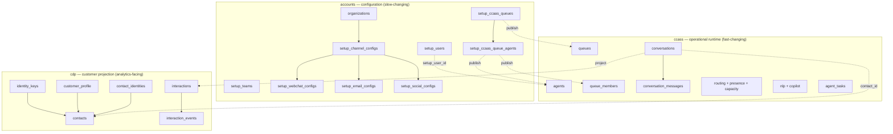
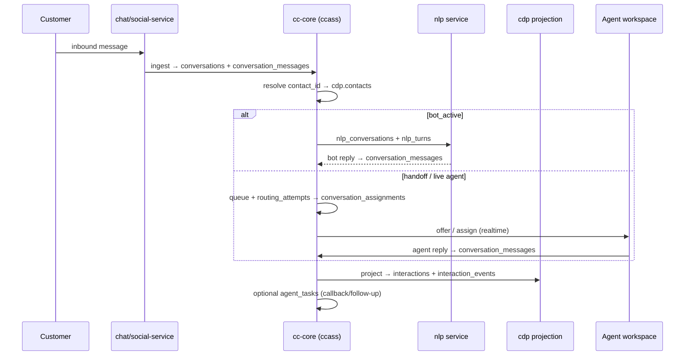
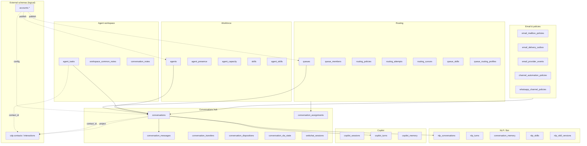

# CCaaS Database Schemas — Understanding Guide

This document explains **how data is organized** across the contact-center database layers, how tables relate at runtime, and how to read the full column reference. At the end is an **umbrella ontology graph** of the `ccass` schema with **column-level foreign-key relationships**.

| Document | Purpose |
|----------|---------|
| **This file** | Conceptual model, cross-schema links, runtime flow, ontology diagram |
| [ccass-schema.md](./ccass-schema.md) | Full `ccass` table + column reference (49 tables, auto-generated) |
| [../architecture/erd.md](../architecture/erd.md) | Original omnichannel ERD notes |

Regenerate the column reference:

```bash
npx tsx packages/db-cc/scripts/generate-ccass-schema-doc.ts
```

---

## 1. Three-layer mental model

Worktual CCaaS uses **one PostgreSQL database** with **separate schemas** by responsibility (see [ADR-007](../adr/ADR-007-shared-db-schemas.md)):



| Schema | Role | Who writes | Who reads |
|--------|------|------------|-----------|
| **accounts** | Tenant setup: orgs, users, channels, queues, business hours | Admin UI, platform-service | cc-core publish jobs, channel services |
| **ccass** | Live conversations, routing, bot/NLP, agent workspace | cc-core, chat-service, social-service, nlp | Agent workspace, supervisor, routing engine |
| **cdp** | Canonical customer + interaction history for CRM/analytics | cc-core projection jobs | Contacts UI, reporting, co-worker |

**Key idea:** `accounts` is the **source of truth for configuration**. `ccass` is the **source of truth for live operations**. `cdp` is a **derived customer view** — never drive routing directly from CDP.

---

## 2. Configuration → runtime publish path

Admin changes in `accounts` are **published** into `ccass` operational snapshots:

```
accounts.setup_ccaas_queues  ──publish──►  ccass.queues
accounts.setup_ccaas_queue_agents  ──publish──►  ccass.agents + ccass.queue_members
accounts.setup_users  ──link──►  ccass.agents.setup_user_id
```

Channel ingest reads **policies** from:

| Layer | Tables | Used for |
|-------|--------|----------|
| Canonical | `ccass.channel_automation_policies` | Bot on/off, confidence, handoff, default queue |
| Legacy email | `ccass.email_mailbox_policies` | Mailbox-specific queue + automation |
| Legacy WhatsApp | `ccass.whatsapp_channel_policies` | WhatsApp default queue |
| Setup | `accounts.setup_*_configs` | Widget IDs, OAuth tokens, personalisation |

---

## 3. `ccass` domain map (49 tables)

Tables grouped by **business domain**. Hub table in **bold**.

### 3.1 Workforce & presence

| Table | Purpose |
|-------|---------|
| **agents** | Published agent identity (`setup_user_id` → platform user) |
| **agent_presence** | Current state: ready, busy, offline, after_contact_work |
| agent_presence_history | Audit trail of presence transitions |
| presence_reason_codes | Org-defined break/training reason codes |
| **agent_capacity** | Per-channel active/reserved counts vs max concurrency |
| skills | Skill catalog |
| agent_skills | Agent ↔ skill with proficiency |
| queue_members | Agent ↔ queue membership + channel concurrency limits |

### 3.2 Routing & queues

| Table | Purpose |
|-------|---------|
| **queues** | Published queue (`setup_queue_id` → accounts) |
| queue_routing_profiles | Intents, keywords, classifier metadata per queue |
| queue_skills | Required/preferred skills per queue |
| **routing_policies** | Strategy, offer timeout, overflow queue, ACW seconds |
| routing_cursors | Round-robin rotation state |
| routing_attempts | Each routing decision with candidate scores |

### 3.3 Conversations (core hub)

| Table | Purpose |
|-------|---------|
| **conversations** | Omnichannel session: status, assignment, contact, thread IDs |
| conversation_messages | Inbound/outbound message bodies |
| conversation_message_attachments | Files linked to messages |
| conversation_participants | Customer/visitor/agent identity refs |
| webchat_sessions | Webchat token, page context, websocket state |
| conversation_assignments | Offer → accept/reject → end lifecycle |
| conversation_transfers | Queue/agent transfer workflow |
| conversation_dispositions | Wrap-up codes applied to a conversation |
| dispositions | Disposition catalog |
| conversation_notes | Agent notes on a conversation |
| conversation_sla_state | First-response + resolution SLA clocks |
| sla_policies | SLA threshold definitions |
| message_receipts | Read/delivered receipts |
| message_delivery_attempts | Provider delivery retry log |

**`conversations` thread columns (critical for omnichannel):**

| Column | Meaning |
|--------|---------|
| `channel` | webchat, email, whatsapp, instagram, facebook, voice |
| `external_thread_id` | Unique session id per org+channel (new session = new id) |
| `provider_thread_id` | Provider-native thread (same customer thread across sessions) |
| `previous_conversation_id` | Links to prior closed conversation in same customer journey |
| `visitor_id` | Channel identity (email address, webchat visitor id, social psid) |
| `contact_id` | Resolved canonical customer (logical → `cdp.contacts`) |
| `channel_config_id` | Logical → `accounts.setup_channel_configs` |
| `status` | Legacy: bot_active, queued, assigned, active, resolved, closed |
| `lifecycle_state` | Normalized: bot, waiting, offered, connected, wrap_up, ended |

### 3.4 NLP & support bot

| Table | Purpose |
|-------|---------|
| **nlp_conversations** | 1:1 NLP runtime session per conversation |
| nlp_turns | Each bot/customer turn: intent, sentiment, facts |
| conversation_memory | Rolling summary + extracted facts |
| nlp_skills → nlp_skill_versions → nlp_skill_tools | Skill registry + MCP tools |
| nlp_skill_bindings | Which skill version applies to which channel/queue |
| nlp_skill_activation_history | Audit of skill activations |

### 3.5 Agent copilot

| Table | Purpose |
|-------|---------|
| **copilot_sessions** | Agent-side copilot chat session |
| copilot_turns | Prompt/response turns (may link to `conversation_id`, `sent_message_id`) |
| copilot_memory | Durable copilot memory |
| copilot_skill_executions | Tool/skill invocation log |

### 3.6 Email delivery

| Table | Purpose |
|-------|---------|
| email_mailbox_policies | Mailbox automation + default queue |
| email_provider_events | Inbound Gmail/pubsub event idempotency |
| email_delivery_outbox | Reliable outbound send queue |

### 3.7 Channel policies

| Table | Purpose |
|-------|---------|
| channel_automation_policies | Cross-channel bot/handoff/queue policy |
| whatsapp_channel_policies | WhatsApp-specific overrides |

### 3.8 Agent workspace

| Table | Purpose |
|-------|---------|
| **agent_tasks** | Callbacks, follow-ups, co-worker suggestions |
| workspace_common_notes | Shared agent notes (not per-conversation) |

### 3.9 Platform

| Table | Purpose |
|-------|---------|
| audit_log | Sensitive action audit trail |
| schema_migrations | Applied SQL migration ledger |

---

## 4. `cdp` — customer projection (CCaaS-relevant subset)

CDP has 59 tables (analytics, campaigns, partitioned events). CCaaS engineers most often touch:

| Table | Purpose | Link to ccass |
|-------|---------|---------------|
| **contacts** | Canonical customer record | `conversations.contact_id` |
| **contact_identities** | Channel identity → contact mapping | Resolved from `visitor_id` / email / phone on ingest |
| **customer_profile** | Enriched profile (name, attributes) | Joined via contact |
| **identity_keys** | Typed identity keys (email, phone, whatsapp) | Used by contacts UI |
| **interactions** | One row per conversation projection | `interactions.conversation_id` = `conversations.id` |
| **interaction_events** | Timeline events (message, handoff, resolve) | `interaction_id` → interactions |

No cross-schema FK constraints — links are **logical UUID references** enforced in application code.

---

## 5. Cross-schema column relationships

Logical joins used throughout cc-core and the agent UI:

| From | Column | To | Notes |
|------|--------|-----|-------|
| `ccass.conversations` | `organization_id` | `accounts.organizations.id` | Tenant scope on every row |
| `ccass.conversations` | `channel_config_id` | `accounts.setup_channel_configs.id` | Channel credentials + widget config |
| `ccass.conversations` | `contact_id` | `cdp.contacts.id` | Set after identity resolution |
| `ccass.conversations` | `assigned_user_id` | `accounts.setup_users.id` | Platform user for assigned agent |
| `ccass.agents` | `setup_user_id` | `accounts.setup_users.id` | Agent ↔ login user |
| `ccass.queues` | `setup_queue_id` | `accounts.setup_ccaas_queues.id` | Publish lineage |
| `ccass.queue_members` | `setup_user_id` | `accounts.setup_users.id` | Membership lineage |
| `cdp.interactions` | `conversation_id` | `ccass.conversations.id` | Projection from conversation lifecycle |
| `cdp.contact_identities` | `identity_value` | `ccass.conversations.visitor_id` | Match key (type-dependent) |
| `ccass.agent_tasks` | `contact_id` | `cdp.contacts.id` | Task → customer |
| `ccass.agent_tasks` | `conversation_id` | `ccass.conversations.id` | Task source conversation |

---

## 6. Runtime data flow

How a customer message moves through schemas:



**Session continuity rules:**

- **Webchat / email (resolved):** new customer message after close → new `conversations` row, `previous_conversation_id` → old row, same `visitor_id` / sender.
- **WhatsApp / Instagram / Facebook:** match open row by `provider_thread_id`; else create new session with same provider thread.
- **Agent opens task workspace:** new or existing open conversation for same `contact_id` + `channel`.

---

## 7. Umbrella ontology — domain graph

High-level **umbrella view** of how `ccass` domains connect (arrows = primary dependency direction):



---

## 8. Full `ccass` ontology — column FK graph

Complete **foreign-key graph** inside `ccass`. Edge labels are the **FK column name** on the child table.

```mermaid
erDiagram
  agents ||--o{ agent_capacity : "agent_id"
  agents ||--o{ agent_presence : "agent_id"
  agents ||--o{ agent_presence_history : "agent_id"
  agents ||--o{ agent_skills : "agent_id"
  agents ||--o{ conversation_assignments : "agent_id"
  agents ||--o{ conversation_dispositions : "agent_id"
  agents ||--o{ conversation_transfers : "from_agent_id"
  agents ||--o{ conversation_transfers : "offered_agent_id"
  agents ||--o{ conversation_transfers : "requested_agent_id"
  agents ||--o{ conversations : "assigned_agent_id"
  agents ||--o{ queue_members : "agent_id"
  agents ||--o{ routing_attempts : "agent_id"
  agents ||--o{ routing_cursors : "last_agent_id"
  conversation_messages ||--o{ conversation_memory : "latest_summarized_message_id"
  conversation_messages ||--o{ conversation_message_attachments : "message_id"
  conversation_messages ||--o{ conversation_messages : "reply_to_message_id"
  conversation_messages ||--o{ copilot_turns : "sent_message_id"
  conversation_messages ||--o{ email_delivery_outbox : "message_id"
  conversation_messages ||--o{ email_delivery_outbox : "source_message_id"
  conversation_messages ||--o{ message_delivery_attempts : "message_id"
  conversation_messages ||--o{ message_receipts : "message_id"
  conversation_messages ||--o{ nlp_turns : "bot_message_id"
  conversation_messages ||--o{ nlp_turns : "customer_message_id"
  conversations ||--o{ conversation_assignments : "conversation_id"
  conversations ||--o{ conversation_dispositions : "conversation_id"
  conversations ||--o{ conversation_memory : "conversation_id"
  conversations ||--o{ conversation_message_attachments : "conversation_id"
  conversations ||--o{ conversation_messages : "conversation_id"
  conversations ||--o{ conversation_notes : "conversation_id"
  conversations ||--o{ conversation_participants : "conversation_id"
  conversations ||--o{ conversation_sla_state : "conversation_id"
  conversations ||--o{ conversation_transfers : "conversation_id"
  conversations ||--o{ conversations : "previous_conversation_id"
  conversations ||--o{ copilot_memory : "conversation_id"
  conversations ||--o{ copilot_turns : "conversation_id"
  conversations ||--o{ email_delivery_outbox : "conversation_id"
  conversations ||--o{ message_receipts : "conversation_id"
  conversations ||--o{ nlp_conversations : "conversation_id"
  conversations ||--o{ nlp_turns : "conversation_id"
  conversations ||--o{ webchat_sessions : "conversation_id"
  copilot_sessions ||--o{ copilot_skill_executions : "session_id"
  copilot_sessions ||--o{ copilot_turns : "session_id"
  copilot_turns ||--o{ copilot_skill_executions : "turn_id"
  dispositions ||--o{ conversation_dispositions : "disposition_id"
  nlp_conversations ||--o{ nlp_turns : "nlp_conversation_id"
  nlp_skill_versions ||--o{ nlp_conversations : "skill_version_id"
  nlp_skill_versions ||--o{ nlp_skill_activation_history : "skill_version_id"
  nlp_skill_versions ||--o{ nlp_skill_bindings : "skill_version_id"
  nlp_skill_versions ||--o{ nlp_skill_tools : "skill_version_id"
  nlp_skills ||--o{ nlp_skill_activation_history : "skill_id"
  nlp_skills ||--o{ nlp_skill_versions : "skill_id"
  queues ||--o{ conversation_assignments : "queue_id"
  queues ||--o{ conversation_transfers : "from_queue_id"
  queues ||--o{ conversation_transfers : "to_queue_id"
  queues ||--o{ conversations : "queue_id"
  queues ||--o{ email_mailbox_policies : "default_queue_id"
  queues ||--o{ queue_members : "queue_id"
  queues ||--o{ queue_routing_profiles : "queue_id"
  queues ||--o{ queue_skills : "queue_id"
  queues ||--o{ routing_attempts : "queue_id"
  queues ||--o{ routing_cursors : "queue_id"
  queues ||--o{ routing_policies : "overflow_queue_id"
  queues ||--o{ routing_policies : "queue_id"
  queues ||--o{ whatsapp_channel_policies : "default_queue_id"
  routing_attempts ||--o{ conversation_assignments : "routing_attempt_id"
  routing_attempts ||--o{ conversation_transfers : "routing_attempt_id"
  skills ||--o{ agent_skills : "skill_id"
  skills ||--o{ queue_skills : "skill_id"
  sla_policies ||--o{ conversation_sla_state : "sla_policy_id"

  conversations {
    uuid id PK
    uuid organization_id
    varchar channel
    varchar external_thread_id UK
    varchar provider_thread_id
    uuid previous_conversation_id FK
    varchar visitor_id
    uuid contact_id
    uuid channel_config_id
    uuid queue_id FK
    uuid assigned_agent_id FK
    uuid assigned_user_id
    varchar status
    varchar lifecycle_state
    boolean bot_active
  }

  conversation_messages {
    uuid id PK
    uuid conversation_id FK
    uuid reply_to_message_id FK
    varchar sender_type
    varchar direction
    text body
    varchar delivery_state
  }

  agents {
    uuid id PK
    uuid organization_id
    uuid setup_user_id
  }

  queues {
    uuid id PK
    uuid organization_id
    uuid setup_queue_id UK
    varchar name
  }

  nlp_conversations {
    uuid id PK
    uuid conversation_id FK UK
    uuid skill_version_id FK
    varchar runtime_type
  }

  agent_tasks {
    uuid id PK
    uuid organization_id
    uuid assigned_user_id
    uuid conversation_id
    uuid contact_id
    varchar task_type
    varchar channel
  }
```

### 8.1 Hub tables (start here when exploring)

| Hub | Fan-out tables | Why it matters |
|-----|----------------|----------------|
| **conversations** | messages, assignments, transfers, nlp, copilot, sla, webchat_sessions | Every customer interaction |
| **agents** | presence, capacity, assignments, queue_members | Who handles work |
| **queues** | members, policies, routing, conversations | Where work waits |
| **conversation_messages** | receipts, attachments, nlp_turns, outbox | What was said |
| **nlp_conversations** | nlp_turns, skill activations | Bot brain state |

### 8.2 Tables without inbound FKs (roots or leaf config)

These are **roots** (nothing in ccass points to them via FK) or **standalone config**:

`presence_reason_codes`, `sla_policies`, `dispositions`, `skills`, `nlp_skills`, `channel_automation_policies`, `email_provider_events`, `workspace_common_notes`, `audit_log`, `schema_migrations`, `agents` (root for workforce), `queues` (root for routing)

---

## 9. Quick lookup — “where is X stored?”

| Question | Table(s) |
|----------|----------|
| Who is the customer? | `cdp.contacts`, `cdp.contact_identities`, `conversations.visitor_id` |
| Is the bot or agent talking? | `conversations.bot_active`, `conversations.status` |
| Which queue? | `conversations.queue_id` → `queues` |
| Which agent owns it? | `conversations.assigned_agent_id`, `conversation_assignments` |
| Message history? | `conversation_messages` (+ attachments, receipts) |
| Why was it handed off? | `conversations.handoff_reason`, `nlp_turns` |
| Wrap-up code? | `conversation_dispositions` → `dispositions` |
| Agent callback task? | `agent_tasks` |
| Bot memory / summary? | `conversation_memory`, `nlp_turns` |
| SLA breach? | `conversation_sla_state` |
| Email send retry? | `email_delivery_outbox` |

---

## 10. Related docs

- [ccass-schema.md](./ccass-schema.md) — exhaustive column listing
- [../architecture/lifecycle-contract.md](../architecture/lifecycle-contract.md) — conversation status transitions
- [../architecture/flow-diagrams.md](../architecture/flow-diagrams.md) — service-level flows
- [../golden-path/webchat-to-agent.md](../golden-path/webchat-to-agent.md) — end-to-end webchat path
