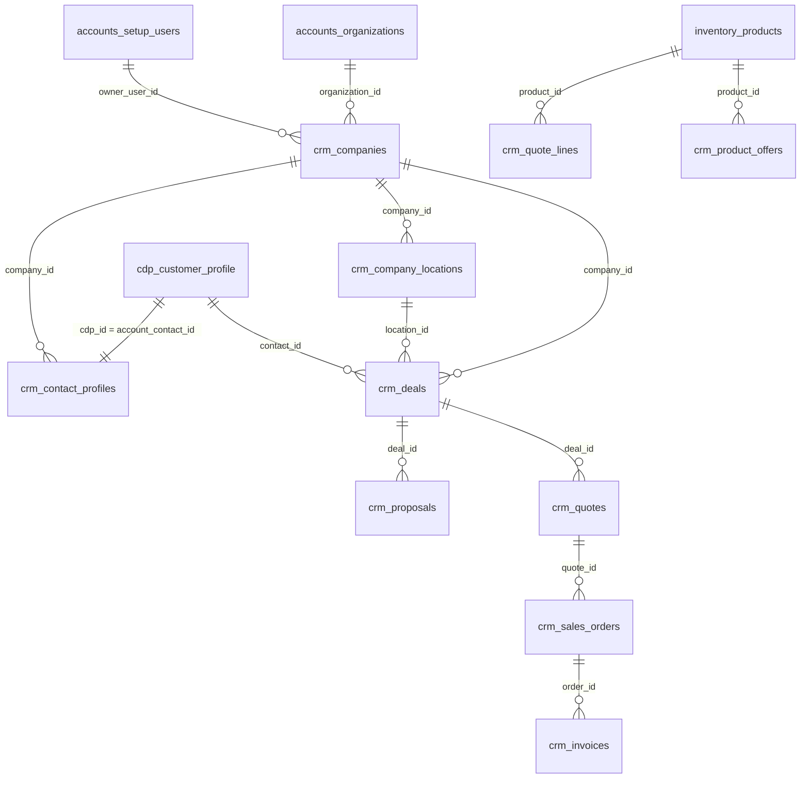

# CRM tables reference (active schema)

Complete guide to **every table the CRM application uses today**: what each table is for, what each important column means, and how rows connect to other tables — including **`accounts`**, **`cdp`**, and **`inventory`**.

> **Database:** shared Worktual Postgres (`worktual_bigint`)  
> **Last updated:** after cleanup migration `20260820180000_drop_unused_crm_tables`  
> **Scope:** 46 `crm.*` tables + `inventory.products` (47 total). Dropped legacy/orphan tables are **not** documented here.

Related docs: [`bigint-ids.md`](./bigint-ids.md) · [`cdp-customer-identity.md`](./cdp-customer-identity.md) · [`multi-tenancy-common-model.md`](./multi-tenancy-common-model.md)

---

## Table of contents

1. [How schemas connect](#how-schemas-connect)
2. [ID and FK conventions](#id-and-fk-conventions)
3. [Entity relationship overview](#entity-relationship-overview)
4. [External schemas (read-only for CRM)](#external-schemas-read-only-for-crm)
5. [Core CRM — companies & locations](#core-crm--companies--locations)
6. [Core CRM — contacts](#core-crm--contacts)
7. [Sales pipeline](#sales-pipeline)
8. [Activities, inbox & integrations](#activities-inbox--integrations)
9. [Lead assignment settings](#lead-assignment-settings)
10. [Product catalog & pricing](#product-catalog--pricing)
11. [Proposals](#proposals)
12. [Quotes](#quotes)
13. [Orders (commerce)](#orders-commerce)
14. [Invoices (finance)](#invoices-finance)
15. [Contracts & renewals](#contracts--renewals)
16. [Audit & reporting cache](#audit--reporting-cache)
17. [Agent enrichment & scoring data](#agent-enrichment--scoring-data)
18. [Agent job queues](#agent-job-queues)
19. [Meeting assist & analysis](#meeting-assist--analysis)
20. [Compliance & human approval gates](#compliance--human-approval-gates)
21. [Platform — notifications, memory, API keys](#platform--notifications-memory-api-keys)

---

## How schemas connect

The CRM app reads and writes across four PostgreSQL schemas. CRM **owns DDL only in `crm.*`**; the others are shared platform schemas (SELECT + limited DML on existing columns only).

```text
accounts.organizations ──organization_id──► almost every crm.* row
accounts.setup_users   ──*_user_id───────► owner, actor, assignee, approver columns

cdp.customer_profile   ◄──account_contact_id / contact_id── crm.contact_profiles
cdp.identity_keys      ◄── (same cdp_id) ── emails, phones for a person

inventory.products     ◄──product_id── crm quote/order/invoice lines, offers, addons
```

**Tenancy:** every business row is scoped by `organization_id` (= `accounts.organizations.id`, type `bigint`).

**People:** CRM never stores the person's name/email as the system of record. Those live in `cdp.customer_profile` + `cdp.identity_keys`. CRM stores sales overlays in `crm.contact_profiles` keyed by `account_contact_id` = `cdp_id`.

**Users:** columns like `owner_user_id`, `created_by_user_id`, `actor_user_id` store `accounts.setup_users.id` (`bigint`). There is **no FK constraint** across schemas — the app enforces validity.

---

## ID and FK conventions

| Column pattern | PostgreSQL type | Points to |
|----------------|-----------------|-----------|
| `organization_id` | `bigint` | `accounts.organizations.id` |
| `*_user_id`, `owner_user_id`, `actor_user_id`, … | `bigint` | `accounts.setup_users.id` |
| `account_contact_id`, `contact_id` (on activities/jobs) | `text` | `cdp.customer_profile.cdp_id` |
| `companies.id`, `deals.id`, `quotes.id`, … | `text` (cuid) | Another `crm.*` row |
| `company_id`, `deal_id`, `location_id`, … | `text` | Parent CRM entity |
| `product_id` | `text` | `inventory.products.id` |

Prisma maps `organization_id` and user IDs as `BigInt`. In raw SQL use `$1::bigint`.

---

## Entity relationship overview

High-level revenue and identity flow:



---

## External schemas (read-only for CRM)

CRM must **not** run migrations against these schemas. Use existing columns only.

### `accounts.organizations`

| Column (used by CRM) | Purpose |
|----------------------|---------|
| `id` | Tenant key → `crm.*.organization_id` |
| `business_type` | `b2b` / `b2c` / `b2b2c` — gates modules (`backend/src/config/modules.ts`) |
| `industry_type` | Signup industry text → mapped to CRM field packs (not stored as FK) |
| `company_name` | Seller letterhead on proposals/quotes/invoices |

### `accounts.setup_users`

| Column (used by CRM) | Purpose |
|----------------------|---------|
| `id` | User key → all `*_user_id` columns in CRM |
| `organization_id` | User's tenant |
| `email`, `name`, role fields | Resolved at runtime for inbox, assignment, notifications |

Access: `backend/src/service/account/setup-users.ts`, auth session.

### `cdp.customer_profile`

| Column (used by CRM) | Purpose |
|----------------------|---------|
| `cdp_id` (PK, text) | Person key — same value as `crm.contact_profiles.account_contact_id` |
| `organization_id` | Tenant |
| `first_name`, `last_name`, … | Person profile (CRM reads; writes via contact DAO) |
| `custom_fields` (jsonb) | `title`, `industry`, `address_line`, … |

Insert trigger on CDP can create thin `crm.contact_profiles` + `lead_enrichment_jobs` rows.

### `cdp.identity_keys`

| Column | Purpose |
|--------|---------|
| `cdp_id` | FK → `customer_profile.cdp_id` |
| `key_type` | `email`, `phone`, `email_secondary`, … |
| `key_value` | Normalized email/phone |
| `organization_id` | Tenant |

### `inventory.products`

Shared product catalog for B2B, B2C, and B2B2C. See [Product catalog](#product-catalog--pricing) below.

---

## Core CRM — companies & locations

### `crm.companies`

**Purpose:** B2B accounts / franchise entities within a tenant. Required for B2B deals; optional for B2B2C contacts.

| Column | Links to | Description |
|--------|----------|-------------|
| `id` | PK (cuid) | Referenced by deals, contacts, orders, invoices, contracts |
| `organization_id` | `accounts.organizations.id` | Tenant |
| `name`, `domain`, `industry`, `employee_count` | — | Firmographics |
| `linkedin_url`, `logo_url` | — | Enrichment / UI |
| `owner_user_id` | `accounts.setup_users.id` | CRM owner (sales rep) |
| `channel_role` | enum | `standard`, `franchise`, `owned_store`, `brand_hq` (B2B2C hierarchy) |
| `parent_company_id` | `crm.companies.id` | Optional franchise tree |
| `expansion_*` | — | Expansion agent overlay (signal, draft — human sends) |

**Child tables:** `company_locations`, `deals`, `contact_profiles`, `sales_orders`, `invoices`, `contracts`.

---

### `crm.company_locations`

**Purpose:** Sites/branches under a company. Every B2B deal requires a location.

| Column | Links to | Description |
|--------|----------|-------------|
| `id` | PK | |
| `organization_id` | `accounts.organizations.id` | Tenant |
| `company_id` | `crm.companies.id` | Parent company (CASCADE delete) |
| `name`, `type` | enum `hq` / `branch` | Location label |
| `address`, `city`, `industry`, `employee_count` | — | Site details |
| `owner_user_id` | `accounts.setup_users.id` | Location owner |

**Referenced by:** `deals.location_id`, `contact_profiles.location_id`.

---

## Core CRM — contacts

### `crm.contact_profiles`

**Purpose:** CRM overlay on a CDP person — lifecycle, ownership, BANT, nurture/lifecycle agent state. **Not** the person identity store.

| Column | Links to | Description |
|--------|----------|-------------|
| `id` | PK (cuid) | Internal CRM row id |
| `account_contact_id` | **`cdp.customer_profile.cdp_id`** (unique) | Person key across CRM |
| `organization_id` | `accounts.organizations.id` | Tenant |
| `company_id` | `crm.companies.id` | Linked account (required B2B) |
| `location_id` | `crm.company_locations.id` | Optional site |
| `owner_user_id` | `accounts.setup_users.id` | Assigned sales owner |
| `created_by_user_id` | `accounts.setup_users.id` | Who created overlay |
| `lifecycle_stage`, `lead_status`, `lead_source` | — | Pipeline labels |
| `bant_*` | — | Qualification booleans |
| `nurture_*`, `lifecycle_*`, `flagged_for_review` | — | Agent overlays |
| `marketing_opt_out` | — | Compliance — blocks nurture sends |
| `custom_attributes` | jsonb | Industry pack fields (from `industry_type` pack) |
| `converted_deal_id` | `crm.deals.id` | Set when lead converts |
| `crm_status` | — | `active` / archived |

**Note:** `contact_id` on activities and jobs = **`cdp_id` text**, not `contact_profiles.id`.

---

### `crm.organization_profiles`

**Purpose:** Optional CRM-side vertical pack config. **Industry source of truth is `accounts.organizations.industry_type`**, not this table.

| Column | Links to | Description |
|--------|----------|-------------|
| `organization_id` | PK = `accounts.organizations.id` | One row per tenant |
| `vertical` | enum | `general`, `ecommerce`, `healthcare`, `finance`, `telecom` |
| `vertical_config` | jsonb | Pack overrides |

---

## Sales pipeline

### `crm.deals`

**Purpose:** B2B opportunity record. Stages: qualification → discover → propose → negotiate → closed_won / closed_lost.

| Column | Links to | Description |
|--------|----------|-------------|
| `id` | PK | |
| `organization_id` | `accounts.organizations.id` | Tenant |
| `company_id` | `crm.companies.id` | Required account |
| `location_id` | `crm.company_locations.id` | Required site |
| `contact_id` | **`cdp.customer_profile.cdp_id`** | Primary contact (optional) |
| `contact_name`, `contact_email` | — | Denormalized for board/list UI |
| `owner_user_id` | `accounts.setup_users.id` | Deal owner |
| `stage`, `amount`, `expected_close_date`, `closed_at` | — | Pipeline fields |
| `forecast_*` | — | Forecast auditor agent overlay |

**Children:** `deal_activities`, `proposals`, `quotes`, `sales_orders`, `invoices`.

---

### `crm.deal_activities`

**Purpose:** Tasks/calls/meetings logged on a deal (not the contact timeline).

| Column | Links to | Description |
|--------|----------|-------------|
| `deal_id` | `crm.deals.id` | Parent deal (CASCADE) |
| `organization_id` | `accounts.organizations.id` | Tenant |
| `type` | enum | call, meeting, email, note, task, … |
| `created_by_user_id` | `accounts.setup_users.id` | |

---

## Activities, inbox & integrations

### `crm.contact_activities`

**Purpose:** Unified contact timeline — emails, meetings, tasks, notes. Powers Inbox and activity feed.

| Column | Links to | Description |
|--------|----------|-------------|
| `contact_id` | **`cdp.customer_profile.cdp_id`** | Person (not `contact_profiles.id`) |
| `organization_id` | `accounts.organizations.id` | Tenant |
| `type`, `subject`, `body` | — | Activity content |
| `folder` | enum | inbox / sent / draft / trash |
| `thread_id`, `provider_thread_id` | — | Conversation grouping |
| `gmail_message_id`, `provider_message_id` | — | Dedupe on sync |
| `mail_provider` | enum | google / microsoft |
| `email_direction` | enum | inbound / outbound |
| `assignee_user_id` | `accounts.setup_users.id` | Task assignee |
| `task_status` | enum | open / in_progress / completed |
| `transcript_*`, `transcript_insights` | — | Meeting transcript + AI signals |
| `needs_manual_response` | — | Auto-reply escalated to human |

**Linked by agents:** `meeting_analyses.activity_id`, `coaching_insights.activity_id`, `privacy_requests.activity_id`, `email_auto_reply_jobs.inbound_activity_id`, `meeting_assist_sessions.activity_id`.

---

### `crm.user_integration_connections`

**Purpose:** Per-user OAuth tokens for Gmail/Calendar (and other providers). Powers inbox sync and outbound mail.

| Column | Links to | Description |
|--------|----------|-------------|
| `user_id` | **`accounts.setup_users.id`** | Mailbox owner |
| `organization_id` | `accounts.organizations.id` | Tenant |
| `provider` | enum | google, microsoft, zoom, yahoo |
| `account_email` | — | Connected mailbox address |
| `access_token`, `refresh_token` | — | Secrets (CRM-owned) |

Unique: `(user_id, provider)`.

---

## Lead assignment settings

### `crm.org_assignment_settings`

**Purpose:** Org-wide rules for lead routing and ICP fit scoring.

| Column | Links to | Description |
|--------|----------|-------------|
| `organization_id` | unique → `accounts.organizations.id` | One row per tenant |
| `senior_amount_threshold` | — | Deal size → seniority routing |
| `lead_icp` | jsonb | Target industries, geos, size tiers |
| `updated_by_user_id` | `accounts.setup_users.id` | |

---

### `crm.sales_user_assignment_profiles`

**Purpose:** Per-rep capacity overlay for assignment agent.

| Column | Links to | Description |
|--------|----------|-------------|
| `organization_id` | `accounts.organizations.id` | Tenant |
| `user_id` | **`accounts.setup_users.id`** | Sales rep |
| `accepting_leads`, `max_open_deals` | — | Capacity |
| `seniority_tier` | enum | junior / mid / senior |
| `on_pto_until`, `country` | — | Routing filters |

Unique: `(organization_id, user_id)`.

---

## Product catalog & pricing

### `inventory.products`

**Purpose:** Shared product catalog (all business types). CRM does DML only — **no DDL** on inventory.

| Column | Links to | Description |
|--------|----------|-------------|
| `id` | PK (cuid) | Referenced by lines, offers, addons |
| `organization_id` | `accounts.organizations.id` | Tenant |
| `name`, `sku`, `description`, `category`, `brand` | — | Catalog fields |
| `price`, `currency`, `status`, `product_type` | — | Merchandising |
| `billing_type`, `billing_frequency`, `unit_of_measure` | — | Subscription / seat pricing |
| `stock_on_hand`, `max_discount_percent` | — | Inventory & finance gates |

**CRM overlay tables (in `crm` schema):**

| Table | Purpose | Key FKs |
|-------|---------|---------|
| `product_offers` | Named plans/packs under a product | `product_id` → `inventory.products.id` |
| `product_addons` | Optional add-ons (tiered/stepped pricing) | `product_id` → `inventory.products.id` |
| `product_addon_tiers` | Quantity bands for tiered addons | `addon_id` → `product_addons.id` |
| `price_books` | Org rate cards (currency/region) | `organization_id` |
| `price_book_entries` | List price for product/offer/addon in a book | `price_book_id`, optional `product_id` / `offer_id` / `addon_id` |

---

## Proposals

### `crm.proposal_templates`

Tenant-owned HTML/section skeletons. `organization_id` → `accounts.organizations.id`.

### `crm.proposals`

Customer-facing proposal on a deal.

| Column | Links to | Description |
|--------|----------|-------------|
| `deal_id` | `crm.deals.id` | Parent deal |
| `template_id` | `crm.proposal_templates.id` | Source template |
| `organization_id` | `accounts.organizations.id` | Tenant |
| `approved_by_user_id` | `accounts.setup_users.id` | Human approval before send |
| `created_by_user_id` | `accounts.setup_users.id` | |
| `sections`, `blueprint`, `assets` | jsonb | Document body |
| `status` | enum | draft / shared / accepted / declined |

**Downstream:** quotes may link via `quotes.proposal_id`.

---

## Quotes

### `crm.quote_templates`

Same pattern as proposal templates — org-owned document skeletons.

### `crm.quotes`

Formal quotation on a deal; may originate from a proposal.

| Column | Links to | Description |
|--------|----------|-------------|
| `deal_id` | `crm.deals.id` | Required |
| `proposal_id` | `crm.proposals.id` | Optional lineage |
| `template_id` | `crm.quote_templates.id` | Document template |
| `approved_by_user_id` | `accounts.setup_users.id` | Finance approval gate |
| `subtotal`, `discount_pct`, `total`, `currency` | — | Pricing |
| `status` | enum | draft → sent → accepted / rejected |

### `crm.quote_lines`

| Column | Links to | Description |
|--------|----------|-------------|
| `quote_id` | `crm.quotes.id` | Parent quote |
| `product_id` | `inventory.products.id` | Optional catalog link |
| `name`, `quantity`, `unit_price`, `amount` | — | Line math |

**Accept flow:** accepted quote → `sales_orders` + optionally `invoices`.

---

## Orders (commerce)

### `crm.sales_orders`

**Purpose:** Confirmed order — from accepted quote (B2B) or direct commerce (B2C: `deal_id` null, `contact_id` set).

| Column | Links to | Description |
|--------|----------|-------------|
| `deal_id` | `crm.deals.id` | Optional (B2B path) |
| `quote_id` | `crm.quotes.id` | Optional source |
| `company_id` | `crm.companies.id` | B2B account |
| `contact_id` | **`cdp.customer_profile.cdp_id`** | B2C / B2B2C buyer |
| `created_by_user_id` | `accounts.setup_users.id` | |

### `crm.order_lines`

Same shape as quote lines: `order_id` → `sales_orders.id`, optional `product_id` → `inventory.products.id`.

---

## Invoices (finance)

### `crm.invoice_templates`

Org-owned invoice document skeletons.

### `crm.invoices`

| Column | Links to | Description |
|--------|----------|-------------|
| `order_id` | `crm.sales_orders.id` | From commerce accept |
| `deal_id` | `crm.deals.id` | Finance-created from deal |
| `company_id` | `crm.companies.id` | Bill-to account |
| `template_id` | `crm.invoice_templates.id` | |
| `approved_by_user_id` | `accounts.setup_users.id` | Send gate |
| `tax_details`, `tax_amount`, `due_at`, `paid_at` | — | Billing lifecycle |
| `escalation_*` | — | Collections agent overlay (human sends) |

### `crm.invoice_lines`

| Column | Links to | Description |
|--------|----------|-------------|
| `invoice_id` | `crm.invoices.id` | Parent |
| `product_id` | `inventory.products.id` | Product line |
| `addon_id` | `crm.product_addons.id` | Addon line |
| `kind` | enum | product / addon |

---

## Contracts & renewals

### `crm.contracts`

**Purpose:** Subscription/ARR record created on closed-won; drives renewal reminders.

| Column | Links to | Description |
|--------|----------|-------------|
| `company_id` | `crm.companies.id` | Account |
| `deal_id` | `crm.deals.id` | Originating deal (optional) |
| `organization_id` | `accounts.organizations.id` | Tenant |
| `starts_at`, `ends_at`, `arr` | — | Contract term |
| `renew_deal_id` | `crm.deals.id` | Linked renewal opportunity |

Service tickets for support live in the **external Service microservice**, not in CRM tables.

---

## Audit & reporting cache

### `crm.audit_logs`

Immutable change log.

| Column | Links to | Description |
|--------|----------|-------------|
| `actor_user_id` | `accounts.setup_users.id` | Who acted |
| `organization_id` | `accounts.organizations.id` | Tenant |
| `entity_type`, `entity_id` | — | Polymorphic ref to CRM row |
| `action` | enum | create, update, merge, quote_sent, … |

### `crm.report_snapshots`

Cached JSON rollups for dashboard (avoids heavy live OLTP scans). Keyed by `organization_id` + `kind`.

---

## Agent enrichment & scoring data

These tables store **agent output and caches**, not primary CRM entities.

| Table | Purpose | Person key |
|-------|---------|------------|
| `domain_enrichment_cache` | 30-day TTL firmographics by email domain | — |
| `lead_enrichment_snapshots` | Enrichment agent result per contact | `contact_id` → **`cdp_id`** |
| `lead_enrichment_jobs` | Queue: firmographic enrich on new CDP insert | `contact_id` → **`cdp_id`** |
| `lead_summaries` | AI narrative summary per lead | `contact_id` → **`cdp_id`** |

All include `organization_id` → `accounts.organizations.id`.

---

## Agent job queues

One row per contact (or per inbound email) for proactive agents. Status enums drive cron/worker processing.

| Table | Agent | Unique key | Notable links |
|-------|-------|------------|---------------|
| `lead_scoring_jobs` | Score lead | `(organization_id, contact_id)` | `contact_id` → **`cdp_id`** |
| `lead_nurture_jobs` | Nurture | `(organization_id, contact_id)` | `contact_id` → **`cdp_id`** |
| `lead_lifecycle_jobs` | Lifecycle | `(organization_id, contact_id)` | `contact_id` → **`cdp_id`**; optional `deal_id` |
| `email_auto_reply_jobs` | Auto-reply | `inbound_activity_id` | `contact_id` → **`cdp_id`**; `inbound_activity_id` → `contact_activities.id`; `mailbox_user_id` → **`setup_users.id`** |
| `agent_step_events` | All proactive agents | `(job_id, step)` | Trace UI; optional `contact_id` |

Common columns: `status`, `attempts`, `next_retry_at`, `last_error`, `result_summary`, `organization_id`.

---

## Meeting assist & analysis

| Table | Purpose | Key links |
|-------|---------|-----------|
| `meeting_assist_sessions` | Live bot session per meeting activity | `activity_id` → `contact_activities.id`; `contact_id` → **`cdp_id`**; `host_user_id` → **`setup_users.id`** |
| `meeting_transcript_chunks` | Streaming transcript segments | `session_id` → `meeting_assist_sessions.id` |
| `meeting_analyses` | Structured BANT/outcome for lifecycle agent | `activity_id` → `contact_activities.id` |
| `coaching_insights` | Private rep coaching (not manager-visible raw text) | `activity_id` → `contact_activities.id`; `rep_user_id` → **`setup_users.id`** |

On session end, transcript rolls up to `contact_activities.transcript_text`.

---

## Compliance & human approval gates

### `crm.privacy_requests`

GDPR-style deletion/access requests — **human must execute**.

| Column | Links to | Description |
|--------|----------|-------------|
| `activity_id` | `crm.contact_activities.id` | Triggering inbound email |
| `contact_id` | **`cdp.customer_profile.cdp_id`** | Subject |
| `reviewed_by_user_id` | `accounts.setup_users.id` | Admin reviewer |

Marketing opt-out applies immediately on `contact_profiles.marketing_opt_out` (no row here).

### `crm.process_confirmations`

Owner approval before post-meeting agent sends email/proposal/close actions.

| Column | Links to | Description |
|--------|----------|-------------|
| `owner_user_id` | `accounts.setup_users.id` | Approver |
| `decided_by_user_id` | `accounts.setup_users.id` | Who approved/rejected |
| `contact_id` | **`cdp_id`** | |
| `activity_id` | `contact_activities.id` | Optional |
| `deal_id` | `crm.deals.id` | Optional |
| `action_kind` | — | email_proposal, close_won, quote_send, … |

---

## Platform — notifications, memory, API keys

### `crm.notifications`

In-app bell notifications.

| Column | Links to | Description |
|--------|----------|-------------|
| `recipient_user_id` | **`accounts.setup_users.id`** | Who sees it |
| `actor_user_id` | `accounts.setup_users.id` | Who triggered |
| `organization_id` | `accounts.organizations.id` | Tenant |
| `contact_id` | **`cdp_id`** | Optional deep link context |
| `entity_type`, `entity_id` | — | Polymorphic link |

### `crm.agent_memories`

Durable structured slots for coworker/agent context (not Redis, not CDP).

| Column | Description |
|--------|-------------|
| `scope_type` | `org` \| `user` \| `contact` \| `deal` |
| `scope_id` | Empty for org-wide; else user id / **cdp_id** / deal id |
| `slot_key`, `slot_value` | JSON memory slot |

Written by ai-service MCP dispatch; read by coworker hydration.

### `crm.api_keys`

Tenant integration API keys (hash only stored).

| Column | Links to | Description |
|--------|----------|-------------|
| `organization_id` | `accounts.organizations.id` | Tenant |
| `created_by_user_id` | `accounts.setup_users.id` | Admin creator |
| `scopes` | text[] | contacts, deals, quotes, … |
| `key_prefix`, `key_hash` | — | Public hint + secret hash |

---

## Revenue path by business type

| Motion | Path | Key tables |
|--------|------|------------|
| **B2B** | Contact → Deal → Proposal → Quote → Order → Invoice | `contact_profiles` → `deals` → `proposals` → `quotes` → `sales_orders` → `invoices` |
| **B2C** | Contact → Order (no deal, no finance module) | `contact_profiles` → `sales_orders` (`deal_id` null) |
| **B2B2C** | Both paths; company optional on contact | Same tables; `business_type` gates UI/modules |

---

## Quick lookup: “this column points where?”

| If you see… | It means… |
|-------------|-----------|
| `organization_id` | Tenant → `accounts.organizations.id` |
| `owner_user_id`, `created_by_user_id`, `actor_user_id`, `assignee_user_id`, `approved_by_user_id`, `recipient_user_id`, `mailbox_user_id`, `host_user_id`, `rep_user_id` | User → `accounts.setup_users.id` |
| `account_contact_id` or `contact_id` (on activities/jobs) | Person → `cdp.customer_profile.cdp_id` |
| `company_id` | `crm.companies.id` |
| `location_id` | `crm.company_locations.id` |
| `deal_id` | `crm.deals.id` |
| `product_id` | `inventory.products.id` |
| `quote_id`, `order_id`, `invoice_id`, `proposal_id`, `template_id` | Respective `crm.*` parent table |

---

## Maintenance notes

- Column-level dump (may lag schema): [`db-schema.md`](./db-schema.md) — regenerate when needed.
- After Prisma edits: `npm run db:generate` from repo root.
- Dropped tables (no longer exist): `catalog_integration_connections`, `service_tickets`, all `b2c_*` / orphan `commerce_*` tables — see migration `20260820180000_drop_unused_crm_tables`.
