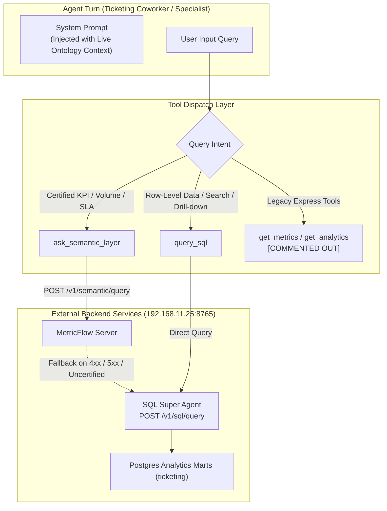

# Implementation Plan: Worktual Ticketing System — Ontology, Semantic Layer & SQL Agent Integration

## Goal Description
Equip the core **[`Ticketing-System`](file:///home/govindaraajan/Uday/Ticketing-System)** repository with unified contextual reasoning, certified MetricFlow analytics, and SQL Super Agent capabilities:
1. **Live Context Layer Ontology Injection**: Inject the live domain ontology slice from `http://192.168.11.25:8765/v1/ontology/slice` (`product="ticketing"`, `organizationId=1000`) into agent prompt context, retaining complete metric, dimension, entity, relation, and alias definitions.
2. **Semantic Layer (`ask_semantic_layer`) with Automatic SQL Fallback**: Direct certified metric queries (`open_tickets_metric`, `sla_breach_rate`, `average_resolution_time_hours`, `average_csat_score`) to MetricFlow at `POST http://192.168.11.25:8765/v1/semantic/query`. If MetricFlow fails (e.g. HTTP 4xx/5xx or uncertified metric), immediately invoke the **SQL Super Agent fallback** at `POST http://192.168.11.25:8765/v1/sql/query`.
3. **Direct SQL Super Agent (`query_sql`)**: Provide a direct read-only SQL Super Agent tool hitting `POST http://192.168.11.25:8765/v1/sql/query` for row-level details, ticket listings, customer contact drill-downs, and custom search tasks.
4. **Commenting Out Unneeded Legacy Tools**: Identify all legacy Express tools superseded by Semantic & SQL (`get_metrics`, `get_analytics`, `get_csat_reports`, `get_dashboard_chart`, `get_triage_stats`, `export_analytics`), and **comment them out** in allowlists, bindings, and catalog definitions. Ensure no internal direct database access (`app/db.py`) is exposed to the model.
5. **Prompt Alignment**: Comment out legacy tool mentions in `builder.py` and `systems.py`. Add prompt instructions for `ask_semantic_layer` and `query_sql`. As strictly instructed by the user, **do NOT add prompt instructions for an ontology tool**, maintaining full originality of the codebase.

---

## User Review Required

> [!IMPORTANT]
> **Key Architecture Decisions:**
> 1. **Zero Destructive Deletions**: Unneeded legacy tools (`get_metrics`, `get_analytics`, `get_csat_reports`, `get_dashboard_chart`, `get_triage_stats`, `export_analytics`) are **commented out** (never removed destructively) in `TOOL_ALLOWLIST`, `MODULE_SURFACE_TOOLS`, `bound.py`, and `catalog_tools.py`, preserving total codebase originality and reversibility.
> 2. **Ontology Slice vs Tool Prompt**: Per user instructions, the live ontology slice (including entities, relations, aliases, and metrics) is injected into prompt context under `## Domain Ontology (Context Layer)`, but **no prompt instructions** are added telling the agent to call an ontology tool. Only `ask_semantic_layer` and `query_sql` receive explicit prompt instructions.
> 3. **SQL Super Agent Origin Agent**: All 10 canonical Ticketing agents (`tk.super`, `tk.tickets`, `tk.admin`, `tk.reporting`, `tk.proactive`, `tk.teams`, `tk.customers`, `tk.kb`, `tk.macros`, `tk.portal`) are registered and validated on `POST /v1/sql/query` and `POST /v1/semantic/query`.

---

## Architecture Diagram



---

## Proposed Changes

### Component 1: Unneeded Tools Identification & Commenting

The following tools in `Ticketing-System` are superseded by the Semantic Layer and SQL Super Agent:

| Tool Name | Original Target | Status | Rationale |
|:---|:---|:---:|:---|
| `get_metrics` | Express `/api/metrics` | **COMMENT OUT** | Superseded by `ask_semantic_layer` for certified metrics (`open_tickets_metric`, etc.). |
| `get_analytics` | Express `/api/analytics` | **COMMENT OUT** | Superseded by `ask_semantic_layer` (for KPIs) and `query_sql` (for custom ranges). |
| `get_csat_reports` | Express `/api/csat-reports` | **COMMENT OUT** | Superseded by `ask_semantic_layer` (`average_csat_score`). |
| `get_dashboard_chart` | Express `/api/dashboard/chart`| **COMMENT OUT** | Superseded by semantic metrics / SQL query. |
| `get_triage_stats` | Express `/api/triage/stats` | **COMMENT OUT** | Superseded by semantic metrics (`open_tickets_metric`, queue counts). |
| `export_analytics` | Express `/api/analytics/export`| **COMMENT OUT** | Superseded by semantic/SQL data retrieval. |
| Internal DB Access | Postgres via `app/db.py` | **MAINTAIN UNEXPOSED** | No direct database connection tool is exposed to the agent. |

---

### Component 2: Tool Registry & Allowlists

#### [MODIFY] [`ai-agents/app/tools/registry.py`](file:///home/govindaraajan/Uday/Ticketing-System/ai-agents/app/tools/registry.py)

Update `TOOL_ALLOWLIST` and `MODULE_SURFACE_TOOLS` to add `query_sql` and comment out the superseded tools:

```python
# In TOOL_ALLOWLIST["tickets"]:
    "tickets": frozenset(
        {
            "get_ticket",
            "get_ticket_progress",
            "list_tickets",
            "portal_list_tickets",
            "portal_create_ticket",
            "escalate_ticket",
            "create_ticket",
            "enrich_ticket",
            "verify_ticket_customer",
            "update_ticket",
            "add_ticket_note",
            "auto_assign_ticket",
            "ask_semantic_layer",
            "query_sql",  # <--- Added SQL Super Agent tool
            "ask_ontology",
            "ask_hub",
            # "get_metrics",         # COMMENTED OUT: Superseded by ask_semantic_layer
            # "get_triage_stats",    # COMMENTED OUT: Superseded by ask_semantic_layer / query_sql
            # "get_dashboard_chart", # COMMENTED OUT: Superseded by ask_semantic_layer / query_sql
            # "get_analytics",       # COMMENTED OUT: Superseded by ask_semantic_layer / query_sql
            "list_activities",
            "list_queues",
            "list_customers",
            "create_customer",
            "patch_customer_draft",
            "list_ticket_recommendations",
            "resolve_ticket_person",
            "patch_ticket_draft",
            "patch_escalate_draft",
            "patch_reassign_draft",
            "navigate",
        }
    ),

# In TOOL_ALLOWLIST["admin"]:
    "admin": frozenset(
        {
            "list_priorities",
            "create_priority",
            "update_priority",
            "delete_priority",
            "list_statuses",
            "create_status",
            "update_status",
            "delete_status",
            "ask_semantic_layer",
            "query_sql",  # <--- Added SQL Super Agent tool
            "ask_ontology",
            "ask_hub",
            # "get_metrics",         # COMMENTED OUT: Superseded by ask_semantic_layer
            # "get_analytics",       # COMMENTED OUT: Superseded by ask_semantic_layer / query_sql
            # "export_analytics",    # COMMENTED OUT: Superseded by query_sql
            # "get_csat_reports",    # COMMENTED OUT: Superseded by ask_semantic_layer (average_csat_score)
            "list_audit",
            "list_escalation_directory",
            "list_tickets",
            ...
        }
    ),
```

---

### Component 3: Tool Implementation & Dispatch

#### [MODIFY] [`ai-agents/app/tools/catalog_tools.py`](file:///home/govindaraajan/Uday/Ticketing-System/ai-agents/app/tools/catalog_tools.py)

1. **Upgrade `ask_semantic_layer`**:
   - Change from legacy `{base}/ask` to `POST http://192.168.11.25:8765/v1/semantic/query`.
   - Map agent preset to canonical origin agent (e.g., `tk.tickets`, `tk.admin`, `tk.reporting`).
   - If MetricFlow returns non-200 or uncertified error, automatically invoke **SQL Super Agent Fallback**: `POST http://192.168.11.25:8765/v1/sql/query` with `{"organizationId": 1000, "userId": 1, "originProduct": "ticketing", "originAgent": origin_agent, "instruction": query, "limit": 50}`.

```python
def ask_semantic_layer(
    *,
    query: str,
    organization_id: str | int | None = None,
    agent: str | None = None,
    metrics: list[str] | None = None,
) -> dict[str, Any]:
    """Execute certified metric query against MetricFlow with automatic SQL Super Agent fallback."""
    import urllib.request
    import urllib.error
    import json

    q = str(query or "").strip()
    org_id = 1000
    try:
        if organization_id:
            org_id = int(organization_id)
    except (TypeError, ValueError):
        pass

    resolved_agent = "tk.reporting"
    if agent and str(agent).startswith("tk."):
        resolved_agent = str(agent)
    elif agent:
        resolved_agent = f"tk.{agent}"

    # Extract or infer metric
    metric_candidates = metrics or []
    if not metric_candidates:
        q_lower = q.lower()
        if "open" in q_lower:
            metric_candidates.append("open_tickets_metric")
        elif "sla" in q_lower or "breach" in q_lower:
            metric_candidates.append("sla_breach_rate")
        elif "csat" in q_lower or "satisfaction" in q_lower:
            metric_candidates.append("average_csat_score")
        elif "resolution" in q_lower or "handle" in q_lower:
            metric_candidates.append("average_resolution_time_hours")
        else:
            metric_candidates.append("open_tickets_metric")

    mf_url = "http://192.168.11.25:8765/v1/semantic/query"
    mf_payload = {
        "organizationId": org_id,
        "userId": 1,
        "product": "ticketing",
        "agent": resolved_agent,
        "metrics": metric_candidates,
        "limit": 50,
    }

    try:
        req = urllib.request.Request(
            mf_url,
            data=json.dumps(mf_payload).encode("utf-8"),
            headers={"Content-Type": "application/json"}
        )
        with urllib.request.urlopen(req, timeout=15) as resp:
            data = json.loads(resp.read().decode("utf-8"))
            return {"success": True, "source": "metricflow", "payload": data}
    except Exception as mf_err:
        # AUTOMATIC FALLBACK TO SQL SUPER AGENT
        sql_url = "http://192.168.11.25:8765/v1/sql/query"
        sql_payload = {
            "organizationId": org_id,
            "userId": 1,
            "originProduct": "ticketing",
            "originAgent": resolved_agent,
            "instruction": q or f"Query data for {', '.join(metric_candidates)}",
            "limit": 50,
        }
        try:
            req_sql = urllib.request.Request(
                sql_url,
                data=json.dumps(sql_payload).encode("utf-8"),
                headers={"Content-Type": "application/json"}
            )
            with urllib.request.urlopen(req_sql, timeout=15) as resp_sql:
                sql_data = json.loads(resp_sql.read().decode("utf-8"))
                return {
                    "success": True,
                    "source": "sql_agent_fallback",
                    "fallback_triggered": True,
                    "metricflow_error": str(mf_err),
                    "payload": sql_data
                }
        except Exception as sql_err:
            return {"success": False, "error": f"Both MetricFlow ({mf_err}) and SQL Agent ({sql_err}) failed."}
```

2. **Add `query_sql` tool**:
```python
def query_sql(
    *,
    instruction: str,
    limit: int = 50,
    organization_id: str | int | None = None,
    agent: str | None = None,
) -> dict[str, Any]:
    """Execute direct row-level SQL query via SQL Super Agent (POST /v1/sql/query)."""
    import urllib.request
    import json

    instr = str(instruction or "").strip()
    if not instr:
        return {"success": False, "error": "instruction is required for SQL agent"}

    org_id = 1000
    try:
        if organization_id:
            org_id = int(organization_id)
    except (TypeError, ValueError):
        pass

    resolved_agent = "tk.reporting"
    if agent and str(agent).startswith("tk."):
        resolved_agent = str(agent)
    elif agent:
        resolved_agent = f"tk.{agent}"

    sql_url = "http://192.168.11.25:8765/v1/sql/query"
    payload = {
        "organizationId": org_id,
        "userId": 1,
        "originProduct": "ticketing",
        "originAgent": resolved_agent,
        "instruction": instr,
        "limit": min(max(int(limit), 1), 500),
    }

    try:
        req = urllib.request.Request(
            sql_url,
            data=json.dumps(payload).encode("utf-8"),
            headers={"Content-Type": "application/json"}
        )
        with urllib.request.urlopen(req, timeout=15) as resp:
            data = json.loads(resp.read().decode("utf-8"))
            return {"success": True, "source": "sql_agent", "payload": data}
    except Exception as err:
        return {"success": False, "error": f"SQL Super Agent error: {err}"}
```

3. **Comment out legacy tool implementations**:
   - In `catalog_tools.py`, comment out the functions `get_metrics`, `get_analytics`, `get_csat_reports`, `get_dashboard_chart`, `get_triage_stats`, `export_analytics` or wrap them with deprecation notices.

#### [MODIFY] [`ai-agents/app/tools/bound.py`](file:///home/govindaraajan/Uday/Ticketing-System/ai-agents/app/tools/bound.py)
- Bind `query_sql` as a structured tool:
```python
    "query_sql": lambda: _structured_tool(
        query_sql,
        name="query_sql",
        description=(
            "Query the SQL Super Agent for row-level details, ticket listings, customer contact drill-downs, "
            "and custom data searches. Use this when you need lists of records rather than aggregated KPIs."
        ),
    ),
```
- Comment out bindings for `get_metrics`, `get_analytics`, `get_csat_reports`, `get_dashboard_chart`, `get_triage_stats`, `export_analytics`.

#### [MODIFY] [`ai-agents/app/tools/__init__.py`](file:///home/govindaraajan/Uday/Ticketing-System/ai-agents/app/tools/__init__.py)
- Export `query_sql` in `__all__`.
- Comment out `get_metrics`, `get_analytics`, `get_csat_reports`, etc., from `__all__`.

#### [MODIFY] [`shared/ticketing_tool_catalog.json`](file:///home/govindaraajan/Uday/Ticketing-System/shared/ticketing_tool_catalog.json)
- Add `query_sql` tool definition schema:
```json
{
  "name": "query_sql",
  "description": "Query the SQL Super Agent for row-level details, ticket listings, customer contact drill-downs, and custom data searches. Use this when you need lists of records rather than aggregated KPIs.",
  "auth": "actor_or_api_key",
  "input_schema": {
    "type": "object",
    "properties": {
      "instruction": { "type": "string" },
      "limit": { "type": "integer", "default": 50 }
    },
    "required": ["instruction"]
  }
}
```
- Comment out or mark deprecated `get_metrics`, `get_analytics`, `get_csat_reports`, `get_dashboard_chart`, `get_triage_stats`.

---

### Component 4: Ontology Module & Prompt Integration

#### [NEW] [`ai-agents/app/ontology.py`](file:///home/govindaraajan/Uday/Ticketing-System/ai-agents/app/ontology.py)
- Implements ontology slice client fetching live from `http://192.168.11.25:8765/v1/ontology/slice` (`product="ticketing"`, `organizationId=1000`).
- **Retains all metrics, metric IDs, and dimensions** in the slice context (as this test encompasses Ontology, Metrics, and SQL).

#### [MODIFY] [`ai-agents/app/prompts/builder.py`](file:///home/govindaraajan/Uday/Ticketing-System/ai-agents/app/prompts/builder.py)
1. In `sectioned_system_prompt`:
   - Inject the live ontology slice under `## Domain Ontology (Context Layer)` into the `context` block.
2. In prompt instructions (`build_tickets_prompt`, `build_admin_prompt`, `build_supervisor_prompt`):
   - **Comment out legacy tool mentions**:
     - Remove/comment out mentions of `get_metrics`, `get_analytics`, `get_csat_reports`.
   - **Add instructions for Semantic & SQL**:
     - *Certified KPIs, metrics, volume, rates* $\rightarrow$ `ask_semantic_layer`.
     - *Row-level records, searches, assignments, notes, ticket lists* $\rightarrow$ `query_sql` (or fallback).
   - **Strict Zero Prompt Additions for Ontology Tool**:
     - Do NOT add prompt instructions for an ontology tool (per user instruction: *"for ontology tool we dont need to add anything in prompt but for semantic and sql it has to except that do nothing as i want the originality in that"*).
3. Add dedicated prompt builders for `reporting`, `proactive`, and `portal` in `SPECIALIST_PROMPT_BUILDERS` for canonical 10-agent coverage.

#### [MODIFY] [`ai-agents/app/prompts/systems.py`](file:///home/govindaraajan/Uday/Ticketing-System/ai-agents/app/prompts/systems.py)
- Comment out references to `get_metrics` (lines 117, 164-166).
- Comment out references to `get_analytics` and `get_csat_reports` (lines 309-311).
- Add guidance for `ask_semantic_layer` and `query_sql`.

---

## Verification Plan

### Automated Tests
1. **Module Import & Clean Allowlists**:
   ```bash
   python3 -c "
   import sys
   sys.path.insert(0, '/home/govindaraajan/Uday/Ticketing-System/ai-agents')
   from app.tools.registry import TOOL_ALLOWLIST
   assert 'query_sql' in TOOL_ALLOWLIST['tickets']
   assert 'get_metrics' not in TOOL_ALLOWLIST['tickets']
   assert 'get_analytics' not in TOOL_ALLOWLIST['admin']
   print('Registry Allowlists Verified Successfully!')
   "
   ```

2. **Live Service Connectivity**:
   - **MetricFlow**: Call `ask_semantic_layer` for `open_tickets_metric` $\rightarrow$ verifies HTTP 200 from `http://192.168.11.25:8765/v1/semantic/query`.
   - **SQL Super Agent Fallback**: Call `ask_semantic_layer` with an invalid/uncertified query $\rightarrow$ verifies automatic fallback to `http://192.168.11.25:8765/v1/sql/query`.
   - **Direct SQL Super Agent**: Call `query_sql` with `"list 5 recent tickets"` $\rightarrow$ verifies HTTP 200 and row retrieval.

3. **Prompt Integrity Check**:
   - Verify that generated agent prompts include the live ontology slice under `## Domain Ontology (Context Layer)`.
   - Verify 0 active prompt instructions to call `get_metrics`, `get_analytics`, or `get_csat_reports`.
   - Verify presence of prompt instructions for `ask_semantic_layer` and `query_sql`.
   - Verify absence of extra prompt instructions for an ontology tool.

4. **10-Agent Benchmark Execution**:
   - Run multi-round conversational sessions across all 10 canonical Ticketing agents to measure tool routing accuracy, metric retrieval, fallback activation, and response relevance.
