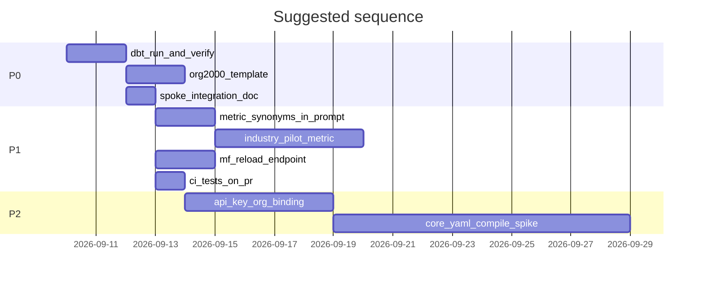

# Roadmap: Ontology & Semantic Layer — Enhancements & Next Steps

**Purpose:** Actionable backlog for the next chat or sprint. Ordered by impact vs effort.  
**Companion:** [`HANDOFF_CHAT_CONTEXT.md`](HANDOFF_CHAT_CONTEXT.md) (full history and current state).  
**User constraints from chat:** Spoke integration deferred; **no hashing** for now; **auth (Phase A) deferred** until spokes or security review require it.

---

## Priority legend

| Priority | Meaning |
|----------|---------|
| P0 | Do before any external spoke or second production org |
| P1 | High value; fits “7.5 ceiling” without full KG |
| P2 | Important for enterprise / 9+ rating |
| P3 | Palantir/EKG-grade; only if graph query is a product goal |

---

## P0 — Before production spokes

### P0.1 Deploy warehouse formula changes

**Status:** ✅ Done 2026-09-10 — parse 5/5, run 4/4 Postgres products, live MetricFlow queries OK on org1000.

**Why:** Ticketing SQL (open=P1/lower status, SLA denominator) was parsed but views may be stale.

**Do (repeat after SQL/YAML changes):**

```bash
PYTHONPATH=. python3 scripts/dbt_parse_all.py
PYTHONPATH=. python3 scripts/dbt_run_all.py          # all products
# or: PYTHONPATH=. python3 scripts/dbt_run_all.py --select ccaas ticketing --marts-only
./scripts/run_context_layer_api.sh   # restart after parse/run (no hot reload)
```

**Verify:** Direct execute or `scripts/test_semantic_products.py` against org 1000; compare agent vs admin open-ticket counts.

**Fix applied:** CRM duplicate `mart_contact_campaign_engagement` in staging schema.yml; metric_policies `"on"` YAML boolean trap (CCaaS channel group_by).

---

### P0.2 Second tenant overlay template

**Why:** Industry model is proven for org1000 only.

**Do:**

- Copy pattern: `tenants/org{id}/semantic.yaml` + `tenants/org{id}/org{id}_metrics.yaml`
- Example: org2000 ecommerce CCaaS with `industryPack: ecommerce` and different thresholds (1 Cr vs 100 Cr shop)
- Add one test in `test_industry_org_metrics.py` for org2000 when folder exists

---

### P0.3 Spoke integration pack (no spoke code required yet)

**Why:** When a team has one day, integration should be copy-paste.

**Deliverable:** Single doc or section in `api/README.md`:

- Curl examples for slice + semantic query per product
- Cache key: `(organizationId, agent, product, ontology version)`
- “After dbt parse → restart context layer API”
- Win rate: do **not** `group_by: stage` on ratio metrics
- Open tickets = status open only
- Use `format=json` if runtime needs structure; default `prompt` for LLM

---

### P0.4 Monitor logs

**Why:** `error.log` only helps if someone reads it.

**Do:**

- Weekly grep on `logs/error.log`
- Alert on repeated MetricFlow / warehouse errors
- Optional: log rotation size review (5MB × 5 backups already configured)

---

## P1 — Reach ~7.5 without auth (user-approved sequence B–E, minus hash)

### P1.1 Align vocabulary with `core.yaml` (noun map + CI)

**Status:** Partial — `noun_map.yml` updated; CI in `test_industry_org_metrics.py`.

**Next:**

- Add CI job (GitHub/local) that runs `test_industry_org_metrics.py` + `test_semantic_dim_resolve.py` on every ontology PR
- Document mapping: `Opportunity ↔ wt:Deal`, `SupportCase ↔ wt:Ticket` in `ontology/README.yml`
- When adding a new `wt:*` class in modules, **must** update noun_map or `agent_only_types`

---

### P1.2 Industry metric extensions (certified only)

**Why:** Ecommerce “units sold”, real estate “commission” belong in industry layer, not org file.

**Do:**

1. Add metric to dbt/MetricFlow for one vertical (pick one pilot: ecommerce)
2. Register in `semantic/metric_registry.yml` (`certified: true`)
3. Add `metric_ids:` list to `ontology/industry/ecommerce.yml` (loader already merges if certified)
4. Add to relevant agent preset `prompt.metrics` allowlist
5. Org file only sets **thresholds** for that id

**Do not:** Put SQL formulas in `org{id}_metrics.yaml`.

---

### P1.3 Metric prompt completeness

**Status:** group_by, when/not, thresholds in compact prompt.

**Enhancements:**

- Default **filter hints** in org metrics file (e.g. `default_filters: { status: open }`) — schema + prompt line
- Document **time grain** in policy when metric uses non-default agg time (e.g. resolution by `resolved_at`)
- Surface **metric synonyms** from tenant `synonyms` block in prompt (today only type aliases shown; metric synonyms like `AHT -> average_handle_time` exist in YAML but not in Aliases section)

---

### P1.4 Semantic query performance

**Status:** MF warmup implemented.

**Next:**

- Optional: cache `fetch_ontology_slice` in process by `(tenant, agent, product, version)` — slice compile is cheap but repeated every semantic query today
- Document expected latency: warmup vs query vs cold restart
- Pre-warm only products in tenant `enabledSpokes` (future env `MF_WARM_PRODUCTS`)

---

### P1.5 Manifest reload without full process restart

**Status:** Done 2026-09-10 — `POST /v1/admin/reload` + [`scripts/reload_context_layer.sh`](../scripts/reload_context_layer.sh).

- Gated by `CONTEXT_RELOAD_SECRET` (404 if unset)
- Clears ontology catalog, policies, thresholds, MetricFlow engines, dimension resolver caches
- Re-runs `warmup_engines()` when `MF_WARM=1`
- **No** uvicorn `--reload` and **no** mtime polling on each request

---

### P1.6 Expand test coverage

| Test | Purpose |
|------|---------|
| Live org1000 agent vs admin open tickets | Proves assignee scope |
| Org isolation SQL assertion | No other org rows in result |
| Hub products[] rejects empty / wrong SKU | Contract |
| org1000 prompt contains threshold lines | Regression |

---

## P2 — Enterprise readiness (when spokes go live or SOC2 matters)

### P2.1 Authentication & tenant binding (Claude #1 — deferred by user)

**Minimum viable:**

- API key or mTLS on context layer
- Map credential → allowed `organizationId`
- Hub: allowed `products[]` from entitlement service or DB (`campaign.organization_products`, `setup_user_product_access`)
- Reject body org/SKU mismatch with **403**

**Full:** JWT from Worktual IdP with claims; semantic query uses same claims for `userId` + scope.

---

### P2.2 Single source of truth: compile from `core.yaml`

**Why:** Stops `Deal` vs `Opportunity` drift; honors user’s KG spec.

**Approach (phased):**

1. **Read-only projection:** Script generates `ontology/modules/_generated/*.yml` from `core.yaml` labels + `noun_map` (human reviews diff)
2. **CI gate:** Generated output must match committed modules OR modules must diff cleanly from generator
3. **Long term:** Industry packs compiled from a single KG source at build time, not parallel `ontology/industry/*.yml`

**Out of scope unless graph is product:** Running Neo4j loader, hubs, collections, `edge_budget` enforcement.

---

### P2.3 Versioning & lifecycle

- Per-module semver in `catalog.yml`
- Fields: `status: active | deprecated | removed`, `sunset_date`
- CI: “which agents/presets break if type X removed?” from `agents.yml` + preset module lists

---

### P2.4 Observability (without hashing — user preference)

- Request id on every API response header
- Log: `(request_id, org, agent, product, metrics, duration_ms, error_class)`
- Optional: prompt **token estimate** in debug/json format only (not hash)
- Dashboard: p95 latency semantic query; MF warm failures

---

### P2.5 Caching contract for spokes

- `ETag` + `If-None-Match` on `/v1/ontology/slice`
- Document fallback: “serve last-known-good slice from disk + alarm” when API down

---

### P2.6 Structured agent contract

- Promote `format=json` in spoke SDK
- Add `format=tools`: actions as JSON Schema for tool calling
- `template_version` field on slice response (ontology catalog version + tenant metrics file mtime)

---

### P2.7 Behavioural evaluation

- Per-agent golden sets: given slice, model selects correct metric id, refuses out-of-scope action
- Run in CI when `metric_policies.yml` or preset prompt allowlists change
- Store frozen transcripts for regression

---

### P2.8 dbt / metric CI on warehouse

- `dbt test` on marts after `dbt run` in CI (against staging Postgres)
- Assert win rate formula, SLA eligible denominator, open ticket count definitions
- Block merge if semantic YAML parse fails

---

## P3 — Knowledge graph & full ontology (optional product bet)

Only if Worktual needs **graph traversal** (e.g. “all interactions for this patient across channels”) beyond MetricFlow + CDP tools.

- Implement loader for canonical KG YAML (collections, hubs, entitlement projection) if reintroduced
- Neo4j or in-memory graph per tenant signature
- Link permissions on relationship types
- OWL/IRI publication if required by compliance

**Not needed for:** CC bot understanding Patient vs Buyer, or KPI questions via `ask_semantic`.

---

## Suggested execution order (next 4 weeks)



| Week | Focus |
|------|--------|
| 1 | P0.1–P0.4: dbt run, verify metrics, org2000 template, integration doc |
| 2 | P1.3–P1.6: metric synonyms in prompt, reload endpoint, CI tests |
| 3 | P1.2: one industry-specific certified metric (ecommerce pilot) |
| 4 | P2.1 spike: API key + org allowlist (when spoke team ready) |

---

## Explicit non-goals (unless user changes mind)

- Slice hashing / encoding for forensics
- JWT auth in current sprint (user skipped Phase A)
- GraphRAG for module selection
- Force-push / amend git history
- Merging pending into open tickets
- Auto-expanding Hub entitlements (CCaaS ≠ ticketing)

---

## Success criteria (how to know we “reached the mark”)

| Milestone | Criteria |
|-----------|----------|
| **Operational** | API restarted after every dbt change; `error.log` clean for 7 days; warmup green on `/health` |
| **Multi-industry** | Two tenants with different `industryPack`; prompts differ (Patient vs Buyer); same metric ids |
| **Multi-org KPIs** | Same metric, different thresholds in org files; visible in prompt |
| **Scoped metrics** | Agent user sees fewer tickets/deals than admin on org1000 live data |
| **Spoke-ready** | One team integrates slice + 3 semantic queries from doc alone |
| **7.5 rating** | P0 + P1 complete; noun_map CI; org templates; no silent drift on open ticket definition |
| **9+ rating** | P2 auth + core compile path + behavioural evals + warehouse metric CI |

---

## Quick reference: who owns what

| Layer | Owns formulas | Owns thresholds | Owns labels/synonyms |
|-------|---------------|-----------------|----------------------|
| MetricFlow / dbt | Yes | No | No |
| `metric_policies.yml` | No (when/dims/scope) | No | No |
| `org{id}_metrics.yaml` | No (overrides rare) | Yes | No |
| `industry/*.yml` | No | No | Yes + taxonomy |
| `tenants/.../semantic.yaml` | No | No | Yes + synonyms + binds |
| Canonical KG YAML (future) | No | No | Business labels (not runtime yet) |

---

## Files to touch for common next tasks

| Task | Primary files |
|------|----------------|
| New org thresholds | `tenants/org{N}/org{N}_metrics.yaml` |
| New industry vertical language | `ontology/industry/{pack}.yml`, tenant `industryPack` |
| New certified metric | `semantic/dbt/.../semantic_layer.yml`, `semantic/metric_registry.yml`, `ontology/metric_policies.yml`, agent preset allowlist |
| Row scope change | `ontology/metric_policies.yml`, `semantic/scope.py` |
| API logging | `api/logging_setup.py`, `api/main.py` |
| Warmup / reload | `semantic/metricflow/engine.py`, `api/main.py` |

---

## Questions for product before P2.1 (auth)

1. Will spokes call context layer **server-to-server** (API key) or **via user JWT**?
2. Is entitlement source of truth `campaign.organization_products` or a new service?
3. Should Hub `products[]` be **removed from body** entirely once auth exists?

Document answers in this file when decided.
