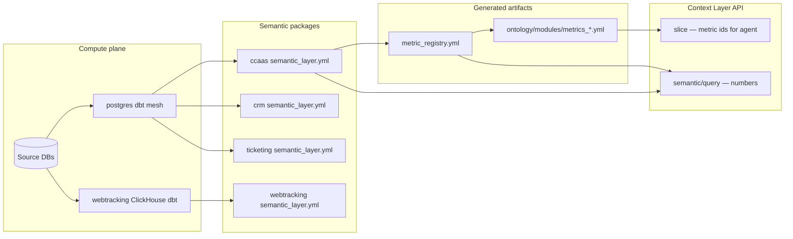

# Semantic layer — purpose and how it works

This document explains **why** the semantic layer exists, **how** numbers are computed and governed, and **why you still see `campaign`, `crm`, `ccaas`, and `ticketing` folders** under `semantic/dbt/`.

For ontology (types, actions, prompts) see [ONTOLOGY.md](ONTOLOGY.md). For operational runbooks see [SEMANTIC_LAYER_OPERATIONS_WORKFLOW.md](SEMANTIC_LAYER_OPERATIONS_WORKFLOW.md).

---

## Motive

Agents need **certified KPIs** — stable ids, correct formulas, tenant isolation, and entitlements — without embedding SQL in prompts.

| Layer | Question it answers |
|-------|---------------------|
| **Ontology** | What metric *names* may this agent use? |
| **Semantic layer** | How is each metric *computed*, filtered, and returned? |
| **Warehouse (dbt)** | Where do the tables and marts live? |
| **Control plane** | Which metrics are visible for *this user, org, and SKU* right now? |

**Core principle:** Formulas live in **MetricFlow YAML** and **mart SQL**. Authorization lives in **capabilities + accounts entitlements**. Git tenant YAML holds **labels and thresholds only**.

---

## Why `campaign`, `crm`, `ccaas`, `ticketing` folders still exist

After the **Postgres warehouse mesh** migration, these folders are **not duplicate warehouses**. They are **per-domain semantic packages** — one MetricFlow graph per product.

```text
semantic/dbt/
├── postgres/default/dbt/          ← WAREHOUSE: all staging + marts (SQL)
│   └── models/
│       ├── shared/                ← metricflow_time_spine + cross-domain sources
│       │   └── staging/
│       │       ├── accounts/      ← stg_accounts_* (organizations, setup_users, setup_teams)
│       │       └── cdp/           ← stg_cdp_* (customer_profile, identity_keys)
│       ├── campaign/staging|marts/
│       ├── crm/staging|marts/
│       ├── ccaas/staging|marts/
│       └── ticketing/staging|marts/
│
├── ccaas/default/dbt/             ← SEMANTIC ONLY: semantic_layer.yml
├── crm/default/dbt/               ← SEMANTIC ONLY
├── campaign/default/dbt/          ← SEMANTIC ONLY
├── ticketing/default/dbt/         ← SEMANTIC ONLY
│
└── webtracking/default/dbt/       ← FULL PROJECT (ClickHouse — separate engine)
```

| Folder | What’s inside | Why keep it |
|--------|---------------|-------------|
| **`postgres/`** | All Postgres staging + mart `.sql` | One `dbt run` for the warehouse; tag/path per domain |
| **`ccaas/`, `crm/`, …** | `models/semantic_layer/*.yml` only | **Separate MetricFlow manifest per domain** — avoids one mega join graph across CCaaS + CRM + ticketing |
| **`webtracking/`** | Staging + marts + semantic (ClickHouse) | Different engine; not merged into Postgres |

Each semantic package declares:

```yaml
# e.g. semantic/dbt/ccaas/default/dbt/packages.yml
packages:
  - local: ../../../postgres/default/dbt   # warehouse refs
```

**You should not delete `campaign` or `crm` folders** unless you intentionally collapse all semantic YAML into a single MetricFlow project (not recommended — cross-domain grain collisions).

### Shared staging naming convention

After merging into one Postgres dbt project, **model names must be globally unique**. Cross-domain onboarding tables stage once; domains project with domain-specific names:

| Layer | Pattern | Example |
|-------|---------|---------|
| Shared base | `stg_accounts_*` | `stg_accounts_organizations` |
| Domain projection | `stg_{domain}_*` | `stg_crm_organizations`, `stg_ticketing_organizations` |
| DB view name (unchanged) | `alias` config | `alias='stg_organizations'` keeps `crm_staging.stg_organizations` |

Sources (`accounts`, `cdp`) are defined **once** under `models/shared/staging/` — do not re-declare them in domain `sources.yml` files.

### CDP is a spine, not a sixth warehouse

CDP has **no** `semantic/dbt/cdp/` project. Customer tables stage under `models/shared/staging/cdp/` (`stg_cdp_customer_profile`, `stg_cdp_identity_keys`). Metric **formulas** stay in product packages (campaign, CRM, webtracking ClickHouse). CDP agents get numbers via:

1. **Ontology slice** — `metrics_cdp` module lists curated customer metric ids
2. **Control plane** — tenant must have `cdp` SKU **and** each metric's engine SKU (`campaign`, `crm`, `web-tracking`, …)
3. **Query routing** — `resolve_execution_product` picks the correct MetricFlow manifest

---

## End-to-end data flow



---

## Control plane (per-request packing)

Implemented in [`semantic/context.py`](../semantic/context.py), [`semantic/entitlements.py`](../semantic/entitlements.py), [`semantic/capabilities.py`](../semantic/capabilities.py).

```text
visible_metrics =
    certified
  ∩ agent_preset.metrics
  ∩ tenant_SKUs          (accounts DB — source of truth)
  ∩ entitled_channels
  ∩ entitled_features
  ∩ min_role
```

| Piece | Location |
|-------|----------|
| Capability tags (SKU, channel, `min_role`, `engine`) | [`ontology/metric_capabilities.yml`](../ontology/metric_capabilities.yml) |
| Entitlements (org SKUs, channels) | `accounts.active_products` + `accounts.setup_channel_configs` via [`semantic/entitlements.py`](../semantic/entitlements.py) |
| User role / row scope | `accounts.setup_user_product_access` + `setup_roles` via [`semantic/scope.py`](../semantic/scope.py) |
| Agent allowlist | [`ontology/catalog.yml`](../ontology/catalog.yml) presets |
| Dim / scope policies | [`ontology/metric_policies.yml`](../ontology/metric_policies.yml) |
| Query enforcement | [`semantic/query.py`](../semantic/query.py) — same resolver + `channel IN (...)` inject |

**Slice** returns packed `metrics[]` when `userId` is sent. **Query** always requires `userId` and rejects non-visible metrics.

---

## Query execution path

1. `POST /v1/semantic/query` with `organizationId`, `userId`, `product`, `agent`, `metrics[]`.
2. **`resolve_execution_product()`** — capability `product` + `engine` must match request (e.g. webtracking → ClickHouse manifest).
3. **`resolve_context()`** — same allowlist as slice.
4. **Validate** dims, row scope ([`semantic/scope.py`](../semantic/scope.py)), channel entitlement clauses.
5. **MetricFlow** — manifest from `semantic/dbt/{product}/default/dbt/target/` via [`semantic/metricflow/manifest_resolver.py`](../semantic/metricflow/manifest_resolver.py).
6. **Tenant filter** — `organization_id` injected on every query.
7. **Response** — `rows`, `sql`, `interpretation` (thresholds from [`semantic/thresholds.py`](../semantic/thresholds.py)).

---

## Registry and duplicate metric names

Some ids exist in **more than one** semantic package (e.g. `resolution_rate` in CCaaS and ticketing — different formulas, different grain).

[`semantic/metric_registry.yml`](../semantic/metric_registry.yml) stores **multi-source** entries:

```yaml
resolution_rate:
  certified: true
  sources:
    aiccaas: { source_metric: resolution_rate }
    ticketing: { source_metric: resolution_rate }
```

Execution always uses the manifest for the request **`product`**, not a single global `source` field. [`semantic/lookup.py`](../semantic/lookup.py) resolves the correct source when `product` is provided.

Regenerate after semantic YAML changes:

```bash
PYTHONPATH=. python3 scripts/generate_metric_registry.py
```

---

## Key runtime modules (`semantic/`)

| Module | Role |
|--------|------|
| [`lookup.py`](../semantic/lookup.py) | Certified metric registry + policy merge |
| [`capabilities.py`](../semantic/capabilities.py) | Capability inference + execution product routing |
| [`entitlements.py`](../semantic/entitlements.py) | Accounts DB SKUs, channels, features |
| [`context.py`](../semantic/context.py) | `resolve_context()` for slice + query |
| [`query.py`](../semantic/query.py) | Validate, prepare, execute MetricFlow |
| [`scope.py`](../semantic/scope.py) | Row-level filters (assignee, owner) |
| [`metricflow/engine.py`](../semantic/metricflow/engine.py) | MetricFlow engine cache + execute |
| [`metric_registry.yml`](../semantic/metric_registry.yml) | Auto-generated certified ids |
| [`metric_thresholds.yml`](../semantic/metric_thresholds.yml) | Platform default thresholds |
| [`catalog/`](../semantic/catalog/) | SQL-agent metric catalog (generated) |
| [`PRODUCT_DATA_PLANE.yml`](../semantic/PRODUCT_DATA_PLANE.yml) | Warehouse schema map, accounts/cdp spine (reference) |

---

## dbt commands

```bash
# Parse warehouse + all semantic packages (needs dbt-postgres)
PYTHONPATH=. python3 scripts/dbt_parse_all.py

# Run warehouse only (domain path selectors)
PYTHONPATH=. python3 scripts/dbt_run_all.py
PYTHONPATH=. python3 scripts/dbt_run_all.py --select ccaas crm --marts-only

# Reload API caches after YAML / capability edits
./scripts/reload_context_layer.sh
```

Parse order: **postgres** first, then campaign → crm → ccaas → ticketing → webtracking (optional, needs ClickHouse env).

---

## Postgres vs ClickHouse

| Engine | dbt project | Profile | Metrics |
|--------|-------------|---------|---------|
| Postgres | `semantic/dbt/postgres` + domain semantic packages | `postgres_warehouse_dbt` / per-domain parse profile | CCaaS, CRM, ticketing, campaign |
| ClickHouse | `semantic/dbt/webtracking` (standalone) | `webtracking_default_dbt` | Web sessions, conversions, … |

Capabilities tag `engine: clickhouse` for web metrics. Query routes to the webtracking manifest when `product=webtracking`.

---

## New tenant path (no dbt fork)

1. Insert org + product subscriptions + CCaaS channels in **accounts**.
2. Optional `tenants/org{id}/semantic.yaml` for labels/thresholds.
3. Warehouse rows filtered by `organization_id` — empty org returns zeros, not missing models.
4. First slice with `userId` returns packed ontology + `metrics[]`.
5. Upsell a channel in accounts → next slice includes channel metrics; **no dbt change**.

Local dev without DB: `export ENTITLEMENTS_DEV_FALLBACK=1`.

---

## Further reading

- [ONTOLOGY.md](ONTOLOGY.md) — types, modules, slice motive
- [SEMANTIC_LAYER_OPERATIONS_WORKFLOW.md](SEMANTIC_LAYER_OPERATIONS_WORKFLOW.md) — add org, metric, agent
- [semantic/dbt/postgres/README.md](../semantic/dbt/postgres/README.md) — mesh layout detail
- [WORKFLOW.md](WORKFLOW.md) — tests and troubleshooting
- [TRACEBACK.md](../TRACEBACK.md) §21 — context control plane delivery log
