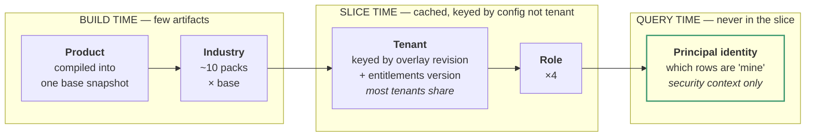
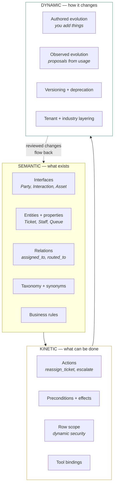
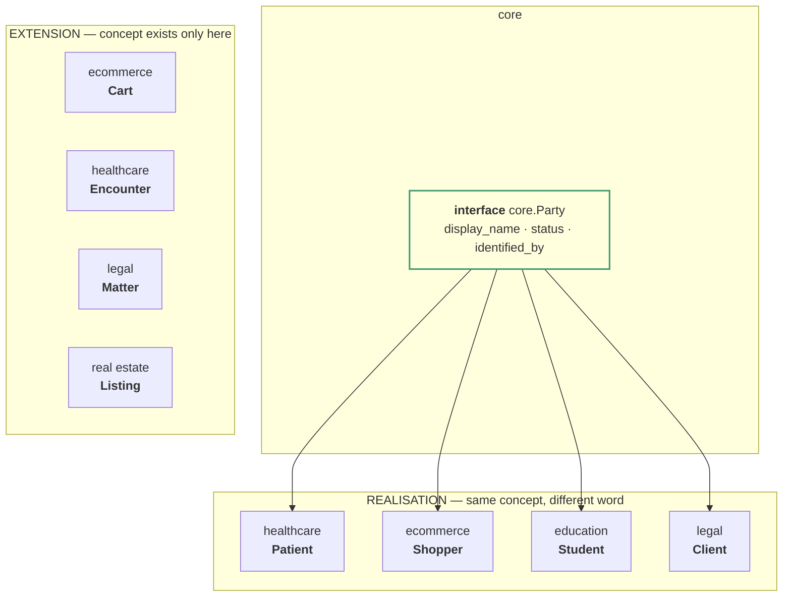
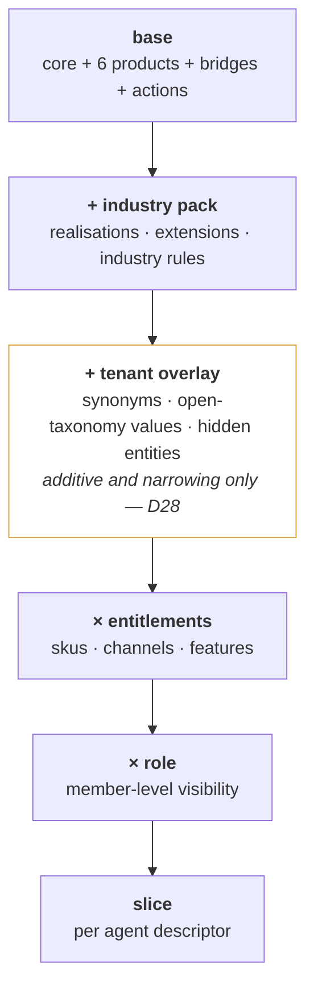
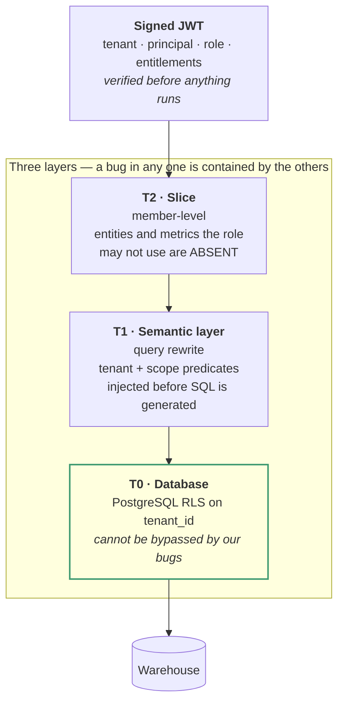
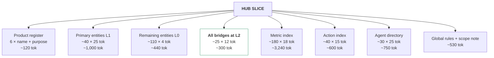
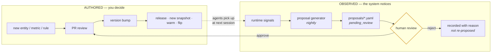

# Advanced Ontology & Semantic Layer — Engineering Specification v4

**Status:** Approved for implementation
**Supersedes:** v1, v2, v3
**Scope:** A dynamically evolving ontology and semantic layer serving six products, a hub, N industries, N tenants and N roles — through one compiled model.

---

## Table of contents

1. [How to read this](#0-how-to-read-this)
2. [The four-axis problem](#1-the-four-axis-problem)
3. [Glossary](#2-glossary)
4. [Locked decisions](#3-locked-decisions)
5. [Invariants](#4-invariants)
6. [The three-layer ontology](#5-the-three-layer-ontology)
7. [Ontology structure](#6-ontology-structure)
8. [Industry packs: realisations and extensions](#7-industry-packs)
9. [Tenants and the compilation lattice](#8-tenants-and-the-compilation-lattice)
10. [The principal model: roles and row scope](#9-the-principal-model)
11. [Security enforcement stack](#10-security-enforcement-stack)
12. [Metrics and dbt design](#11-metrics-and-dbt-design)
13. [The hub](#12-the-hub)
14. [Agent descriptors](#13-agent-descriptors)
15. [Slice composition](#14-slice-composition)
16. [The four lanes](#15-the-four-lanes)
17. [Dynamic evolution](#16-dynamic-evolution)
18. [Change classification and versioning](#17-change-classification-and-versioning)
19. [Validators](#18-validators)
20. [Failure containment](#19-failure-containment)
21. [Sequencing](#20-sequencing)
22. [Open questions](#21-open-questions)
23. [Appendix A — machine-readable invariants](#appendix-a)
24. [Appendix B — one question, three industries, three roles](#appendix-b)

---

## 0. How to read this

### 0.1 Normative language

| Word | Meaning |
|---|---|
| **MUST** / **MUST NOT** | Absolute. A violation is a build failure or a production incident. |
| **SHOULD** / **SHOULD NOT** | Strong default. Deviation requires a written note in the PR, reviewed by the spec owner. |
| **MAY** | Genuinely optional. |

### 0.2 Precedence

1. §4 Invariants — the contract. Nothing overrides them.
2. §3 Locked decisions — settled; see §3.0 before proposing a change.
3. Algorithms and schemas in §6–§15.
4. Rationale and guidance elsewhere.

### 0.3 The anti-drift mechanism

§2 (glossary), §3 (locked decisions) and §4 (invariants) exist so that a second reader — a person or a coding assistant — builds the same system. Every rejected alternative is recorded in §3 with its reason and its reversal condition. When an implementer proposes something already settled, the answer is the recorded rationale, not a fresh debate. A genuinely new argument goes through §3.0, which changes the decision for everyone at once.

---

## 1. The four-axis problem

Your context varies along four axes that are **orthogonal** — any combination can occur.

| Axis | Cardinality | Example |
|---|---|---|
| **Product** | 6 + core | cdp · crm · ccaas · ticketing · campaign · webtracking |
| **Industry** | ~5–15 and growing | healthcare · ecommerce · education · real estate · legal |
| **Tenant** | 10 → 1,000 → 10,000 | org1000, org1001 … |
| **Principal** | ~4 roles × N users | admin sees all tickets; agent sees only their own |

Naively multiplied: 6 × 10 × 1,000 × 4 × 30 agent descriptors = **7.2 million compiled artifacts**. Obviously impossible. The whole architecture is a way of collapsing that number.

### 1.1 The collapse: each axis binds at a different time



**The single most important line in this document:** *identity-scoped row visibility MUST NOT be baked into the slice.* "Which tickets are mine" is resolved at query time from the security context. If you put it in the slice you need one slice per user and the system does not scale past a few hundred people. The slice carries the **rule** ("you see only your own tickets"); the **filter** is injected by the semantic layer.

### 1.2 Realistic artifact count

| Level | Count | Reason |
|---|---|---|
| Base snapshots | 1 per commit | product axis compiled in |
| Industry projections | ~10 | one per pack |
| Tenant configurations | ~industries + tenants-with-overlays | ~5% of tenants have an overlay; the rest share by `(industry, entitlements_version)` |
| Role variants | ×4 | |
| Agent descriptors | ~30 | |
| **Warm slices at 1,000 tenants** | **≈ 7,000** | `(10 industries + 50 overlay configs) × 4 roles × 30 descriptors` |

Seven thousand slices at ~2 KB each is 14 MB. Warming them in parallel takes a couple of minutes. **At 10,000 tenants the number barely moves**, because it is proportional to distinct configurations, not tenant count. This is the property that makes the design viable, and it is why D22 forbids putting `tenant_id` in the cache key.

---

## 2. Glossary

| Term | Definition |
|---|---|
| **Interface** | An abstract shape in the core ontology (`core.Party`). Carries required properties and relations. Never instantiated directly. |
| **Realisation** | An industry's concrete naming of an interface (`Patient` realises `core.Party` in healthcare). Same computation, different vocabulary. |
| **Extension** | An entity that exists **only** in one industry (`Cart` in ecommerce, `Encounter` in healthcare). Not a renaming of anything. |
| **Entity** | A business concept. Namespaced (`ticketing.Ticket`). Not a table. |
| **dbt entity** | A MetricFlow join key, typed `primary`, `unique` or `foreign`. |
| **Action** | A kinetic-layer operation (`reassign_ticket`) with parameters, preconditions, effects and governing rules. Bound to an agent tool. |
| **Binding** | The declared correspondence between ontology structure and dbt structure. Lives only in `bindings/*.yaml`. |
| **Metric** | A MetricFlow metric. Computation owned by dbt; agent prose owned by `metric_policies.yml`; presentation realised per industry. |
| **Servable** | A `(metric, dimension)` pair MetricFlow can execute. Computed at build time. |
| **Slice** | The per-agent projection delivered once at session start. A function of `(base, industry, tenant_config, role, descriptor)`. |
| **Detail level** | `L0` name · `L1` name + definition + identifier · `L2` full. |
| **Row scope** | `own` \| `team` \| `all` \| `none`. Which rows a principal may see. Resolved at query time. |
| **Security context** | Verified claims in a signed JWT: tenant, principal, role, scopes, entitlements. The only source of identity. |
| **Lane** | One of four answer paths: Certified · Extended · Retrieval · Hand-off. |
| **Snapshot** | Immutable compiled artifact keyed by `(sha_ontology, sha_dbt_manifest, sha_policies, sha_industry, sha_bindings)`. |
| **Proposal** | A machine-generated candidate ontology change awaiting human review. Never auto-applied. |
| **Sibling group** | Metrics answering superficially identical questions, disambiguated by a discriminator. |
| **Enforcement tier** | T0 compile · T1 harness · T2 slice · T3 prompt. |

---

## 3. Locked decisions

### 3.0 How to change one

A locked decision changes only when a new fact invalidates its rationale, or its reversal condition is met. **Change this document first**, then the code. Never the other way round.

### 3.1 Carried forward from v3

| # | Decision |
|---|---|
| **D1** | dbt owns computation. The ontology MUST NOT contain metric formulas. |
| **D2** | The ontology owns meaning, relations and rules. dbt descriptions are not authoritative meaning. |
| **D3** | `bindings/*.yaml` carries structure only. No agent-facing prose. |
| **D4** | `metric_policies.yml` is the single home for `when`, `not_for`, synonyms, `exposure`. Migration to dbt `meta` happens in one batch or not at all. |
| **D5** | Servability is precomputed at build time, never classified at runtime. |
| **D6** | Four lanes. Retrieval is separate from Extended. |
| **D7** | The SQL harness is kept and extended, not replaced by open text-to-SQL. |
| **D8** | Lane 2 seeds from certified SQL; the boundary is enforced by a parser diff, not a prompt. |
| **D9** | Tenant scoping is T0 or T1, never a prompt rule. |
| **D10** | Retrieval MUST NOT produce aggregates, and its row count is not reportable. |
| **D11** | Every metric with a time dimension declares a timezone policy. |
| **D12** | Sibling ambiguity resolves by asking, not defaulting. |
| **D13** | The snapshot id pins every source hash. |
| **D14** | Slices are byte-deterministic. |
| **D15** | Hydration is once per session; mid-session calls are metered and alerted above 2%. |
| **D16** | Existing controls are retained as backstops until their replacements pass their golden sets. |

### 3.2 New in v4

| # | Decision | Rationale | Reverses if |
|---|---|---|---|
| **D17** | Industry vocabulary is handled by **interfaces and realisations**, not by forking entities per industry. | Forking gives you 10 copies of `Customer` and 10 copies of every metric. Realisation keeps one computation and one dbt metric. | Never. |
| **D18** | **Realisation ≠ extension.** A different *word* for the same concept is a realisation. A concept that only exists in one industry is an extension. They use different mechanisms and MUST NOT be conflated. | Conflating them means either `Cart` leaks into healthcare or `Patient` needs its own metrics. | Never. |
| **D19** | **Metric ids are industry-invariant.** Only `label`, `when`, `synonyms` and the realised entity name change per industry. | One dbt metric. An industry-varying id would fork the dbt project. | Never. |
| **D20** | **Row scope is resolved at query time from the security context, never baked into a slice.** | §1.1. One slice per user does not scale. | Never. |
| **D21** | The hub is unrestricted in **ontology breadth**, fully restricted in **data scope**. A hub answering for an `agent`-role principal sees only that principal's rows. | Otherwise the hub is a privilege-escalation path. | Never. |
| **D22** | `tenant_id` MUST NOT appear in the slice cache key. Key on `(industry, overlay_revision, entitlements_version, role, descriptor)`. | §1.2. This is what makes 1,000+ tenants tractable. | Never. |
| **D23** | The ontology has a **kinetic layer**: actions with parameters, preconditions, effects and governing rules. | The agent currently knows what a Ticket is but not what may be done to one. Tools are an undocumented kinetic layer. | Never. |
| **D24** | **Tool → entity binding is declared via actions, not inferred from tool names.** | Verb/noun splitting of `escalate_ticket` is a heuristic. An action declares `operates_on` and typed parameters. | Never. |
| **D25** | Ontology evolution is **proposed automatically, applied manually.** No machine-generated change reaches a slice without review. | Version sprawl and silent semantic drift are the documented failure modes of evolving ontologies. | Never. |
| **D26** | **Nothing is deleted; things are deprecated** with `replaced_by` and `sunset_at`. | Deletion cascades breakage into every dependent — agent prompts, golden sets, tenant overlays. | Never. |
| **D27** | Ontology versions are semantic: MAJOR = breaking, MINOR = additive, PATCH = editorial. Breaking changes need a migration path and a compatibility window. | Downstream teams need lead time. | Never. |
| **D28** | Tenant overlays are **additive and narrowing only.** An overlay may not redefine a base definition, change an identifier, or remove a global rule. | A tenant redefining `Ticket` produces N incompatible ontologies with no way back. | Never. |
| **D29** | Security enforcement is **three stacked layers**: database RLS, semantic-layer query rewrite, slice member-level. Any one failing MUST NOT produce a leak. | Defence in depth. The database layer is the one that cannot be bypassed by a bug in ours. | Never. |
| **D30** | **Every answer produced under a restricted row scope MUST state the scope in its phrasing.** | "You have 12 open tickets" vs "there are 12 open tickets" is the difference between correct and badly wrong. | Never. |
| **D31** | One dbt project. Not one per tenant, industry or product. Semantic models are industry-neutral. | N dbt projects is N times the maintenance and guarantees divergence. | Never. |
| **D32** | Industry packs are versioned and released independently of the base, but compile against a declared base version range. | A healthcare pack must not silently break when core changes. | Never. |

---

## 4. Invariants

Numbered, testable, asserted in CI. A build violating any of these MUST NOT be promoted.

### 4.1 Structural (v3, carried)

| # | Invariant |
|---|---|
| I1 | Every relation in a slice has both endpoints at ≥ L1. |
| I2 | Every L2 entity attribute with a taxonomy has that taxonomy present. |
| I3 | Every rule in a slice has all tagged entities at L2. |
| I4 | Every L2 entity carries its complete synonym list. |
| I5 | Every entity at any level carries its identifier. |
| I6 | Every slice contains every `scope: global` rule. |
| I7 | Every entity reference is namespace-qualified. |

### 4.2 Semantic (v3, carried)

| # | Invariant |
|---|---|
| I8 | Every dimension listed on a metric in a slice is Servable. |
| I9 | Every metric in a slice has `exposure: agent`. |
| I10 | Every `exposure: agent` metric has a non-template `when`. |
| I11 | Every sibling group has a discriminator; no slice holds a partial group. |
| I12 | Every metric with a time dimension declares `tz_policy`. |
| I13 | Every metric and template carries the tenant predicate. |
| I14 | No prose key has more than one home. |

### 4.3 Operational (v3, carried)

| # | Invariant |
|---|---|
| I15 | Building the same descriptor twice is byte-identical. |
| I16 | The snapshot id determines slice content. |
| I17 | Fail closed on identity and authorisation; fail open on freshness. |
| I18 | Servable pairs succeed at Lane 1, or an alert fires. |
| I19 | A Lane 2 result preserves its seed's filters and aggregates. |
| I20 | A Lane 3 result never becomes a measure. |

### 4.4 Multi-tenancy and identity (new)

| # | Invariant |
|---|---|
| **I21** | No slice contains tenant-identifying data. Slices are shared across tenants with the same configuration. |
| **I22** | Every query issued on behalf of a principal carries that principal's tenant predicate, injected by the semantic layer and independently enforced by database RLS. |
| **I23** | A principal's row scope is derived **only** from verified JWT claims. Request-body fields MUST NOT influence it. |
| **I24** | Every entity with a `row_scope` block has a resolvable predicate for every role in `by_role`. |
| **I25** | Every slice states its row scope in prose, in the language the agent will use when answering. |
| **I26** | The hub's data scope equals the principal's data scope. Breadth of ontology does not widen row access. |

### 4.5 Industry and evolution (new)

| # | Invariant |
|---|---|
| **I27** | Every interface has a realisation in every industry pack, or an explicit `not_applicable` declaration. |
| **I28** | Metric ids are identical across all industry projections of the same snapshot. |
| **I29** | An extension entity never appears in a slice for an industry that does not declare it. |
| **I30** | Every deprecated term resolves until its `sunset_at`, and appears in no new slice after `deprecated_since`. |
| **I31** | No machine-generated proposal is present in a released snapshot without a recorded human approval. |
| **I32** | An industry pack declares a base version range, and the compiler refuses to build it against a base outside that range. |
| **I33** | A tenant overlay never shadows a base definition, identifier, or global rule. |

---

## 5. The three-layer ontology

The model is the one Palantir's Foundry Ontology uses, which their documentation describes as containing both "semantic elements (objects, properties, links) and kinetic elements (actions, functions, dynamic security)" and which practitioners describe as three layers: semantic, kinetic and dynamic. Adopting the same decomposition, because it is the one that actually covers what an agent needs.



**Why the kinetic layer matters for you specifically.** Today your ontology tells an agent what a `Ticket` is. It does not tell it that `reassign_ticket` requires the target staff member to be active and a member of the ticket's queue, that it writes an `AuditEvent`, that it is governed by TKT-BR-006, or that a `viewer` may not call it. The agent's tool list is a de facto kinetic layer with no documentation, no preconditions and no rule binding. Formalising it (§6.4) closes that gap and, as a side effect, replaces tool-name string-splitting with declared bindings (D24).

**Note on portability.** Foundry's own model is not exportable — it uses proprietary object/link/action types rather than W3C standards, which is a documented lock-in. We adopt the *decomposition*, not the format. Our serialisation stays YAML with an Apache Ossie projection (§11.6), so we keep the exit.

---

## 6. Ontology structure

### 6.1 File layout

```
ontology/
  VERSION                       # 4.2.0 — semantic, see §17
  meta.yaml                     # product register
  core/
    interfaces.yaml             # Party, Interaction, Asset, Agentic
    entities.yaml               # Tenant, Identity, Staff, Product
    rules.yaml                  # scope: global rules
  products/
    ticketing.yaml  crm.yaml  ccaas.yaml
    cdp.yaml        campaign.yaml  webtracking.yaml
  bridges.yaml                  # cross-product relations
  actions/
    ticketing.yaml  crm.yaml  …  # kinetic layer
  industry/
    saas_b2b.yaml   healthcare.yaml   ecommerce.yaml
    education.yaml  real_estate.yaml  legal.yaml
  tenants/
    org1000.yaml                # only tenants that need one
  policies/
    metric_policies.yml
    row_scopes.yaml
bindings/
  ticketing.yaml  crm.yaml  …   # structure only
proposals/
  2026-09-21.yaml               # machine-generated, pending review
```

### 6.2 Interfaces — the core abstraction

```yaml
# ontology/core/interfaces.yaml
interfaces:
  Party:
    definition: A person or organisation the tenant interacts with.
    properties:
      display_name: { type: string,    required: true }
      status:       { type: enum,      taxonomy: party.status, required: true }
      created_at:   { type: timestamp, required: true }
    relations:
      identified_by: { target: core.Identity, cardinality: one_to_many, required: true }
    default_realisation: Customer         # used when an industry declares none
    hub_tier: primary

  Interaction:
    definition: A recorded exchange between a Party and the tenant.
    properties:
      occurred_at: { type: timestamp, required: true }
      channel:     { type: enum, taxonomy: interaction.channel, required: true }
    relations:
      involves: { target: core.Party, required: true }
    default_realisation: Interaction
```

An interface is never instantiated. Every industry provides a realisation, or declares `not_applicable` (I27).

### 6.3 Entities

```yaml
# ontology/products/ticketing.yaml
product: ticketing
requires_sku: ticketing

entities:
  Ticket:
    implements: core.Interaction           # optional; enables interface-bound metrics
    definition: A customer issue or service request tracked from creation to resolution.
    identifier: ticketing.tickets.id
    tenant_column: organization_id          # REQUIRED on every fact-bearing entity
    hub_tier: primary
    main_attributes:
      - { name: number,   type: string }
      - { name: status,   type: enum, taxonomy: ticket.status }
      - { name: priority, type: enum, taxonomy: ticket.priority }
      - { name: due_at,   type: timestamp }
      # …
    synonyms: [case, issue, support_request, complaint, service_request]
    row_scope: ticket_ownership             # -> policies/row_scopes.yaml

relations:
  - Ticket - raised_by    -> core.Party
  - Ticket - assigned_to  -> core.Staff
  - Ticket - has_resolver -> core.Staff
  - Ticket - routed_to    -> Queue

taxonomy:
  ticket.status:
    values: [open, pending, reopened, resolved, overdue, custom]
    closed: false                           # tenants may add values
  ticket.priority:
    values: [urgent, high, medium, low]
    closed: true                            # tenants may NOT add values

business_rules:
  - id: TKT-BR-006
    text: assigned_to is the L1 owner. has_resolver is the L2 specialist. They are different jobs.
    entities: [Ticket, core.Staff]
    scope: entity
    severity: hard
```

`closed: true|false` on a taxonomy drives conflict resolution (§8.4) and validator B7: a warehouse value absent from a **closed** taxonomy is a build error; absent from an **open** one is a warning.

### 6.4 Actions — the kinetic layer

```yaml
# ontology/actions/ticketing.yaml
actions:
  reassign_ticket:
    definition: Move ownership of a ticket to a different staff member.
    operates_on: ticketing.Ticket
    tool: reassign_ticket                    # the agent-side tool name — D24
    parameters:
      ticket_id:   { type: ref, entity: ticketing.Ticket, required: true }
      to_staff_id: { type: ref, entity: core.Staff,       required: true }
      reason:      { type: string, required: true, min_length: 10 }
    preconditions:
      - expr: "Ticket.status not in [resolved]"
        message: A resolved ticket cannot be reassigned. Reopen it first.
      - expr: "to_staff.status == active"
        message: The target staff member is inactive.
      - expr: "to_staff in Ticket.routed_to.Queue.has_member"
        message: The target staff member is not in this ticket's queue.
    effects:
      - sets: Ticket.assigned_to
      - writes: ticketing.AuditEvent
      - notifies: to_staff_id
    governed_by: [TKT-BR-006, TKT-BR-008]
    requires_role: [admin, resolver]
    requires_scope: { ticketing.Ticket: [own, team, all] }
    idempotent: false
    reversible: true
```

Three things this buys immediately:

1. **Seeding becomes exact (D24).** `operates_on` and the typed `ref` parameters declare that this tool touches `Ticket` and `Staff`. No verb/noun splitting, no false positives, no misses.
2. **Preconditions are checkable before the call.** The agent can read them from the slice and avoid an attempt that will fail.
3. **Rules bind to actions.** TKT-BR-006 ships with any slice containing this action, automatically, by the same subset rule as metrics.

### 6.5 Row-scope definitions

```yaml
# ontology/policies/row_scopes.yaml
row_scopes:
  ticket_ownership:
    entity: ticketing.Ticket
    paths:
      own:  [assigned_to.Staff, has_resolver.Staff]
      team: [routed_to.Queue.has_member.Staff]
    by_role:
      admin:    all
      resolver: team
      agent:    own
      viewer:   team
    phrasing:
      own:  "your tickets"
      team: "tickets in your queues"
      all:  "all tickets in the organisation"

  staff_self:
    entity: core.Staff
    paths:
      own: [self]
    by_role:
      admin: all
      resolver: all
      agent: own
      viewer: all
```

`paths` are expressed in **ontology relations**, not SQL. The bindings turn them into predicates (§10.3). `phrasing` feeds D30 — the words the agent must use when reporting a number computed under that scope.

---

## 7. Industry packs

### 7.1 Two mechanisms, never conflated (D18)



| | Realisation | Extension |
|---|---|---|
| Trigger | The industry calls the same thing by a different name | The concept genuinely does not exist elsewhere |
| Mechanism | `realisations:` block naming an interface | `extensions:` block defining a new entity |
| dbt impact | **None.** Same semantic model, same metrics | New semantic model, new metrics |
| Metric ids | Unchanged (D19) | New ids, namespaced to the industry |
| Slice impact | Label and synonyms change | Entity present only for that industry (I29) |

### 7.2 An industry pack

```yaml
# ontology/industry/healthcare.yaml
industry: healthcare
version: 1.4.0
requires_base: ">=4.0.0 <5.0.0"           # I32

realisations:
  core.Party:
    as: Patient
    definition: A person receiving care from the tenant.
    synonyms: [patient, service user, care recipient, client, subject]
    property_labels:
      display_name: patient name
      status: patient status
    taxonomy_overrides:
      party.status: [active, discharged, deceased, inactive]

  core.Interaction:
    as: Encounter
    definition: A recorded clinical or administrative interaction with a patient.
    synonyms: [encounter, visit, appointment, consultation]

  ticketing.Ticket:
    as: Case
    synonyms: [case, request, enquiry, referral]
    # note: id, computation, relations all unchanged — only vocabulary

extensions:
  Diagnosis:
    definition: A clinical finding recorded against an encounter.
    identifier: clinical.diagnoses.id
    tenant_column: organization_id
    requires_feature: clinical_records     # gated on entitlement, not industry
    main_attributes:
      - { name: code,   type: string }
      - { name: system, type: enum, taxonomy: diagnosis.system }
    synonyms: [diagnosis, condition, problem]
    relations:
      - Diagnosis - recorded_in -> core.Interaction

rules:
  - id: HC-BR-001
    text: >
      Never infer a diagnosis from free text in a case description. A diagnosis
      exists only when explicitly coded.
    entities: [Diagnosis, core.Interaction]
    scope: entity
    severity: hard

metric_overrides:
  active_parties_metric:
    label: Active Patients
    when: Count patients whose status is active, at a point in time.
    synonyms: [active patients, patient panel, census]
```

Note `metric_overrides` changes only presentation. `active_parties_metric` keeps its id (D19, I28) so there is exactly one dbt metric.

### 7.3 Ecommerce, for contrast

```yaml
industry: ecommerce
version: 2.1.0
requires_base: ">=4.0.0 <5.0.0"

realisations:
  core.Party:
    as: Shopper
    synonyms: [shopper, buyer, customer, consumer, guest]

extensions:
  Cart:
    definition: A collection of items a shopper intends to purchase.
    identifier: commerce.carts.id
    tenant_column: organization_id
    requires_feature: commerce
    main_attributes:
      - { name: status, type: enum, taxonomy: cart.status }
      - { name: value,  type: money }
    synonyms: [cart, basket, bag]
    relations:
      - Cart - belongs_to -> core.Party
      - Cart - contains   -> Product

  Order:
    definition: A completed purchase.
    identifier: commerce.orders.id
    tenant_column: organization_id
    requires_feature: commerce
    synonyms: [order, purchase, transaction]

taxonomy:
  cart.status:
    values: [active, abandoned, converted, expired]
    closed: true
```

A healthcare tenant never sees `Cart` (I29). A `saas_b2b` tenant never sees `Patient`. Neither requires any change to the base or to dbt.

### 7.4 Resolution order

```python
def resolve_entity_name(qid, industry_pack) -> Realised:
    e = base.entity(qid)
    if r := industry_pack.realisations.get(qid):
        return Realised(
            name        = r.as_,
            definition  = r.definition or e.definition,
            synonyms    = dedupe(r.synonyms + e.synonyms),   # union, never replace
            taxonomy    = {**e.taxonomy, **r.taxonomy_overrides},
            attributes  = relabel(e.attributes, r.property_labels),
            qid         = qid,          # STABLE — never realised
        )
    if e.implements and (r := industry_pack.realisations.get(e.implements)):
        return apply_interface_realisation(e, r)
    return Realised.from_base(e)
```

**Synonyms union, never replace.** A healthcare user may still say "customer"; the realisation adds `patient` rather than removing `customer`. Dropping base synonyms is the fastest way to break recall for users whose vocabulary is mixed.

**The qid is stable.** Only display names change. This is what keeps golden sets, bindings, metrics and rules industry-invariant.

---

## 8. Tenants and the compilation lattice

### 8.1 Four layers, composed at compile time



### 8.2 What a tenant overlay may and may not do

| May | May not |
|---|---|
| Add synonyms to any entity, metric or dimension | Redefine a base definition |
| Add values to an **open** taxonomy | Add values to a closed taxonomy |
| Hide an entity or metric the tenant does not use | Change an identifier |
| Add a tenant-specific rule | Remove a `scope: global` rule |
| Add a tenant-specific `when` on a metric | Change a metric's computation |
| Rename for display | Change a qid |

```yaml
# ontology/tenants/org1000.yaml
tenant: org1000
overlay_revision: 7
industry: saas_b2b

synonyms:
  ticketing.Ticket: [escalation, esc]        # this tenant's internal jargon
  ticketing.Queue:  [pod, squad]

taxonomy_additions:
  ticket.category: [onboarding, migration]   # allowed: ticket.category is open

hidden:
  entities: [ticketing.Macro]                # this tenant does not use macros
  metrics:  [macro_volume]

rules:
  - id: ORG1000-BR-001
    text: Tickets in the Migration category are always routed to the Platform pod.
    entities: [ticketing.Ticket, ticketing.Queue]
    scope: entity
    severity: soft
```

### 8.3 The cache key (D22)

```python
def slice_key(descriptor, snapshot_id, ctx) -> str:
    return sha256_hex(canonical_json({
        "snapshot":     snapshot_id,          # sha_ont+sha_dbt+sha_pol+sha_ind+sha_bind
        "industry":     ctx.industry_pack,    # "healthcare"
        "overlay_rev":  ctx.overlay_revision, # 0 when the tenant has no overlay
        "entitlements": ctx.entitlements_version,
        "role":         ctx.role,
        "descriptor":   descriptor.hash,
        "renderer":     RENDERER_VERSION,
        # NOTE: no tenant_id, no principal_id — D20, D22
    }))
```

Nine hundred tenants on `saas_b2b` with no overlay and identical entitlements share **one** slice per (role, descriptor). Add a tenth industry: +30 configurations. Add a thousand tenants: +0, unless they need overlays.

**Alert on overlay proliferation.** If distinct configurations exceed 20% of tenant count, overlays have become per-tenant forks. That is a modelling failure, not a caching one, and the fix is to promote the common overlay content into an industry pack.

### 8.4 Conflict precedence

| Conflict | Resolution | Level |
|---|---|---|
| Industry realisation vs base name | Industry wins for display; qid unchanged | — |
| Tenant synonym collides with a base synonym for a different entity | Both seeded; collision reported | warn |
| Overlay adds a value to a **closed** taxonomy | **Build error** | error |
| Overlay adds a value to an **open** taxonomy | Accepted | — |
| Warehouse value absent from a closed taxonomy | **Build error** | error |
| Warehouse value absent from an open taxonomy | Appended as `undocumented`; reported | warn |
| Overlay shadows a base definition or identifier | **Build error** (I33) | error |
| Industry pack outside the base version range | **Build error** (I32) | error |
| Extension entity referenced from a non-declaring industry | **Build error** (I29) | error |
| Two industry packs realise the same interface differently | Fine — they are separate projections | — |

---

## 9. The principal model

### 9.1 The security context

The **only** source of identity. A signed JWT, verified before anything else runs. This follows the standard semantic-layer pattern, where every query is augmented with a verified set of claims about the current user, passed as signed JWTs.

```json
{
  "iss": "worktual-auth",
  "sub": "staff_4412",
  "tenant_id": "org1000",
  "industry": "saas_b2b",
  "entitlements_version": "0cfcf65517f18dd5",
  "products": ["ticketing", "crm", "ccaas"],
  "role": "agent",
  "principal": {
    "staff_id": 4412,
    "queue_ids": [12, 19],
    "team_ids": [3]
  },
  "exp": 1758470400
}
```

**I23 is absolute:** nothing in the request body may influence scope. `home_product` in the descriptor is a seeding hint. `products` in the JWT is authorisation. They are different fields for a reason.

### 9.2 Scope resolution

```python
def resolve_row_scope(entity_qid, ctx, ontology) -> RowScope:
    spec = ontology.row_scope_for(entity_qid)
    if spec is None:
        return RowScope.ALL              # entity has no ownership semantics
    level = spec.by_role.get(ctx.role)
    if level is None:
        raise ConfigError(f"I24: no scope defined for role {ctx.role} on {entity_qid}")
    return RowScope(level=level, paths=spec.paths.get(level, []),
                    phrasing=spec.phrasing[level])
```

| Level | Meaning | Predicate shape |
|---|---|---|
| `all` | Every row in the tenant | tenant predicate only |
| `team` | Rows reachable via the principal's teams or queues | tenant + membership predicate |
| `own` | Rows where the principal is directly on an ownership path | tenant + direct predicate |
| `none` | Entity not visible at all | entity absent from the slice (T2) |

### 9.3 Compiling scope paths to predicates

```python
def compile_scope_predicate(scope, entity, bindings, ctx) -> Sql:
    if scope.level == "none":
        return Sql("1 = 0")                                  # belt and braces
    tenant = Sql(f"{bindings.tenant_column(entity)} = :tenant_id")
    if scope.level == "all":
        return tenant

    clauses = []
    for path in scope.paths:                                 # ["assigned_to.Staff", ...]
        rel  = bindings.relation(entity, path)               # -> assignee_id
        if path.endswith("Queue.has_member.Staff"):
            clauses.append(Sql(f"{rel.column} IN :queue_ids"))
        else:
            clauses.append(Sql(f"{rel.column} = :principal_id"))
    return tenant.and_(Sql.or_all(clauses))
```

For `role=agent`, `entity=Ticket`, principal 4412:

```sql
fct_tickets.organization_id = :tenant_id
AND (fct_tickets.assignee_id = :principal_id
     OR fct_tickets.resolver_id = :principal_id)
```

For `role=admin`:

```sql
fct_tickets.organization_id = :tenant_id
```

### 9.4 Scope-aware phrasing (D30, I25)

This is a correctness requirement, not a style preference. An agent operating under `own` scope that reports *"there are 12 open tickets"* has told the user something false — the tenant has 4,000. Every slice carries:

```yaml
  data_scope:
    level: own
    phrasing: your tickets
    note: >
      You can see only tickets where you are the assignee or the resolver.
      Every count, average or breakdown you produce is computed over YOUR
      tickets only, never across the organisation. When reporting a number,
      say "you have 12 open tickets", never "there are 12 open tickets".
      If the user asks for an organisation-wide figure, tell them their
      role does not have that visibility and suggest they ask an admin.
```

And provenance carries it, so downstream consumers cannot misattribute:

```json
"provenance": { "tier": "certified", "metric_id": "open_tickets_metric",
                "row_scope": "own", "principal": "staff_4412" }
```

---

## 10. Security enforcement stack

Three independent layers (D29). Any one failing MUST NOT produce a leak.



| Layer | What it stops | What it cannot stop |
|---|---|---|
| **T2 Slice** | The agent asking for something out of role | A compromised or buggy caller bypassing the slice |
| **T1 Query rewrite** | Any query missing its tenant or scope predicate | A bug in the rewrite itself |
| **T0 Database RLS** | Everything, unconditionally | Nothing — this is the backstop |

The strongest implementations enforce row- and column-level permissions **before** SQL is generated, so the query already carries the right restrictions for that user's tenant and role. That is the T1 contract. Database-level RLS then guarantees a query can only see permitted rows regardless of what SQL is executed — which is the property you want when the layer above has a bug.

### 10.1 Query rewrite

```python
def rewrite(query: MetricQuery, ctx: SecurityContext) -> MetricQuery:
    for entity in query.entities_touched():
        scope = resolve_row_scope(entity, ctx, ontology)
        query.add_mandatory_filter(compile_scope_predicate(scope, entity, bindings, ctx))
    query.add_mandatory_filter(Sql("organization_id = :tenant_id"))
    query.bind(tenant_id=ctx.tenant_id,
               principal_id=ctx.principal.staff_id,
               queue_ids=ctx.principal.queue_ids)
    return query
```

`add_mandatory_filter` MUST be un-removable. A caller-supplied filter on the same column is ANDed, never substituted.

### 10.2 Member-level visibility in the slice

```python
def visible(item, ctx) -> bool:
    if item.requires_sku and item.requires_sku not in ctx.products:        return False
    if item.requires_feature and item.requires_feature not in ctx.features: return False
    if item.grants and ctx.role not in item.grants:                         return False
    if resolve_row_scope(item.qid, ctx, ontology).level == "none":          return False
    return True
```

Applied **before** slice building, never after rendering. An entity filtered after rendering still appears in a relation line, which leaks your schema one edge at a time.

### 10.3 Test matrix — mandatory before any production traffic

| Test | Expectation |
|---|---|
| Tenant A token, every lane, every product | Zero rows from tenant B |
| `agent` role, ticket count | Equals a hand-computed count of that staff member's tickets |
| `admin` role, same question, same tenant | Equals the tenant-wide count |
| `agent` role asks for a tenant-wide figure | Slice-driven refusal plus a suggestion to ask an admin |
| Drop the tenant predicate in a Lane 2 extension | Rejected by the parser diff |
| Disable T1 rewrite in a test build | T0 RLS still blocks cross-tenant reads |
| `viewer` role calls `reassign_ticket` | Action absent from the slice; harness rejects if called anyway |

The sixth row is the important one. **Test that the backstop works by deliberately breaking the layer above it.** A defence-in-depth stack that has never been tested with one layer disabled is a single layer with extra steps.

---

## 11. Metrics and dbt design

### 11.1 One dbt project (D31)

Not one per tenant, industry or product. Semantic models are **industry-neutral**: `fct_parties`, not `fct_patients`.

```yaml
# models/marts/fct_tickets.yml
models:
  - name: fct_tickets
    semantic_model:
      enabled: true
    agg_time_dimension: created_at_tenant_tz       # D11 — see 11.4
    columns:
      - name: ticket_id
        entity: { type: primary, name: ticket }
      - name: organization_id
        entity: { type: foreign, name: organization }   # tenant key IS an entity
      - name: assignee_id
        entity: { type: foreign, name: agent }
      - name: resolver_id
        entity: { type: foreign, name: agent }
      - name: queue_id
        entity: { type: foreign, name: queue }
      - name: priority
        dimension: { type: categorical }
    tests:
      - not_null: { column_name: organization_id }
      - dbt_utils.expression_is_true:
          expression: "organization_id is not null"
```

**`organization_id` is declared as a dbt entity, not merely a column.** That makes the tenant key part of the semantic graph and lets the reachability walk reason about it. It also makes the "every semantic model has a tenant entity" test trivial to write:

```sql
-- tests/assert_every_semantic_model_has_tenant_entity.sql
select semantic_model_name
from {{ ref('semantic_manifest_flat') }}
where not exists (
  select 1 from {{ ref('semantic_manifest_entities') }} e
  where e.semantic_model_name = semantic_model_name
    and e.entity_name = 'organization'
)
```

### 11.2 Metrics bind to interfaces (D19)

```yaml
# one metric, every industry
metrics:
  - name: active_parties_metric
    type: simple
    label: Active Parties
    type_params: { measure: party_count }
    filter: "{{ Dimension('party__status') }} = 'active'"
```

Realised per industry at slice time:

| Industry | Rendered label | Rendered entity | Metric id |
|---|---|---|---|
| healthcare | Active Patients | Patient | `active_parties_metric` |
| ecommerce | Active Shoppers | Shopper | `active_parties_metric` |
| education | Active Students | Student | `active_parties_metric` |
| saas_b2b | Active Customers | Customer | `active_parties_metric` |

One dbt metric. One computation. Four vocabularies. **This is the whole payoff of interfaces.**

### 11.3 Extension metrics

Industry extensions get their own semantic models and metrics, namespaced and gated:

```yaml
metrics:
  - name: ecommerce__cart_abandonment_rate
    type: ratio
    label: Cart Abandonment Rate
    type_params:
      numerator: abandoned_carts
      denominator: total_carts
    meta:
      requires_feature: commerce
```

`requires_feature` gates it on entitlement, so an ecommerce tenant without the commerce module does not receive it (I29).

### 11.4 Timezone (D11, I12)

The quietest systematic error available to you.

Your global rule says all dates and times are in the tenant timezone. A dbt metric aggregating on a UTC `created_at` returns "tickets created today" on UTC day boundaries. For a tenant in IST that is wrong by five and a half hours at every boundary, every day, silently, forever.

**The pattern:** materialise a tenant-localised time dimension in the mart, and make it the `agg_time_dimension`.

```sql
-- models/marts/fct_tickets.sql
select
  t.*,
  t.created_at                                             as created_at_utc,
  t.created_at at time zone o.timezone                     as created_at_tenant_tz,
  date(t.created_at at time zone o.timezone)               as created_date_tenant_tz
from {{ ref('stg_tickets') }} t
join {{ ref('dim_organizations') }} o using (organization_id)
```

```python
for m in metrics_with_time_dimension:
    if m.tz_policy is None:
        raise BuildError(f"I12: {m.id} has a time dimension and no tz_policy")
    if m.tz_policy == "tenant" and not agg_time_dim(m).is_tenant_localised:
        raise BuildError(
            f"I12: {m.id} declares tz_policy=tenant but {agg_time_dim(m).name} "
            f"is not tenant-localised. Add a localised time dimension.")
    if m.tz_policy == "utc":
        m.when += " Time boundaries are UTC, not the tenant timezone."
```

The last line matters. If a metric genuinely must be UTC, the agent MUST be told in prose, because the global rule says otherwise and the model will assume the rule holds.

### 11.5 Reachability — unchanged from v3, restated

MetricFlow's join rules are published and deterministic, so servability is computed offline:

| Source type | Target type | Behaviour |
|---|---|---|
| Foreign | Primary | `LEFT OUTER JOIN` — allowed |
| Primary | Primary (two facts together) | `FULL OUTER JOIN` — allowed |
| **Primary** | **Foreign** | **Error** — fan-out prevention |
| Any | via many-to-many intermediate | **Refused** — chasm join |
| Any | more than two hops | **Refused** — three tables, two hops max |
| Any | two distinct paths | **Validation error** — ambiguous |

```python
MAX_HOPS = 2

def build_reachability(manifest, bindings):
    g, out = semantic_graph(manifest, bindings), {}
    for metric in manifest.metrics:
        base = manifest.semantic_model_of(metric)
        for dim in manifest.all_dimensions():
            key, owner = (metric.id, dim.qualified_name), manifest.semantic_model_of(dim)
            if owner == base:
                out[key] = Servable(path=()); continue
            paths = g.simple_paths(base, owner, max_hops=MAX_HOPS)
            if   not paths:          out[key] = Blocked("unreachable_within_two_hops", metric.id)
            elif len(paths) > 1:     out[key] = Blocked("ambiguous_join_path", metric.id)
            elif any(s.src_type == "primary" and s.dst_type == "foreign" for s in paths[0]):
                                     out[key] = Blocked("fan_out_refused", metric.id)
            elif g.is_chasm(paths[0]):out[key] = Blocked("chasm_join_refused", metric.id)
            else:                    out[key] = Servable(path=tuple(paths[0]))
    return out
```

**The known trap.** The matrix is only as correct as the dbt entity typing. If `assignee_id` is declared a *dimension* rather than a *foreign entity*, every dimension on `dim_agents` is marked unreachable and answerable questions route to Lane 2. Validator B2 asserts that every column named in `bindings.relations[*].via` is a typed dbt entity. Run it before trusting any matrix output.

### 11.6 Apache Ossie projection

Emit an Ossie document as a second compiler output. Ossie's four building blocks — datasets, fields, relationships and metrics, each able to carry `ai_context`, `instructions` and synonyms — map onto ours directly, and dbt Core v1.12 already emits `osi_document.json` at parse time. This costs little and buys schema validation, portability to Snowflake Cortex Analyst / Databricks Metric Views / GoodData / Lightdash, and an exit from any single vendor. Unlike Foundry's proprietary object model, which cannot be exported, we keep the option open by construction.

---

## 12. The hub

### 12.1 What "unrestricted" means, precisely (D21)

| Dimension | Hub |
|---|---|
| **Ontology breadth** | Every product the tenant bought, at index depth. Unrestricted within entitlements. |
| **Metric visibility** | The full agent-exposed metric index across products. |
| **Bridges** | All of them, at full detail — this is the hub's specialty. |
| **Action index** | All actions, with `requires_role` — so it knows who can do what. |
| **Agent directory** | Every registered agent, generated. |
| **Entity depth** | L1 for `hub_tier: primary`, L0 for the rest. Never L2 across the board. |
| **Data / row scope** | **Exactly the principal's scope. No widening whatsoever.** |

A hub answering for an `agent`-role principal sees only that principal's tickets. It is a router with wide vocabulary, not a superuser. Anything else is a privilege-escalation path, and it is the kind that passes code review because "the hub needs everything" sounds reasonable.

### 12.2 Composition



**Total ≈ 7,000 tokens** across six products. Compare: everything at L2 with all metrics would be ~90,000. The hub grows **linearly in products and agents**, not in total ontology size — a seventh product adds roughly 900 tokens.

If 7,000 is too much, cut the metric index first: ship metric ids and labels grouped by product without `when`, reducing it to ~8 tokens each and the total to ~4,500. The hub routes; it does not need to choose between sibling metrics.

### 12.3 The agent directory is generated

```yaml
  agents:
    - id: ticketing.sla_escalation
      product: ticketing
      purpose: Monitors SLA breaches, escalates overdue tickets, reassigns ownership.
      handles: [Ticket, SLA, Queue, Staff, Notification]
      actions: [escalate_ticket, reassign_ticket]
      min_role: resolver
    - id: ecommerce.cart_recovery
      product: campaign
      purpose: Identifies abandoned carts and triggers recovery campaigns.
      handles: [Cart, Shopper, Campaign]
      actions: [trigger_campaign]
      min_role: agent
```

Every field is derived: `purpose` from what the agent sent at registration, `handles` from that agent's own L2 set computed by this same pipeline, `actions` from its tool list matched against the kinetic layer, `min_role` from the actions' `requires_role`. **Nothing here is authored.** A new agent appears in the hub's directory on the hub's next session.

---

## 13. Agent descriptors

### 13.1 The call

```
POST /v1/ontology/slice
Authorization: Bearer <JWT>          ← tenant, industry, role, entitlements, principal
Content-Type: application/json
```

```json
{
  "agent": {
    "id": "ticketing.sla_escalation",
    "version": "3.1.0",
    "purpose": "Monitors SLA breaches across support queues, escalates overdue tickets to L2 resolvers, and reassigns ownership when the assigned agent is unavailable.",
    "home_product": "ticketing",
    "tools": ["get_ticket", "list_queue_tickets", "get_sla_policy",
              "escalate_ticket", "reassign_ticket", "notify_staff"],
    "modules": ["sla_management", "assignment"]
  },
  "request": {
    "budget_tokens": 6000,
    "format": "yaml",
    "known_content_hash": "sha256:9f3c…"
  }
}
```

**What is NOT in the body, ever (I23):** `tenant_id`, `industry`, `role`, `principal_id`, `products`, `entitlements`. All come from the verified token. A body field with any of these names MUST cause a 400 — silently ignoring them invites a caller to believe they work.

### 13.2 Writing a purpose — this drives recall

The purpose string is the primary seeding signal after tools. Quality matters measurably.

**Template:**

> `<verb phrase describing the job>` over `<the entities it works with>`, `<the decisions or actions it takes>`, `<any boundary>`.

| Quality | Example | Why |
|---|---|---|
| **Bad** | "Handles ticketing tasks." | Seeds nothing. Only the product floor saves it. |
| **Bad** | "A helpful assistant for support agents." | Zero domain nouns. |
| **Adequate** | "Manages SLA breaches and escalations." | Seeds SLA and Ticket; misses Queue, Staff, Notification. |
| **Good** | "Monitors SLA breaches across support queues, escalates overdue tickets to L2 resolvers, and reassigns ownership when the assigned agent is unavailable." | Seeds Ticket, SLA, Queue, Staff via nouns, taxonomy values (`overdue`, `resolver`) and predicates (`assigned`). |

**Rules for purpose authors:**

- MUST name the entities in domain vocabulary, not generic terms.
- MUST name the actions taken, in the same words as the tool names where possible.
- SHOULD mention states and roles that appear in the taxonomy (`overdue`, `resolver`, `at_risk`) — these are indexed and are strong signals.
- SHOULD state boundaries explicitly ("does not touch billing") — this is used for the handoff note.
- MUST NOT exceed roughly 60 words. Beyond that the vector signal dilutes.
- MUST be updated when the tool list changes. `agent.version` forces a fresh slice.

### 13.3 Response

```json
{
  "slice_id": "sl_7f21c9",
  "snapshot_id": "a91f3c2e5b70",
  "content_hash": "sha256:4a19be…",
  "industry": "healthcare",
  "ontology": "<rendered YAML>",
  "coverage": {
    "products": { "core": "full", "ticketing": "full", "crm": "index",
                  "campaign": "none", "webtracking": "none" },
    "entities_full": ["ticketing.Ticket", "ticketing.SLA", "ticketing.Queue", "core.Staff"],
    "entities_stub": ["core.Party", "ticketing.Note", "ticketing.AuditEvent"],
    "metrics": ["first_response_sla_compliance_rate", "resolution_sla_compliance_rate",
                "sla_at_risk_tickets_metric", "open_tickets_metric"],
    "actions": ["escalate_ticket", "reassign_ticket"],
    "blocked_pairs": [{ "metric": "open_tickets_metric", "dimension": "skill",
                        "reason": "unreachable_within_two_hops" }],
    "handoff": { "crm": "deal, pipeline, opportunity questions",
                 "campaign": "not available in this slice" }
  },
  "data_scope": { "level": "own", "phrasing": "your tickets" },
  "cache": { "ttl_seconds": 3600, "etag": "W/\"sl_7f21c9-a91f3c2e5b70\"" },
  "stats": { "est_tokens": 2180, "build_ms": 11, "cache": "hit" }
}
```

`coverage` and `data_scope` are **also rendered as prose inside `ontology`**, because the model reads the prompt, not the JSON metadata. Structured for your telemetry, prose for the model. Both, always.

---

## 14. Slice composition

### 14.1 Pipeline

```python
def build_slice(descriptor, snapshot, ctx) -> Slice:
    scope     = resolve_scope(descriptor, ctx)               # §10.2 — auth FIRST
    industry  = snapshot.industry_projection(ctx.industry)   # §7.4
    overlay   = snapshot.overlay(ctx.overlay_revision)       # §8.2
    model     = compose(snapshot.base, industry, overlay)
    seeds     = seed(descriptor, model, scope)               # §14.2
    levels    = assign_levels(seeds, model, scope)
    actions   = select_actions(levels, descriptor, ctx)      # §14.3
    metrics   = select_metrics(levels, seeds, model, scope)
    levels    = promote_for(metrics, actions, levels)
    rules     = select_rules(levels, metrics, actions, model)
    parts     = fit_budget(levels, metrics, actions, rules, descriptor.budget)
    return render(parts, scope, ctx.row_scope, descriptor.format)   # deterministic
```

### 14.2 Seeding — six channels, fused by `max`

| Channel | Score | Source |
|---|---|---|
| **Action binding** — tool name matched to `actions[*].tool`, seeding `operates_on` + parameter entities | **1.0** | **D24 — declared, not inferred** |
| Tool parameter → identifier match | 1.0 | `to_staff_id` → `core.Staff` |
| Declared module | 1.0 | |
| Purpose text — realised names, synonyms (base ∪ industry ∪ tenant), predicates, taxonomy values, metric labels | 0.9 | |
| Purpose + tools, vector, `cos ≥ 0.42` | cos | |
| Product floor — `hub_tier: primary` of the home product | 0.6 | |

Threshold 0.55. Fusion is `max`, not `sum`: summing over-seeds hub entities like `Ticket` and under-seeds specific ones like `SLA`.

Channel 1 is new in v4 and is the strongest signal in the system. `reassign_ticket` no longer needs verb/noun splitting — the action declares that it operates on `Ticket` and takes a `Staff` reference.

**Synonym channel uses the union across all three layers.** A healthcare tenant's user may say `patient` (industry), `customer` (base) or `service user` (industry). All three must seed.

### 14.3 Action selection

```python
def select_actions(levels, descriptor, ctx):
    out = []
    for a in model.actions:
        if a.tool not in descriptor.tools:              continue   # agent lacks the tool
        if ctx.role not in a.requires_role:             continue   # T2
        if levels.get(a.operates_on, L0) < L2:
            levels[a.operates_on] = L2                             # an action lifts its entity
        out.append(a)
    return out
```

An action in the slice MUST have its `operates_on` entity at L2. An agent that can reassign a ticket but only has a stub definition of `Ticket` cannot evaluate the preconditions.

### 14.4 Budget ladder

Applied in order, stopping when it fits. Rule selection re-runs after every demotion (I3).

| Step | Action |
|---|---|
| 1 | Drop L0 names in secondary products |
| 2 | Demote single-seed L1 stubs → L0, ascending by seed score |
| 3 | Demote count-promoted L2 → L1 |
| 4 | Demote product-floor L2 → L1 |
| 5 | Drop `severity: soft` rules |
| — | **STOP** |

**Never crossed at any budget:** action-derived and tool-derived seeds stay L2; every global rule ships; every hard rule whose entities remain L2 ships; **sibling groups are never partially dropped**; **the `data_scope` note always ships**; **every action's preconditions ship in full**; closure holds.

If the floor still exceeds budget, return it with `budget_exceeded: true` and alert. Do not keep cutting.

---

## 15. The four lanes

### 15.1 Question plan

```json
{
  "intent": "measure | retrieve_rows | describe | act",
  "subject": "ticketing.Ticket",
  "measure_hint": "count | rate | duration | average | null",
  "sibling_answers": { "ticket_state": "open" },
  "group_bys": ["queue_name", "priority"],
  "filters": [{ "dim": "priority", "op": "eq", "value": "urgent" }],
  "time": { "grain": "day", "window": "last_7_days" },
  "action": null,
  "raw_question": "…"
}
```

### 15.2 `lane()` — normative reference implementation

```python
def lane(plan: Plan, s: Slice) -> Lane:
    # 0. actions route to the kinetic path
    if plan.intent == "act":
        a = s.action(plan.action)
        if a is None:
            return HandOff(reason="action_not_available")
        if failed := a.unmet_preconditions(plan):
            return PreconditionFailed(failed)          # checked BEFORE the call
        return Act(a)

    # 1. scope
    if plan.subject not in s.entities_at(L2):
        return HandOff(owner=s.coverage.owner_of(plan.subject))

    # 2. retrieval never touches metrics
    if plan.intent == "retrieve_rows":
        return Retrieval(entity=plan.subject, scope=s.retrieval_scope)

    # 3. candidates
    cands = s.match_metrics(plan)
    if not cands:
        return Extended(base=None, entity=plan.subject, reason="no_metric_exists")

    # 4. sibling ambiguity — ask, do not guess (D12)
    if len(cands) > 1:
        grp = s.common_sibling_group(cands)
        if grp and grp.id not in plan.sibling_answers:
            if grp.on_ambiguity == "ask":
                return AskUser(grp.discriminator, options=grp.members)
            if grp.on_ambiguity == "reject":
                return Reject("ambiguous_metric", [c.id for c in cands])
            cands = [s.metric(grp.default)]
        else:
            cands = resolve_by_discriminator(cands, plan.sibling_answers, grp)
    m = cands[0]

    # 5. filter legality — before any call
    if bad := [f for f in plan.filters if not m.accepts(f)]:
        return RejectFilters(bad, legal={f.dim: m.legal_values(f.dim) for f in bad})

    # 6. servability — a set lookup, never a guess (D5)
    missing = set(plan.group_bys) - m.dimension_names
    if missing or not m.supports_grain(plan.time.grain):
        return Extended(base=m, missing=missing, reason="dimension_not_servable")

    # 7. timezone sanity
    if plan.time.grain and m.tz_policy == "utc" and s.requires_tenant_tz:
        return Extended(base=m, missing=set(), reason="tz_mismatch")

    # 8. row scope is NOT decided here — the semantic layer injects it (D20)
    return Certified(m)
```

`lane()` MUST be a pure function of `(plan, slice)`. No network, no database, no clock. This is what makes it testable offline against recorded plans, which is the only way you will ever trust it.

### 15.3 Lane 2 — extend, do not redefine (D8, I19)

Seed: `get_metrics_compiled_sql(base_metric)`, or the matching KPI template where reconciliation has not yet converged.

```python
def validate_extension(produced: str, seed: str) -> None:
    p, q = parse(produced), parse(seed)
    if normalise(p.where)     != normalise(q.where): raise Rejected("filters changed")
    if p.aggregates           != q.aggregates:       raise Rejected("aggregation changed")
    if p.tenant_predicate     != q.tenant_predicate: raise Rejected("tenant predicate changed")
    if p.scope_predicate      != q.scope_predicate:  raise Rejected("row scope changed")
    if len(p.joins) > len(q.joins) + 1:              raise Rejected("more than one join added")
```

The `scope_predicate` check is new in v4 and is not optional. An extension that drops the row-scope predicate turns an `agent`-scoped question into a tenant-wide one — a data leak that looks like a correct answer.

### 15.4 Lane 3 — the back-door metric (D10, I20)

> Agent asks Lane 3 for "open tickets in Billing", receives 412 rows, reports "you have 412 open tickets."

Uncertified metric via the retrieval lane. Three T1 enforcements:

1. Lane 3 SQL containing `COUNT`, `SUM`, `AVG`, `MIN`, `MAX` or `GROUP BY` is rejected at the harness.
2. Lane 3 returns `rows` and `truncated`; **never** a `total` field.
3. A planner setting `intent: retrieve_rows` on a count-shaped question rewrites to `intent: measure`. Detect on *how many, count, number of, total*.

### 15.5 Result kinds — no silent zeros

```python
Result = Measure(value, metric_id, row_scope)   # 0 means zero
       | Rows(records, truncated)               # empty means "none found", NOT zero
       | NoMatch(filters)                       # legal filters, nothing matched
       | Rejected(reason, legal_values)         # illegal filter or ambiguous metric
       | PreconditionFailed(unmet)              # kinetic path
```

- **R1** `Rows([])` MUST be reported as "no matching records", never "0".
- **R2** `Measure(0)` MUST be reported as zero and distinguished from `NoMatch`.
- **R3** `NoMatch` MUST name the filters that matched nothing and offer to broaden.
- **R4** `Rejected` MUST return legal values so the next attempt succeeds.
- **R5** `Measure` MUST be phrased using `row_scope.phrasing` (D30).

Today all of these collapse into "0", and only one of them means zero.

---

## 16. Dynamic evolution

### 16.1 Two kinds of change



**D25 is absolute: no machine-generated change reaches a slice without a recorded human approval.** Version sprawl and silent semantic drift are the documented failure modes of evolving ontologies, and an ontology that edits itself will acquire both within a quarter.

### 16.2 The six proposal sources

| # | Signal | Proposes | Confidence from |
|---|---|---|---|
| 1 | A term in a user question that seeded nothing, where the agent still answered correctly | **Synonym** for the entity the agent used | occurrences × distinct tenants |
| 2 | Lane 2 fallbacks clustered on `(metric, missing_dimension)` | **Dimension** to add to a dbt semantic model | ask frequency |
| 3 | `RejectFilters` on the same `(dimension, value)` repeatedly | **Taxonomy value** — open taxonomy only | occurrences |
| 4 | A term heavily used by one tenant and no other | **Tenant overlay synonym** | tenant concentration |
| 5 | A term heavily used across tenants of one industry | **Industry pack synonym** | industry concentration |
| 6 | `AskUser` firing on the same sibling group repeatedly with a consistent resolution | **Sharpen `when`**, or set `on_ambiguity: default` | resolution consistency |

### 16.3 Proposal format

```yaml
# proposals/2026-09-21.yaml
generated_at: 2026-09-21T02:00:00Z
snapshot: a91f3c2e5b70

proposals:
  - id: PROP-2026-09-21-001
    kind: synonym
    target: ticketing.Ticket
    value: escalation
    layer: industry              # base | industry | tenant  — source 5
    industry: saas_b2b
    evidence:
      occurrences: 214
      distinct_tenants: 17
      distinct_principals: 89
      example_questions:
        - how many escalations are open
        - show me escalations from last week
      agent_resolved_to: ticketing.Ticket
      agent_answered_correctly: 0.94
    confidence: 0.82
    risk: low                    # synonym addition is additive — §17
    status: pending_review

  - id: PROP-2026-09-21-002
    kind: dimension
    target_metric: open_tickets_metric
    dimension: skill
    layer: dbt
    evidence:
      lane2_fallbacks: 61
      distinct_tenants: 9
      blocked_reason: unreachable_within_two_hops
    suggested_change: >
      Add `skill` as a categorical dimension on fct_tickets, or add a
      dim_skills semantic model with a foreign entity on fct_tickets.
    confidence: 0.91
    risk: low
    status: pending_review

  - id: PROP-2026-09-21-003
    kind: taxonomy_value
    target: ticket.category
    value: onboarding
    layer: tenant
    tenant: org1000
    evidence:
      reject_filter_events: 38
      warehouse_values_observed: true
    confidence: 0.97
    risk: low
    status: pending_review
```

### 16.4 Review workflow

```python
def review_queue(proposals) -> list[Proposal]:
    return sorted(
        [p for p in proposals if p.status == "pending_review"],
        key=lambda p: (-p.confidence * impact_weight(p), p.risk_rank())
    )

def impact_weight(p):        # how many agents/tenants benefit
    return log1p(p.evidence.get("distinct_tenants", 1)) * \
           log1p(p.evidence.get("occurrences", 1))
```

Rules:

- A rejected proposal is recorded with a reason and **MUST NOT be re-proposed** for 90 days. Otherwise the reviewer sees the same rejected item every week and stops reading the queue.
- A proposal at `confidence >= 0.95`, `risk: low`, `kind: synonym` MAY be batch-approved — but batch approval is still a recorded human act.
- Proposals for **closed** taxonomies, identifier changes, entity renames or rule changes are **never** auto-generated. Those are authored changes only.

### 16.5 The loop closes

An approved synonym enters the ontology, the next snapshot embeds and indexes it, the next slice for every affected agent includes it, and the term that seeded nothing last week seeds correctly this week — with no per-agent configuration anywhere.

---

## 17. Change classification and versioning

### 17.1 Three classes

| Class | Examples | Review | Version | Compatibility |
|---|---|---|---|---|
| **Editorial** | Typo, clearer definition, better `when` | Async, one reviewer | PATCH | None needed |
| **Additive** | New entity, synonym, open-taxonomy value, metric, rule, action, industry realisation | Standard PR, one cross-domain reviewer to check for naming collision and semantic overlap | MINOR | Backward compatible |
| **Breaking** | Rename, delete, redefine, identifier change, closed-taxonomy narrowing, rule reversal, metric semantics change | Governance sign-off, impact analysis, migration path, compatibility window | MAJOR | Requires lead time |

This mirrors the standard ontology-governance operating model: editorial changes move fast, additive changes get standard review, and breaking changes require impact analysis, migration paths and explicit compatibility windows, with releases published as artifacts carrying version identifiers, a summary of what changed and why, migration guidance, effective dates and support windows for deprecated terms.

### 17.2 Versioning

```
ontology VERSION = MAJOR.MINOR.PATCH        # e.g. 4.2.0
industry pack    = its own MAJOR.MINOR.PATCH + requires_base range   # D32, I32
```

An industry pack declaring `requires_base: ">=4.0.0 <5.0.0"` refuses to compile against base 5.x. This is what stops a healthcare pack silently breaking when core changes.

### 17.3 Deprecation, never deletion (D26)

```yaml
  Macro:
    definition: A reusable reply template…
    deprecated_since: "4.2.0"
    replaced_by: ticketing.ReplyTemplate
    sunset_at: "2027-01-01"
    migration_note: >
      ReplyTemplate adds versioning and approval state. Field mapping:
      Macro.title -> ReplyTemplate.name, Macro.body -> ReplyTemplate.content.
```

Compiler behaviour:

| Phase | Behaviour |
|---|---|
| Before `deprecated_since` | Normal |
| After `deprecated_since`, before `sunset_at` | **Resolvable but excluded from new slices.** An old agent prompt referencing it still resolves; a warning is emitted; golden sets referencing it warn. |
| After `sunset_at` | **Build error** on any reference. |

Deletion cascades breakage into every dependent — agent prompts, golden sets, tenant overlays, downstream references. The documented failure mode is exactly this: using terms deleted in a later version leads to invalid references and semantic inconsistencies across the network. Deprecation gives everyone a window.

### 17.4 Impact analysis for a breaking change

```python
def impact(change, registry, snapshot) -> Impact:
    return Impact(
        agents      = registry.descriptors_whose_slice_contains(change.target),
        goldensets  = goldens.referencing(change.target),
        overlays    = tenants.overlays_referencing(change.target),
        industries  = packs.realising_or_extending(change.target),
        metrics     = snapshot.metrics_touching(change.target),
        actions     = snapshot.actions_operating_on(change.target),
    )
```

The report is attached to the PR. A breaking change with unlisted impact does not merge.

---

## 18. Validators

### 18.1 Carried from v3

| # | Check | Level |
|---|---|---|
| B1 | Every dbt metric binds to exactly one ontology entity | error |
| B2 | Every `relations[*].via` column is a typed dbt **entity**, not a dimension | error |
| B3 | Two ontology relations sharing one dbt entity are both bound explicitly | error |
| B4 | No prose key in `bindings/*.yaml` | error |
| B5 | No key set in both dbt `meta.ai_context` and `metric_policies.yml` | error |
| B6 | Reachability computed and non-empty for every `exposure: agent` metric | error |
| B7 | Taxonomy reconciled against `get_dimension_values` — error if `closed: true`, else warn | error/warn |
| B8 | Every `exposure: agent` metric has a non-template `when` | error |
| B9 | Similar metrics share a sibling group or declare `not_for` | error |
| B10 | Every sibling group has a discriminator and per-member conditions | error |
| B11 | Every metric and template carries the tenant predicate | error |
| B12 | Every time-dimensioned metric declares a valid `tz_policy`; `tenant` requires a localised dimension | error |
| B13 | Snapshot pins every source hash | error |
| B14 | Every KPI template is matched, partial or flagged orphan | warn |
| B15 | Building any descriptor twice is byte-identical | error |
| B16 | No slice contains a partial sibling group | error |
| B17 | Every unbound dbt metric is forced to `exposure: internal` | warn |

### 18.2 New in v4

| # | Check | Level |
|---|---|---|
| **B18** | Every interface has a realisation or `not_applicable` in every industry pack | error |
| **B19** | Metric ids are identical across every industry projection of a snapshot | error |
| **B20** | An extension entity is referenced only from its declaring industry | error |
| **B21** | Every industry pack's `requires_base` range includes the current base version | error |
| **B22** | No tenant overlay shadows a base definition, identifier or global rule | error |
| **B23** | No overlay adds a value to a closed taxonomy | error |
| **B24** | Every fact-bearing entity declares `tenant_column`, and it is a typed dbt entity | error |
| **B25** | Every entity with `row_scope` has a resolvable predicate for every role in `by_role` | error |
| **B26** | Every `row_scope` path traverses real relations that bind to real foreign keys | error |
| **B27** | Every slice renders a `data_scope` prose note | error |
| **B28** | Every action's `operates_on` and parameter `ref` entities exist | error |
| **B29** | Every action's `tool` is unique across the ontology | error |
| **B30** | Every action's `governed_by` rule ids exist | error |
| **B31** | No deprecated term appears in a new slice; no reference after `sunset_at` | error |
| **B32** | No proposal in `pending_review` is present in a released snapshot | error |
| **B33** | Distinct tenant configurations ≤ 20% of tenant count | warn |
| **B34** | Every industry realisation's synonyms are a superset of the base synonyms | error |
| **B35** | Cross-tenant isolation test suite passes for every lane | error |

B34 deserves emphasis: a realisation that *replaces* rather than *extends* the base synonym list silently breaks recall for anyone using the general term.

---

## 19. Failure containment

| Failure | Contained by | Signal | Blast radius |
|---|---|---|---|
| Cross-tenant leak | T0 RLS + T1 rewrite + T2 slice (D29) | `tenant_predicate_violation` — **page** | Must be zero |
| Row-scope leak (agent sees others' tickets) | Scope predicate in rewrite; Lane 2 `scope_predicate` diff | `scope_predicate_violation` — **page** | Must be zero |
| Scope-unaware phrasing | `data_scope` note (D30, B27) | Sampled answer audit | User misreads a number |
| dbt manifest changes, snapshot stale | Joint compile triggered by any repo; alert on unexpected Lane 1 failure | `unexpected_lane1_failure > 0.5%` | Degrades to Lane 2 |
| Industry pack breaks on base change | `requires_base` range (I32, B21) | Build failure | Caught pre-release |
| Overlay proliferation | B33 | `distinct_configs / tenants` | Cache cost, then latency |
| Deleted term breaks dependents | Deprecation window (D26) | Build warning then error | None if the window is honoured |
| Auto-applied bad proposal | D25 — impossible by construction | B32 | None |
| Compile in progress at hydrate | Serve previous snapshot, `stale: true` (I17) | `stale_slice_served` | None |
| Slice builder down | Last known good slice for that descriptor | `builder_unavailable` | Stale schema, no wrong numbers |
| Bad snapshot promoted | Eval gate blocks the flip; rollback is a pointer flip | Gate failure | Zero |
| Metric selection wrong | Sibling groups + `AskUser` (D12) | `ask_user_rate` | One clarifying question |
| Lane 2 crosses the boundary | Parser diff before execution (D8) | `extension_rejected` | Query never runs |
| Retrieval count leaks as a metric | T1 aggregate ban, no `total` field (D10) | `lane3_aggregate_rejected` | Query never runs |
| Timezone wrong | B12 at compile; UTC metrics self-declare | Build failure | Caught pre-release |
| Action precondition unchecked | Preconditions in the slice; harness re-checks | `precondition_failed_at_harness` | Action refused |
| Taxonomy drift | B7 nightly diff | `taxonomy_drift_count` | Empty results, flagged |
| KPI template diverges | Nightly reconcile, exact for counts | `kpi_divergence_count` — P1 | Tagged `extended` |
| Golden sets rot | Store the descriptor hash they were written against | `goldenset_stale` | Vacuous gate — dangerous |
| Non-deterministic renderer | B15 every build | Build failure | Cache collapse |

**Kill switches.** Each lane MUST be disableable by config without a deploy. `LANE_2_ENABLED=false` degrades Extended questions to an honest *"I can't break that down"*. These must exist before the lane ships, not after.

---

## 20. Sequencing

No block starts until the previous gate passes.

| # | Block | Weeks | Gate |
|---|---|---|---|
| **0** | **Tenant + timezone + scope audit** | 1 | Every metric provably carries the tenant predicate; one time-bounded metric verified against a non-UTC tenant; T0 RLS enabled and tested with T1 disabled |
| **1** | **Bind ticketing** + B1–B5, B24, B26, entity-typing audit | 1.5 | Every ticketing metric binds to one entity; assignee/resolver explicit; every fact model has a typed tenant entity |
| **2** | **Kinetic layer for ticketing** — actions, preconditions, tool bindings | 1.5 | Every ticketing tool has an action; seeding channel 1 live; B28–B30 pass |
| **3** | **Disambiguate** — `exposure`, sibling groups, `when` | 2 | Agent-visible metrics under 40 per product; B8–B10 pass |
| **4** | **Row scope** — `row_scopes.yaml`, predicate compilation, query rewrite, `data_scope` prose | 2 | §10.3 test matrix passes in full, including the disabled-T1 test |
| **5** | **Taxonomy reconciliation** (B7) | 0.5 | Zero unexplained diffs on closed taxonomies |
| **6** | **Reachability matrix** | 1.5 | Every slice dimension provably servable; blocked pairs listed with reasons |
| **7** | **Interfaces + first industry pack** (pick the one with most tenants after saas_b2b) | 2 | One metric renders correctly in two industries with one dbt definition; B18–B21, B34 pass |
| **8** | **`lane()` in shadow**, then live, on reporting agents | 1.5 | Divergence reviewed for a week; unexpected-failure rate under 0.5% |
| **9** | **KPI reconciliation** steps 1–2 | 1 | Nightly divergence report running; all divergences triaged |
| **10** | **Lane split + aggregate ban + seeded extension + scope diff** | 2 | Harness rejects aggregates and scope-predicate changes; `Rows([])` never rendered as 0 |
| **11** | **Provenance + proposal generator** | 1.5 | First proposal reviewed and merged; first dbt backlog item from real traffic |
| **12** | **Remaining industry packs** | 3 | Each pack passes B18–B21 and a golden set in its own vocabulary |
| **13** | **Tenant overlays at scale** | 2 | 1,000-tenant load test; B33 green; distinct configs under 20% |
| **14** | **Remaining five products + hub** | 4 | Lane 1 share above 80% per product; hub under 7,000 tokens |

**Roughly 26 weeks to full coverage. Blocks 0–4 are eight weeks and deliver the two things that matter most: correctness under multi-tenancy, and metric selection that works.**

### Order rationale

- **Block 0 before everything.** If tenant isolation or timezone is wrong, every other improvement is polishing a broken thing.
- **Block 2 (kinetic) before block 3 (disambiguate).** Actions give you the strongest seeding channel, which makes disambiguation measurable.
- **Block 4 (row scope) before block 7 (industries).** Scope is a correctness property; industry is a vocabulary property. Get correctness first.
- **Block 7 with one pack, not all.** Prove the interface mechanism on one industry before committing to six.
- **Block 13 before block 14.** Validate the tenancy model at scale before multiplying by five more products.

### Explicitly out of scope

- Rewriting the SQL harness as open text-to-SQL (D7).
- Per-tenant or per-industry dbt projects (D31).
- Auto-applying proposals (D25).
- Deleting anything (D26).
- Putting `tenant_id` in a cache key (D22).
- Widening hub data scope (D21).

---

## 21. Open questions

| # | Question | Owner | Blocks | Default if unanswered |
|---|---|---|---|---|
| Q1 | Can the semantic layer inject `organization_id` at compile time, or must `/v1/semantic/query` do it? | Platform | 0 | The endpoint must; implement and verify there |
| Q2 | Is `agg_time_dimension` on ticket metrics UTC or tenant-localised? | Analytics | 0 | Assume UTC; §11.4 forces the declaration |
| Q3 | Is PostgreSQL RLS enabled on the warehouse tables today? | Platform | 0 | Assume no; enabling it is part of block 0 |
| Q4 | Are ownership columns (`assignee_id`, `resolver_id`, queue membership) present on every fact model? | Analytics | 4 | Audit during block 1 |
| Q5 | How many distinct roles exist per product, and are they consistent across products? | Product | 4 | Assume admin / resolver / agent / viewer; reconcile in block 4 |
| Q6 | Which industry has the most tenants after `saas_b2b`? | Product | 7 | Pick by tenant count at block 7 |
| Q7 | Do industry-specific tables (carts, encounters) live in the same warehouse schema, or separate? | Platform | 7 | Assume same schema, gated by `requires_feature` |
| Q8 | dbt Cloud (SL API + MCP) or dbt Core (read `semantic_manifest.json`, run `mf`)? | Platform | 1 | Assume Core; harder path, works either way |
| Q9 | Which model runs the SQL harness? | Platform | 10 | Assume a small one — the parser diff is mandatory |
| Q10 | Is the SQL harness read-only against the warehouse? | Platform | 10 | Assume yes; enforce it |

**Q1, Q2 and Q3 all block block 0 and are each roughly a half-day investigation.** If Q2 comes back "UTC aggregation with a tenant-timezone rule in the ontology", every time-bounded number you have shipped is wrong, and that finding outranks everything else in this document.

---

## Appendix A

Machine-readable summary, for a coding assistant to check an implementation against.

```yaml
spec_version: 4.0.0

axes:
  product:   { binds_at: build_time,  cardinality: 7 }
  industry:  { binds_at: build_time,  cardinality: ~10 }
  tenant:    { binds_at: slice_time,  key_on: [overlay_revision, entitlements_version] }
  role:      { binds_at: slice_time,  cardinality: 4 }
  principal: { binds_at: query_time,  never_in_slice: true }        # D20

invariants:
  structural:   [I1, I2, I3, I4, I5, I6, I7]
  semantic:     [I8, I9, I10, I11, I12, I13, I14]
  operational:  [I15, I16, I17, I18, I19, I20]
  tenancy:      [I21, I22, I23, I24, I25, I26]
  industry:     [I27, I28, I29, I30, I31, I32, I33]

locked_decisions: [D1..D32]

enforcement_tiers:
  tenant_scope:        [T0, T1]     # never T3
  row_scope:           [T1, T2]
  metric_grants:       [T2]
  entitlements:        [T2]
  illegal_filters:     [T1]
  retrieval_aggregates:[T1]
  action_roles:        [T1, T2]

never_do:
  - tenant_id_in_cache_key              # D22
  - principal_scope_in_slice            # D20
  - hub_widens_row_scope                # D21
  - fork_entities_per_industry          # D17
  - industry_varying_metric_ids         # D19
  - auto_apply_proposals                # D25
  - delete_instead_of_deprecate         # D26
  - overlay_shadows_base                # D28
  - open_text_to_sql_as_governed_path   # D7
  - prose_in_bindings_file              # D3
  - aggregate_in_retrieval_lane         # D10
  - runtime_servability_classification  # D5
  - report_empty_rows_as_zero           # R1
  - scope_unaware_phrasing              # D30
  - identity_from_request_body          # I23
```

---

## Appendix B

**One question, three industries, three roles.** The same question, showing what changes and what does not.

> *"How many are open right now, by queue?"*

### B.1 What never changes

| | Value |
|---|---|
| Metric id | `open_tickets_metric` |
| dbt semantic model | `fct_tickets` |
| Compiled aggregation | `count(distinct ticket_id) where status = 'open'` |
| Reachability of `queue_name` | `Servable`, one hop, `foreign → primary` |
| Governing rules | TKT-BR-005, TKT-BR-008, GBL-BR-001 |
| Lane | Certified |

### B.2 What changes by industry

| Industry | Realised entity | Rendered label | Extra synonyms seeded |
|---|---|---|---|
| saas_b2b | Ticket | Open Tickets | case, issue, support request |
| healthcare | Case | Open Cases | referral, enquiry, request |
| ecommerce | Ticket | Open Tickets | + `Cart`, `Order` available as extensions |

### B.3 What changes by role

| Role | Scope | Injected predicate | Reported as |
|---|---|---|---|
| `admin` | all | `organization_id = :tenant` | "There are 412 open tickets across 6 queues." |
| `resolver` | team | `organization_id = :tenant AND queue_id IN :queue_ids` | "There are 96 open tickets in your queues." |
| `agent` | own | `organization_id = :tenant AND (assignee_id = :principal OR resolver_id = :principal)` | "You have 12 open tickets." |

### B.4 The failure this prevents

Without §9.4 and D30, the `agent` role answer reads *"There are 12 open tickets"* — and the user, a support agent who believes they are seeing an organisation view, concludes the queue is nearly empty when it holds 412. The number is correct. The sentence is a lie. That is the single most likely way this system harms someone, and it is prevented by eighty tokens of prose in every slice.

---

## Sources

- **Palantir Foundry Ontology** — semantic elements (objects, properties, links) and kinetic elements (actions, functions, dynamic security); Interfaces as shared shapes across object types; three-layer semantic/kinetic/dynamic decomposition; non-exportability as a documented lock-in: `palantir.com/docs/foundry/ontology/overview`, `palantir.com/docs/foundry/architecture-center/ontology-system`
- **Cube security model** — signed-JWT security context, `queryRewrite` for row-level multi-tenancy, member-level security, access policies combined with OR across roles; compile-time enforcement before SQL generation: `cube.dev/docs/product/auth/context`, `cube.dev/docs/product/auth/data-access-policies`, `cube.dev/docs/product/configuration/multitenancy`
- **Database-level RLS as backstop** — PostgreSQL 9.5+ policies guarantee row visibility regardless of executed SQL: `drizzle-cube.dev/semantic-layer/security`
- **MetricFlow join rules** — three tables, two-hop limit; `foreign → primary` left outer; `primary → primary` full outer; `primary → foreign` errors to prevent fan-out; fan-out and chasm joins restricted; ambiguous paths surfaced at validation: `docs.getdbt.com/docs/build/join-logic`, `docs.getdbt.com/docs/build/about-metricflow`
- **Semantic Layer vs text-to-SQL, 2026 rerun** — 32.7% → 64.5%; 100% within scope; entity-hop questions unanswerable until three new dbt models were added: dbt Developer Blog, April 2026
- **Modeling failures, not hallucinations; 75% → 95%** — Omni, *Semantic Layer for AI and BI (2026)*
- **Knowledge-graph grounding: ~16% → 54.2%; 72.55% with ontology-based query checking** — Sequeda et al., arXiv 2311.07509; Allemang & Sequeda, arXiv 2405.11706
- **Ontology governance** — editorial / additive / breaking change classes; releases as registry artifacts with migration guidance and deprecation support windows: getgalaxy.io, *Ontology Management Operating Model*
- **Deprecation over deletion** — deleted terms produce invalid references and semantic inconsistencies across dependent networks; version sprawl as a documented failure mode: Enterprise Knowledge, *Top 5 Tips for Managing and Versioning an Ontology*; Grokipedia, *Ontology versioning*
- **dbt MCP tools** — `list_metrics`, `get_dimensions`, `get_entities`, `get_dimension_values`, `get_metrics_compiled_sql`, `query_metrics`: `github.com/dbt-labs/dbt-mcp`
- **Apache Ossie** — datasets, fields, relationships, metrics with `ai_context` and synonyms; v1.0 under Apache 2.0, 27 January 2026; dbt Core v1.12 emits `osi_document.json`: `ossie.apache.org`
