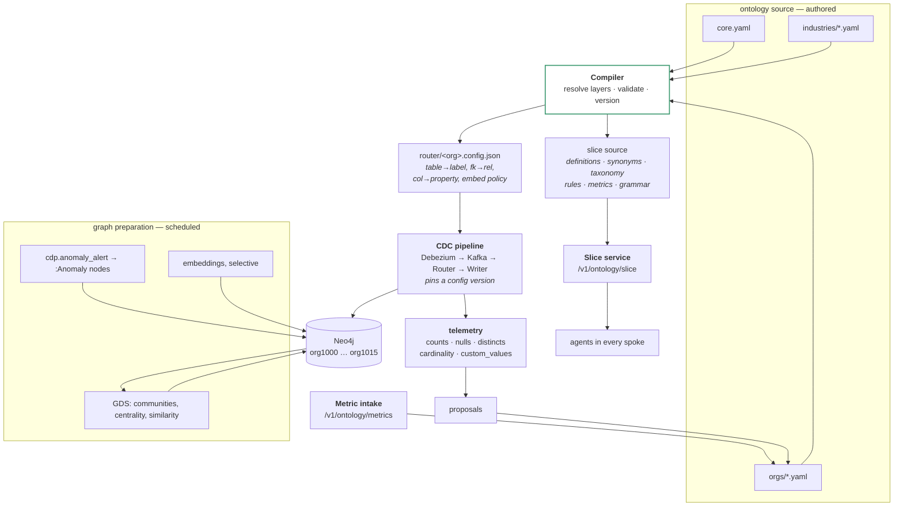

# Build Plan — Pipeline, Ontology Slice, Metric Intake

*You asked me not to follow your framing where it's wrong. Four corrections first, then the plan.*

---

## 0. Corrections

### 0.1 You said three layers, but you named two

> *"core + domain (health, education, legal,..) + industry"*

Healthcare, education and legal **are** industries. That's one layer named twice. Your own `core.yaml` already settles it:

> *"Industry vocabulary lives in `domains/<industry>.yaml`. Single-tenant overrides live in `orgs/<id>.yaml`."*

So the three layers are **core → industry → organisation**. "Domain" and "industry" are the same thing and you should pick one word and never use the other, because two files that mean the same thing means nobody knows which to edit.

**Product is not a layer.** It's a tag on entities in core, filtered at slice time by what the tenant bought. Your core file already does this with `product:` on every table. Making product a layer would fork core six ways for no benefit.

| Layer | File | Owns | Rule |
|---|---|---|---|
| Core | `core.yaml` | Domain-neutral entities, all products, tagged | Authoritative |
| Industry | `industries/healthcare.yaml` | Realisations and extensions | Adds members, never classes |
| Organisation | `orgs/1012.yaml` | Per-tenant vocabulary and extensions | Additive and narrowing only |
| *(product)* | *a tag, not a file* | | Filtered by entitlement |

### 0.2 Embeddings do not find anomalies

> *"i want the graph to be with embeddings so that the hub ... finds the issues, anomallys"*

Three different things are being conflated here, and building on the conflation would waste months.

| | What it is | What it finds | What it cannot find |
|---|---|---|---|
| **Text embeddings** (your Qwen3 migration) | A vector of the *meaning of text* on a node | "Tickets similar to this description" | Anomalies |
| **Graph embeddings** (FastRP, Node2Vec, GraphSAGE) | A vector of a node's *position in the structure* | Link prediction, node classification, structural outliers | Business anomalies |
| **Anomaly detection** | Statistics and graph algorithms | "This queue's breach rate jumped 3σ", "this ticket took an unusual path" | — |

Cosine distance between two ticket descriptions tells you they're about the same topic. It tells you nothing about whether either is unusual. Even for structural outlier detection, the standard approach is an isolation forest run *on top of* embeddings — and the research notes that Node2Vec and GraphSAGE "suffer as they do not process outliers while generating the embeddings." Embeddings are an input to outlier detection at best, never the detector.

**And you already have an anomaly detector.** `HUB_FOR_SPOKES.md` documents a `cdp.anomaly_alert` schema with `rule_id`, `metric_key`, `observed`, `threshold`, `severity`, `trigger_type: ops_anomaly`. Anomalies are already being found by a rules engine and delivered over Kafka.

So the graph's job is not to detect anomalies. It's to **hold them, connect them to what they're about, and let an agent explain them.** That's §5 of the plan and it's a fraction of the work you were imagining.

### 0.3 Nothing "consumes the complete graph"

> *"the hub ... consumes the complete graph and pass through and finds the issues"*

Not possible and not necessary. At fifteen organisations with millions of nodes, passing the graph through a model isn't a context-window problem, it's a category error.

Neo4j's own guidance on this is blunt: **large schema sizes overload the context and confuse the LLM, so you bring in only select components of the schema.** The recommended approaches are exactly the slice mechanism — vector similarity on component descriptions, or n-hop traversal from identified schema nodes.

So the shape is: **algorithms scan the whole graph offline; the agent reads a small retrieved subgraph online.** The LLM never sees more than a few dozen nodes.

### 0.4 Don't embed everything, and decide now

You're mid-migration. Step 3 of your Qwen3 plan pulls every node out of Neo4j and re-embeds it. **This is the cheapest moment you will ever have to cut the embedded set**, and after the migration it becomes a second migration.

| Label | Embed? | Why |
|---|---|---|
| Ticket (subject, description) | **Yes** | Semantic search over tickets is the highest-value case |
| Note (body, public only) | **Yes** | Finding similar resolutions |
| KnowledgeArticle | **Yes** | Its whole purpose |
| Macro | **Yes** | Finding the right template |
| Conversation (CCaaS) | **Yes** | Same as Ticket |
| Customer, Staff, Company | **No** | Names — exact and fuzzy match beat vectors |
| Queue, SLA, Product | **No** | Low cardinality, enumerable |
| AuditEvent, Notification, Email | **No** | Nobody searches these semantically |
| Session, PageView, Interaction, Conversion | **No** | Never |

Roughly five labels out of twenty-one. If those five are a third of your nodes, the migration is three times faster, the async embedder load drops by two thirds, and every future model change is cheaper.

Make this an ontology declaration, so it's a property of the model rather than a decision in code:

```yaml
Ticket:
  semantic_search: true
  embed_fields: [subject, description]
Queue:
  semantic_search: false
```

---

## 1. Architecture



**One compiler, two outputs.** The graph and the agent ontology cannot disagree because both are generated by one act. That closes the `in_queue` vs `routed_to` drift permanently.

---

## 2. Workstream A — the pipeline

### A0 · Measure first (3 days)

Before changing anything:

```cypher
// per org, per label
MATCH (n) RETURN labels(n)[0] AS label, count(*) AS n ORDER BY n DESC;
// property null rates on the top 10 labels
// current vector index inventory and dimensions
```

Produce: node census per org, embedded-node count, and **whether the Router's table→graph mapping is config or Python.** That last answer triples or thirds the estimate for A2.

**Gate:** you can state the node count per org and the share that is currently embedded.

### A1 · Split the source and build the compiler (2–3 weeks)

Restructure `core.yaml` into the three layers. Write the compiler:

```python
def compile(org_id) -> CompiledOntology:
    core     = load("core.yaml")
    industry = load(f"industries/{org(org_id).industry_pack}.yaml")
    overlay  = load(f"orgs/{org_id}.yaml", optional=True)

    model = core
    model = apply_realisations(model, industry)     # rename, add synonyms
    model = apply_extensions(model, industry)       # new entities, members only
    model = apply_overlay(model, overlay)           # additive + narrowing only
    validate(model)                                  # §A1 validators
    return CompiledOntology(
        router_config = to_router_config(model),
        slice_source  = to_slice_source(model),
        version       = hash(core, industry, overlay),
    )
```

Validators that must pass:

| # | Check |
|---|---|
| V1 | Every entity is a member of an existing upper class — overlays add members, never classes |
| V2 | No overlay redefines a core definition, identifier or global rule |
| V3 | Every relation endpoint resolves |
| V4 | Every taxonomy key names a real entity and attribute |
| V5 | Every fact-bearing entity declares `tenant_column` |
| V6 | Every entity declares `semantic_search` explicitly |
| V7 | Industry pack's `requires_core` range includes the current core version |
| V8 | Compilation is deterministic — same input, identical bytes |

**Gate:** the compiled router config for one org, diffed against the Router's current behaviour, produces an identical mapping. Any difference is either a bug you just found or a decision you must make explicitly.

### A2 · Router reads compiled config (2–3 weeks)

Move the mapping out of code. The Router holds one config per org, pins a version, and hot-swaps.

```python
class RouterConfigStore:
    def __init__(self): self._by_org, self._version = {}, None
    def refresh(self):
        v = fetch_latest_version()
        if v == self._version: return
        new = {org: fetch_config(org, v) for org in active_orgs()}
        validate_all(new)                 # if this fails, keep the old one
        self._by_org, self._version = new, v      # atomic swap
```

**Non-negotiable:** a failed validation keeps the previous config. A bad ontology change must never stop ingestion for fifteen organisations.

**Gate:** replay 24 hours of CDC through the old Router and the new one into two databases. The graphs are identical, node for node, property for property.

### A3 · Pipeline telemetry (2 weeks)

Counters in the write path, profiling on a separate schedule — **never profile inline**, your pipeline is sub-second by design and discovery on its own cadence is the standard practice.

Emitted per org per day:

```
entities declared 21 / with data 18        ⚠ 3 phantom
attributes declared 147 / always null 12   ⚠ promised, never populated
taxonomy  ticket.status  6 declared / 7 observed  ⚠ "escalated" undeclared
cardinality  Ticket→assignee→Staff  many_to_one, max observed 1   ✓
             Ticket→has_note→Note   one_to_many, max observed 43  ⚠ fan-out
custom_values  9 keys; 2 above threshold
```

**Gate:** the report for one org names at least one real problem you didn't know about. It will.

---

## 3. Workstream B — the ontology slice service

### B1 · The slice (3 weeks)

Endpoint, seeding, one-hop expansion, budget, metrics included.

```
POST /v1/ontology/slice
Authorization: Bearer <JWT>        ← org, industry, role, entitlements, principal
{ "agent": { "id", "version", "purpose", "tools" },
  "request": { "budget_tokens", "format", "known_content_hash" } }
```

Everything about tenancy comes from the token. Nothing about tenancy comes from the body.

Slice contents, in fixed order:

1. `data_scope` — what rows this principal sees, and the words to use when reporting a number
2. `decision_card` — when to measure, when to retrieve, when to ask
3. `you_work_with` — entities at full detail, with definitions, synonyms, taxonomy
4. `also_exists_nearby` — one-hop neighbours, name and one line only
5. `you_can_ask_for` — the metric grammar for those entities
6. `rules` — business rules whose entities are all present
7. `handoff` — what this agent doesn't cover, and who does

Caps: scoped agent 6,000 tokens, hub 4,000.

**Gate:** two agents with different purposes receive correct and materially different slices, and a create-ticket agent receives no metrics at all.

### B2 · Slices are precomputed (1 week)

Compile-time warming for every registered agent × role × industry × overlay revision. Cache key excludes `tenant_id` — key on `(industry, overlay_revision, entitlements_version, role, descriptor)` so hundreds of tenants with no overlay share one slice.

**Gate:** p99 under 10ms warm; cold-path share under 1%.

---

## 4. Workstream C — the metric intake endpoint

### C1 · Registration (2 weeks)

```
POST /v1/ontology/metrics/register
{
  "product": "ticketing",
  "scope": { "kind": "product" },        // product | industry | organization
  "measures_entity": "Ticket",
  "measure": "count",
  "qualifier": "escalated",
  "means": "A ticket moved to a higher priority or reassigned to L2 after first response.",
  "breakdowns": ["queue", "priority", "assignee"],
  "module_version": "2.4.1"
}
```

Validation, all rejecting:

| Check | Reason |
|---|---|
| `Ticket` exists in the effective ontology for this scope | Can't measure what isn't modelled |
| `(Ticket, count, escalated)` is not already taken | Two metrics on one key is the ambiguity you're removing |
| Every breakdown resolves to a real attribute or relation | Otherwise the agent offers a breakdown that fails |
| `means` is not template-generated | *"Period aggregate for escalated metric"* is not a definition |
| `means` distinguishes it from its siblings | `escalated` vs `reopened` vs `overdue` |
| Scope is permitted for the caller | A product module cannot register an industry-wide metric |

**The ontology stores the meaning. The module keeps the SQL.** That's what makes the conformance test possible later: the ontology says what `escalated` means, the module implements it, a test proves the number matches.

`scope: product` applies live. `scope: industry` requires review, because it changes what other tenants see.

**Gate:** a spoke registers a metric; it appears in the relevant agents' next slice; a duplicate key is rejected with a useful message.

### C2 · Proposals from telemetry (2 weeks)

The `custom_values` profile from A3 feeds the same intake, as proposals rather than registrations. The classifier answers one question with a strong default:

**attribute · taxonomy value · relation · entity — and attribute is the default.**

Blood group is a property of a patient with eight values. It is not an entity. Get that default wrong and an org with forty custom fields becomes an org with forty entities.

Thresholds: attribute needs ≥50 rows and ≥5% coverage; taxonomy needs ≤25 stable distinct values; entity needs its own id, ≥2 attributes, ≥100 instances **and** a valid upper-class membership; relations are never automatic.

Caps per org: unlimited synonyms and taxonomy values, 20 attributes per entity, **10 entities before review is forced**, 0 automatic relations.

**Gate:** a real `custom_values` field is profiled, proposed as an attribute with a taxonomy, approved, and appears in that org's slice and graph — without anyone writing YAML by hand.

---

## 5. Workstream D — preparing the graph

This is what "greatly prepared" should actually mean.

### D1 · Apply the embedding policy (1 week, before the Qwen migration completes)

Drop vector indexes on labels declared `semantic_search: false`. Re-embed only the declared set. Do this **during** the migration you're already running, not after.

**Gate:** embedded node count drops by the expected proportion; semantic search still returns good results on the five labels that kept vectors.

### D2 · Anomalies as nodes (2 weeks)

You already have `cdp.anomaly_alert` on Kafka. Consume it into the graph.

```cypher
MERGE (a:Anomaly {alert_id: $alert_id})
SET a.rule_id = $rule_id, a.metric_key = $metric_key,
    a.observed = $observed, a.threshold = $threshold,
    a.severity = $severity, a.detected_at = datetime($ts)
WITH a
MATCH (q:Queue {id: $queue_id})
MERGE (a)-[:ABOUT]->(q)
```

Now an agent finds anomalies by traversal in milliseconds:

```cypher
MATCH (a:Anomaly)-[:ABOUT]->(e)
WHERE a.detected_at > datetime() - duration('P7D') AND a.severity IN ['high','critical']
RETURN a, e, labels(e)[0] AS about
```

And because the anomaly is *connected* to the entity, the agent can traverse outward to explain it — which queue, which agents are in it, which tickets breached, what changed. **That's the thing a graph gives you that a metric alert doesn't**, and it needs no LLM to find and no whole-graph scan.

**Gate:** a Kafka anomaly alert appears as a connected `:Anomaly` node within a second, and a two-hop traversal returns the context needed to explain it.

### D3 · Precomputed structure (2 weeks)

Scheduled GDS runs, results written back as properties. Not on the request path.

| Algorithm | Written back as | Answers |
|---|---|---|
| Leiden / Louvain | `community_id` on Staff, Queue | "Which teams cluster together in practice?" |
| Degree / PageRank | `centrality` on Queue, Staff, Product | "Which queues are load-bearing?" |
| Node similarity | `:SIMILAR_TO` edges between Tickets | Duplicate and recurring-issue detection |
| K-core | `core_number` | Structural importance |

**Gate:** a nightly job completes inside its window for the largest org, and an agent can answer "which queues are most central" without running an algorithm.

### D4 · Indexes and constraints (1 week)

Uniqueness constraints on every entity key per org, range indexes on every property used in a scope predicate or a common filter, vector indexes only where declared. Unindexed scope predicates are the difference between 5ms and 5s on every query.

**Gate:** every scope predicate column is indexed in every org database.

---

## 6. The graph agent's contract

You said this agent isn't yours to build. Fine — but the contract is, because it's the difference between it working and not.

**It gets the ontology slice, not the schema dump.** Neo4j's own guidance is that large schemas overload the context and confuse the model; you bring in only the relevant components. Your slice service already does exactly that, and because the labels and the slice come from one compiler, the slice describes precisely the graph it's querying. That's the real argument for building your own rather than using a generic NL-to-graph tool — not better language handling, **grounded** language handling.

Four hard requirements:

| # | Requirement | Why |
|---|---|---|
| 1 | **Scope predicate injected into every Cypher** | Database-per-org gives tenant isolation. It gives *nothing* for one employee seeing another's tickets. Resolved to `ticketing.agents.id`, never `setup_users.id`. |
| 2 | **Read-only transactions, parameterised Cypher, injection validation** | A generated query must never be able to write |
| 3 | **Self-healing on failure** — send the error back once, then stop | Standard practice, and the retry cap stops loops |
| 4 | **The generated Cypher is returned with the answer** | Provenance. A wrong answer is unattributable without it. |

Requirement 1 is currently owned by nobody, and it's the easiest way to leak one employee's data to another.

---

## 7. Sequencing

Two tracks, different people, one dependency between them.

```mermaid
gantt
    dateFormat X
    axisFormat %s
    section Pipeline
    A0 measure            :a0, 0, 1
    A1 compiler           :a1, after a0, 3
    A2 router config      :a2, after a1, 3
    A3 telemetry          :a3, after a2, 2
    section Ontology
    B1 slice service      :b1, 0, 3
    B2 warming            :b2, after b1, 1
    C1 metric intake      :c1, after b1, 2
    C2 proposals          :c2, after a3, 2
    section Graph
    D1 embedding policy   :d1, 0, 1
    D2 anomaly nodes      :d2, after d1, 2
    D3 GDS precompute     :d3, after d2, 2
    D4 indexes            :d4, after d3, 1
```



| Order | Why |
|---|---|
| **D1 first, immediately** | You're mid-migration. This window closes. |
| A1 before A2 | Can't drive the Router from a config that doesn't compile |
| B1 in parallel with A1 | Different people, no dependency |
| C2 after A3 | Proposals need the telemetry that produces the evidence |
| D2 early | Cheap, and it's the thing the Hub actually needs |

Roughly **12 weeks with two tracks**, 18 with one.

---

## 8. What I'd change about your framing, summarised

| You said | Do instead |
|---|---|
| core + domain + industry | core + **industry** + **organisation**; product is a tag |
| Graph with embeddings so the Hub finds anomalies | Embeddings for semantic search on five labels; anomalies from the alert stream you already have, stored as connected nodes |
| Hub consumes the complete graph | Algorithms scan offline; the agent reads a retrieved subgraph |
| Ontology should be one file | Authored in three layers, **served as one compiled slice** |
| Metrics in the ontology? maybe | **Yes** — meaning in the ontology, SQL in the module |

---

## 9. What I need from you

1. **Is the Router's mapping config or Python?** Decides whether A2 is three weeks or nine.
2. **Node count per org, and share currently embedded.** Sizes D1 and tells us how much headroom exists.
3. **Who consumes `cdp.anomaly_alert` today?** If something already writes them somewhere, D2 is plumbing rather than new work.
4. **Is `custom_values` consistent JSON per org, or freeform?** Determines whether C2's classifier is reliable or needs a human on every proposal.
5. **Who owns scope injection in Cypher?** Currently nobody. This needs a name before the graph agent ships.
6. **Does anything besides the NL agent read the graph today?** If dashboards read it, renaming `Contact` to `Customer` in A1 needs a migration path.
7. **GDS licence tier?** Some algorithms are Enterprise-only, which changes D3.

Question 5 is the one I'd want answered this week. Everything else is scheduling; that one is a data-protection gap.
