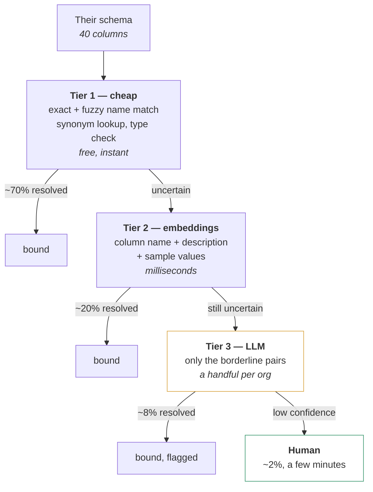
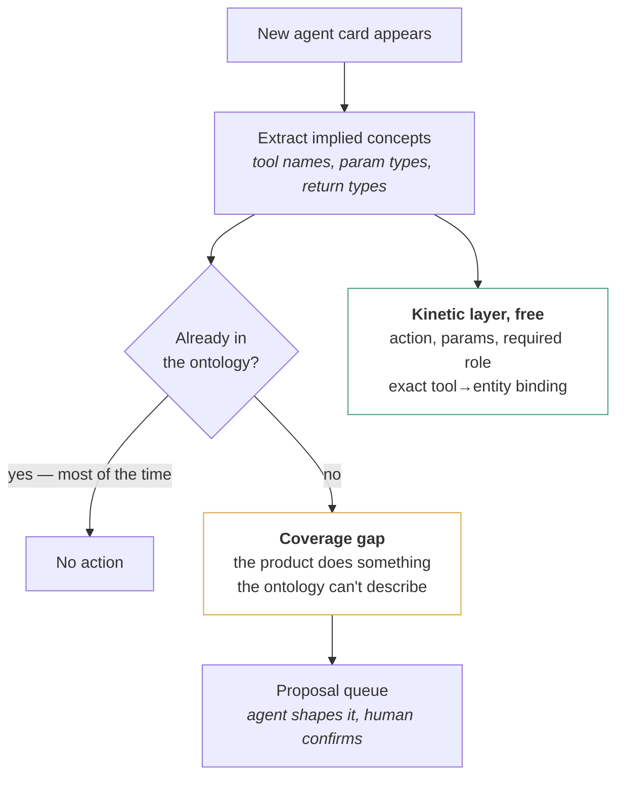
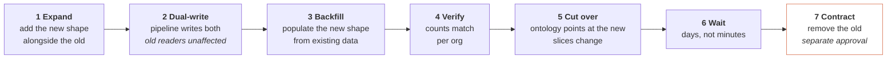

# Your Seven Points, Assessed

*What each thing actually is, whether you're right, and what to do about it.*

---

## 1. Aligning your ontology with a customer's database

**You're right, and this has a name: ontology matching** (also called ontology alignment, or schema matching when one side is a database). It's been a formal research field since the early 2000s with an annual benchmark — the Ontology Alignment Evaluation Initiative.

The task is precisely yours: given your ontology and their schema, produce a set of correspondences — for each pair, which of *equivalent*, *narrower*, *broader*, *disjoint* or *overlapping* holds, and with what confidence.

### The pattern that wins, and it isn't "give it to an LLM"

Three findings from recent work that change how you'd build this:

**Don't put whole schemas in a prompt.** Loading complete ontologies into an LLM is "computationally expensive and often infeasible" on context grounds, and produces unstructured output nobody can evaluate automatically. Every serious system reduces the search space first.

**Use the LLM only on the borderline cases.** MILA's retrieve-identify-prompt pipeline finds most correspondences cheaply and limits LLM requests to the genuinely uncertain ones. It achieved the highest F-measure in five of seven unsupervised OAEI 2024 tasks, beating state-of-the-art systems by up to 17% — **with reduced runtime**, not more.

**Use the human only on what the LLM is unsure about.** A 2026 EACL paper puts it directly: human-in-the-loop has become essential where accuracy matters, but user involvement is expensive on large ontologies. Their answer is to use LLMs as oracles *only* to validate high-uncertainty correspondences — top-2 overall in OAEI 2025's bio-ml track.

So the shape is a three-tier funnel, not a single step:

On a forty-column table, that's roughly two columns reaching a person. That's an onboarding task, not a project.

### Two cautions

**Most tooling only does 1:1.** A source column mapping to one target concept is well-solved. What's harder and newer is *complex* alignment — their `party_ref` meaning your `Customer` reached through two joins, or their single `contact_info` splitting into your `email` and `phone`. Expect those to need a person, always.

**Alignment needs repair.** BERTMap and similar systems include a logic-based repair step to ensure the resulting alignment is *coherent* — because individually plausible mappings can contradict each other. Your version: after binding, check that the result doesn't say their `account` is both your `Company` and your `Customer`.

### For you, concretely

Coverage is the honest metric, reported per org: *"of their 40 columns we bound 34, 4 are unmapped, 2 need review."* An org with 60% coverage gets agents that can answer 60% of questions about their data and should know to refuse the rest.

---

## 2. Dynamic ontology

> *"mostly knowledge graph which is backed by ontology and also should be able to handle new data to align dynamically with human approval"*

**Right on the mechanism, and there's one distinction worth being strict about**, because getting it wrong makes the human-in-the-loop impossible.

### New data arriving is not the ontology being dynamic

| | Changes | Rate | Needs approval? |
|---|---|---|---|
| **A-Box** — the graph, instances | Constantly | Millions of rows an hour | **Never.** Impossible. |
| **T-Box** — the ontology, schema | Rarely | A handful a week across all orgs | **Always.** Tractable. |

A million tickets arriving changes nothing about the ontology. `Ticket` is still `Ticket`. That's not dynamism, that's the pipeline working.

The ontology is dynamic when the **T-Box** changes: a new entity, a new attribute, a new taxonomy value, a new relation, a new rule.

**Why the distinction is load-bearing:** if you conflate them, you end up designing approval flows for data volume, which cannot work. Separate them and human review becomes obviously feasible — nobody approves a ticket; somebody approves adding `blood_group` to Patient, once, for one org.

That rate difference is the entire reason your idea is buildable.

### What "dynamic" correctly means for you

| Layer | Who changes it | Rate | Gate |
|---|---|---|---|
| Core T-Box | You | Monthly | Full review |
| Industry T-Box | You, from proposals | Monthly | Full review |
| Org T-Box | Proposals from data, endpoint, capabilities | Weekly | Human confirms meaning |
| A-Box | CDC, continuously | Constant | None |

---

## 3. Operational ontology — what to do about it

**Nothing. You already have one.** It isn't a thing to build; it's a property an ontology either has or doesn't.

### The test

> **If you deleted the ontology file tomorrow, what breaks?**

| Answer | What you have |
|---|---|
| Some documentation goes stale | A **descriptive** ontology. A glossary. |
| Agents stop working, the pipeline stops mapping, metrics stop resolving | An **operational** ontology |

Yours drives the Router's mapping, the agent slices, the metric grammar and the scope rules. That's operational, by definition. Palantir's framing of their Ontology as containing both semantic elements and *kinetic* ones — actions, functions, dynamic security — is describing the same property.

### The one thing to actually do

Keep it. And there's a single rule that keeps it:

> **Nothing that drives runtime behaviour may be defined anywhere except the ontology.**

The moment the Router has a hardcoded table mapping the ontology doesn't know about, or an agent has a prompt listing entities, you're back to descriptive — the ontology becomes a document that *describes* behaviour rather than *causing* it, and the two drift within a quarter.

You have live evidence of this already: `in_queue` in the graph versus `routed_to` in the agent ontology. Two descriptions of one relationship, drifting, because neither causes the other.

---

## 4. Temporal and spatial

### Spatial — you don't have a spatial problem

The PDF spends real effort on GeoSPARQL, RCC8 topology, H3 indexing and geofencing. Those matter for delivery routing, territory management, moving assets, environmental modelling.

Your spatial needs across ticketing, CRM, CCaaS, CDP, campaign and web tracking are: **country, city, timezone**, and coarse geo on web visitors for grouping. Three attributes and a breakdown dimension. Not a reasoning framework.

Adopting spatial ontology machinery would be building for a problem you don't have. If you ever add field service — engineers dispatched to addresses — revisit it. Not before.

### Temporal — one real bug, one real opportunity

**The bug: timezone.** Your global rule says all dates and times are in the tenant timezone. If your metrics aggregate on a UTC `created_at`, then every "today", "last 7 days" and "created this month" figure is wrong for every tenant outside UTC — silently, every day, at every boundary. I'd check this before anything else in this document; it's half a day and it outranks everything.

**The opportunity: selective valid time.** The distinction worth taking from the PDF is *valid time* (when a fact was true) versus *transaction time* (when you recorded it). Your CDC gives you transaction time free. You have no valid time.

But don't go bitemporal broadly. Neo4j has no built-in temporal semantics — times are ordinary properties, and **there are no relationship property indexes**, so filtering large relationship sets by time performs badly. Bitemporal support in graph databases remains limited and adoption slow precisely because most projects never use what they paid for.

Version only the relationships people ask historical questions about:

| Relationship | Version? | Question |
|---|---|---|
| `Ticket -assigned_to-> Staff` | Yes | "Who owned it when it breached?" |
| `Staff -member_of-> Queue` | Yes | "Who was on the team that month?" |
| `Ticket -raised_by-> Customer` | No | Never changes |
| Web tracking anything | No | Events are already timestamped facts |

And split current from history with labels so the common query never touches the history path — otherwise you pay the temporal cost on every query including all the ones that don't care.

---

## 5. "Advanced ontology"

**Not a term of art.** There's no definition, no literature, no benchmark. When someone says it they mean one of the things below, and asking which is more useful than accepting the label.

The real axes of sophistication, with an honest read on where you sit:

| Axis | Levels | You |
|---|---|---|
| **Expressiveness** | glossary → taxonomy → relations → constraints → formal logic | **Relations + constraints.** Right level. Going to formal logic buys you nothing here. |
| **Operationality** | describes → drives runtime | **Drives runtime.** Already advanced on this axis. |
| **Extensibility** | monolith → layered → tenant-extensible | **Layered, moving to tenant-extensible.** Ahead of most. |
| **Governance** | ad hoc → reviewed → versioned with rollback | **Reviewed, rollback in design.** In progress. |
| **Temporality** | current state only → versioned → bitemporal | **Current state.** Fine, mostly. |
| **Federation** | one source → multi-source → virtual over inaccessible data | **One source, moving to virtual.** The new frontier for you. |

If someone wants you to build an "advanced ontology," the productive response is: *which axis, and why does it pay?* Formal logic and bitemporality are the two most commonly demanded and least commonly worth it.

---

## 6. Agent capabilities → auto-created ontology

> *"when a new agent has been created we will be getting the agents capabilities and skills and based on that the ontology should be created automatically... (creating new entities, and also dividing the entities based on the requirements)"*

**Half right, and the half that's wrong is the important half.**

### Capabilities are excellent for finding gaps, poor for creating entities

A capability tells you what an *agent does*. The ontology describes what the *domain is*. They're correlated but not the same, and treating capability as the source of domain truth biases you badly.

Concretely: if you generate entities from capabilities, you get an entity per tool. Three agents that all work on tickets produce `Ticket`, `TicketStatus`, `TicketAssignment` — three entities where one plus two properties is correct. The bias is systematic and it always goes the same way, toward over-fragmentation.

**Your own example shows it.** A ticket-status agent needs `Ticket` and the taxonomy `ticket.status: [open, pending, reopened, resolved, overdue]` — both already in your ontology. Nothing should be created. Status has no identity, no lifecycle, and nobody asks how many statuses exist.

### What to use capabilities for instead

A gap is a real finding. `tk.ticket.merge` with a `duplicate_of_ticket_id` parameter implies a `Ticket -duplicate_of-> Ticket` relation you don't have, which means no agent can reason about duplicates even though the product can merge them. **Nobody finds that by reading files.**

### On "dividing the entities"

You raised entity splitting and it deserves a straight answer: **splitting is a destructive change and the hardest kind of ontology evolution.** It should never be automatic, whatever the approval flow.

Legitimate reasons to split:

| Reason | Example |
|---|---|
| Two genuinely different lifecycles under one name | `Contact` covering both a person and a company |
| Different identity | Rows identified by different keys |
| Different access class | Part of the entity is L3 sensitive, part isn't |
| Different binding mode | Half local, half from their API |

Illegitimate reasons, all of which come from capability-driven thinking:

- A new agent works on a subset of it
- It has a lot of attributes
- Different teams use different parts

The distinction: **split on identity and lifecycle, never on usage.** Two agents using different halves of `Ticket` is not a reason to have two entities — it's what slices are for.

And note what a split costs downstream: every existing relationship must be reassigned to one side or the other, every metric bound to it must be re-bound, every slice changes, and existing graph data must be migrated. It's a migration, not an edit. Which brings us to your last point.

---

## 7. Approved changes → automatic Neo4j updates

**Right in principle, and the thing to get right is that additive and destructive changes are completely different problems.** Treating them the same is how you lose data.

### The hazard, stated plainly

**Neo4j is schemaless, so schema drift is silent.** Nothing stops a label from existing that the ontology doesn't know about, or the ontology promising a property no node has. There's no error — just wrong answers later.

A useful invariant from the graph-RAG world: *there is no API that can declare schema your data doesn't match.* The ontology is a contract, and if it promises an attribute, every instance of the owning entity must be queryable for it — even if the value is null.

### Three classes of change

| Class | Examples | Auto-apply? | Reversible? |
|---|---|---|---|
| **Additive** | new label, new property, new relationship type, new taxonomy value | **Yes** | Yes |
| **Backfill** | new property that must be populated from existing rows or the raw blob | **Yes**, as a background job | Yes |
| **Destructive** | rename, split, merge, delete, retype, change a key | **No** | **No** |

Additive is genuinely safe. A new label appears, the Router starts writing it, nothing that exists is touched. Backfill is safe but slow and must be idempotent and resumable — you're running it across fifteen databases and one will fail halfway.

Destructive is a different animal and needs the expand–migrate–contract pattern:

**Never rename in place.** Seven steps, days apart, each reversible until step seven. Step seven is a second human decision, not a continuation of the first.

### Use a migration framework, don't hand-roll it

This is solved. Neo4j-Migrations is Flyway-inspired, builds on the official driver, and **supports multidatabase** — which matters directly, because you have one database per org. APOC's refactor procedures give you the primitives: rename label, rename relationship type, extract a property into a node, clone and split nodes.

The pattern worth copying from the migration tooling in this space:

- **An intermediate representation of the schema, hashed and diffable** — so you can compare two ontology versions without touching the database
- **Generated migration files with detected changes**, reviewed before they run
- **A `rollback_safe` flag per migration** — and unsafe migrations *refuse* to downgrade rather than trying and corrupting
- **Dry-run mode** as the default for anything destructive
- **A ledger** of what was applied where

### The per-org multiplication

Fifteen databases, soon more. Every migration runs fifteen times, and the requirements that follow are not optional:

- **Idempotent** — running it twice must be harmless
- **Resumable** — org 9 fails, orgs 1–8 stay applied, you retry 9
- **Independently tracked** — a per-org ledger, not one global "applied" flag
- **Non-blocking** — one org's failure must not stop the other fourteen
- **Version-aware** — an org can legitimately be a version behind for a day

And the Router must tolerate the window: while orgs 1–8 are on v1848 and 9–15 are on v1847, the Router needs the right config per org. That's already the design, but it's the reason it has to be per-org config rather than one global config.

---

## Summary

| # | Your point | Verdict |
|---|---|---|
| 1 | Align with customer databases | **Right.** It's ontology matching. Use a three-tier funnel — cheap, then LLM on borderline, then human on the rest. ~2% reaches a person. |
| 2 | Dynamic ontology | **Right mechanism.** But new *data* isn't dynamism — only T-Box changes are, and that rate difference is why approval is feasible. |
| 3 | Operational ontology | **You already have one.** Nothing to build. One rule: nothing that drives runtime is defined outside the ontology. |
| 4 | Temporal / spatial | **Spatial: you don't have this problem.** Temporal: fix the timezone bug, then selective valid time only on relationships with historical questions. |
| 5 | Advanced ontology | **Not a real term.** Six axes of sophistication; you're already advanced on two and behind on one (federation). |
| 6 | Capabilities → auto-create ontology | **Half right.** Excellent for finding gaps and free kinetic layer. Bad for creating entities — biases toward one entity per tool. Never auto-split. |
| 7 | Approved change → auto-update Neo4j | **Right, with a hard split.** Additive auto-applies. Destructive needs expand–migrate–contract over days. Use a migration framework; Neo4j is schemaless so drift is silent. |

The one I'd act on this week is the timezone check in point 4. Everything else is design; that one may already be producing wrong numbers.
