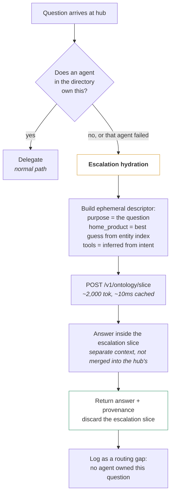
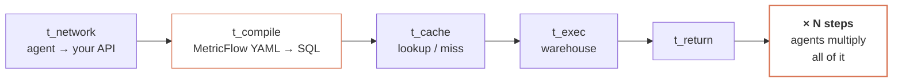
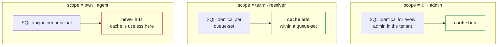

# Context, Latency & Growth — Specification v5

**Status:** Approved for implementation
**Relationship to v4:** Companion. v4 defines *structure* (what the ontology is, how tenancy and industry work). v5 defines *operating characteristics* (how much context, how fast, how it grows) and **supersedes v4 §12.2 hub sizing, §13.2 purpose guidance, §14.4 budget ladder**.
**Ends with:** §11 — why dbt, and why not just SQL.

---

## 0. What v5 changes

| v4 said | v5 says | Why |
|---|---|---|
| Budget is a demotion ladder | Budget is a **declared allocation per content class**, with per-class caps and a distractor ceiling | A single ladder cannot express "metrics may never exceed 30% of the slice" |
| Hub ≈ 7,000 tokens including a metric index | Hub ≈ **3,000 tokens with no metric index**, plus **escalation hydration** when it must answer | The v4 estimate assumed ~180 metrics. At 6 products × ~100 you get ~600, and the index alone is 10,800 tokens |
| Context budget is about cost | Context budget is about **correctness** | Every frontier model degrades with length; distractors compound |
| Slice size will be fine | Slice size MUST be **invariant to ontology growth**, asserted by a test | Otherwise every agent slowly rots as you add entities |
| dbt SL is called at runtime | dbt is a **build-time compiler**. Hot-path SQL is precompiled into the snapshot | Agents multiply compile + cache + execution per step |
| Agents infer what to do from prose scattered in the slice | Every slice carries a **decision card** — one compact block stating the answer policy | ~150 tokens, highest value-per-token in the system |

---

## 1. Context is a correctness budget

### 1.1 The evidence

This is the reframing the whole document rests on. Sending less context is not a cost optimisation; it is the primary accuracy intervention available to you.

| Finding | Source |
|---|---|
| Every one of 18 frontier models tested — GPT-4.1, Claude 4 family, Gemini 2.5, Qwen3 — degrades as input length grows. Not some. All. | Chroma context-rot study, 2025 |
| Accuracy drops 30%+ when relevant information sits mid-context rather than at the start or end. U-shaped position curve. | Liu et al., Stanford/UC Berkeley, TACL 2024 |
| With just 20 retrieved documents (~4,000 tokens), accuracy can fall from 70–75% to 55–60%. The information is present; the model attends to it less. | Stanford, 2023 |
| **One distractor lowers performance; four compound it.** Damage is worst when distractors are semantically similar to the answer. | Chroma, 2025 |
| Models performed *better* on shuffled haystacks than on logically coherent documents — coherent text creates more plausible-seeming distractors. | Chroma, 2025 |
| Rule of thumb for high-accuracy workloads: stay at 20–40% of the documented context window. | Practitioner consensus, 2026 |
| Degradation is an architectural property of transformer attention, not a capability gap training will close. Larger windows raise the ceiling; the shape of the curve persists. | Multiple, 2026 |

The tell that catches most teams: **the same task passes on a short input and fails on a long one.** You will not see an error. You will see quality drift — facts from early context coming back wrong, constraints in the middle being ignored, answers sharp on the first three tool calls and vague by the tenth.

### 1.2 The distractor theorem

> **The metric catalogue is the highest-distractor-density object in any slice, and therefore the first thing to cut.**

A distractor is content that is semantically similar to the answer but irrelevant. Ranked by density in your current payload:

| Content class | Distractor density | Why |
|---|---|---|
| **Metrics** | **Very high** | `open_tickets_metric`, `active_tickets_metric`, `pending_tickets_metric`, `unassigned_tickets_metric`, `current_overdue_tickets_metric` are five near-identical strings. Exactly the configuration Chroma found most damaging. |
| Dimension lists | High | The same 23 dimensions repeated 45 times is 45 copies of one distractor set |
| Entity stubs | Low | Short, structurally distinct, and each names a different thing |
| Business rules | Low | Semantically distinct from each other and from the question |
| Taxonomy | Very low | Enumerations, not prose |

**Make it measurable.** At build time:

```python
def distractor_density(items, threshold=0.85) -> float:
    """Fraction of items that have at least one near-twin in the same slice."""
    emb = np.stack([i.embedding for i in items])
    sim = emb @ emb.T
    np.fill_diagonal(sim, 0)
    return float((sim.max(axis=1) > threshold).mean())
```

| Class | Ceiling | Enforcement |
|---|---|---|
| Metrics in a slice | **≤ 0.15** | Build error (B36) |
| Entities in a slice | ≤ 0.10 | Warn |
| Whole slice | ≤ 0.12 | Warn |

A metric density above 0.15 means more than one in seven metrics has a near-twin in the same context. The fix is never "raise the ceiling" — it is a sibling group with a discriminator (v4 §5.2), a sharper `when`, a merge, or a demotion to `component`.

### 1.3 The budget is a fraction of the *session*, not the window

The slice is the only fixed part of the context. Everything else grows: conversation history, tool schemas, tool outputs, retrieved rows, intermediate reasoning. A slice sized against the window is sized against a number that is never available.

```
window            200,000
  system prompt     1,500
  tool schemas      2,000
  SLICE            ≤8,000      ← the only part we control at hydration
  conversation      grows
  tool outputs      grows fastest — a 500-row retrieval is 15,000 tokens
  headroom
```

**Hard caps, enforced at build time:**

| Slice class | Cap | Target |
|---|---|---|
| Lifecycle agent (no metrics) | 3,000 | 1,500 |
| Scoped agent (one product) | 6,000 | 2,500 |
| Cross-product agent (2–3 products) | 8,000 | 4,000 |
| SQL harness | 5,000 | 2,500 |
| **Hub** | **4,000** | **3,000** |
| Escalation slice (§3.3) | 3,000 | 2,000 |

These are ~1.5–4% of a 200K window. That is deliberate. The slice competes with tool outputs, and a single Lane 3 retrieval can be five times the size of the slice.

---

## 2. The slice budget system

### 2.1 Allocation by content class

v4's single demotion ladder cannot express "metrics may never dominate." Replace it with a **declared allocation**, checked before rendering.

```yaml
# ontology/policies/budget.yaml
budget_profiles:
  scoped_agent:
    total: 6000
    reserved:                 # never cut, at any budget
      decision_card:      200
      data_scope_note:    120
      global_rules:       450
      handoff_note:       120
    allocated:                # cut in ladder order within each class
      entities_l2:       2200
      entities_l1:        700
      action_contracts:   600
      metrics:           1200      # ≤ 20% of total — the distractor cap
      dimension_sets:     300
      sibling_groups:     150
      relations:          400
      taxonomy:           400
    overflow: demote          # demote | drop | error
```

```python
def fit_budget(parts, profile) -> Parts:
    reserved = sum(profile.reserved.values())
    for cls in LADDER_ORDER:                       # §2.2
        while parts.tokens(cls) > profile.allocated[cls]:
            if not demote_one(parts, cls):
                break                              # class is at its floor
    if parts.total() > profile.total:
        return emergency_floor(parts, profile)     # §2.3
    return parts
```

**Per-class caps are the point.** Without them, an agent whose purpose happens to seed thirty metrics ends up with a slice that is 60% metrics and a distractor density of 0.4 — structurally the worst possible context, and no global ladder would notice.

### 2.2 Ladder order, per class

| Class | Demotion order | Floor |
|---|---|---|
| `metrics` | drop `component`-adjacent → drop lowest-seed-score → **never break a sibling group** | tool-derived + seeded metrics |
| `entities_l1` | single-seed stubs first, ascending by score | endpoints of L2 relations (I1) |
| `entities_l2` | count-promoted → product-floor | action-derived + tool-derived seeds |
| `relations` | drop those with an L0 endpoint | all relations between L2 entities |
| `taxonomy` | drop for L1 entities | all taxonomy for L2 entities (I2) |
| `dimension_sets` | drop dims unused by any retained metric | dims referenced by retained metrics |
| `action_contracts` | drop `effects` prose, keep `preconditions` | **preconditions never dropped** |

Rule selection re-runs after every demotion (I3).

### 2.3 Emergency floor

If everything reserved plus every class floor still exceeds `total`, return:

```json
{ "budget_exceeded": true, "required": 7400, "budget": 6000,
  "cause": "12 tool-derived L2 entities — this agent has too many jobs" }
```

and alert. **Do not keep cutting.** A budget that cannot hold the entities the agent's own tools operate on means the agent is over-scoped, and that is a decision for a person. In practice the answer is almost always to split the agent.

### 2.4 Slice size MUST be invariant to ontology growth

The critical property. If adding entities to the ontology grows every agent's slice, the system rots continuously and invisibly.

It holds by construction, because every expansion mechanism is bounded by the *agent's job*, not by ontology size:

| Mechanism | Bounded by |
|---|---|
| Seeding | top-k plus a score threshold — bounded |
| One-hop expansion | the seeds' own relation degree — bounded |
| L0 lists | omitted entirely for scoped slices (v3 §11.7) |
| Metric selection | gated on `measures ∈ L2` — bounded by the L2 set |
| Rule selection | subset of the L2 set — bounded |

**Assert it (I34, B37).** The growth test:

```python
def test_slice_size_invariant_to_ontology_growth():
    base = compile(ontology)
    doubled = compile(ontology + synthetic_entities(n=len(ontology.entities)))
    for d in registry.active_descriptors():
        a, b = build_slice(d, base), build_slice(d, doubled)
        assert b.tokens <= a.tokens * 1.10, f"{d.id} grew {b.tokens/a.tokens:.0%}"
```

Synthetic entities MUST be generated in the same domain vocabulary, not as nonsense strings — otherwise the seeding channels never touch them and the test passes vacuously.

### 2.5 Agent over-scope alarm

A separate signal from budget: **L2 entity count per agent**.

| L2 count | Meaning |
|---|---|
| 3–8 | Healthy. A focused agent. |
| 9–14 | Watch. Possibly two jobs. |
| **15+** | **Alert.** Almost always an agent doing several jobs that should be split. |

Splitting an over-scoped agent into two improves accuracy more than any budget tuning, because it halves both slice size and distractor density at once.

---

## 3. The hub problem

### 3.1 Why v4's number was wrong

v4 estimated ~7,000 tokens for the hub, including a metric index. That assumed ~180 metrics. Ticketing alone has ~100. Six products plausibly gives 500–600.

| Component | v4 estimate | Realistic at 6 products |
|---|---|---|
| Product register | 120 | 120 |
| Primary entities L1 (~40) | 1,000 | 1,000 |
| Remaining entities L0 (~110) | 440 | 440 |
| Bridges at L2 | 300 | 300 |
| **Metric index** | **3,240** | **~10,800** |
| Action index | 600 | 1,200 |
| Agent directory | 750 | 750 |
| Rules + scope note | 530 | 530 |
| **Total** | **~7,000** | **~15,100** |

And the metric index is 600 near-identical strings — a distractor density approaching 0.5. It is simultaneously the largest and the most damaging component.

### 3.2 The hub carries no metric index

**A hub routes. Routing needs to know who handles what, not which metric answers what.**

Asked *"what's our SLA compliance this month?"*, the hub needs to know that `ticketing.reports` handles SLA. It does not need to know that `first_response_sla_compliance_rate` exists — the reports agent knows that, because its own slice contains it.

The agent directory already encodes this. It **subsumes** the metric index for routing purposes at 1/14th the tokens.

| Component | Tokens |
|---|---|
| Product register | 120 |
| Primary entities L1 (~40) | 1,000 |
| Remaining entities L0 (~110) | 440 |
| **All bridges at L2** — the hub's specialty | 300 |
| Agent directory (~30) | 750 |
| Global rules + scope note + decision card | 650 |
| **Total** | **~3,260** |

**Growth is now O(products + agents), not O(metrics).** A seventh product adds ~300 tokens. Four hundred new metrics add zero.

### 3.3 Escalation hydration — how the hub answers

But the hub *is* the fallback when a product agent cannot solve something. Without a metric index, how does it answer?

**It doesn't. It hydrates a purpose-built slice for the question and answers inside that.**



```python
def escalate(question, hub_slice, ctx) -> Answer:
    subject = hub_slice.entity_index.best_match(question)      # from L0/L1 names
    desc = EphemeralDescriptor(
        id           = f"hub.escalation.{sha1(question)[:8]}",
        purpose      = question,                                # the question IS the purpose
        home_product = hub_slice.product_of(subject),
        tools        = infer_tools(question),                   # measure -> query_metrics, etc.
        budget       = 3000,
        ephemeral    = True,                                    # not added to the registry
    )
    sub = hydrate(desc, ctx)              # SAME endpoint, same auth, same row scope
    ans = answer_in_subcontext(question, sub)
    metrics.increment("hub_escalation", product=desc.home_product)
    return ans
```

Four properties worth stating:

- **The hub's own context never grows.** The escalation slice lives in a sub-context and is discarded. The hub stays ~3,200 tokens for its entire life.
- **Row scope is unchanged (v4 D21).** Escalation uses the same token and the same security context. A hub escalating for an `agent`-role principal still sees only that principal's rows. Escalation is not privilege escalation.
- **It is not a D15 violation.** D15 forbids per-turn ontology lookups during a session. Escalation is a distinct phase with its own session, not a mid-turn fetch. Budget one escalation per question; a second is a bug.
- **Every escalation is a routing gap.** Aggregate by `(product, subject)`. A recurring escalation means an agent is missing or its purpose is too narrow. This is a backlog generator, exactly like blocked reachability pairs.

### 3.4 Planned evolution: two-level routing at ~100 agents

At 30 agents the directory is 750 tokens. At 300 it is 7,500 and the hub breaks again.

The fix, when `agent_count > 100`: the hub carries a **product-level register** (6 entries plus a one-line scope each, ~200 tokens) and each product has a **sub-hub** carrying its own agent directory. Hub routes to sub-hub; sub-hub routes to agent. Two hops instead of one, each cheap, and hub size becomes O(products) — constant.

Do not build this now. Add the alert (`agent_directory_tokens > 2000`) and build it when it fires.

---

## 4. The decision card

### 4.1 Why it exists

You asked how the agent knows when to ask, when to use a metric, and which metric to pick. Today that knowledge is implicit — spread across `when` strings, rule prose and the model's priors. Make it explicit, in one compact block, at a **fixed position** in the slice.

Position matters. Lost-in-the-middle means content at the start and end of context is attended to far better than content in the middle. The decision card goes **immediately after the scope note, at the top**. It is the thing the agent must consult on every turn.

### 4.2 The card

```yaml
# ~200 tokens. Rendered in every slice. Never cut at any budget.
how_to_answer:
  step_1_scope: >
    Is the subject in your entity list? If not, hand off. Name the agent
    from `handoff` — do not attempt an answer.

  step_2_kind: >
    Records or a number? "Show me / list / which tickets" is records — use
    retrieval. "How many / rate / average / trend" is a number — use a metric.
    Never count retrieved records to produce a number.

  step_3_pick: >
    Find the metric whose `measures` matches the subject and whose `when`
    matches the question. Check `sibling_groups` first: if the metric you
    are considering is in a group, read every member's condition before
    choosing.

  step_4_ask: >
    If two or more siblings fit and the question does not resolve the
    group's discriminator, ASK the user. Do not pick the closest. A
    clarifying question costs one turn; a wrong number costs trust.

  step_5_check: >
    Confirm every grouping you want is in that metric's `dimensions`, and
    every filter value is in its taxonomy. If a grouping is missing, you
    cannot produce that breakdown — say which breakdowns you can produce.
    If a filter value is illegal, say so and list the legal values.

  step_6_report: >
    State the number using your data scope's phrasing. Say which metric
    you used.

  never:
    - Count retrieved records to answer a "how many" question.
    - Use a metric whose `when` does not match, because it is the closest you hold.
    - Filter on a value that is not in the taxonomy.
    - Report a scoped number as if it were organisation-wide.
    - Write SQL for a number a metric already defines.
```

### 4.3 Sibling groups, rendered compactly

```yaml
sibling_groups:
  ticket_state_count:
    discriminator: Which ticket state? Resolve before choosing.
    on_ambiguity: ask
    members:
      open_tickets_metric:            status is exactly open
      active_tickets_metric:          any status that is not closed
      pending_tickets_metric:         awaiting a customer reply
      current_overdue_tickets_metric: past due_at and not resolved
      unassigned_tickets_metric:      no assignee, any status
```

Five lines of conditions, ~70 tokens, replacing five vague `when` strings that would total ~200 and still not disambiguate. **Sibling grouping reduces tokens and distractor density simultaneously** — the only intervention in this document that improves both at once.

### 4.4 Escalating ambiguity is correct behaviour, and must be measured

`ask_user_rate` per sibling group is a health metric, not a failure metric.

| Trend | Meaning | Action |
|---|---|---|
| Falling, then flat | Discriminators are working; planners resolve them from the question | None |
| Flat and high (>25%) | The discriminator is badly worded, or the members genuinely overlap | Rewrite, or merge two members |
| Rising | A new near-duplicate metric was added without joining the group | B9 should have caught it — check the validator |
| Zero from day one | Suspicious. Either the group is unnecessary, or planners are silently defaulting | Audit the planner |

---

## 5. Latency

### 5.1 Why you saw "huge latency in dbt"

MetricFlow is a compile-time metrics engine: YAML in Git becomes warehouse SQL **at query time**. That is fast enough for governed BI and slow for multi-step agents unless caching and grounding are architected for it. dbt's own FAQ puts query runtimes "in the order of milliseconds" — which is true of the *execution* phase and omits compilation and the round trips around it.

The decomposition that matters:



**Agents multiply all three.** A five-step plan touching three metrics and two dimension slices pays compile + cache + execution up to fifteen times. The standard guidance is explicit that architecture decisions ignoring measured compile latency are the primary reason AI analytics pilots stall after promising demos.

### 5.2 Five interventions, ordered by impact

#### I1 — Precompile SQL into the snapshot (removes `t_compile` from the hot path)

You already walk the reachability matrix at build time (v4 §11.5). While walking it, call `get_metrics_compiled_sql` for the **top-N (metric, dimension-combination, grain)** triples by observed demand and store the parameterised SQL in the snapshot.

```python
def precompile(snapshot, demand: Counter, top_n=500):
    out = {}
    for (metric, dims, grain), _count in demand.most_common(top_n):
        if all(snapshot.reachability[(metric, d)].is_servable for d in dims):
            sql = dbt.get_metrics_compiled_sql(metrics=[metric],
                                               group_by=list(dims), grain=grain)
            out[(metric, tuple(sorted(dims)), grain)] = parameterise(sql)
    return out          # -> snapshots/<id>/compiled_sql.json
```

```python
def parameterise(sql: str) -> str:
    """Replace literal tenant/principal/window values with bind markers.
       Row scope and tenant predicate are injected at runtime (v4 §10.1),
       never baked into the template."""
```

Runtime becomes: look up template → inject scope predicate → bind params → execute. **One hop instead of three.** Fall back to live compilation for the tail; log every fallback so the top-N list stays honest.

The combinatorics are manageable because the reachability matrix already prunes: 100 metrics × the 5–8 dimension combinations actually asked for × 3 grains is ~2,000 templates, and 500 covers the vast majority of traffic.

#### I2 — Exports and declarative caching (attacks `t_exec`)

dbt supports building a cached table in the data platform from a saved query with exports defined, so matching query requests use the cache; it automatically invalidates when it detects fresh data in upstream models and rebuilds on the next run. Configure exports for the top-N combinations from the same demand counter.

This is the right mechanism because invalidation is handled for you. The caveat from dbt's own documentation applies to humans, not to us: business users struggle to choose among hundreds of pre-built tables. Our agents never see the tables — they call metrics, and the cache is transparent.

#### I3 — Understand why the warehouse result cache will not save you

**This one will surprise you and it is the most important finding in this section.**

MetricFlow generates the same SQL for multiple identical query requests, which is precisely what lets the platform's result cache hit — on Snowflake, the result cache is per user for 24 hours.

But we inject per-principal row-scope predicates (v4 §10.1). `assignee_id = 4412` and `assignee_id = 4413` are different SQL. **Every `own`-scoped query is a cache miss, forever.**



And `own` scope is the **most common** case — most users are agents, not admins. So the naive design gives you excellent caching for the rare query shape and none for the common one.

**The fix is a dbt model, not code.** Pre-aggregate per owner:

```sql
-- models/marts/agg_tickets_by_assignee_day.sql
{{ config(materialized='incremental', unique_key=['organization_id','assignee_id','status','d']) }}
select
  organization_id,
  assignee_id,
  status,
  priority,
  queue_id,
  date(created_at at time zone o.timezone) as d,
  count(*)                                 as ticket_count
from {{ ref('fct_tickets') }} t
join {{ ref('dim_organizations') }} o using (organization_id)
group by 1,2,3,4,5,6
```

An `own`-scoped count then reads a handful of pre-aggregated rows instead of scanning the fact table. The query is still unique per principal — but it is now trivially cheap, so cache misses stop mattering.

**Build the rollup for the top owner-scoped metrics only.** Start with ticket counts by status and priority; that is the overwhelming majority of `own`-scoped traffic.

#### I4 — Parallelise the plan

Agents serialise tool calls by default. A plan touching three independent metrics should issue all three concurrently.

```python
async def execute_plan(plan) -> list[Result]:
    independent = [s for s in plan.steps if not s.depends_on]
    results = await asyncio.gather(*(run(s) for s in independent))
    for s in plan.steps:
        if s.depends_on:
            results.append(await run(s))
    return results
```

On a three-metric plan this converts 3 × t to 1 × t. Cheap to implement, and it compounds with everything above.

#### I5 — Answer cache keyed by scope signature, not principal

```python
def answer_key(metric, dims, filters, window, ctx) -> str:
    return sha256_hex(canonical_json({
        "metric": metric.id, "dims": sorted(dims),
        "filters": sorted(filters), "window": window,
        "tenant": ctx.tenant_id,
        "scope_sig": scope_signature(ctx),   # NOT principal_id
    }))

def scope_signature(ctx) -> str:
    lvl = ctx.row_scope.level
    if lvl == "all":  return "all"
    if lvl == "team": return f"team:{sorted(ctx.principal.queue_ids)}"
    return f"own:{ctx.principal.staff_id}"   # unavoidable, but I3 makes it cheap
```

All admins of a tenant share one entry. All resolvers with the same queue set share one. TTL 60–300 seconds — short enough that an agent seeing a number twice in one session sees the same number, long enough to absorb a burst.

### 5.3 Latency budget

| Phase | Target p99 | Mechanism |
|---|---|---|
| Hydrate, warm cache | < 10 ms | v3 §10 |
| Hydrate, cold build | < 500 ms | Once per new descriptor |
| `lane()` routing | < 1 ms | Pure function, no I/O |
| Metric, precompiled + answer cache hit | < 50 ms | I1 + I5 |
| Metric, precompiled + warehouse | < 400 ms | I1 + I2 + I3 |
| Metric, live compile (tail) | < 1,500 ms | Fallback; alert if > 10% of calls |
| Lane 2 extension | < 2,000 ms | Includes the parser diff |
| Lane 3 retrieval | < 300 ms | Indexed, always limited |
| **Five-step agent plan** | **< 2,500 ms** | I4 parallelism is what makes this possible |

### 5.4 The benchmark protocol — run this before trusting any of it

Adapted from the standard guidance for agent workloads:

1. Select **ten metrics your business already trusts** — ticket volume, SLA breach rate, CSAT, resolution time, open backlog, and five more.
2. For each, record **cold-compile time, warm-cache time and warehouse execution time separately.** Do not report a single blended number; agents multiply all three independently.
3. Simulate a **five-step agent plan** touching three metrics and two dimension slices. Log total wall clock and warehouse credits.
4. Run the same questions three other ways: through pre-built BI exports, through raw text-to-SQL without MetricFlow, and through your precompiled-SQL path.
5. Publish a one-page scorecard with pass/fail against the §5.3 targets.
6. **Rerun after every dbt upgrade, warehouse resize, or change to agent concurrency.**

Step 2 is the one teams skip and the one that explains your observation.

---

## 6. Growth

### 6.1 What happens when things are added at runtime

| Event | Mechanism | Slice impact | Agent impact |
|---|---|---|---|
| New entity in the ontology | Joint compile → diff → reverse index → two propagation branches (v3 §11) | Only slices already holding a touched entity, plus slices whose purpose now seeds the new one | Next session |
| New relation | Branch A: every slice with either endpoint at L2 gains a stub | Small | Next session |
| New metric in dbt | Reachability recomputed; `exposure` defaults to `internal` | **None until someone exposes it** | None |
| New dbt dimension | Reachability recomputed; may unblock Lane 2 pairs | Slices whose metrics gain a servable dim | Next session |
| New tenant | No compile if it matches an existing `(industry, entitlements)` configuration | Zero | Immediate |
| New tenant with an overlay | One new configuration warmed lazily | +1 config | First call cold (~25 ms) |
| New industry pack | New projection | +1 × roles × descriptors | After warm |
| New agent registers | Directory regenerates | Hub only, +25 tokens | Next hub session |
| New role | +1 multiplier across the warm set | Warm set × 1.25 | After warm |
| Entity deprecated | Resolvable but excluded from new slices (v4 §17.3) | Shrinks | Next session |

**`exposure: internal` as the default for new metrics is load-bearing.** Without it, every dbt merge silently widens every agent's slice and raises distractor density. A new metric is invisible until a human writes its `when` and exposes it.

### 6.2 Growth invariants

| # | Invariant |
|---|---|
| **I34** | Doubling the ontology grows no agent's slice by more than 10% (§2.4) |
| **I35** | A new dbt metric never enters a slice without an explicit `exposure: agent` |
| **I36** | Hub slice size is O(products + agents), never O(entities + metrics) |
| **I37** | Adding a tenant with no overlay adds zero compiled artifacts |
| **I38** | Distractor density for metrics stays ≤ 0.15 in every slice after any addition |

### 6.3 Forward risk register

Problems you do not have yet but will.

| Horizon | Risk | Early signal | Mitigation, decided now |
|---|---|---|---|
| 6 months | Metric catalogue passes 1,000 across products; distractor density climbs | `metric_distractor_density` rising | Per-product `exposure: agent` cap of 40 (B38). Exceeding it forces a merge or a demotion, not an exception |
| 6 months | Agents grow 30 → 100+; hub directory bloats | `agent_directory_tokens > 2000` | Two-level routing (§3.4). Designed, not built |
| 9 months | An industry pack drifts from base; a realisation silently loses base synonyms | B34 failures | `requires_base` range + synonym-superset check, already validators |
| 9 months | One tenant's overlay becomes a fork | `distinct_configs / tenants > 0.2` (B33) | Promote common overlay content into an industry pack |
| 12 months | Warehouse slows as data grows; precompiled SQL does not help because the cost is scan volume | `t_exec` p99 rising while `t_compile` flat | Pre-aggregate rollups (§5.2 I3), extended beyond owner-scoped counts |
| 12 months | Context windows reach 2M and someone proposes sending everything | A PR removing the budget caps | §1.1 is the answer. Larger windows raise the ceiling; the degradation curve persists |
| 12 months | Prose migration to dbt `meta` stalls because two homes are tolerable | B5 passing while nobody migrates | D4 says one batch or not at all. Set a date or abandon the plan explicitly |
| 18 months | The reachability matrix goes stale against a fast-moving dbt project | `unexpected_lane1_failure` creeping up | Joint compile on every dbt merge is already mandatory — the risk is it being disabled "temporarily" |
| 18 months | Golden sets rot as agent purposes drift | `goldenset_stale` warnings ignored | Block the release gate on stale golden sets, not just on failing ones |

The second-to-last row is the one to watch. Every team eventually disables a slow CI step "temporarily." Make the joint compile fast enough (§5.2 I1 precompilation is the slow part — run it asynchronously after the flip, not before) that nobody wants to.

---

## 7. New validators

| # | Check | Level |
|---|---|---|
| **B36** | Metric distractor density in any slice ≤ 0.15 | error |
| **B37** | Doubling the ontology grows no slice by more than 10% | error |
| **B38** | `exposure: agent` metrics per product ≤ 40 | error |
| **B39** | Every slice contains a decision card at a fixed position | error |
| **B40** | Hub slice contains no metric index | error |
| **B41** | Hub slice ≤ 4,000 tokens | error |
| **B42** | Every budget profile's reserved + class floors ≤ total | error |
| **B43** | Precompiled SQL templates contain no literal tenant or principal values | error |
| **B44** | Every precompiled template's metric+dims pair is Servable | error |
| **B45** | Agent directory ≤ 2,000 tokens (warn at 1,500) | warn |
| **B46** | No agent descriptor has more than 15 L2 entities | warn |

B43 deserves emphasis. A precompiled template with a baked-in `organization_id` literal is a cross-tenant leak waiting for a cache hit. Assert it by scanning every template for digit sequences matching known tenant ids.

---

## 8. Observability additions

```
# context economics
slice_tokens{agent_id, class}                  # per content class, not just total
metric_distractor_density{agent_id}
slice_l2_entity_count{agent_id}                # over-scope alarm at 15
agent_directory_tokens
hub_slice_tokens

# latency, decomposed — never report a blended number
metric_latency_seconds{phase}                  # compile | cache | exec | network
precompiled_hit_ratio
live_compile_fallback_total{metric_id}
answer_cache_hit_ratio{scope_level}            # expect all >> team >> own
plan_steps_total{agent_id}
plan_wall_clock_seconds{agent_id}

# decision policy
ask_user_total{sibling_group}
lane_selected_total{lane, reason}
hub_escalation_total{product, subject}         # routing gaps
decision_card_violation_total{rule}            # sampled answer audit
```

`answer_cache_hit_ratio{scope_level}` is the one to put on the wall. If `own` is near zero and `all` is high, §5.2 I3 is working as predicted and the rollup tables are what you need next.

---

## 9. Sequencing delta

Insert into v4 §20:

| After block | New block | Weeks | Gate |
|---|---|---|---|
| 3 (disambiguate) | **3b. Distractor audit + decision card** | 1 | Metric density ≤ 0.15 per product; decision card in every slice; B36, B39 pass |
| 6 (reachability) | **6b. Precompile top-500 SQL templates** | 1.5 | `precompiled_hit_ratio` > 80%; B43, B44 pass |
| 6b | **6c. Latency benchmark (§5.4)** | 0.5 | Scorecard published; §5.3 targets met or explicitly waived |
| 8 (lane live) | **8b. Owner-scope rollups + answer cache** | 1.5 | `own`-scope p99 within 2× of `all`-scope |
| 14 (hub) | **14b. Hub rebuild: no metric index + escalation hydration** | 1.5 | Hub ≤ 4,000 tokens with 6 products; escalation answers correctly under `agent` row scope |
| any | **Growth test in CI** | 0.5 | B37 running on every build |

**Adds ~6.5 weeks, to roughly 32 weeks total.** Block 3b is the highest value per week in either document — a distractor audit and a 200-token decision card, with no new infrastructure.

---

## 10. The short version

| Concern | Answer |
|---|---|
| How much context? | Scoped agent ≤6,000 tokens, hub ≤4,000. Roughly 2–3% of a 200K window, because the slice competes with tool outputs. |
| Why so small? | Every frontier model degrades with length, and near-duplicate metrics are the worst kind of distractor. |
| What do we cut first? | Metrics. Highest distractor density, largest component, and sibling grouping cuts tokens and confusion together. |
| How does the hub cope with 6 products? | It carries no metric index. It routes using the agent directory, and hydrates a throwaway slice when it must answer. |
| How does the agent know what to pick? | A 200-token decision card at a fixed position at the top of every slice, plus sibling groups with discriminators. |
| When does it ask? | When two or more siblings fit and the discriminator is unresolved. Always. Never guess. |
| Why was dbt slow? | Compilation at query time, multiplied by every step in an agent plan. |
| How do we fix that? | Precompile the top 500 SQL templates into the snapshot. dbt leaves the hot path. |
| What breaks caching? | Per-principal row scope. Fix with owner-keyed rollup tables, not with cache tuning. |
| Does the slice grow as the ontology grows? | No, and there is a CI test that proves it. |

---

## 11. Why dbt, and why not just SQL?

### 11.1 The question is mis-framed

**SQL is not the alternative to dbt. SQL is the output of dbt.** Every metric call ends in SQL executing on your warehouse. The real question is: *what generates that SQL?*

There are exactly three options.

| | Who writes the SQL | Consequence |
|---|---|---|
| **A** | Humans, once per metric per dimension combination | Combinatorial explosion |
| **B** | An LLM, at runtime | Non-deterministic and unauditable |
| **C** | A compiler, from declarative definitions | dbt / MetricFlow |

### 11.2 Why A fails — the combinatorics

One hundred metrics. Twenty dimensions. Users group by one, two or three dimensions, at three time grains.

```
group-by combinations = C(20,1) + C(20,2) + C(20,3) = 20 + 190 + 1,140 = 1,350
× 100 metrics × 3 grains ≈ 405,000 distinct SQL statements
```

From roughly 100 metric definitions plus 20 dimension declarations. **That ratio is the entire argument.** You cannot hand-maintain four hundred thousand queries, and the moment you try, the definition of "open ticket" differs between two of them and nobody notices for a year.

You already have a small version of this problem. `kpi_templates/` is option A, and v3 §11 exists because it has already drifted from the MetricFlow definitions of the same numbers.

### 11.3 Why B fails — the evidence

| Approach | Accuracy |
|---|---|
| Raw text-to-SQL, 2024 models | 32.7% |
| Raw text-to-SQL, 2026 models | 64.5% |
| Questions within a well-modelled semantic layer's scope, same models | **100%** |
| Enterprise SQL, zero-shot | ~16% |
| Same questions over a knowledge-graph representation | 54.2% |
| Plus ontology-based query checking and repair | 72.55% |
| Adding metric definitions, business context and query examples | 75% → 95% |

Text-to-SQL has roughly doubled in accuracy in two years and remains far below a governed semantic layer on in-scope questions. The diagnosis that matters: most AI analytics failures are not hallucinations — they are **modeling failures**, the wrong table, the wrong grain, the wrong aggregation level. A better model does not fix a missing join-path constraint.

### 11.4 What dbt gives you that raw SQL cannot

| Property | dbt / MetricFlow | Hand SQL | LLM SQL |
|---|---|---|---|
| One definition per metric | Yes, by construction | No — drifts across files | No |
| **Join-path safety** | Refuses fan-out and chasm joins; errors on `primary → foreign` | You must remember | No |
| Ambiguous joins caught | At validation | Never | Never |
| Dimensional consistency | Guaranteed | By discipline | No |
| Same SQL for the same request | Yes — which is what makes result caching work | Yes | **No** |
| Lineage and tests | Native | Bespoke | None |
| Change a definition in one place | Yes | N files | n/a |
| **Precomputable servability** | Yes — join rules are declarative, so the reachability matrix exists | No | No |
| Auditable before execution | `get_metrics_compiled_sql` | Yes | Post-hoc only |

Two rows carry most of the weight.

**Join-path safety.** MetricFlow refusing `primary → foreign` joins is not a limitation to work around — it is a correctness guarantee. A hand-written or generated query that fans out silently double-counts, and double-counting is the error class that destroys trust in a metric fastest, because the number looks plausible.

**Precomputable servability.** This is what enables the entire plan-time routing design (v3 §7, v4 §11.5). Because the join rules are declarative and published, we can compute offline exactly which (metric, dimension) pairs are answerable. With hand SQL or generated SQL there is nothing to compute against, and Lane 1 versus Lane 2 would have to be discovered by failure — which is what you have today.

### 11.5 The honest costs

| Cost | Severity | Mitigation in this plan |
|---|---|---|
| Compilation latency at query time | **High for agents** | §5.2 I1 — precompile into the snapshot; dbt leaves the hot path |
| Two-hop join limit | Medium | Lane 2 exists exactly for this; blocked pairs become the dbt backlog |
| dbt Cloud pricing, or Core operational burden | Medium | Works either way; Q8 in v4 §21 |
| A second repo with a slower review cycle | Medium | D4 — agent prose stays in `metric_policies.yml` until it stabilises |
| MetricFlow semantics learning curve | Low | One-time |
| Another build step in CI | Low | Joint compile; precompilation runs async after the flip |

### 11.6 Alternatives genuinely considered

| Option | Verdict |
|---|---|
| **Raw SQL templates only** | This is what `kpi_templates/` already is, and it is the documented drift source. Rejected. |
| **Cube** | Better security model — compile-time row-level security and member-level access are first-class, which is genuinely ahead of dbt here. But you would migrate every metric definition, and you already run dbt. Borrow the *security pattern* (v4 §10), not the platform. |
| **Snowflake semantic views / Databricks metric views** | Warehouse lock-in, and you lose portability. Ossie converters exist for both, so this stays available later. |
| **Malloy** | Elegant language, smaller ecosystem, no comparable agent-tooling story. |
| **LLM text-to-SQL only** | 64.5% ceiling versus 100% in-scope. Not a governance story at all. Rejected. |
| **dbt + this layer** | You have it. MetricFlow's join safety is real and precomputable. Ossie gives you an exit. |

### 11.7 The framing that resolves it

After §5.2 I1, **dbt is not in your runtime path at all.** The snapshot holds precompiled, parameterised SQL. At query time you inject the scope predicate, bind parameters, and execute against the warehouse. dbt compiled that SQL at build time, the way a compiler does.

> You are not using dbt *instead of* SQL. You are using dbt to *generate* SQL, and keeping the generator out of the request path.

Apache Ossie frames its own semantic model the same way: not a runtime dependency, not in the query path, but a build-time artifact — in the way a Protobuf `.proto` file defines schemas that compile to language-specific code.

Nobody asks why you would use a TypeScript compiler instead of just writing JavaScript. You write the constrained thing, the compiler emits the permissive thing, and **the constraint is the entire point**. Four hundred thousand SQL statements that cannot fan out, cannot double-count, cannot disagree about what "open" means, and can be proven answerable before you call them — generated from a hundred definitions you can read in an afternoon.

That is what dbt is for. Everything else in this document is about keeping it off the critical path.

---

## Sources

- **Context rot across 18 frontier models; distractor compounding; coherent text as worse than shuffled** — Chroma, *Context Rot* (2025); summarised at tinyfish.ai, morphllm.com, glasp.co (2026)
- **Lost in the middle: 30%+ accuracy drop for mid-context information; U-shaped position curve** — Liu et al., Stanford/UC Berkeley, TACL 2024
- **20 documents (~4,000 tokens) dropping accuracy from 70–75% to 55–60%** — Stanford, 2023; via redis.io (2026)
- **20–40% of window as the safe budget for high-accuracy workloads** — practitioner consensus, glasp.co (2026)
- **MetricFlow as a compile-time engine; agents multiply compile, cache and execution; benchmark protocol; compile latency as the main reason pilots stall** — InfiniSynapse, *dbt Semantic Layer for AI: Architecture and Trade-offs* (June 2026)
- **dbt declarative caching, exports, saved queries, automatic invalidation on upstream freshness; result caching via identical generated SQL; Snowflake result cache per user for 24 hours** — `docs.getdbt.com/docs/use-dbt-semantic-layer/sl-cache`, `/exports`, `/docs/build/saved-queries`
- **"Latency of query runtimes is low, in the order of milliseconds"** — dbt Semantic Layer FAQs
- **MetricFlow join rules: three tables, two hops, `primary → foreign` errors to prevent fan-out, chasm joins restricted** — `docs.getdbt.com/docs/build/join-logic`
- **Text-to-SQL 32.7% → 64.5%; 100% within semantic-layer scope** — dbt Developer Blog, April 2026
- **Enterprise SQL ~16% → 54.2% with a knowledge graph → 72.55% with ontology-based query checking** — Sequeda et al., arXiv 2311.07509; Allemang & Sequeda, arXiv 2405.11706
- **75% → 95% from metric definitions, business context and query examples; modeling failures rather than hallucinations** — Omni, *Semantic Layer for AI and BI* (2026)
- **Semantic model as a build-time artifact, not a runtime dependency, analogous to a Protobuf `.proto`** — Apache Ossie
