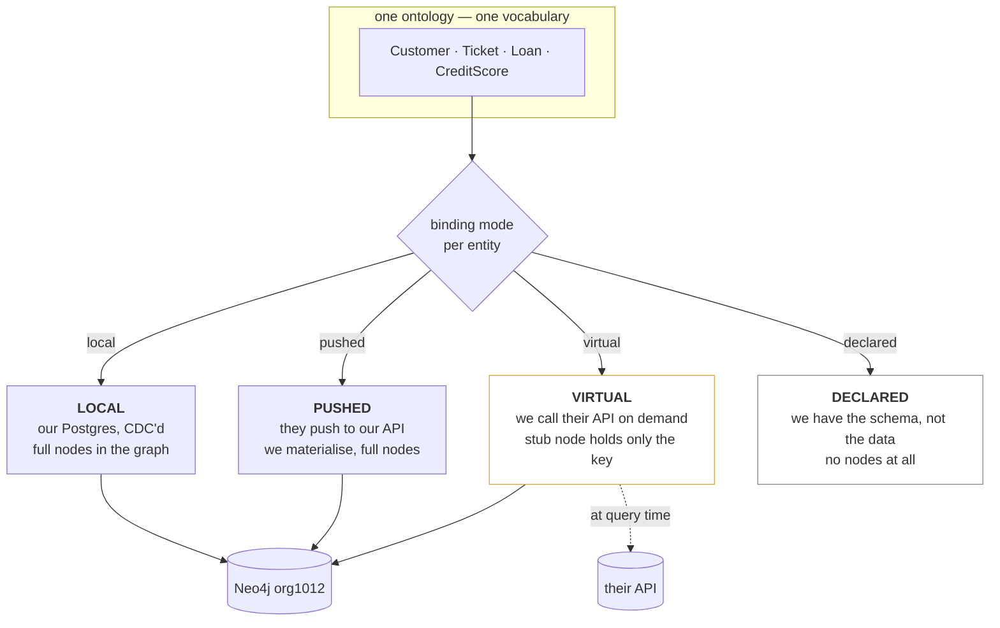
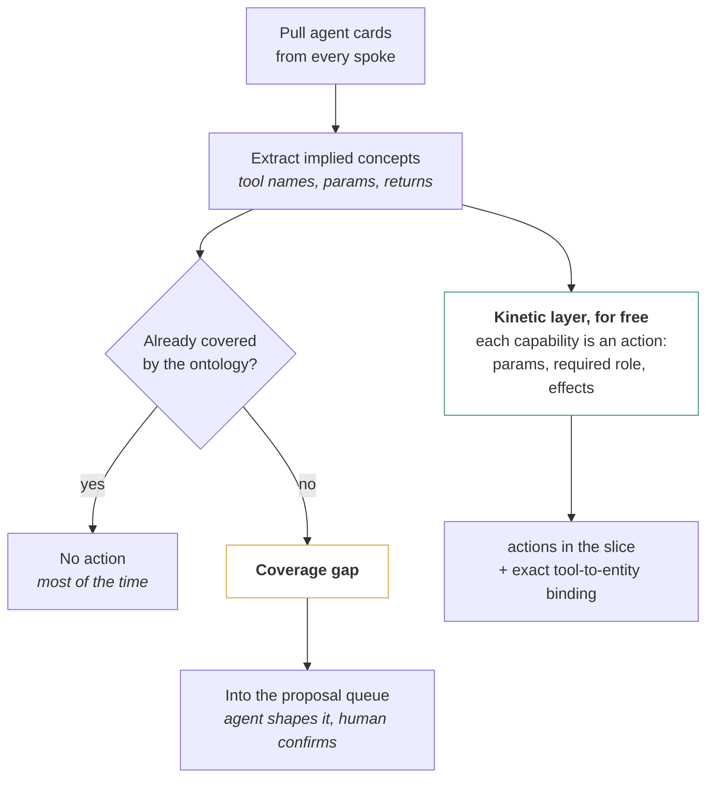
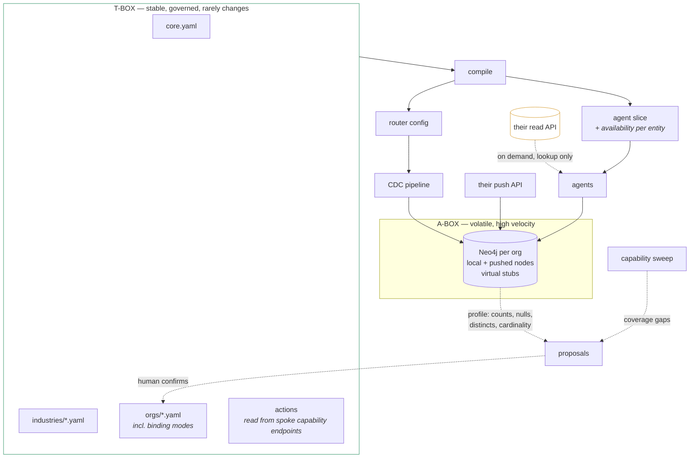

# Federation, Capabilities, and What to Take from the PDF

*Ideas, not a plan.*

---

## 1. The PDF — what to take, what to leave

It's a mix of solid standard concepts and consultant narrative. The split matters, because two of its recommendations would cost you a year.

### Take this

**T-Box / A-Box separation.** The single most useful idea in the document, and it describes what you're already building without you having named it.

| | Your system |
|---|---|
| **T-Box** — stable schema, concepts, taxonomy | Your ontology files: core + industry + org |
| **A-Box** — volatile instances, high velocity | Your Neo4j graph, filled by CDC |

Why it matters: incoming real-time data populates the A-Box continuously **without touching the T-Box**. Millions of tickets arrive and the schema never changes. A schema change is a rare, governed, reviewed event. That's exactly the discipline that stops a "dynamic ontology" from becoming an ontology that mutates constantly and can't be reasoned about.

**Rules as data, not code.** The point about externalising business logic rather than hardcoding it is right, and you already do it — your rules live in YAML and travel with the slice.

**Modular namespaces.** Core + industry + org, which you already have.

**The observer-layer playbook.** Read-only CDC overlay, map legacy schemas into a domain model, never touch the source. **You have already built step 1 of that playbook** — Debezium, read-only, mapping into a graph, running live.

### Leave this

**The RDF/OWL/SPARQL stack.** OWL-Time, GeoSPARQL, RCC8, SWRL, `owl:imports`, triples. All of it assumes an RDF semantic-web architecture. You have a Neo4j property graph and a YAML ontology. The *concepts* transfer cleanly — instant versus interval, valid time versus transaction time, modular imports. **The technology does not**, and adopting it means a second graph, a second query language, a reasoner, and people who know Description Logic.

**Automatic ontological inference.** *"The ontology can compute complex relationships on the fly"* — OWL reasoning over live data at scale is slow, hard to debug, and unnecessary here. Your inference needs are "which agent gets what" and "which breakdown is servable." Those are lookups you precompute, not entailments you derive.

**Heavy spatial modelling.** GeoSPARQL and RCC8 are for geofencing, topology and moving objects. Your spatial needs are country, city, timezone — three attributes, not a reasoning framework.

**SWRL.** SHACL-style *validation* is a good idea and you can implement the concept in plain code. SWRL *inference* is a research rabbit hole.

### The terminology you've heard

| Term | Real? | What it means |
|---|---|---|
| **Operational ontology** | Yes | An ontology that drives runtime behaviour — what agents see, what actions are permitted, how data is written — rather than sitting in a document. Palantir's framing. **You are already building one.** |
| **Dynamic / evolving ontology** | Yes | The schema changes over time under governance. Studied as *ontology evolution*. |
| **T-Box / A-Box** | Yes | Standard, from Description Logic. Genuinely useful. |
| **Upper / domain / application ontology** | Yes | Your core / industry / org layers. |
| **"Advanced ontology"** | **No** | Not a term of art. Marketing. If someone says it, ask which of the above they mean. |

---

## 2. The federation problem

This is the biggest new requirement in your message.

> *"for one organization we might be needing our database and their database... they won't be giving us access but they might share an API to push and for understanding some table schemas"*

There's a formal name: **ontology-based data access**, also called **virtual knowledge graphs**. Sources are exposed through a mapping and an ontology and presented as one unified graph; at query time, queries over the ontology are rewritten into queries over the sources. The property that matters most for you:

> **The translation is independent of the actual data in the data layer.**

Which means **you can declare an ontology over data you will never see.** The ontology is a contract about meaning. Whether you hold the rows is a separate question.

### Four binding modes

Every entity declares **how reachable its data is**, and everything downstream adapts.



```yaml
Loan:
  definition: A credit facility extended to a customer.
  synonyms: [facility, credit line, advance]
  binding:
    mode: virtual
    source: org1012.lending_api
    key: loan_id
    resolves: [status, principal, opened_at, next_payment_at]
    latency_budget_ms: 800
    freshness: on_demand

CreditScore:
  definition: An internal risk score the organisation holds for a customer.
  binding:
    mode: declared            # we know it exists. We cannot see it.
    source: org1012.risk_db
    note: Not shared with us. Say so rather than guessing.
```

### The insight worth holding onto

**An entity with no data behind it is still valuable in the ontology.**

Without `CreditScore` declared, an agent asked *"what's this customer's credit score?"* has no idea what a credit score even is. It guesses, hedges, or invents a number.

With it declared as `mode: declared`, the agent says: *"Credit scores live in your risk system. I don't have access to them — you'd need to check there."*

That's the difference between confident ignorance and an accurate handoff, and it costs about thirty tokens.

### What the slice carries

The agent must know the mode, because it changes what it can promise:

```yaml
you_work_with:
  Ticket:
    is: A customer issue tracked from creation to resolution.
    availability: full
  Loan:
    is: A credit facility extended to a customer.
    availability: on_request
    note: I can look up a specific loan. I cannot count or aggregate loans.
  CreditScore:
    is: An internal risk score the organisation holds.
    availability: none
    note: Exists in their risk system. Say you cannot see it.
```

`availability: on_request` carries a hard constraint: **you can look one up, you cannot aggregate.** Calling an external API once per customer across ten thousand customers isn't a report, it's an outage. Virtual entities are for lookup, never for metrics.

### What the graph holds for a virtual entity

A stub — the key and the source, nothing else:

```cypher
(:Customer {cdp_id: "c_8812"})-[:HAS_LOAN]->(:Loan {
   external_id: "L-4412",
   source: "org1012.lending_api",
   binding: "virtual"
})
```

The graph knows the customer **has** a loan. It holds no loan data. The relationship is the valuable part — it's what lets you answer *"which customers with an open ticket also have a loan"* without ever seeing a principal amount.

That's the hybrid to aim for: **materialise the relationships, virtualise the attributes.**

### The three onboarding conversations

When an org arrives, the question isn't "can we have your database." It's a ladder:

| Ask | Mode you get | What becomes possible |
|---|---|---|
| "Push us the keys and the links" | `pushed` spine, `virtual` detail | Everything, including cross-product |
| "Give us a read API" | `virtual` | Lookup and relationships, no aggregation |
| "Share the table schemas" | `declared` | Accurate handoff, no data |
| Nothing | absent | The agent doesn't know the concept exists |

**Even the third rung is worth asking for.** Schemas aren't data, so legal usually says yes, and it buys you the difference between a wrong answer and a correct refusal.

---

## 3. Agent capabilities to ontology coverage

> *"right now we only have create ticket agent and we have ticket entity and now there is a new agent ticket status agent and now the ontology should grow as ticket, ticket status"*

The mechanism is good. Your example is the trap.

### `TicketStatus` is not an entity

A ticket-status agent needs `Ticket`, and it needs `ticket.status: [open, pending, reopened, resolved, overdue]` — **a taxonomy that already exists in your ontology today.** Nothing grows. The agent's slice simply includes Ticket at full detail with its status values.

Same trap as blood group. Status has no identity, no lifecycle, and nobody asks "how many statuses are there." It's a property with a fixed value set.

Create a `TicketStatus` entity and you get five nodes per org that exist only to be pointed at, an edge on every ticket that earns nothing, and a block in the readable ontology that says nothing. **The test is always: does it have its own identity and lifecycle?**

### What capability sync is actually for

Not generating entities. **Finding where the ontology is behind what the product already does.**



Worked example. A new capability appears:

```json
{ "skillId": "tk.ticket.merge",
  "params": { "ticket_id": "...", "duplicate_of_ticket_id": "...", "reason": "..." },
  "requires_role": ["admin", "resolver"] }
```

| Implied concept | In the ontology? |
|---|---|
| `Ticket` | yes |
| A Ticket to Ticket relation "duplicate of" | **no — gap** |
| An action `merge_ticket` with preconditions | **no — gap** |

The ontology is missing `Ticket -duplicate_of-> Ticket`, which means no agent can reason about duplicates even though the product can merge them. **That's the class of gap nobody finds by reading files**, and a capability sweep finds it in seconds.

### The free kinetic layer

The second arrow is the better prize. Earlier I proposed you author action definitions — what each tool operates on, its parameters, its required role. **The spokes are already declaring exactly that in their agent cards.** Your own Hub document maps `actionType` to skill for both CCaaS and ticketing.

So you don't author the kinetic layer. You **read** it — and it gives you the highest-precision seeding signal available: `tk.ticket.merge` declares it operates on `Ticket` and takes two `Ticket` references. No verb/noun string-splitting, no guessing.

---

## 4. Proactive, predictive, prescriptive — honestly

The PDF claims the ontology delivers all three. It doesn't, and knowing which part it does deliver keeps you from promising something you can't build.

| | What it needs | What the ontology contributes | Have it? |
|---|---|---|---|
| **Descriptive** — what happened | Metric definitions | The definitions themselves | Yes |
| **Diagnostic** — why | Relations to traverse from an anomaly | **The graph's real strength** | Nearly |
| **Predictive** — what will happen | An ML model on historical data | Features, including structural ones. Nothing more. | No |
| **Prescriptive** — what to do | A playbook plus the prediction | The action catalogue and the rules bounding it | Partly — `ops_playbook.yaml` exists |
| **Proactive** — act unasked | Event rules and thresholds | Where to attach the alert and who to tell | **Yes** — `cdp.anomaly_alert` |

Two things worth stating plainly.

**An ontology does not make you predictive.** It makes a prediction *explainable*, because the prediction attaches to an entity that has relations, definitions and rules around it. "Churn risk 0.82" is a number. "Churn risk 0.82, driven by three SLA breaches this month on the Billing queue, where this customer has an open high-priority ticket assigned to someone on leave" is an answer. The graph turns the first into the second.

**You are already proactive** and may not be counting it. `cdp.anomaly_alert` with `rule_id`, `observed`, `threshold` and `severity` is a detection pipeline in production. The gap is that those alerts aren't connected to anything, so nobody can explain them. Landing them as nodes in the graph is what turns proactive detection into diagnostic explanation.

---

## 5. Temporal — selective, not bitemporal

The PDF's strongest technical section, and the one place I'd partially follow it.

**Valid time** (when a fact was true) versus **transaction time** (when you recorded it) is a real and useful distinction. Your CDC pipeline gives you transaction time for free. You have no valid time at all.

But **do not go bitemporal across the board.** Neo4j has no built-in temporal semantics — timestamps are ordinary properties on nodes and edges, and there are **no relationship property indexes**, so filtering large relationship sets by time performs badly. Bitemporal support in graph databases remains limited, and adoption has been slow precisely because most projects never use the capability they paid for.

### Where valid time earns its cost

Only on relationships people actually ask historical questions about:

| Relationship | Version it? | Question it answers |
|---|---|---|
| `Ticket -assigned_to-> Staff` | **Yes** | "Who owned this when it breached?" |
| `Staff -member_of-> Queue` | **Yes** | "Who was on the team that month?" |
| `Ticket.status` | Already have it | AuditEvent holds this — connect it, don't duplicate |
| `Ticket -raised_by-> Customer` | No | Never changes |
| `Customer -belongs_to-> Company` | Occasionally | Low volume, cheap either way |
| Anything web-tracking | **No** | Events are already time-stamped facts |

### The pattern that avoids the performance trap

Split current from historical with labels, so the common query never touches history:

```cypher
// 99% of queries — one hop, indexed, fast
(t:Ticket)-[:ASSIGNED_TO]->(s:Staff)

// historical — separate label, never scanned by the common path
(t:Ticket)-[:ASSIGNED_TO_HISTORY {valid_from, valid_to}]->(s:Staff)
```

A 2026 study doing exactly this on Neo4j separated identity nodes from versioned nodes and used labels to give both a fast current-state view and a full history view over the same data, with composite indexes on the interval columns. The lesson: **the current-state path must stay untouched**, or you pay the temporal cost on every query, including all the ones that don't care.

Separately, version the **ontology** temporally — which you need anyway for revert. *"Which definition of `open` was in force when this answer was given"* is a question you will eventually be asked.

---

## 6. Where this leaves the picture



Four inputs to the T-Box, all governed the same way: what you author, what the pipeline observes, what a partner submits, and what the spokes' capabilities imply. One review queue, one version history, one revert mechanism.

---

## 7. Three things to decide

**1. Does virtual ever become a metric?** My position is no — an external API called once per row is not a report. But if an org insists on "count our loans by status," the only honest answers are a nightly pull into `pushed` mode, or refusal. Decide before someone promises it in a sales call.

**2. Who writes the binding for an org's schema?** They share table schemas; someone maps `their_loans.status` to `Loan.status`. An agent can propose the mapping, but a human must confirm it — and that human needs to understand *their* business, not just yours. This is real per-org onboarding work, and it doesn't scale to a thousand tenants without a self-service mapping screen.

**3. Are spoke capability endpoints stable enough to sync from?** If agent cards change on every deploy, a nightly sweep generates noise. If they're versioned and change deliberately, it's a clean signal. Depends on how those spokes are built — and one of them is one person with Cursor.
