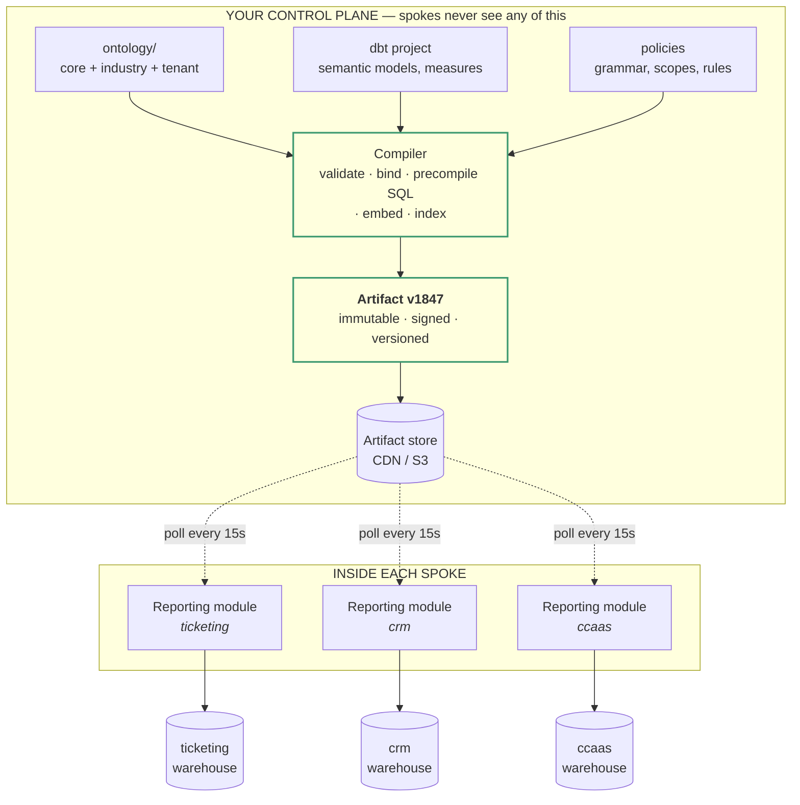
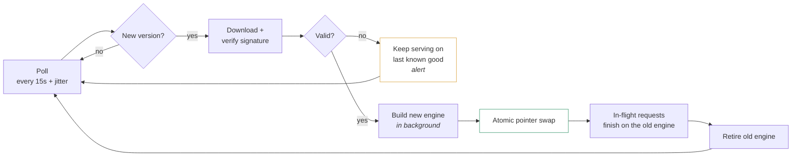
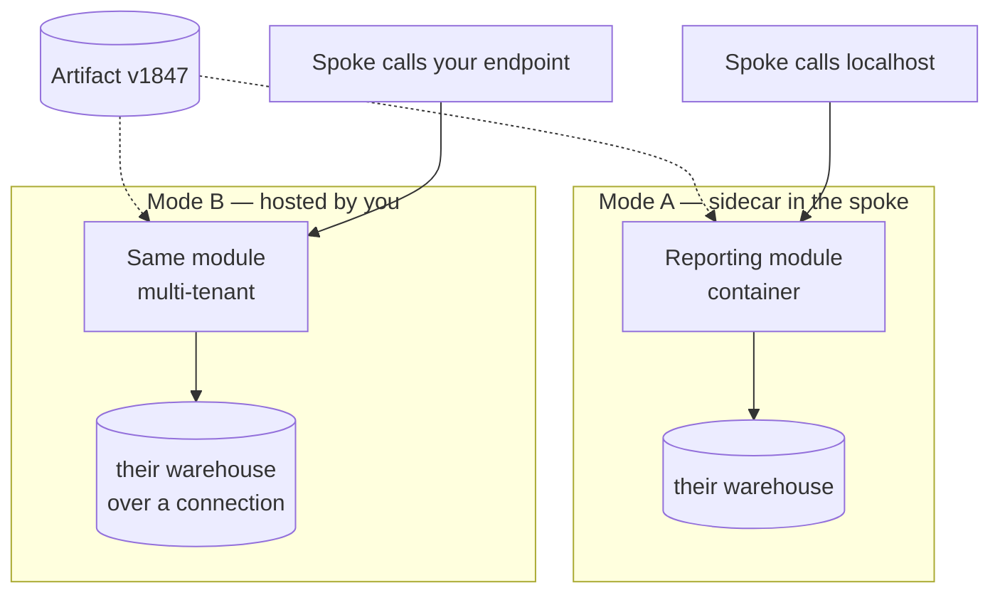
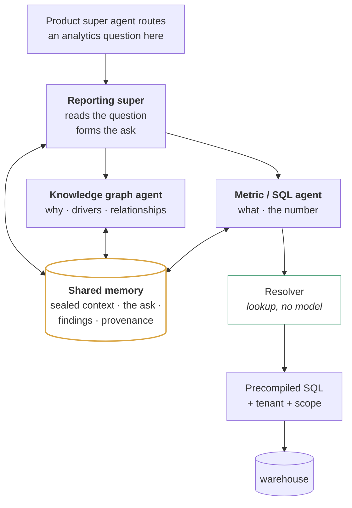

# The Reporting Module — a distribution problem, not a tooling problem

*Research first, idea second. No build plan yet.*

---

## 1. The reframe

You asked whether to use dbt or SQL templates. That's not where the pain is.

Read your own description again: *"handling the dbt and things makes more difficult to solve by going and check the product and understanding the situation... when we change some things we need to cut and run, there is no auto reload without losing the application for some time."*

Every problem in that sentence is about **where the definitions live and how they get updated** — not about what generates the SQL. Swap dbt for SQL templates and you have the identical problem: the templates live inside six products, so changing a metric means six teams, six releases, six restarts. You would have traded a good generator for a worse one and kept the pain.

**The real question: what ships into the spoke, and what stays with you?**

Answer it correctly and dbt-versus-SQL stops mattering, because dbt disappears from the spoke entirely.

---

## 2. Why "SQL templates in the spoke" is the thing causing the pain

You already have evidence for this in your own codebase. Your oracle contract exists because `kpi_templates/` and MetricFlow both define the same numbers and drifted apart — there is a *forbidden proxies* table listing six comparisons that produced a false mismatch on 20 September. That's two definitions of one number, maintained separately, disagreeing.

Now multiply by six products and N tenants, and hand each copy to a different team.

| | Templates live in the spoke | Templates live with you |
|---|---|---|
| Change a metric | 6 PRs, 6 reviews, 6 releases | 1 publish |
| New industry | 6 teams learn your domain model | 1 publish |
| Fix a wrong definition | Ship to 6, hope all deploy | 1 publish, everyone converges |
| Two spokes disagree on "open" | Inevitable | Impossible |
| Downtime | Per release | None |
| Who understands the metric | 6 teams, partially | You |

The second column isn't a dbt property. It's a **deployment topology** property. You can have it with dbt, with templates, or with anything else — provided the definitions don't live in the product.

---

## 3. The pattern: control plane and data plane

This problem is thoroughly solved elsewhere, and the shape is always the same.

| System | Control plane | Data plane | Distribution |
|---|---|---|---|
| Kubernetes | API server, scheduler | kubelets on every node | watch |
| Istio / Linkerd | istiod | Envoy sidecar per service | push |
| Apollo GraphOS | Schema composition | Router in your infra | pinned artifact reference |
| WunderGraph Cosmo | Composes federated schema, pushes to CDN | Router in your infra | **CDN poll, 15s** |
| Confluent | Schema registry | Producers and consumers | fetch + cache |
| **You** | **dbt + ontology + compiler** | **Reporting module in each spoke** | **poll a versioned artifact** |

Two properties matter for you specifically.

**Independent scaling and change rates.** The control plane handles a few configuration changes per day; the data plane handles production traffic. Coupling them means every config change is a traffic-path deployment. That is precisely your "cut and run" problem.

**Blast-radius isolation.** If a bad configuration change takes down the control plane, a well-designed data plane keeps serving using its last known good configuration. Your reporting modules keep working if your publishing service is down. That property is not available at all when the config is baked into the spoke's release.

---

## 4. What ships and what stays



| Stays with you | Ships to the spoke |
|---|---|
| The ontology, all three layers | Nothing — it's inside the artifact |
| dbt, MetricFlow, the whole project | **Nothing.** No install, no CLI, no knowledge required. |
| Metric definitions | Nothing |
| The compiler and validators | Nothing |
| Industry packs | Nothing |
| Reconciliation and eval harness | Nothing |
| — | **One container** + a config line pointing at the artifact URL |

**A spoke team never learns what dbt is.** That single fact dissolves the objection you raised. Your reporting module is a container they run; your semantic layer is a file it downloads.

---

## 5. The artifact

Immutable, versioned, content-addressed, signed. Everything the module needs to answer a question without calling you.

```
artifact/v1847/
  manifest.json           version, source hashes, signature, build time
  ontology.yaml           the agent-facing slice source — plain English
  grammar.json            what can be asked: subject × measure × qualifier
  resolution.json         (subject, measure, qualifier) -> metric id
  reachability.json       which breakdowns are servable for which metric
  sql/                    precompiled, parameterised SQL templates
    open_tickets__by_queue__day.sql
    …
  scopes.json             role -> row-scope predicate shapes
  rules.json              business rules, tagged to entities
  dimensions.json         legal filter values per dimension
  industry/
    healthcare.json       realisations + extensions
    ecommerce.json
```

Two things make this work:

**The SQL is precompiled.** dbt generated it in your build. The module substitutes tenant, principal and time parameters and executes. No MetricFlow at runtime, no compile step, no dependency on your service during a query.

**The templates carry bind markers, never literals.** A template with a baked-in `organization_id` is a cross-tenant leak waiting for a cache hit. Assert against it in CI before signing.

Signing matters here more than usual: the artifact contains SQL that will execute against a customer's warehouse inside their product. The module must verify the signature before loading, or you've built a supply-chain hole into six products at once.

---

## 6. Hot reload — the mechanism, in detail

This is the part you said you don't have, and it's a solved pattern with a precise shape. Cosmo Router does exactly this: it polls the CDN, and on a new valid config it builds a new engine alongside the old one, hands traffic over gracefully, then retires the old one. In-flight requests finish on the old engine; new requests use the new one. No restart, no dropped connections.



Four properties you get for free:

**Zero downtime.** The pointer swap is atomic. A request that started on v1846 finishes on v1846.

**Fleet convergence.** Every module polls the same URL and converges within the poll interval. Jitter stops them all hitting at once. You don't coordinate a rollout; you publish and wait fifteen seconds.

**Last known good.** A bad artifact, a failed signature, an unreachable CDN — the module keeps serving what it already has. Your publishing being down does not take down six products.

**Rollback is a pointer change.** Apollo's practice is worth copying directly: pin new artifacts in staging, validate, then promote the same artifact to production, and keep the reference URI of the last known-good artifact so rollback is reassigning a tag rather than rebuilding anything.

Add two escape hatches from the same playbook: a file watch for local development, and a signal or admin endpoint for an immediate reload when fifteen seconds is too long.

---

## 7. One binary, two deployment modes

You asked whether to ship the setup or host an endpoint. **Build it so you don't have to choose**, because different spokes will want different answers and you'll want to change your mind later.



Same code, same artifact, different placement.

| | Mode A — sidecar | Mode B — hosted |
|---|---|---|
| Data leaves the spoke | No | Yes, query results at least |
| Works if your service is down | Yes | No |
| Latency to warehouse | Local | Network hop |
| Spoke deploys anything | One container | Nothing |
| You see all telemetry | Only what's reported | Everything |
| Data residency / compliance | Easy | Needs a story per region |
| Debugging a customer issue | Harder | Easy |

**Default to Mode A.** It's the pattern every system in §3 converges on, and the residency and availability arguments are hard to beat. Offer Mode B for spokes that can't run a container and for your own dev and demo environments.

One important constraint: **ship a container, not a library.** A library means upgrading the module is a spoke release, which reintroduces the exact coupling you're trying to remove. A sidecar upgrades independently and is language-agnostic — and your stack is already mixed, with Express/TypeScript and Python both in the ticketing path.

---

## 8. The three-agent reporting MAS

Your shape — a reporting super agent over a knowledge-graph agent and a SQL agent, with common memory — is sound, and it matches what you already run: `analytics_audit_query_executor` doing value-plus-why with `ask_semantic_layer` and `ask_knowledge_graph`.



### What belongs in shared memory

| In | Out |
|---|---|
| **The sealed security context** — tenant, principal, role, scope. Write-once. | The ontology and grammar — resident in each agent's context, not fetched from memory |
| **The resolved ask** — subject, measure, qualifier, breakdowns, filters, window | Raw conversation history from the parent product agent |
| **Findings so far** — the number from the metric side, the drivers from the graph side | Anything a later agent might mutate and an earlier one assumed |
| **Provenance** — which metric, which artifact version, which scope | |

Two rules worth fixing early.

**The security context is sealed on entry and immutable.** If any of the three agents can widen the scope in shared memory, you have a privilege-escalation path between agents that no individual agent's code review would catch. Seal it at the boundary and have the module reject any query whose context hash doesn't match the sealed one.

**Shared memory holds the plan and the findings, never the knowledge.** A blackboard becomes a dumping ground within a month otherwise, and then each agent is doing retrieval against a growing pile instead of reading a fixed grammar. Knowledge is resident; memory is transient.

### Where metric selection happens

Not in the SQL agent's model. In the **resolver**, which is a lookup table inside the artifact:

```
ask: (Ticket, count, overdue, by=[queue])
  → resolution.json → current_overdue_ticket_count
  → reachability.json → queue is servable ✓
  → sql/overdue_tickets__by_queue.sql
  → inject organization_id + row-scope predicate
  → execute
```

Deterministic, sub-millisecond, no model in the path, and the same answer in every spoke because they all load the same artifact.

---

## 9. Where dbt sits now, and why your objection dissolves

Your objection was: *dbt is hard to manage when it lives in the product.* Correct — so it doesn't.

```
YOUR BUILD                          THE SPOKE
──────────                          ─────────
ontology.yaml ─┐
dbt project ───┼─► compile ─► artifact ─► (download) ─► execute SQL
policies ──────┘      │
                      └─ dbt runs HERE, once, at build time
```

dbt becomes a compiler in your CI. Nobody installs it. Nobody debugs it in production. Nobody in a spoke team needs to know the word.

**What it buys you at that position:**

- **Join safety.** MetricFlow refuses fan-out and chasm joins and errors on primary-to-foreign traversals. A query that double-counts returns a plausible number, which is the worst kind of wrong. Hand-written templates give you no such guarantee, and neither does a model.
- **Precomputable servability.** Because the join rules are declarative, you can compute offline exactly which breakdowns work for which metric — which is what makes `reachability.json` possible, and therefore what makes routing a lookup instead of a guess.
- **One definition.** The thing your oracle contract exists to protect.
- **Nothing at runtime.** No compile latency, no dbt dependency, no network call to dbt Cloud from inside a customer's product.

**What it costs at that position:** a build step you already run, and nothing else.

### And if you still don't want dbt

The topology is the load-bearing part; dbt is replaceable within it. You would need to replace three things:

1. A declarative measure and dimension spec — writable, but you're rebuilding MetricFlow's front end.
2. A join planner that refuses unsafe joins — the hard part, and the part people skip and regret.
3. A SQL generator.

You already have (1) in two `semantic_layer.yml` files and (3) in `kpi_templates/`. You do not have (2), and (2) is the reason the whole thing is trustworthy. **Keep dbt for the join planner, if for nothing else.**

---

## 10. What "add a metric" and "add an industry" actually look like

### Adding or changing a metric

```
1. Edit the measure or the grammar mapping in your repo
2. CI: compile, validate, reconcile, sign
3. Publish artifact v1848
4. Promote to staging tag; run the golden set
5. Promote to production tag
6. Every module converges within 15 seconds
```

**Nobody in any spoke does anything.** No release, no restart, no downtime, no conversation.

### Adding an industry

```
1. Write domains/healthcare.yaml — realisations and extensions
2. CI: validate against the extension rules, compile
3. Publish v1849 with industry/healthcare.json included
4. Healthcare tenants get healthcare vocabulary on their next hydration
5. Everyone else sees no change at all
```

The artifact carries every industry; the module selects by the tenant's `industry_pack` at request time. So adding an industry is a publish, not a deployment, and it cannot affect tenants in other industries because their selection key didn't change.

### Fixing a wrong definition

Publish, wait fifteen seconds, all six products converge on the corrected number simultaneously. Today that's six coordinated releases and a period where different products give different answers to the same question.

---

## 11. What this doesn't solve

Being straight about the limits.

**Warehouse differences.** If ticketing is Postgres and web tracking is ClickHouse — which your schema files suggest — the precompiled SQL is dialect-specific. The artifact needs per-dialect templates, and dbt handles that, but it doubles the precompile matrix.

**The spoke still owns the warehouse connection.** Credentials, network, performance. If their warehouse is slow, your module is slow, and the telemetry will point at you first.

**The first integration is still real work.** One container, one config line, one auth handshake — but multiplied by six teams with their own release calendars. Front-load a reference integration with the friendliest spoke and make it the template.

**Version skew is now possible.** Five spokes on v1848 and one stuck on v1841 because its egress is blocked. You need artifact-version telemetry from day one, or you'll debug a "wrong number" that is actually an old artifact.

**Hot reload of SQL is not hot reload of data.** A changed metric definition takes effect immediately for new queries; any cached results or materialised rollups need their own invalidation.

---

## 12. What I'd want to know before designing this properly

1. **Can spokes run a sidecar container?** If any can't, Mode B stops being optional and the architecture needs both paths from the start rather than as a later addition.

2. **Do spokes share a warehouse or have separate ones?** Your schemas suggest separate (`ticketing.*`, `ccass.*`, `crm.*`, ClickHouse for web tracking). If a reporting question ever spans two spokes, the sidecar model breaks and something has to federate.

3. **Who operates the module once it's in their product?** If a spoke's on-call gets paged when it misbehaves, they need runbooks and logs they can read — which changes what it emits and how much you can treat it as a black box.

4. **Is the knowledge-graph agent reading Neo4j directly?** If so it needs the same artifact-driven scope injection as the SQL side, and your graph doesn't have row-level security the way Postgres does. That's a bigger gap than it looks.

5. **What's the acceptable staleness?** Fifteen seconds is Cosmo's default. If a metric fix must land in under a second across a fleet, that's push rather than poll, and push is materially more infrastructure.

6. **How many tenants per spoke deployment?** One module serving one tenant is a different caching story from one serving a thousand. It changes whether the artifact is selected per-request or per-process.

---

## 13. The idea in one paragraph

Stop thinking of it as *a reporting module you ship*. Think of it as **a thin execution engine you ship, plus a semantic artifact you publish**. The engine is a container that knows how to resolve an ask, inject a tenant and a scope, run precompiled SQL and answer — and knows nothing else. Everything that changes — metrics, ontology, industries, business rules, scopes — lives in a signed, versioned artifact that the engine polls for and hot-swaps without a restart, keeping the last known good if anything is wrong. dbt stays entirely in your build, compiling that artifact, so no spoke team ever encounters it. Adding a metric is a publish. Adding an industry is a publish. Fixing a definition is a publish, and all six products converge on the fix within fifteen seconds without anyone deploying anything.
