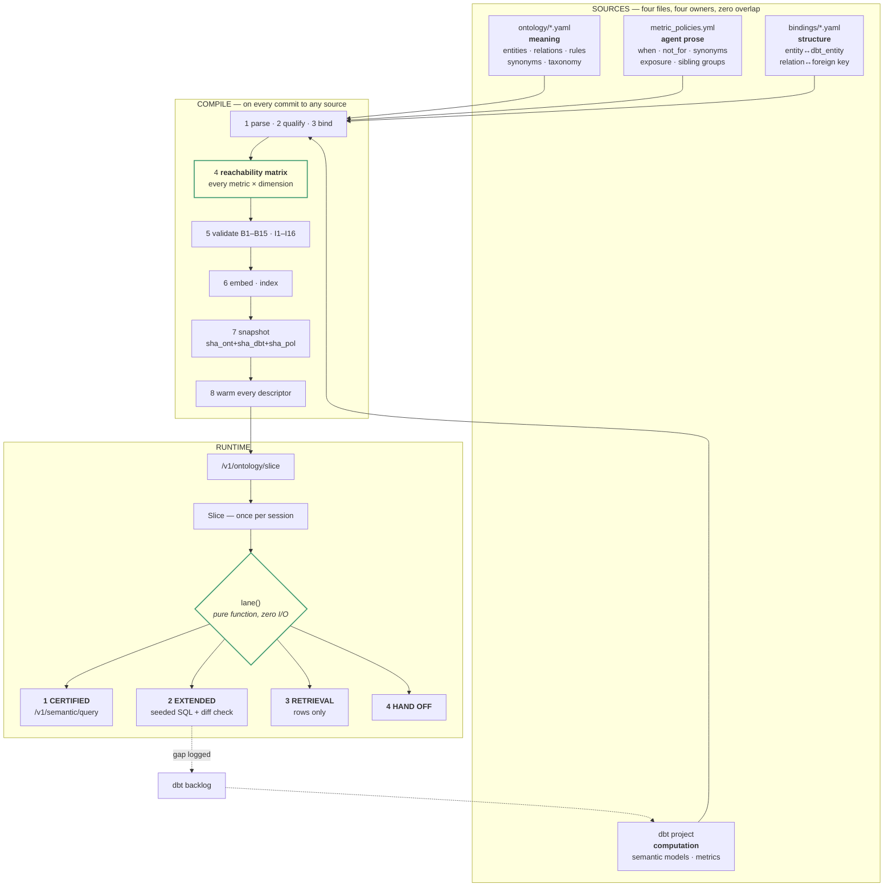

# Unified Semantic Layer — Engineering Specification v3

**Status:** Approved for implementation
**Supersedes:** v1 (ontology + dbt plan), v2 (revised plan)
**Scope:** How the ontology, dbt/MetricFlow, the metric policies and the SQL harness compile into one agent-facing contract.

---

## 0. How to read this specification

### 0.1 Normative language

| Word | Meaning |
|---|---|
| **MUST** / **MUST NOT** | Absolute. A violation is a build failure or a production incident. No implementer may decide otherwise. |
| **SHOULD** / **SHOULD NOT** | Strong default. Deviation requires a written note in the PR explaining why, reviewed by the spec owner. |
| **MAY** | Genuinely optional. |

### 0.2 Precedence

When two parts of this document appear to conflict, resolve in this order:

1. **§3 Invariants** — these are the contract. Nothing overrides them.
2. **§2 Locked decisions** — settled; see §2.0 before proposing a change.
3. Algorithms in §6–§9.
4. Guidance and rationale elsewhere.

### 0.3 The anti-drift mechanism

The purpose of §1 (glossary), §2 (locked decisions) and §3 (invariants) is that **a second reader — a person or a coding assistant — arrives at the same implementation.** Every reasonable-sounding alternative that was considered and rejected is recorded in §2 with the reason and with the condition that would reverse it. If an implementer proposes something already in §2, the answer is the recorded rationale, not a fresh debate.

If a genuinely new argument appears, it goes through §2.0, which changes the decision *for everyone at once* rather than in one branch.

---

## 1. Glossary — locked terms

These words have exactly one meaning in this system. Using them loosely is how two implementers build two different things.

| Term | Definition |
|---|---|
| **Entity** | A business concept in the ontology (`Ticket`, `Staff`). Namespaced (`ticketing.Ticket`). Not a table. |
| **dbt entity** | A MetricFlow join key declared on a semantic model (`ticket`, `agent`). Typed `primary`, `unique` or `foreign`. |
| **Binding** | The declared correspondence between an Entity and a dbt entity, and between an ontology relation and a foreign key. Lives only in `bindings/*.yaml`. |
| **Metric** | A MetricFlow metric. Computation is owned by dbt. Agent-facing prose is owned by `metric_policies.yml`. |
| **Dimension** | A way to group or filter a metric. Local (on the base model) or joined (reached across a dbt entity). |
| **Servable** | A `(metric, dimension)` pair that MetricFlow can execute, per §7. A property computed at build time, never guessed. |
| **Slice** | The per-agent projection of the snapshot, delivered once at session start. |
| **Detail level** | `L0` name only · `L1` name + definition + identifier · `L2` full, with attributes, taxonomy, synonyms. |
| **Lane** | One of the four answer paths in §9: Certified, Extended, Retrieval, Hand-off. |
| **Snapshot** | An immutable compiled artifact identified by `(sha_ontology, sha_dbt_manifest, sha_policies)`. |
| **Question plan** | The structured form of a user question produced by the agent before any call. Schema in §9.1. |
| **Sibling group** | A set of metrics that answer superficially identical questions and MUST be disambiguated by a discriminator. §8.4. |
| **Enforcement tier** | Where a rule is enforced: T0 compile · T1 harness · T2 slice · T3 prompt. §10. |
| **Measure result** vs **row result** | A number produced by a metric, versus a set of records. They are different kinds and MUST NOT be interconverted. §9.5. |

---

## 2. Locked decisions

### 2.0 How to change one

A locked decision changes only when: (a) a new fact invalidates the recorded rationale, or (b) the recorded reversal condition is met. The change is made **in this document first**, with the rationale updated, and then implemented. Never the other way round.

### 2.1 The register

| # | Decision | Rationale | Reverses if |
|---|---|---|---|
| **D1** | dbt owns computation. The ontology MUST NOT contain metric formulas. | Two definitions of one number is the failure this project exists to prevent. | Never. |
| **D2** | The ontology owns meaning, relations and business rules. dbt descriptions MUST NOT be treated as authoritative meaning. | dbt descriptions are written for analysts, are inconsistently maintained, and cannot express relations like assignee-versus-resolver. | Never. |
| **D3** | `bindings/*.yaml` carries **structure only**. No prose an agent reads. | Prose in three places drifts. Enforced by validator B4. | Never. |
| **D4** | `metric_policies.yml` remains the single home for `when`, `not_for`, synonyms and `exposure`. | It already exists and is already owned. Creating a fourth home would be self-inflicted. | When prose has been stable for a quarter, migrate to dbt `meta.ai_context` per §5.5 — one move, all metrics, never a split. |
| **D5** | Servability is **precomputed at build time**, never classified at runtime. | MetricFlow's join rules are declarative and published (§7.1). A runtime heuristic would be strictly worse and untestable offline. | If dbt makes join resolution non-deterministic or unpublished. |
| **D6** | There are **four lanes**, and Retrieval is separate from Extended. | Most SQL traffic is rows, search, notes and audit, not metric fallback. Collapsing them creates the back-door metric in §9.5. | Never. |
| **D7** | The SQL harness is **kept and extended**, not replaced by open text-to-SQL. | A constrained harness with an intent gate, catalog and scope controls is the correct architecture, independent of it already existing. | Never. |
| **D8** | Lane 2 seeds from certified SQL and MUST NOT redefine aggregation, filters, denominator or tenant predicate. Enforced by a parser diff, not a prompt. | A small model in the harness will cross a boundary that exists only in an instruction. | Never. |
| **D9** | Tenant scoping is **T0 or T1**, never a prompt rule. | A cross-tenant number makes every other correctness property irrelevant. | Never. |
| **D10** | Lane 3 (Retrieval) MUST NOT produce aggregates, and its row count MUST NOT be reportable as an answer. | §9.5 — the back-door metric. | Never. |
| **D11** | Every metric with a time dimension MUST declare a timezone policy. | §6.6 — the silent systematic error. | Never. |
| **D12** | Ambiguity between sibling metrics resolves by **asking**, not by defaulting. | A wrong confident number is worse than one clarifying question. | Per sibling group, when a golden set proves one member is correct above 95% of the time; then set `on_ambiguity: default`. |
| **D13** | The snapshot id pins all three source hashes. | Otherwise "why did the agent's answer change?" is unanswerable. | Never. |
| **D14** | Slices are byte-deterministic. | The content hash is the cache key, the ETag and the prompt-cache prefix boundary. | Never. |
| **D15** | Hydration is once per session. Mid-session ontology calls are a metered exception, alerted above 2%. | Latency, and context stability. | Never. |
| **D16** | Existing controls (`kpi_not_allowed`, grants, presets) are **retained as backstops** while their T2 equivalents are proven. | Removing a working guard before its replacement is proven is how outages happen. | Per control, after its golden set passes for two weeks. |

---

## 3. Invariants

Numbered, testable, and asserted in CI. A build that violates any of these MUST NOT be promoted.

### 3.1 Structural

| # | Invariant |
|---|---|
| **I1** | Every relation in a slice has both endpoints present at ≥ L1. |
| **I2** | Every attribute of an L2 entity that has a taxonomy in the source has that taxonomy in the slice. |
| **I3** | Every rule in a slice has all its tagged entities present at L2. |
| **I4** | Every L2 entity carries its complete synonym list. |
| **I5** | Every entity at any level carries its identifier. |
| **I6** | Every slice contains every `scope: global` rule. |
| **I7** | Every entity reference is namespace-qualified. |

### 3.2 Semantic

| # | Invariant |
|---|---|
| **I8** | Every dimension listed on a metric in a slice is **Servable** for that metric (§7). |
| **I9** | Every metric in a slice has `exposure: agent`. |
| **I10** | Every `exposure: agent` metric has a `when` that is not template-generated. |
| **I11** | Every metric belongs to at most one sibling group, and every sibling group has a discriminator. |
| **I12** | Every metric with a time dimension declares `tz_policy`. |
| **I13** | Every metric and every KPI template carries the tenant predicate. |
| **I14** | No prose key is set in more than one of: dbt `meta.ai_context`, `metric_policies.yml`, `bindings/*.yaml`. |

### 3.3 Operational

| # | Invariant |
|---|---|
| **I15** | Building the same descriptor against the same snapshot twice produces byte-identical output. |
| **I16** | The snapshot id determines the full content of every slice built from it. |
| **I17** | A hydrate call never fails closed on **freshness**; it always fails closed on **identity and authorisation**. |
| **I18** | A Lane 1 call that the reachability matrix marked servable succeeds, or an alert fires. |
| **I19** | A Lane 2 result's filter predicates and aggregate expressions are identical to its seed's. |
| **I20** | A Lane 3 result is never converted into a measure. |

---

## 4. Architecture



---

## 5. Data contracts

### 5.1 `bindings/<product>.yaml`

```yaml
version: 2
product: ticketing                      # MUST match a product namespace
dbt_project: worktual_analytics

entities:                               # Entity -> dbt entity
  <EntityName>:
    dbt_entity: <string>                # MUST exist in the semantic manifest
    primary_model: <string>             # MUST be a semantic model
    identifier: <schema.table.column>   # MUST match the ontology identifier
    tenant_column: <string>             # REQUIRED on every fact-bearing entity

relations:                              # ontology relation -> foreign key
  <Entity>.<predicate>.<Entity>:
    via: <column>                       # MUST be a declared dbt entity column
    dbt_entity_type: primary|unique|foreign

dimensions:                             # joined / renamed / derived only
  <dim_name>:
    relation: <Entity>.<predicate>.<Entity>   # for joined dims
    entity: <EntityName>                      # for local dims
    field: <string>
    derived_from: <string>                    # for computed dims
```

**MUST NOT contain:** `when`, `not_for`, `synonyms`, `exposure`, `label`, or any description. Validator B4.

### 5.2 `metric_policies.yml` — extended

```yaml
metrics:
  <metric_id>:
    when: <string>                    # REQUIRED for exposure: agent. Must disambiguate.
    not_for: [<metric_id>, ...]       # OPTIONAL
    synonyms: [<string>, ...]         # user vocabulary
    exposure: agent|component|internal   # REQUIRED. Default MUST be `internal`.
    dims: [<dim_name>, ...]           # OPTIONAL allow-list; intersected with Servable
    tz_policy: tenant|utc|none        # REQUIRED when the metric has a time dimension
    sibling_group: <group_id>         # OPTIONAL

sibling_groups:
  <group_id>:
    members:
      <metric_id>: <one-line distinguishing condition>
    discriminator: <string>           # the question the planner must answer
    on_ambiguity: ask|default|reject  # D12 default is `ask`
    default: <metric_id>              # only when on_ambiguity == default
```

`exposure` defaulting to `internal` is deliberate: a metric is invisible to agents until someone consciously exposes it. The opposite default leaks the whole catalogue on every dbt merge.

### 5.3 Snapshot

```
snapshots/<snapshot_id>/
  graph.bin              entities, relations, rules
  metrics.json           metric nodes, sibling groups
  reachability.json      (metric, dimension) -> Servable | Blocked{reason, nearest_base}
  dimension_sets.json    per entity
  lexical.json           surface form -> qids and metric ids
  vectors.hnsw           + vectors.meta.json
  templates.json         KPI template <-> metric mapping and reconciliation state
  manifest.json          sha_ontology, sha_dbt_manifest, sha_policies, build time, per-file sha256
```

`snapshot_id = sha256(sha_ontology || sha_dbt_manifest || sha_policies)[:12]`. Snapshots are immutable. A rebuild writes a new directory.

### 5.4 Conflict precedence

When sources disagree, resolve by this table. Implementers MUST NOT invent a different resolution.

| Conflict | Resolution | Level |
|---|---|---|
| Ontology attribute exists; no matching dbt dimension | Attribute appears in the slice as descriptive, marked `queryable: false` | info |
| dbt metric exists; no binding entry | Metric forced to `exposure: internal`; listed in the unbound report | warn |
| Ontology taxonomy has a value the warehouse has never produced | Value retained, marked `unverified`; the agent is told it may match nothing | warn |
| Warehouse produces a value absent from an ontology taxonomy declared `closed: true` | **Build error** — the agent could never filter for it | error |
| Same, but taxonomy is `closed: false` | Value appended as `undocumented`; report raised | warn |
| `when` set in both dbt `meta` and `metric_policies.yml` | **Build error** (B5) | error |
| A business rule contradicts a metric's computation (detectable) | **Build error** — never ship a contradiction | error |
| Binding says relation uses FK `x`; dbt has no such entity column | **Build error** | error |

### 5.5 Prose migration to dbt (D4)

The compiler MUST read `meta.ai_context` first and fall back to `metric_policies.yml`. Both set for the same key is an error. Migration happens per-quarter in one batch, never per-metric, so there is never a period where half the prose is in each place.

---

## 6. The compiler

### 6.1 Stages

| # | Stage | Fails the build on |
|---|---|---|
| 1 | Parse all four sources | Malformed YAML/JSON |
| 2 | Qualify — resolve bare names against local namespace, then `core.*` | A name resolving to zero or two things |
| 3 | Bind — apply `bindings/`, derive metric → entity | B1, B2, B3 |
| 4 | Reachability (§7) | B6 |
| 5 | Derive — rules → metrics, dimension sets, sibling closure, affinity | I11 |
| 6 | Validate — all of §12 | any error-level check |
| 7 | Embed and index | Embedding unavailable |
| 8 | Freeze and warm | — |

Stage 4 MUST run before stage 6, because several validators assert over the matrix.

### 6.2 Metric → entity derivation

```python
def bind_metric(metric, manifest, bindings) -> str:
    sm = manifest.semantic_model_of(metric)
    primary = sm.primary_entity()                 # MetricFlow guarantees one
    matches = [e for e, b in bindings.entities.items() if b.dbt_entity == primary.name]
    if len(matches) != 1:
        raise BuildError(f"B1: metric {metric.id} -> dbt entity "
                         f"{primary.name} binds to {len(matches)} ontology entities")
    return qualify(matches[0])
```

Exactly one, always. Zero means an unbound metric; two means the binding file is ambiguous. Both are bugs, not situations to handle gracefully.

### 6.3 `entities_touched`

```python
metric.entities_touched = ({metric.measures}
                           | {bindings.endpoint_of(d) for d in metric.servable_dimensions
                              if d.is_joined})
```

Note it uses **servable** dimensions only. A dimension MetricFlow cannot reach is not part of what the metric touches, so rules about that entity MUST NOT attach.

### 6.4 Rule → metric

```python
def rules_for(metric, rules):
    return sorted(
        (r for r in rules
         if r.scope == "global" or (r.entities and set(r.entities) <= metric.entities_touched)),
        key=lambda r: (r.scope != "global", r.severity != "hard", r.id))
```

Subset, not intersection. A rule about an entity the agent cannot see invites reasoning about attributes it does not have.

### 6.5 Dimension-set factoring

Dimension sets are emitted **once per owning entity**, never per metric. A metric references its sets by name. This is the ~4,100-token saving identified in the ticketing payload and it is mandatory, not an optimisation.

### 6.6 Timezone resolution (D11, I12)

This is the quietest systematic error available to you, so it gets its own stage.

**The problem.** Global rule GBL-BR-001 states all dates and times are given in the tenant timezone. A dbt metric aggregating on a UTC `created_at` with `tz_policy` unset will return "tickets created today" computed on UTC day boundaries. For a tenant in IST that is wrong by five and a half hours at every boundary, every day, silently and forever.

**The rule.**

```python
for m in metrics_with_time_dimension:
    if m.tz_policy is None:
        raise BuildError(f"I12: metric {m.id} has a time dimension and no tz_policy")
    if m.tz_policy == "tenant":
        td = manifest.agg_time_dimension_of(m)
        if not td.is_tenant_localised:
            raise BuildError(
                f"I12: metric {m.id} declares tz_policy=tenant but its time dimension "
                f"{td.name} is not tenant-localised. Add a localised time dimension "
                f"to the semantic model.")
    if m.tz_policy == "utc":
        m.when += " Time boundaries are UTC, not the tenant timezone."
```

The last line matters: if a metric genuinely must be UTC, the agent MUST be told in the prose it reads, because the global rule says otherwise and the model will assume the rule holds.

**Audit this before P0.** Check one metric against a known non-UTC tenant. If it is wrong, every time-bounded number you have shipped is wrong, and that is a bigger finding than anything else in this document.

---

## 7. Reachability — the core algorithm

### 7.1 MetricFlow's published rules

These are facts about the engine, not choices:

| Source entity type | Target entity type | Behaviour |
|---|---|---|
| Foreign | Primary | `LEFT OUTER JOIN` — allowed |
| Primary | Primary, two facts queried together | `FULL OUTER JOIN` — allowed |
| **Primary** | **Foreign** | **Error**, to prevent fan-out |
| Any | via a many-to-many intermediate | **Refused** — chasm join |
| Any | more than two hops | **Refused** — three tables, two hops maximum |
| Any | reachable by two distinct paths | **Validation error** — ambiguous |

Because every one of these is decidable from the semantic manifest plus the `relations:` block, servability is computable offline. This is D5.

### 7.2 The algorithm

```python
MAX_HOPS = 2

@dataclass(frozen=True)
class Servable:  path: tuple[Step, ...]
@dataclass(frozen=True)
class Blocked:   reason: str; nearest_base: str | None

def build_reachability(manifest, bindings) -> dict[tuple[str, str], Servable | Blocked]:
    g = semantic_graph(manifest, bindings)     # nodes = semantic models, edges = typed entities
    out = {}
    for metric in manifest.metrics:
        base = manifest.semantic_model_of(metric)
        for dim in manifest.all_dimensions():
            key = (metric.id, dim.qualified_name)
            owner = manifest.semantic_model_of(dim)

            if owner == base:
                out[key] = Servable(path=())                       # local dimension
                continue

            paths = g.simple_paths(base, owner, max_hops=MAX_HOPS)
            if not paths:
                out[key] = Blocked("unreachable_within_two_hops", nearest_base=metric.id)
            elif len(paths) > 1:
                out[key] = Blocked("ambiguous_join_path", nearest_base=metric.id)
            elif any(s.src_type == "primary" and s.dst_type == "foreign" for s in paths[0]):
                out[key] = Blocked("fan_out_refused", nearest_base=metric.id)
            elif g.is_chasm(paths[0]):
                out[key] = Blocked("chasm_join_refused", nearest_base=metric.id)
            else:
                out[key] = Servable(path=tuple(paths[0]))
    return out
```

### 7.3 Consequences, stated as rules

- **R7.1** A slice MUST list a dimension on a metric only if the pair is `Servable`. (I8)
- **R7.2** `lane()` MUST NOT re-derive servability. It reads the set. (D5)
- **R7.3** Every `Blocked` entry MUST record a reason and a `nearest_base` metric, because that is the seed for Lane 2 and the input to the backlog.
- **R7.4** A Lane 1 failure on a pair marked `Servable` is an **alert**, not a fallback to tolerate. Target under 0.5%. Above that, the snapshot is stale against the manifest — usually the joint compile is not firing on dbt merges.

### 7.4 The known trap

The matrix is only as correct as the dbt entity typing. If `fct_tickets` declares `assignee_id` as a *dimension* rather than a *foreign entity*, every dimension on `dim_agents` is marked unreachable and perfectly answerable questions route to Lane 2.

**Mandatory audit, during the binding block:** for every column named in `bindings.relations[*].via`, assert it is declared as a dbt entity with a type, not as a dimension. Validator B2 covers this; run it before trusting any matrix output.

---

## 8. Slice construction

### 8.1 Pipeline

```python
def build_slice(descriptor, snapshot, tenant_ctx) -> Slice:
    scope   = resolve_scope(descriptor, tenant_ctx)      # §8.2 — auth BEFORE anything
    seeds   = seed(descriptor, snapshot, scope)          # §8.3
    levels  = assign_levels(seeds, snapshot, scope)
    metrics = select_metrics(levels, seeds, snapshot, scope)   # §8.4
    levels  = promote_for_metrics(levels, metrics)       # a seeded metric lifts its entity to L2
    rules   = select_rules(levels, metrics, snapshot)
    parts   = fit_budget(levels, metrics, rules, descriptor.budget)
    return render(parts, scope, descriptor.format)       # deterministic — I15
```

### 8.2 Scope resolution — order is security-critical

```python
def resolve_scope(descriptor, ctx) -> Scope:
    products = (set(ctx.entitlements["skus"])          # what the tenant bought
                & set(ctx.token.claims["allowed_products"]))   # what the token permits
    grants   = role_grants(descriptor.role)
    return Scope(products=products, grants=grants, tenant=ctx.tenant)
```

**MUST be applied before seeding, never after rendering.** An entity filtered out after rendering still appears in a relation line, which leaks the schema one edge at a time.

### 8.3 Seeding — five channels, fused by `max`

| Channel | Score | Source |
|---|---|---|
| Tool name, verb/noun split, exact lexical | 1.0 | `escalate_ticket` → `Ticket` |
| Tool parameter → identifier match | 1.0 | `to_agent_id` → `Staff` |
| Declared module | 1.0 | |
| Purpose text — names, synonyms, predicates, taxonomy values, **metric labels and synonyms** | 0.9 | |
| Purpose + tools, vector, `cos ≥ 0.42` | cos | |
| Product floor — `hub_tier: primary` of the home product | 0.6 | |

Seed threshold 0.55. Fusion is `max`, not `sum`: summing over-seeds hub entities like `Ticket` and under-seeds specific ones like `SLA`.

All thresholds MUST be fitted on the golden sets (§13.4), not chosen.

### 8.4 Metric selection and sibling groups

```python
def select_metrics(levels, seeds, snap, scope) -> list[MetricNode]:
    out = []
    for m in snap.metrics:
        if m.exposure != "agent":              continue   # I9
        if not scope.grants.allows(m):         continue   # T2
        if levels.get(m.measures, L0) < L2 and m.id not in seeds:
            continue
        m = m.with_dimensions(
            [d for d in m.declared_dims
             if snap.reachability[(m.id, d)].is_servable])          # I8
        out.append(m)
    return close_sibling_groups(out, snap)
```

**Sibling closure (I11).** If any member of a sibling group is in the slice, **all agent-exposed members MUST be**, together with the group's discriminator. Shipping `open_tickets_metric` without `active_tickets_metric` beside it produces an agent that confidently uses the one it has for a question the other answers. Partial sibling groups are worse than none.

Rendered form:

```yaml
sibling_groups:
  ticket_state_count:
    discriminator: >
      Which ticket state is being asked about? Resolve this before choosing.
    on_ambiguity: ask
    members:
      open_tickets_metric:            status is exactly open
      active_tickets_metric:          any status that is not closed
      pending_tickets_metric:         awaiting a customer reply
      current_overdue_tickets_metric: past due_at and not resolved
      unassigned_tickets_metric:      no assignee, regardless of status
```

### 8.5 Budget ladder

Applied in order, stopping when it fits. Rule selection MUST be re-run after every demotion step, because an entity dropping from L2 invalidates rules under I3.

| Step | Action |
|---|---|
| 1 | Drop L0 names in secondary products |
| 2 | Demote single-seed L1 stubs → L0, ascending by seed score |
| 3 | Demote count-promoted L2 → L1 |
| 4 | Demote product-floor L2 → L1 |
| 5 | Drop `severity: soft` rules |
| — | **STOP** |

**Never crossed at any budget:** tool-derived seeds stay L2; every global rule ships; every hard rule whose entities remain L2 ships; **sibling groups are never partially dropped**; the scope note ships; closure holds.

If the floor still exceeds budget, return it with `budget_exceeded: true` and alert. Do not keep cutting — that produces an agent that fails in ways nobody can debug.

---

## 9. The four lanes

### 9.1 Question plan — the agent/router contract

```json
{
  "intent": "measure | retrieve_rows | describe | act",
  "subject": "ticketing.Ticket",
  "measure_hint": "count | rate | duration | average | null",
  "sibling_answers": { "ticket_state": "open" },
  "group_bys": ["queue_name", "priority"],
  "filters": [{ "dim": "priority", "op": "eq", "value": "urgent" }],
  "time": { "grain": "day", "window": "last_7_days" },
  "raw_question": "..."
}
```

The plan MUST be produced before any call. `sibling_answers` carries the planner's resolution of any discriminator; absent means unresolved.

### 9.2 `lane()` — normative reference implementation

```python
def lane(plan: Plan, s: Slice) -> Lane:
    # 1. scope
    if plan.subject not in s.entities_at(L2):
        return HandOff(owner=s.coverage.owner_of(plan.subject))

    # 2. retrieval never touches metrics
    if plan.intent == "retrieve_rows":
        return Retrieval(entity=plan.subject, scope=s.retrieval_scope)

    # 3. candidate metrics
    cands = s.match_metrics(plan)          # §9.3
    if not cands:
        return Extended(base=None, entity=plan.subject, reason="no_metric_exists")

    # 4. sibling ambiguity — D12: ask, do not guess
    if len(cands) > 1:
        grp = s.common_sibling_group(cands)
        if grp and grp.id not in plan.sibling_answers:
            if grp.on_ambiguity == "ask":
                return AskUser(grp.discriminator, options=grp.members)
            if grp.on_ambiguity == "reject":
                return Reject("ambiguous_metric", candidates=[c.id for c in cands])
            cands = [s.metric(grp.default)]
        else:
            cands = resolve_by_discriminator(cands, plan.sibling_answers, grp)
    m = cands[0]

    # 5. filter legality — before any call
    if bad := [f for f in plan.filters if not m.accepts(f)]:
        return RejectFilters(bad, legal={f.dim: m.legal_values(f.dim) for f in bad})

    # 6. servability — a set lookup, never a guess (D5, R7.2)
    missing = set(plan.group_bys) - m.dimension_names
    if missing or not m.supports_grain(plan.time.grain):
        return Extended(base=m, missing=missing, reason="dimension_not_servable")

    # 7. timezone sanity
    if plan.time.grain and m.tz_policy == "utc" and s.requires_tenant_tz:
        return Extended(base=m, missing=set(), reason="tz_mismatch")

    return Certified(m)
```

`lane()` MUST be a pure function of `(plan, slice)`. No network, no database, no clock. This is what makes it testable offline against recorded plans, which is the only way you will trust it.

### 9.3 Metric matching — ordered, deterministic

```python
def match_metrics(self, plan) -> list[MetricNode]:
    if plan.metric_id:                                   # explicit
        return [self.metric(plan.metric_id)]
    if hits := self.lexical_metric_hits(plan.raw_question):   # id, label, synonyms
        return hits
    typed = [m for m in self.metrics
             if m.measures == plan.subject
             and (plan.measure_hint is None or m.kind == plan.measure_hint)]
    if typed:
        return typed
    return self.vector_metric_hits(plan.raw_question, floor=0.55)
```

Ordered so the deterministic channels win. The vector channel is a last resort, never a tie-breaker over an exact match.

### 9.4 Lane 2 — extend, do not redefine (D8, I19)

**Seed selection:** `get_metrics_compiled_sql(base_metric)`, or the matching KPI template where one exists and reconciliation (§11) has not yet converged.

**The boundary, enforced by a parser and not by a prompt:**

```python
def validate_extension(produced_sql: str, seed_sql: str) -> None:
    p, q = parse(produced_sql), parse(seed_sql)
    if normalise(p.where) != normalise(q.where):
        raise ExtensionRejected("filter predicates changed")
    if p.aggregates != q.aggregates:
        raise ExtensionRejected("aggregation changed")
    if p.tenant_predicate != q.tenant_predicate:
        raise ExtensionRejected("tenant predicate changed")     # D9
    if len(p.joins) > len(q.joins) + 1:
        raise ExtensionRejected("more than one join added")
    # only GROUP BY and one join may differ
```

Rejection is silent to the user and loud to telemetry: the agent receives `needs_new_metric` and reports that it cannot answer at this breakdown, which is correct and honest.

### 9.5 Lane 3 — the back-door metric (D10, I20)

The failure this prevents:

> Agent asks Lane 3 for "open tickets in Billing", receives 412 rows, and reports "you have 412 open tickets."

That is an uncertified metric produced through the retrieval lane, and it will disagree with `open_tickets_metric` — different filter semantics, different definition of *open*, different tenant scoping. Three enforcements, all T1:

1. Lane 3 SQL containing `COUNT`, `SUM`, `AVG`, `MIN`, `MAX` or `GROUP BY` is **rejected at the harness**.
2. Lane 3 responses return `rows` and `truncated: true|false`. They MUST NOT return a `total` field.
3. If the planner sets `intent: retrieve_rows` on a question whose surface form is a count question, the planner rewrites to `intent: measure`. Detect on interrogatives: *how many, count, number of, total*.

### 9.6 Result kinds — no silent zeros

```python
Result = Measure(value, metric_id)      # a metric returned a number; 0 means zero
       | Rows(records, truncated)       # retrieval; empty means "none found", NOT zero
       | NoMatch(filters)               # legal filters, nothing matched
       | Rejected(reason, legal_values) # illegal filter or ambiguous metric
```

Rules:

- **R9.1** `Rows([])` MUST be reported as *"no matching records"*, never as *"0"*.
- **R9.2** `Measure(0)` MUST be reported as zero, and MUST be distinguished from `NoMatch`.
- **R9.3** `NoMatch` MUST name the filters that matched nothing and offer to broaden.
- **R9.4** `Rejected` MUST return the legal values, so the next attempt succeeds.

Today all four collapse into "0", and only one of them means zero.

### 9.7 Provenance — mandatory on every answer

```json
{
  "value": 412,
  "provenance": {
    "tier": "certified | extended | retrieval",
    "metric_id": "open_tickets_metric",
    "base_metric_id": null,
    "snapshot": "a91f3c2e5b70",
    "slice_id": "sl_7f21c9",
    "lane_reason": null,
    "tz_policy": "tenant"
  }
}
```

Without this, a wrong answer three weeks later is unattributable. Slices are content-addressed and deduplicated, so storing every distinct slice indefinitely costs almost nothing and makes any historical answer replayable.

---

## 10. Enforcement tiers


Review question for every rule: **can this go one tier up?**

| Rule | Tier | Mechanism |
|---|---|---|
| Tenant scoping | **T0 + T1** | Compiled into every metric and template; harness rejects any attempt to set or drop it |
| Never recompute a certified metric in SQL | **T2 + T1** | Lane 2 is reachable only when the matrix says Lane 1 cannot serve; parser diff enforces the boundary |
| Lane 3 produces no aggregates | **T1** | SQL parsed and rejected |
| Role and metric grants | **T2** | Ungranted metrics absent from the slice |
| Product entitlements | **T2** | Filtered before slice building, so they cannot leak through a relation line |
| Illegal filter values | **T1** | Plan-time rejection with the legal set returned |
| `kpi_not_allowed` for lifecycle agents | **T2 + T1** | Metrics absent from the slice; existing check retained as backstop (D16) |
| Internal notes never shown to customers | **T2** | `Note` absent at L2 from customer-facing slices |
| assignee vs resolver | **T3 + T2** | Rule text ships, and the slice names both dimensions with their paths so the distinction is visible rather than inferred |
| Sibling ambiguity resolution | **T2** | The discriminator ships with the group; `lane()` enforces |

A rule that exists only at T3 and matters MUST have a promotion ticket.

---

## 11. KPI template reconciliation

Two independently maintained certified definitions of one number is the live risk in the current stack.

**Protocol:**

1. **Inventory.** Each template classified: `matched`, `partial` (template has a filter the metric lacks), or `orphan` (no metric).
2. **Nightly reconcile.** Run both over the same tenant and window.
   - Counts and integers: **exact match required.**
   - Rates and averages: `abs(a - b) <= 1e-6 * max(|a|, |b|)`.
   - Any divergence is a **P1 ticket**, not a log line.
3. **Converge.** `matched` → regenerate the template from `get_metrics_compiled_sql`. `partial` → port the difference into dbt as a dimension or filtered metric. `orphan` → dbt backlog item.
4. **Freeze.** Once generated, hand edits blocked in CI. The number changes in dbt or not at all.

Until a template converges, answers derived from it are tagged `extended`, not `certified`.

---

## 12. Validators

| # | Check | Level |
|---|---|---|
| B1 | Every dbt metric binds to exactly one ontology entity | error |
| B2 | Every `relations[*].via` column is a declared dbt **entity** with a type, not a dimension (§7.4) | error |
| B3 | Two ontology relations sharing one dbt entity are both bound explicitly | error |
| B4 | No prose key appears in `bindings/*.yaml` | error |
| B5 | No key set in both dbt `meta.ai_context` and `metric_policies.yml` | error |
| B6 | Reachability matrix computed and non-empty for every `exposure: agent` metric | error |
| B7 | Ontology taxonomy reconciled against `get_dimension_values` | error if `closed: true`, else warn + diff |
| B8 | Every `exposure: agent` metric has a non-template `when` | error |
| B9 | Similar metrics (embedding distance below threshold) share a sibling group or declare `not_for` | error |
| B10 | Every sibling group has a discriminator and every member has a distinguishing condition | error |
| B11 | Every metric and template carries the tenant predicate | error |
| B12 | Every metric with a time dimension declares a valid `tz_policy`; `tenant` requires a localised time dimension | error |
| B13 | Snapshot pins all three source hashes | error |
| B14 | Every KPI template is matched, partial or flagged orphan | warn |
| B15 | Building any descriptor twice is byte-identical | error |
| B16 | No slice contains a partial sibling group | error |
| B17 | Every dbt metric with no binding is forced to `exposure: internal` | warn |

---

## 13. Acceptance tests

Each component ships with tests that MUST pass before the next block starts.

### 13.1 Compiler
- Reproducible: two compiles of identical sources produce identical manifest hashes.
- Breaking a relation endpoint fails the build with the endpoint named.
- A prose key in `bindings/` fails with B4.

### 13.2 Reachability
- A dimension two hops away is `Servable`; three hops is `Blocked("unreachable_within_two_hops")`.
- A `primary → foreign` path is `Blocked("fan_out_refused")`.
- A dimension reachable by two paths is `Blocked("ambiguous_join_path")`.
- Mis-typing one `via` column as a dimension flips the expected pairs to blocked — proves B2 is load-bearing.

### 13.3 Slice
- I1–I14 assert clean across every registered descriptor.
- A partial sibling group is impossible to construct.
- Demotion re-runs rule selection: a rule whose entity dropped to L1 is gone.

### 13.4 Routing
- `lane()` runs with network access blocked.
- Over recorded plans: every `Certified` verdict succeeds against the real semantic endpoint; unexpected-failure rate under 0.5%.
- An ambiguous ticket-count question returns `AskUser`, never a guess.
- `priority = critical` returns `RejectFilters` with the four legal values.

### 13.5 Lanes 2 and 3
- A seeded extension agrees with its base metric on the overlapping slice.
- Changing the aggregate in the produced SQL is rejected.
- Lane 3 SQL containing `COUNT` is rejected.
- `Rows([])` is never rendered as "0".

### 13.6 Tenancy
- A request with tenant A's token never returns tenant B's data, across all four lanes.
- Dropping the tenant predicate in Lane 2 is rejected.
- A time-bounded metric on a non-UTC tenant matches a hand-computed tenant-local figure.

### 13.7 Threshold fitting

```python
grid = product(TAU_VECTOR=[.35,.40,.42,.45,.50], TAU_SEED=[.45,.50,.55,.60,.65],
               PROMOTE_AT=[2,3,4], PRODUCT_FLOOR=[.0,.5,.6,.7])
# minimise mean slice tokens
# constraint: recall == 1.0 for EVERY agent — per-agent, not averaged
```

Averages hide the one broken agent. Pick a setting slightly more generous than the boundary, because the boundary moves as the ontology grows. Re-run quarterly, and whenever the ontology grows more than 20%.

---

## 14. Failure containment

The "we won't lose at any point" section. For each failure, the containment and the signal.

| Failure | Contained by | Signal | Blast radius |
|---|---|---|---|
| dbt manifest changes, snapshot stale | R7.4 alert on unexpected Lane 1 failure; joint compile triggered by **either** repo | `unexpected_lane1_failure > 0.5%` | Degrades to Lane 2; no wrong numbers |
| Compile in progress at hydrate time | Serve previous snapshot, `stale: true` (I17) | `stale_slice_served` | None |
| Slice builder down | Last known good slice for that agent id | `builder_unavailable` | Stale schema; no wrong numbers |
| Bad snapshot promoted | Eval gate blocks the flip; rollback is a pointer flip | Gate failure in CI | Zero — never reaches production |
| Metric selection wrong | Sibling groups + `AskUser` (D12) | `ask_user_rate` per group | One clarifying question |
| Lane 2 model crosses the boundary | Parser diff rejects before execution (D8) | `extension_rejected` | Query never runs |
| Retrieval count leaks as a metric | T1 aggregate ban + no `total` field (D10) | `lane3_aggregate_rejected` | Query never runs |
| Cross-tenant leak | T0 compiled predicate + T1 override rejection (D9) | `tenant_predicate_violation` — **page** | Must be zero |
| Timezone wrong | B12 at compile; UTC metrics self-declare in prose | Build failure | Caught before release |
| Taxonomy drift | B7 nightly diff | `taxonomy_drift_count` | Empty results, flagged not silent |
| KPI template diverges | Nightly reconcile, exact for counts | `kpi_divergence_count` — P1 | Tagged `extended`, not `certified` |
| Over-seeding inflates slices | Precision metric; budget ladder | `slice_tokens` p95 rising | Cost, not correctness |
| Golden sets rot | Store the descriptor hash a golden set was written against | `goldenset_stale` warning | Vacuous gate — the dangerous one |
| Non-deterministic renderer | B15 on every build | Build failure | Cache collapse |

**Kill switches.** Each lane MUST be disableable by config without a deploy. `LANE_2_ENABLED=false` degrades Extended questions to an honest *"I can't break that down"*. This is the lever you want at 2am, and it must exist before Lane 2 ships, not after.

---

## 15. Observability contract

```
# routing
lane_selected_total{lane, agent_id, reason}
unexpected_lane1_failure_total{metric_id, error_code}     # R7.4 — alert > 0.5%
ask_user_total{sibling_group}
reject_filters_total{dimension}

# lanes 2 and 3
extension_rejected_total{rule}                            # D8
lane3_aggregate_rejected_total
blocked_pair_requested_total{metric_id, dimension, reason}  # the backlog, ranked

# integrity
tenant_predicate_violation_total                          # MUST be 0 — page
kpi_divergence_total{template_id}
taxonomy_drift_total{dimension}

# slices
slice_tokens{agent_id}
slice_metrics_visible{agent_id, product}                  # target < 40
hydrate_latency_seconds{path}
```

### Health targets

| Signal | Healthy | A bad value means |
|---|---|---|
| Lane 1 share of number questions | rising toward 85% | The metric layer is not keeping up |
| Unexpected Lane 1 failures | < 0.5% | Snapshot stale against the manifest |
| Distinct blocked pairs, weighted by ask frequency | shrinking | Your semantic models need more **dimensions**, usually not more metrics |
| KPI divergence | zero | Two live definitions of one number |
| Agent-visible metrics per product | under 40 | Disambiguation has regressed |
| `ask_user_rate` per sibling group | falling then flat | Falling is discriminators working; rising means a new near-duplicate metric |
| `tenant_predicate_violation` | **0** | Stop and fix before anything else |

The third row is routinely misread. Most Lane 2 fallbacks are not "we need a new metric" — they are "this metric needs one more dimension." Adding `skill` to `fct_tickets` once fixes it for every ticket metric simultaneously. This is precisely the pattern dbt found in their own benchmark, where three new models closed the entire unanswerable gap.

---

## 16. Sequencing with gates

No block starts until the previous gate passes.

| # | Block | Weeks | Gate |
|---|---|---|---|
| **0** | **Tenant + timezone audit** (§6.6, D9) | 0.5 | Every metric provably carries the tenant predicate; one time-bounded metric verified against a known non-UTC tenant |
| **1** | **Bind ticketing** + B1–B5, B17, §7.4 entity-typing audit | 1.5 | Every ticketing metric binds to exactly one entity; assignee/resolver explicit in slice output |
| **2** | **Disambiguate** — `exposure`, sibling groups, `when`/`not_for` | 2 | Agent-visible metrics under 40; B8–B10 pass; golden metric-selection tasks resolve to one member |
| **3** | **Taxonomy reconciliation** (B7) | 0.5 | Zero unexplained diffs on closed taxonomies |
| **4** | **Reachability matrix** (§7) | 1.5 | Every dimension in every slice provably servable; blocked pairs listed with reasons and seeds |
| **5** | **`lane()` in shadow** on reporting agents | 1 | Computed lane logged, current behaviour unchanged; divergence reviewed for one week |
| **6** | **`lane()` live** on reporting agents | 0.5 | Unexpected-failure rate under 0.5% for one week |
| **7** | **KPI reconciliation** steps 1–2 | 1 | Nightly divergence report running; all divergences triaged |
| **8** | **Lane split + Lane 3 aggregate ban** | 1 | Harness rejects aggregates; `Rows([])` never rendered as 0 |
| **9** | **Lane 2 seeded extension + parser diff** | 1 | Seeded answer agrees with base metric; boundary violations rejected |
| **10** | **Provenance + gap backlog** | 1 | First dbt backlog item generated from real traffic |
| **11** | Template convergence steps 3–4 | 2 | Templates generated; hand edits blocked in CI |
| **12** | Joint snapshot + projections; retire presets | 2–3 | Recall 1.0 per agent against presets for two weeks (D16) |
| **13** | Remaining five products | 3 | Lane 1 share above 80% per product |

**Roughly 18 weeks. Blocks 0–3 are about four and a half weeks and deliver most of the accuracy gain** — disambiguation alone, with no router and no matrix, fixes the largest error class you have.

Block 5 (shadow) is non-negotiable. Routing that has never been compared against current behaviour on real traffic is routing nobody should trust.

### Explicitly out of scope

- Rewriting the SQL harness as open text-to-SQL (D7).
- Moving prose into dbt before block 12 (D4).
- Deleting `kpi_not_allowed`, grants or presets before their golden sets pass (D16).
- Building the router before disambiguation — a perfect router choosing between five identical metrics is still wrong.

---

## 17. Open questions register

| # | Question | Owner | Blocks | Default if unanswered |
|---|---|---|---|---|
| Q1 | Can dbt SL inject `organization_id` at compile time, or must `/v1/semantic/query` do it? | Platform | Block 0 | Assume the endpoint must; implement and verify there |
| Q2 | Is the `agg_time_dimension` on ticket metrics UTC or tenant-localised? | Analytics | Block 0 | Assume UTC; §6.6 forces the declaration |
| Q3 | Are all ~100 ticketing metrics in dbt, or do some exist only as KPI templates? | Analytics | Block 1 | Audit during binding; templates-only become orphans |
| Q4 | dbt Cloud (SL API + MCP) or dbt Core (read `semantic_manifest.json`, run `mf`)? | Platform | Block 1 | Assume Core; harder path, works either way |
| Q5 | Is the SQL harness read-only against the warehouse? | Platform | Block 8 | Assume yes; enforce it |
| Q6 | Which model runs the harness? | Platform | Block 9 | Assume a small one — the parser diff in §9.4 is mandatory |
| Q7 | Are `hub_tier: primary` entities declared, or must the compiler infer from relation degree? | Ontology | Block 4 | Infer from degree; declare later |

Q1 and Q2 both block block 0, and both are half-day investigations. If Q2's answer is "UTC with a tenant-timezone rule in the ontology", every time-bounded number currently shipped is wrong, and that finding outranks everything else in this document.

---

## Appendix A — Machine-readable invariants

For a coding assistant to check an implementation against.

```yaml
invariants:
  structural:
    I1: { rule: relation_endpoints_present, min_level: L1 }
    I2: { rule: l2_entity_has_taxonomy }
    I3: { rule: rule_entities_all_at_l2 }
    I4: { rule: l2_entity_has_all_synonyms }
    I5: { rule: all_levels_have_identifier }
    I6: { rule: global_rules_always_present }
    I7: { rule: all_refs_namespaced }
  semantic:
    I8:  { rule: slice_dimensions_are_servable }
    I9:  { rule: slice_metrics_are_exposure_agent }
    I10: { rule: agent_metrics_have_real_when }
    I11: { rule: sibling_groups_have_discriminator }
    I12: { rule: time_metrics_declare_tz_policy }
    I13: { rule: tenant_predicate_present }
    I14: { rule: prose_has_exactly_one_home }
  operational:
    I15: { rule: slice_build_is_deterministic }
    I16: { rule: snapshot_determines_slice }
    I17: { rule: fail_closed_on_identity_open_on_freshness }
    I18: { rule: servable_pairs_succeed, threshold: 0.995 }
    I19: { rule: extension_preserves_seed_semantics }
    I20: { rule: rows_never_become_measures }

locked_decisions: [D1, D2, D3, D4, D5, D6, D7, D8, D9, D10,
                   D11, D12, D13, D14, D15, D16]

never_do:
  - open_text_to_sql_as_governed_path      # D7
  - prose_in_bindings_file                 # D3
  - tenant_scope_as_prompt_rule            # D9
  - aggregate_in_retrieval_lane            # D10
  - partial_sibling_group_in_slice         # I11
  - runtime_servability_classification     # D5
  - report_empty_rows_as_zero              # R9.1
```

---

## Sources

- **MetricFlow join rules** — three tables, two-hop limit; `foreign → primary` left outer; `primary → primary` across facts full outer; `primary → foreign` errors to prevent fan-out; fan-out and chasm joins restricted; ambiguous paths surfaced at validation: `docs.getdbt.com/docs/build/join-logic`, `docs.getdbt.com/docs/build/about-metricflow`
- **Semantic Layer vs text-to-SQL, 2026 rerun** — text-to-SQL 32.7% → 64.5%; 100% within semantic-layer scope; entity-hop questions unanswerable until three new dbt models were added: dbt Developer Blog, April 2026
- **Modeling failures, not hallucinations; 75% → 95% on 100 real questions** — Omni, *Semantic Layer for AI and BI (2026)*
- **Knowledge-graph grounding: ~16% → 54.2%; 72.55% with ontology-based query checking** — Sequeda et al., arXiv 2311.07509; Allemang & Sequeda, arXiv 2405.11706
- **dbt MCP tools** — `list_metrics`, `get_dimensions`, `get_entities`, `get_dimension_values`, `get_metrics_compiled_sql`, `query_metrics`, `execute_sql`, `text_to_sql`: `github.com/dbt-labs/dbt-mcp`
- **Compile-time tenant and row-level security as the strongest enforcement pattern** — Cube, *Semantic Layer for AI Agents (2026)*; Dremio, *Semantic Layer: The Definitive Guide*
- **Apache Ossie** — datasets, fields, relationships, metrics with `ai_context` and synonyms at every level; v1.0 under Apache 2.0, 27 January 2026; dbt Core v1.12 emits `osi_document.json`: `ossie.apache.org`
