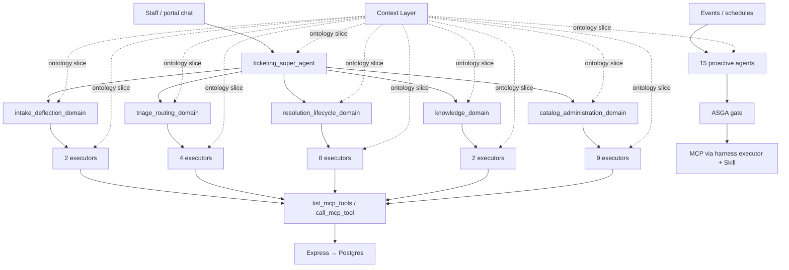

# Ticketing Agents — Hierarchy, Purpose, and Ontology

This document describes **every agent identity** in the Worktual Ticketing multi-agent system (MAS): where each agent sits in the hierarchy, what it does, and **which agents need Context Layer ontology** in their prompts (and why).

Canonical registry: `ai-agents/app/agents/definitions/*/agent.md`  
Tool allowlists: `ai-agents/app/tools/registry.py`  
Proactive bindings: `ai-agents/app/proactive/registry_agents.py`

---

## Counts at a glance

| Group | Count | Where it runs |
|-------|------:|---------------|
| **Three-Layer Harness MAS** | **31** | Staff / portal chat (`Super → Domain → Executor`) |
| — Super | 1 | Chat entry router |
| — Domain | 5 | Chat planners (delegate only) |
| — Executor | 25 | Chat workers (Skills + MCP tools) |
| **Proactive agents** | **15** | Events / schedules (background; harness-bound) |
| **Legacy chat specialists** | **7** | Compatibility layer during cutover |
| **ASGA** | — | Safety middleware (not an LLM agent) |

**Total distinct agent ids (Harness + Proactive + Legacy): 53** (with overlap: proactive agents map 1:1 to harness executors for tool execution).

**Ontology in prompts (minimum for tool correctness): 8 agents** — see [The 8 agents that need ontology](#the-8-agents-that-need-ontology-minimum-set) and [Why the other agents do not need ontology](#why-the-other-agents-do-not-need-ontology). Harness-only: **5** (3 executors + 2 proactive); add **3 legacy** (`tickets`, `admin`, `general`) if those paths still handle analytics.

---

## Architecture diagram

**Decision boundary:** LLM understands → Super routes or continues → Domain delegates → Executor collects and calls tools → code validates → Express → Postgres → grounded reply.

---

## What is an Executor? (Super vs Domain vs Executor)

Ticketing chat uses a **three-layer harness**. Each layer has a different job; only the bottom layer touches business data through tools.

### Super (`ticketing_super_agent`)

The **front door** for every chat message. Super answers one question: *“Is this a continuation of the pinned task, or new work — and if new, which Domain owns it?”* It uses tools like `route_to_domain`, `continue_active_task`, and `refuse_capability`. It does **not** ask for ticket fields, does **not** call `create_ticket`, `list_tickets`, or analytics tools, and does **not** need certified metric ids in its prompt because it never calls Context Layer.

### Domain (5 domain agents)

The **planner** for one business area (intake, triage, resolution, knowledge, catalog). Domain answers: *“Which Executor and which Skill should run this?”* It uses `delegate_to_executor` once per turn. It does **not** run MCP list/get/write tools itself — Executors do. Domain text in prompts is about Skill selection and handoff, not about picking `ticket_volume` vs `ticket_count`.

### Executor (25 executor agents)

The **worker** that actually does the task. An Executor:

1. Loads the **Skill** chosen by Domain (e.g. `ticket-create`, `analytics-query`, `team-create`).
2. Reads the Skill’s `agent.md` + JSON schemas for required fields.
3. **Collects** missing slots via `patch_*_draft` and natural-language questions.
4. **Calls MCP tools** allowed by that Skill (`list_tickets`, `create_queue`, `ask_semantic_layer`, etc.).
5. Waits for **TOOL RESULT** from Express/Postgres and writes a **grounded** user reply.

Executors are the only harness layer that **list, create, update, delete, or query** through MCP. Examples: `ticket_creation_executor` files tickets; `team_queue_crud_executor` manages queues; `analytics_audit_query_executor` runs semantic metrics and audit reads.

**Proactive agents** (e.g. `icpa`, `tiaa`) are **not** Executors themselves — they are event-driven wrappers that **propose** actions, pass ASGA, then execute tools **through** the bound harness Executor + Skill (same MCP path as chat).

**Legacy specialists** (`tickets`, `admin`, …) are an older chat routing model (one specialist per module). The product target is Super → Domain → **Executor**; legacy ids remain for compatibility.

---

# Part 1 — Three-Layer Harness (31 agents)

## Level 0 — Super (1)

### `ticketing_super_agent`

**Parent:** none (chat entry point)  
**Children:** 5 Domain agents (via `route_to_domain`)

The Super agent is the **conversation router** for all staff and portal coworker chat. It reads the full utterance plus live TaskState (active Skill pin, drafts, open UI focus) and decides whether to continue the current task, route to a new Domain, park/resume work, or refuse when RBAC blocks the capability. It never collects business fields, never confirms writes, and never calls MCP mutation tools itself. Its job is strictly transition control: one Domain per new task, with metric/count questions sent to `catalog_administration_domain` rather than ticket list-search. All user-visible routing outcomes are expressed through LLM tool calls (`route_to_domain`, `continue_active_task`, `refuse_capability`), not canned scripts.

---

## Level 1 — Domains (5)

Domains **plan only**. They pick `executor + Skill + task` and call `delegate_to_executor`. They do not call business MCP tools.

---

### `intake_deflection_domain`

**Parent:** `ticketing_super_agent`  
**Children (executors):** `ai_resolution_executor`, `ticket_creation_executor`

This Domain owns **intake**: helping users without filing vs filing a new ticket. It semantically splits self-service / KB deflection from create-ticket flows and delegates accordingly — never collecting ticket fields at the Domain layer. On the support portal it prefers deflection first unless the user clearly wants to file, then switches to ticket creation in the same session without bouncing through Super unnecessarily. It also parks close/reopen-of-existing-ticket asks back to Super so they land on resolution lifecycle, not create-ticket. CDP miss outcomes stay on ticket creation with a grounded refusal, not customer directory CRUD.

---

### `triage_routing_domain`

**Parent:** `ticketing_super_agent`  
**Children (executors):** `classification_priority_executor`, `intelligent_assignment_executor`, `workload_optimization_executor`, `root_cause_learning_executor`

This Domain owns **post-create triage and routing intelligence**: classify/enrich new tickets, assign L1/L2, optimize workload signals, and learn from routing outcomes. On lean `ticket.created` events it runs **without Super**, delegating classify then assign in order. For staff chat it delegates immediately and does not refuse for missing ticket ids — the Executor collects them. It does not own filing new tickets (returns to Super) or ticket lifecycle updates (resolution Domain). Workload optimization writes briefs for ITRA; it does not assign tickets itself.

---

### `resolution_lifecycle_domain`

**Parent:** `ticketing_super_agent`  
**Children (executors):** `ticket_lifecycle_executor`, `sla_escalation_executor`, `investigation_summary_executor`, `customer_reply_drafting_executor`, `autonomous_resolution_executor`, `resolution_quality_executor`, `personalized_notification_executor`, `insights_analytics_executor`

This Domain owns **existing ticket work** and resolution-side automation hooks exposed in chat. It delegates browse/search, field updates, notes, reassign, escalate, resolve/reopen, SLA monitoring, investigation summaries, reply drafts, autonomous resolution proposals, quality checks, notifications, and chat insights. It explicitly does **not** own catalog CRUD or new ticket filing — those are parked to Super. Natural-language metric counts belong on catalog administration / analytics executors, not ticket list tools. Portal customers can resolve/reopen and add files on owned tickets; staff-only fields remain RBAC-gated.

---

### `knowledge_domain`

**Parent:** `ticketing_super_agent`  
**Children (executors):** `resolution_knowledge_executor`, `similar_ticket_detection_executor`

This Domain owns **knowledge-assisted ticket intelligence**, not KB authoring. It recommends resolution articles for a ticket context and detects similar tickets at create time. It delegates immediately and does not answer in Domain prose while asking for missing ticket details. KB article create/update/publish and catalog work are parked to Super → catalog administration. It stays out of proactive lean create triage paths.

---

### `catalog_administration_domain`

**Parent:** `ticketing_super_agent`  
**Children (executors):** `team_queue_crud_executor`, `kb_quality_crud_executor`, `macro_crud_executor`, `customer_directory_crud_executor`, `priority_status_crud_executor`, `org_settings_integrations_executor`, `notification_inbox_executor`, `analytics_audit_query_executor`, `automation_rule_crud_executor`

This Domain owns **org catalog and administration**: teams/queues, KB quality CRUD, macros, customer directory (with chat policy limits on create/import), priorities/statuses, org settings, integrations, notification inbox, analytics/audit/CSAT reporting, and automation rules. It selects create vs update vs read vs delete Skills semantically and passes open UI context into executor objectives. Ticket lifecycle work (notes, reassign, create ticket) is parked to resolution/intake Domains. Analytics Skill selection sends NL how-many/CSAT/SLA asks to `analytics-query` (semantic metrics), why/drivers to `analytics-root-cause` (knowledge graph), and dashboard snapshots to structured `get_metrics` only.

---

## Level 2 — Executors (25)

Executors **do the work**: load a Skill, collect schema fields, call MCP tools, confirm writes, reply from TOOL RESULT only.

See **“What is an Executor?”** above for how Executors differ from Super and Domain. Every executor below is a **runtime agent id** registered in `ai-agents/app/agents/definitions/<name>/agent.md` with its own tool allowlist (union of legacy specialist bases + Skill narrowing + MCP discovery).

---

### Under `intake_deflection_domain`

#### `ai_resolution_executor`

**Parent Domain:** `intake_deflection_domain`  
**Proactive twin:** `dssa` (Deflection and Self-Service Agent)  
**Skills:** `intake-self-service-deflection`, `knowledge-search`

Handles **self-service deflection** before a ticket is filed: searches KB, walks articles, and answers how-to style questions from grounded KB tool results. Used heavily on the support portal when the user has not yet asked to file. It does not create tickets or mutate catalog rows. When the user clearly wants to file, it parks to Super/Domain so `ticket_creation_executor` takes over. Tools are read-only KB/list paths plus navigation helpers scoped by Skill.

#### `ticket_creation_executor`

**Parent Domain:** `intake_deflection_domain`  
**Proactive twin:** `tcaa` (Ticket Creation and Capture Agent)  
**Skills:** `ticket-create`, `customer-verify`, `ticket-enrich`

Owns the **full create-ticket pipeline** for staff and portal: verify customer in directory, enrich, duplicate check, collect issue/subject, confirm, and call `create_ticket` / `portal_create_ticket`. It maintains `ticket_draft` / TaskState across turns and never claims success without a write TOOL RESULT in the same turn. CDP miss means grounded refusal — no inventing customers. Order-id and purchase-related filing stays on this Skill. It does not classify, assign, or answer analytics KPIs.

---

### Under `triage_routing_domain`

#### `classification_priority_executor`

**Parent Domain:** `triage_routing_domain`  
**Proactive twin:** `icpa` (Classification and Prioritization Agent)  
**Skills:** `ticket-classify-prioritize`

Runs **post-create enrichment**: subject, description, priority, category, queue on new tickets (ICPA). Invoked on lean create path before assignment. Uses ticket read/update and queue list tools; roster and catalog values must come from Postgres tool results. Does not assign people or answer user chat analytics. Confidence-gated proactive proposals go through ASGA before apply.

#### `intelligent_assignment_executor`

**Parent Domain:** `triage_routing_domain`  
**Proactive twin:** `itra` (Intelligent Routing Agent)  
**Skills:** `ticket-assign-best`

Chooses **L1 agent and L2 resolver** from live roster, skills, queue, and workload signals (ITRA). Runs after classify on create path or on `icpa.completed`. Assignee names must match list/get tool results — never invented. May read WLOA workload briefs from durable memory. Does not change priority/catalog or draft customer replies.

#### `workload_optimization_executor`

**Parent Domain:** `triage_routing_domain`  
**Proactive twin:** `wloa` (Workload Optimization Agent)  
**Skills:** `routing-optimize-workload`

On schedule, inspects org ticket load and agent/queue metrics and **persists a short workload brief** that ITRA may read on later assigns. It never assigns tickets itself and does not mutate ticket rows. Output is recommendation/memory for routing, not user chat. Uses list tickets/agents/queues and dashboard-style metrics reads within Skill scope.

#### `root_cause_learning_executor`

**Parent Domain:** `triage_routing_domain`  
**Proactive twin:** `rcaa` (Root Cause and Learning Agent)  
**Skills:** `routing-learn-from-outcomes`

Scheduled **routing learning**: analyzes outcomes via analytics, audit, tickets, CSAT, and **knowledge graph** (`ask_knowledge_graph`) to adjust routing weight hints ITRA consumes. Never mutates tickets. Proactive RCAA runs silently through ASGA for audit; chat harness uses the same Skill when delegated. Does **not** call `ask_semantic_layer` in the current reporting contract (knowledge graph + structured analytics only).

---

### Under `resolution_lifecycle_domain`

#### `ticket_lifecycle_executor`

**Parent Domain:** `resolution_lifecycle_domain`  
**Proactive twin:** none (chat-first)  
**Skills:** `ticket-read-search`, `ticket-update`, `ticket-note-add`, `ticket-reassign`, `ticket-escalate`, `ticket-resolve-reopen`

Primary **staff chat ticket worker**: list/search/open tickets, update fields, add notes, reassign, escalate, resolve/reopen. Grounded list rows and ids come only from `list_tickets` / `get_ticket` this turn. Must not answer how-many / CSAT / SLA % KPIs with list counts — those route to analytics executors. Honors RBAC for staff vs portal customers (customers: resolve/reopen and file attach on owned tickets). Uses MCP-only tool path in harness mode.

#### `sla_escalation_executor`

**Parent Domain:** `resolution_lifecycle_domain`  
**Proactive twin:** `sema` (SLA and Escalation Agent)  
**Skills:** `sla-monitor-escalate`

Monitors **SLA-at-risk** tickets and proposes or executes escalation paths per policy. Triggered on schedules and ticket update/SLA events. Can escalate, notify staff, and read ticket/assignee context. Stays quiet when no risk is detected. High-risk auto-escalation is gated by ASGA; SEMA proposes, ASGA approves or blocks.

#### `investigation_summary_executor`

**Parent Domain:** `resolution_lifecycle_domain`  
**Proactive twin:** `tsaa` (Ticket Summary Assistant)  
**Skills:** `ticket-investigation-summary`

Produces **investigation summaries** after create or on ticket lifecycle events: progress, notes, customer replies, escalation context. Used on lean create follow-up chain (after triage). Read-only ticket/note/progress tools plus LLM narrative grounded in TOOL RESULT. Does not assign, escalate, or mutate catalog.

#### `customer_reply_drafting_executor`

**Parent Domain:** `resolution_lifecycle_domain`  
**Proactive twin:** `crda` (Customer Response Drafting Agent)  
**Skills:** `reply-draft`

Drafts **customer-facing reply text** from ticket context and progress; may propose adding a note. Triggered on customer reply events or on-demand draft requests. High-risk / approval policies apply via ASGA for proactive runs. Does not send notifications directly (PNA owns delivery patterns).

#### `autonomous_resolution_executor`

**Parent Domain:** `resolution_lifecycle_domain`  
**Proactive twin:** `ara` (Autonomous Resolution Agent)  
**Skills:** `ticket-autonomous-resolution`

Proposes **close/reopen / status-only** autonomous resolution steps when customer replies or on demand. LLM judges close vs reopen vs silence; ASGA executes approved status updates. Minimal tool surface: get/update ticket. Does not reassign, escalate, or run analytics.

#### `resolution_quality_executor`

**Parent Domain:** `resolution_lifecycle_domain`  
**Proactive twin:** `rqa` (Resolution Quality Agent)  
**Skills:** `ticket-resolution-quality`

Evaluates **resolution quality** on ticket updates using notes, progress, and ticket state. Outputs recommendations or flags; does not own CSAT analytics or semantic KPIs. Read-heavy ticket/note/progress tools. Proactive runs on `ticket.updated` events.

#### `personalized_notification_executor`

**Parent Domain:** `resolution_lifecycle_domain`  
**Proactive twin:** `pna` (Personalized Notifications Agent)  
**Skills:** `notification-personalize-deliver`

Sends **personalized staff notifications** on ticket lifecycle events (create, update, comment, SLA risk, etc.). Respects user notification preferences as hard gates. Uses send_staff_notification and inbox reads. ASGA always executes PNA proposals through the approval pipeline.

#### `insights_analytics_executor`

**Parent Domain:** `resolution_lifecycle_domain` (also reachable via catalog for analytics routing)  
**Proactive twin:** `tiaa` (Insights and Analytics Agent)  
**Skills:** `analytics-generate-insights`

Chat **insights** worker: NL metric values via `ask_semantic_layer` (certified metric ids from ontology slice) and why/drivers via `ask_knowledge_graph`. Combined value+why runs semantic then graph. Must not invent counts from `list_tickets`. One of three **reporting contract** agents allowed to call semantic layer in current enforcement.

---

### Under `knowledge_domain`

#### `resolution_knowledge_executor`

**Parent Domain:** `knowledge_domain`  
**Proactive twin:** `rkaa` (Resolution Knowledge Agent)  
**Skills:** `knowledge-recommend-resolution`

Recommends **KB articles to help resolve a ticket**, using list/get KB and ticket recommendation tools. Runs at ticket create or on-demand knowledge requests. Read-only KB/ticket paths; no article authoring (catalog KB executor owns writes). Grounded recommendations only from tool results.

#### `similar_ticket_detection_executor`

**Parent Domain:** `knowledge_domain`  
**Proactive twin:** `stda` (Similar Ticket Detection Agent)  
**Skills:** `ticket-detect-similar`

Finds **similar historical tickets** at create time to reduce duplicates and surface patterns. Uses ticket list/get, notes, KB, macros as scoped by Skill. Does not create tickets or run semantic KPI queries. Proactive on `ticket.created`.

---

### Under `catalog_administration_domain`

#### `team_queue_crud_executor`

**Parent Domain:** `catalog_administration_domain`  
**Skills:** `team-read`, `team-create`, `team-update`, `team-members-update`, `team-delete`

Full **teams/queues CRUD** including member add/remove with confirmation gates on roster writes. Collects via `patch_team_draft` patterns; ids from list/get only. After create succeeds, member changes use members-update Skill, not recreate. MCP-only writes to Express.

#### `kb_quality_crud_executor`

**Parent Domain:** `catalog_administration_domain`  
**Skills:** `knowledge-read`, `knowledge-article-create`, `knowledge-article-update`, `knowledge-article-publish`, `knowledge-category-manage`, `knowledge-import`, `knowledge-export`

**KB authoring and quality**: list/search articles, draft/create/publish, categories, import/export. Distinguishes new draft vs persisted row for publish vs create. Publication intent (draft vs published) is LLM-chosen then tool-matched. No ticket lifecycle mutations.

#### `macro_crud_executor`

**Parent Domain:** `catalog_administration_domain`  
**Skills:** `macro-read`, `macro-create`, `macro-update`, `macro-delete`

**Canned reply macros** CRUD. Collects title/body distinctly on create. Confirmed writes only after schema complete and RBAC pass.

#### `customer_directory_crud_executor`

**Parent Domain:** `catalog_administration_domain`  
**Skills:** `customer-read-360`, `customer-create`, `customer-import`

**Customer directory** reads and writes. Staff chat often refuses create/import per Domain policy (lookup + ticket history only); executor still owns the Skills when explicitly delegated. 360 requires `get_customer_360` TOOL RESULT — never invented rows.

#### `priority_status_crud_executor`

**Parent Domain:** `catalog_administration_domain`  
**Skills:** `priority-read/create/update/delete`, `status-read/create/update/delete`

**Priority and status catalog** CRUD. Semantic split between create (new label/hours draft) vs update (existing row from list/get id). Hours vs name confusion fixed at Skill/agent level, not regex routing.

#### `org_settings_integrations_executor`

**Parent Domain:** `catalog_administration_domain`  
**Skills:** org prefs, user prefs, LTM, widgets, integration keys, hub-delegate

**Org settings, preferences, long-term memory, widgets, integration keys**, and Hub delegation. Sensitive mutations RBAC- and confirm-gated. No ticket or analytics semantic tools in core Skills.

#### `notification_inbox_executor`

**Parent Domain:** `catalog_administration_domain`  
**Skills:** `notification-inbox-read`, `notification-mark-read`, `notification-clear`

Staff **notification inbox** read, mark read, clear. Shares some tools with PNA but chat-facing inbox UX lives here. Read-heavy with bounded clear/mark mutations.

#### `analytics_audit_query_executor`

**Parent Domain:** `catalog_administration_domain`  
**Skills:** `dashboard-metrics-read`, `analytics-query`, `analytics-export`, `analytics-root-cause`, `csat-report`, `audit-query`, `escalation-directory-read`

Primary **chat analytics and audit** executor. NL how-many/CSAT/SLA/volume → `ask_semantic_layer` with metric ids from ontology slice; why/drivers → `ask_knowledge_graph`; value+why → both in order. Structured home dashboard → `get_metrics` only. Export/audit/CSAT use dedicated tools — not ticket list substitutes. **Reporting contract** agent for semantic layer.

#### `automation_rule_crud_executor`

**Parent Domain:** `catalog_administration_domain`  
**Skills:** `automation-rule-read/create/update/delete`

**Automation rules** CRUD for org workflows. Standard collect/confirm/write pattern. No analytics or ontology tools.

---

# Part 2 — Proactive agents (15)

Proactive agents run on **events or schedules**, outside normal coworker chat unless Hub invokes `tk.proactive.run`. Each maps 1:1 to a harness **Domain + Executor + Skill** (`PROACTIVE_HARNESS_BINDINGS`). Tool execution uses MCP tokens scoped to the harness executor; LLM propose steps use the **proactive id** (e.g. `tiaa`, not only `insights_analytics_executor`).

| Proactive ID | Full name | Harness executor | Domain |
|--------------|-----------|------------------|--------|
| `dssa` | Deflection and Self-Service Agent | `ai_resolution_executor` | intake_deflection |
| `tcaa` | Ticket Creation and Capture Agent | `ticket_creation_executor` | intake_deflection |
| `icpa` | Classification and Prioritization Agent | `classification_priority_executor` | triage_routing |
| `itra` | Intelligent Routing Agent | `intelligent_assignment_executor` | triage_routing |
| `wloa` | Workload Optimization Agent | `workload_optimization_executor` | triage_routing |
| `rcaa` | Root Cause and Learning Agent | `root_cause_learning_executor` | triage_routing |
| `tsaa` | Ticket Summary Assistant | `investigation_summary_executor` | resolution_lifecycle |
| `sema` | SLA and Escalation Agent | `sla_escalation_executor` | resolution_lifecycle |
| `crda` | Customer Response Drafting Agent | `customer_reply_drafting_executor` | resolution_lifecycle |
| `ara` | Autonomous Resolution Agent | `autonomous_resolution_executor` | resolution_lifecycle |
| `rqa` | Resolution Quality Agent | `resolution_quality_executor` | resolution_lifecycle |
| `pna` | Personalized Notifications Agent | `personalized_notification_executor` | resolution_lifecycle |
| `tiaa` | Insights and Analytics Agent | `insights_analytics_executor` | resolution_lifecycle |
| `rkaa` | Resolution Knowledge Agent | `resolution_knowledge_executor` | knowledge |
| `stda` | Similar Ticket Detection Agent | `similar_ticket_detection_executor` | knowledge |

**ASGA** sits after every proactive proposal: deterministic safety, RBAC, and approval — not counted as an agent.

### Proactive agent purposes (summary)

Each proactive module implements `propose(event) → Proposal | None`, then ASGA → harness MCP execution:

- **`dssa` / `tcaa`:** Inbound message capture — deflect with KB or propose ticket create.  
- **`icpa` / `itra`:** Post-create classify then assign on `ticket.created`.  
- **`wloa`:** Scheduled workload brief for routing.  
- **`rcaa`:** Scheduled routing learning from analytics + knowledge graph.  
- **`tsaa`:** Summaries on ticket lifecycle events.  
- **`sema`:** SLA risk watch and escalation proposals.  
- **`crda`:** Draft replies on customer message.  
- **`ara`:** Close/reopen assistance on customer reply.  
- **`rqa`:** Quality signals on ticket update.  
- **`pna`:** Deliver notifications on lifecycle events.  
- **`tiaa`:** Scheduled/on-demand insights (semantic + graph).  
- **`rkaa`:** KB recommendations at create.  
- **`stda`:** Similar ticket detection at create.

---

# Part 3 — Legacy chat specialists (7)

Compatibility allowlists in `registry.py` for module/surface routing during harness cutover. **Not** the canonical Super → Domain → Executor path, but still present in tool registry:

| Specialist | Typical scope |
|------------|----------------|
| `tickets` | Ticket ops, portal, recommendations, some analytics reads |
| `customers` | Customer directory |
| `teams` | Queues / teams |
| `kb` | Knowledge base |
| `macros` | Canned replies |
| `admin` | Priorities, statuses, analytics, audit, org prefs |
| `general` | Cross-module help / greetings |

New staff chat work should route through **Super → Domain → Executor**. Legacy ids remain for idle page tools and transitional flows.

---

# Part 4 — Ontology (Context Layer) — who needs what

Ontology integration means appending a **Context Layer slice** to the LLM system prompt via `ontology_slice_prompt_block()`:

- **`prompt`** — role-scoped ontology text from `POST /v1/ontology/slice`  
- **`metrics[]`** — certified metric ids and `dims` for `ask_semantic_layer`  
- Injected per **`(organizationId, userId, runtimeAgentId)`**

Tool enforcement (after LLM): only **`SEMANTIC_REPORTING_AGENTS`** may call `ask_semantic_layer`; metric/dimension ids must match the cached slice.

---

## Where ontology is injected today (prompt sites)

| Site | Runtime agent id passed | File |
|------|-------------------------|------|
| Super — continue/pin path | `ticketing_super_agent` | `ticketing_coworker.py` |
| Super — route path | `ticketing_super_agent` | `ticketing_coworker.py` |
| Super — domain pick path | `ticketing_super_agent` | `ticketing_coworker.py` |
| Domain delegate loop | `{domain_id}` | `ticketing_coworker.py` |
| Executor harness loop | `{harness_executor}` | `ticketing_coworker.py` |
| Proactive LLM JSON | `{agent_id}` e.g. `tiaa`, `rcaa` | `proactive/llm_json.py` |

So **in current code**, slice fetch runs for **every harness Super/Domain/Executor turn** and **every proactive LLM call** (except `asga`). If Context Layer returns empty for non-reporting agents, the block is skipped harmlessly.

---

## Who **must** have ontology (tool correctness)

These agents call Context Layer tools and **need** slice content (especially **certified `metrics[]`**) to avoid invented metric ids like `ticket_count`:

### Tier A — Semantic metrics (`ask_semantic_layer`) — **required**

| Agent id | Why | Ontology need |
|----------|-----|----------------|
| **`analytics_audit_query_executor`** | Skills `analytics-query`, `analytics-root-cause` (value+why) | **Full slice:** `prompt` + **`metrics[]`** + dims; map NL → `metrics: [...]` before MCP call |
| **`insights_analytics_executor`** | Skill `analytics-generate-insights` | Same — semantic for counts, graph for drivers |
| **`tiaa`** | Proactive insights; same Skill/tools via harness | Same slice under proactive id **`tiaa`** (may differ from executor id in Context Layer) |

**Count: 3** reporting contract agents (`SEMANTIC_REPORTING_AGENTS` in `registry.py`).

### Tier B — Knowledge graph (`ask_knowledge_graph`) — **required for why/drivers**

| Agent id | Why | Ontology need |
|----------|-----|----------------|
| **`analytics_audit_query_executor`** | `analytics-root-cause` Skill | **`prompt`** for graph context; optional metrics when value+why |
| **`insights_analytics_executor`** | `analytics-generate-insights` | Same |
| **`root_cause_learning_executor`** | `routing-learn-from-outcomes` | **`prompt`** for learning narrative; uses graph, not semantic |
| **`rcaa`** | Proactive twin; calls graph on schedule | Slice under proactive id **`rcaa`** |
| **`tiaa`** | Combined insights | Graph + semantic (Tier A + B) |

### Tier C — Optional / legacy (pre-harness analytics paths)

If legacy specialists still handle analytics utterances, they previously had semantic/graph tools in allowlists:

| Agent id | Notes |
|----------|--------|
| `tickets`, `admin`, `general` | Legacy module routing; **not** canonical harness. Ontology only needed if those paths still call semantic/graph tools in production. |

### The 8 agents that need ontology (minimum set)

Before harness-wide slice injection, **only eight runtime agent ids** needed Context Layer ontology in their prompts for **correct tool behavior** (not for routing polish). Everything else could omit ontology without breaking MCP calls.

| # | Agent id | Layer | Needs ontology because |
|---|----------|-------|-------------------------|
| 1 | `analytics_audit_query_executor` | Executor | Calls `ask_semantic_layer` (certified `metrics[]`) and `ask_knowledge_graph` for analytics-query / root-cause Skills |
| 2 | `insights_analytics_executor` | Executor | Same for chat insights Skill (`analytics-generate-insights`) |
| 3 | `root_cause_learning_executor` | Executor | Calls `ask_knowledge_graph` for `routing-learn-from-outcomes` |
| 4 | `tiaa` | Proactive | Proactive insights LLM + tools; bound to `insights_analytics_executor` but uses proactive id for slice |
| 5 | `rcaa` | Proactive | Proactive routing learning; bound to `root_cause_learning_executor`; uses knowledge graph |
| 6 | `tickets` | Legacy specialist | Pre-cutover allowlist included semantic + graph for KPI-style asks on ticket module |
| 7 | `admin` | Legacy specialist | Same for admin/analytics module surfaces |
| 8 | `general` | Legacy specialist | Same for cross-module analytics/help paths |

**Harness-only minimum (no legacy): 5 ids** — rows 1–5. Rows 6–8 apply only while legacy specialists still serve analytics utterances.

If Context Layer registers **different slices** for proactive id vs executor id, treat **`tiaa` + `insights_analytics_executor`** and **`rcaa` + `root_cause_learning_executor`** as up to **10** injection sites; functionally the **8 named roles** above still describe who needs ontology content.

---

## Why the other agents do **not** need ontology

Ontology in the prompt matters when the LLM must choose **Context Layer tool arguments** — especially certified **metric ids** and **dimensions** for `ask_semantic_layer`, or grounded context for `ask_knowledge_graph`. Agents that never call those tools do not need `metrics[]` or ontology narrative in prompt; their tools use Express/Postgres ids from `list_*` / `get_*` TOOL RESULT only.

Below: **45+ agent identities** that do **not** need ontology for tool correctness (current enforcement aligns with this).

### 1. Super — `ticketing_super_agent` (1 agent)

Super never calls `ask_semantic_layer` or `ask_knowledge_graph`. It only routes to `catalog_administration_domain` when the user asks “how many open tickets?” — the **analytics executor** picks metric ids, not Super. Injecting ontology into Super would add token cost without changing any tool payload Super sends. Super’s outputs are routing JSON (`domain_id`, `continue`, `refuse`), not semantic query bodies.

### 2. Domains — all 5 (intake, triage, resolution, knowledge, catalog)

Domains never invoke MCP business tools; they call `delegate_to_executor` with an objective string. They do not construct `metrics: ["ticket_volume"]` or knowledge-graph queries. Domain prompts need Skill/executor catalogs, RBAC, and memory — not certified metrics. Optional ontology text might hint “analytics lives on catalog Domain,” but that is routing documentation, not a hard requirement for Context Layer APIs.

### 3. Executors without semantic/graph tools — 22 agents

These Executors use **Express-backed MCP tools only** (tickets, queues, KB rows, macros, prefs, notifications, automation rules). Their Skills never list `ask_semantic_layer` or `ask_knowledge_graph`:

| Executor | What it uses instead of Context Layer |
|----------|--------------------------------------|
| `ai_resolution_executor` | `list_kb`, `get_kb` |
| `ticket_creation_executor` | `create_ticket`, verify/enrich, directory lists |
| `classification_priority_executor` | `get_ticket`, `update_ticket`, `list_queues` |
| `intelligent_assignment_executor` | `auto_assign_ticket`, roster/queue lists |
| `workload_optimization_executor` | `list_tickets`, `list_agents`, `get_metrics` (structured dashboard, not semantic) |
| `ticket_lifecycle_executor` | `list_tickets`, `get_ticket`, updates, notes, escalate |
| `sla_escalation_executor` | ticket read + escalate + notify |
| `investigation_summary_executor` | ticket progress, notes (read-only narrative) |
| `customer_reply_drafting_executor` | ticket context for drafts |
| `autonomous_resolution_executor` | `get_ticket`, `update_ticket` status |
| `resolution_quality_executor` | ticket/notes/progress reads |
| `personalized_notification_executor` | `send_staff_notification`, inbox reads |
| `resolution_knowledge_executor` | `list_kb`, recommendations (Postgres KB, not knowledge graph analytics) |
| `similar_ticket_detection_executor` | ticket/KB list similarity |
| `team_queue_crud_executor` | queue CRUD |
| `kb_quality_crud_executor` | KB article CRUD |
| `macro_crud_executor` | macro CRUD |
| `customer_directory_crud_executor` | customer list/360/create/import |
| `priority_status_crud_executor` | priority/status catalog CRUD |
| `org_settings_integrations_executor` | prefs, widgets, keys |
| `notification_inbox_executor` | inbox read/mark/clear |
| `automation_rule_crud_executor` | automation rule CRUD |

For all of these, **correct behavior depends on Postgres tool results**, not on Context Layer metric catalogs. Adding ontology would not prevent invented ids because they do not send metric ids to Context Layer at all.

### 4. Proactive agents without semantic/graph — 13 agents

Proactive modules `dssa`, `tcaa`, `icpa`, `itra`, `wloa`, `tsaa`, `sema`, `crda`, `ara`, `rqa`, `pna`, `rkaa`, `stda` declare `tools_used` without `ask_semantic_layer` or `ask_knowledge_graph`. They propose ticket creates, classify, assign, summarize, notify, recommend KB articles from **Express APIs**, etc. Their LLM steps choose assignee names, draft text, or escalation targets — grounded via list/get tools, not ontology slices. Only **`tiaa`** and **`rcaa`** (of 15) need ontology among proactive agents.

### 5. Legacy specialists without analytics tools — 4 agents

`teams`, `customers`, `kb`, and `macros` legacy allowlists have **no** semantic or knowledge-graph tools. They only need catalog CRUD/list MCP tools. Ontology slices for metrics or enterprise graph would be unused noise in their prompts.

### 6. ASGA (not an agent)

ASGA is deterministic middleware (approve/block proactive proposals). It does not run an LLM turn and does not call Context Layer. No ontology.

### Summary: 8 need it, the rest do not (for tools)

| Category | Count | Need ontology? |
|----------|------:|:--------------:|
| **Need ontology (minimum 8)** | 8 | **Yes** — semantic and/or knowledge graph tool args |
| Super | 1 | No — routes only |
| Domains | 5 | No — delegate only |
| Other executors | 22 | No — Express/Postgres tools only |
| Other proactive | 13 | No — no Context Layer tools |
| Legacy without analytics | 4 | No — no semantic/graph in allowlist |
| ASGA | — | No — not LLM |

**Note on current code:** Slice injection may still **run** for Super, Domains, and all Executors/proactive LLMs; if Context Layer returns empty for non-reporting agents, the block is skipped. That is safe but **not required** for correctness — only the **8** above (or **5** harness-only) materially depend on ontology content.

---

## Ontology need matrix (quick reference)

| Agent | Inject prompt? (current) | Needs `metrics[]`? | Needs `ask_knowledge_graph` context? |
|-------|:------------------------:|:------------------:|:------------------------------------:|
| ticketing_super_agent | Yes | No | No |
| 5 Domains | Yes | No | No |
| ai_resolution_executor | Yes | No | No |
| ticket_creation_executor | Yes | No | No |
| classification_priority_executor | Yes | No | No |
| intelligent_assignment_executor | Yes | No | No |
| workload_optimization_executor | Yes | No | No |
| root_cause_learning_executor | Yes | No | **Yes** |
| ticket_lifecycle_executor | Yes | No | No |
| sla_escalation_executor | Yes | No | No |
| investigation_summary_executor | Yes | No | No |
| customer_reply_drafting_executor | Yes | No | No |
| autonomous_resolution_executor | Yes | No | No |
| resolution_quality_executor | Yes | No | No |
| personalized_notification_executor | Yes | No | No |
| **insights_analytics_executor** | Yes | **Yes** | **Yes** |
| resolution_knowledge_executor | Yes | No | No |
| similar_ticket_detection_executor | Yes | No | No |
| team_queue_crud_executor | Yes | No | No |
| kb_quality_crud_executor | Yes | No | No |
| macro_crud_executor | Yes | No | No |
| customer_directory_crud_executor | Yes | No | No |
| priority_status_crud_executor | Yes | No | No |
| org_settings_integrations_executor | Yes | No | No |
| notification_inbox_executor | Yes | No | No |
| **analytics_audit_query_executor** | Yes | **Yes** | **Yes** |
| automation_rule_crud_executor | Yes | No | No |
| **tiaa** (proactive) | Yes | **Yes** | **Yes** |
| **rcaa** (proactive) | Yes | No | **Yes** |
| Other 13 proactive | Yes | No | No |
| Legacy tickets/admin/general | If used | Legacy only | Legacy only |

---

## Related files

| Concern | Path |
|---------|------|
| Agent definitions | `ai-agents/app/agents/definitions/*/agent.md` |
| Canonical counts | `ai-agents/app/runtime/supervisor.py` |
| Tool allowlists + `SEMANTIC_REPORTING_AGENTS` | `ai-agents/app/tools/registry.py` |
| Ontology slice fetch + validation | `ai-agents/app/tools/catalog_tools.py` |
| Chat inject sites | `ai-agents/app/agents/ticketing_coworker.py` |
| Proactive inject | `ai-agents/app/proactive/llm_json.py` |
| Proactive ↔ harness map | `ai-agents/app/proactive/registry_agents.py` |
| Shared MCP catalog | `shared/ticketing_tool_catalog.json` |

---

*Generated from the Ticketing Three-Layer Harness MAS registry (1 Super + 5 Domains + 25 Executors) and proactive harness bindings.*
