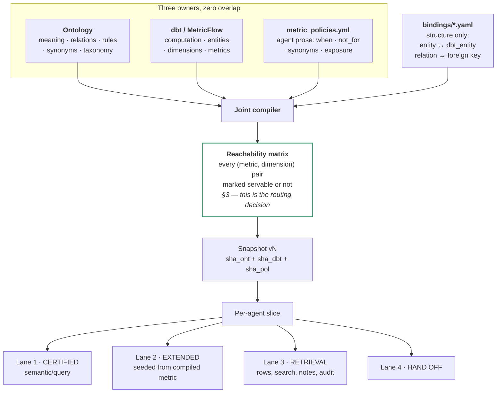
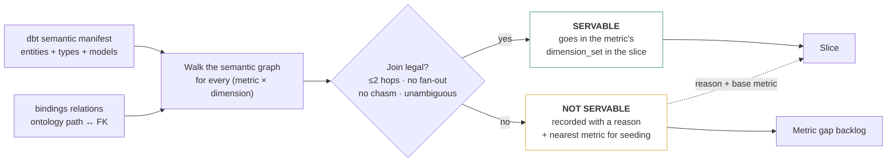
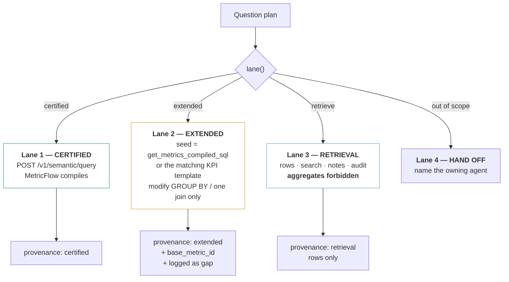
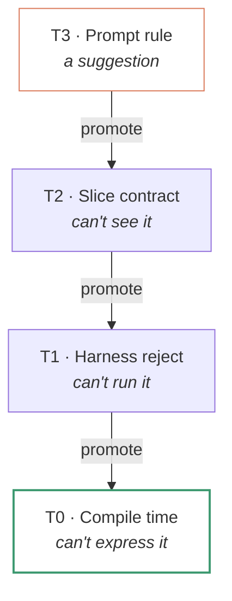
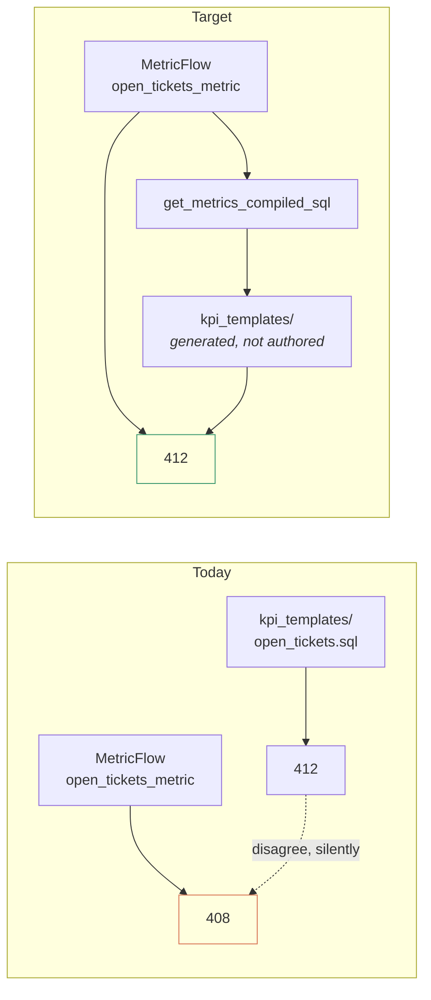

# The Unified Semantic Layer — Final Plan (v2)

*Ontology · dbt / MetricFlow · SQL harness, compiled into one agent-facing contract.*
*Supersedes v1. Changes are driven by review feedback and by what MetricFlow's published join rules actually permit.*

---

## 0. What changed from v1, and why

| v1 said | v2 says | Why |
|---|---|---|
| Routing today is exception-driven | Routing is **already role-based at the outer layer**; the weakness is *inside* the analytics path | Lifecycle agents are list-only, KPI phrasing already returns `kpi_not_allowed`, Super remounts analytics. Those are real controls. |
| The SQL agent writes SQL from scratch | The SQL agent is a **constrained harness**; the real drift vector is **two certified definitions** — `kpi_templates/` and MetricFlow | Free-SQL was the wrong threat model. Duplicate certified logic is the actual one. |
| Put `when` / `not_when` in a new binding file | `metric_policies.yml` **already owns agent prose**. The binding file carries **structure only** | Three homes for the same prose guarantees drift |
| Classify Tier 1 vs Tier 2 at plan time with a heuristic | **Precompute reachability at build time.** The dimension set *is* the routing decision | MetricFlow's join rules are declarative and knowable offline (§3) |
| "SQL projection" as one thing | **Two SQL lanes**: retrieval and metric-extension, with different guards | Most SQL traffic is rows/search/notes/audit, not metric fallback |
| GBL-BR-002 as a prompt rule | **Enforcement tiers** — every rule assigned a tier; prompt rules are the weakest and used last | A rule in a prompt is a suggestion |

**The framing that should drive the whole effort:** Omni's testing on 100 real analytics questions found that adding metric definitions, business context and valid query examples lifted accuracy from 75% to 95%, and their diagnosis is that most AI analytics failures are not hallucinations — they are *modeling failures*: the wrong table, the wrong grain, the wrong aggregation level. Everything below is an attack on modeling failures.

---

## 1. North star, in one diagram



---

## 2. Two files, two jobs — the anti-drift rule

The single most likely way this project fails is that `when` for `open_tickets_metric` ends up in three places and they disagree. So the split is a hard rule, enforced by a validator.

| File | Owns | Never contains | Changes when |
|---|---|---|---|
| `bindings/<product>.yaml` | **Structure.** `entity ↔ dbt_entity`, `relation ↔ foreign key`, joined-dimension paths, derived-dimension definitions | Any prose an agent reads | The dbt model changes |
| `ontology/metric_policies.yml` | **Agent prose.** `when`, `not_for`, synonyms, `exposure`, `dims` allow-list | Any join key or FK name | You learn the agent picked wrong |
| `ontology/*.yaml` | Meaning, relations, business rules, taxonomy | Metric definitions | The business changes |
| dbt project | Computation | Agent-facing prose (for now — see 2.2) | The numbers change |

### 2.1 What the binding file looks like when it carries structure only

```yaml
# bindings/ticketing.yaml
version: 2
product: ticketing
dbt_project: worktual_analytics

entities:
  Ticket: { dbt_entity: ticket, primary_model: fct_tickets, identifier: ticketing.tickets.id }
  Staff:  { dbt_entity: agent,  primary_model: dim_agents,  identifier: ticketing.agents.id }
  Queue:  { dbt_entity: queue,  primary_model: dim_queues,  identifier: ticketing.agent_queues.id }
  # Customer, Company, Note, SLA … auto-matched where names align

relations:
  # This block exists because dbt cannot express it.
  Ticket.assigned_to.Staff:  { via: assignee_id, dbt_entity_type: foreign }
  Ticket.has_resolver.Staff: { via: resolver_id, dbt_entity_type: foreign }
  Ticket.routed_to.Queue:    { via: queue_id,    dbt_entity_type: foreign }
  Ticket.raised_by.Customer: { via: customer_id, dbt_entity_type: foreign }

dimensions:
  assignee_name: { relation: Ticket.assigned_to.Staff,  field: name }
  resolver_name: { relation: Ticket.has_resolver.Staff, field: name }
  queue_name:    { relation: Ticket.routed_to.Queue,    field: name }
  is_overdue:    { entity: Ticket, derived_from: status }
```

No `when`. No synonyms. No `exposure`. Those live in `metric_policies.yml`, which you already have — extend it with `exposure` and leave everything else where it is.

**Why `relations:` is load-bearing.** `assigned_to` and `has_resolver` both point at dbt entity `agent` through different foreign keys. To MetricFlow they are two join paths with no semantic difference. To your business they are the L1 owner and the L2 specialist, and rule TKT-BR-006 exists to stop them being confused. This block is the only place that distinction can be expressed, and it is what lets the compiler emit into every slice:

> `assignee_name` is the Staff reached by `assigned_to` — the L1 owner.
> `resolver_name` is the Staff reached by `has_resolver` — the L2 specialist.
> These are different jobs. Do not substitute one for the other.

### 2.2 Migration path for prose into dbt

dbt Core v1.12 emits `osi_document.json` alongside the semantic manifest, and the Apache Ossie spec carries `ai_context`, `instructions` and synonyms natively at every level. So there is a standard home in dbt eventually.

Do not go there yet. Keep prose in `metric_policies.yml` while you are iterating weekly on disambiguation — analytics-engineering PR cycles will throttle prompt tuning. Build the compiler to read **dbt `meta.ai_context` first, falling back to `metric_policies.yml`**, so migration later is a data move with no code change. Add a validator that errors if the same key is set in both.

---

## 3. The core change: precompute reachability, don't classify at runtime

v1 proposed a plan-time classifier that guessed whether the semantic layer could answer. That was still a heuristic. It does not need to be, because **MetricFlow's join behaviour is declarative and published**:

| Source entity type | Target entity type | MetricFlow behaviour |
|---|---|---|
| Foreign | Primary | `LEFT OUTER JOIN` — allowed |
| Primary | Primary (two facts queried together) | `FULL OUTER JOIN` — allowed |
| **Primary** | **Foreign** | **Error** — refused, to prevent fan-out |
| Any | via many-to-many intermediate | **Refused** — chasm join |
| Any | more than two hops away | **Refused** — the limit is three tables, two hops |
| Any | reachable by two different paths | **Validation error** — ambiguous |

Every one of those is decidable from the semantic manifest plus your `relations:` block, offline, at build time.

### 3.1 The matrix



```python
def reachability(manifest, bindings) -> dict[tuple[str, str], Servable | Blocked]:
    out = {}
    for metric in manifest.metrics:
        base = manifest.semantic_model_of(metric)
        for dim in manifest.all_dimensions():
            owner = manifest.semantic_model_of(dim)
            paths = graph.paths(base, owner, max_hops=2)
            if not paths:
                out[metric.id, dim] = Blocked("unreachable_within_two_hops")
            elif len(paths) > 1:
                out[metric.id, dim] = Blocked("ambiguous_join_path")
            elif any(step.src_type == "primary" and step.dst_type == "foreign"
                     for step in paths[0]):
                out[metric.id, dim] = Blocked("fan_out_refused")
            elif graph.is_chasm(paths[0]):
                out[metric.id, dim] = Blocked("chasm_join_refused")
            else:
                out[metric.id, dim] = Servable(path=paths[0])
    return out
```

### 3.2 What this buys

**The slice's `dimension_set` becomes a guarantee, not a hint.** Every dimension listed on a metric in the slice is one MetricFlow will actually serve. Anything absent is, by construction, a Tier 2 case. The agent does not classify, does not guess, and does not discover by failure.

**Routing collapses to set membership:**

```python
def lane(plan, slice_):
    if plan.subject not in slice_.entities_at(L2):
        return HandOff(owner=slice_.coverage.owner_of(plan.subject))
    if plan.intent == "retrieve_rows":
        return Retrieval()                                  # Lane 3, never aggregates
    m = slice_.match_metric(plan)                            # id → synonym → (measures, kind)
    if m is None:
        return Extended(base=None, entity=plan.subject)
    if bad := [f for f in plan.filters if not m.accepts_value(f)]:
        return RejectFilters(bad, legal=m.legal_values_for(bad))
    if set(plan.group_bys) <= m.dimension_names and m.supports_grain(plan.grain):
        return Certified(m)                                  # guaranteed to work
    return Extended(base=m, missing=set(plan.group_bys) - m.dimension_names)
```

**Unexpected Tier 1 failures become an alertable bug.** If `semantic/query` errors on a request the matrix said was servable, the snapshot is stale against the manifest. Target under 0.5%; anything higher means the joint compile is not firing on dbt merges.

**The blocked pairs are your backlog, generated automatically.** dbt's own benchmark found the semantic layer could not answer questions requiring too many entity hops — and the fix was three new dbt models, after which every question became answerable. Your blocked-pair list, ranked by how often agents ask for those combinations, is exactly the input to that modelling work.

---

## 4. Four lanes, not two

Splitting retrieval from metric-extension is the correction that matters most operationally, because most of your SQL traffic is not about numbers at all.



### 4.1 Lane 3's hard boundary — the back-door metric

Lane 3 returns rows. It must be **structurally incapable** of returning an aggregate. Otherwise this happens:

> Agent asks Lane 3 for "all open tickets in the Billing queue", gets 412 rows, and reports "you have 412 open tickets."

That is an uncertified metric produced through the retrieval lane, and it will eventually disagree with `open_tickets_metric` — different filter semantics, different definition of *open*, different tenant scoping. Enforce at the harness (Tier 1 in §5):

- Lane 3 responses never include a row count in a field an agent is likely to quote as an answer. Return rows plus `truncated: true|false`, not `total`.
- Reject any Lane 3 SQL containing `COUNT`, `SUM`, `AVG`, or `GROUP BY` at the harness. If the agent wants a number, it must go through Lane 1 or 2.
- If an agent's plan says `intent: retrieve_rows` but the user's question was a count question, the planner routes to Lane 1 instead.

### 4.2 Lane 2's hard boundary — extend, don't redefine

The seed is the certified SQL: `get_metrics_compiled_sql` returns a metric's compiled SQL without executing it, and where you already have a KPI template for that number, the template is the seed instead.

The instruction to the harness model must carry a boundary it cannot reason its way around:

> You are **extending** a certified metric, not writing one. You may add one join and change the `GROUP BY`. You may not change the filter predicates, the aggregation function, the denominator, or the tenant predicate. If the request would require any of those, stop and return `needs_new_metric`.

Enforce it, don't just ask for it. Parse the produced SQL and diff its `WHERE` clause and aggregate expressions against the seed. A mismatch is rejected at the harness before execution. Given a small model in the harness, prompt-only constraints will be violated — this check is not optional.

---

## 5. Enforcement tiers — where a rule actually lives

Every governance rule gets a tier. The plan states the tier explicitly, and the review question for any new rule is *"can this go one tier up?"*

| Tier | Mechanism | Strength | Cost |
|---|---|---|---|
| **T0 — Compile time** | The rule is structurally impossible to violate because the thing is not expressible | Absolute | Modelling work |
| **T1 — Harness / API** | Request is rejected before execution | Very strong | A validator |
| **T2 — Slice contract** | The agent cannot see it, so cannot ask for it | Strong | Slicing |
| **T3 — Prompt rule** | Text in context | Advisory | Free |



Applied to the rules in this plan:

| Rule | Tier | Mechanism |
|---|---|---|
| Never recompute a certified metric in SQL | **T2 + T1** | Lane 2 is only reachable when the matrix says Tier 1 cannot serve it; harness rejects SQL whose aggregate differs from the seed. T3 prompt text is a backstop, not the control. |
| Tenant scoping (`organization_id`) | **T0** | Compiled into every metric and every template as a mandatory predicate; a request that tries to set or drop it is rejected at T1. Never a prompt rule. |
| Role / metric grants | **T2** | Ungranted metrics are absent from the slice |
| Product entitlements (SKUs) | **T2** | Out-of-entitlement entities never enter the working set — filtered *before* slice building, so they cannot leak through a relation line |
| Illegal filter values | **T1** | Plan-time rejection with the legal set returned |
| Lane 3 produces no aggregates | **T1** | SQL parsed and rejected |
| assignee vs resolver | **T3 + T2** | The rule ships as prose, but the slice also names both dimensions with their paths so the distinction is visible, not inferred |
| Internal notes never shown to customers | **T2** | `Note` is absent at L2 from customer-facing slices, so its content is not reachable |

**Tenant scoping deserves the loudest warning in this document.** dbt's Semantic Layer has access permissions, but compile-time row-level security keyed to tenant is the strongest pattern and is a Cube/Dremio/Omni strength rather than a dbt one. If your dbt SL cannot inject `organization_id` at compile time, then your `/v1/semantic/query` endpoint must, and must reject any request attempting to override it. Verify this before anything else in this plan. An agent that can produce a cross-tenant number makes every other correctness improvement irrelevant.

---

## 6. Reconciling KPI templates with MetricFlow

This is the real Problem 3 for your stack: two independently maintained certified definitions of the same number.



**The convergence programme:**

1. **Inventory.** For each KPI template, find its MetricFlow equivalent. Three outcomes: a match, a partial match (the template has a filter the metric lacks), or no metric at all.
2. **Reconcile nightly.** Run both against the same tenant and window. Log any divergence. Expect to find real bugs here — this step usually pays for the whole project on its own.
3. **Converge.** Where they match, regenerate the template from `get_metrics_compiled_sql` so it becomes derived rather than authored. Where the template is richer, port the difference into dbt as a dimension or a filtered metric. Where no metric exists, the template becomes a dbt backlog item.
4. **Freeze authoring.** Once a template is generated, block hand edits in CI. A change to the number must happen in dbt.

Until convergence completes, tag template-derived answers `provenance: extended`, not `certified`. They are governed, but they are not the single definition yet.

---

## 7. What each agent gets

| Agent class | Lanes | Projection |
|---|---|---|
| **Lifecycle** (create, assign, resolve) | 3, 4 | Entities at L2 with identifiers; **no metrics at all**. `kpi_not_allowed` stays, and is now T2 — the metrics are simply absent, so refusal does not depend on the model noticing. |
| **Support** | 1, 3, 4 | Ticket-family entities, ~9 agent-exposed metrics with servable dimension sets, retrieval scope |
| **Reports / Analytics** | 1, 2, 4 | Wider entity set, ~28 metrics, blocked-pair reasons, seed access for Lane 2 |
| **SQL harness** | 2, 3 | Identifiers, join paths, taxonomy as constraints, seeds; **no metric prose** |
| **Super / Hub** | 4 only | Entity index, metric index (id + label + measures + one-line `when`), bridges, agent directory. Routes; does not answer. |

The Super agent routing to analytics is already the right shape. What changes is that it routes using a generated agent directory rather than hard-coded knowledge, and it carries ~2,700 tokens instead of the full ontology plus 100 metrics.

---

## 8. Validators

| # | Check | Level |
|---|---|---|
| B1 | Every dbt metric resolves to exactly one ontology entity through the bindings | error |
| B2 | Every `relations:` entry maps to a real dbt foreign key | error |
| B3 | Two ontology relations sharing one dbt entity are both bound explicitly | error |
| B4 | No prose key (`when`, `not_for`, synonyms) appears in `bindings/*.yaml` | error |
| B5 | No key set in both dbt `meta.ai_context` and `metric_policies.yml` | error |
| B6 | Reachability matrix recomputed and non-empty for every `exposure: agent` metric | error |
| B7 | Ontology taxonomy values match `get_dimension_values` for the bound dimension | warn + diff |
| B8 | Every `exposure: agent` metric has a non-template `when` | error |
| B9 | Similar metrics (embedding distance below threshold) declare `not_for` against each other | warn |
| B10 | Every KPI template is either matched to a metric or flagged as a backlog item | warn |
| B11 | Every metric and every template carries the tenant predicate | **error** |
| B12 | Snapshot pins `sha_ontology`, `sha_dbt_manifest` and `sha_policies` | error |

B7 deserves a dashboard rather than a log line. Taxonomy drift between what you documented and what the warehouse contains is the quietest way for an agent to start returning empty results and reporting them as zero.

---

## 9. Sequencing

Ordered so each block delivers on its own and nothing depends on the slice service until late.

| # | Block | Weeks | Delivers alone? | Exit criterion |
|---|---|---|---|---|
| **P0** | **Tenant predicate audit** | 0.5 | — | Every metric and template provably carries `organization_id` at T0/T1 |
| **P0** | **Bind ticketing** (§2.1) + B1–B5 | 1–1.5 | Yes | Every ticketing metric resolves to an entity; assignee/resolver is explicit in slice output |
| **P0** | **Disambiguate** — extend `metric_policies.yml` with `exposure`, harden `when`/`not_for`, ~35 metrics → `component` | 1.5–2 | **Yes, biggest single win** | Agent-visible metric count under 40; B8, B9 pass |
| **P0** | **Taxonomy ↔ `get_dimension_values`** (B7) | 0.5 | Yes | Zero unexplained diffs |
| **P1** | **Reachability matrix** (§3) | 1–1.5 | Yes — shrinks slices immediately | Every metric's `dimension_set` is provably servable; blocked pairs listed with reasons |
| **P1** | **`lane()` on reporting agents only** | 1 | Yes | Zero wasted semantic round trips on that path; unexpected-failure rate under 0.5% |
| **P1** | **KPI reconciliation** (§6 steps 1–2) | 1 | Yes — finds real bugs | Nightly divergence report running; divergences triaged |
| **P2** | **Lane split + Lane 3 aggregate ban** (§4.1) | 1 | Yes | Harness rejects aggregates on the retrieval lane |
| **P2** | **Lane 2 seeded extension + SQL diff check** (§4.2) | 1 | Yes | A seeded answer and its base metric agree on the overlapping slice |
| **P2** | **Provenance + gap backlog** (§3.2, §6.3) | 1 | Yes | First dbt backlog item generated from real traffic |
| **P3** | Template convergence (§6 steps 3–4) | 2 | | Templates generated, hand edits blocked in CI |
| **P3** | Joint snapshot + projections with the slice service | 2–3 | | Derived slices replace preset allowlists behind the existing endpoint |
| **P3** | Remaining five products | 3 | | Lane 1 share above 80% per product |

**Roughly 16–18 weeks end to end, with the first three P0 blocks — about four weeks — delivering most of the accuracy improvement.** Disambiguation alone, with no router and no matrix, fixes the largest error class you have: an agent choosing between five indistinguishable ticket-count metrics.

### What not to do

- **Do not rewrite the SQL harness into open text-to-SQL.** The intent gate, catalog and scope controls are assets. Lane 2 is an extension of them, not a replacement.
- **Do not put agent prose in the binding file.** B4 exists for this.
- **Do not delete `kpi_not_allowed` or the grants.** They become T2 controls with T1 backstops; removing them before the slice service is proven removes a working guard.
- **Do not build the router before disambiguation.** A perfect router picking between five identical metrics is still wrong.

---

## 10. Metrics to watch

| Signal | Healthy | A bad value means |
|---|---|---|
| Lane 1 share of number questions | rising toward 85% | The metric layer is not keeping up with demand |
| Unexpected Lane 1 failures | < 0.5% | Snapshot is stale against the dbt manifest |
| Distinct blocked `(metric, dimension)` pairs, weighted by ask frequency | shrinking | Your semantic models need more dimensions — usually not more metrics |
| KPI/metric nightly divergence count | zero | Two definitions of one number are live |
| Agent-visible metric count per product | under 40 | Disambiguation has regressed |
| Lane 3 aggregate-rejection count | non-zero then falling | Agents are still trying the back door; planner needs tuning |

The third row is the one people misread. Most Tier 2 fallbacks are not "we need a new metric" — they are "this metric needs one more dimension." Adding `skill` to `fct_tickets` once fixes it for every ticket metric simultaneously, which is exactly the pattern dbt found in their own benchmark, where three new models closed the entire gap.

---

## 11. Open questions to close before P0

| # | Question | Default if unanswered |
|---|---|---|
| 1 | Can dbt SL inject `organization_id` at compile time, or must `/v1/semantic/query` do it? | Assume the endpoint must; implement and verify there |
| 2 | Are all ~100 ticketing metrics defined in dbt, or do some exist only as KPI templates? | Audit in the binding block; templates-only ones are backlog items |
| 3 | dbt Cloud (SL API + MCP server available) or dbt Core (read `semantic_manifest.json`, run `mf` yourself)? | Assume Core; it is the harder path and works either way |
| 4 | Is the SQL harness read-only against the warehouse? | Assume yes; enforce it |
| 5 | Which model runs the harness, and can it be trusted to respect the Lane 2 boundary? | Assume not — the SQL diff check in §4.2 is mandatory, not optional |

Question 5 is why §4.2 specifies a parser check rather than a prompt. With a small model in the harness, a boundary that exists only in the instruction will be crossed.

---

## Sources

- **MetricFlow join rules** — up to three tables, two-hop limit; `foreign → primary` = left outer; `primary → primary` across facts = full outer; `primary → foreign` errors to prevent fan-out; fan-out and chasm joins restricted; ambiguous paths surfaced as validation errors: `docs.getdbt.com/docs/build/join-logic`, `docs.getdbt.com/docs/build/about-metricflow`
- **Semantic Layer vs text-to-SQL, 2026 rerun** — text-to-SQL 32.7% → 64.5%; 100% within semantic-layer scope; questions needing too many entity hops remained unanswerable until three new dbt models were added: dbt Developer Blog, April 2026
- **Modeling failures, not hallucinations; 75% → 95% on 100 real questions** — Omni, *Semantic Layer for AI and BI (2026)*
- **Knowledge-graph grounding: ~16% → 54.2%, and 72.55% with ontology-based query checking** — Sequeda et al., arXiv 2311.07509; Allemang & Sequeda, arXiv 2405.11706
- **dbt MCP tools** — `list_metrics`, `get_dimensions`, `get_entities`, `get_dimension_values`, `get_metrics_compiled_sql`, `query_metrics`, `execute_sql`, `text_to_sql`: `github.com/dbt-labs/dbt-mcp`
- **Compile-time row-level and tenant security as the strongest enforcement pattern** — Cube, *Semantic Layer for AI Agents (2026)*; Dremio, *Semantic Layer: The Definitive Guide*
- **Apache Ossie** (formerly Open Semantic Interchange) — datasets, fields, relationships, metrics with `ai_context` and synonyms at every level; v1.0 under Apache 2.0, 27 January 2026; dbt Core v1.12 emits `osi_document.json`: `ossie.apache.org`, `docs.getdbt.com/reference/artifacts/sl-manifest`
