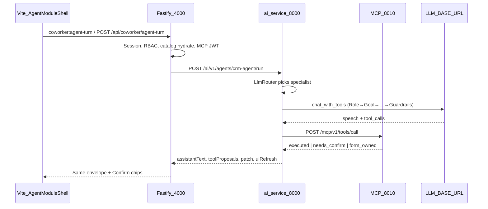
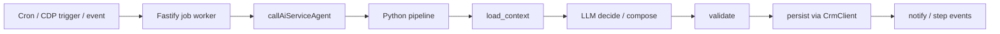
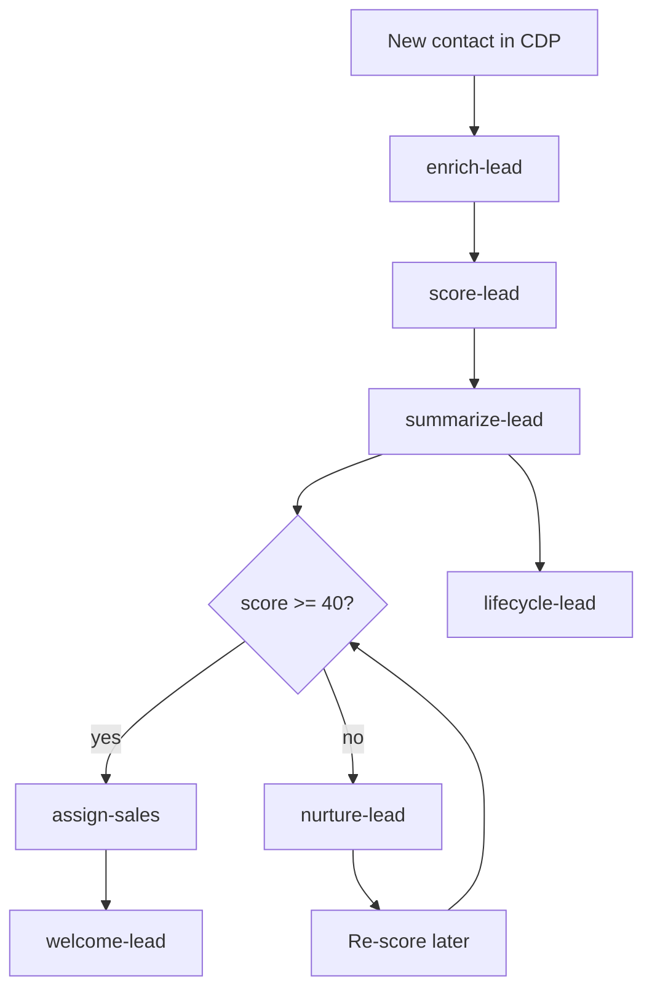

# CRM Agents Reference

Complete catalog of CRM AI agents: what each does, how it runs, required inputs, outputs, and tools.

**Location:** All agent brains live in Python under [`ai-service/app/agents/`](../ai-service/app/agents/).  
**HTTP surface:** `POST /ai/v1/agents/<name>/run` on ai-service (port 8000).  
**Enqueue only in TypeScript:** Fastify calls `callAiServiceAgent(...)` — never implements agent logic in Node.

**Mandatory rule:** Primary decision / generated content must come from the LLM (`LLM_BASE_URL`). Heuristics are **offline fallback only** and must be labeled `source: "heuristic"`.

Related docs:

- [`lead-agent-pipeline.md`](./lead-agent-pipeline.md) — enrich → score → summary → assign | nurture
- [`crm-agent-prompts-tools-confirmation.md`](./crm-agent-prompts-tools-confirmation.md) — prompts, MCP tools, confirmation flow
- [`ai-service-architecture-migration.md`](./ai-service-architecture-migration.md) — orchestrator, tool loop, memory

---

## 1. Architecture overview

### Two agent families

| Family | Entry | Orchestration | Tools |
|--------|-------|---------------|-------|
| **Coworker chat** | `crm-agent`, `chat` | Supervisor → specialist → bounded MCP tool loop | Full MCP catalog (filtered by module/role) |
| **Named / job agents** | `enrich-lead`, `score-lead`, … | Linear pipeline (`native_pipeline.run_steps`) | Usually **none** (LLM JSON + CRM HTTP persist via `CrmClient`) |

### End-to-end coworker flow



### Named job flow



### Prompt shape (all agents)

Every agent uses the same six sections:

**Role → Goal → Instructions → Context → Output → Guardrails**

Built via `build_system_prompt()` (coworker) or `sectioned_system_prompt()` (named jobs) in [`crm_tools.py`](../ai-service/app/agents/crm_tools.py) / [`llm_result.py`](../ai-service/app/agents/llm_result.py).

---

## 2. Agent catalog (descriptions)

Quick reference — every agent, what it is for, and when it runs.

| Agent | Type | Description |
|-------|------|-------------|
| **`crm-agent`** | Coworker | Main in-app CRM co-worker. Answers questions, navigates modules, fills create forms, and proposes creates/updates/deletes through confirmable MCP tools. Routed to a domain specialist per module. |
| **`chat`** | Coworker | Generic LLM chat with a custom system prompt. No MCP tools or CRM mutations. |
| **`contact-agent`** | Coworker specialist | Contact CRUD, merge, import, and prospect pull in the contact module chat. |
| **`company-agent`** | Coworker specialist | Company and location create/update/delete in the company module. |
| **`deal-agent`** | Coworker specialist | Deal create/update, stage changes, and pipeline questions in the sales module. |
| **`proposal-agent`** | Coworker specialist | Proposal create, section rewrite, personalize, and send when a proposal is open on a deal. |
| **`product-agent`** | Coworker specialist | Product catalog create/update in the product module (`inventory.products`). |
| **`reports-analytics-agent`** | Coworker specialist | Answers KPI and analytics questions using authorized CRM data; handles dashboard metric utterances. |
| **`link-agent`** | Coworker specialist | Fallback navigator — deep-links to the right module when the user wants to go somewhere. |
| **Draft agents** | Coworker (create) | Fill in-shell create forms from natural language; user saves manually. |
| **`enrich-lead`** | Proactive | Web search + LLM extraction to fill firmographic blanks on a new lead overlay. |
| **`score-lead`** | Proactive | Fit + intent scoring → hot/warm/cold band; gate ≥ 40 for assignment. |
| **`summarize-lead`** | Proactive | LLM narrative summary on the contact profile after scoring. |
| **`assign-sales`** | Proactive | Assigns sales-ready leads using territory, load, deal size, and rep maturity. |
| **`welcome-lead`** | Proactive | First-touch welcome email from the assigned rep's connected inbox. |
| **`nurture-lead`** | Proactive | Below-gate nurture: LLM decides action and emails via org CRM bot mailbox. |
| **`lifecycle-lead`** | Proactive | One lifecycle stage transition (or review flag) from create through Won/Lost. |
| **`owner-change-notify`** | Proactive | Notifies the new owner when contact ownership changes. |
| **`auto-reply-email`** | Proactive | Decides and drafts/sends inbound email auto-replies per policy. |
| **`compose-email`** | On-demand | Drafts email subject/body from instruction + CRM context. |
| **`compliance-privacy`** | Proactive | Classifies GDPR/CCPA mail; auto opt-out only; queues deletion for admins. |
| **`meeting-brief-email`** | Proactive | Meeting prep and reminder emails with CRM context. |
| **`meeting-mom`** | Proactive | Internal + customer-safe minutes of meeting after transcript capture. |
| **`meeting-miss-escalation`** | Proactive | Escalates missed meetings to the owner. |
| **`post-meeting-process`** | Proactive | Draft proposal/quote from transcript; notifies owner (no customer auto-send). |
| **`analyze-transcript`** | On-demand | Structured meeting analysis for CRM follow-up. |
| **`assist-meeting`** | Real-time | Live meeting side-panel Q&A from transcript window. |
| **`sales-coach`** | Proactive | Private rep-only coaching from call/meeting transcript. |
| **`audit-forecast`** | Cron (HITL) | Deal forecast audit — overlay fields only, never changes stage/close date. |
| **`invoice-escalation`** | Cron (HITL) | Overdue invoice collections risk + draft reminder — human sends. |
| **`expansion-matcher`** | Cron (HITL) | Upsell/cross-sell signals from account deal history + outreach draft. |
| **`document-template`** | On-demand | Generate template sections from brief or PDF sample. |
| **`document-template-edit`** | Coworker turn | Edit one template section from chat in Configuration. |
| **`document-template-chat`** | Coworker turn | Multi-turn template setup wizard in Configuration. |
| **`document-clone-personalize`** | On-demand | Personalize cloned document for a specific deal. |
| **`proposal-content`** | On-demand | Rewrite/generate proposal section HTML from deal context. |
| **`prospect-search`** | On-demand | Search external sources for prospect candidates. |
| **`prospect-qualify`** | On-demand | Score/filter candidates against ICP. |
| **`prospect-personnel`** | On-demand | Find contacts at target companies. |
| **`hygiene`** | On-demand | Recommend duplicate merges — never auto-merge. |
| **`daily-briefing`** | Scheduled | Daily spoken/text briefing for a user. |
| **`hello`** | Utility | Smoke-test / health check agent. |
| **`send-outbound-email`** | Internal | Hub helper to send composed mail via CRM bot. |

---

## 3. Coworker chat agents

### 3.1 Primary entry: `crm-agent`

**Description:** The main in-app CRM co-worker. Users chat from any module shell; the agent routes to a domain specialist, proposes MCP tool actions (with confirm for high-risk mutations), and can patch in-shell create forms. All replies are LLM-generated on the success path.

| | |
|---|---|
| **Route** | `POST /ai/v1/agents/crm-agent/run` |
| **Trigger** | User chat in any module shell (`AgentModuleShell`) |
| **Purpose** | Module-aware CRM co-worker: navigate, draft forms, propose mutations |

**Required request body** (`CrmAgentRequest`):

| Field | Type | Required | Description |
|-------|------|----------|-------------|
| `intent` | string | yes | Usually `"agent_turn"` |
| `messages` | array | yes | Chat history `{role, text}` |
| `context` | object | yes | `module`, `surface`, `pathname`, `entityId`, `businessType`, … |
| `catalog` | object | no | Hydrated deals/products/companies snippets |
| `sessionMemory` | object | no | Client STM (pending duplicates, etc.) |
| `organizationId` | string | no | Tenant |
| `role` | string | no | RBAC role |
| `businessType` | string | no | `b2b` \| `b2c` \| `b2b2c` |
| `actingUserId` | string | no | User performing the turn |
| `mcpExecutionToken` | string | no | JWT for MCP tool execution |
| `confirmTool` | object | no | User confirmed a high-risk tool |

**Output:**

| Field | Description |
|-------|-------------|
| `ok` | boolean |
| `assistantText` | User-visible markdown reply (LLM) |
| `toolProposals` | Up to 3 confirmable tools `{id, name, label, args, risk}` |
| `patch` | Draft field patch for create forms |
| `uiRefresh` | Hints for Vite to reload lists/detail |
| `source` | `"ai"` or `"heuristic"` |

**How it works:**

1. Fastify validates session, builds catalog + MCP JWT.
2. `coworker_native.run_native_coworker()` routes via `LlmRouter` (max 3 handoffs).
3. Specialist runs `BoundedToolLoop` (max 6 rounds, 10 calls).
4. High-risk tools return `needs_confirm`; UI shows Confirm chip before MCP executes.

### 3.2 Native specialists (routed by `crm-agent`)

**Description:** Module-scoped co-worker brains. Each specialist sees only its MCP skill group plus navigation/memory tools. `crm-agent` hands off via `LlmRouter` (max 3 hops); dashboard metric questions always route to `reports-analytics-agent`.

| Specialist | Module domain | File | Description |
|------------|---------------|------|-------------|
| `contact-agent` | contact | `contact_coworker_agent.py` | Contact CRUD, merge, import, and prospect pull in the contact module. |
| `company-agent` | company | `company_coworker_agent.py` | Company and location create/update/delete in the company module. |
| `deal-agent` | sales | `deal_coworker_agent.py` | Deal create/update, stage changes, and pipeline questions. |
| `proposal-agent` | sales (open proposal) | `proposal_coworker_agent.py` | Proposal create, section rewrite, personalize, and send on an open deal. |
| `product-agent` | product | `product_coworker_agent.py` | Product catalog create/update (`inventory.products`). |
| `reports-analytics-agent` | dashboard/reports | `reports_analytics_agent.py` | KPI and analytics Q&A; handles dashboard metric utterances. |
| `link-agent` | fallback | `link_module_coworker_agent.py` | Deep-links to the right module when the user wants to navigate. |

Dashboard metric questions route **only** to `reports-analytics-agent`.

### 3.3 Draft specialists (create forms)

**Description:** Lightweight agents that fill in-shell create forms from natural language. They return field patches only — the user reviews and saves manually. Used when `surface=create` or when the router hands off to a draft flow.

Used when `surface=create` or in-shell create handoff:

| Agent | File | Description |
|-------|------|-------------|
| Contact draft | `contact_draft_agent.py` | Fill contact create form fields from natural language. |
| Deal draft | `deal_draft_agent.py` | Fill deal create form fields from natural language. |
| Company draft | `company_draft_agent.py` | Fill company + location create draft fields. |
| Product / quote / invoice / activity | `misc_draft_agents.py` | Fill other module create forms (product, quote, invoice, activity). |

### 3.4 Simple chat: `chat`

**Description:** Generic LLM chat with a caller-supplied system prompt. No MCP tools, no CRM mutations, no module routing — used for simple text generation endpoints.

| | |
|---|---|
| **Route** | `POST /ai/v1/agents/chat/run` |
| **Inputs** | `system`, `user`, `maxTokens`, `timeoutMs`, `organizationId` |
| **Output** | `{ text, source }` — generic LLM chat, no MCP |

---

## 4. MCP tools (coworker only)

Declared in [`ai-service/app/mcp/catalog.py`](../ai-service/app/mcp/catalog.py). Filtered by module + role before reaching the LLM.

### Navigation & workspace

| Tool | Kind | Risk | Purpose |
|------|------|------|---------|
| `navigate` | ui_directive | low | Deep-link to CRM route |
| `open_entity` | ui_directive | low | Open contact/company/deal detail |
| `set_workspace` | ui_directive | low | Switch list/create/detail in shell |
| `ask_clarification` | clarify | low | Ask user one question (no confirm) |

### Contacts

| Tool | Kind | Risk |
|------|------|------|
| `patch_contact_draft` | draft_patch | low |
| `propose_create_contact` | mutation | high |
| `propose_update_contact` | mutation | high |
| `propose_delete_contact` | mutation | high |
| `propose_merge_contacts` | mutation | high |
| `propose_import_contacts` | mutation | high |
| `propose_pull_prospect_leads` | mutation | high |

### Companies & locations

| Tool | Kind | Risk |
|------|------|------|
| `patch_company_draft` | draft_patch | low |
| `patch_location_draft` | draft_patch | low |
| `propose_create_company` | mutation | high |
| `propose_update_company` | mutation | high |
| `propose_delete_company` | mutation | high |

### Deals & pipeline

| Tool | Kind | Risk |
|------|------|------|
| `patch_deal_draft` | draft_patch | low |
| `propose_create_deal` | mutation | high |
| `propose_update_deal` | mutation | high |
| `propose_delete_deal` | mutation | high |
| `propose_stage_change` | mutation | high |

### Products

| Tool | Kind | Risk |
|------|------|------|
| `patch_product_draft` | draft_patch | low |
| `propose_create_product` | mutation | high |
| `propose_update_product` | mutation | high |
| `propose_delete_product` | mutation | high |

### Activities

| Tool | Kind | Risk |
|------|------|------|
| `patch_activity_draft` | draft_patch | low |
| `propose_create_activity` | mutation | high |

### Proposals

| Tool | Kind | Risk |
|------|------|------|
| `propose_create_proposal` | mutation | high |
| `propose_rewrite_proposal_section` | mutation | high |
| `propose_patch_proposal_section` | mutation | high |
| `propose_patch_proposal_document_text` | mutation | high |
| `propose_personalize_proposal` | mutation | high |
| `propose_send_proposal` | mutation | high |
| `propose_delete_proposal` | mutation | high |

### Quotes

| Tool | Kind | Risk |
|------|------|------|
| `patch_quote_draft` | draft_patch | low |
| `propose_create_quote` | mutation | high |
| `propose_update_quote` | mutation | high |
| `propose_delete_quote` | mutation | high |
| `propose_send_quote` | mutation | high |
| `propose_rewrite_quote_section` | mutation | high |
| `propose_update_document_asset` | mutation | high |

### Invoices (B2B / B2B2C)

| Tool | Kind | Risk |
|------|------|------|
| `patch_invoice_draft` | draft_patch | low |
| `propose_create_invoice` | mutation | high |
| `propose_update_invoice` | mutation | high |
| `propose_delete_invoice` | mutation | high |
| `propose_send_invoice` | mutation | high |
| `propose_mark_invoice_paid` | mutation | high |

### Memory & analytics

| Tool | Kind | Risk |
|------|------|------|
| `remember_memory` | mutation | low |
| `clear_memory` | mutation | low |
| `query_analytics` | mutation | low |

**Tool loop budgets:** max 6 rounds, 10 calls, 2 repeated identical calls (`BoundedToolLoop`).

---

## 5. Lead pipeline agents

Canonical flow — see [`lead-agent-pipeline.md`](./lead-agent-pipeline.md).

**Gate:** total score ≥ **40** → assign; &lt; 40 → nurture (if unowned).  
**Bands:** Hot 70–100 · Warm 40–69 · Cold 0–39.



### 5.1 `enrich-lead`

**Description:** Enriches a CRM contact overlay from authorized firmographic context. Runs web search (DuckDuckGo), fetches pages, and uses the LLM to extract industry, size, and other blanks — then persists only validated fields.

| | |
|---|---|
| **Dashboard ID** | `lead_enrichment` |
| **Route** | `POST /ai/v1/agents/enrich-lead/run` |
| **Trigger** | CDP insert → job queue; cron drain |
| **Purpose** | Fill firmographic blanks on contact overlay from web search + LLM extraction |

**Parameters:**

| Field | Required | Description |
|-------|----------|-------------|
| `contactId` | yes | CRM contact |
| `organizationId` | no | Tenant |

**Pipeline steps:** `load_context` → `search_ddg` → `fetch_page` → `extract` → `validate` → `persist`

**Output:**

```json
{
  "contactId": "…",
  "status": "ok | skipped | failed",
  "source": "ai | heuristic",
  "reason": "…",
  "fields": { "industry": "…", "employeeCount": "…" },
  "persistResult": { … }
}
```

**Tools:** None (MCP). Uses DuckDuckGo search + HTTP fetch + CRM internal API.

---

### 5.2 `score-lead`

**Description:** Scores a lead on fit (0–50) and intent (0–50), returns total, band (hot/warm/cold), and rationale. The ≥ 40 gate decides assign vs nurture.

| | |
|---|---|
| **Dashboard ID** | `lead_scoring` |
| **Route** | `POST /ai/v1/agents/score-lead/run` |
| **Trigger** | After enrich completes |
| **Purpose** | Fit (0–50) + Intent (0–50) → total, band, category |

**Parameters:** `contactId`, `organizationId?`

**Output:**

```json
{
  "contactId": "…",
  "status": "ok | failed",
  "source": "ai | heuristic",
  "fitScore": 0,
  "intentScore": 0,
  "totalScore": 0,
  "band": "hot | warm | cold",
  "category": "hot | warm | cold",
  "rationale": "…"
}
```

**Tools:** None.

---

### 5.3 `summarize-lead`

**Description:** Writes a concise LLM narrative summary on the contact profile after scoring, giving reps a readable snapshot of who the lead is and why they matter.

| | |
|---|---|
| **Dashboard ID** | `lead_summary` |
| **Route** | `POST /ai/v1/agents/summarize-lead/run` |
| **Trigger** | After score |
| **Purpose** | LLM narrative summary on contact profile |

**Parameters:** `contactId`, `organizationId?`, `force?` (bool)

**Output:** `{ contactId, status, summary, source }`

**Tools:** None.

---

### 5.4 `assign-sales`

**Description:** Assigns a sales-ready lead (score ≥ 40, unowned) to a rep using territory, current load, deal size, and rep seniority rules.

| | |
|---|---|
| **Dashboard ID** | `sales_assignment` |
| **Route** | `POST /ai/v1/agents/assign-sales/run` |
| **Trigger** | Score ≥ 40, unowned lead |
| **Purpose** | Territory + load + seniority assignment to rep |

**Parameters:**

| Field | Required |
|-------|----------|
| `contactId` | usually |
| `organizationId` | no |
| `businessType` | no |
| `country`, `city` | no |
| `companyId`, `locationId` | no |
| `estimatedAmount` | no |

**Output:** `{ status, ownerUserId, reason, source, … }`

**Tools:** None (persists via CRM assignment service).

---

### 5.5 `welcome-lead`

**Description:** Composes the first-touch welcome email after assignment. CRM sends from the **assigned rep's connected inbox**, not the org bot.

| | |
|---|---|
| **Route** | `POST /ai/v1/agents/welcome-lead/run` |
| **Trigger** | After assignment |
| **Purpose** | Compose first-touch email; CRM sends from **owner's connected inbox** |

**Parameters:** `contactId`, `ownerUserId`, `organizationId?`, `context?`

**Output:** `{ status, subject, body, source, sendResult? }`

**Tools:** None.

---

### 5.6 `nurture-lead`

**Description:** For below-gate, unowned leads: the LLM decides a nurture action and composes email copy. Sends via the **org CRM bot mailbox** until the lead re-scores above the gate.

| | |
|---|---|
| **Dashboard ID** | `lead_nurture` |
| **Route** | `POST /ai/v1/agents/nurture-lead/run` |
| **Trigger** | Score &lt; 40 and unowned |
| **Purpose** | LLM decides nurture action + composes email; sends via **org CRM bot mailbox** |

**Parameters:** `contactId`, `organizationId?`

**Output:** `{ status, action, subject?, body?, source, reason? }`

**Tools:** None.

---

### 5.7 `lifecycle-lead`

**Description:** Recommends and applies one valid lifecycle stage transition (or flags for review) based on CRM events, stall signals, and pipeline evidence.

| | |
|---|---|
| **Dashboard ID** | `lead_lifecycle` |
| **Route** | `POST /ai/v1/agents/lifecycle-lead/run` |
| **Trigger** | CRM events, stall cron |
| **Purpose** | Recommend/apply one lifecycle stage transition with evidence |

**Parameters:** `contactId`, `organizationId?`

**Output:** `{ status, transition?, fromStage?, toStage?, rationale, source, flagForReview? }`

**Tools:** None.

---

### 5.8 `owner-change-notify`

**Description:** Notifies the new owner when contact ownership changes, with enough CRM context to act immediately.

| | |
|---|---|
| **Route** | `POST /ai/v1/agents/owner-change-notify/run` |
| **Trigger** | Contact owner changed |
| **Purpose** | Notify new owner with context |

**Parameters:** `contactId`, `ownerUserId`, `organizationId?`, `context?`

**Output:** `{ status, notificationSent, … }`

---

## 6. Email & inbox agents

### 6.1 `auto-reply-email`

**Description:** Decides whether and how to auto-reply to inbound email. Drafts copy per policy; may send autonomously or queue for human review depending on classification.

| | |
|---|---|
| **Dashboard ID** | `email_auto_reply` |
| **Route** | `POST /ai/v1/agents/auto-reply-email/run` |
| **Trigger** | Inbound email activity |
| **Purpose** | Decide if/how to auto-reply; draft only or send per policy |

**Parameters:** `activityId`, `contactId?`, `organizationId?`

**Output:** `{ status, shouldReply, draft?, sent?, source, category? }`

---

### 6.2 `compose-email`

**Description:** Composes a CRM email grounded in authorized contact/deal context from a user instruction. When invoked by Hub with `send_email`, the spoke supervisor composes then sends via CRM bot and logs the activity.

| | |
|---|---|
| **Route** | `POST /ai/v1/agents/compose-email/run` |
| **Trigger** | User compose dialog, Hub send_email action |
| **Purpose** | Draft CRM email grounded in contact/deal context |

**Parameters:**

| Field | Required |
|-------|----------|
| `instruction` | yes |
| `contactId`, `contactName`, `companyName` | no |
| `subject`, `inboundBody`, `isReply` | no |
| `productCatalog`, `senderOrganizationName` | no |
| `organizationId` | no |

**Output:** `{ subject, body, source }`

---

### 6.3 `send-outbound-email`

**Description:** Internal helper for Hub-orchestrated outbound send. Not exposed in the A2A catalog and not user-facing — wraps CRM bot delivery after compose.

---

### 6.4 `compliance-privacy`

**Description:** Assesses inbound content for GDPR/CCPA-style privacy requests. Auto-applies marketing opt-out only; deletion and access requests queue for admin HITL.

| | |
|---|---|
| **Dashboard ID** | `compliance_privacy` |
| **Route** | `POST /ai/v1/agents/compliance-privacy/run` |
| **Trigger** | Inbound email matches privacy keyword filter |
| **Purpose** | Classify GDPR/CCPA requests; auto opt-out or queue admin deletion |

**Parameters:** `body` (required), `subject?`, `contactName?`, `activityId?`, `contactId?`, `organizationId?`

**Output:**

```json
{
  "status": "ok | skipped",
  "classification": "data_deletion | marketing_optout | data_access | other | not_a_privacy_request",
  "draftAcknowledgment": "…",
  "autonomousAction": "marketing_optout | none",
  "privacyRequestId": "…"
}
```

**HITL:** Only `marketing_optout` auto-applies. Deletion/access → admin queue.

---

## 7. Meeting agents

### 7.1 `meeting-brief-email`

**Description:** Composes owner/participant meeting prep and reminder emails (booking cron; T−24h / T−1h) using CRM context and optional lead summary.

| | |
|---|---|
| **Dashboard IDs** | `meeting_brief`, `meeting_reminder` |
| **Route** | `POST /ai/v1/agents/meeting-brief-email/run` |
| **Trigger** | Booking cron; T−24h / T−1h reminders |
| **Purpose** | Owner/participant prep email from CRM context |

**Parameters:** `activityId`, `contactId?`, `reminderWindow?`, `audience`, `leadSummary?`, `context?`, `organizationId?`

**Output:** `{ status, subject, body, source, audience }`

---

### 7.2 `meeting-mom`

**Description:** Generates minutes of meeting from a transcript — an internal detailed version and a customer-safe email draft.

| | |
|---|---|
| **Dashboard ID** | `meeting_mom` |
| **Route** | `POST /ai/v1/agents/meeting-mom/run` |
| **Trigger** | Transcript attached to activity |
| **Purpose** | Internal detailed MOM + customer-safe MOM email drafts |

**Parameters:** `transcript` (required), `contactName?`, `topic?`, `companyName?`, `activityId?`, `contactId?`, `heuristic?`, `organizationId?`

**Output:** `{ status, internalMom, customerMom, source }`

---

### 7.3 `meeting-miss-escalation`

**Description:** Escalates a missed meeting under existing rules — decision + notification to the activity owner.

| | |
|---|---|
| **Dashboard ID** | `meeting_miss_escalation` |
| **Route** | `POST /ai/v1/agents/meeting-miss-escalation/run` |
| **Trigger** | Missed meeting detected |
| **Purpose** | Escalation decision + owner notification |

**Parameters:** `context` (object), `activityId?`, `organizationId?`

---

### 7.4 `post-meeting-process`

**Description:** Runs post-meeting follow-up: creates draft proposal/quote (or both) from transcript and notifies the owner. Never auto-emails the customer.

| | |
|---|---|
| **Dashboard ID** | `post_meeting_process` |
| **Route** | `POST /ai/v1/agents/post-meeting-process/run` |
| **Trigger** | After transcript capture |
| **Purpose** | Create draft proposal/quote/both; notify owner — **never auto-email customer** |

**Parameters:** `transcript`, `seller?`, `contactName?`, `activityId?`, `contactId?`, `heuristic?`, `timeZone?`, `organizationId?`

**Output:** `{ status, branch: "proposal|quote|both|none", proposalId?, quoteId?, source }`

---

### 7.5 `analyze-transcript`

**Description:** Analyzes a meeting transcript for structured CRM follow-up — action items, sentiment, and next steps without creating documents.

| | |
|---|---|
| **Route** | `POST /ai/v1/agents/analyze-transcript/run` |
| **Purpose** | Structured meeting analysis for CRM follow-up |

**Parameters:** `transcript`, `organizationId?`

---

### 7.6 `assist-meeting`

**Description:** Live meeting assistance from an authorized transcript window — real-time Q&A and suggestions during the call.

| | |
|---|---|
| **Route** | `POST /ai/v1/agents/assist-meeting/run` |
| **Trigger** | Live meeting assist UI |
| **Purpose** | Real-time coaching from transcript window |

**Parameters:** `query?`, `transcriptWindow?`, `mode`, `contactId?`, `contextPack?`, `organizationId?`

**Output:** `{ answer, suggestions?, source }`

---

### 7.7 `sales-coach`

**Description:** Produces private rep-only coaching feedback from a call/meeting transcript — discovery quality, objection handling, and growth areas. Managers see aggregates only.

| | |
|---|---|
| **Dashboard ID** | `sales_coach` |
| **Route** | `POST /ai/v1/agents/sales-coach/run` |
| **Trigger** | Same event as meeting MOM (transcript attach) |
| **Purpose** | Private rep-only coaching on discovery, objections, methodology |

**Parameters:** `transcript`, `repName?`, `contactName?`, `activityId?`, `contactId?`, `priorGrowthAreas?`, `organizationId?`

**Output:**

```json
{
  "status": "ok | skipped",
  "overallImpression": "strong | solid | needs_work",
  "coachingNote": "…",
  "highlightedMoment": "…",
  "growthAreas": ["…"],
  "source": "ai"
}
```

**HITL:** Rep-only notification; managers see aggregates only.

---

## 8. Sales & finance cron agents (HITL overlays)

These agents **write overlay fields + notifications only** — they do not mutate core business state without human action.

### 8.1 `audit-forecast` (pipeline forecast)

**Description:** Audits a deal forecast using authorized CRM facts. Writes overlay fields (category, confidence, flag, reason) — never changes stage or expected close date.

| | |
|---|---|
| **Dashboard ID** | `pipeline_forecast` |
| **Route** | `POST /ai/v1/agents/audit-forecast/run` |
| **Trigger** | 30-min cron sweep (24h throttle/deal) |
| **Purpose** | Judge if deal stage + close date are realistic |

**Parameters:** `dealId`, `organizationId?`

**Output / persists:** `forecastCategory`, `forecastConfidencePercent`, `forecastFlagged`, `forecastReason`, `forecastLastRunAt` on Deal

**Does NOT change:** `Deal.stage`, `Deal.expectedCloseDate`

---

### 8.2 `invoice-escalation`

**Description:** Escalates an overdue or blocked invoice under finance rules. Sets severity, reason, and a draft reminder — human must send; does not mark paid or change due date.

| | |
|---|---|
| **Dashboard ID** | `invoice_escalation` |
| **Route** | `POST /ai/v1/agents/invoice-escalation/run` |
| **Trigger** | 30-min cron on overdue invoices |
| **Purpose** | Collections risk severity + draft reminder |

**Parameters:** `invoiceId`, `organizationId?`

**Output / persists:** `escalationSeverity` (`watch|escalate|urgent`), `escalationReason`, `escalationDraft`, `escalationLastRunAt`

**Does NOT:** mark paid, send email, change due date

---

### 8.3 `expansion-matcher`

**Description:** Matches expansion (upsell/cross-sell) signals for a company from its own deal history. Writes overlay signal + draft outreach — rep decides whether to send.

| | |
|---|---|
| **Dashboard ID** | `expansion_matcher` |
| **Route** | `POST /ai/v1/agents/expansion-matcher/run` |
| **Trigger** | 24h cron (7-day throttle/company) |
| **Purpose** | Upsell/cross-sell signal from account's own deal history |

**Parameters:** `companyId`, `organizationId?`

**Output / persists:** `expansionSignal` (`none|watch|opportunity`), `expansionReason`, `expansionDraft`, `expansionLastRunAt`

---

## 9. Document agents (B2B)

### 9.1 `document-template`

**Description:** Generates proposal, quote, or invoice template sections from a brief and/or PDF sample. Returns structured HTML sections for Configuration.

| | |
|---|---|
| **Route** | `POST /ai/v1/agents/document-template/run` |
| **Purpose** | Generate proposal/quote/invoice template sections from brief or PDF sample |

**Parameters:** `kind` (`proposal|quote|invoice`), `brief?`, `sampleText?`, `sampleFileBase64?`, `organizationName?`, `existingSections?`, `organizationId?`

**Output:** `{ sections: [{ key, title, bodyHtml }], source }`

---

### 9.2 `document-template-edit` / `document-template-chat`

**Description:** Conversational document-template authoring in Configuration. `document-template-edit` handles single-turn section edits; `document-template-chat` runs a multi-step setup wizard.

| | |
|---|---|
| **Routes** | `…/document-template-edit/run`, `…/document-template-chat/run` |
| **Purpose** | Conversational template authoring in Configuration |

**Parameters:** `kind`, `message`, `currentStep`, `templateContext?`, `organizationId?`

---

### 9.3 `document-clone-personalize`

**Description:** Personalizes a cloned proposal, quote, or invoice for a specific deal — replaces placeholders and tailors copy from deal context.

| | |
|---|---|
| **Route** | `POST /ai/v1/agents/document-clone-personalize/run` |
| **Purpose** | Personalize cloned proposal/quote/invoice for a deal |

**Parameters:** `kind`, `visibleTextPreview`, `context`, `alreadyApplied?`, `organizationId?`

---

### 9.4 `proposal-content`

**Description:** Generates or rewrites proposal section HTML from deal context — used when editing proposal body on a deal without full template regeneration.

| | |
|---|---|
| **Route** | `POST /ai/v1/agents/proposal-content/run` |
| **Purpose** | Rewrite/generate proposal sections from deal context |

**Parameters:** `sections`, `context`, `vendorName?`, `organizationId?`

**Output:** `{ sections: [{ key, bodyHtml }], source }`

---

## 10. Prospecting agents

### 10.1 `prospect-search`

**Description:** Searches external sources for lead candidates matching org criteria. Returns a job id and candidate list for qualify/pull workflows.

| | |
|---|---|
| **Dashboard ID** | `prospect_search` |
| **Route** | `POST /ai/v1/agents/prospect-search/run` |
| **Purpose** | Search external sources for lead candidates |

**Parameters (body dict):** `organizationId`, `criteria`, `sources?`, `limit?`, `credentials?`

**Output:** `{ ok, jobId, candidates[], count, sourcesUsed, errors[] }`

---

### 10.2 `prospect-qualify`

**Description:** LLM qualifies and scores prospect candidates against the org ICP — splits into qualified vs rejected lists before import.

| | |
|---|---|
| **Dashboard ID** | `prospect_qualify` |
| **Route** | `POST /ai/v1/agents/prospect-qualify/run` |
| **Purpose** | LLM qualify/score prospect candidates against ICP |

**Parameters:** `organizationId`, `candidates[]`, `icp?`

**Output:** `{ qualified[], rejected[], source }`

---

### 10.3 `prospect-personnel`

**Description:** Finds personnel and contacts at target companies for a given role filter — feeds contact create or pull-prospect flows.

| | |
|---|---|
| **Dashboard ID** | `prospect_personnel` |
| **Route** | `POST /ai/v1/agents/prospect-personnel/run` |
| **Purpose** | Find personnel/contacts at target companies |

**Parameters:** `organizationId`, `companies[]`, `roles?`

**Output:** `{ personnel[], source }`

---

## 11. Utility agents

### 11.1 `hygiene`

**Description:** Recommends duplicate contact merges and enrichment fixes from authorized data — **never auto-merges**; human confirms in UI.

| | |
|---|---|
| **Route** | `POST /ai/v1/agents/hygiene/run` |
| **Purpose** | Recommend duplicate merges — **never auto-merge** |

**Parameters:** free-form `body` dict with org + candidate pairs

---

### 11.2 `daily-briefing`

**Description:** Generates the daily spoken or text CRM briefing for a user — pipeline highlights, tasks, and calendar from authorized data.

| | |
|---|---|
| **Route** | `POST /ai/v1/agents/daily-briefing/run` |
| **Purpose** | Spoken/text daily CRM briefing for a user |

**Parameters:** `userId`, `organizationId`, `timeZone?`, … (payload dict)

**Output:** `{ script, sections[], source }`

---

### 11.3 `hello`

**Description:** Health and smoke-test agent — echoes a message to verify ai-service routing and LLM connectivity.

| | |
|---|---|
| **Route** | `POST /ai/v1/agents/hello/run` |
| **Purpose** | Health / smoke test agent |

**Parameters:** `message?`  
**Output:** `{ reply }`

---

## 12. Agent step visibility

Proactive agents emit curated step events to `crm.agent_step_events` for the **Agents** module UI (`/agents/:agentId/runs`).

| Mode | Agents | `jobId` source |
|------|--------|----------------|
| Job-backed | enrich, score, nurture, lifecycle, auto-reply | Existing job table row id |
| Ephemeral | summary, assign, meeting_*, forecast, coach, compliance, invoice, expansion, prospect_* | UUID per run |

Step decorator: [`step_trace.traced_step`](../ai-service/app/agents/step_trace.py)

---

## 13. Full registry index

All registered HTTP agent names ([`agents/__init__.py`](../ai-service/app/agents/__init__.py)):

| HTTP name | Category | Description | Mutates CRM? |
|-----------|----------|-------------|--------------|
| `crm-agent` | Coworker | Main in-app co-worker; routes to specialists and confirmable MCP tools. | via MCP confirm |
| `chat` | Coworker | Generic LLM chat; no MCP or CRM mutations. | no |
| `enrich-lead` | Lead pipeline | Web search + LLM extraction for firmographic blanks on new leads. | yes |
| `score-lead` | Lead pipeline | Fit + intent scoring → hot/warm/cold band; gate ≥ 40. | yes |
| `summarize-lead` | Lead pipeline | LLM narrative summary on the contact profile. | yes |
| `nurture-lead` | Lead pipeline | Below-gate nurture action + email via org CRM bot. | yes |
| `lifecycle-lead` | Lead pipeline | One lifecycle stage transition or review flag. | yes |
| `assign-sales` | Lead pipeline | Territory/load-based rep assignment for sales-ready leads. | yes |
| `welcome-lead` | Lead pipeline | First-touch welcome email from assigned rep's inbox. | sends email |
| `owner-change-notify` | Lead pipeline | Notify new owner when contact ownership changes. | notify |
| `auto-reply-email` | Email | Decide and draft/send inbound email auto-replies per policy. | conditional |
| `compose-email` | Email | Draft CRM email from instruction + context. | draft only |
| `compliance-privacy` | Email/compliance | Classify GDPR/CCPA mail; auto opt-out only. | partial auto |
| `meeting-brief-email` | Meeting | Meeting prep and reminder emails with CRM context. | sends email |
| `meeting-mom` | Meeting | Internal + customer-safe minutes from transcript. | drafts |
| `meeting-miss-escalation` | Meeting | Escalate missed meetings to the owner. | notify |
| `post-meeting-process` | Meeting | Draft proposal/quote from transcript; notify owner. | draft docs |
| `analyze-transcript` | Meeting | Structured meeting analysis for CRM follow-up. | analysis |
| `assist-meeting` | Meeting | Live meeting side-panel Q&A from transcript window. | no |
| `sales-coach` | Meeting | Private rep-only coaching from call/meeting transcript. | coaching row |
| `audit-forecast` | Sales cron | Deal forecast audit — overlay fields only. | overlay only |
| `invoice-escalation` | Finance cron | Overdue invoice risk + draft reminder — human sends. | overlay only |
| `expansion-matcher` | Sales cron | Upsell/cross-sell signals + outreach draft. | overlay only |
| `document-template` | Documents | Generate template sections from brief or PDF sample. | template |
| `document-template-edit` | Documents | Edit one template section from chat in Configuration. | template |
| `document-template-chat` | Documents | Multi-turn template setup wizard in Configuration. | template |
| `document-clone-personalize` | Documents | Personalize cloned document for a specific deal. | personalize |
| `proposal-content` | Documents | Rewrite/generate proposal section HTML from deal context. | content |
| `prospect-search` | Prospecting | Search external sources for prospect candidates. | candidates |
| `prospect-qualify` | Prospecting | Score/filter candidates against ICP. | scores |
| `prospect-personnel` | Prospecting | Find contacts at target companies. | personnel |
| `hygiene` | Utility | Recommend duplicate merges — never auto-merge. | recommend only |
| `daily-briefing` | Utility | Daily spoken/text briefing for a user. | no |
| `hello` | Utility | Smoke-test / health check agent. | no |
| `send-outbound-email` | Internal | Hub helper to send composed mail via CRM bot. | send |

---

## 14. How to add a new agent

1. Implement under `ai-service/app/agents/<name>_agent.py` with LLM on the success path.
2. Use `sectioned_system_prompt()` + `generate_json_with_retries()` from `llm_result.py`.
3. Register in `agents/__init__.py` `REGISTRY`.
4. Add Fastify route + Pydantic model in `routes.py`.
5. Enqueue from backend via `callAiServiceAgent("<name>", payload)`.
6. If proactive + visible: wrap pipeline nodes with `traced_step()` and add `POST /api/internal/.../steps`.
7. Add to `AGENT_RUN_IDS` / dashboard card if user-facing runs page needed.
8. For coworker tools: add to `mcp/catalog.py` only — single schema source.

---

*Generated from the CRM codebase registry and agent modules. For prompt/tool confirmation details see [`crm-agent-prompts-tools-confirmation.md`](./crm-agent-prompts-tools-confirmation.md).*
