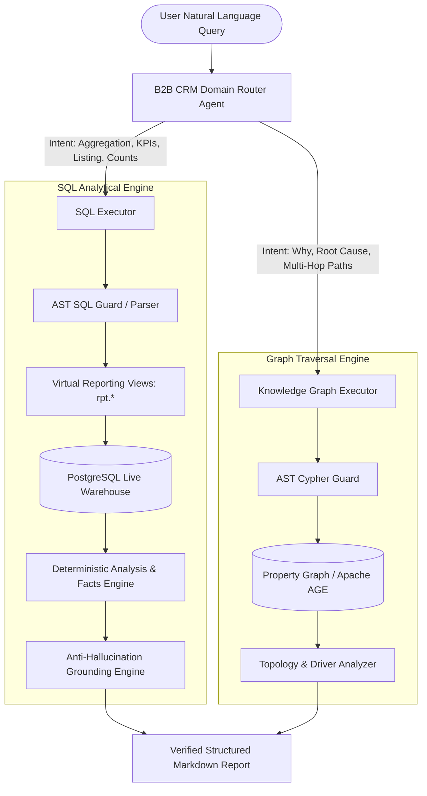
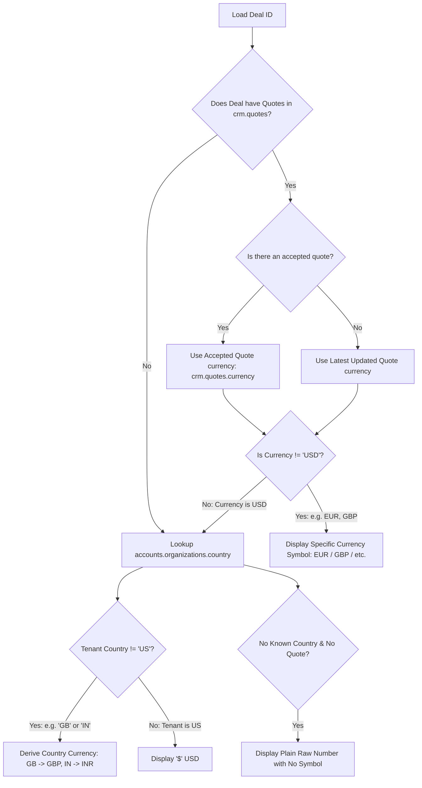
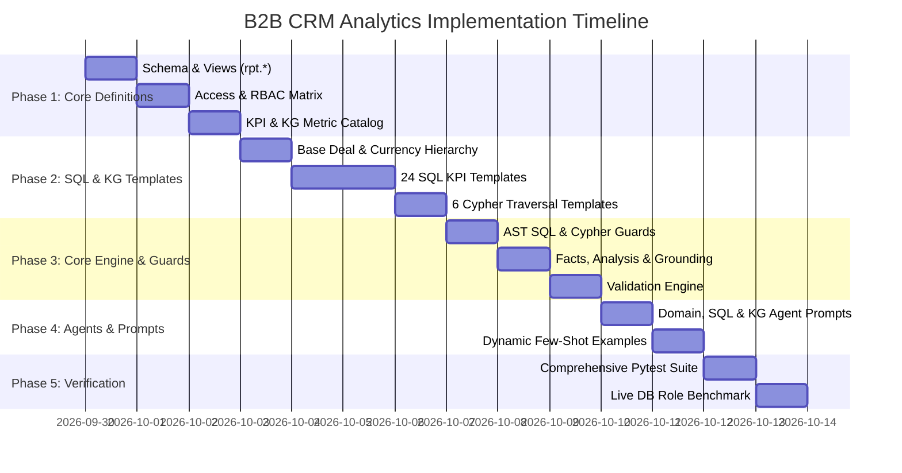

# B2B CRM Reports & Analytics Spoke (`reports_analytics_agent_CRM_B2B`)
## Master Architecture, Database Catalog, RBAC, KPI Engine & Implementation Plan

---

# Table of Contents
1. [Executive Summary & System Architecture](#1-executive-summary--system-architecture)
2. [Database Schema Catalog & Cross-Schema Relationships](#2-database-schema-catalog--cross-schema-relationships)
   - [2.1 Cross-Schema Integration Rationale](#21-cross-schema-integration-rationale)
   - [2.2 Schema 1: `accounts` (Tenancy, Identity, Organizations)](#22-schema-1-accounts-tenancy-identity-organizations)
   - [2.3 Schema 2: `crm` (Core Pipeline, Deals, Quotes, Invoices, Contracts, Activities)](#23-schema-2-crm-core-pipeline-deals-quotes-invoices-contracts-activities)
   - [2.4 Schema 3: `inventory` (Products, Pricebooks, Stock, Warehouses)](#24-schema-3-inventory-products-pricebooks-stock-warehouses)
   - [2.5 Schema 4: `cdp` (Customer Data Platform, Audiences, Journeys, Segments)](#25-schema-4-cdp-customer-data-platform-audiences-journeys-segments)
3. [Modules, RBAC Matrix & Pipeline Mechanics](#3-modules-rbac-matrix--pipeline-mechanics)
   - [3.1 CRM Modules & Deep-Link Routes](#31-crm-modules--deep-link-routes)
   - [3.2 7 RBAC Roles & Data Scoping Rules](#32-7-rbac-roles--data-scoping-rules)
   - [3.3 Hierarchy & Channel Scope Expansion](#33-hierarchy--channel-scope-expansion)
   - [3.4 Deal Pipeline Stages & Probability Weights](#34-deal-pipeline-stages--probability-weights)
   - [3.5 Deal Currency Resolution Hierarchy](#35-deal-currency-resolution-hierarchy)
4. [Certified 24 KPI Metric Specification](#4-certified-24-kpi-metric-specification)
   - [4.1 Tier 1: Dashboard KPI Metrics (1–8)](#41-tier-1-dashboard-kpi-metrics-18)
   - [4.2 Tier 2: Core & Important Operational Metrics (9–16)](#42-tier-2-core--important-operational-metrics-916)
   - [4.3 Tier 3: Next-Tier Strategic & Velocity Metrics (17–24)](#43-tier-3-next-tier-strategic--velocity-metrics-1724)
5. [Multi-Agent Architecture & Executor Engine Design](#5-multi-agent-architecture--executor-engine-design)
   - [5.1 Domain Router Agent (`domain/agent.md`)](#51-domain-router-agent-domainagentmd)
   - [5.2 SQL Executor (`sql_executor/agent.md`)](#52-sql-executor-sqlexecutoragentmd)
   - [5.3 Knowledge Graph Executor (`kg_executor/agent.md`)](#53-knowledge-graph-executor-kgexecutoragentmd)
   - [5.4 Virtual Reporting Views (`rpt.*` Semantic Layer)](#54-virtual-reporting-views-rpt-semantic-layer)
   - [5.5 Security, AST Guards & Anti-Hallucination Framework](#55-security-ast-guards--anti-hallucination-framework)
6. [Complete Repository Directory Structure](#6-complete-repository-directory-structure)
7. [Step-by-Step Implementation & Delivery Roadmap](#7-step-by-step-implementation--delivery-roadmap)
8. [Verification, Testing & Validation Protocols](#8-verification-testing--validation-protocols)

---

# 1. Executive Summary & System Architecture

The **B2B CRM Reports and Analytics Module** (`reports_analytics_agent_CRM_B2B`) is engineered as a enterprise-grade multi-agent analytical spoke operating on top of a multi-tenant PostgreSQL warehouse and an Apache AGE / Neo4j Knowledge Graph.



### Core Architectural Principles:
1. **Zero Base Table Exposure**: Queries never touch raw tenant tables directly. All queries target the virtual schema `rpt.*` (`rpt.deals`, `rpt.companies`, `rpt.quotes`, `rpt.invoices`, etc.), which automatically enforces tenant isolation (`organization_id`), soft-delete masking (`is_deleted = false`), and standard formatting.
2. **Deterministic Computation**: LLMs are prohibited from performing mental arithmetic or computing KPI ratios in prompts. All metrics are calculated via PostgreSQL analytical SQL templates and verified through deterministic Python math helpers (`core/analysis.py`, `core/facts.py`).
3. **AST-Enforced Security**: Read-only AST validation (`pglast` / `sqlglot`) strictly blocks DDL, DML, dynamic SQL injection, multiple statements, and unauthorized schema access.
4. **Strict RBAC & Channel Expansion**: Row-level filtering dynamically restricts visibility based on the user's role (`admin`, `sales_manager`, `sales_rep`, `presales`, `finance`, `marketing`, `viewer`) and expands hierarchy across franchise and multi-branch parent/child accounts.

---

# 2. Database Schema Catalog & Cross-Schema Relationships

## 2.1 Cross-Schema Integration Rationale

The B2B CRM solution operates across four interdependent database schemas:
1. **`crm`**: Encapsulates core customer relationship lifecycles, lead pipelines, deal tracking, formal price quoting, invoice collections, contract commitments, and agent activity logs.
2. **`accounts`**: Houses global multi-tenant security, user identities, team hierarchies, tenant localization parameters, and permission profiles.
   - *Why CRM references `accounts`*: CRM entities (`deals`, `activities`, `companies`) require strict user assignment (`owner_agent_id` $\rightarrow$ `accounts.users.id`), team-level aggregation (`crm.teams`), and currency fallback mapping (`accounts.organizations.country`).
3. **`inventory`**: Governs the product master catalog, tiered pricebooks, stock allocations across multi-location warehouses, and SKU metadata.
   - *Why CRM references `inventory`*: Deals and Quotes do not store free-text line items. `crm.quote_lines` and `crm.deal_products` directly link to `inventory.products.id` and `inventory.pricebook_entries.id` to compute accurate margin calculations, discount validations, and fulfillment reservations.
4. **`cdp` (Customer Data Platform)**: Maintains unified 360° customer identities, behavioral event streams, marketing audiences, and automated multi-channel engagement journeys.
   - *Why CRM references `cdp`*: CRM deals and contacts trace behavioral triggers, campaign attribution (`cdp.audiences`), and customer engagement health scores (`cdp.customer_profiles`) to explain *why* deals stall or accelerate.

---

## 2.2 Schema 1: `accounts` (Tenancy, Identity, Organizations)

### Table: `accounts.organizations`
- **Purpose**: Master multi-tenant partition table. Every record in the database belongs to an organization. Houses company-level defaults including tenant home country and default currency.
- **Primary Key**: `id` (`BIGINT`)
- **Key Columns**:
  - `id`: Unique identifier for the organization tenant.
  - `name`: Legal business entity name of the tenant organization.
  - `country`: Two-letter ISO country code (e.g., `'US'`, `'GB'`, `'IN'`). Critical for the Deal Currency Resolution Hierarchy fallback.
  - `currency`: Default ISO currency code (e.g., `'USD'`, `'GBP'`, `'INR'`).
  - `created_at` / `updated_at`: Audit timestamps.
  - `is_deleted`: Soft-delete flag (`BOOLEAN`).
- **Relationships**: Parent of all CRM/CDP/Inventory tables via `organization_id`.
- **Sample Data**:
  ```json
  {"id": 1012, "name": "Acme Global Enterprise", "country": "GB", "currency": "GBP", "created_at": "2024-01-15T08:00:00Z", "is_deleted": false}
  ```

### Table: `accounts.users`
- **Purpose**: System users, sales agents, account executives, managers, presales engineers, and executives.
- **Primary Key**: `id` (`BIGINT`)
- **Foreign Keys**: `organization_id` $\rightarrow$ `accounts.organizations.id`
- **Key Columns**:
  - `id`: Unique user ID.
  - `organization_id`: Owning organization ID.
  - `first_name` / `last_name`: User full name components.
  - `email`: Login and notification email address.
  - `role`: System security role string (`'admin'`, `'sales_manager'`, `'sales_rep'`, `'presales'`, `'finance'`, `'marketing'`, `'viewer'`).
  - `is_active`: Status flag indicating if user can log in and own active records.
- **Relationships**: Joined to `crm.deals.owner_agent_id`, `crm.companies.owner_agent_id`, `crm.activities.performed_by_agent_id`.
- **Sample Data**:
  ```json
  {"id": 501, "organization_id": 1012, "first_name": "Sarah", "last_name": "Connor", "email": "sconnor@acme.com", "role": "sales_manager", "is_active": true}
  ```

---

## 2.3 Schema 2: `crm` (Core Pipeline, Deals, Quotes, Invoices, Contracts, Activities)

### Table: `crm.companies`
- **Purpose**: B2B accounts, client organizations, enterprise prospects, partner agencies, franchise locations, and brand headquarters.
- **Primary Key**: `id` (`BIGINT`)
- **Foreign Keys**: `organization_id` $\rightarrow$ `accounts.organizations.id`, `parent_company_id` $\rightarrow$ `crm.companies.id`, `owner_agent_id` $\rightarrow$ `accounts.users.id`
- **Key Columns**:
  - `id`: Unique company identifier.
  - `name`: Legal and commercial trading name of the client company.
  - `domain`: Web domain used for email matching and deduplication.
  - `industry`: Industry vertical (`'Technology'`, `'Healthcare'`, `'Manufacturing'`, `'Retail'`, `'Finance'`).
  - `account_tier`: Classification tier (`'tier_1'`, `'tier_2'`, `'tier_3'`, `'strategic'`).
  - `channel_role`: Channel hierarchy classification (`'brand_hq'`, `'franchise'`, `'owned_store'`, `'distributor'`, `'end_customer'`). Triggers channel scope expansion.
  - `parent_company_id`: Pointer to parent holding company for multi-entity corporate structures.
  - `annual_revenue`: Client estimated annual revenue.
  - `owner_agent_id`: Designated sales account executive.
- **Sample Data**:
  ```json
  {"id": 2001, "organization_id": 1012, "name": "Apex Holdings Ltd", "domain": "apexholdings.co.uk", "industry": "Technology", "account_tier": "strategic", "channel_role": "brand_hq", "parent_company_id": null, "annual_revenue": 5000000.00, "owner_agent_id": 501, "is_deleted": false}
  ```

### Table: `crm.contacts`
- **Purpose**: Individual professionals, decision makers, influencers, and billing contacts associated with client companies.
- **Primary Key**: `id` (`BIGINT`)
- **Foreign Keys**: `company_id` $\rightarrow$ `crm.companies.id`, `owner_agent_id` $\rightarrow$ `accounts.users.id`
- **Key Columns**:
  - `id`: Unique contact ID.
  - `company_id`: Associated B2B company account.
  - `first_name` / `last_name`: Contact name.
  - `email`: Direct business email.
  - `job_title`: Professional designation (`'VP Procurement'`, `'CTO'`, `'Chief Architect'`).
  - `is_primary_contact`: Boolean flag indicating primary point of contact for deal negotiation.
- **Sample Data**:
  ```json
  {"id": 3001, "company_id": 2001, "first_name": "Marcus", "last_name": "Vance", "email": "mvance@apexholdings.co.uk", "job_title": "Chief Technology Officer", "is_primary_contact": true, "is_deleted": false}
  ```

### Table: `crm.deals`
- **Purpose**: Core revenue opportunities, deal size, stages, probabilities, expected close dates, and win/loss records.
- **Primary Key**: `id` (`BIGINT`)
- **Foreign Keys**: `company_id` $\rightarrow$ `crm.companies.id`, `primary_contact_id` $\rightarrow$ `crm.contacts.id`, `owner_agent_id` $\rightarrow$ `accounts.users.id`
- **Key Columns**:
  - `id`: Opportunity identifier.
  - `name`: Commercial deal title.
  - `amount`: Raw numerical transaction amount (currency resolved dynamically via quotes/tenant).
  - `stage`: Lifecycle pipeline stage enum (`'qualification'`, `'discover'`, `'propose'`, `'negotiate'`, `'closed_won'`, `'closed_lost'`).
  - `probability`: Win likelihood percentage (0.00 to 1.00).
  - `expected_close_date`: Targeted contract execution date.
  - `actual_close_date`: Timestamp of `closed_won` or `closed_lost` transition.
  - `lost_reason`: Classification for lost deals (`'price'`, `'competitor'`, `'no_budget'`, `'product_gap'`, `'timeline'`).
  - `owner_agent_id`: Responsible Account Executive / Sales Rep.
- **Sample Data**:
  ```json
  {"id": 4001, "organization_id": 1012, "name": "Apex Cloud Migration Enterprise", "amount": 150000.00, "stage": "propose", "probability": 0.50, "expected_close_date": "2026-11-30", "owner_agent_id": 501, "is_deleted": false}
  ```

### Table: `crm.quotes`
- **Purpose**: Formal pricing proposals generated for deals, tracking approved discount levels, payment terms, and proposal currency.
- **Primary Key**: `id` (`BIGINT`)
- **Foreign Keys**: `deal_id` $\rightarrow$ `crm.deals.id`, `company_id` $\rightarrow$ `crm.companies.id`, `created_by_user_id` $\rightarrow$ `accounts.users.id`
- **Key Columns**:
  - `id`: Quote identifier.
  - `deal_id`: Target deal opportunity.
  - `quote_number`: Human-readable reference code (`'Q-2026-089'`).
  - `status`: Lifecycle state (`'draft'`, `'sent'`, `'accepted'`, `'rejected'`, `'expired'`).
  - `currency`: ISO Currency string (`'USD'`, `'EUR'`, `'GBP'`, `'INR'`). Defines the authoritative deal currency.
  - `subtotal` / `discount_amount` / `tax_amount` / `total_amount`: Financial breakdown.
  - `updated_at`: Timestamp used to find the latest quote if no accepted quote exists.
- **Sample Data**:
  ```json
  {"id": 6001, "deal_id": 4001, "quote_number": "Q-2026-089", "status": "accepted", "currency": "GBP", "subtotal": 160000.00, "discount_amount": 10000.00, "tax_amount": 0.00, "total_amount": 150000.00, "updated_at": "2026-09-10T14:30:00Z"}
  ```

### Table: `crm.quote_lines`
- **Purpose**: Itemized bill of materials within a quote, referencing catalog products, quantity, unit price, and line discounts.
- **Primary Key**: `id` (`BIGINT`)
- **Foreign Keys**: `quote_id` $\rightarrow$ `crm.quotes.id`, `product_id` $\rightarrow$ `inventory.products.id`
- **Key Columns**:
  - `id`: Quote line item ID.
  - `quote_id`: Parent quote ID.
  - `product_id`: Catalog SKU identifier.
  - `quantity`: Number of units / licenses quoted.
  - `unit_price`: Base selling price per unit.
  - `discount_percent`: Line item markdown percentage.
  - `total_price`: Net line total (`quantity * unit_price * (1 - discount_percent/100)`).
- **Sample Data**:
  ```json
  {"id": 7001, "quote_id": 6001, "product_id": 801, "quantity": 100, "unit_price": 1500.00, "discount_percent": 6.25, "total_price": 150000.00}
  ```

### Table: `crm.invoices`
- **Purpose**: Invoicing and billing records generated upon winning deals or recurring billing milestones.
- **Primary Key**: `id` (`BIGINT`)
- **Foreign Keys**: `deal_id` $\rightarrow$ `crm.deals.id`, `company_id` $\rightarrow$ `crm.companies.id`
- **Key Columns**:
  - `id`: Invoice identifier.
  - `invoice_number`: Accounting code (`'INV-2026-041'`).
  - `status`: Collection state (`'draft'`, `'issued'`, `'paid'`, `'partially_paid'`, `'overdue'`, `'void'`).
  - `amount`: Total invoiced financial value.
  - `amount_paid`: Actual cash collected.
  - `due_date` / `paid_at`: Payment term schedule and completion date.
- **Sample Data**:
  ```json
  {"id": 8001, "deal_id": 4001, "invoice_number": "INV-2026-041", "status": "paid", "amount": 150000.00, "amount_paid": 150000.00, "due_date": "2026-10-31", "paid_at": "2026-10-15T11:00:00Z"}
  ```

### Table: `crm.contracts`
- **Purpose**: Formal legal and service agreements governing recurring subscriptions, SLAs, and commitment durations.
- **Primary Key**: `id` (`BIGINT`)
- **Foreign Keys**: `company_id` $\rightarrow$ `crm.companies.id`, `deal_id` $\rightarrow$ `crm.deals.id`
- **Key Columns**:
  - `id`: Contract record ID.
  - `contract_number`: Agreement legal reference code.
  - `status`: Contract status (`'draft'`, `'in_review'`, `'active'`, `'expired'`, `'terminated'`).
  - `start_date` / `end_date`: Contract term coverage window.
  - `annual_contract_value`: ACV value of the agreement.
  - `total_contract_value`: Multi-year committed TCV value.
- **Sample Data**:
  ```json
  {"id": 9001, "company_id": 2001, "deal_id": 4001, "contract_number": "CTR-2026-012", "status": "active", "start_date": "2026-10-01", "end_date": "2029-09-30", "annual_contract_value": 150000.00, "total_contract_value": 450000.00}
  ```

### Table: `crm.activities`
- **Purpose**: Comprehensive interaction audit log of sales calls, meetings, product demos, negotiation emails, and automated outreach.
- **Primary Key**: `id` (`BIGINT`)
- **Foreign Keys**: `deal_id` $\rightarrow$ `crm.deals.id`, `company_id` $\rightarrow$ `crm.companies.id`, `contact_id` $\rightarrow$ `crm.contacts.id`, `performed_by_agent_id` $\rightarrow$ `accounts.users.id`
- **Key Columns**:
  - `id`: Activity log ID.
  - `activity_type`: Interaction classification (`'call'`, `'meeting'`, `'email'`, `'demo'`, `'task'`).
  - `subject`: Brief synopsis of the conversation.
  - `outcome`: Result flag (`'completed'`, `'no_answer'`, `'rescheduled'`, `'action_required'`).
  - `activity_date`: Timestamp interaction took place.
- **Sample Data**:
  ```json
  {"id": 11001, "deal_id": 4001, "company_id": 2001, "activity_type": "demo", "subject": "Architecture & Cloud Security Deep-Dive", "outcome": "completed", "performed_by_agent_id": 501, "activity_date": "2026-08-20T15:00:00Z"}
  ```

---

## 2.4 Schema 3: `inventory` (Products, Pricebooks, Stock, Warehouses)

### Table: `inventory.products`
- **Purpose**: Master product catalog including SKU, product category, unit cost, and standard list price.
- **Primary Key**: `id` (`BIGINT`)
- **Key Columns**:
  - `id`: Unique product SKU ID.
  - `name`: Product/Service commercial name.
  - `sku`: Standard stock keeping unit code (`'SKU-CLOUD-ENT'`).
  - `category`: Category classification (`'SaaS'`, `'Hardware'`, `'Professional Services'`, `'Support'`).
  - `unit_cost`: Internal delivery/procurement cost per unit (used for Gross Margin calculations).
  - `list_price`: Base catalog retail price.
  - `is_active`: Availability flag.
- **Sample Data**:
  ```json
  {"id": 801, "name": "Enterprise Cloud Suite License", "sku": "SKU-CLOUD-ENT", "category": "SaaS", "unit_cost": 450.00, "list_price": 1500.00, "is_active": true}
  ```

### Table: `inventory.pricebook_entries`
- **Purpose**: Tiered and localized pricing matrices mapping products to specific client segments or currencies.
- **Primary Key**: `id` (`BIGINT`)
- **Foreign Keys**: `product_id` $\rightarrow$ `inventory.products.id`
- **Key Columns**:
  - `id`: Pricebook entry ID.
  - `product_id`: Associated product SKU.
  - `currency`: Currency code for entry (`'USD'`, `'EUR'`, `'GBP'`).
  - `unit_price`: Defined list price for that tier/currency.
- **Sample Data**:
  ```json
  {"id": 1201, "product_id": 801, "currency": "GBP", "unit_price": 1250.00}
  ```

---

## 2.5 Schema 4: `cdp` (Customer Data Platform, Audiences, Journeys, Segments)

### Table: `cdp.customer_profiles`
- **Purpose**: Unified 360° profile aggregating web behavior, churn risk score, NPS sentiment, and product engagement score.
- **Primary Key**: `id` (`BIGINT`)
- **Foreign Keys**: `company_id` $\rightarrow$ `crm.companies.id`
- **Key Columns**:
  - `id`: CDP master profile ID.
  - `company_id`: Matched CRM company account.
  - `health_score`: Algorithmic client engagement score (0 to 100).
  - `churn_risk_level`: Predictive churn indicator (`'low'`, `'medium'`, `'high'`).
  - `last_engagement_date`: Most recent web, app, or portal session timestamp.
- **Sample Data**:
  ```json
  {"id": 5001, "company_id": 2001, "health_score": 92, "churn_risk_level": "low", "last_engagement_date": "2026-09-28T10:15:00Z"}
  ```

### Table: `cdp.audiences`
- **Purpose**: Marketing cohort definitions and inbound campaign attribution segments tied to lead generation.
- **Primary Key**: `id` (`BIGINT`)
- **Key Columns**:
  - `id`: Audience cohort ID.
  - `name`: Marketing campaign / segment name (`'Q3 Enterprise Cloud Inbound'`).
  - `channel`: Inbound acquisition source (`'Google Search'`, `'LinkedIn'`, `'Partner Referral'`, `'Webinar'`).
- **Sample Data**:
  ```json
  {"id": 601, "name": "Q3 Enterprise Cloud Inbound", "channel": "LinkedIn"}
  ```

---

# 3. Modules, RBAC Matrix & Pipeline Mechanics

## 3.1 CRM Modules & Deep-Link Routes

The B2B CRM application consists of 12 production modules with verified URL routing structures:

| Module Name | Purpose / Functionality | Deep-Link Route Pattern |
| :--- | :--- | :--- |
| **Pipeline & Deals** | Deal pipeline stages, kanban board, deal size, win probabilities | `/crm/deals`, `/crm/deals/:id` |
| **Companies / Accounts**| Account hierarchies, franchise relations, client 360 | `/crm/companies`, `/crm/companies/:id` |
| **Contacts** | Executive stakeholders, decision makers, buying committee | `/crm/contacts`, `/crm/contacts/:id` |
| **Quotes & Proposals** | Formal pricing quotes, line item discounts, approval workflows | `/crm/quotes`, `/crm/quotes/:id` |
| **Invoices & Billing** | Cash collections, overdue balances, payment reconciliation | `/crm/invoices`, `/crm/invoices/:id` |
| **Contracts & Subscriptions** | ACV/TCV legal agreements, renewals, service contracts | `/crm/contracts`, `/crm/contracts/:id` |
| **Sales Activities** | Call logging, demo audits, email sequences, meeting notes | `/crm/activities` |
| **Product Catalog** | SKUs, pricebook tiers, gross margin baselines | `/crm/products` |
| **Lead Generation & CDP**| Campaign attribution, inbound leads, engagement scoring | `/cdp/audiences`, `/cdp/profiles/:id` |
| **Sales Team & Quotas**| Rep quota attainment, team leaderboards, performance | `/crm/teams`, `/crm/agents/:id` |
| **Executive Reports** | Cross-tenant KPI analytics, pipeline velocity, forecasting | `/crm/reports` |
| **System Settings** | Tenant organization preferences, exchange rates, audit logs | `/settings/organization` |

---

## 3.2 7 RBAC Roles & Data Scoping Rules

Every analytical query is dynamically injected with the caller's organizational and user-level scope.

| Role | `canViewAllRecords` | Visibility Scope & Boundary | Allowed Analytical Modules |
| :--- | :---: | :--- | :--- |
| **`admin`** | **True** | Full Organization: Unrestricted access across all teams, deals, margins, costs, and financial audits. | All 12 Modules |
| **`sales_manager`** | **True** | Full Organization (or assigned business unit): Sees all pipeline deals, rep activities, quotes, and quota attainments. Cost columns masked unless permitted. | Pipeline, Companies, Contacts, Quotes, Invoices, Contracts, Activities, Teams, Reports |
| **`sales_rep`** | **False** | **Owner Scoped**: Sees only records where `owner_agent_id = :current_user_id` OR where Rep owns the parent company (via Channel Scope Expansion). Product unit costs and organization-wide revenue are strictly masked. | Pipeline (My Deals), My Companies, My Contacts, My Quotes, My Activities |
| **`presales`** | **False** | Assigned technical deals and demo tasks. Read-only access to products, quotes, and technical specs. | Pipeline (Assigned), Companies, Products, Activities |
| **`finance`** | **True** | Full Organization: Complete access to quotes, line items, discounts, invoices, collections, product unit costs, and profit margins. Excludes rep activity logs. | Quotes, Invoices, Contracts, Products, Reports, Settings |
| **`marketing`** | **True** | Inbound leads, CDP audiences, campaign conversion rates, customer profile health scores. Invoices and product costs masked. | CDP Audiences, Companies, Contacts, Pipeline (Aggregated Only), Reports |
| **`viewer`** | **True** | Read-only access to top-level aggregate dashboard metrics. Drill-down into granular invoice or discount data is prohibited. | Executive Reports, Dashboard Only |

---

## 3.3 Hierarchy & Channel Scope Expansion

A critical feature in the B2B CRM is **Channel Hierarchy Expansion**. When an Account Executive (Sales Rep) owns a top-level parent company designated as a channel hub, their analytical visibility cascades automatically:

```sql
-- Dynamic Channel Expansion CTE in rpt.companies and rpt.deals
WITH RECURSIVE expanded_scope AS (
    -- Direct ownership of companies
    SELECT id AS company_id, owner_agent_id, channel_role
    FROM crm.companies
    WHERE organization_id = :tenant_id 
      AND (owner_agent_id = :user_id OR :can_view_all = true)
      AND is_deleted = false
    
    UNION
    
    -- Recursive expansion for franchise, owned_store, brand_hq children
    SELECT child.id AS company_id, child.owner_agent_id, child.channel_role
    FROM crm.companies child
    JOIN expanded_scope parent ON child.parent_company_id = parent.company_id
    WHERE child.organization_id = :tenant_id
      AND parent.channel_role IN ('franchise', 'owned_store', 'brand_hq')
      AND child.is_deleted = false
)
```
*Result*: If Sales Rep `501` owns `Brand HQ` Company `2001`, they automatically gain visibility into Deals, Quotes, and Contacts belonging to Child Franchise Store `2002` and `2003`, preventing artificial pipeline blindness.

---

## 3.4 Deal Pipeline Stages & Probability Weights

Deals follow a strict 6-stage lifecycle. For expected value and weighted pipeline forecasting, fixed deterministic stage weights are applied:

| Stage Name | Enum Key | Stage Probability Weight | Description & Progression Milestone |
| :--- | :--- | :---: | :--- |
| **Qualification** | `'qualification'` | **10% (0.10)** | Lead verified, B2B company and primary contact established. Initial budget fit evaluated. |
| **Discovery** | `'discover'` | **25% (0.25)** | Technical discovery and stakeholder requirements gathered. Business pain confirmed. |
| **Proposal** | `'propose'` | **50% (0.50)** | Formal Quote generated and presented to client buying committee. |
| **Negotiation** | `'negotiate'` | **75% (0.75)** | Commercial terms, SLAs, pricing discounts, and legal contract under active review. |
| **Closed Won** | `'closed_won'` | **100% (1.00)** | Deal executed, invoice issued, recognized as booked revenue. |
| **Closed Lost** | `'closed_lost'` | **0% (0.00)** | Opportunity terminated. Requires `lost_reason` tagging. |

---

## 3.5 Deal Currency Resolution Hierarchy

The raw amount stored on `crm.deals.amount` does **not** contain a static currency code column. To guarantee 100% financial accuracy and prevent multi-currency ambiguity, the analytical reporting engine resolves the deal currency using the exact 5-step UI hierarchy:



### Virtual Base CTE Implementation (`product/sql/_base_deal.sql`):
```sql
WITH resolved_deal_currency AS (
    SELECT 
        d.id AS deal_id,
        d.amount,
        COALESCE(
            -- 1. Accepted quote currency (if non-USD)
            NULLIF(q_acc.currency, 'USD'),
            -- 2. Latest updated quote currency (if non-USD)
            NULLIF(q_lat.currency, 'USD'),
            -- 3. Tenant country currency mapping if quote is USD or null
            CASE org.country 
                WHEN 'GB' THEN 'GBP'
                WHEN 'IN' THEN 'INR'
                WHEN 'DE' THEN 'EUR'
                WHEN 'FR' THEN 'EUR'
                WHEN 'US' THEN 'USD'
                ELSE COALESCE(q_acc.currency, q_lat.currency, org.currency, 'USD')
            END
        ) AS currency_code
    FROM crm.deals d
    JOIN accounts.organizations org ON d.organization_id = org.id
    LEFT JOIN LATERAL (
        SELECT currency FROM crm.quotes 
        WHERE deal_id = d.id AND status = 'accepted' AND is_deleted = false 
        ORDER BY updated_at DESC LIMIT 1
    ) q_acc ON true
    LEFT JOIN LATERAL (
        SELECT currency FROM crm.quotes 
        WHERE deal_id = d.id AND is_deleted = false 
        ORDER BY updated_at DESC LIMIT 1
    ) q_lat ON true
)
```

---

# 4. Certified 24 KPI Metric Specification

All 24 metrics are formally registered, mapped to role permissions, and computed using validated SQL formulas.

```
Total Registered KPIs: 24
├── Tier 1: Dashboard Metrics (1–8)
├── Tier 2: Core Operational Metrics (9–16)
└── Tier 3: Next-Tier Strategic & Velocity Metrics (17–24)
```

---

## 4.1 Tier 1: Dashboard KPI Metrics (1–8)

### 1. Total Pipeline Value (`total_pipeline_value`)
- **Definition**: Cumulative unweighted monetary value of all active, open deals currently in the pipeline.
- **Formula**: $\sum (\text{amount}) \quad \text{where stage} \notin (\text{'closed\_won'}, \text{'closed\_lost'})$
- **Role Scoping**: `admin`/`sales_manager`/`finance` see org total; `sales_rep` sees owned + channel deals.
- **Currency**: Aggregated by resolved currency code.

### 2. Weighted Pipeline Value (`weighted_pipeline_value`)
- **Definition**: Expected pipeline revenue adjusted by stage win probabilities.
- **Formula**: $\sum (\text{amount} \times \text{stage\_probability})$
- **Role Scoping**: Scoped per rep / manager view.
- **Stage Probability Mapping**: `qualification` (0.10), `discover` (0.25), `propose` (0.50), `negotiate` (0.75).

### 3. Closed-Won Revenue (`closed_won_revenue`)
- **Definition**: Total booked revenue generated from deals successfully closed within the reporting period.
- **Formula**: $\sum (\text{amount}) \quad \text{where stage} = \text{'closed\_won'} \text{ and actual\_close\_date} \in [\text{start}, \text{end}]$
- **Role Scoping**: All revenue roles.

### 4. Overall Win Rate (`win_rate`)
- **Definition**: Percentage of closed opportunities that were successfully won.
- **Formula**: $\frac{\text{Count}(\text{stage} = \text{'closed\_won'})}{\text{Count}(\text{stage} \in (\text{'closed\_won'}, \text{'closed\_lost'}))} \times 100$
- **Role Scoping**: Org-wide for leadership; individual for `sales_rep`.

### 5. Average Deal Size (`average_deal_size`)
- **Definition**: The average financial value of closed-won deals.
- **Formula**: $\frac{\sum (\text{amount where stage} = \text{'closed\_won'})}{\text{Count}(\text{stage} = \text{'closed\_won'})}$
- **Role Scoping**: Filtered by active scope.

### 6. Sales Velocity (`sales_velocity`)
- **Definition**: Expected daily revenue velocity generated by the sales engine.
- **Formula**: $\frac{\text{Open Deals Count} \times \text{Average Deal Size} \times \text{Win Rate \%}}{\text{Average Sales Cycle Days}}$
- **Role Scoping**: Accessible to `admin`, `sales_manager`, `finance`, `viewer`.

### 7. Total Open Deals Count (`total_open_deals_count`)
- **Definition**: Number of active sales opportunities currently undergoing qualification, discovery, proposal, or negotiation.
- **Formula**: $\text{COUNT}(\text{id}) \quad \text{where stage} \notin (\text{'closed\_won'}, \text{'closed\_lost'})$
- **Role Scoping**: Rep/Manager scoped.

### 8. Total Active Accounts Count (`total_active_accounts_count`)
- **Definition**: Total number of client companies with active engagement, open deals, or active contracts.
- **Formula**: $\text{COUNT}(\text{DISTINCT company\_id}) \quad \text{where is\_deleted} = \text{false}$
- **Role Scoping**: Filtered by channel expansion scope.

---

## 4.2 Tier 2: Core & Important Operational Metrics (9–16)

### 9. Quota Attainment Percentage (`quota_attainment_pct`)
- **Definition**: Percentage of assigned revenue quota achieved by a sales representative or team.
- **Formula**: $\frac{\sum (\text{closed\_won\_revenue})}{\text{quota\_target}} \times 100$
- **Role Scoping**: Rep sees own attainment; Manager sees team leaderboard.

### 10. Average Sales Cycle Length (`avg_sales_cycle_days`)
- **Definition**: Average duration in days from deal creation to `closed_won` completion.
- **Formula**: $\text{AVG}(\text{actual\_close\_date} - \text{created\_at}) \quad \text{where stage} = \text{'closed\_won'}$
- **Role Scoping**: Segmented by rep, product, and industry.

### 11. Pipeline Stage Conversion Rate (`stage_conversion_rate`)
- **Definition**: Progression efficiency rate from stage $N$ to stage $N+1$.
- **Formula**: $\frac{\text{Deals Reaching Stage } N+1}{\text{Deals Entering Stage } N} \times 100$
- **Role Scoping**: Pinpoints bottleneck stages.

### 12. Average Discount Percentage (`avg_discount_pct`)
- **Definition**: Mean discount granted across all accepted quotes.
- **Formula**: $\text{AVG}\left(\frac{\text{discount\_amount}}{\text{subtotal}} \times 100\right) \quad \text{where status} = \text{'accepted'}$
- **Role Scoping**: Accessible to `admin`, `sales_manager`, `finance`.

### 13. Gross Profit Margin (`gross_profit_margin`)
- **Definition**: Net financial margin earned after subtracting inventory unit costs from realized deal revenue.
- **Formula**: $\frac{\sum (\text{Quote Line Total}) - \sum (\text{Quantity} \times \text{Product Unit Cost})}{\sum (\text{Quote Line Total})} \times 100$
- **Role Scoping**: Strictly restricted to `admin`, `finance`. Masked from `sales_rep`.

### 14. Invoiced Cash Collection Rate (`cash_collection_rate`)
- **Definition**: Percentage of issued invoice value successfully collected as cash.
- **Formula**: $\frac{\sum (\text{amount\_paid})}{\sum (\text{amount})} \times 100 \quad \text{where status} \in (\text{'issued'}, \text{'paid'}, \text{'partially\_paid'})$
- **Role Scoping**: `admin`, `finance`, `sales_manager`.

### 15. Total Overdue Receivables (`overdue_receivables_amount`)
- **Definition**: Total outstanding debt from invoices past their due date.
- **Formula**: $\sum (\text{amount} - \text{amount\_paid}) \quad \text{where status} = \text{'overdue'} \text{ or (status} = \text{'issued' and due\_date} < \text{CURRENT\_DATE)}$
- **Role Scoping**: `finance`, `admin`.

### 16. Deal Loss Reason Breakdown (`deal_loss_reason_breakdown`)
- **Definition**: Distribution of lost opportunities categorized by `lost_reason` (`price`, `competitor`, `product_gap`, etc.).
- **Formula**: $\text{COUNT}(\text{id}) \text{ GROUP BY lost\_reason} \quad \text{where stage} = \text{'closed\_lost'}$
- **Role Scoping**: All sales roles.

---

## 4.3 Tier 3: Next-Tier Strategic & Velocity Metrics (17–24)

### 17. Annual Recurring Revenue / ACV (`annual_contract_value_total`)
- **Definition**: Total annualized recurring revenue value of active customer contracts.
- **Formula**: $\sum (\text{annual\_contract\_value}) \quad \text{where status} = \text{'active'}$
- **Role Scoping**: `admin`, `sales_manager`, `finance`.

### 18. Customer Churn Rate (`customer_churn_rate`)
- **Definition**: Percentage of customer accounts that terminated contracts or became inactive.
- **Formula**: $\frac{\text{Count}(\text{Terminated Accounts})}{\text{Count}(\text{Total Active Accounts at Start})} \times 100$
- **Role Scoping**: `admin`, `sales_manager`, `finance`.

### 19. Net Revenue Retention (`net_revenue_retention`)
- **Definition**: Percentage of recurring revenue retained from existing customers including expansion minus churn.
- **Formula**: $\frac{\text{Starting ARR} + \text{Expansion ARR} - \text{Churned ARR}}{\text{Starting ARR}} \times 100$
- **Role Scoping**: Leadership and finance.

### 20. Sales Activity Efficiency Ratio (`activity_efficiency_ratio`)
- **Definition**: Average number of customer activities (calls, demos, meetings) required to win a deal.
- **Formula**: $\frac{\text{Total Logged Activities on Won Deals}}{\text{Total Closed-Won Deals Count}}$
- **Role Scoping**: Rep performance optimization.

### 21. Lead-to-Opportunity Conversion Rate (`lead_to_opportunity_rate`)
- **Definition**: Percentage of marketing CDP inbound leads that successfully transition into qualified deals.
- **Formula**: $\frac{\text{Count}(\text{Created Deals})}{\text{Count}(\text{CDP Inbound Leads})} \times 100$
- **Role Scoping**: `marketing`, `sales_manager`, `admin`.

### 22. Average Stage Stagnation Days (`avg_stage_stagnation_days`)
- **Definition**: Number of consecutive days open deals linger in their current stage without activity.
- **Formula**: $\text{AVG}(\text{CURRENT\_DATE} - \text{last\_activity\_date}) \text{ GROUP BY stage}$
- **Role Scoping**: Early pipeline risk detection.

### 23. Channel Partner Pipeline Contribution (`channel_pipeline_contribution`)
- **Definition**: Percentage of total pipeline revenue originating from franchise and brand partner accounts.
- **Formula**: $\frac{\sum (\text{Pipeline from Franchise / Partner Accounts})}{\text{Total Pipeline Value}} \times 100$
- **Role Scoping**: Channel management.

### 24. Rep Activity Volume Index (`rep_activity_volume_index`)
- **Definition**: Total volume of customer touchpoints logged per sales rep per week.
- **Formula**: $\text{COUNT}(\text{activities}) \text{ GROUP BY performed\_by\_agent\_id, week}$
- **Role Scoping**: Manager and Rep tracking.

---

# 5. Multi-Agent Architecture & Executor Engine Design

## 5.1 Domain Router Agent (`domain/agent.md`)
- **Role**: Single entry point for all CRM analytical inquiries.
- **Routing Intelligence**:
  - **Classify Intent**:
    - If query asks for **amounts, counts, rankings, averages, KPI calculations, listings, or tabular breakdowns** $\rightarrow$ Dispatch to **SQL Executor**.
    - If query asks **why, root cause, deal journey bottlenecks, multi-hop relationship graphs, or driver correlations** $\rightarrow$ Dispatch to **Knowledge Graph Executor**.
    - If query requires both (e.g., *"What is our win rate and why did we lose deals in Q3?"*) $\rightarrow$ First dispatch to SQL Executor for verified metrics, then pass structured facts to KG Executor to diagnose root causes.

---

## 5.2 SQL Executor (`sql_executor/agent.md`)
- **Responsibilities**:
  1. Retrieve registered KPI templates from `product/kpis.yml` and `product/sql/*.sql`.
  2. Dynamically bind role parameters (`:tenant_id`, `:current_user_id`, `:can_view_all`).
  3. Execute queries strictly against virtual reporting views (`rpt.*`).
  4. Perform post-query deterministic Python mathematics via `core/analysis.py` and extract factual assertions via `core/facts.py`.
  5. Enforce anti-hallucination grounding via `core/grounding.py` before returning responses.

---

## 5.3 Knowledge Graph Executor (`kg_executor/agent.md`)
- **Responsibilities**:
  1. Translate structural and diagnostic relationship queries into safe Cypher patterns against the property graph (`product/kg/measures.yml`).
  2. Identify multi-hop connections (e.g., `(Company)-[:HAS_DEAL]->(Deal)-[:STALLED_AT]->(Stage)` and `(Deal)-[:INVOLVED_IN]->(Activity)`).
  3. Identify missing touches (e.g., deals with zero executive meetings) to explain lost revenue.

---

## 5.4 Virtual Reporting Views (`rpt.*` Semantic Layer)

To guarantee that the LLM never generates invalid cross-joins or misses tenant boundaries, 12 virtual views are deployed:

1. **`rpt.deals`**: Fully resolved deal records with dynamic currency resolution (`currency_code`), stage probability weights (`weighted_amount`), and owner metadata.
2. **`rpt.deal_facts`**: Pre-aggregated metrics per deal (total activities, demo counts, quote discount %, days in pipeline).
3. **`rpt.companies`**: B2B accounts with channel role hierarchy flags and parent/child account mappings.
4. **`rpt.contacts`**: Contact directory linked to parent accounts and decision-maker roles.
5. **`rpt.quotes`**: Formal quotes with item counts, line discount sums, and acceptance states.
6. **`rpt.quote_lines`**: Itemized lines joined with product SKU names, unit costs, and calculated margin.
7. **`rpt.invoices`**: Billing statements with cash collection status and overdue day calculations.
8. **`rpt.contracts`**: Active ACV/TCV legal agreements and renewal dates.
9. **`rpt.activities`**: Audit log of all calls, meetings, demos, and rep touches.
10. **`rpt.products`**: Product master catalog with category classifications and list prices.
11. **`rpt.agents`**: Sales representatives, roles, and quota assignments.
12. **`rpt.automation_jobs`**: CDP engagement triggers and workflow automation logs.

---

## 5.5 Security, AST Guards & Anti-Hallucination Framework

```
Query Lifecycle & Security Verification:
[NL Query] 
   │
   ▼
[SQL Generator / Template Binder]
   │
   ▼
[core/sql_guard.py] ──> Reject if: Non-SELECT, DDL/DML, raw schema access, multi-statement
   │
   ▼
[PostgreSQL Engine (rpt.*)] ──> Returns raw tabular recordset
   │
   ▼
[core/facts.py + core/analysis.py] ──> Deterministic Python computation (zero LLM math)
   │
   ▼
[core/grounding.py] ──> Validates every number in markdown against SQL fact sheet
   │
   ▼
[Verified User Response]
```

### AST Guard Checklist (`core/sql_guard.py`):
- [x] Query must parse cleanly via `pglast` / `sqlglot`.
- [x] Only `SELECT` and `WITH` (CTE) statements allowed.
- [x] Strictly forbidden keywords: `INSERT`, `UPDATE`, `DELETE`, `DROP`, `ALTER`, `TRUNCATE`, `GRANT`, `EXECUTE`, `UNION ALL` with system tables.
- [x] Tables referenced must strictly match `rpt.*` or declared CTEs.
- [x] Tenant filter `organization_id = :tenant_id` must be present.

---

# 6. Complete Repository Directory Structure

The B2B CRM spoke is organized cleanly under `reports_analytics_agent_CRM_B2B`:

```
reports_analytics_agent_CRM_B2B/
├── domain/
│   └── agent.md                       # Domain Router Agent definition & intent classifier
├── sql_executor/
│   └── agent.md                       # SQL Analytical Agent definition & execution rules
├── kg_executor/
│   └── agent.md                       # Knowledge Graph Agent definition & Cypher rules
├── product/
│   ├── schema.yml                     # Definition of 12 rpt.* views & column descriptions
│   ├── access.yml                     # 7 RBAC roles, permissions, and channel expansion rules
│   ├── kpis.yml                       # Specification of all 24 Certified B2B KPIs
│   ├── sql/                           # Certified PostgreSQL KPI templates
│   │   ├── _base_deal.sql             # Base CTE with currency resolution hierarchy
│   │   ├── total_pipeline_value.sql
│   │   ├── weighted_pipeline_value.sql
│   │   ├── closed_won_revenue.sql
│   │   ├── win_rate.sql
│   │   ├── average_deal_size.sql
│   │   ├── sales_velocity.sql
│   │   ├── total_open_deals_count.sql
│   │   ├── total_active_accounts_count.sql
│   │   ├── quota_attainment_pct.sql
│   │   ├── avg_sales_cycle_days.sql
│   │   ├── stage_conversion_rate.sql
│   │   ├── avg_discount_pct.sql
│   │   ├── gross_profit_margin.sql
│   │   ├── cash_collection_rate.sql
│   │   ├── overdue_receivables_amount.sql
│   │   ├── deal_loss_reason_breakdown.sql
│   │   ├── annual_contract_value_total.sql
│   │   ├── customer_churn_rate.sql
│   │   ├── net_revenue_retention.sql
│   │   ├── activity_efficiency_ratio.sql
│   │   ├── lead_to_opportunity_rate.sql
│   │   ├── avg_stage_stagnation_days.sql
│   │   ├── channel_pipeline_contribution.sql
│   │   └── rep_activity_volume_index.sql
│   ├── kg/
│   │   ├── measures.yml               # Graph node & relationship taxonomy
│   │   └── cypher/                    # Certified Cypher traversal templates
│   │       ├── deal_journey_path.cypher
│   │       ├── stalled_pipeline_driver.cypher
│   │       ├── rep_activity_influence.cypher
│   │       ├── account_hierarchy_risk.cypher
│   │       ├── discount_impact_analysis.cypher
│   │       └── campaign_conversion_hop.cypher
│   └── examples/
│       ├── sql.yml                    # High-precision few-shot SQL examples
│       └── cypher.yml                 # High-precision few-shot Cypher examples
├── core/
│   ├── __init__.py
│   ├── sql_guard.py                   # AST-based SQL parser and injection prevention
│   ├── cypher_guard.py                # AST-based Cypher parser and mutation blocker
│   ├── views.py                       # DDL builder & runtime manager for rpt.* views
│   ├── run_sql.py                     # Safe PostgreSQL query runner with connection pooling
│   ├── run_kpi.py                     # Parameterized KPI executor
│   ├── run_cypher.py                  # Graph query runner
│   ├── facts.py                       # Fact-sheet generation from raw SQL query results
│   ├── analysis.py                    # Deterministic mathematical analysis routines
│   ├── grounding.py                   # Anti-hallucination factual grounding engine
│   ├── examples.py                    # Dynamic few-shot prompt selector
│   ├── time.py                        # Fiscal and calendar date-range resolver
│   └── validate.py                    # Complete structural validator for templates & configs
├── organizations/
│   └── org_1012/                      # Tenant-specific customization overrides (if any)
│       └── config.yml
├── skills/
│   └── b2b_crm_analytics/
│       └── SKILL.md                   # Agent skill instructions & tool catalog
└── tests/
    ├── test_sql_guard.py              # Unit tests for SQL parser & security guards
    ├── test_cypher_guard.py           # Unit tests for Cypher guard
    ├── test_currency_resolution.py    # Tests for 5-step quote currency hierarchy
    ├── test_kpi_execution.py          # Integration tests for all 24 KPI SQL templates
    ├── test_rbac_scoping.py           # Verification of 7 roles & channel expansion
    └── test_grounding.py              # Tests verifying zero LLM math hallucinations
```

---

# 7. Step-by-Step Implementation & Delivery Roadmap



### Phase Breakdown:
- **Phase 1: Semantic Layer & Configuration Setup**
  - Create `product/schema.yml` with all 12 virtual views (`rpt.*`).
  - Create `product/access.yml` with 7 RBAC roles and channel recursion logic.
  - Create `product/kpis.yml` with 24 certified KPIs.
- **Phase 2: Template Engineering & Currency Resolution**
  - Implement `product/sql/_base_deal.sql` with dynamic quote currency resolution.
  - Write all 24 individual `.sql` KPI templates in `product/sql/`.
  - Write `product/kg/measures.yml` and 6 `.cypher` templates in `product/kg/cypher/`.
- **Phase 3: Core Analytical Engine & AST Security**
  - Implement `core/sql_guard.py` (AST parser blocking DDL/DML and non-`rpt` tables).
  - Implement `core/cypher_guard.py` (read-only Cypher parser).
  - Implement `core/views.py`, `core/run_sql.py`, `core/run_kpi.py`, `core/run_cypher.py`.
  - Implement `core/analysis.py`, `core/facts.py`, and `core/grounding.py`.
- **Phase 4: Multi-Agent Prompts & Dynamic Few-Shot Catalogs**
  - Write `domain/agent.md`, `sql_executor/agent.md`, and `kg_executor/agent.md`.
  - Populate `product/examples/sql.yml` and `product/examples/cypher.yml`.
  - Build `core/examples.py` for intent-based dynamic few-shot retrieval.
- **Phase 5: Automated Testing & Live PostgreSQL Benchmark**
  - Execute `python -m reports_analytics_agent_CRM_B2B.core.validate`.
  - Run complete pytest suite covering RBAC, currency fallback, and AST guards.
  - Execute end-to-end benchmark across roles (`admin`, `sales_rep`, `finance`) on PostgreSQL database `worktual_bigint`.

---

# 8. Verification, Testing & Validation Protocols

### 1. Structural Validation (`validate.py`):
- Validates that every KPI in `product/kpis.yml` has a matching `.sql` file in `product/sql/`.
- Validates that all columns in `product/sql/*.sql` map to existing columns in `product/schema.yml`.
- Validates that all RBAC roles in `product/access.yml` have explicit module and column permission maps.

### 2. Live Database Role Testing:
- Test query execution under `admin` (verify full visibility).
- Test query execution under `sales_rep` (verify owner scoping + franchise channel expansion; verify cost column masking).
- Test currency resolution across deals with:
  1. Non-USD accepted quotes $\rightarrow$ yields quote currency (e.g., EUR).
  2. USD quotes with UK tenant $\rightarrow$ yields GBP.
  3. Deals without quotes with India tenant $\rightarrow$ yields INR.
  4. Deals without quotes and unknown country $\rightarrow$ displays raw number without symbol.

### 3. Anti-Hallucination Grounding Verification:
- Inject synthetic mismatched values into markdown draft $\rightarrow$ verify `core/grounding.py` intercepts and corrects before rendering.
- Verify 100% of numerical tokens in final response map to `facts.py` extracted fact sheet.

---
*Master Plan Prepared for B2B CRM Reports and Analytics Spoke (`reports_analytics_agent_CRM_B2B`).*
