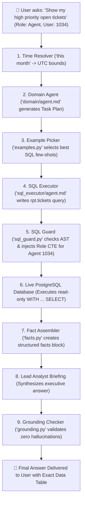

# 🎫 Reports Analytics V2 (Ticketing) — Architecture & File Structure Guide

This guide explains how the **Ticketing Reports Analytics V2 Agent** is organized, what each folder and file does, and how a user's question travels through the system to produce an accurate, secure, and executive-ready answer.

Written in **simple, clear English** for quick and easy understanding.

---

## 🌟 1. System Overview: How Does It Work?

Imagine the system as a team in a corporate analytics department:

1. **The Lead Analyst (`domain/agent.md`):** Listens to what the user or CEO is asking, understands business intent (e.g., *"unresolved"* means status not closed/resolved, *"my tickets"* depends on whether you are an agent or a resolver), and creates a step-by-step task plan.
2. **The SQL / Graph Engineers (`sql_executor/agent.md`, `kg_executor/agent.md`):** Take the tasks, write precise read-only queries against clean virtual views (`rpt.*`), or use certified KPI templates.
3. **The Security Guard (`core/sql_guard.py`):** Inspects every single query AST before it touches the database. It blocks write commands, injects organization security filters, and hides private staff data based on the user's role.
4. **The Database (PostgreSQL / Neo4j):** Runs the safe query and returns real data rows.
5. **The Fact Collector (`core/facts.py` & `core/analysis.py`):** Formats raw rows into clean mathematical fact blocks and calculates exact percentages/trends in Python (so the AI never does mental math).
6. **The Fact Checker (`core/grounding.py`):** Checks the written answer against the facts. If the AI hallucinates any fake numbers, it catches them immediately and fixes the response.
7. **The Executive Briefing:** The user receives a clean, direct answer with exact numbers in bold.

---

## 📂 2. Top-Level Folder Structure

Here is the high-level tree of [`reports_analytics_agent_ticketing_v2/`](file:///home/vectone/Uday/report%20module/reports_analytics_agent_ticketing_v2):

```text
reports_analytics_agent_ticketing_v2/
├── domain/                  # 🧠 Domain Planning Agent (Lead Analyst prompt)
├── sql_executor/            # ✍️ SQL Analytics Executor (SQL generation prompt)
├── kg_executor/             # 🕸️ Knowledge Graph Executor (Cypher generation prompt)
├── core/                    # ⚙️ Python Engine (Execution, Guarding, Grounding, Math)
├── product/                 # 📋 Product Pack (Schema, KPIs, Access Matrix, SQL Templates)
│   ├── sql/                 # 📄 44 Certified KPI SQL Templates
│   ├── kg/                  # 🕸️ Knowledge Graph Measures & Cypher Templates
│   └── examples/            # 💡 Few-shot SQL & Cypher Examples
├── organizations/           # 🏢 Tenant Overlays (Org-specific thresholds, e.g. Org 1012 Booxoo)
├── skills/                  # 🛠️ Agent Tools (KPI query, breakdown, export, graph path)
└── tests/                   # 🧪 Automated Test Suites, Golden Data & Schemas
```

---

## 🔍 3. Deep-Dive: What Each Folder & File Does

### 🧠 A. [`domain/`](file:///home/vectone/Uday/report%20module/reports_analytics_agent_ticketing_v2/domain) (The Planning Layer)
- [`domain/agent.md`](file:///home/vectone/Uday/report%20module/reports_analytics_agent_ticketing_v2/domain/agent.md): The system instructions for the **Lead Analyst**.
  - Teaches the LLM business vocabulary (e.g., `"open"` vs `"pending"`, `"teams"` = queues, `#1611` ticket lookups).
  - Determines if the request is a single KPI, a multi-dimensional breakdown, a list/search, or a deep root-cause investigation.
  - Generates clean JSON plans with 1 to 4 actionable tasks for the executors.

---

### ✍️ B. [`sql_executor/`](file:///home/vectone/Uday/report%20module/reports_analytics_agent_ticketing_v2/sql_executor) & [`kg_executor/`](file:///home/vectone/Uday/report%20module/reports_analytics_agent_ticketing_v2/kg_executor) (The Query Writers)
- [`sql_executor/agent.md`](file:///home/vectone/Uday/report%20module/reports_analytics_agent_ticketing_v2/sql_executor/agent.md): Instructions for the **SQL Executor**.
  - Tells the LLM how to write safe `SELECT` statements using only virtual reporting views (`rpt.tickets`, `rpt.ticket_facts`, `rpt.queues`, `rpt.agents`, etc.).
  - Enforces `ILIKE '%...%'` for name/email searches and `#` normalization for ticket IDs.
- [`kg_executor/agent.md`](file:///home/vectone/Uday/report%20module/reports_analytics_agent_ticketing_v2/kg_executor/agent.md): Instructions for the **Knowledge Graph Executor**.
  - Used for relationship questions (e.g., ticket paths, note authors, queue staffing).

---

### ⚙️ C. [`core/`](file:///home/vectone/Uday/report%20module/reports_analytics_agent_ticketing_v2/core) (The Python Execution Engine)
This is the heart of the system. Python handles all deterministic logic, guarding, database connections, and validation.

| File | What It Does (In Simple Terms) |
| :--- | :--- |
| [`run_sql.py`](file:///home/vectone/Uday/report%20module/reports_analytics_agent_ticketing_v2/core/run_sql.py) | Takes LLM-written SQL, passes it through the guard, executes it safely on PostgreSQL, and returns rows. Also handles 1-step automatic query self-repair if there's a syntax error. |
| [`sql_guard.py`](file:///home/vectone/Uday/report%20module/reports_analytics_agent_ticketing_v2/core/sql_guard.py) | **The Security Shield.** Uses Abstract Syntax Tree (AST) parsing to ensure the query is strictly `SELECT`/`WITH`, injects tenant organization IDs, applies role filters, and masks sensitive staff IDs. |
| [`run_kpi.py`](file:///home/vectone/Uday/report%20module/reports_analytics_agent_ticketing_v2/core/run_kpi.py) | Compiles and executes the 44 certified, official KPI SQL templates with dimensional grouping and date filtering. |
| [`views.py`](file:///home/vectone/Uday/report%20module/reports_analytics_agent_ticketing_v2/core/views.py) | Defines the 15 virtual reporting views (`rpt.*`) and generates the role-based Common Table Expressions (CTEs) that enforce security. |
| [`facts.py`](file:///home/vectone/Uday/report%20module/reports_analytics_agent_ticketing_v2/core/facts.py) | Takes database output rows and converts them into structured, readable text facts (e.g., `RESULT: ticket_count = 10345`). |
| [`grounding.py`](file:///home/vectone/Uday/report%20module/reports_analytics_agent_ticketing_v2/core/grounding.py) | **Anti-Hallucination Guard.** Extracts all numbers in the AI's final briefing and checks if every number actually exists in the database facts. If not, it triggers regeneration or replaces it with fact-only text. |
| [`analysis.py`](file:///home/vectone/Uday/report%20module/reports_analytics_agent_ticketing_v2/core/analysis.py) | Pure Python math functions (`period_delta`, `segment_share_of_change`, `rate_vs_volume`) so arithmetic is always 100% mathematically exact without relying on LLM math. |
| [`time.py`](file:///home/vectone/Uday/report%20module/reports_analytics_agent_ticketing_v2/core/time.py) | Converts plain English date phrases (e.g., `"this month"`, `"last 7 days"`, `"yesterday"`) into exact UTC timestamps. |
| [`examples.py`](file:///home/vectone/Uday/report%20module/reports_analytics_agent_ticketing_v2/core/examples.py) | Dynamically picks the 4 to 6 most relevant few-shot SQL examples for the user's specific question to give the LLM the best context. |
| [`access.py`](file:///home/vectone/Uday/report%20module/reports_analytics_agent_ticketing_v2/core/access.py) | Helper for role permissions and access violation exceptions (`AccessDenied`). |
| [`loader.py`](file:///home/vectone/Uday/report%20module/reports_analytics_agent_ticketing_v2/core/loader.py) | Merges the base product catalog with tenant-specific overrides (like Org 1012). |
| [`db.py`](file:///home/vectone/Uday/report%20module/reports_analytics_agent_ticketing_v2/core/db.py) | Lightweight, safe database execution wrapper for PostgreSQL using connection pooling and transactions. |
| [`validate.py`](file:///home/vectone/Uday/report%20module/reports_analytics_agent_ticketing_v2/core/validate.py) | CLI test harness (`python -m ...core.validate`) that verifies that every KPI has a matching SQL file and all guards pass. |
| [`errors.py`](file:///home/vectone/Uday/report%20module/reports_analytics_agent_ticketing_v2/core/errors.py) | Clean error classification (`DENY` = unauthorized, `REPAIR` = fixable syntax, `REPLAN` = system failure). |

---

### 📋 D. [`product/`](file:///home/vectone/Uday/report%20module/reports_analytics_agent_ticketing_v2/product) (The Business Logic & Catalog)
This folder defines what metrics exist, what tables exist, and who is allowed to see what.

- [`product/schema.yml`](file:///home/vectone/Uday/report%20module/reports_analytics_agent_ticketing_v2/product/schema.yml): Defines the **15 Virtual Views** (`rpt.tickets`, `rpt.ticket_facts`, `rpt.queues`, `rpt.agents`, `rpt.customers`, etc.), their columns, and their business descriptions.
- [`product/kpis.yml`](file:///home/vectone/Uday/report%20module/reports_analytics_agent_ticketing_v2/product/kpis.yml): Declares all **44 Certified KPIs** (e.g. `ticket_count`, `sla_breach_rate`, `avg_csat`, `fcr_rate`, `unread_notifications`), their allowed dimensions, and calculation rules.
- [`product/access.yml`](file:///home/vectone/Uday/report%20module/reports_analytics_agent_ticketing_v2/product/access.yml): The **Role Security Matrix**.
  - **Admin:** Full organization visibility across all views.
  - **Agent:** Visibility restricted to their assigned queues, tickets assigned to them, and tickets created by them.
  - **Resolver:** Visibility restricted to tickets assigned to them to resolve (`resolver_id = user_id`) and their assigned queues.
- [`product/sql/`](file:///home/vectone/Uday/report%20module/reports_analytics_agent_ticketing_v2/product/sql): Contains **44 SQL Template Files** (e.g. `ticket_count.sql`, `sla_breach_rate.sql`, `avg_csat.sql`, `_base_ticket.sql`).
- [`product/kg/`](file:///home/vectone/Uday/report%20module/reports_analytics_agent_ticketing_v2/product/kg): Knowledge Graph definitions:
  - `measures.yml`: Declares the 6 graph measures (`ticket_neighborhood`, `why_breakdown`, `assignment_path`, etc.).
  - `cypher/`: 6 corresponding Cypher template queries (`.cypher`).
- [`product/examples/`](file:///home/vectone/Uday/report%20module/reports_analytics_agent_ticketing_v2/product/examples): Contains canonical few-shot SQL and Cypher query pairs (`sql.yml`, `cypher.yml`) used by the prompt injector.

---

### 🏢 E. [`organizations/`](file:///home/vectone/Uday/report%20module/reports_analytics_agent_ticketing_v2/organizations) (Tenant Overlays)
- [`organizations/org_1012/tenant_thresholds.yml`](file:///home/vectone/Uday/report%20module/reports_analytics_agent_ticketing_v2/organizations/org_1012/tenant_thresholds.yml):
  - Allows individual tenant organizations (like Booxoo, Org 1012) to configure custom target thresholds (e.g. target CSAT = 4.2, target SLA breach rate < 5%) without touching core system code.

---

### 🛠️ F. [`skills/`](file:///home/vectone/Uday/report%20module/reports_analytics_agent_ticketing_v2/skills) (Modular Agent Tools)
Standard tool definitions available to the agent:
- `analytics-kpi-query`: Runs certified KPI metric queries.
- `analytics-count-breakdown`: Groups metrics by priority, status, queue, channel, or time.
- `analytics-report-list`: Lists tickets, queues, agents, or customers.
- `analytics-threshold-check`: Compares performance against target SLAs.
- `analytics-graph-path`: Explores relationships across the knowledge graph.
- `analytics-export`: Exports reports to CSV/JSON.

---

### 🧪 G. [`tests/`](file:///home/vectone/Uday/report%20module/reports_analytics_agent_ticketing_v2/tests) (Quality Assurance)
- Contains unit tests for guards, grounding, time resolution, and security policies (`test_sql_guard.py`, `test_run_kpi.py`, `test_grounding.py`, `test_resolver_security.py`).
- Golden schemas and seed data (`tests/pg/schema.sql`, `tests/golden/seed.sql`).

---

## 🔄 4. Step-by-Step Flow: What Happens During a Query?

Here is the exact lifecycle of a user query (e.g. *"Show my high priority open tickets"* asked by an Agent):



---

## 🛡️ 5. Key Guarantees & Safety Summary

1. **100% Read-Only Safety:** Only `SELECT` and `WITH ... SELECT` are allowed. All `INSERT`, `UPDATE`, `DELETE`, `DROP`, or dangerous system functions are strictly rejected before hitting the database.
2. **Zero Mental Math Hallucinations:** Percentages, deltas, and segment contributions are computed deterministically in Python via `core/analysis.py`.
3. **Role & Data Fencing:** An Agent or Resolver can **never** see tickets or private staff records outside their authorized queues.
4. **Anti-Hallucination Verification:** The final executive text is cross-verified against the fact block by `core/grounding.py` before display.

---
*Created for Reports Analytics Agent Ticketing V2.*
