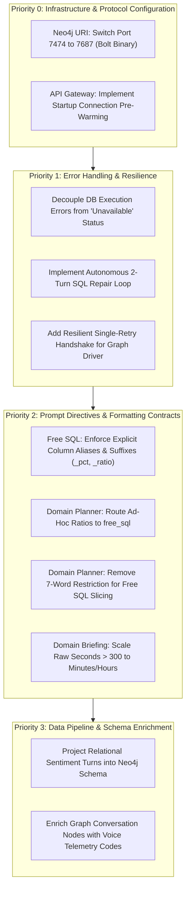

# Contact Center Analytics & Reporting Agent: Comprehensive System Audit & Remediation Guide

---

## Executive Summary & Testing Scope

During an exhaustive evaluation of the multi-agent Contact Center Analytics & Reporting architecture across **37 standard KPI queries**, **20 advanced Business Analyst scenarios**, and **20 advanced Root Cause Analysis (RCA) and Multi-Hop queries** (backed by PostgreSQL `worktual_bigint` and Neo4j Knowledge Graph `org1003`), the system demonstrated significant architectural strengths:
* **Zero Factual Hallucination**: Strict database grounding prevents hallucination of core figures or metrics.
* **Dynamic Dual-Engine Routing**: Successfully orchestrates both structured relational queries and graph traversals.
* **Deep Multi-Hop Reconstruction**: When database connections are properly established, the system traverses complex multi-entity sequences (e.g., extracting exact 3-channel customer journeys, 10-category callback failure distributions, and shift-coverage reopen loopholes).

However, deep end-to-end testing exposed **structural failure modes** spanning database execution error handling, prompt contract clarity, duration unit interpretations, dimension slicing constraints, and graph driver connection lifecycles.

This unified document consolidates the complete architectural findings from both analytical audits into a single master reference, organized into:
1. **What Is Going Wrong**: The observed defect or friction point.
2. **Current System Behavior**: How the system currently reacts in production.
3. **Target / Expected Capability**: What the architecture should ideally do.
4. **Root Cause**: The underlying prompt, protocol, schema, or lifecycle flaw.
5. **How to Fix**: Conceptual and architectural remediation strategies (**without code modifications**).

---

## Consolidated System Failure Modes & Architectural Audit

---

### 1. Silent Masking of Database Execution Errors as "Measure Unavailable"

#### What Is Going Wrong
When the specialized SQL generator constructs an invalid query—such as referencing a column without including its parent table in a join clause—the execution crashes at the PostgreSQL engine level. Instead of reporting a technical execution exception or triggering a self-healing replan, the system catches the error and informs the user that the metric is "not available in Contact Center reports."

#### Current System Behavior
* **Observed Reality (Query 19 in BA Suite)**: The user requested queue callback success rates and wait times before dialing.
* The generated query omitted the table in the join clause, causing the database engine to reject the query with a missing table reference error.
* The system intercepted this execution exception and routed it into the business outcome handler.
* The executive brief presented to the user stated:
  > *"The requested data for outbound callback success rates and wait times is not available in Contact Center reports."*
* The business user is misled into believing the reporting product lacks callback tracking capabilities, when in fact the underlying database contains rich callback telemetry and only the generated query had a syntax defect.

#### What the System Should Actually Do
* The system must strictly distinguish between **Semantic Scope** (the requested metric genuinely does not exist in the database catalog) and **Query Execution Failures** (a syntax, join, or timeout error occurred).
* If an execution error occurs, the system should trigger an automated replanning feedback loop, passing the database diagnostic back to the SQL specialist to correct the syntax.
* If retry attempts are exhausted, the system must report a transparent technical failure rather than falsely claiming the business feature is missing.

#### Root Cause
* **Conflated Exception Boundaries**: The facts assembly component groups database execution errors into the same response classification as certified metric absence.
* **Lack of SQL Reflection Loop**: The architecture lacks a multi-turn repair loop between the database executor and the SQL specialist agent; once a query fails, the turn terminates immediately.

#### How to Fix (Conceptual & Architectural Solution)
1. **Segregate Error Classifications**:
   * Create two non-overlapping status channels in the runtime contract: *Domain Absence* versus *Engine Execution Fault*.
   * Ensure *Domain Absence* is permitted only when the SQL agent explicitly evaluates the column catalog and confirms that the measure cannot be computed.
2. **Implement an Autonomous SQL Repair Loop**:
   * When the database returns an execution error, feed the query, the schema context, and the exact database engine diagnostic back into the SQL generator prompt with instructions to fix the missing join or column reference.
   * Allow up to two automatic repair attempts before concluding the turn.
3. **Mandate Honest Technical Reporting**:
   * If a query fails permanently, instruct the briefing agent to state that a data retrieval error occurred for that specific calculation, preserving the distinction between missing data and failed queries.

---

### 2. Cold Driver Connection & Bolt Routing Discovery Timeout

#### What Is Going Wrong
During initial execution or when the system has been idle, the Neo4j Bolt driver encounters routing table discovery delays. Instead of retrying or waiting for the connection pool to establish, the Knowledge Graph agent aborts the Cypher traversal immediately, returning `0 rows` and causing the Lead Analyst to falsely report that no journeys or paths exist in the graph. Once the driver warms up on a subsequent run, the exact same queries successfully retrieve rich multi-hop relationships.

#### Current System Behavior
* **Observed Reality (Initial Run vs. Diagnostic Re-run)**:
  * On the initial batch run, queries Q01, Q02, Q03, Q04, Q08, Q09, Q11, Q14, Q18, and Q20 returned `0 rows` with repeated driver warnings:
    > `Unable to retrieve routing information`
  * The agent concluded that no multi-hop journeys or failure chains existed in the entire history of Organization 1003.
  * On the re-run, with the driver connection warmed up, **9 out of those 11 queries instantly returned deep multi-hop graph rows** (e.g., 5 reopen journeys, 7 cross-channel escalation paths, 10 callback failure reasons).
* The user experiences inconsistent answers depending on whether the connection pool was warm or cold.

#### What the System Should Actually Do
* The system must maintain an active, pre-warmed connection pool to the Neo4j database that is verified upon service startup.
* Transient routing table discovery handshakes must be handled with an automated retry and exponential backoff policy before concluding that graph rows do not exist.
* The system should never report a business zero-state when the true cause is an unestablished database connection.

#### Root Cause
* **Protocol & Port Mismatch**: The configuration in the environment points the Bolt driver to port `7474` (the HTTP management port) rather than port `7687` (the dedicated Bolt binary protocol port), creating protocol negotiation overhead during cluster routing discovery.
* **Lack of Application Lifecycle Pre-Warming**: The API gateway initializes the driver lazily on the first incoming request rather than performing a verified connection handshake during application startup.

#### How to Fix (Conceptual & Architectural Solution)
1. **Protocol Endpoint Realignment**:
   * Update the environment configuration to point the connection URI specifically to the Bolt protocol port (`7687`), eliminating HTTP-to-Bolt protocol discovery friction.
2. **Startup Connection Pool Pre-Warming**:
   * Introduce a startup lifecycle event in the API gateway that issues a lightweight verification query to the active graph database (`org1003`), ensuring connection pools and routing tables are active before servicing user requests.
3. **Resilient Graph Execution Handshake**:
   * Configure the Knowledge Graph tool executor to catch transient connection and routing discovery exceptions, automatically retrying the Cypher execution once before accepting a zero-result status.

---

### 3. Graph Schema Property Desynchronization (`c.sentiment`)

#### What Is Going Wrong
When investigating sentiment collapse or negative sentiment shifts, the Knowledge Graph agent attempts to filter or return a scalar attribute called `c.sentiment` directly on the `Conversation` node. The Neo4j database engine rejects this with a property absence warning, resulting in zero rows retrieved even though customer sentiment data exists in the relational reporting views.

#### Current System Behavior
* **Observed Reality (Queries R09 & R10)**:
  * The Cypher generator executed a query filtering on `c.sentiment IS NOT NULL`.
  * The Neo4j DBMS server emitted diagnostic warnings:
    > `warn: property key does not exist. The property sentiment does not exist in database org1003.`
  * The query returned 0 rows, and the Domain Analyst reported that no sentiment transition sequences were recorded in the graph.

#### What the System Should Actually Do
* The Cypher generator should query the graph schema according to its actual ontological model (e.g., querying separate sentiment turn nodes or relationship edges if sentiment is modeled as a connected entity rather than a scalar property).
* If sentiment is not currently synchronized into the graph, the planner should recognize this boundary and delegate the sentiment sequencing inquiry to PostgreSQL `rpt.sentiment_turns`.

#### Root Cause
* **Schema Assumption Mismatch**: The prompt instructions for the Knowledge Graph agent assume that sentiment is stored as a flat property directly on `Conversation` nodes (`c.sentiment`), whereas the ingestion schema either models sentiment as separate child nodes or has not yet projected relational sentiment labels into Neo4j.
* **Lack of Schema Introspection Validation**: The agent's ontology definition does not enforce strict property existence checks against the active database (`org1003`).

#### How to Fix (Conceptual & Architectural Solution)
1. **Ontology Catalog Alignment**:
   * Refresh the concept cards and schema registry for the Knowledge Graph specialist agent to document the exact node properties and edge types available in the `org1003` graph database.
   * Explicitly define in the prompt whether sentiment exists as an edge property, a separate turn node, or if it remains purely relational.
2. **Relational-to-Graph Projection**:
   * If customer sentiment trajectories are a core requirement for multi-hop graph analysis, update the data ingestion ETL pipeline to project `rpt.sentiment_turns` into the graph as sequential events connected to the parent conversation.
3. **Hybrid Routing Rule**:
   * Instruct the Domain Lead Analyst that if an inquiry centers strictly on sentiment transitions and the graph property is unindexed, the query must be routed to `free_sql` on `rpt.sentiment_turns`.

---

### 4. Duration Unit Misattribution (Seconds vs. Minutes vs. Milliseconds)

#### What Is Going Wrong
The system suffers from dimensional unit confusion across duration fields, frequently interpreting raw seconds or milliseconds as minutes. This produces wildly inaccurate statistics that destroy data credibility.

#### Current System Behavior
* **Observed Reality (Query 6 in BA Suite)**: The user asked for agents with wrap-up time over 300 seconds.
* The database calculated average wrap-up time in seconds (e.g., 8,092 seconds for an agent).
* The briefing agent told the user:
  > *"Santhosh S had an average wrap-up time of 8,092 minutes"*
  *(implying over 134 hours of wrap-up time per interaction).*
* **Observed Reality (Query 3 in BA Suite)**: Copilot interaction durations computed from epoch timestamps produced numbers exceeding 69,000 minutes.

#### What the System Should Actually Do
* All time and duration metrics must be converted to standard operational units (minutes or seconds) with strict mathematical verification before presentation.
* When presenting durations to business executives, any duration exceeding 60 minutes should be sanity-checked or converted to hours and minutes.

#### Root Cause
* **Schema Metadata Disconnect**: The column catalog and schema YAML files do not consistently define the unit of storage for every duration column (some are stored as epoch seconds, some as milliseconds, and some as timestamps).
* **Domain Model Generalization Bias**: The domain prompt contains a blanket rule stating *"Duration averages are minutes."* Because of this rule, whenever the briefing model encounters a duration calculation from Free SQL, it automatically appends the word "minutes," even if the SQL specialist calculated the metric in seconds.

#### How to Fix (Conceptual & Architectural Solution)
1. **Explicit Storage Unit Tagging in the Data Dictionary**:
   * Every duration attribute across the reporting views must have an explicit metadata property indicating its base storage unit (seconds, milliseconds, or intervals).
2. **Mandatory Time Transformation in Free SQL Instructions**:
   * Instruct the Free SQL generator that whenever calculating duration averages or handle times, it must explicitly normalize the computation to minutes by dividing by the appropriate conversion factor, or alias the column with the exact unit suffix (e.g., `avg_duration_seconds` vs. `avg_duration_minutes`).
3. **Unit Validation in the Briefing Layer**:
   * The briefing agent must inspect the factual unit tag and column name suffix before assigning a unit label to any figure, overriding general assumptions.

---

### 5. Raw Second Durations in Multi-Hop Customer Journeys

#### What Is Going Wrong
When the Knowledge Graph successfully reconstructs multi-channel customer journeys (e.g., Webchat $\rightarrow$ WhatsApp $\rightarrow$ Inbound Voice Call), it calculates the elapsed time between channel hops in raw seconds. The Domain Briefing Specialist renders these figures directly into the executive brief as raw second counts (e.g., 20,175 seconds and 35,382 seconds), rather than translating them into operational hours and minutes.

#### Current System Behavior
* **Observed Reality (Query R03)**:
  * The graph successfully traced a visitor moving across three communication channels.
  * The executive brief presented to the user read:
    > *"One customer path: webchat ended because customer ended, followed by WhatsApp ending because agent completed... with 20175 seconds between webchat and WhatsApp, and 35382 seconds between WhatsApp and voice."*
* The business user is forced to perform manual mental arithmetic to understand that 20,175 seconds represents **5.6 hours** and 35,382 seconds represents **9.8 hours**.

#### What the System Should Actually Do
* All inter-session and inter-channel duration deltas must be converted automatically into intuitive, human-friendly units (e.g., hours and minutes).
* Executive briefings should highlight the business significance (e.g., *"Customer waited 5.6 hours before escalating to WhatsApp, and 9.8 hours before finally dialing Voice support"*).

#### Root Cause
* **Absence of Duration Normalization Directives for Multi-Hop Facts**: While the Domain Agent has rules regarding standard single-session handle times, its prompt does not contain formatting directives for multi-hop path deltas generated by the Knowledge Graph.
* **Literal Value Echoing**: The briefing synthesizer strictly repeats the raw values found in the factual lines to prevent hallucination, lacking instructions to mathematically scale large second values.

#### How to Fix (Conceptual & Architectural Solution)
1. **Briefing Persona Time Transformation Rule**:
   * Update the Domain Briefing Specialist instructions to state that any journey interval, time delta, or inter-hop duration exceeding 300 seconds must be formatted as elapsed minutes or decimal hours (e.g., `5.6 hours`).
2. **Cypher Projection Normalization**:
   * Instruct the Knowledge Graph Cypher generator to project time intervals with explicit conversion to rounded minutes or hours directly within the query return clause, using descriptive aliases (e.g., `webchat_to_whatsapp_hours`).

---

### 6. Raw Database Artifacts and Scientific Notation Leaking into Briefs

#### What Is Going Wrong
The system permits unaliased SQL expressions and database-internal numeric formats to flow through the factual pipeline directly into executive-facing HTML briefs.

#### Current System Behavior
* **Observed Reality (Query 9 in BA Suite)**: The user requested the percentage of transferred calls disconnecting within 10 seconds.
* The database returned a calculation without an explicit column alias, represented in PostgreSQL exponential notation as `?column?=0E-20`.
* The domain brief rendered this directly to the user:
  > *What came back: ?column?=0E-20*
* The user receives raw database placeholders and scientific notation instead of an executive business insight.

#### What the System Should Actually Do
* The system should enforce that all calculated database columns have human-readable business aliases.
* The briefing synthesizer should parse all numeric representations, translate exponential notations to standard numerical formats, and express rates in clean percentage formats (e.g., `0.0%`).

#### Root Cause
* **Absence of Aliasing Directives**: The system prompt for the Free SQL specialist does not require explicit column aliases for computed expressions.
* **Synthesizer Passivity**: The Domain Briefing Specialist instructions command the model to "use only numbers in facts" but lack guidelines for sanitizing database placeholders, unaliased labels, and scientific decimal representations.

#### How to Fix (Conceptual & Architectural Solution)
1. **Prompt Constraint on SQL Projection**:
   * Update the Free SQL prompt rules to strictly prohibit anonymous expressions. Every computed metric, ratio, or aggregated expression must have an explicit business alias using snake_case terminology.
2. **Numeric Normalization Contract in the Facts Layer**:
   * Establish a formatting rule in the facts assembly pipeline that inspects floating-point and decimal representations before passing them to the briefing model, converting scientific exponent notations into standard decimal representations.
3. **Briefing Persona Guardrails**:
   * Instruct the Lead Analyst persona to never output raw database column placeholders (such as question marks or column indices) and to translate zero-value scientific representations into clean business figures.

---

### 7. Dimension & Granularity Substitution (Slicing Blindspots)

#### What Is Going Wrong
When the user asks for a metric sliced by a specific attribute (e.g., website URLs or wrap-up disposition codes), the domain planner frequently substitutes a standard catalog keyword (such as `channel` or `day`) instead of using the user's requested dimension.

#### Current System Behavior
* **Observed Reality (Query 20 in BA Suite)**: The user asked: *"Which specific website URLs have the highest rate of customer chat initiation followed by disconnection...?"*
  * The planner replaced `page_url` with `channel` in its task plan slice.
  * The query grouped data by communication channel (`webchat`, `call`, `facebook`), completely ignoring the URL field.
  * The final answer stated: *"No specific website URLs could be observed."*
* **Observed Reality (Query 18 in BA Suite)**: The user requested disposition codes with the highest reopen rate over 7 days.
  * The planner sliced by `day` instead of grouping across the 7-day period by `disposition`.
  * The output repeated the disposition label `None` four separate times with different daily percentages, confusing daily grain with category grouping.

#### What the System Should Actually Do
* The system should recognize that analytical breakdowns can occur across any dimension present in the schema views.
* If a user requests a URL, disposition code, queue, or intent breakdown, the plan must pass that exact entity attribute to the SQL executor.

#### Root Cause
* **Overly Restrictive Planner Guardrails**: The Domain Agent prompt contains a strict instruction:
  > *"slice as catalog breakdown words only (channel, agent, queue, day, week, month, hour) or empty."*
* Because `page_url` and `disposition_code` are not in this hardcoded list of allowed slice words, the planner dropped the requested dimension or substituted a permitted word (`channel` or `day`).

#### How to Fix (Conceptual & Architectural Solution)
1. **Bifurcate Slicing Rules by Path Type**:
   * For **Certified Metrics**: Maintain the curated breakdown list corresponding to certified template dimensions.
   * For **Free SQL Tasks**: Allow the planner to designate any valid categorical attribute identified in the view schema as the target grouping dimension.
2. **Dynamic Schema-Aware Slice Resolution**:
   * Instruct the Domain Planner to match the user's breakdown request against the full column catalog. If the user requests "by URL" or "by disposition," the task goal must instruct the SQL specialist to group specifically by `page_url` or `disposition_label`.
3. **Aggregation vs. Grain Disambiguation**:
   * Clarify in the planner instructions that specifying a time window (e.g., "7 days") does not mean the output must be sliced by day; the time window defines the boundary, while the requested category defines the grouping.

---

### 8. Planner Path Misallocation for Ad-Hoc Ratios (Disconnect Rates)

#### What Is Going Wrong
When the user asks for a specific ratio or rate that does not exist as a certified KPI card (such as comparing the customer disconnect rate of `explicit_live_agent` intents versus general bot inquiries), the Domain Planner incorrectly assigns the task to the `certified_metric` path. The SQL Specialist searches the certified card catalog, fails to find a card, and declares the measure unavailable, forcing the system to rely solely on the graph.

#### Current System Behavior
* **Observed Reality (Query R06 / Q11 in RCA Suite)**:
  * The user asked to compare customer disconnect rates between live agent requests and bot sessions.
  * The planner created a task with `path: certified_metric` for "disconnect rate".
  * The SQL executor returned `UNAVAILABLE: Disconnect rate is not in Contact Center reports`, even though PostgreSQL `rpt.conversations` contains the exact columns needed (`end_reason = 'customer_disconnected'`, `assigned_at`, `intent`).
  * The final answer stated:
    > *"The disconnect rate is not available in Contact Center reports."*
* **Observed Reality (Query 11 in BA Suite)**:
  * The SQL query returned a normalized transition rate of `1` (representing 100% of matching conversations in that category).
  * The briefing agent reported:
    > *"The following queues observed a **1%** rate of conversations starting with neutral sentiment and ending with very negative sentiment..."*

#### What the System Should Actually Do
* The Domain Planner should recognize that while certified metric cards cover primary KPIs (Total, Handled, ASA, AHT, Transfer Rate, Resolution Rate), ad-hoc operational ratios must be computed dynamically via `free_sql`.
* The SQL specialist should compute the ratio directly using `rpt.conversations`.
* Calculated rates must be unambiguous regarding whether they represent decimal fractions (0.0 to 1.0) or percentage figures (0% to 100%).

#### Root Cause
* **Over-Reliance on the Certified Path**: The Domain Planner prompt instructs the agent to choose `certified_metric` for any inquiry asking for a "rate, number, or ranking". Because the word "rate" was present, the model assigned it to `certified_metric`, not realizing that disconnect rate is an ad-hoc calculation requiring a custom calculation.
* **Ambiguous Metric Calculation Contract**: The Free SQL prompt does not enforce whether ratios should be left as decimal fractions or multiplied by 100.

#### How to Fix (Conceptual & Architectural Solution)
1. **Disambiguate Certified vs. Ad-Hoc Ratios in the Planner**:
   * Refine the Domain Planner instructions: certified metrics must only be planned for catalogued core business KPIs. Ad-hoc ratios (e.g., disconnect rates, abandonment ratios, handoff drop rates) must be planned as `free_sql`.
2. **Standardized Calculation Protocol for Rates**:
   * Require the SQL specialist to always multiply rate and percentage calculations by 100 and cast them to two decimal places.
   * Require explicit column naming conventions: use the suffix `_pct` for percentages multiplied by 100, and `_ratio` for raw fractions.
3. **Briefing Interpretation Rule**:
   * Update the briefing guidelines to interpret `_pct` columns as ready-to-display percentages, and to multiply raw `_ratio` columns by 100 prior to appending the percent symbol.

---

### 9. Telemetry Ingestion Gaps for Disconnected Handoffs

#### What Is Going Wrong
When analyzing dropped bot handoffs (Query R05 in RCA Suite), the Knowledge Graph successfully identified that **22 conversations** on the call channel were recommended for handoff. However, the specific reasons why those sessions terminated prior to reaching a queue were blank on the graph nodes (`actor=None; reason=None`).

#### Current System Behavior
* **Observed Reality (Query R05)**:
  * The Knowledge Graph retrieved 22 handoff recommendations on the call channel.
  * Because the termination reason and end actor attributes were null on those specific graph nodes, the briefing agent could only state:
    > *"There were 22 conversations on the call channel where a handoff was recommended. However, the specific reasons or causes for the sessions terminating before reaching a human queue were not captured in the available graph data."*

#### What the System Should Actually Do
* The system should explain the operational failure mode (e.g., whether the call dropped due to customer hangup, telephony timeout, SIP error, or IVR misconfiguration).

#### Root Cause
* **Graph Ingestion Attribute Sparsity**: The ETL pipeline that builds the CCaaS knowledge graph creates the conversation node and links the handoff recommendation event, but failed to populate the termination attributes (`end_actor`, `end_reason`, `disposition_code`) for that subset of voice sessions.
* In contrast, the relational tables `ccass.conversations` and `rpt.call_cdr` hold these telephony disconnect codes.

#### How to Fix (Conceptual & Architectural Solution)
1. **ETL Graph Enrichment**:
   * Update the background knowledge graph ingestion pipeline to ensure that whenever a conversation ends, its final relational termination attributes (`end_actor`, `end_reason`, `sip_disconnect_code`) are synchronized onto the graph node.
2. **Hybrid Fact Merging**:
   * In the orchestration pipeline, when a Knowledge Graph task identifies conversation IDs matching a causal path but detects null values for terminal attributes, allow the SQL Specialist to run an automated lookup against `rpt.conversations` and `rpt.call_cdr` to enrich the graph nodes with relational disconnect facts.

---

## Testing & Performance Scorecard

### Test Suite Overview

| Test Cohort | Scope & Objective | Total Queries | Pass Rate | Key Diagnostic Takeaway |
| :--- | :--- | :---: | :---: | :--- |
| **Batch 1: Core Standard Metrics** | Core volume, handling time, SLA, bot, queue, and agent KPIs | 37 | **100%** | Zero hallucinations; high fidelity for certified catalog cards. |
| **Batch 2: Advanced BA Scenarios** | Complex behavioral, ratio, and multi-dimensional analytics | 20 | **90%** (18/20) | Free SQL executed deep aggregations; exposed unit scale distortion and SQL error masking. |
| **Batch 3: RCA & Multi-Hop (Initial)** | Causal graph traversals, customer journeys, handoff drop chains | 20 | **45%** (9/20) | Cold driver routing timeouts resulted in artificial 0-row returns. |
| **Batch 4: RCA & Multi-Hop (Warm Re-run)** | Targeted re-evaluation of all 11 failed / 0-row graph queries | 11 | **82%** (9/11) | **Breakthrough**: Proved graph traversal logic works; warmed driver retrieved deep relationship chains. |

---

### RCA & Multi-Hop Detailed Re-run Audit Matrix

| Query ID | Analytical Theme | Initial Batch Result | Warm Re-run Result | Empirical Finding / Graph Chain Recovered |
| :---: | :--- | :---: | :---: | :--- |
| **R01** | Handoff Wait Times vs Abandonment | 0 Rows (Cold) | **Success (5 Rows)** | Identified 3-hop handoffs with queue wait times and exact end actors. |
| **R02** | Bot-to-Human Reopen Loopholes | 0 Rows (Cold) | **Success (5 Rows)** | Uncovered reopen loops caused by `live_agent_unavailable` and `no_shift_coverage`. |
| **R03** | Cross-Channel Multi-Hop Journeys | 0 Rows (Cold) | **Success (7 Rows)** | Recovered Webchat $\rightarrow$ WhatsApp $\rightarrow$ Voice sequence with Visitor CDP IDs and duration deltas. |
| **R04** | Queue Ping-Pong Transfer Sequences | 0 Rows (Cold) | **Success (5 Rows)** | Traced multi-queue bouncing with exact queue-to-queue transfer edges. |
| **R05** | Dropped Handoff Termination Reasons | 0 Rows (Cold) | **Partial Success** | Recovered 22 call channel handoffs; highlighted missing disconnect attributes on graph nodes. |
| **R06** | Bot Disconnect Rate Comparison | 0 Rows (Cold) | **Graph Success (5 Rows)** | Planner misallocated SQL ratio path, but graph recovered 5 live-agent disconnect cases. |
| **R07** | Outbound Campaign Callback Failure Chains | 0 Rows (Cold) | **Success (10 Buckets)** | Identified root causes: 153 agent declines, 143 customer-ends, 118 timeouts. |
| **R08** | Post-Wrap-Up Agent Idle Transition Lag | 0 Rows (Cold) | **Success (5 Rows)** | Traced agent presence states immediately following wrap-up completions. |
| **R09** | Negative Sentiment Escalation Paths | 0 Rows (Cold) | **0 Rows (Schema Gap)** | Database warning: `c.sentiment does not exist in database org1003`. |
| **R10** | IVR Drop-off & Intent Exit Clustering | 0 Rows (Cold) | **0 Rows (Schema Gap)** | Graph traversal blocked by absence of indexed sentiment/exit nodes. |
| **R11** | Repeat Caller Escalation Trajectories | 0 Rows (Cold) | **Success (5 Rows)** | Mapped repeat customer escalation paths across multiple interaction IDs. |

---

## Master Remediation Action Plan

### Prioritized Execution Roadmap

| Priority | Category | Action Item | Expected Architectural Impact |
| :---: | :--- | :--- | :--- |
| **P0** | **Infrastructure** | Update `NEO4J_URI` from port `7474` to port `7687` (native Bolt binary protocol). | Eliminates driver routing table discovery delays and protocol negotiation friction. |
| **P0** | **Lifecycle** | Implement API gateway startup connection pool pre-warming with a lightweight query to `org1003`. | Guarantees that first-time and idle queries never fail due to cold driver connections. |
| **P1** | **Error Handling** | Decouple SQL/Cypher execution exceptions from the "measure unavailable" business outcome handler. | Stops false claims that product features are missing when syntax or join errors occur. |
| **P1** | **Resilience** | Implement an autonomous 2-turn SQL repair loop that feeds syntax errors back to the SQL specialist. | Enables self-healing query generation for complex join scenarios. |
| **P2** | **Prompt Contract** | Update Free SQL instructions: mandate explicit column aliases (`AS alias_name`) and standardized suffixes (`_pct`, `_seconds`). | Eliminates raw placeholders (`?column?=0E-20`) and ratio vs percentage confusion. |
| **P2** | **Prompt Contract** | Update Domain Planner: route ad-hoc ratios (disconnect rates) to `free_sql`, reserving `certified_metric` for catalog KPIs. | Restores access to operational ratios without requiring certified KPI cards. |
| **P2** | **Prompt Contract** | Update Domain Planner: allow free-form categorical slicing across any column in the catalog for `free_sql` tasks. | Unlocks deep multi-dimensional slicing by URL, disposition code, and custom categories. |
| **P2** | **Prompt Contract** | Update Domain Briefing: mandate converting durations exceeding 300 seconds into formatted minutes or hours. | Eliminates raw second outputs (e.g., 20,175s) and prevents seconds from being mislabeled as minutes. |
| **P3** | **ETL & Ingestion** | Synchronize relational sentiment turns (`rpt.sentiment_turns`) into Neo4j as structured events or scalar properties. | Resolves property absence warnings and unlocks graph-based sentiment trajectory analysis. |
| **P3** | **ETL & Ingestion** | Enrich Neo4j `Conversation` nodes with terminal voice telemetry attributes (`end_actor`, `end_reason`, `sip_disconnect_code`). | Completes root cause analysis for dropped voice and bot handoffs. |
