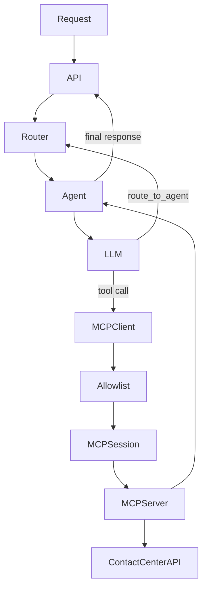

# NLP Architecture

## Structure

```text
apps/nlp/
├── src/app/
│   ├── main.py
│   ├── config.py
│   ├── logging.py
│   ├── api/
│   │   ├── auth.py
│   │   ├── copilot.py
│   │   ├── bot.py
│   │   ├── contact_entities.py
│   │   ├── omnichannel.py
│   │   └── health.py
│   ├── llm/
│   │   ├── client.py
│   │   ├── providers.py
│   │   └── thinking_filter.py
│   ├── runtime/
│   │   ├── agent.py
│   │   ├── router.py
│   │   ├── memory.py
│   │   ├── context.py
│   │   ├── guardrails.py
│   │   └── sse.py
│   ├── agents/
│   │   ├── definitions.py
│   │   ├── support_bot.py
│   │   └── coworker/
│   │       ├── general.py
│   │       ├── contact.py
│   │       ├── inbox.py
│   │       ├── task.py
│   │       ├── queue.py
│   │       └── analytics.py
│   ├── prompts/
│   │   ├── coworker.py
│   │   ├── bot.py
│   │   ├── contact.py
│   │   ├── contact_identity.py
│   │   ├── inbox.py
│   │   ├── task.py
│   │   ├── queue.py
│   │   ├── analytics.py
│   │   ├── email.py
│   │   └── omnichannel.py
│   ├── mcp/
│   │   ├── client.py
│   │   ├── registry.py
│   │   ├── context.py
│   │   └── servers/
│   │       ├── contact.py
│   │       ├── conversation.py
│   │       ├── task.py
│   │       ├── queue.py
│   │       ├── analytics.py
│   │       ├── organization.py
│   │       ├── navigation.py
│   │       ├── skill.py
│   │       └── metric.py
│   ├── skills/
│   │   ├── registry.py
│   │   └── packs/
│   │       ├── contact-entity-extraction/
│   │       ├── contact-identity-resolution/
│   │       └── performance-analytics/
│   └── schemas/
│       ├── bot.py
│       ├── copilot.py
│       ├── events.py
│       └── omnichannel.py
└── tests/
    ├── unit/
    ├── contract/
    └── integration/
```

## Agent workflow



`Agent.run` keeps standard `system`, `user`, `assistant`, and `tool` dictionaries visible. Tool
rounds and handoffs are bounded. The router shares one `SessionMemory` during a handoff.

## Support bot

One `SupportBotAgent` handles all five customer channels. Channel is trusted runtime context,
not a separate agent. Explicit live-agent requests return an immediate handoff. Contact entities
are retained in trusted context, redacted before model calls, and sent through `contact_enrich`.

## MCP catalog

- `contact`: contact search, profile, draft, create, update, and enrichment.
- `conversation`: context, suggested reply, and summary.
- `task`: task list, detail, and update.
- `queue`: queues, teams, mutations, agents, eligibility, and presence.
- `analytics`: read-only SQL analytics, plots, and reports.
- `organization`: organization details and knowledge.
- `navigation`: approved application navigation.
- `skill`: discovery and session-scoped prompt injection.
- `metric`: deterministic vectorless metric and schema retrieval.

The client uses real in-process MCP sessions. It rejects trusted IDs from model arguments, applies
agent/surface/role allowlists, limits payloads and time, and writes structured audit logs.

## External contracts

- `POST /copilot`
- `POST /copilot/stream`
- `POST /copilot/suggest-reply/stream`
- `POST /webchat/turn`
- `POST /whatsapp/turn`
- `POST /social/turn`
- `POST /email/turn`
- `POST /email/priority`
- `POST /contact-entities/extract`
- `POST /omnichannel/summary/refresh`
- `GET /health`
- `GET /health/ready`

API routes are exposed under configured API prefixes. SSE events remain `status`, `text_delta`,
`tool_call`, `block`, `contact_draft`, `confirmation_required`, `action`, `error`, and `done`.
