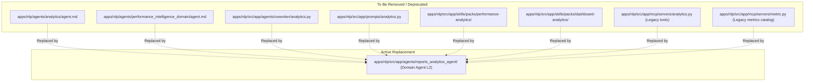

# Contact Center Reporting & Analytics Validation Catalog

This document details all **KPIs, Metrics, Dimensions, Filters, and Capabilities** currently managed and supported by the Contact Center setup, comparing the **Legacy NLP Analytics Path** with the **Domain Reporting Module (`reports_analytics_agent`)**.

---

## 1. Executive Summary & Capability Matrix

| Capability Area | Legacy Setup (`analytics` agent / MCP) | New Domain Agent (`reports_analytics_agent`) | Status / Coverage |
| :--- | :--- | :--- | :--- |
| **Total Certified KPIs** | 9 hardcoded metrics (`metrics.yaml`) | **46 certified KPIs** (`kpis.yml` + certified `.sql` templates) | **5x more KPIs**, 100% legacy coverage |
| **Dimensions / Breakdowns** | 3 (`channel`, `day`, `disposition`) | **33 dimensions** across 663 aliases (`dimensions.yml`) | Complete multi-dimensional breakdown |
| **Filters Supported** | 3 (`org`, date range, `assigned_user_id`) | **40 distinct SQL & business filters** | Granular filtering (teams, customers, queues, etc.) |
| **Execution Paths** | MCP tools (`generate_performance_report`, semantic/ontology gateway) | **3 execution paths**: Certified SQL, Free SQL, and Cypher KG | Self-contained, robust SQL fallback + Graph |
| **Causal Analysis ("Why")** | Rigid prompt hints & external ontology proxy | **Full Neo4j Cypher KG** with tenant isolation & causal facts | Deep multi-hop causal reasoning |
| **Hallucination Protection**| Basic LLM prompt instructions | **Automated Grounding Verifier** (`apply_grounding()`) | Verified factual numbers only |
| **RBAC Scoping** | Basic query filtering | **Built-in RBAC Matrix** (Org vs. Agent vs. Queue) | Scoped at SQL & Graph layers |

---

## 2. Legacy Metrics vs. Domain Module Coverage

All 9 legacy metrics managed by the old `analytics` coworker agent are **100% covered and enhanced** by `reports_analytics_agent`:

| Legacy Metric ID | Legacy Description | Legacy Dimensions | Domain Agent KPI ID | Domain Certified SQL Template | Coverage Status |
| :--- | :--- | :--- | :--- | :--- | :--- |
| `conversations_handled` | Count of handled conversations | `channel`, `day` | `handled` / `total` | `product/sql/handled.sql` | ✅ **Fully Covered** (includes calls, channels) |
| `resolution_rate` | % of handled with `resolved_at` | none | `resolution_rate` | `product/sql/resolution_rate.sql` | ✅ **Fully Covered** |
| `avg_handle_time` | Average seconds from assigned to resolved/ended | none | `avg_handle_time` | `product/sql/avg_handle_time.sql` | ✅ **Fully Covered** (reported in min/sec) |
| `avg_first_response` | Average seconds assigned to first response | none | `avg_first_response` | `product/sql/avg_first_response.sql` | ✅ **Fully Covered** |
| `response_sla_60s` | % first replies within 60s | none | `first_reply_sla` | `product/sql/first_reply_sla.sql` | ✅ **Fully Covered** (60s threshold certified) |
| `transfers` | Conversations with `transferred_at` set | none | `transferred` / `transfer_rate` | `product/sql/transferred.sql` | ✅ **Fully Covered** (count & rate) |
| `channel_mix` | Handled/assigned volume by channel | `channel` | `total` / `handled` (slice: `channel`) | `product/sql/total.sql` with slice | ✅ **Fully Covered** |
| `daily_handled_trend` | Handled conversations per day | `day` | `avg_daily_handled` / `handled` (slice: `day`) | `product/sql/avg_daily_handled.sql` | ✅ **Fully Covered** |
| `disposition_mix` | Latest disposition counts | `disposition` | `total` / `handled` (slice: `disposition`) | `product/sql/total.sql` with slice | ✅ **Fully Covered** |

---

## 3. Complete Catalog of 46 Domain Agent KPIs

The new domain agent manages **46 certified KPIs** grouped into logical families:

### A. Volume & Contact Intake (10 KPIs)
1. **`total`**: Total conversations started in the window (including open).
2. **`call_count`**: Conversations on voice channel (`channel = 'voice'`).
3. **`social_count`**: Conversations on messaging/social channels (`whatsapp`, `webchat`, etc.).
4. **`handled`**: Finished/handled conversations (`status IN ('resolved', 'closed')`).
5. **`handled_change`**: Week-over-week or period-over-period handled volume delta.
6. **`avg_daily_handled`**: Average conversations handled per day in the window.
7. **`avg_monthly_handled`**: Average conversations handled per month.
8. **`active`**: Conversations currently active/in progress.
9. **`bot_active`**: Conversations currently engaged with automated bots.
10. **`callback_count`**: Scheduled/requested outbound callback requests.

### B. Resolution, SLAs & Quality (8 KPIs)
11. **`resolved`**: Total resolved conversations.
12. **`resolution_rate`**: Percentage of handled conversations marked resolved.
13. **`fcr`**: First Contact Resolution rate (resolved without re-contact within 24h).
14. **`reopen_rate`**: Percentage of resolved conversations reopened by customers.
15. **`first_replies`**: Count of first agent replies sent.
16. **`first_reply_sla`**: First-reply SLA adherence (% replied within 60s).
17. **`queue_service_level`**: Percentage of contacts answered within queue threshold (e.g., 20s).
18. **`failed_send_rate`**: Outbound message delivery failure rate.

### C. Speed & Duration (5 KPIs)
19. **`avg_first_response`**: Average first response time (minutes/seconds).
20. **`avg_handle_time`**: Average handle time (AHT) from assignment to close.
21. **`asa`**: Average Speed of Answer (ASA) across queues.
22. **`avg_hold_time`**: Average time callers spent on hold.
23. **`avg_messages_per_conversation`**: Message depth/count per interaction.

### D. Transfers & Abandonment (5 KPIs)
24. **`transferred`**: Count of transferred conversations.
25. **`transfer_rate`**: Percentage of conversations transferred.
26. **`abandoned`**: Count of inbound contacts abandoned while waiting in queue.
27. **`abandonment_rate`**: Percentage of queued contacts abandoned before answer.
28. **`waiting`**: Real-time count of contacts currently waiting in queue.

### E. Risk & Live SLA Monitoring (2 KPIs)
29. **`sla_at_risk`**: Conversations nearing SLA breach threshold.
30. **`sla_breached_live`**: Conversations that have currently breached SLA.

### F. Missed Contacts (2 KPIs)
31. **`missed_contacts`**: Unique missed customer contacts.
32. **`missed_rate`**: Missed contact rate (`uniqueMissed / demand * 100`).

### G. Bot & AI Automation (4 KPIs)
33. **`bot_containment`**: Percentage of conversations resolved entirely by bot.
34. **`bot_grounded_rate`**: Percentage of bot responses verified as fact-grounded.
35. **`copilot_acceptance_rate`**: Share of AI suggestions accepted by human agents.
36. **`negative_sentiment_rate`**: Share of conversations with negative sentiment score.

### H. Workforce Management & Agent Presence (10 KPIs)
37. **`present_days`**: Agent shift attendance/present days count.
38. **`occupancy`**: Agent occupancy rate (time handling vs logged-in time).
39. **`ready_hours`**: Total agent hours in Ready/Available state.
40. **`busy_hours`**: Total agent hours in Busy/Handling state.
41. **`not_ready_hours`**: Total agent hours in Not Ready state.
42. **`break_hours`**: Total agent hours on break/lunch.
43. **`ready_agents`**: Live count of agents currently in Ready status.
44. **`logged_in_agents`**: Live count of agents currently logged into the system.
45. **`offers_ringing`**: Contacts currently ringing/offered to agents.
46. **`offer_accept_rate`**: Percentage of routing offers accepted by agents.

---

## 4. Dimensions & Breakdown Capabilities

The domain reporting module supports **33 distinct dimensions** across **663 mapped aliases** in `dimensions.yml`:

| Dimension Category | Supported Dimensions |
| :--- | :--- |
| **Time Slices** | `day`, `week`, `month`, `hour` |
| **Organizational** | `team`, `queue`, `agent` |
| **Communication Channels** | `channel` (`voice`, `webchat`, `whatsapp`, `email`, `sms`, `social`), `conversation_direction` (`inbound`, `outbound`) |
| **Interaction Lifecycle** | `conversation_status`, `disposition`, `resolution_code`, `end_actor`, `end_reason`, `is_reopened`, `is_bot_only`, `handler` |
| **Routing & Assignment** | `assignment_state`, `delivery_state`, `handoff_recommended`, `miss_reason`, `presence_state` |
| **AI / Copilot** | `copilot_accepted`, `copilot_turn_type`, `grounded`, `intent`, `sender_type` |
| **Task & Priority** | `priority`, `task_status`, `task_type`, `visibility` |

---

## 5. Filters Supported

The module features **40 granular filters** mapped directly in SQL queries:
- **Tenant & Identity**: `organization_id`, `agent`, `team`, `queue`, `shift`, `presence_state`
- **Customer Profiles**: `customer_name`, `customer_company`, `customer_language`, `customer_blocked`
- **Channel & Config**: `channel`, `channel_config`, `conversation_direction`
- **Outcome & Tags**: `disposition`, `resolution_code`, `end_actor`, `end_reason`, `handoff_reason`, `intent`, `miss_reason`
- **Dates & Windows**: `created_at`, `completed_at`, `due_at`, and user-phrased natural language windows (e.g., "last 7 days", "yesterday", "all time")

---

## 6. What Can Be Safely Removed from the NLP Setup

Once `reports_analytics_agent` is the sole reporting engine, the legacy reporting artifacts in `apps/nlp` can be cleaned up:

### Detailed Decommissioning Candidates:
1. **Agent Definitions & Prompt Files**:
   - `apps/nlp/agents/analytics/agent.md`
   - `apps/nlp/agents/performance_intelligence_domain/agent.md`
   - `apps/nlp/src/app/agents/coworker/analytics.py`
   - `apps/nlp/src/app/prompts/analytics.py`
   - Remove `PERFORMANCE_INTELLIGENCE_DOMAIN_DEFINITION` & `ANALYTICS_AGENT_DEFINITION` from `definitions.py`.

2. **Legacy Skill Packs**:
   - `apps/nlp/src/app/skills/packs/performance-analytics/` (contains redundant `metrics.yaml` and prompt instructions).
   - `apps/nlp/src/app/skills/packs/dashboard-analytics/` (redundant diagnostic/incident prompt rules).

3. **Legacy MCP Servers & Tools**:
   - `apps/nlp/src/app/mcp/servers/metric.py` (`MetricMCPServer` - only managed the 9 legacy metrics).
   - Remove `generate_performance_report` from `apps/nlp/src/app/mcp/servers/analytics.py`.
   - Remove `analytics` and `metric` from `AGENT_ALLOWED_MCP_SERVERS` in `apps/nlp/src/app/mcp/registry.py`.

4. **Surface & Router Fallbacks**:
   - In `apps/nlp/src/app/runtime/orchestration.py`, map `"performance"`, `"reports"`, and `"analytics"` surfaces directly to `reports_analytics_agent` instead of the legacy `analytics` agent.
