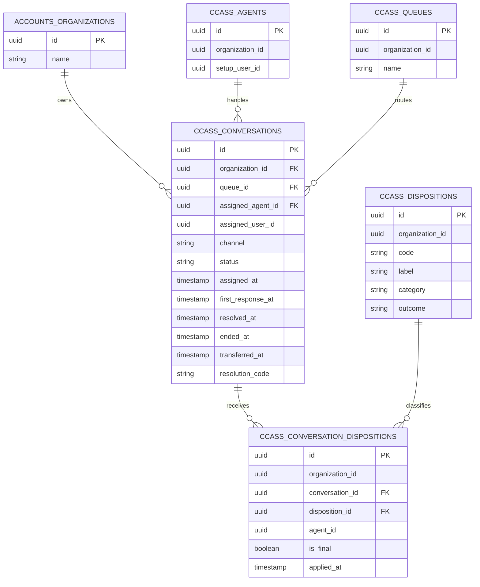
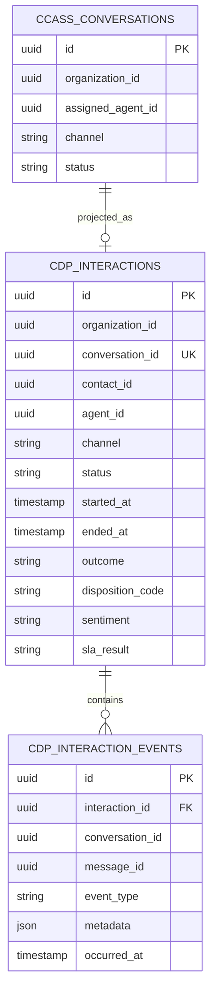
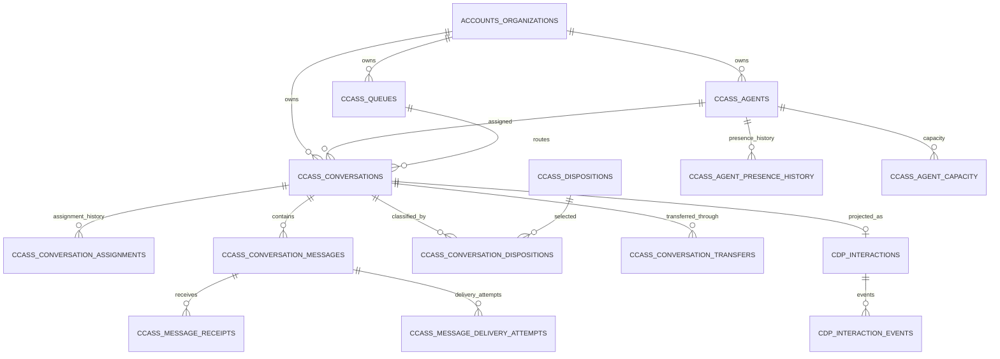

# Agent Performance Analytics — Tables and ERD

The My Performance analytics feature does not create additional database tables. It reads existing operational data, primarily from the `ccass` schema.

## Tables currently used

### `ccass.conversations`

This is the primary source for the My Performance page.

Important columns:

- `organization_id` — tenant isolation
- `assigned_user_id` — setup user responsible for the conversation
- `assigned_agent_id` — CCaaS agent responsible for the conversation
- `queue_id` — queue that routed the conversation
- `channel` — webchat, voice, email, WhatsApp, etc.
- `status` — active, resolved or closed
- `assigned_at` — time the conversation was assigned
- `first_response_at` — first agent response
- `resolved_at` — time the conversation was resolved
- `ended_at` — final interaction end time
- `transferred_at` — transfer timestamp
- `resolution_code` — saved resolution

Metrics calculated from this table:

- Handled conversations
- Resolution rate
- Average first-response time
- Average handle time
- 60-second response SLA
- Transfer count
- Daily handled volume
- Channel distribution

### `ccass.conversation_dispositions`

Links a completed conversation to the disposition selected by the agent.

Important columns:

- `organization_id`
- `conversation_id`
- `disposition_id`
- `agent_id`
- `applied_by_user_id`
- `resolution_code`
- `resolution_data`
- `is_final`
- `applied_at`

The analytics query selects the latest disposition for each conversation.

### `ccass.dispositions`

Tenant-specific disposition catalog.

Important columns:

- `organization_id`
- `code`
- `label`
- `description`
- `category`
- `outcome`
- `requires_note`
- `requires_resolution`
- `is_active`

Seeded examples include:

- Issue resolved
- Follow-up required
- Transferred to specialist
- Customer disconnected

## Current analytics ERD



## Current KPI formulas

### Handled conversations

Count conversations where:

```sql
status IN ('resolved', 'closed') OR ended_at IS NOT NULL
```

### Resolution rate

```text
resolved conversations / handled conversations × 100
```

### Average first-response time

```text
AVG(first_response_at - assigned_at)
```

### Average handle time

```text
AVG(COALESCE(resolved_at, ended_at) - assigned_at)
```

### Response SLA

Percentage of conversations where:

```text
first_response_at - assigned_at <= 60 seconds
```

This is currently a dashboard threshold and is not yet connected to tenant-specific SLA policies.

### Transfer count

Count conversations where:

```sql
transferred_at IS NOT NULL
```

### Channel mix

Conversations grouped by `ccass.conversations.channel`.

### Resolution outcomes

Completed conversations grouped by their latest disposition label.

## Existing tables available for expanded analytics

### Conversation lifecycle

#### `ccass.conversation_assignments`

Stores offer and assignment history:

- Offered
- Accepted
- Rejected
- Expired
- Ended

Potential analytics:

- Offer acceptance rate
- Offer rejection rate
- Offer timeout rate
- Assignment duration
- Conversations handled per agent

#### `ccass.conversation_transfers`

Stores transfer activity:

- Source queue and agent
- Destination queue
- Requested agent
- Transfer state
- Request, offer, acceptance and completion timestamps

Potential analytics:

- Transfer rate
- Transfer destination
- Transfer completion time
- Transfers sent and received per agent

#### `ccass.routing_attempts`

Stores routing attempts, candidate scores and skip reasons.

Potential analytics:

- Routing success rate
- Average attempts before assignment
- Agent skip reasons
- Queue routing efficiency

## Messaging analytics

### `ccass.conversation_messages`

Stores customer, bot, agent and system messages.

Potential analytics:

- Messages per conversation
- Agent and customer message volume
- Customer-to-agent response gaps
- Bot containment volume

### `ccass.message_receipts`

Stores sent, delivered and read timestamps.

Potential analytics:

- Delivery rate
- Read rate
- Delivery latency

### `ccass.message_delivery_attempts`

Stores delivery attempts and failures.

Potential analytics:

- Retry rate
- Delivery failure rate
- Provider reliability

## Agent availability analytics

### `ccass.agent_presence`

Stores the agent's current presence state.

### `ccass.agent_presence_history`

Stores presence transitions:

- Ready
- Busy
- Away
- Not ready
- After-contact work
- Offline

Potential analytics:

- Ready time
- Busy time
- Away time
- After-contact-work duration
- Occupancy percentage

### `ccass.agent_capacity`

Stores current channel concurrency:

- Maximum concurrency
- Reserved capacity
- Active capacity

Potential analytics:

- Concurrent workload
- Capacity utilization
- Peak agent occupancy

## Customer analytics projection

The `cdp` schema contains customer-centric projections generated from operational conversation events.

### `cdp.interactions`

Stores one projected customer interaction per conversation.

Important columns:

- `conversation_id`
- `contact_id`
- `visitor_id`
- `channel`
- `queue_id`
- `agent_id`
- `status`
- `started_at`
- `ended_at`
- `outcome`
- `summary`
- `topics`
- `sentiment`
- `disposition_code`
- `sla_result`

### `cdp.interaction_events`

Stores the chronological event stream for a projected interaction.

Important columns:

- `interaction_id`
- `conversation_id`
- `message_id`
- `event_type`
- `metadata`
- `occurred_at`

## CDP projection ERD



The relationship between `ccass.conversations` and `cdp.interactions` is logical through `conversation_id`; it is not enforced by a cross-schema foreign key.

## Full future analytics ERD



## Current limitations

### CSAT

CSAT is not currently available because there is no customer survey, rating table or capture API.

A future implementation would require a table such as:

```text
ccass.customer_satisfaction_responses
```

with conversation, agent, score, comment and submission timestamp.

### SLA policies

SLA schema tables exist, but the My Performance page currently uses a fixed 60-second first-response threshold. Tenant-specific SLA policy enforcement and historical SLA state are not yet connected to the dashboard.

### Sentiment

The `cdp.interactions.sentiment` column exists, but sentiment is not consistently projected for every interaction yet.

## Source files

- `apps/cc-core/src/routes/performance.ts`
- `packages/db-cc/prisma/migrations/conversations_and_nlp.sql`
- `packages/db-cc/prisma/migrations/phase1_conversation_lifecycle_v1.sql`
- `packages/db-cc/prisma/migrations/cdp_interactions.sql`
- `apps/cc-core/src/services/conversations.ts`
- `apps/cc-core/src/services/cdp-projection.ts`
