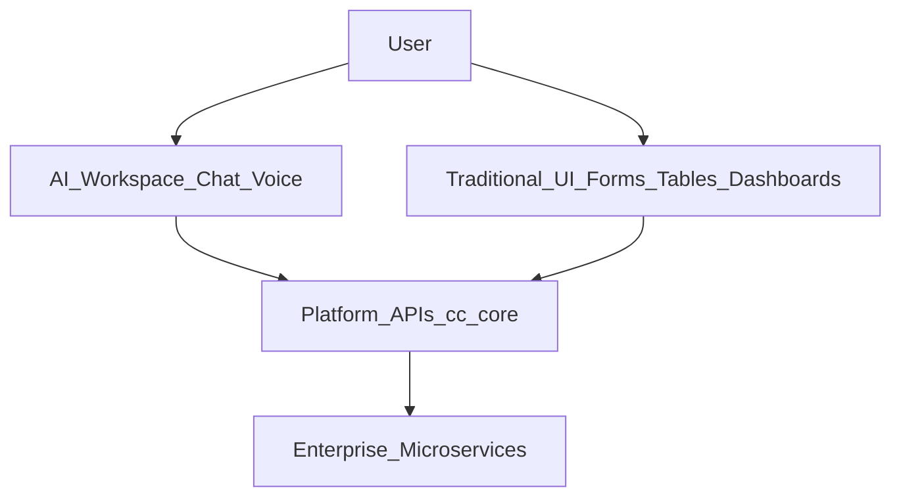
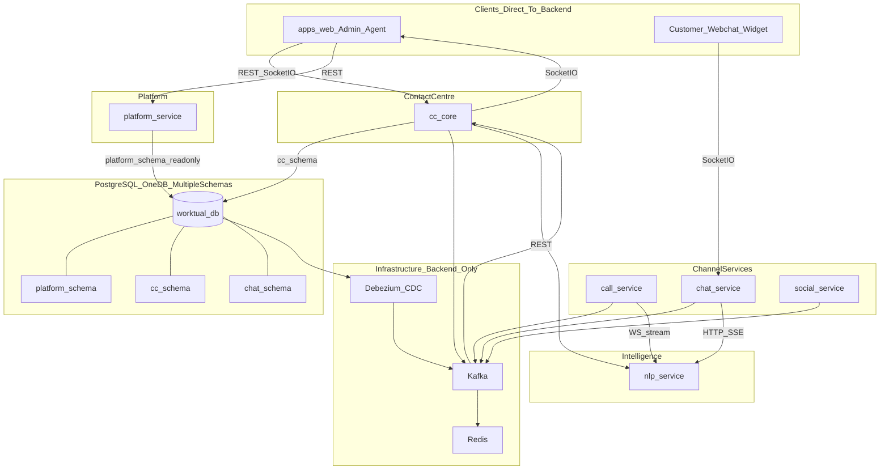
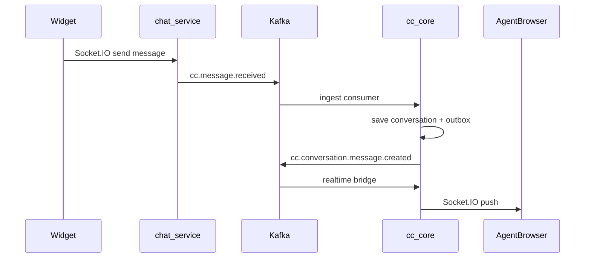

# Enterprise AI Contact Centre — Plan

> **Status:** Planning (not yet implemented)  
> **Repo:** `ai_contact_center_2`  
> **Related:** [CONTACT_CENTER_MY_UNDERSTANDING.md](./CONTACT_CENTER_MY_UNDERSTANDING.md) · [DESIGN_GUIDELINES.md](./DESIGN_GUIDELINES.md) · [brand assets](./brand/) · [layouts](./brand/LAYOUTS.md)

Build the **Worktual Contact Centre** as an independent spoke in the Enterprise AI Platform: microservices (`cc-core`, `platform-service`, `call`/`chat`/`social`, `nlp`), hybrid events (outbox + Kafka + Debezium CDC), Redis cache, Socket.IO UI, NLP REST/SSE/Kafka. Includes observability, resilience, security baseline, ADRs, and a golden-path spike. **Admin first → agent second → analytics last.**

---

## 1. Vision

- **Conversation-centric omnichannel** — voice, email, SMS, webchat, WhatsApp, social; channel is metadata, not separate apps
- **AI embedded silently** — summaries, suggested replies, bot responses inside workflow; no separate "AI page"
- **Configuration vs operations** — org/users/teams/hours/KB from Platform Services; CC owns conversations, queues, routing
- **Enterprise-grade** — multi-tenant, independently deployable microservices, event-driven, observable, horizontally scalable

**Reference docs (external):**

- Product vision and hub-and-spoke architecture (PDF)
- Contact Centre spoke scope (PDF)
- Admin/Agent portal modules (PDF)
- Technical stack: Ant Design + Tailwind, Fastify, Prisma, Kafka
- API contracts: [`../ai_contact_center/knowledge/`](../ai_contact_center/knowledge/) (v1 scaffold)

---

## 2. Contact Centre Portal Structure

### Design principles

- **Conversation-centric** — not channel-centric; one workspace for all channels
- **Configuration** owned by Platform Services; **operations** owned by Contact Centre
- **AI embedded** in workflows — no separate "AI module" navigation
- **Omnichannel** — Voice, Chat, Email, WhatsApp, SMS, Social (+ future channels)
- **Dual-role** — admins can operate as support agents via **My Workspace**
- **Hybrid UX** — AI Workspace (primary) + Traditional UI (forms/tables/dashboards) as complementary; users switch anytime
- **Simple navigation**, enterprise scalability

### Interaction model



Every business capability should be API-accessible (for AI intent execution). Traditional UI remains for precision, bulk ops, compliance, and user preference.

### Support Admin Portal (`/admin/*`) — Phase 1

| Module | Sub-pages / features | Phase |
|--------|----------------------|-------|
| **Dashboard** | Queue KPIs, active conversations, agent availability, SLA status, operational insights, AI operational insights | 1 |
| **Workforce Management** | Agents, Queues, Skills, Presence, Shift assignment | 1 |
| **My Workspace** | Same as agent workspace — admin acts as agent: My Queue, Assigned, Waiting, In Progress, Callbacks, Closed | 1 (basic), 2 (full) |
| **Live Monitoring** | Queue monitoring, agent monitoring, active conversations, SLA monitoring | 1 |
| **Reports & Analytics** | Saved reports, generate, scheduled, exports — queue/agent/SLA/channel/productivity/CSAT | 3 |

**WFM future:** capacity planning, workforce forecasting, queue balancing.

**Live monitoring future:** silent monitoring, whisper coaching, barge-in.

### Support Agent Portal (`/agent/*`) — Phase 2

| Module | Sub-pages / features | Phase |
|--------|----------------------|-------|
| **Agent Workspace** | Conversation views: My Queue, Assigned, Waiting, In Progress, Callbacks, Closed | 2 |
| **My Tasks** | Follow-ups, pending actions, escalations, scheduled callbacks, completed (many auto-created by AI) | 2 |
| **My Performance** | Today's KPIs, productivity, SLA compliance, CSAT, interaction summary | 3 |

**Performance future:** quality score, coaching, AI feedback, performance trends.

### Conversation workspace layout (shared admin My Workspace + agent)

Three-panel unified layout — channel is metadata, not separate apps:

```text
┌──────────────────┬────────────────────────────┬──────────────────┐
│ Conversation     │ Conversation Window        │ Customer 360     │
│ List             │ (messages, reply, AI       │ Panel            │
│ (filters/views)  │  assists inline)           │                  │
└──────────────────┴────────────────────────────┴──────────────────┘
```

**Customer 360 panel** (right side, not separate nav):

- Customer profile, timeline, internal notes, attachments
- Previous conversations
- CRM info, tickets, campaign history (fetched via APIs — not owned by CC)

**Channels in workspace:** Voice, Chat, Email, WhatsApp, SMS, Social, future channels.

### Embedded AI (in workspace, not a page)

- Conversation summary & wrap-up
- Suggested replies & next best action
- Intent detection & sentiment
- Language translation
- Auto classification & tagging
- Smart routing, knowledge suggestions, conversation priority

### Web app route map (high level)

```text
/admin/dashboard
/admin/workforce/{agents,queues,skills,presence,shifts}
/admin/workspace          # admin-as-agent
/admin/monitoring
/admin/reports            # Phase 3

/agent/workspace
/agent/tasks
/agent/performance        # Phase 3
```

---

## 3. Architecture overview



### Frontend connectivity rule (critical)

| From | To | Protocol | Allowed |
|------|-----|----------|---------|
| Admin/Agent UI | cc-core | REST + Socket.IO | **Yes** |
| Admin/Agent UI | platform-service | REST | **Yes** |
| Customer widget | chat-service | Socket.IO / REST | **Yes** |
| Any frontend | Kafka / Redis / nlp | — | **Never** (nlp via gateway only) |

---

## 4. Services and deployment

Each `apps/*` is an **independent Docker image** on its own server. Monorepo shares code via `packages/`.

| Service | Port (dev) | DB schema | Responsibility |
|---------|------------|-----------|----------------|
| **apps/web** | 5173 | — | Admin + Agent UI (Ant Design + Tailwind) |
| **cc-core** | 3000 | `cc` | Conversations, queues, routing, presence, SLA, Socket.IO gateway |
| **platform-service** | 3001 | `platform` (read-only role) | Org, users, teams, entitlements, channel config |
| **chat-service** | 3002 | `chat` (optional) | Email, SMS, webchat; customer widget Socket.IO |
| **call-service** | 3003 | `call` (optional) | Voice, voicebot |
| **social-service** | 3004 | `social` (optional) | WhatsApp, Instagram, Facebook |
| **nlp** | 8000 | — | LLM, summaries, intent, bot replies |

### Database strategy (DB architect decision)

**One PostgreSQL database, multiple schemas** — fixed. Logical product isolation via schema ownership, not separate databases.

```text
worktual_db (single PostgreSQL database)
├── platform/     # My Account — users, teams, org, hours, entitlements, channels
├── cc/           # Contact Centre — conversations, queues, routing, presence, outbox
├── chat/         # chat-service provider state (optional, Phase 2)
├── call/         # call-service (optional, Phase 2)
└── social/       # social-service (optional, Phase 2)
```

**Mandatory rules (even within one DB):**

| Rule | Implementation |
|------|----------------|
| Schema ownership | Each service writes **only** to its schema |
| No cross-schema queries | cc-core never `JOIN platform.users` — use platform-service REST |
| Per-service DB roles | `cc_app` → `cc` only; `platform_app` → `platform` read-only; no superuser in apps |
| Migrations | Per-schema Prisma migrations in `packages/db-cc`, `packages/db-platform` (same `DATABASE_URL`, different `schemas`) |
| Multi-tenant | `tenant_id` on every business table in every schema |
| CDC | Debezium watches `platform` schema tables → Kafka |

Services remain independently deployable; only the **datastore is shared** at the PostgreSQL instance level.

---

## 5. Monorepo folder structure

```text
ai_contact_center_2/
├── apps/
│   ├── web/
│   ├── cc-core/
│   ├── platform-service/
│   ├── chat-service/
│   ├── call-service/
│   ├── social-service/
│   └── nlp/
│
├── packages/
│   ├── db-cc/                    # Prisma — cc schema only
│   ├── db-platform/              # Prisma — platform schema only
│   ├── shared-types/
│   ├── event-contracts/          # Zod schemas, AsyncAPI spec
│   ├── platform-client/
│   ├── observability/            # pino, trace_id, OpenTelemetry
│   └── config/
│
├── docs/
│   ├── AI_CONTACT_CENTER_PLAN.md # this file
│   ├── DESIGN_GUIDELINES.md
│   ├── brand/
│   ├── adr/
│   └── golden-path/
│
├── docker/
│   ├── docker-compose.yml
│   └── Dockerfile.*
├── turbo.json
└── package.json
```

**No new microservices in Phase 0.** Structure is a starting point — refine folders as we build.

Each backend service imports `@ai-contact-center/observability` for consistent logging and tracing.

### Frontend — `apps/web/src/`

```text
src/
├── main.tsx      # Vite entry → App
├── app/          # App.tsx, providers (Redux, Query, Ant Design), theme
├── routes/       # router config only (createBrowserRouter)
├── layouts/      # AppLayout (role-aware shell)
├── pages/        # auth/, admin/, agent/ screen components
├── features/     # domain modules (e.g. workforce/queues)
├── components/   # shared UI (brand, etc.)
├── hooks/        # useAuth, typed Redux hooks
├── services/     # axios clients (cc-core, platform), socket.io
├── store/        # Redux Toolkit (auth, …)
├── types/
├── utils/
└── config/       # navigation, env
```

### Backend — each Node service `apps/<service>/src/`

```text
src/
├── index.ts
├── config/
├── plugins/      # fastify, prisma, redis, kafka, swagger, socket.io
├── middleware/   # auth, tenant, errors
├── routes/
├── controllers/
├── services/
├── repositories/
├── schemas/      # Zod validation
├── workers/      # outbox, kafka consumers, jobs
├── events/
└── utils/
```

**Service-specific additions:**

- `cc-core` — `realtime/` (Socket.IO), internal ingest routes
- `platform-service` — read-only repos against `platform` schema
- `chat/call/social-service` — `providers/` (Twilio, Meta, etc.)
- `nlp` — Python FastAPI under `src/app/` (copy from v1)

---

## 6. Observability

| Layer | Tool | Phase | Notes |
|-------|------|-------|-------|
| Structured logging | `pino` via `packages/observability` | 0 | Every log includes `trace_id`, `tenant_id`, `service` |
| Distributed tracing | OpenTelemetry → Jaeger/Tempo (dev) | 0 hooks, 1 full | Propagate trace context across HTTP + Kafka |
| Metrics | Prometheus + Grafana | 1 | Request latency, Kafka lag, Socket.IO connections, queue depth |
| Error tracking | Sentry | 1 | Frontend + all Node services |
| Health checks | `/health`, `/health/ready` per service | 0 | DB, Redis, Kafka connectivity |

**Correlation rule:** `trace_id` generated at API gateway or first service; passed via HTTP headers (`traceparent`) and Kafka message headers.

---

## 7. Security baseline

| Control | Phase | Implementation |
|---------|-------|----------------|
| JWT validation | 0 | All services; extract `tenant_id` + `user_id` |
| Tenant isolation | 0 | Every DB query scoped by `tenant_id` |
| HTTPS | 0 | TLS in production; HTTP dev only |
| Secrets management | 0 | Env vars / vault; never in code |
| Audit log | 0 | `AuditLog` model in cc-core |
| Per-service DB roles | 0 | `cc_app` → `cc` schema only; `platform_app` → `platform` read-only |
| PII tagging | 1 | Mark `customer_ref`, message body fields; mask in logs |
| Encryption at rest | 1 | PostgreSQL + Redis provider-level encryption in production |
| GDPR/CCPA controls | 2+ | Data retention, export/delete when required |
| Consent management | 2+ | Via platform-service / CDP integration |

---

## 8. Resilience and operations

| Concern | Phase | Implementation |
|---------|-------|----------------|
| Transactional outbox | 0 | DB + outbox same transaction; publisher replays on restart |
| Kafka DLQ | 0 | Failed consumers → `*.dlq` topics; alert on DLQ depth |
| Consumer retries | 0 | Exponential backoff (3 attempts) before DLQ |
| Circuit breaker | 1 | `opossum` on calls to platform-service, nlp |
| HTTP retries | 0 | Idempotent GETs; bounded retries with backoff |
| Socket.IO reconnect | 1 | Built-in client reconnect |
| DB migrations | 0 | Prisma migrate; versioned, reversible where possible |
| Backup/restore | 0 | `pg_dump` script in docker/ |
| Backpressure | 1 | Kafka consumer pause on lag threshold |

**Deferred (Phase 3+):** Temporal/Cadence; chaos testing; multi-region.

---

## 9. Event-driven architecture (enterprise hybrid)

### Three patterns

| Pattern | Use for |
|---------|---------|
| **Transactional outbox → Kafka** | cc-core + channel service writes |
| **Debezium CDC → Kafka** | `platform` schema changes (Phase 2.5) |
| **Kafka consumer → Redis + Socket.IO** | Cache refresh + UI push |

### Normalized inbound message contract

Defined in `packages/event-contracts` — every channel service MUST produce this shape:

```typescript
interface InboundMessageEvent {
  schema_version: "1.0";
  event_id: string;
  tenant_id: string;
  channel_type: "webchat" | "email" | "sms" | "voice" | "whatsapp" | "instagram" | "facebook";
  external_thread_id: string;
  external_message_id: string;
  customer_ref: string;
  direction: "inbound" | "outbound";
  body: string;
  attachments?: Array<{ url: string; mime_type: string }>;
  metadata?: Record<string, unknown>;
  occurred_at: string; // ISO 8601
}
```

### Kafka topics (initial)

| Topic | Publisher | Consumers |
|-------|-----------|-----------|
| `cc.conversation.created` | cc-core | cache, realtime, routing |
| `cc.message.received` | chat/call/social | cc-core ingest |
| `cc.conversation.message.created` | cc-core | cache, realtime, nlp-worker |
| `cc.conversation.assigned` | cc-core | cache, realtime, notifications |
| `cc.agent.presence.changed` | cc-core | redis, realtime |
| `cc.queue.stats.updated` | cc-core | redis, dashboard |
| `cc.sla.breached` | cc-core | notifications, admin alerts |
| `nlp.enrichment.completed` | nlp-worker | cc-core, realtime |
| `cdc.platform.*` | Debezium | platform cache worker |
| `*.dlq` | failed consumers | alerting, manual replay |

---

## 10. NLP / chatbot integration

| Use case | Transport | Path |
|----------|-----------|------|
| Customer bot (streaming) | HTTP SSE | Widget → chat-service → nlp → tokens back |
| Customer bot (FAQ) | REST | chat-service → nlp |
| Agent assist | REST | UI → cc-core → nlp |
| Async enrichment | Kafka | cc-core → nlp-worker → `nlp.enrichment.completed` |
| Voicebot live | WebSocket stream | call-service ↔ nlp |

**Never:** Kafka in live chatbot turn path.

---

## 11. Realtime / Socket.IO ownership

| Connection | Owner | Rooms |
|------------|-------|-------|
| Agent inbox, admin monitoring | cc-core | `tenant:{id}`, `agent:{id}`, `conversation:{id}` |
| Customer webchat widget | chat-service | `session:{webchatSessionId}` |

Use `@socket.io/redis-adapter` for multi-instance cc-core.

---

## 12. Testing strategy (phased)

| Type | Phase | Tool |
|------|-------|------|
| Unit tests | 0 | Vitest (Node), pytest (nlp) |
| API integration tests | 0 | Supertest / Fastify inject |
| Event schema validation | 0 | Zod parse tests in event-contracts |
| Golden path E2E | 0 | Documented spike: webchat → agent Socket.IO |
| Contract tests | 2 | Pact: chat-service ↔ cc-core |
| E2E UI tests | 2 | Playwright |
| Load tests | 2 | k6 on ingest + Socket.IO |
| Chaos testing | 3+ | Kafka/Redis failure injection |

---

## 13. Architecture Decision Records (ADRs)

Store in `docs/adr/`. Create in Phase 0:

| ADR | Decision |
|-----|----------|
| ADR-001 | Monorepo + independent deployables per service |
| ADR-002 | Hybrid events: outbox + CDC + Kafka |
| ADR-003 | platform-service reads `platform` schema (interim; swap to MA HTTP API later) |
| ADR-004 | Socket.IO for UI realtime; Kafka backend-only |
| ADR-005 | Normalized inbound message contract for all channel services |
| ADR-006 | Ant Design + Tailwind per technical stack recommendation |
| ADR-007 | One PostgreSQL database, multiple schemas; per-service DB roles |
| ADR-008 | Portal structure per product docs; three-panel conversation workspace |

---

## 14. Golden path spike (Phase 0)

Prove architecture before full admin UI. Document in `docs/golden-path/webchat-to-agent.md`:



---

## 15. cc-core data model (Prisma)

All models include `tenant_id`.

| Entity | Purpose |
|--------|---------|
| `Conversation` | Core object; `channel_type`, `status`, `customer_ref`, `assigned_agent_id` |
| `ConversationMessage` | Canonical messages |
| `Queue` | Routing queue; `platform_team_id` ref |
| `QueueMember` | Agent membership |
| `RoutingRule` | channel/skill → queue/agent |
| `AgentPresence` | online/away/busy, capacity |
| `AgentSkill` | skill tags |
| `CallSession` | voice ref |
| `SlaPolicy` | proactive alert thresholds |
| `OutboxEvent` | transactional outbox |
| `AuditLog` | who did what, when, on which conversation/config |
| `AgentTask` | follow-ups, callbacks, escalations (My Tasks) |
| `ChannelBinding` | tenant channel config → channel service endpoint |

---

## 16. Tech stack

| Layer | Choice |
|-------|--------|
| Frontend | React, TS, Vite, Redux Toolkit, TanStack Query, React Router, Ant Design, Tailwind, Axios, Socket.IO Client, React Hook Form, Zod, Recharts (phase 3) |
| Backend | Node.js LTS, Fastify, TS, Prisma, Zod, `@fastify/swagger` |
| Observability | pino, OpenTelemetry, Prometheus, Sentry, Jaeger/Tempo (dev) |
| NLP | Python FastAPI, LangChain |
| Data | PostgreSQL (`worktual_db`), Redis, BullMQ |
| Events | Kafka (KRaft), Debezium CDC |
| Realtime | Socket.IO + Redis adapter |
| Auth | JWT |
| Deploy | Docker per service; API Gateway later |

---

## 17. Phased delivery

### Phase 0 — Foundation

- [ ] Monorepo scaffold (all apps + packages including `observability`)
- [ ] Docker Compose: postgres (`worktual_db`), redis, kafka
- [ ] `packages/observability`: pino, trace_id, OpenTelemetry hooks
- [ ] `packages/event-contracts`: Zod schemas, normalized message contract, AsyncAPI stub
- [ ] `docs/adr/`: first 6 ADRs
- [ ] cc-core: Prisma, outbox, AuditLog, Socket.IO skeleton, JWT tenant middleware
- [ ] platform-service: `platform` schema read + Redis TTL cache
- [ ] Kafka: producers, consumers, DLQ topics, retry policy
- [ ] Outbox publisher + cache worker + realtime bridge
- [ ] Copy nlp from v1
- [ ] Channel services: health + Kafka subscriber stubs
- [ ] **Golden path spike** documented and working
- [ ] pg_dump backup script

### Phase 1 — Support Admin Portal

1. **Dashboard** — queue KPIs, active conversations, agent availability, SLA, AI insights
2. **Workforce Management** — agents, queues, skills, presence, shift assignment
3. **My Workspace (basic)** — admin-as-agent; conversation list + window layout
4. **Live Monitoring** — queue, agent, active conversations, SLA
5. OpenTelemetry, Sentry, circuit breakers, PII masking

### Phase 2 — Support Agent Portal + channels + NLP

1. **Agent Workspace (full)** — three-panel layout + Customer 360
2. **My Tasks** — follow-ups, escalations, callbacks
3. Embedded AI in workspace
4. chat-service: webchat + email; NLP SSE bot + REST assist
5. NLP Kafka async worker; call-service + social-service
6. Pact contract tests (chat ↔ cc-core)

### Phase 2.5 — Platform CDC

- Debezium on `platform` schema → Kafka → Redis cache refresh

### Phase 3 — Reports, Analytics & My Performance (last)

- Reports & Analytics — saved/generate/scheduled/export
- My Performance — KPIs, productivity, SLA, CSAT
- Recharts dashboards; Kafka analytics sink; BullMQ exports

### Deferred

- Temporal/Cadence for workflow orchestration
- Multi-region / data residency
- Chaos engineering
- Full GDPR/CCPA compliance tooling

---

## 18. Anti-patterns

| Avoid | Do instead |
|-------|------------|
| Frontend → Kafka / Redis / nlp | Frontend → cc-core / chat-service / platform-service |
| cc-core querying `platform` schema | platform-service REST |
| Kafka in live chatbot path | SSE/REST hot path |
| Channel services writing cc-core DB | Kafka ingest API |
| Logging PII in plain text | Mask customer_ref, message body in logs |
| Three separate observability packages | One `packages/observability` |

---

## 19. Success criteria

- Each microservice deploys independently on its own server
- Every request/event traceable via `trace_id` + `tenant_id`
- Failed Kafka messages land in DLQ with alerts
- Golden path (webchat → agent) works end-to-end in Phase 0
- Conversation is central object; channel is metadata
- outbox/CDC → Kafka → Redis + Socket.IO UI
- Platform config via platform-service; swappable to MA HTTP API
- Admin first, agent second, analytics last
- ADRs document key architectural decisions

---

## 20. Copy from ai_contact_center v1

| From v1 | Action |
|---------|--------|
| `apps/nlp/` | Copy as-is |
| `knowledge/` | Copy as platform-service API contract reference |
| Nav structure | Adapt to Ant Design layouts |
| Queues domain logic | Port to cc-core + Prisma |
| Brand logo | Already in [`docs/brand/worktual-logo.png`](./brand/worktual-logo.png) |
| Express, raw pg, shadcn UI | Do not copy |
