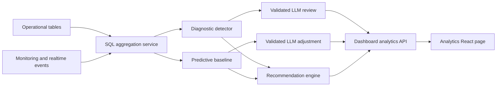
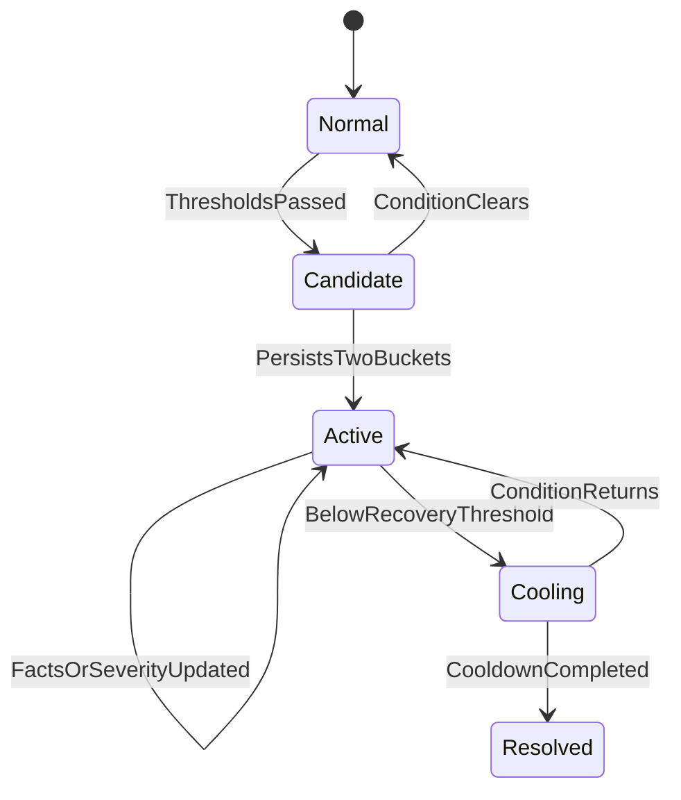

# Dynamic Dashboard Analytics Plan

## Overview

The current admin Analytics page renders Diagnostic, Predictive, and Prescriptive sections from the hardcoded `MOCK` object in:

- `apps/web/src/pages/admin/DashboardAnalyticsPage.tsx`
- `apps/web/src/components/dashboard/dashboard-analytics-panel.tsx`

V1 will keep the existing layout and replace the mock with one versioned, tenant-scoped analytics response.



Core principles:

- Algorithms own counts, rates, comparisons, forecast baselines, severity, and action eligibility.
- The LLM receives compact aggregate facts only—never raw conversations or customer PII.
- The LLM explains, deduplicates narratives, applies bounded forecast adjustments, and ranks allowlisted actions.
- No LLM call occurs for every missed contact or page load.
- Rule-based fallbacks keep analytics available when the LLM fails.
- V1 excludes SLA because active policy and historical SLA-state coverage are not guaranteed.

### Shared LLM structured-output contract

Every LLM task uses a dedicated, versioned JSON Schema/Pydantic response model so output shape remains consistent.

- Add `DiagnosticReviewResponse`, `ForecastAdjustmentResponse`, and `WorkforcePlanResponse` under `apps/nlp/src/app/schemas/dashboard_analytics.py`.
- Use provider-native structured output/JSON Schema when available, followed by Pydantic validation.
- Use low randomness (`temperature` 0–0.1), stable system prompts, and explicit prompt versions.
- Set `additionalProperties: false`, require expected fields, and use nullable fields where necessary.
- Use enums for task, decision, severity, risk, priority, action keys, evidence IDs, and reason codes.
- Sort queue/channel/agent arrays before hashing and prompting.
- Backend code—not the LLM—provides IDs, timestamps, numeric facts, routes, and staffing limits.
- Require JSON only, with no Markdown or prose wrapper.
- Validate selected IDs/actions against request-specific allowlists.
- Attempt at most one schema-repair call; then use deterministic fallback output.
- Store schema version, prompt version, input hash, model, validation result, and output source.
- Add fixture-based contract tests and schema snapshots.

Common request envelope:

```json
{
  "schemaVersion": 1,
  "promptVersion": "dashboard-analytics-v1",
  "task": "review_diagnostic_candidate",
  "inputHash": "sha256:...",
  "facts": {},
  "allowlists": {}
}
```

Common response envelope:

```json
{
  "schemaVersion": 1,
  "task": "review_diagnostic_candidate",
  "decision": "update",
  "payload": {},
  "warnings": []
}
```

`payload` uses a different strict schema for each task; it is not implemented as an untyped free-form object.

Primary data:

- `ccass.conversations`
- `ccass.agent_missed_contacts`
- `ccass.routing_attempts`
- `ccass.conversation_assignments`
- `ccass.agent_presence`
- `ccass.agent_presence_history`
- `ccass.agent_tasks`
- `ccass.proactive_callback_attempts`
- Queue, channel, business-hours, and capacity configuration

### Database design

Existing operational tables are enough for calculations, but production V1 needs persistence for incident history, daily forecast caching, LLM deduplication, workforce-plan comparison, and audit. Direct calculation alone would repeat LLM calls after restarts and could not reliably return `no_change`.

Add an idempotent migration such as `packages/db-cc/prisma/migrations/dashboard_analytics_v1.sql`, register it in the migration manifest, and update `packages/db-cc/prisma/schema.prisma`.

Minimum new tables:

1. `ccass.dashboard_analytics_incidents`
   - Identity: `id`, `organization_id`, `fingerprint`, `incident_type`.
   - Lifecycle: `status`, `severity`, `version`, first/last detected and resolved timestamps.
   - Facts: `scope_json`, `current_facts_json`, `baseline_facts_json`.
   - Narrative/audit: headline, summary, source, schema/prompt version, model, input hash.
   - Unique `(organization_id, fingerprint)`.

2. `ccass.dashboard_analytics_forecast_runs`
   - Organization, forecast date, history days, horizon, method, and status.
   - Input hash, baseline, LLM adjustment, final forecast, and summary JSON.
   - Schema/prompt/model/validation metadata and timestamps.
   - Unique `(organization_id, forecast_date, input_hash)`.

3. `ccass.dashboard_analytics_workforce_plans`
   - Organization, forecast run, plan date, previous plan.
   - Input signature, plan fingerprint, decision, and review/application status.
   - Validated queue/member plan JSON and model metadata.
   - Reviewer/application timestamps.
   - Unique `(organization_id, plan_date, input_signature)`.

V1 keeps forecast points and queue/member details in validated JSONB. Normalize them into point/item tables later if query volume requires it, without changing the API.

Safeguards:

- Follow existing organization RLS/tenant conventions.
- Persist aggregates only; avoid customer messages and unnecessary PII.
- Retain audit history with safe foreign-key delete behavior.
- Index incident status/severity, forecast date, plan date/status, and hashes.
- Review query plans and add time indexes where needed, especially `conversations (organization_id, created_at)` and `agent_missed_contacts (organization_id, missed_at)`.
- Define an analytics retention policy.

Implementation:

- Add `GET /api/v1/dashboard/analytics` under `apps/cc-core/src/routes/dashboard.ts`.
- Add `apps/cc-core/src/services/dashboard-analytics.ts`.
- Reuse period/reporting logic from `apps/cc-core/src/services/reporting.ts`.
- Add `apps/web/src/features/dashboard/analytics-api.ts`.
- Make `DashboardAnalyticsPage.tsx` own period, loading, selected incident, refresh, and actions.
- Convert `dashboard-analytics-panel.tsx` to props-driven rendering.
- Follow the structured NLP/fallback pattern used by `agent-attention-insight.ts` and `apps/nlp/src/app/api/supervisor.py`.

---

## 1. Diagnostic Analytics

### Types covered

1. Missed-contact spike by channel, queue, hour, and reason.
2. Inbound/handled-volume spike or drop.
3. Queue-wait increase and live backlog.
4. Routing failures: no Ready agents, capacity exhausted, no matching skill, no shift coverage, outside business hours, routing exhausted.
5. Assignment rejection/expiry increase.
6. Ready-agent coverage decline.
7. AHT or first-response-time increase.
8. Callback backlog and unrecovered missed contacts.

The first end-to-end implementation is **Missed-contact spike**.

### Aggregation and algorithms

Missed-contact facts:

- Aggregate into 15-minute buckets by organization, channel, and queue.
- Track `missedEventCount` and `uniqueMissedConversations`.
- Define `agentDemandConversations` as distinct conversations entering a live-agent queue.
- Calculate:

```text
missedContactRate =
  uniqueMissedConversations / agentDemandConversations × 100
```

- Guard zero denominators.
- Track later connection, callback assignment/completion, and unrecovered contacts separately.

Baseline:

- Matching weekday and 15-minute slots from the previous 56 days.
- Median and MAD for robust comparison.
- EWMA for recent direction and drift.

Initial incident gates:

- At least 5 unique missed conversations.
- At least +5 percentage-point increase.
- At least 1.5× the baseline.
- MAD robust z-score ≥ 3.
- Persists for two consecutive buckets.

These are starting thresholds and must be tuned through backtesting.



One incident is fingerprinted by organization, type, channel, queue, and top driver. New missed events update its facts/version instead of generating repeated analyses.

### LLM invocation

- No algorithmic candidate: no LLM call.
- New incident: one LLM call.
- Severity or top driver changes: one new LLM call.
- Minor numeric movement: update facts and reuse the cached narrative.
- Copilot explanation: call on demand.

`no_change` means reuse the narrative; numeric facts still refresh.

### Sample LLM input

```json
{
  "schemaVersion": 1,
  "task": "review_diagnostic_candidate",
  "candidate": {
    "fingerprint": "missed_contact:1000:whatsapp:42:no_agent_available",
    "incidentType": "missed_contact_spike",
    "severity": "high",
    "persistenceBuckets": 3,
    "detectorReasons": [
      "minimum_count_passed",
      "rate_delta_passed",
      "robust_z_score_passed",
      "persistence_passed"
    ]
  },
  "previousIncident": {
    "version": 2,
    "severity": "medium",
    "headline": "Missed contacts elevated in WhatsApp Support",
    "topDriver": "offer_timeout",
    "missedContactRate": 10.4,
    "uniqueMissedConversations": 8
  },
  "currentFacts": {
    "window": "2026-08-27T14:00:00Z/2026-08-27T15:00:00Z",
    "channel": "whatsapp",
    "queueId": "42",
    "queueName": "WhatsApp Support",
    "agentDemandConversations": 80,
    "uniqueMissedConversations": 14,
    "missedEventCount": 19,
    "missedContactRate": 17.5,
    "readyAgentsAverage": 3,
    "oldestWaitSeconds": 380,
    "drivers": [
      { "key": "no_agent_available", "count": 8, "share": 57.1 },
      { "key": "offer_timeout", "count": 4, "share": 28.6 },
      { "key": "routing_exhausted", "count": 2, "share": 14.3 }
    ]
  },
  "baselineFacts": {
    "lookbackDays": 56,
    "missedContactRate": 6.8,
    "readyAgentsAverage": 6,
    "oldestWaitSeconds": 145,
    "robustZScore": 3.7
  },
  "allowedEvidenceIds": [
    "rate_delta",
    "top_driver",
    "ready_coverage",
    "oldest_wait"
  ],
  "allowedRecommendationKeys": [
    "increase_ready_coverage",
    "review_offer_timeout",
    "configure_overflow",
    "assign_callbacks"
  ]
}
```

Prompt rules:

```text
Review a deterministic contact-center diagnostic candidate.
Use only supplied facts; never calculate or invent metrics.
The detector owns incident existence, severity, and numbers.
Compare previousIncident with currentFacts.
Return update or no_change.
Use only allowlisted evidence IDs and recommendation keys.
Do not claim causation; describe concentration or association.
Return strict JSON only.
```

### Sample LLM output

```json
{
  "decision": "update",
  "sameIncident": true,
  "headline": "Missed contacts worsened in WhatsApp Support",
  "summary": "The missed-contact rate rose from the 6.8% baseline to 17.5%. The increase was concentrated in no-agent-available events while Ready coverage was below its usual level.",
  "evidenceIds": [
    "rate_delta",
    "top_driver",
    "ready_coverage",
    "oldest_wait"
  ],
  "recommendationKeys": [
    "increase_ready_coverage",
    "assign_callbacks"
  ],
  "unsupportedClaims": []
}
```

### Final diagnostic output

```json
{
  "id": "missed_contact:1000:whatsapp:42:no_agent_available",
  "version": 3,
  "status": "active",
  "severity": "high",
  "metric": "Missed contact rate",
  "headline": "Missed contacts worsened in WhatsApp Support",
  "change": "+10.7 percentage points versus baseline",
  "summary": "The missed-contact rate rose from 6.8% to 17.5%. The increase was concentrated in no-agent-available events while Ready coverage was below its usual level.",
  "factors": [
    { "label": "No agents available", "value": 57.1 },
    { "label": "Offer timeout", "value": 28.6 },
    { "label": "Routing exhausted", "value": 14.3 }
  ],
  "evidence": [
    { "label": "Affected workload", "detail": "14 of 80 agent-demand conversations were missed" },
    { "label": "Ready coverage", "detail": "3 agents on average versus usual 6" },
    { "label": "Queue pressure", "detail": "Oldest wait 6m 20s versus baseline 2m 25s" }
  ],
  "source": "nlp"
}
```

Validation:

- Use strict Pydantic response schemas.
- Reject unknown IDs, numbers, evidence, actions, and unsupported claims.
- Use deterministic narrative templates on timeout/invalid output.
- Store incident version, input hash, model metadata, output source, and narrative.

---

## 2. Predictive Analytics

### Types covered

1. **Contact volume forecast**
   - Next 7 days, hourly.
   - Organization, channel, and queue.
   - Daily totals, peak hours/days, busiest channels and queues.

2. **Missed-contact risk**
   - Use predicted demand, recent misses, wait, and routing failures.
   - Initially show Low/Medium/High rather than an uncalibrated probability.

Deferred: callback-demand, transfer, sentiment, churn, AHT, and outcome forecasting.

### Aggregation and algorithms

Confirmed windows:

- History: **56 days**.
- Recent trend: last 7 days versus previous 7 days.
- Forecast: next **7 days**, hourly.
- Main run: once daily per organization.
- Intraday check: every 15 minutes; rerun only on material deviation.

Baseline:

- Aggregate inbound arrivals from `ccass.conversations.created_at`.
- Calculate 7×24 matching weekday/hour medians and dispersion.
- Calculate channel/queue shares by forecast hour.
- Sparse queues fall back to channel/org profiles.
- Produce the complete baseline before calling the LLM.

LLM adjustment:

- One call per organization per daily run.
- Return bounded multipliers, peak windows, risk labels, and narrative.
- Initial multiplier bounds: 0.75–1.25.
- Reconcile channel/queue totals with organization total.
- Fall back to the baseline on invalid output.

Token controls:

- Never send raw conversations or all 1,344 historical hourly rows.
- Send a 168-value weekday/hour profile.
- Send the last 14 daily totals.
- Send active-channel summaries.
- Send the top 10 queues plus `other`.
- Send compact AHT, Ready coverage, missed-contact, routing, and business-hours facts.
- Target ≤6,000 input and ≤2,000 output tokens.
- Cache by organization, date, and input hash.

### Sample LLM input

```json
{
  "schemaVersion": 1,
  "task": "adjust_seven_day_contact_forecast",
  "history": {
    "lookbackDays": 56,
    "recentDays": 7,
    "dailyTotalsLast14Days": [154, 168, 171, 160, 192, 110, 96, 162, 176, 181, 169, 205, 116, 101],
    "weekdayHourlyProfile": {
      "monday": [2, 1, 1, 1, 1, 2, 5, 9, 15, 18, 20, 22, 24, 25, 27, 29, 26, 22, 18, 14, 10, 7, 5, 3]
    }
  },
  "channels": [
    {
      "id": "whatsapp",
      "share": 0.41,
      "recentGrowthPct": 12.5,
      "avgHandleSeconds": 420
    }
  ],
  "queues": [
    {
      "id": "42",
      "name": "WhatsApp Support",
      "volumeShare": 0.28,
      "recentGrowthPct": 18,
      "expectedReadyAgents": 4,
      "recentMissedContactRate": 9.8,
      "topRoutingFailure": "no_ready_agents"
    }
  ],
  "baselineForecast": {
    "dailyTotals": [
      { "date": "2026-08-28", "value": 184 },
      { "date": "2026-08-29", "value": 121 }
    ],
    "candidatePeakWindows": [
      {
        "date": "2026-08-28",
        "startHour": 14,
        "endHour": 17,
        "queueId": "42",
        "baselineContacts": 78
      }
    ]
  },
  "allowedQueueIds": ["42"],
  "allowedEvidenceIds": [
    "recent_queue_growth",
    "weekday_peak_pattern",
    "forecast_demand_growth",
    "recent_no_agent_available"
  ],
  "multiplierBounds": { "minimum": 0.75, "maximum": 1.25 }
}
```

### Sample LLM output

```json
{
  "decision": "adjust",
  "confidence": "medium",
  "organizationDailyMultipliers": [
    { "date": "2026-08-28", "multiplier": 1.08 },
    { "date": "2026-08-29", "multiplier": 0.94 }
  ],
  "scopeAdjustments": [
    {
      "scopeType": "queue",
      "scopeId": "42",
      "date": "2026-08-28",
      "startHour": 14,
      "endHour": 17,
      "multiplier": 1.12,
      "evidenceIds": [
        "recent_queue_growth",
        "weekday_peak_pattern"
      ]
    }
  ],
  "peakWindows": [
    {
      "date": "2026-08-28",
      "startHour": 14,
      "endHour": 17,
      "scopeId": "42"
    }
  ],
  "riskLabels": [
    {
      "scopeId": "42",
      "risk": "high",
      "evidenceIds": [
        "forecast_demand_growth",
        "recent_no_agent_available"
      ]
    }
  ],
  "summary": "WhatsApp Support is likely to peak between 14:00 and 17:00 on Friday."
}
```

### Final predictive output

```json
{
  "forecastVersion": "volume-2026-08-27",
  "historyDays": 56,
  "horizon": "7d",
  "method": "seasonal_baseline_plus_llm_adjustment",
  "summary": {
    "expectedContacts": 1260,
    "peakDay": "2026-08-28",
    "peakHour": "14:00-15:00",
    "busiestChannel": "whatsapp",
    "busiestQueue": { "id": "42", "name": "WhatsApp Support" }
  },
  "volumeForecast": [
    {
      "bucketStart": "2026-08-28T14:00:00Z",
      "channel": "whatsapp",
      "queueId": "42",
      "low": 18,
      "expected": 26,
      "high": 35
    }
  ],
  "missedContactRisks": [
    {
      "bucketStart": "2026-08-28T14:00:00Z",
      "queueId": "42",
      "risk": "high",
      "evidence": [
        "Forecast demand exceeds expected staffed capacity",
        "Recent no-agent-available misses are elevated"
      ]
    }
  ]
}
```

Validation:

- Validate dates, IDs, evidence, bounds, and adjustment consistency.
- Apply exact hourly calculations after validation in backend code.
- Backtest using WAPE, MAE, and bias.
- Keep LLM adjustments only when they do not degrade baseline accuracy.
- Later replace the LLM adjustment with a trained model using 6–12 months while retaining the contract.

---

## 3. Prescriptive Analytics

Prescriptive analytics uses Diagnostic and Predictive outputs. It is not another unrestricted LLM opinion.

### Types covered

1. Daily AI workforce plan mapping eligible agents to queues/channels/hours.
2. Temporary Ready-coverage increase.
3. Overflow/routing review.
4. Offer-timeout review.
5. Callback assignment for unrecovered contacts.
6. Supervisor review for prolonged Not Ready coverage.
7. Queue prioritization for high forecast demand/current backlog.

### Recommendation algorithms

- Map incident type and driver to allowlisted action candidates.
- Combine severity, affected count, persistence, predicted demand, missed-contact risk, and the workforce gap calculated inside the Prescriptive engine.
- Remove unavailable actions.
- Rank by urgency, customer impact, confidence, and actionability.
- Deduplicate actions for the same queue/time window.

Workforce calculation:

```text
forecast workload seconds = expected contacts × historical AHT
required concurrent capacity = workload seconds / interval seconds
required agents = concurrent capacity / target occupancy
scheduled agents = expected Ready agents after shrinkage
shortfall = required agents - scheduled agents
```

- Voice can later use Erlang C.
- Chat accounts for concurrent-chat capacity.
- Email uses workload hours.
- Impact remains `not_calibrated` until supported by historical simulation.

LLM role:

- Receive allowlisted candidate actions and facts.
- Select eligible agents for queue assignment, order actions, and write concise rationale.
- Cannot invent agent/queue IDs, action types, routes, required staffing counts, or impact values.
- Rule-based ranking remains the authority/fallback.

### Daily workforce mapping and no-change handling

- Generate one workforce suggestion run per organization after the daily Predictive forecast.
- Calculate required member counts in the Prescriptive engine from forecast volume, AHT, occupancy, channel concurrency, shifts, and shrinkage.
- Pre-filter agents by active status, shift availability, queue/channel eligibility, skills, language, capacity, and conflicting assignments.
- Send only allowlisted queues and a compact eligible-agent list to the LLM.
- The LLM may map only eligible agent IDs and may not exceed `allowedAddCount`.
- Persist the forecast version, normalized input signature, plan fingerprint, generation time, and status.

Equal volume alone does not imply an equal workforce plan. Compare forecast demand, required members, current membership, eligible agents, shifts, skills, channels, capacity, and the previously accepted plan.

No-change flow:

1. Build a normalized `inputSignature`.
2. If it matches the previous effective plan, return `no_change` without calling the LLM and suppress a duplicate card.
3. If inputs changed materially, call the LLM with the previous plan and current eligible mapping.
4. The LLM may still return `no_change` when the existing mapping remains suitable.
5. Show a new card only for `decision: update`; keep previous plans in history.

### Sample LLM input

```json
{
  "schemaVersion": 1,
  "task": "build_daily_workforce_plan",
  "forecastDate": "2026-08-28",
  "forecastVersion": "volume-2026-08-27",
  "inputSignature": "sha256:current-signature",
  "previousPlan": {
    "planFingerprint": "sha256:previous-plan",
    "forecastDate": "2026-08-27",
    "queuePlans": [
      {
        "queueId": "42",
        "suggestedMemberCount": 7,
        "suggestedAgentIds": ["101", "102", "103"]
      }
    ]
  },
  "diagnostic": {
    "incidentId": "missed_contact:1000:whatsapp:42:no_agent_available",
    "severity": "high",
    "queueId": "42",
    "queueName": "WhatsApp Support",
    "topDriver": "no_agent_available",
    "uniqueMissedConversations": 14,
    "missedContactRate": 17.5,
    "readyAgentsAverage": 3,
    "baselineReadyAgents": 6,
    "unrecoveredMissedContacts": 9
  },
  "predictive": {
    "forecastWindow": "2026-08-28T14:00:00Z/2026-08-28T17:00:00Z",
    "expectedContacts": 78,
    "missedContactRisk": "high"
  },
  "queueRequirements": [
    {
      "queueId": "42",
      "queueName": "WhatsApp Support",
      "channel": "whatsapp",
      "window": "2026-08-28T14:00:00Z/2026-08-28T17:00:00Z",
      "expectedContacts": 78,
      "currentMemberCount": 4,
      "requiredMemberCount": 7,
      "allowedAddCount": 3,
      "currentMemberIds": ["201", "202", "203", "204"],
      "eligibleAgents": [
        {
          "agentId": "101",
          "displayName": "Agent A",
          "skills": ["billing", "whatsapp"],
          "channels": ["whatsapp", "webchat"],
          "shiftAvailable": true,
          "availableCapacity": 2
        },
        {
          "agentId": "102",
          "displayName": "Agent B",
          "skills": ["support", "whatsapp"],
          "channels": ["whatsapp"],
          "shiftAvailable": true,
          "availableCapacity": 1
        },
        {
          "agentId": "103",
          "displayName": "Agent C",
          "skills": ["billing"],
          "channels": ["whatsapp", "email"],
          "shiftAvailable": true,
          "availableCapacity": 1
        }
      ]
    }
  ],
  "allowedDecisions": ["update", "no_change"]
}
```

### Sample LLM output

```json
{
  "decision": "update",
  "sameAsPrevious": false,
  "planFingerprint": "sha256:new-plan",
  "forecastDate": "2026-08-28",
  "queuePlans": [
    {
      "queueId": "42",
      "queueName": "WhatsApp Support",
      "channel": "whatsapp",
      "window": "2026-08-28T14:00:00Z/2026-08-28T17:00:00Z",
      "priority": "high",
      "currentMemberCount": 4,
      "suggestedMemberCount": 7,
      "addAgents": [
        {
          "agentId": "101",
          "reasonCodes": ["channel_eligible", "skill_match", "shift_available"]
        },
        {
          "agentId": "102",
          "reasonCodes": ["channel_eligible", "skill_match", "shift_available"]
        },
        {
          "agentId": "103",
          "reasonCodes": ["channel_eligible", "skill_match", "shift_available"]
        }
      ],
      "removeAgents": [],
      "rationale": "Forecast workload requires seven agents while four are expected to be Ready.",
      "confidence": "medium"
    }
  ]
}
```

If the existing mapping is still suitable:

```json
{
  "decision": "no_change",
  "sameAsPrevious": true,
  "planFingerprint": "sha256:previous-plan",
  "reason": "Forecast demand and eligible workforce inputs remain within the configured tolerance."
}
```

### Final prescriptive output

```json
{
  "decision": "update",
  "planId": "workforce-plan-2026-08-28",
  "forecastVersion": "volume-2026-08-27",
  "recommendations": [
    {
      "key": "daily_queue_assignment",
      "priority": "high",
      "title": "Add three Ready agents to WhatsApp Support",
      "window": "2026-08-28T14:00:00Z/2026-08-28T17:00:00Z",
      "queue": {
        "id": "42",
        "name": "WhatsApp Support",
        "currentMemberCount": 4,
        "suggestedMemberCount": 7
      },
      "memberChanges": {
        "add": [
          { "agentId": "101", "displayName": "Agent A" },
          { "agentId": "102", "displayName": "Agent B" },
          { "agentId": "103", "displayName": "Agent C" }
        ],
        "remove": []
      },
      "rationale": "Forecast workload requires seven agents while four are expected to be Ready.",
      "impactStatus": "not_calibrated",
      "destination": {
        "type": "workforce_plan_review",
        "queueId": "42"
      }
    }
  ]
}
```

Safety:

- Validate actions and destinations against server allowlists.
- Clamp staffing numbers to the calculated shortfall.
- Validate every suggested agent against the eligible-agent allowlist, shift, skill, channel, and capacity snapshot.
- Reject duplicate agents, conflicting assignments, unknown queues, and changes above `allowedAddCount`.
- Never let the LLM execute actions directly.
- Require confirmation for staffing, routing, and callback mutations.
- Persist plan fingerprints and return `no_change` while the previous mapping remains valid.
- Render a queue-assignment card with current/suggested member counts. Clicking the count opens a member dialog showing current members and proposed additions/removals.
- Record action source, incident/forecast versions, previous plan, and outcomes.

---

## Update Frequency

- Live facts: socket-driven, debounced 5–10 seconds; fallback poll every 20–30 seconds.
- Diagnostic aggregates: every minute.
- Diagnostic LLM: new/material incident version or explicit request only.
- Predictive baseline and LLM: once daily per organization.
- Predictive deviation check: every 15 minutes.
- Prescriptive workforce plan: once daily after forecast; skip the LLM and suppress duplicate cards when the normalized input signature is unchanged.

## Delivery Order

1. Implement missed-contact Diagnostic end to end.
2. Replace Diagnostic mock UI.
3. Implement 56-day Predictive baseline and daily LLM adjustment.
4. Add missed-contact risk output.
5. Implement Prescriptive rules and validated LLM ranking.
6. Wire actions and Copilot context.
7. Backtest, tune thresholds, monitor tokens, and collect outcomes for future model training.

## UI Enhancement Checklist

- [ ] Improve visual hierarchy, spacing, typography, and card consistency across Diagnostic, Predictive, and Prescriptive sections.
- [ ] Add responsive desktop, tablet, and mobile layouts.
- [ ] Add date-range, incident-selection, severity, status, and last-updated controls.
- [ ] Add loading skeletons without layout shift.
- [ ] Add healthy, no-data, partial-data, stale-data, and error states.
- [ ] Improve actual-versus-forecast charts, legends, tooltips, confidence indicators, and accessible labels.
- [ ] Add Prescriptive queue cards showing current and suggested member counts.
- [ ] Add a member-detail dialog showing current members and proposed additions/removals.
- [ ] Show update/no-change state, forecast version, source, and confidence where useful.
- [ ] Require review and confirmation before any workforce or routing action.
- [ ] Preserve the existing Worktual design language and avoid regressions on Dashboard Reports, Monitoring, and Performance.
- [ ] Visually validate common viewport sizes and test keyboard/accessibility behavior.
