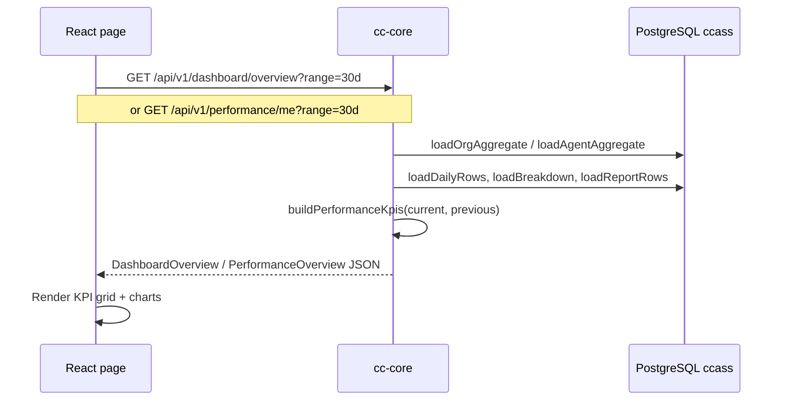
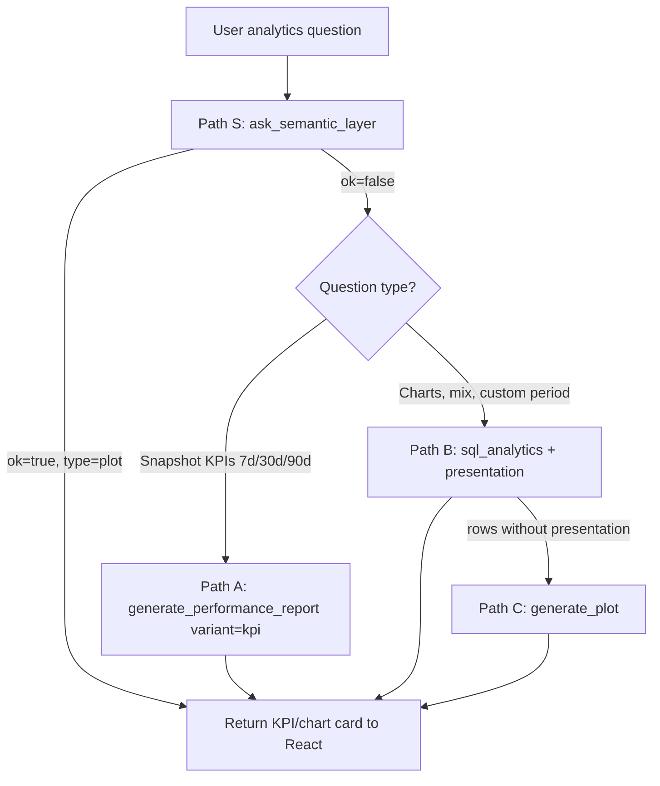

# Dashboard & Analytics Agent — KPI Cards

This document explains how KPI cards are generated in Worktual CCaaS, which tools and services are involved, the end-to-end workflow, sample response shapes, and how React renders them.

There are **two parallel paths** for KPI data:

| Path | User surface | Data source | React renderer |
|------|--------------|-------------|----------------|
| **A — Page dashboard** | Admin Dashboard (`/admin/dashboard`) or My Performance (`/agent/performance`) | `cc-core` REST API → PostgreSQL | `DashboardKpiCard` / `MetricCard` |
| **B — Copilot analytics agent** | Embedded copilot on dashboard or performance pages | NLP Analytics MCP tools → semantic layer or cc-core API | `PlotChartCard` / `PerformanceReportCard` |

Both paths ultimately read the same operational tables (`ccass.conversations`, dispositions, etc.). See [AGENT_PERFORMANCE_ANALYTICS_ERD.md](./AGENT_PERFORMANCE_ANALYTICS_ERD.md) for the data model.

---

## KPI definitions

Six core KPIs appear on agent and org dashboards. Admin dashboard adds two org-only tiles.

| KPI key | Label | Formula (conceptual) |
|---------|-------|----------------------|
| `handled` | Handled | Conversations completed in period (`resolved`, `closed`, or `ended_at` set) |
| `resolutionRate` | Resolution rate | `resolved / handled × 100` |
| `avgFirstResponseSeconds` | First response | Avg seconds from `assigned_at` → `first_response_at` |
| `avgHandleSeconds` | Handle time | Avg seconds from `assigned_at` → `resolved_at` or `ended_at` |
| `slaRate` | Response SLA | % of first responses within **60 seconds** of assignment |
| `transferred` | Transferred | Count where `transferred_at` is set |
| `resolved` *(dashboard only)* | Resolved | Count with `resolved_at` set |
| `totalAssigned` *(dashboard only)* | Total assigned | All conversations assigned in period |

Period-over-period change is computed for **handled** only (`handledChangePercent` vs the immediately prior window of equal length).

KPI computation lives in:

- `apps/cc-core/src/services/reporting.ts` → `buildPerformanceKpis()`
- Metric catalog for the analytics agent: `apps/nlp/src/app/skills/packs/performance-analytics/references/metrics.yaml`

---

## Path A — Page dashboard (REST → React)

### Architecture



### API endpoints

| Endpoint | Scope | Auth |
|----------|-------|------|
| `GET /api/v1/dashboard/overview` | Organization (optional `?agentId=` filter) | Admin |
| `GET /api/v1/dashboard/overview/report` | CSV export | Admin |
| `GET /api/v1/dashboard/overview/sql` | Read-only DQL for copilot | Admin |
| `GET /api/v1/performance/me` | Logged-in agent only | Agent |
| `GET /api/v1/performance/me/report` | CSV export | Agent |
| `GET /api/v1/performance/me/sql` | Read-only DQL for copilot | Agent |

Query params (mutually exclusive):

- Preset: `?range=today|7d|30d`
- Custom: `?start=YYYY-MM-DD&end=YYYY-MM-DD`

Route handlers:

- `apps/cc-core/src/routes/dashboard.ts`
- `apps/cc-core/src/routes/performance.ts`

### Sample API response

```json
{
  "range": "30d",
  "period": {
    "start": "2026-07-22T00:00:00.000Z",
    "end": "2026-08-21T00:00:00.000Z"
  },
  "agent": null,
  "kpis": {
    "handled": 248,
    "handledChangePercent": 12,
    "resolutionRate": 91,
    "avgFirstResponseSeconds": 42,
    "avgHandleSeconds": 384,
    "slaRate": 87,
    "transferred": 14,
    "totalAssigned": 265,
    "resolved": 226
  },
  "daily": [
    { "date": "2026-07-22", "handled": 8, "avgHandleSeconds": 360 },
    { "date": "2026-07-23", "handled": 11, "avgHandleSeconds": 402 }
  ],
  "channels": [
    { "label": "Webchat · AI", "value": 45, "channel": "Webchat", "handler": "ai" },
    { "label": "Webchat · Agent", "value": 82, "channel": "Webchat", "handler": "agent" }
  ],
  "dispositions": [
    { "label": "Issue resolved", "value": 180 },
    { "label": "Follow-up required", "value": 32 }
  ],
  "recent": [
    {
      "id": "123",
      "channel": "webchat",
      "status": "resolved",
      "subject": "Billing question",
      "assignedAt": "2026-08-20T14:22:00.000Z",
      "disposition": "Issue resolved"
    }
  ]
}
```

Agent `/performance/me` responses omit `agent`, `totalAssigned`, and org channel handler splits; channel rows are simple `{ label, value }`.

### React flow

**Admin dashboard**

| Layer | File |
|-------|------|
| Page shell + date range + fetch | `apps/web/src/pages/admin/DashboardPage.tsx` |
| API client + TypeScript types | `apps/web/src/features/dashboard/api.ts` |
| KPI grid + charts | `apps/web/src/components/dashboard/dashboard-overview-panel.tsx` |
| KPI tile component | `apps/web/src/components/dashboard/dashboard-charts.tsx` → `DashboardKpiCard` |
| Shared KPI shell styles | `apps/web/src/components/ui/kpi-card.tsx` |

**Agent My Performance**

| Layer | File |
|-------|------|
| Page + fetch | `apps/web/src/pages/performance/PerformancePage.tsx` |
| API client | `apps/web/src/features/performance/api.ts` |
| Inline `MetricCard` component | Same file (local, mirrors dashboard styling) |

**Typical render loop**

1. User picks date range via `PerformanceDateRangeControl`.
2. `useEffect` calls `dashboardApi.getOverview(selection)` or `performanceApi.getOverview(selection)`.
3. Response stored in `overview` state.
4. KPI grid maps `overview.kpis.*` into six (or eight) cards:

```tsx
<DashboardKpiCard
  label="Resolution rate"
  value={`${overview.kpis.resolutionRate}%`}
  caption="Resolved from handled"
  icon={CheckCircle2}
  iconClassName="bg-emerald-50 text-emerald-600"
/>
```

5. Charts consume `overview.daily`, `overview.channels`, `overview.dispositions`.

**Copilot period sync:** Both pages call `setPerformancePeriod()` from `copilot-page-context.tsx` so the embedded copilot uses the same date window for analytics queries.

---

## Path B — Copilot analytics agent (NLP tools → chat cards)

When a user asks the copilot *"What's my resolution rate?"* or *"Show org handled volume"*, the **Analytics specialist agent** (`apps/nlp/src/app/agents/coworker/analytics.py`) handles the request using MCP tools.

### Surface routing

The copilot sends a **page snapshot** with `surface: "dashboard" | "performance"` and the active date range. The analytics MCP server picks the correct cc-core path:

| Surface | Overview API | SQL API |
|---------|--------------|---------|
| `dashboard` | `/api/v1/dashboard/overview` | `/api/v1/dashboard/overview/sql` |
| `performance` | `/api/v1/performance/me` | `/api/v1/performance/me/sql` |

Logic: `AnalyticsMCPServer._analytics_overview_path()` in `apps/nlp/src/app/mcp/servers/analytics.py`.

### Analytics MCP tools

Registered on the `analytics` MCP server:

| Tool | Purpose |
|------|---------|
| `ask_semantic_layer` | **Mandatory first step** for KPI/metric questions. Calls external semantic metrics gateway; returns KPI or chart card, or signals fallback. |
| `generate_performance_report` | Fetches live overview from cc-core; returns KPI strip or full report card. Fallback after semantic layer fails. |
| `sql_analytics` | Runs one validated read-only `SELECT`/`WITH` against cc-core DQL endpoint. Used for charts, custom periods, breakdowns. |
| `generate_plot` | Builds a chart card from rows already fetched in the same turn (last-resort fallback). |

Supporting MCP servers:

| Server | Tools | Role |
|--------|-------|------|
| `metric` | `get_metric`, `get_metric_schema`, `list_active_metrics`, … | Loads metric definitions from `metrics.yaml` into agent context |
| `analytics` | (above) | Executes queries and shapes card payloads |

Skill pack workflow rules: `apps/nlp/src/app/skills/packs/performance-analytics/skill.yaml`  
Agent prompt (tool routing): `apps/nlp/src/app/prompts/analytics.py`

### Tool selection workflow



**Rules (enforced in prompt + skill):**

1. Never invent KPI numbers — only use tool result rows.
2. Always try `ask_semantic_layer` once before `generate_performance_report` or `sql_analytics` for predefined metrics.
3. Do not call `generate_performance_report` for channel mix, disposition mix, trends, or custom day windows.
4. SQL must be single-statement `SELECT`/`WITH` only; agent scope uses `assigned_user_id` (server-enforced).

### Sample tool responses

#### 1. Semantic layer — single KPI card

Returned when the gateway matches a predefined metric (e.g. resolution rate):

```json
{
  "ok": true,
  "source": "semantic_layer",
  "type": "plot",
  "title": "Resolution rate",
  "chartType": "kpi",
  "description": "What is my resolution rate for the last 30 days?",
  "data": [{ "label": "Resolution rate", "value": "91%" }],
  "kpis": [{ "label": "Resolution rate", "value": "91%" }],
  "rows": [{ "resolution_rate": 0.91 }],
  "grounded": true,
  "period": { "range": "30d", "start": "2026-07-22", "end": "2026-08-21" }
}
```

#### 2. Semantic layer — failure (triggers fallback)

```json
{
  "ok": false,
  "source": "semantic_layer",
  "fallback": "sql_analytics",
  "reason": "Semantic layer URL is not configured."
}
```

#### 3. `generate_performance_report` — KPI strip (`variant: "kpi"`)

```json
{
  "type": "plot",
  "title": "Resolution rate",
  "chartType": "kpi",
  "description": "Key metrics for the selected period.",
  "data": [
    { "label": "Resolution rate", "value": "91%" }
  ],
  "kpis": [
    { "label": "Resolution rate", "value": "91%" }
  ],
  "period": { "start": "2026-07-22T00:00:00.000Z", "end": "2026-08-21T00:00:00.000Z" },
  "range": "30d",
  "grounded": true
}
```

#### 4. `generate_performance_report` — full report (`variant: "report"`)

```json
{
  "type": "performance_report",
  "title": "Performance Report — 30D",
  "range": "30d",
  "period": { "start": "...", "end": "..." },
  "kpis": {
    "handled": 248,
    "handledChangePercent": 12,
    "resolutionRate": 91,
    "avgFirstResponseSeconds": 42,
    "avgHandleSeconds": 384,
    "slaRate": 87,
    "transferred": 14
  },
  "daily": [{ "date": "2026-07-22", "handled": 8, "avgHandleSeconds": 360 }],
  "channels": [{ "label": "webchat", "value": 82 }],
  "dispositions": [{ "label": "Issue resolved", "value": 180 }],
  "recent": [{ "id": "123", "channel": "webchat", "status": "resolved", "subject": "Billing", "assignedAt": "..." }]
}
```

#### 5. `sql_analytics` — chart with presentation

```json
{
  "type": "plot",
  "title": "Channel mix",
  "chartType": "pie",
  "description": "Assigned conversations by channel",
  "data": [
    { "label": "Webchat", "value": 82 },
    { "label": "Email", "value": 34 }
  ],
  "kpis": [],
  "grounded": true,
  "query_description": "Channel breakdown for last 30 days",
  "period": { "range": "30d", "start": "2026-07-22", "end": "2026-08-21" }
}
```

#### 6. `sql_analytics` — raw rows (no presentation)

```json
{
  "ok": true,
  "query_description": "Daily handled trend",
  "rowCount": 30,
  "columns": ["day", "handled"],
  "rows": [{ "day": "2026-07-22", "handled": 8 }],
  "period": { "range": "30d" }
}
```

Raw rows are **not** rendered as cards unless followed by `generate_plot` or a second call with `presentation`.

### Copilot SSE → React

1. User message streamed to NLP `/api/v1/copilot/...` (see `apps/web/src/features/assistant/assistant-api.ts`).
2. Agent invokes MCP tool; tool result appended as a **`kind: "tool"`** message in copilot chat state (`copilot-chat-session-slice`).
3. `CopilotMessageList` inspects tool name and result shape:

| Condition | React component |
|-----------|-----------------|
| `tool === "ask_semantic_layer"` \| `"generate_plot"` \| `result.type === "plot"` \| `result.chartType === "kpi"` | `PlotChartCard` |
| `tool === "generate_performance_report"` && `result.type === "performance_report"` | `PerformanceReportCard` |
| Multiple plots in `result.plots[]` | One `PlotChartCard` per plot |

Key files:

- `apps/web/src/components/assistant/copilot-message-list.tsx` — routing logic
- `apps/web/src/components/assistant/plot-chart-card.tsx` — KPI strip + pie/bar/line charts
- `apps/web/src/components/assistant/performance-report-card.tsx` — full report with KPI grid, charts, dispositions, recent list
- `apps/web/src/features/assistant/use-copilot-runner.ts` — streams turns, records tool messages

### How `PlotChartCard` renders KPIs

When `chartType === "kpi"` and `kpis[]` is populated:

- Each entry `{ label, value, change? }` becomes a themed tile.
- Icon/color chosen by label regex (`resolution` → green check, `sla` → amber target, etc.).
- Single-KPI cards use a one-column layout; multi-KPI uses a 2–3 column grid.

This mirrors the page dashboard visually but lives inside the chat thread.

### How `PerformanceReportCard` renders KPIs

Maps `report.kpis` object fields into six tiles (Handled, Resolution, Handle time, Response SLA, First response, Transferred), then optionally renders:

- Line chart from `report.daily`
- Pie chart from `report.channels`
- Disposition bars from `report.dispositions`
- Recent conversation list from `report.recent`

---

## End-to-end comparison

```text
┌─────────────────────────────────────────────────────────────────────────┐
│                         KPI CARD RENDERING                              │
├──────────────────────────────┬──────────────────────────────────────────┤
│ PATH A: Page dashboard       │ PATH B: Copilot analytics agent          │
├──────────────────────────────┼──────────────────────────────────────────┤
│ User opens dashboard page    │ User asks copilot a question             │
│         ↓                    │         ↓                                │
│ React fetch on mount         │ NLP coworker routes → analytics agent    │
│         ↓                    │         ↓                                │
│ cc-core reporting.ts         │ ask_semantic_layer (preferred)           │
│   loadAggregate + buildKpis  │   OR generate_performance_report         │
│         ↓                    │   OR sql_analytics + presentation        │
│ JSON overview response       │ Tool result JSON (plot / report)         │
│         ↓                    │         ↓                                │
│ DashboardKpiCard / MetricCard│ PlotChartCard / PerformanceReportCard    │
└──────────────────────────────┴──────────────────────────────────────────┘
                              │
                              ▼
                    ccass.conversations (+ dispositions)
```

---

## File index

| Area | Path |
|------|------|
| KPI SQL + aggregation | `apps/cc-core/src/services/reporting.ts` |
| Attribution rules | `apps/cc-core/src/services/reporting-attribution.ts` |
| Dashboard routes | `apps/cc-core/src/routes/dashboard.ts` |
| Agent performance routes | `apps/cc-core/src/routes/performance.ts` |
| DQL guard for copilot SQL | `apps/cc-core/src/services/sql-dql.ts` |
| Analytics MCP server | `apps/nlp/src/app/mcp/servers/analytics.py` |
| Semantic layer adapter | `apps/nlp/src/app/services/semantic_layer.py` |
| Metric catalog YAML | `apps/nlp/src/app/skills/packs/performance-analytics/references/metrics.yaml` |
| Skill workflow | `apps/nlp/src/app/skills/packs/performance-analytics/skill.yaml` |
| Analytics agent prompt | `apps/nlp/src/app/prompts/analytics.py` |
| Admin dashboard UI | `apps/web/src/pages/admin/DashboardPage.tsx` |
| Agent performance UI | `apps/web/src/pages/performance/PerformancePage.tsx` |
| Copilot card renderers | `apps/web/src/components/assistant/plot-chart-card.tsx`, `performance-report-card.tsx` |
| Data model ERD | `docs/AGENT_PERFORMANCE_ANALYTICS_ERD.md` |

---

## Related configuration

| Variable | Service | Purpose |
|----------|---------|---------|
| `SEMANTIC_LAYER_URL` | NLP | External metrics gateway for `ask_semantic_layer` |
| `SEMANTIC_LAYER_PRODUCT` | NLP | Product tag sent to gateway (default `aiccaas`) |

When `SEMANTIC_LAYER_URL` is unset, Path S fails immediately and the agent falls back to `generate_performance_report` or `sql_analytics`.

---

## Quick test checklist

- [ ] Admin dashboard loads six KPIs + two extras (Resolved, Avg daily handled) for `?range=30d`
- [ ] Agent My Performance loads six KPIs scoped to logged-in user
- [ ] Copilot on dashboard: *"What's our handled volume?"* → KPI card in chat
- [ ] Copilot on performance: *"Generate my performance report"* → full `PerformanceReportCard`
- [ ] Custom date range on page syncs to copilot period context
- [ ] CSV/PNG/PDF export captures `[data-export-kpis]` grid from page (not copilot cards)
