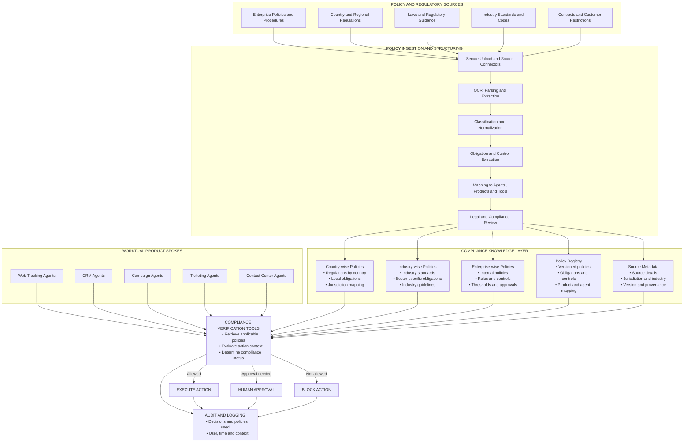
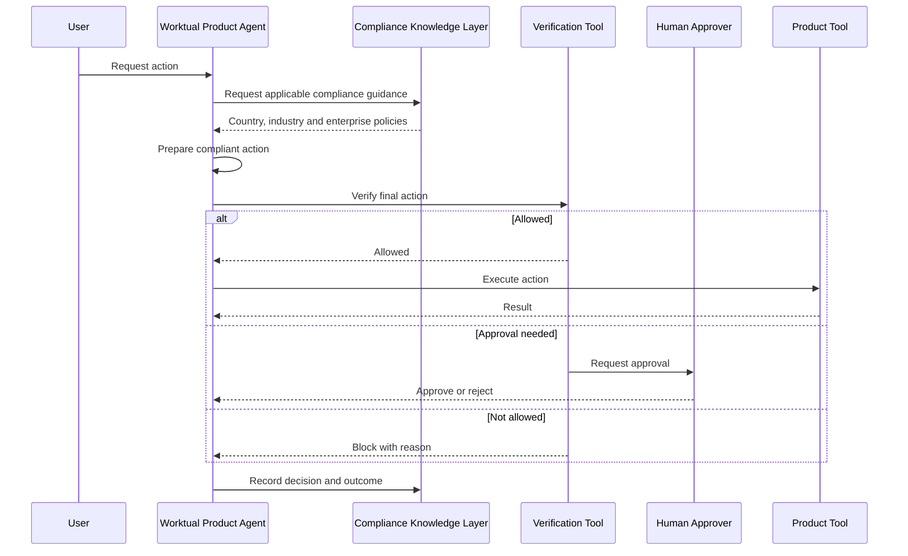
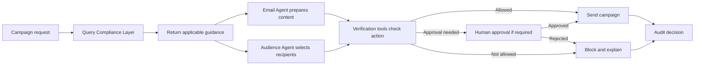

# Worktual Compliance Knowledge Layer

## 1. Overview

Worktual provides multiple AI-enabled product spokes:

- Web Tracking
- CRM
- Campaign Management
- Ticketing System
- AI Contact Center

Every product and agent must follow the regulations and policies applicable to its country, industry, enterprise, product and action.

These requirements should not be hardcoded into individual agent prompts. Worktual should maintain them in a shared **Compliance Knowledge Layer**. Product agents retrieve the applicable guidance from this layer, while compliance verification tools determine whether an action can proceed.

The architecture supports three possible outcomes:

1. **Allowed** — execute the action.
2. **Approval needed** — request human approval.
3. **Not allowed** — block the action.

---

## 2. High-Level Architecture

---

## 3. Architecture Components

### 3.1 Policy and regulatory sources

The Compliance Knowledge Layer accepts information from multiple authoritative sources.

| Source | Examples |
|---|---|
| Enterprise policies and procedures | Privacy policy, marketing policy, security policy and operating procedures |
| Country and regional regulations | UK, EU, India and other applicable regional requirements |
| Laws and regulatory guidance | Acts, rules, regulator guidance and official updates |
| Industry standards and codes | Healthcare, financial services, telecom and other sector requirements |
| Contracts and customer restrictions | Customer agreements, data-processing terms and communication restrictions |

Applicability must be determined from the complete context, not only from a country name. Customer location, enterprise location, industry, processing purpose, data type and communication channel may all affect which rules apply.

### 3.2 Policy ingestion and structuring

This component converts uploaded policies into approved, structured compliance knowledge.

The high-level process is:

1. Securely upload or retrieve the policy document.
2. Extract its content using parsing or OCR.
3. Classify it by country, industry, enterprise and policy type.
4. Identify obligations, restrictions, permissions and approval requirements.
5. Map those requirements to affected products, agents and tools.
6. Submit the structured policy for legal or compliance review.
7. Publish the approved version to the Compliance Knowledge Layer.

AI can assist with extraction and structuring, but it must not activate its own interpretation. A qualified reviewer approves policies before agents use them.

### 3.3 Compliance Knowledge Layer

The knowledge layer stores approved policies in a reusable structure.

#### Country-wise knowledge

Contains:

- Regulations applicable to a country or region.
- Local obligations and restrictions.
- Jurisdiction and applicability information.

For example, UK processing may require evaluation against the UK GDPR and other applicable UK requirements. EU GDPR and UK GDPR must not be treated as the same policy.

#### Industry-wise knowledge

Contains:

- Industry regulations and standards.
- Sector-specific requirements.
- Restricted activities and data types.
- Additional approval or evidence requirements.

#### Enterprise-wise knowledge

Contains:

- Internal enterprise policies.
- Roles and responsibilities.
- Permitted and prohibited actions.
- Enterprise approval thresholds.
- Policies stricter than the regulatory minimum.

#### Policy registry

Maintains:

- Approved policy versions.
- Obligations and controls.
- Product, agent and tool mappings.
- Effective and expiry dates.
- Review and approval status.

#### Source metadata

Preserves:

- Original source information.
- Country, industry and enterprise classification.
- Document version.
- Effective date.
- Approval and provenance.

Every structured rule should remain traceable to its original source.

### 3.4 Compliance verification tools

Product agents do not decide compliance only through language-model reasoning. They submit their intended action to compliance verification tools.

The tools:

- Identify the applicable policy set.
- Evaluate the user, enterprise, customer, location, industry and action context.
- Check the proposed content, audience or operation.
- Determine whether required conditions are satisfied.
- Return an allowed, approval-needed or blocked decision.

Examples of tool-based checks include:

- Consent and communication eligibility.
- Suppression and opt-out status.
- Required disclosures.
- Restricted or sensitive data.
- Approved templates and content.
- Human approval status.
- Enterprise limits and thresholds.

### 3.5 Decision outcomes

#### Execute action

The action proceeds when:

- Required conditions are satisfied.
- No blocking policy is violated.
- Required evidence is available.
- Any necessary approval has already been granted.

#### Human approval

The action pauses when:

- A policy explicitly requires approval.
- The action is high risk.
- The available information is uncertain.
- Applicable rules conflict.
- An exception is requested.

#### Block action

The action is blocked when:

- It violates a mandatory restriction.
- Required consent or evidence is unavailable.
- A prohibited data type or action is detected.
- The requested operation is outside the agent’s authority.

The product agent receives a clear reason so it can inform the user or request a compliant alternative.

### 3.6 Audit and logging

Every compliance decision must record:

- Product and agent requesting the action.
- User and enterprise.
- Action and context.
- Policies and versions applied.
- Verification result.
- Human approval or rejection.
- Final action status.
- Date and time.

This provides evidence that Worktual used the correct approved policy when an action was performed or blocked.

---

## 4. Runtime Flow

The agent retrieves only the policies relevant to its current task. Complete regulatory documents are not inserted into every prompt.

---

## 5. Product-Spoke Usage

| Worktual spoke | Example compliance application |
|---|---|
| Web Tracking | Tracking permission, data collection, retention, identity resolution and audience activation |
| CRM | Lead enrichment, profiling, customer data access, identity merging, proposals and quotations |
| Campaign Management | Audience eligibility, consent, suppression, content validation and campaign approval |
| Ticketing System | Sensitive data, ticket access, escalation, investigation and retention |
| AI Contact Center | Customer authentication, recording, disclosure, sensitive information and communication rules |

All spokes use the same Compliance Knowledge Layer. This avoids duplicate or inconsistent policy definitions across products.

---

## 6. Example — Email Campaign

### Request

An enterprise user asks the Campaign Agent to send a marketing email to customers in a particular country and industry.

### Applicable policy layers

The Compliance Layer combines:

| Policy level | Example guidance |
|---|---|
| Country or region | Confirm the recipient is eligible for the communication. |
| Industry | Do not expose restricted industry information in the email. |
| Enterprise | Use approved sender identity, branding and wording. |
| Product | Campaign launch requires defined checks. |
| Channel | Include the approved unsubscribe mechanism. |
| Agent or action | Certain claims require human approval before sending. |

### Processing flow

The Campaign Agent:

1. Queries the Compliance Knowledge Layer.
2. Receives the relevant country, industry and enterprise rules.
3. Passes content guidance to the Email Content Agent.
4. Passes eligibility rules to the Audience Agent.
5. Submits the final content and audience for verification.
6. Sends only after all required checks and approvals pass.
7. Records the policy versions and final decision.

---

## 7. Key Principles

1. Regulations and enterprise policies are maintained centrally, not hardcoded in prompts.
2. Policies are structured by country, industry, enterprise, product and agent action.
3. AI assists with policy extraction, but humans approve policies before publication.
4. Agents retrieve only relevant guidance for the current task.
5. Deterministic tools verify important restrictions.
6. High-risk or uncertain actions require human approval.
7. Prohibited actions are blocked before execution.
8. Every decision is traceable to the exact policy version used.
9. Policy updates are applied centrally across affected products and agents.
10. The Compliance Layer supports legal and compliance teams; it does not replace them.

---

## 8. Recommended Starting Point

Start with one controlled use case:

> Email campaign compliance for one enterprise, one country and one industry.

The first implementation should demonstrate:

1. Policy upload.
2. Content extraction and structuring.
3. Legal or compliance approval.
4. Policy storage by country, industry and enterprise.
5. Retrieval by Campaign and Email Agents.
6. Content and audience verification.
7. Human approval where required.
8. Allowed or blocked execution.
9. Audit logging.

After validating this flow, extend the Compliance Knowledge Layer to additional products, countries, industries and actions.
