# Worktual Multi-Agent System Architecture

## 1. Purpose

This document defines the target three-level Multi-Agent System (MAS) architecture for the following Worktual product spokes:

1. CRM
2. AI Contact Center
3. Ticketing System
4. Campaign Management
5. Web Tracking

The architecture is based on the agents listed in **“AI agents in spokes”** and extends that inventory where a product or CRM module does not yet have enough agents to form a complete three-level architecture.

### Agent labels

- **Documented**: Defined in the supplied agent document.
- **Proposed**: Recommended to complete the architecture; not present in the supplied document.
- **Autonomous**: Can act without approval inside a predefined policy boundary.
- **Approval-gated**: Prepares or recommends an action that requires human confirmation.
- **Mixed**: Low-risk actions can be autonomous, while consequential actions require approval.

The term **Executor Agent** is used throughout this document as the normalized spelling of “Executer Agent” from the source document.

---

## 2. Enterprise Multi-Agent Model

Every Worktual product is an independently deployable **spoke**. Each spoke contains three agent levels.

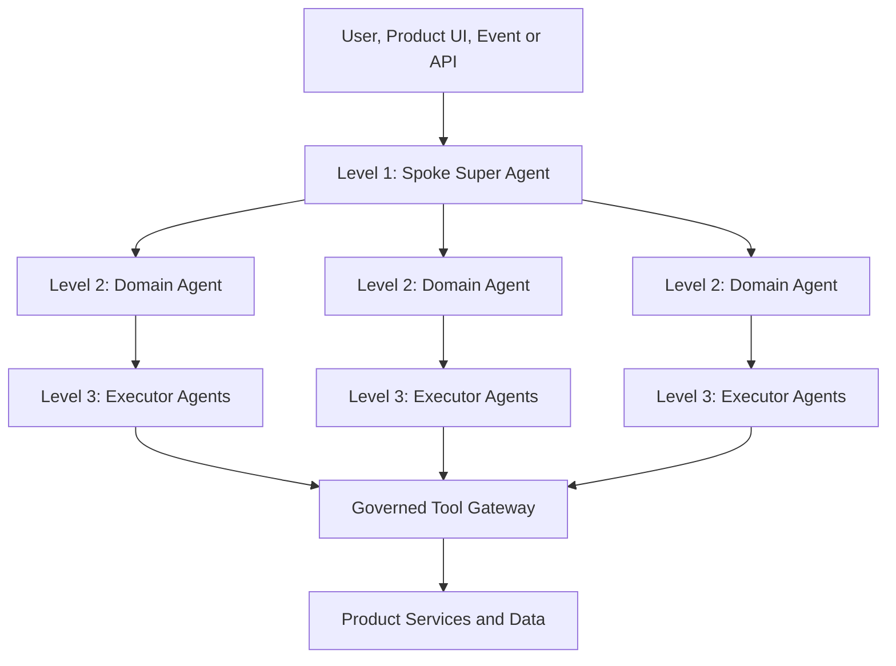

### Level 1 — Spoke Super Agent

The Super Agent is the single intelligent entry point for a product spoke.

Responsibilities:

- Understand the requested business outcome.
- Select the correct domain or module agent.
- Split complex work into bounded tasks.
- Coordinate work spanning multiple domain agents.
- Delegate cross-product work to another spoke’s Super Agent.
- Carry identity, tenant, consent and approval context.
- Track progress, failures and compensating actions.
- Combine domain results into a final response.
- Enforce product-level policies and limits.

The Super Agent should **not** directly modify product records. All writes must pass through domain and executor boundaries.

### Level 2 — Domain or Module Agent

A Domain Agent owns a bounded business capability such as CRM Sales, Ticket Triage or Contact Center Workforce Management.

Responsibilities:

- Plan the domain workflow.
- Select and supervise executor agents.
- Maintain domain-specific rules and context.
- Validate executor outputs.
- Request human approval when required.
- Report status and evidence to the Super Agent.

### Level 3 — Executor Agent

An Executor Agent performs one narrow, auditable capability.

Responsibilities:

- Accept typed, validated input.
- Call only explicitly permitted tools.
- Return structured results and evidence.
- Respect confidence, cost, time and policy limits.
- Support idempotency, retry and safe replay.
- Avoid independently expanding its assigned goal.

---

## 3. Product and Data Ownership

An embedded CRM module is a **facade over a standalone spoke**, not a second implementation of that product.

| Business object or operation | Authoritative spoke | CRM responsibility |
|---|---|---|
| Accounts, contacts, leads and opportunities | CRM | Own and manage |
| Campaign definitions, content, audiences and delivery | Campaign Management | Request campaigns and display summaries |
| Live conversations, routing, queues and dispositions | AI Contact Center | Request interactions and store summaries |
| Tickets, SLA clocks, investigations and resolutions | Ticketing System | Request case operations and retain ticket references |
| Web events, sessions, consent and attribution evidence | Web Tracking | Consume minimum required behavioral signals |

### Core ownership rule

> A product spoke may call another spoke only through the owning spoke’s Super Agent or a versioned spoke API. It must not call another spoke’s Domain or Executor Agents directly.

---

# 4. CRM Multi-Agent Architecture

## 4.1 CRM mission and boundary

The CRM spoke owns the customer relationship and the lead-to-revenue lifecycle. It is the system of record for accounts, contacts, leads, opportunities, activities, customer context and commercial approvals.

Campaign Management and AI Contact Center are exposed as CRM modules, but their operational workflows remain owned by their standalone spokes.

## 4.2 CRM hierarchy

```mermaid
flowchart TB
    CRM[Level 1: CRM Super Agent]

    MKT[Level 2: Marketing Domain Agent]
    SALES[Level 2: Sales Domain Agent]
    FIN[Level 2: Finance Domain Agent]
    SUP[Level 2: Support Domain Agent]

    MKT --> ME[Lead Enrichment]
    MKT --> MQ[Lead Qualification]
    MKT --> MN[Lead Nurturing]
    MKT --> MC[Campaign Delegation]

    SALES --> SLA[Lead Assignment]
    SALES --> SC[Sales Coworker]
    SALES --> MP[Meeting Preparation]
    SALES --> MNT[Meeting Note-Taker and Insights]
    SALES --> LLC[Lead Lifecycle]
    SALES --> PA[Proposal]
    SALES --> QA[Quotation]
    SALES --> PAA[Pipeline Audit]

    FIN --> CR[Credit and Risk Check]
    FIN --> IPS[Invoice and Payment Status]
    FIN --> RC[Renewal and Collections]

    SUP --> CCA[Customer Context]
    SUP --> CCD[Contact Center Delegation]
    SUP --> TD[Ticketing Delegation]

    CRM --> MKT
    CRM --> SALES
    CRM --> FIN
    CRM --> SUP

    MC -. CampaignRequest .-> CAMPAIGN[Campaign Super Agent]
    CCD -. InteractionRequest .-> CONTACT[Contact Center Super Agent]
    TD -. CaseRequest .-> TICKET[Ticketing Super Agent]
```

## 4.3 Level 1 — CRM Super Agent

The **CRM Super Agent**:

- Routes requests to Marketing, Sales, Finance or Support.
- Coordinates end-to-end customer and lead journeys.
- Resolves conflicting module plans.
- Maintains CRM customer and commercial context.
- Delegates campaign, interaction and ticket work to standalone spokes.
- Returns one consolidated CRM response to the requester.

## 4.4 Level 2 — Marketing Domain Agent

Mission: Build qualified demand inside CRM and delegate campaign execution to the Campaign Management spoke.

| Level 3 Executor | Source | Autonomy | Responsibility |
|---|---|---|---|
| Lead Enrichment Agent | Documented | Autonomous | Complete and improve lead profiles using available information. |
| Lead Qualification Agent | Documented | Autonomous | Evaluate engagement and intent and promote leads to MQL or SQL. |
| Lead Nurturing Agent | Documented | Autonomous | Select nurture actions based on lead interests and behavior. |
| Campaign Delegation Agent | Proposed | Approval-gated | Convert a CRM nurture objective into a governed request for the Campaign Super Agent. |

The Lead Nurturing Agent must not implement campaign delivery itself. It requests campaign work through the Campaign Delegation Agent.

## 4.5 Level 2 — Sales Domain Agent

Mission: Coordinate SQL assignment, seller assistance, meetings, opportunity progression, proposals and quotations.

| Level 3 Executor | Source | Autonomy | Responsibility |
|---|---|---|---|
| Lead Assignment Agent | Documented | Autonomous | Assign SQLs using geography, background, seller performance, expertise and availability. |
| Sales Coworker Agent | Documented | Autonomous | Handle routine sales queries, collect meeting details and schedule available slots. |
| Meeting Preparation Agent | Documented | Autonomous | Prepare lead summary, meeting context, recommended handling strategy and reminders. |
| Meeting Note-Taker & Performance Insight Agent | Documented | Autonomous | Capture notes, decisions and actions and provide seller coaching. |
| Lead Lifecycle Agent | Documented | Autonomous | Update lifecycle stages and trigger meetings, proposals or follow-up work. |
| Proposal Agent | Documented | Approval-gated | Generate a proposal from discovery information and customer requirements. |
| Quotation Agent | Documented | Approval-gated | Generate a quotation from approved product and pricing requirements. |
| Pipeline Audit Agent | Documented | Approval-gated | Detect stalled opportunities and notify the sales manager or administrator. |

The source document identifies the Lead Lifecycle Agent as a Domain Agent. In this architecture, lifecycle ownership remains under the Sales Domain Agent and Lead Lifecycle is treated as a Level 3 capability to preserve the requested three-level hierarchy.

## 4.6 Level 2 — Finance Domain Agent

Mission: Apply commercial controls after quotation and supply finance context to sales and service.

The supplied document does not define CRM Finance agents. The following are proposed:

| Level 3 Executor | Source | Autonomy | Responsibility |
|---|---|---|---|
| Credit & Risk Check Agent | Proposed | Approval-gated | Assess account credit and risk rules before non-standard commercial commitments. |
| Invoice & Payment Status Agent | Proposed | Autonomous | Retrieve billing status and explain outstanding balances. |
| Renewal & Collections Agent | Proposed | Approval-gated | Detect renewal or payment risk and prepare approved outreach. |

## 4.7 Level 2 — Support Domain Agent

Mission: Give CRM users a customer-centric support experience while preserving Contact Center and Ticketing ownership.

The supplied document does not define CRM Support agents. The following are proposed:

| Level 3 Executor | Source | Autonomy | Responsibility |
|---|---|---|---|
| Customer Context Agent | Proposed | Autonomous | Assemble customer 360 context for service journeys. |
| Contact Center Delegation Agent | Proposed | Autonomous | Send live engagement requests to the Contact Center Super Agent. |
| Ticketing Delegation Agent | Proposed | Mixed | Open, query or update cases through the Ticketing Super Agent. |

---

# 5. Ticketing System Multi-Agent Architecture

## 5.1 Ticketing mission and boundary

The Ticketing spoke owns the service issue lifecycle from self-service and intake through classification, assignment, investigation, SLA management, resolution, closure and knowledge reuse.

## 5.2 Ticketing hierarchy

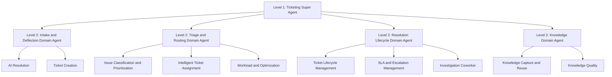

## 5.3 Level 1 — Ticketing Super Agent

The **Ticketing Super Agent**:

- Determines whether a request is a known issue, new ticket or existing ticket operation.
- Coordinates intake, triage, assignment, lifecycle and knowledge domains.
- Maintains ticket workflow context.
- Enforces ticket, SLA, escalation and knowledge policies.
- Returns ticket status and resolution evidence to CRM or Contact Center.

## 5.4 Level 2 — Intake and Deflection Domain Agent

| Level 3 Executor | Source | Autonomy | Responsibility |
|---|---|---|---|
| AI Resolution Agent | Documented | Approval-gated | Find a reliable Knowledge Base answer and resolve eligible requests without a ticket. |
| Ticket Creation Agent | Documented | Autonomous | Convert unresolved customer requests into structured tickets. |

Although the AI Resolution Agent can answer customers, the source document classifies it as semi-autonomous. Customer-visible answers should initially use confidence, policy and approval thresholds.

## 5.5 Level 2 — Triage and Routing Domain Agent

| Level 3 Executor | Source | Autonomy | Responsibility |
|---|---|---|---|
| Issue Classification & Prioritization Agent | Documented | Autonomous | Identify category, tags, product, module, issue type and priority. |
| Intelligent Ticket Assignment Agent | Documented | Autonomous | Route by issue, required skills, expertise, workload and priority. |
| Workload & Optimization Agent | Documented | Approval-gated | Detect workload imbalance and recommend qualified reassignment. |

## 5.6 Level 2 — Resolution Lifecycle Domain Agent

| Level 3 Executor | Source | Autonomy | Responsibility |
|---|---|---|---|
| Ticket Lifecycle Management Agent | Documented | Autonomous | Manage status from New through Closed and trigger intermediate actions. |
| SLA & Escalation Management Agent | Documented | Mixed | Monitor SLA risk and recommend or trigger governed escalation. |
| Investigation Coworker Agent | Proposed | Approval-gated | Assist resolvers with evidence collection, diagnostics and next actions. |

## 5.7 Level 2 — Knowledge Domain Agent

| Level 3 Executor | Source | Autonomy | Responsibility |
|---|---|---|---|
| Knowledge Capture & Reuse Agent | Documented | Approval-gated | Convert completed investigation and resolution evidence into reusable knowledge. |
| Knowledge Quality Agent | Proposed | Approval-gated | Detect stale, conflicting or ineffective Knowledge Base content. |

---

# 6. AI Contact Center Multi-Agent Architecture

## 6.1 Contact Center mission and boundary

The AI Contact Center coordinates customer interactions across:

- Webchat
- Voicebot
- Social media
- Agent assist

It owns live conversations, routing, queues, agent presence, interaction continuity, dispositions and workforce operations.

## 6.2 Contact Center hierarchy

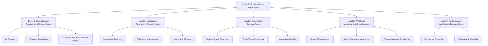

## 6.3 Level 1 — Contact Center Super Agent

The **Contact Center Super Agent**:

- Selects the correct channel and interaction domain.
- Maintains context across bot, channel and human handoffs.
- Coordinates interaction recovery, follow-up and closure.
- Invokes Ticketing when a customer issue requires investigation.
- Retrieves customer context through CRM.
- Applies channel, consent, recording and communication policies.

## 6.4 Level 2 — Omnichannel Engagement Domain Agent

| Level 3 Executor | Source | Autonomy | Responsibility |
|---|---|---|---|
| AI Support Agent | Documented | Approval-gated | Understand intent, answer routine questions, perform permitted actions and hand over. |
| Channel Adaptation Agent | Proposed | Autonomous | Adapt content, interaction style and latency for voice, webchat and social channels. |
| Customer Identification & Merge Agent | Documented | Approval-gated | Match interaction details to an existing customer and safely link profiles. |

Customer identity linking can be autonomous at high confidence. Profile merging should remain approval-gated because an incorrect merge can contaminate customer history.

## 6.5 Level 2 — Interaction Operations Domain Agent

| Level 3 Executor | Source | Autonomy | Responsibility |
|---|---|---|---|
| Interaction Recovery Agent | Documented | Autonomous | Recover missed, failed, dropped or unassigned interactions. |
| Follow-Up Management Agent | Documented | Autonomous | Create and track follow-up tasks and due times. |
| Interaction Closure Agent | Documented | Approval-gated | Summarize the outcome and suggest a disposition for confirmation. |

## 6.6 Level 2 — Agent Assist Domain Agent

| Level 3 Executor | Source | Autonomy | Responsibility |
|---|---|---|---|
| Support Agent Coworker | Documented | Approval-gated | Suggest responses, knowledge, next actions and notes, and perform approved tasks. |
| Real-Time Compliance Agent | Proposed | Autonomous | Detect required disclosures, prohibited language and risky actions during interactions. |
| Interaction Quality Agent | Proposed | Approval-gated | Score completed interactions and identify coaching opportunities. |

## 6.7 Level 2 — Workforce Management Domain Agent

The source document defines Workforce Management as a Domain Agent, which maps directly to Level 2.

| Level 3 Executor | Source | Autonomy | Responsibility |
|---|---|---|---|
| Queue Management Agent | Documented | Approval-gated | Create, modify or remove queues and queue membership under policy. |
| Agent Presence Monitoring Agent | Documented | Autonomous | Monitor agent states, send reminders and identify behavior patterns. |
| Forecasting & Scheduling Agent | Proposed | Approval-gated | Forecast channel demand and recommend staffing by queue and interval. |

Queue deletion and bulk membership changes must require human approval.

## 6.8 Level 2 — Performance Intelligence Domain Agent

| Level 3 Executor | Source | Autonomy | Responsibility |
|---|---|---|---|
| Scheduled Reporting Agent | Documented | Autonomous | Generate and distribute agent and queue performance reports. |
| Operational Anomaly Agent | Proposed | Autonomous | Detect abnormal service level, containment, queue or channel behavior. |

---

# 7. Campaign Management Multi-Agent Architecture

## 7.1 Campaign mission and boundary

Campaign Management owns campaign planning, audience snapshots, content, approvals, schedules, delivery state and campaign performance.

The Campaign Management product remains a standalone spoke. CRM Marketing accesses it through the CRM Campaign Delegation Agent and Campaign Super Agent.

## 7.2 Campaign hierarchy

```mermaid
flowchart TB
    CS[Level 1: Campaign Super Agent]

    CC[Level 2: Campaign Creation Domain Agent]
    CONTENT[Level 2: Content Creation Domain Agent]
    AC[Level 2: Audience and Consent Domain Agent]
    CO[Level 2: Campaign Optimization Domain Agent]

    CS --> CC
    CS --> CONTENT
    CS --> AC
    CS --> CO

    CC --> BV[Campaign Brief Validation]
    CC --> CR[Campaign Recommendation]
    CC --> LS[Launch and Scheduling]

    CONTENT --> WA[WhatsApp Content Generation]
    CONTENT --> EM[Email Content Generation]
    CONTENT --> AP[App Push Content Generation]
    CONTENT --> WP[Web Push Content Generation]
    CONTENT --> IMG[Image Generation]
    CONTENT --> CV[Content Verification]

    AC --> AUD[Audience]
    AC --> SF[Suppression and Frequency]
    AC --> ED[Experiment Design]

    CO --> CM[Campaign Monitoring]
    CO --> DR[Channel Delivery Recovery]
    CO --> BP[Budget and Pacing]
```

## 7.3 Level 1 — Campaign Super Agent

The **Campaign Super Agent**:

- Receives objectives from Campaign users or CRM Marketing.
- Coordinates campaign setup, content, audience, approval and optimization.
- Maintains end-to-end campaign status.
- Prevents launch until required checks and approvals pass.
- Publishes campaign status and outcomes to CRM.

All campaign agents should initially remain semi-autonomous, consistent with the source document.

## 7.4 Level 2 — Campaign Creation Domain Agent

The source document defines the Campaign Creation Agent as a Domain Agent.

| Level 3 Executor | Source | Autonomy | Responsibility |
|---|---|---|---|
| Campaign Brief Validation Agent | Proposed | Approval-gated | Detect missing objective, audience, channel, schedule, budget or success criteria. |
| Campaign Recommendation Agent | Documented | Approval-gated | Recommend campaign objectives, timing, targeting, channels and strategies. |
| Launch & Scheduling Agent | Proposed | Approval-gated | Validate readiness and execute an approved launch or schedule. |

## 7.5 Level 2 — Content Creation Domain Agent

The source document defines the Content Creation Agent as a Domain Agent.

| Level 3 Executor | Source | Autonomy | Responsibility |
|---|---|---|---|
| WhatsApp Content Generation Agent | Documented | Approval-gated | Generate WhatsApp templates, variables, calls to action and personalization. |
| Email Content Generation Agent | Documented | Approval-gated | Generate subject, preview text, body, calls to action and personalization. |
| App Push Content Generation Agent | Documented | Approval-gated | Generate concise mobile push titles, messages and calls to action. |
| Web Push Content Generation Agent | Documented | Approval-gated | Generate concise browser push content and calls to action. |
| Image Generation Agent | Documented | Approval-gated | Generate brand-aligned campaign creatives for required dimensions. |
| Content Verification Agent | Documented | Approval-gated | Validate accuracy, consistency, claims, compliance and channel constraints. |

## 7.6 Level 2 — Audience and Consent Domain Agent

| Level 3 Executor | Source | Autonomy | Responsibility |
|---|---|---|---|
| Audience Agent | Documented | Approval-gated | Build and validate target audiences using profile, behavior, consent and availability. |
| Suppression & Frequency Agent | Proposed | Autonomous | Apply exclusion, fatigue, frequency and campaign-collision policies. |
| Experiment Design Agent | Proposed | Approval-gated | Prepare variants, holdouts, sample sizes and success measures. |

## 7.7 Level 2 — Campaign Optimization Domain Agent

| Level 3 Executor | Source | Autonomy | Responsibility |
|---|---|---|---|
| Campaign Monitoring Agent | Documented | Approval-gated | Monitor delivery, engagement, conversion, anomalies and optimization opportunities. |
| Channel Delivery Recovery Agent | Proposed | Mixed | Diagnose delivery failures and retry only within channel and consent policy. |
| Budget & Pacing Agent | Proposed | Approval-gated | Monitor spending or volume limits and recommend pacing changes. |

---

# 8. Web Tracking Multi-Agent Architecture

## 8.1 Web Tracking mission and boundary

The supplied agent document does not define Web Tracking agents. This entire inventory is proposed as the minimum architecture required to create a standalone Web Tracking spoke.

Web Tracking owns event schemas, collection health, consent evidence, sessions, identity links, behavioral audiences and attribution evidence.

## 8.2 Web Tracking hierarchy

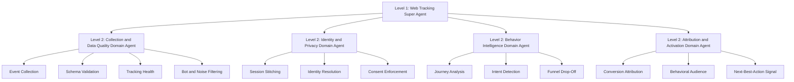

## 8.3 Level 1 — Web Tracking Super Agent

The **Web Tracking Super Agent**:

- Coordinates collection, identity, privacy, behavioral analysis and activation.
- Provides trustworthy behavioral signals to CRM and Campaign Management.
- Prevents activation where consent or identity confidence is insufficient.
- Maintains evidence explaining how intent, audience and attribution signals were produced.

## 8.4 Level 2 — Collection and Data Quality Domain Agent

| Level 3 Executor | Source | Autonomy | Responsibility |
|---|---|---|---|
| Event Collection Agent | Proposed | Autonomous | Coordinate approved SDK, server-side and tag-based event collection. |
| Schema Validation Agent | Proposed | Autonomous | Detect missing, malformed, duplicated or breaking event changes. |
| Tracking Health Agent | Proposed | Autonomous | Monitor collection loss, latency, drift and instrumentation regressions. |
| Bot & Noise Filtering Agent | Proposed | Autonomous | Identify automation, spam and non-customer traffic. |

## 8.5 Level 2 — Identity and Privacy Domain Agent

| Level 3 Executor | Source | Autonomy | Responsibility |
|---|---|---|---|
| Session Stitching Agent | Proposed | Autonomous | Link events into coherent anonymous sessions. |
| Identity Resolution Agent | Proposed | Mixed | Link anonymous and known identities only when deterministic policy permits. |
| Consent Enforcement Agent | Proposed | Autonomous | Apply purpose, region, retention and deletion rules. |

## 8.6 Level 2 — Behavior Intelligence Domain Agent

| Level 3 Executor | Source | Autonomy | Responsibility |
|---|---|---|---|
| Journey Analysis Agent | Proposed | Autonomous | Identify common paths, loops and abandonment patterns. |
| Intent Detection Agent | Proposed | Autonomous | Infer product, support and purchase intent with confidence evidence. |
| Funnel Drop-Off Agent | Proposed | Autonomous | Detect significant stage loss and contributing events or segments. |

## 8.7 Level 2 — Attribution and Activation Domain Agent

| Level 3 Executor | Source | Autonomy | Responsibility |
|---|---|---|---|
| Conversion Attribution Agent | Proposed | Autonomous | Attach transparent attribution evidence to conversions. |
| Behavioral Audience Agent | Proposed | Approval-gated | Create consented behavioral segments for campaign activation. |
| Next-Best-Action Signal Agent | Proposed | Approval-gated | Publish explainable intent signals without directly contacting customers. |

---

# 9. Cross-Spoke Architecture

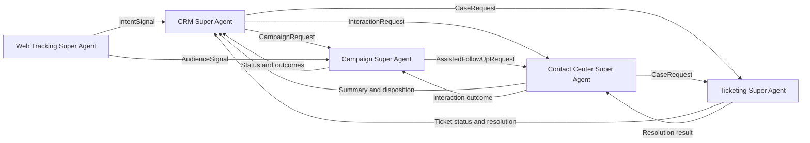

## 9.1 Required spoke contracts

| Caller | Contract | Owning entry point | Result |
|---|---|---|---|
| CRM Marketing | `CampaignRequest` | Campaign Super Agent | Campaign ID, status, engagement and conversion summary |
| CRM Support | `InteractionRequest` | Contact Center Super Agent | Interaction ID, transcript summary, disposition and follow-up |
| CRM or Contact Center | `CaseRequest` | Ticketing Super Agent | Ticket ID, state, priority, SLA and resolution |
| Web Tracking | `IntentSignal` | CRM Super Agent | Accepted lead/account signal and resulting CRM action |
| Web Tracking | `AudienceSignal` | Campaign Super Agent | Accepted segment and activation status |
| Campaign Management | `AssistedFollowUpRequest` | Contact Center Super Agent | Interaction outcome and consent evidence |

## 9.2 Standard agent handoff envelope

Every delegation should include:

```yaml
identity:
  tenantId: string
  actorId: string
  actorType: user | service | agent
  delegatedPermissions: []

trace:
  requestId: string
  correlationId: string
  causationId: string
  parentTaskId: string

intent:
  goal: string
  constraints: []
  expectedOutcome: string
  deadline: timestamp

context:
  entityReferences: []
  facts: {}

governance:
  riskTier: low | medium | high | restricted
  approvalToken: string | null
  consentPurpose: string | null
  region: string

reliability:
  idempotencyKey: string
  retryPolicy: string
  compensationReference: string | null

response:
  status: accepted | running | awaiting_approval | completed | failed
  evidence: []
  confidence: number
  actions: []
  nextOwner: string | null
```

---

# 10. Shared Agent Platform

The spokes should share a common platform plane without sharing ungoverned writable memory.

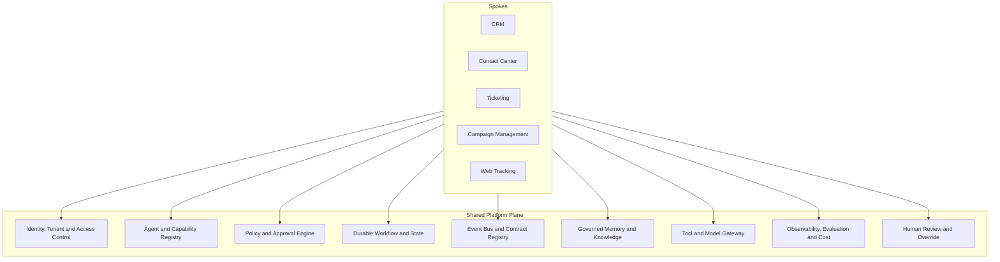

## 10.1 Shared platform capabilities

| Platform capability | Responsibilities |
|---|---|
| Identity and tenancy | SSO, service identity, tenant isolation and user delegation |
| Agent registry | Agent capabilities, versions, owners, discovery and health |
| Policy and approval | Risk tiers, RBAC/ABAC, approval inbox and separation of duties |
| Workflow and state | Durable execution, retries, timeouts, compensation and idempotency |
| Events and contracts | Versioned schemas, event bus, correlation and causation IDs |
| Memory and knowledge | Customer context, governed RAG, retention and evidence |
| Tool gateway | Typed APIs, scoped credentials, validation, rate limits and dry-run |
| Observability and evaluation | Traces, quality, cost, latency, drift and business KPIs |
| Human control | Review, override, pause, replay, explanation and emergency stop |

---

# 11. Autonomy and Approval Model

“Autonomous” means pre-authorized within a bounded policy. It does not mean unrestricted authority.

| Risk class | Default mode | Examples | Required controls |
|---|---|---|---|
| Low and reversible | Autonomous | Enrichment, classification, summaries, reminders and health checks | Confidence threshold, audit, replay and rate limit |
| Medium and customer-visible | Bounded autonomy | Routine answers, follow-ups, lead assignment and ticket status | Approved templates, policy checks, escalation and sampled QA |
| High and consequential | Human approval | Campaign launch, proposal, quotation, queue deletion and KB publishing | Preview, named approver, separation of duties and approval expiry |
| Restricted | Human-only or deterministic workflow | Consent override, bulk identity merge, legal commitments and destructive data actions | No LLM authority, privileged workflow and dual control |

## 11.1 Mandatory approval examples

Human approval is required for:

- Sending proposals and quotations.
- Launching, pausing or materially changing campaigns.
- Publishing new Knowledge Base content.
- Deleting queues or making bulk workforce changes.
- Merging ambiguous customer identities.
- Escalations with contractual or financial impact.
- Non-standard pricing, credit or legal commitments.
- Actions that override consent, suppression or retention policy.

---

# 12. Example End-to-End Journeys

## 12.1 Web intent to sales opportunity

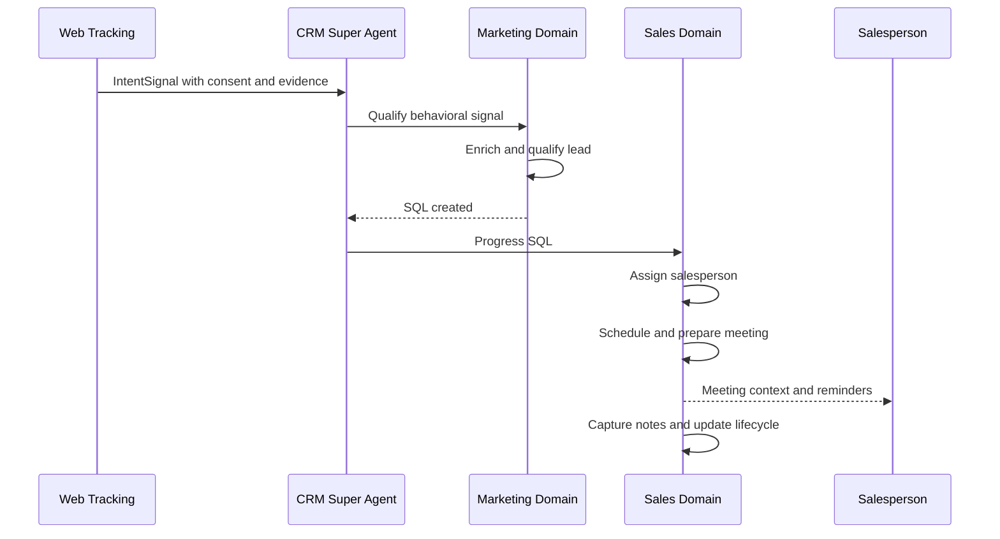

## 12.2 CRM nurture campaign

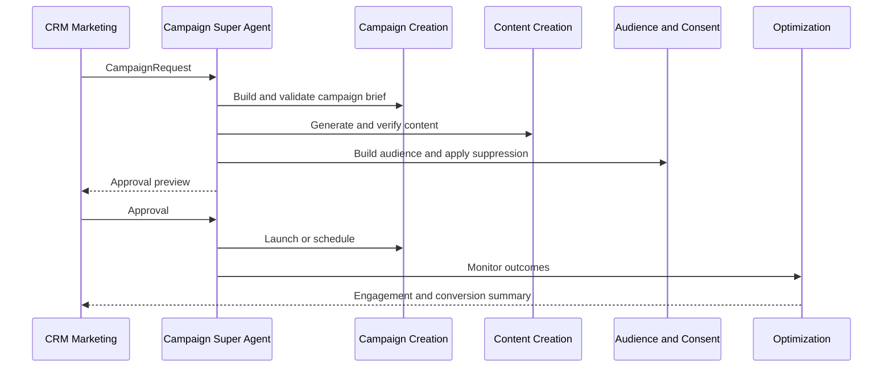

## 12.3 Contact Center interaction to ticket resolution

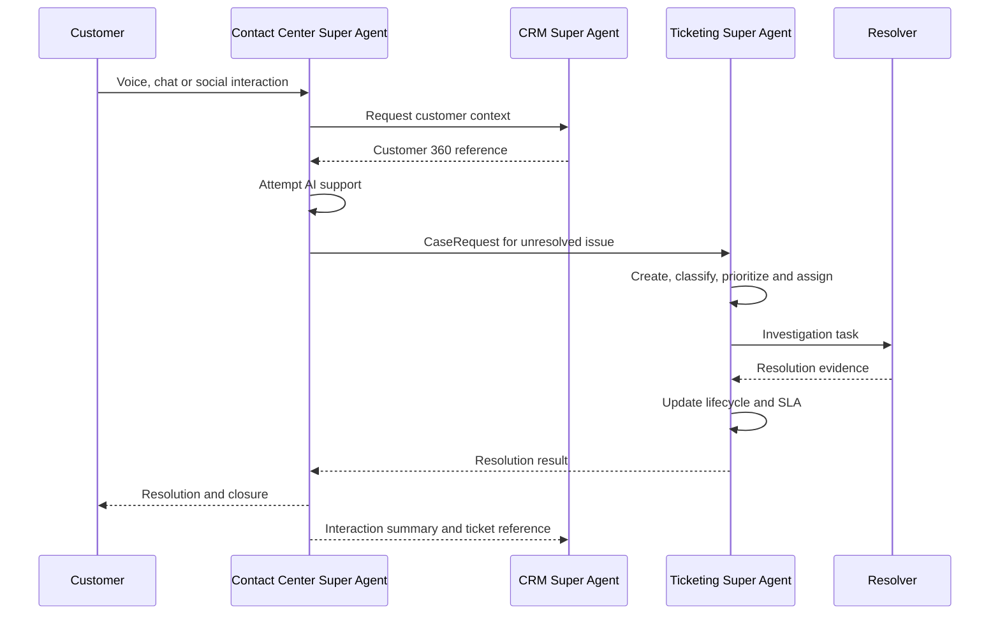

---

# 13. Deployment Architecture

Each spoke should be independently deployable and versioned.

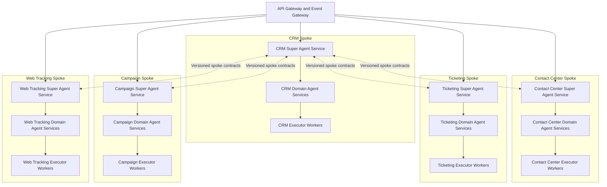

Recommended deployment rules:

- Run each Super Agent as a separately versioned service.
- Domain Agents may initially share a spoke service but must retain independent contracts.
- Run long-running or high-volume Executor Agents as queue-backed workers.
- Store workflow state outside model context in a durable workflow service.
- Use product APIs for all writes; never let an agent write directly to product databases.
- Use an event outbox for reliable state-change publication.
- Include tenant, trace, policy and idempotency data in every operation.
- Support agent version rollback independently from product API rollback.

---

# 14. Architecture Anti-Patterns

Avoid the following:

1. **Direct cross-spoke executor calls**  
   CRM must not directly call Campaign Monitoring, Queue Management or Ticket Lifecycle executors.

2. **Duplicate systems of record**  
   CRM must not maintain a second campaign, ticket or contact-center workflow database.

3. **Shared ungoverned memory**  
   Spokes should exchange contracts and canonical entity references, not a shared writable agent scratchpad.

4. **LLM-controlled transactions**  
   Deterministic services must validate money, consent, identity, state transitions and destructive actions.

5. **Unbounded delegation**  
   Every child task requires a scope, deadline, cost limit, permitted capabilities and expected output.

6. **Agent per API endpoint**  
   An agent represents a business capability. Simple deterministic operations should remain normal services or tools.

7. **Autonomy without evidence**  
   Agents should move from recommendation to autonomous action only after evaluation and production shadowing.

---

# 15. Recommended Delivery Roadmap

## Phase 1 — Shared foundation

- Ratify product and data ownership.
- Define canonical customer, account, campaign, interaction and ticket IDs.
- Build the agent and capability registry.
- Build the governed tool gateway.
- Implement durable workflow, event and audit services.
- Implement approval, override and emergency-stop controls.
- Create a shared offline and online evaluation framework.

## Phase 2 — Service loop

- Deploy Contact Center AI Support and customer identification.
- Deploy Ticketing intake, classification, assignment and lifecycle.
- Implement the Contact Center-to-Ticketing `CaseRequest`.
- Implement CRM customer context retrieval.
- Return ticket resolution and interaction summaries to CRM.

## Phase 3 — Growth loop

- Deploy CRM lead enrichment, qualification and assignment.
- Deploy Campaign creation, content generation and audience agents.
- Implement the CRM-to-Campaign `CampaignRequest`.
- Build approval and campaign launch workflows.
- Return campaign outcomes to CRM.

## Phase 4 — Intelligence and optimization

- Build the Web Tracking spoke.
- Publish governed intent and audience signals.
- Add workforce, campaign and pipeline optimization.
- Introduce cross-spoke next-best-action recommendations.
- Promote selected agents to bounded autonomy using production evidence.

---

# 16. Production Readiness Gates

Before an agent receives production autonomy, it must pass:

| Gate | Minimum evidence |
|---|---|
| Functional | Contract tests, golden journeys, deterministic fallback and tool-error handling |
| Quality | Offline evaluation and shadow-mode comparison against human decisions |
| Safety | Prompt-injection, permission, PII and approval-bypass testing |
| Reliability | Idempotency, timeout, retry, replay, compensation and dependency-failure tests |
| Operations | Trace coverage, latency and cost SLOs, kill switch, runbook and named owner |
| Business | Baseline, target KPI, guardrail metrics and accountable product owner |

## Immediate architecture decision

The first implementation decision should be to approve:

1. The product and data ownership matrix.
2. The three-level agent responsibility model.
3. The `CampaignRequest`, `InteractionRequest` and `CaseRequest` contracts.
4. The human-approval and restricted-action policy.

These decisions prevent duplicate implementations when Campaign Management and AI Contact Center are presented as CRM submodules.
