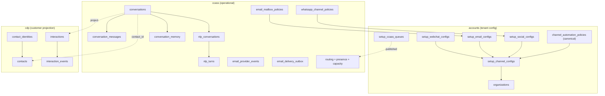

# Omnichannel ERD

Schemas: `accounts` (tenant setup), `ccass` (operational runtime), `cdp` (customer projection).

## Schema Overview



## Core Runtime ERD

```mermaid
erDiagram
  organizations ||--o{ setup_channel_configs : "organization_id"
  setup_channel_configs ||--o| setup_webchat_configs : "channel_config_id"
  setup_channel_configs ||--o| setup_email_configs : "channel_config_id"
  setup_channel_configs ||--o| setup_social_configs : "channel_config_id"
  setup_channel_configs ||--o| channel_automation_policies : "channel_config_id"

  organizations ||--o{ conversations : "organization_id"
  queues ||--o{ conversations : "queue_id"
  agents ||--o{ conversations : "assigned_agent_id"
  setup_channel_configs ||--o{ conversations : "channel_config_id"

  conversations ||--o{ conversation_messages : "conversation_id"
  conversations ||--|| nlp_conversations : "conversation_id"
  conversations ||--o| conversation_memory : "conversation_id"
  conversations ||--o{ conversation_dispositions : "conversation_id"
  conversations ||--o{ routing_attempts : "conversation_id"
  conversations }o--o| contacts : "contact_id"

  nlp_conversations ||--o{ nlp_turns : "nlp_conversation_id"
  nlp_turns }o--o| conversation_messages : "customer_message_id"
  nlp_turns }o--o| conversation_messages : "bot_message_id"

  conversations ||--o{ conversation_assignments : "conversation_id"
  routing_attempts ||--o{ conversation_assignments : "routing_attempt_id"

  contacts ||--o{ contact_identities : "contact_id"
  conversations ||--o{ interactions : "conversation_id"
  interactions ||--o{ interaction_events : "interaction_id"

  conversations {
    uuid id PK
    uuid organization_id FK
    varchar channel
    uuid channel_config_id FK
    varchar external_thread_id
    varchar provider_thread_id
    uuid queue_id FK
    uuid assigned_agent_id FK
    uuid contact_id FK
    varchar status
    varchar lifecycle_state
    boolean bot_active
    boolean nlp_enabled
    boolean live_agent_enabled
    timestamptz queued_at
    timestamptz created_at
  }

  channel_automation_policies {
    uuid id PK
    uuid organization_id FK
    uuid channel_config_id FK UK
    varchar channel
    boolean bot_enabled
    boolean live_agent_enabled
    varchar automation_mode
    numeric confidence_threshold
    uuid default_queue_id FK
    uuid_array allowed_queue_ids
    text handoff_message
    varchar no_agent_behavior
    int inactivity_close_seconds
    int policy_version
    varchar status
  }

  nlp_conversations {
    uuid id PK
    uuid conversation_id FK UK
    uuid organization_id FK
    varchar channel
    varchar active_intent
    jsonb entity_state
    varchar status
  }

  nlp_turns {
    uuid id PK
    uuid nlp_conversation_id FK
    varchar intent
    numeric confidence
    jsonb entities
    boolean grounded
    varchar action
    uuid customer_message_id FK
    uuid bot_message_id FK
  }

  conversation_memory {
    uuid conversation_id PK FK
    text rolling_summary
    jsonb extracted_facts
    int summary_version
  }

  contact_identities {
    uuid id PK
    uuid contact_id FK
    uuid organization_id FK
    varchar channel
    varchar identity_type
    varchar identity_value UK
  }
```

## Known Schema Gaps (to be resolved in Steps 2–3)

| Gap | Impact | Resolution |
|-----|--------|------------|
| `channel_automation_policies` table missing | No canonical cross-channel policy | Step 4 migration |
| Most `ccass` tables absent from Prisma | No type safety for runtime SQL | Step 3 Prisma models |
| `cdp` schema absent from Prisma | Contact identity untyped | Step 3 |
| Missing FK on `conversations.channel_config_id` | Orphan conversations possible | Step 3 |
| Missing FK on `conversations.contact_id` | CDP link integrity | Step 3 |
| `seed_webchat_live_agent_test.sql` in migrations | Test data in prod path | Step 2 move to seeds |
| CI applies migrations alphabetically with `\|\| true` | Silent schema drift | Step 2 migration runner |
| No `schema_migrations` ledger for db-cc | Cannot verify applied version | Step 2 |

## Policy Table Migration Path

During transition (Steps 4–5), channel-specific tables remain readable:

| Channel | Legacy Table | Canonical Target |
|---------|-------------|------------------|
| Webchat | `setup_webchat_configs.personalisation` | `channel_automation_policies` |
| Email | `email_mailbox_policies` + `setup_email_configs.ccaas_handler` | `channel_automation_policies` |
| WhatsApp | `whatsapp_channel_policies` + `setup_social_configs.bot_enabled` | `channel_automation_policies` |

Resolver reads canonical first, then legacy, then setup, then defaults.
