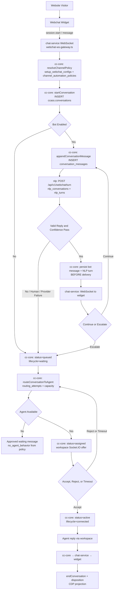
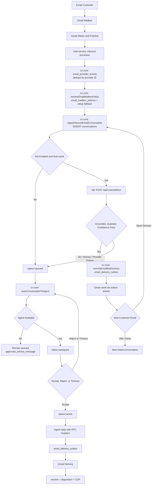
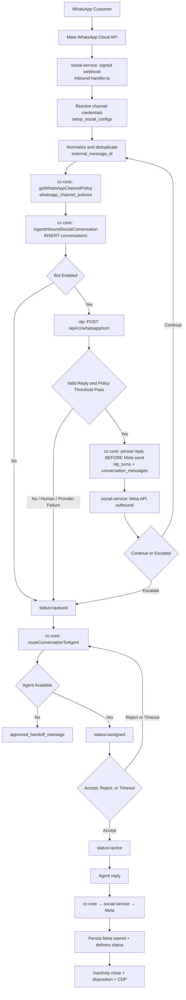
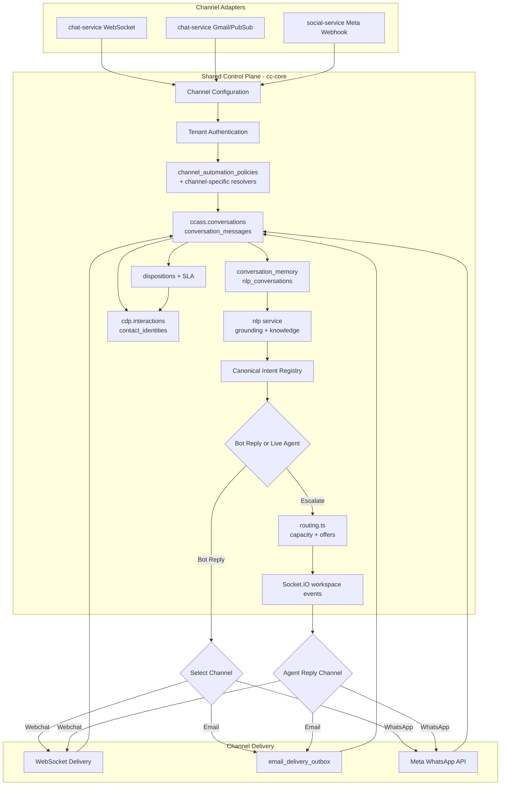

# Omnichannel Flow Diagrams

Source-cited entry points:
- Webchat: `apps/chat-service/src/services/webchat-orchestrator.ts`, `apps/cc-core/src/services/conversations.ts`
- Email: `apps/chat-service/src/email/email-orchestrator.ts`, `apps/cc-core/src/services/email-conversations.ts`
- WhatsApp: `apps/social-service/src/services/inbound-handler.ts`, `apps/cc-core/src/services/social-conversations.ts`

## Webchat

**DB writes per happy path:** `conversations`, `conversation_messages` (customer + bot), `nlp_conversations`, `nlp_turns`, `conversation_memory`.

## Email

## WhatsApp

## Combined Omnichannel

