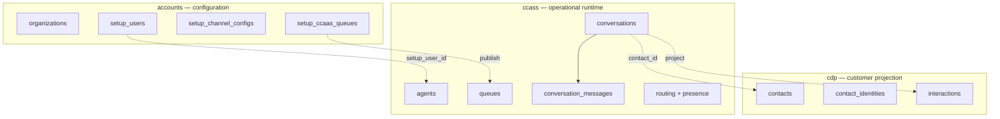

# Contact Center Schema Documentation

## Overview

This document provides detailed technical documentation for the PostgreSQL schemas used by **Worktual Contact Center (CCaaS)**.

Contact Center data is split across three schemas in one database:

| Schema | Responsibility | Typical writers | Typical readers |
| --- | --- | --- | --- |
| `accounts` (setup subset) | Slow-changing tenant configuration: orgs, users, channels, queues, business hours, knowledge | Admin / My Accounts setup | cc-core publish jobs, channel services |
| `ccass` | Fast-changing operational runtime: conversations, routing, presence, NLP, workspace, delivery | cc-core, chat-service, social-service, NLP | Agent workspace, supervisor, routing, reports |
| `cdp` | Customer projection for contacts UI, CRM, analytics, and co-worker | cc-core projection jobs | Contacts UI, reporting, NLP tools |

`accounts` is the source of truth for **configuration**. `ccass` is the source of truth for **live operations**. `cdp` is a **derived customer view** — do not drive routing from CDP.



For each table, this file includes:

- A detailed description of the table and its purpose
- The business or application use case
- Every column defined in the table
- The purpose and usage of each column
- The data type of each column
- Primary key and foreign key information where applicable
- Relationships between tables

**141 tables**, **1959 columns**, **61 declared foreign keys** (plus logical UUID/bigint references enforced in application code).

Regenerate from live PostgreSQL:

```bash
npx tsx packages/db-cc/scripts/generate-schema-docs.ts
```

## Contents

### `ccass` — Operational contact-center runtime

- [`ccass.agent_capacity`](#ccass-agent_capacity)
- [`ccass.agent_missed_contacts`](#ccass-agent_missed_contacts)
- [`ccass.agent_not_ready_escalations`](#ccass-agent_not_ready_escalations)
- [`ccass.agent_presence`](#ccass-agent_presence)
- [`ccass.agent_presence_history`](#ccass-agent_presence_history)
- [`ccass.agent_skills`](#ccass-agent_skills)
- [`ccass.agent_tasks`](#ccass-agent_tasks)
- [`ccass.agents`](#ccass-agents)
- [`ccass.audit_log`](#ccass-audit_log)
- [`ccass.channel_automation_policies`](#ccass-channel_automation_policies)
- [`ccass.conversation_assignments`](#ccass-conversation_assignments)
- [`ccass.conversation_dispositions`](#ccass-conversation_dispositions)
- [`ccass.conversation_memory`](#ccass-conversation_memory)
- [`ccass.conversation_message_attachments`](#ccass-conversation_message_attachments)
- [`ccass.conversation_messages`](#ccass-conversation_messages)
- [`ccass.conversation_notes`](#ccass-conversation_notes)
- [`ccass.conversation_participants`](#ccass-conversation_participants)
- [`ccass.conversation_sentiment_turns`](#ccass-conversation_sentiment_turns)
- [`ccass.conversation_sla_state`](#ccass-conversation_sla_state)
- [`ccass.conversation_transfers`](#ccass-conversation_transfers)
- [`ccass.conversations`](#ccass-conversations)
- [`ccass.copilot_memory`](#ccass-copilot_memory)
- [`ccass.copilot_sessions`](#ccass-copilot_sessions)
- [`ccass.copilot_skill_executions`](#ccass-copilot_skill_executions)
- [`ccass.copilot_turns`](#ccass-copilot_turns)
- [`ccass.dispositions`](#ccass-dispositions)
- [`ccass.email_delivery_outbox`](#ccass-email_delivery_outbox)
- [`ccass.email_mailbox_policies`](#ccass-email_mailbox_policies)
- [`ccass.email_provider_events`](#ccass-email_provider_events)
- [`ccass.message_delivery_attempts`](#ccass-message_delivery_attempts)
- [`ccass.message_receipts`](#ccass-message_receipts)
- [`ccass.nlp_conversations`](#ccass-nlp_conversations)
- [`ccass.nlp_skill_activation_history`](#ccass-nlp_skill_activation_history)
- [`ccass.nlp_skill_bindings`](#ccass-nlp_skill_bindings)
- [`ccass.nlp_skill_tools`](#ccass-nlp_skill_tools)
- [`ccass.nlp_skill_versions`](#ccass-nlp_skill_versions)
- [`ccass.nlp_skills`](#ccass-nlp_skills)
- [`ccass.nlp_turns`](#ccass-nlp_turns)
- [`ccass.presence_reason_codes`](#ccass-presence_reason_codes)
- [`ccass.proactive_callback_attempts`](#ccass-proactive_callback_attempts)
- [`ccass.queue_members`](#ccass-queue_members)
- [`ccass.queue_routing_profiles`](#ccass-queue_routing_profiles)
- [`ccass.queue_skills`](#ccass-queue_skills)
- [`ccass.queues`](#ccass-queues)
- [`ccass.routing_attempts`](#ccass-routing_attempts)
- [`ccass.routing_cursors`](#ccass-routing_cursors)
- [`ccass.routing_policies`](#ccass-routing_policies)
- [`ccass.scheduled_report_runs`](#ccass-scheduled_report_runs)
- [`ccass.scheduled_reports`](#ccass-scheduled_reports)
- [`ccass.schema_migrations`](#ccass-schema_migrations)
- [`ccass.skills`](#ccass-skills)
- [`ccass.sla_policies`](#ccass-sla_policies)
- [`ccass.webchat_sessions`](#ccass-webchat_sessions)
- [`ccass.whatsapp_channel_policies`](#ccass-whatsapp_channel_policies)
- [`ccass.workspace_common_notes`](#ccass-workspace_common_notes)

### `cdp` — Customer projection and analytics

- [`cdp.agentic_model`](#cdp-agentic_model)
- [`cdp.ai_insights`](#cdp-ai_insights)
- [`cdp.anomaly_alerts`](#cdp-anomaly_alerts)
- [`cdp.anomaly_rules`](#cdp-anomaly_rules)
- [`cdp.anomaly_threshold_state`](#cdp-anomaly_threshold_state)
- [`cdp.bronze_raw_catalog`](#cdp-bronze_raw_catalog)
- [`cdp.campaign_deliveries`](#cdp-campaign_deliveries)
- [`cdp.campaign_interactions`](#cdp-campaign_interactions)
- [`cdp.campaigns`](#cdp-campaigns)
- [`cdp.cdc_outbox`](#cdp-cdc_outbox)
- [`cdp.connector_connections`](#cdp-connector_connections)
- [`cdp.contact_identities`](#cdp-contact_identities)
- [`cdp.crm_activities`](#cdp-crm_activities)
- [`cdp.customer_events`](#cdp-customer_events)
- [`cdp.customer_events_2026_07`](#cdp-customer_events_2026_07)
- [`cdp.customer_events_2026_08`](#cdp-customer_events_2026_08)
- [`cdp.customer_events_default`](#cdp-customer_events_default)
- [`cdp.customer_interactions`](#cdp-customer_interactions)
- [`cdp.customer_interactions_2026_07`](#cdp-customer_interactions_2026_07)
- [`cdp.customer_interactions_2026_08`](#cdp-customer_interactions_2026_08)
- [`cdp.customer_interactions_default`](#cdp-customer_interactions_default)
- [`cdp.customer_journey`](#cdp-customer_journey)
- [`cdp.customer_journey_2026_07`](#cdp-customer_journey_2026_07)
- [`cdp.customer_journey_2026_08`](#cdp-customer_journey_2026_08)
- [`cdp.customer_journey_default`](#cdp-customer_journey_default)
- [`cdp.customer_metrics`](#cdp-customer_metrics)
- [`cdp.customer_persona_assignments`](#cdp-customer_persona_assignments)
- [`cdp.customer_profile`](#cdp-customer_profile)
- [`cdp.customer_recommendations`](#cdp-customer_recommendations)
- [`cdp.customer_scores`](#cdp-customer_scores)
- [`cdp.customer_segments`](#cdp-customer_segments)
- [`cdp.customer_sessions`](#cdp-customer_sessions)
- [`cdp.gold_campaign_lookup`](#cdp-gold_campaign_lookup)
- [`cdp.gold_customer_metrics`](#cdp-gold_customer_metrics)
- [`cdp.gold_enrichment_jobs`](#cdp-gold_enrichment_jobs)
- [`cdp.graph_edges`](#cdp-graph_edges)
- [`cdp.graph_nodes`](#cdp-graph_nodes)
- [`cdp.identity_keys`](#cdp-identity_keys)
- [`cdp.identity_links`](#cdp-identity_links)
- [`cdp.identity_match_log`](#cdp-identity_match_log)
- [`cdp.identity_merge_log`](#cdp-identity_merge_log)
- [`cdp.identity_review_queue`](#cdp-identity_review_queue)
- [`cdp.interaction_events`](#cdp-interaction_events)
- [`cdp.interactions`](#cdp-interactions)
- [`cdp.journey_states`](#cdp-journey_states)
- [`cdp.order_items`](#cdp-order_items)
- [`cdp.order_items_2026_07`](#cdp-order_items_2026_07)
- [`cdp.order_items_2026_08`](#cdp-order_items_2026_08)
- [`cdp.order_items_default`](#cdp-order_items_default)
- [`cdp.orders`](#cdp-orders)
- [`cdp.orders_2026_07`](#cdp-orders_2026_07)
- [`cdp.orders_2026_08`](#cdp-orders_2026_08)
- [`cdp.orders_default`](#cdp-orders_default)
- [`cdp.persona_definitions`](#cdp-persona_definitions)
- [`cdp.persona_inference_runs`](#cdp-persona_inference_runs)
- [`cdp.persona_snapshots`](#cdp-persona_snapshots)
- [`cdp.prediction_dead_letters`](#cdp-prediction_dead_letters)
- [`cdp.prediction_routing_audit`](#cdp-prediction_routing_audit)
- [`cdp.prediction_routing_tasks`](#cdp-prediction_routing_tasks)
- [`cdp.products`](#cdp-products)
- [`cdp.recs_ml_train_state`](#cdp-recs_ml_train_state)
- [`cdp.segment_definitions`](#cdp-segment_definitions)
- [`cdp.segments`](#cdp-segments)
- [`cdp.silver_processed_keys`](#cdp-silver_processed_keys)
- [`cdp.silver_reject_queue`](#cdp-silver_reject_queue)
- [`cdp.source_systems`](#cdp-source_systems)

### `accounts` — Tenant setup published into ccass

- [`accounts.organizations`](#accounts-organizations)
- [`accounts.setup_business_hour_shifts`](#accounts-setup_business_hour_shifts)
- [`accounts.setup_business_hours`](#accounts-setup_business_hours)
- [`accounts.setup_ccaas_queue_agents`](#accounts-setup_ccaas_queue_agents)
- [`accounts.setup_ccaas_queues`](#accounts-setup_ccaas_queues)
- [`accounts.setup_channel_configs`](#accounts-setup_channel_configs)
- [`accounts.setup_crm_channel_agents`](#accounts-setup_crm_channel_agents)
- [`accounts.setup_email_configs`](#accounts-setup_email_configs)
- [`accounts.setup_holiday_calendars`](#accounts-setup_holiday_calendars)
- [`accounts.setup_holidays`](#accounts-setup_holidays)
- [`accounts.setup_knowledge_documents`](#accounts-setup_knowledge_documents)
- [`accounts.setup_knowledge_org_profiles`](#accounts-setup_knowledge_org_profiles)
- [`accounts.setup_queue_routing_profiles`](#accounts-setup_queue_routing_profiles)
- [`accounts.setup_roles`](#accounts-setup_roles)
- [`accounts.setup_social_configs`](#accounts-setup_social_configs)
- [`accounts.setup_teams`](#accounts-setup_teams)
- [`accounts.setup_user_invite_tokens`](#accounts-setup_user_invite_tokens)
- [`accounts.setup_user_product_access`](#accounts-setup_user_product_access)
- [`accounts.setup_users`](#accounts-setup_users)
- [`accounts.setup_webchat_configs`](#accounts-setup_webchat_configs)

---

<a id="ccass-agent_capacity"></a>

# Table: `agent_capacity`

**Schema:** `ccass`

## Table Description

`ccass.agent_capacity` stores per-agent, per-channel active and reserved conversation counts against max concurrency. The table supports live Contact Center operations in `ccass` and is used by cc-core, channel services, NLP, and the agent/admin UI. Other tables join it through the keys listed under Fields and Relationships.

## Fields

| Column Name | Column Purpose | Data Type |
| --- | --- | --- |
| `id` | Surrogate primary key. | `bigint NOT NULL PRIMARY KEY` |
| `organization_id` | Tenant scope; references accounts.organizations. | `bigint NOT NULL` |
| `agent_id` | Agent referenced in ccass.agents. | `bigint NOT NULL` |
| `channel` | Omnichannel identifier (webchat, email, whatsapp, instagram, facebook, voice). | `varchar(32) NOT NULL` |
| `max_concurrency` | Max concurrency for `ccass.agent_capacity`. | `integer NOT NULL` |
| `reserved_count` | Reserved count for `ccass.agent_capacity`. | `integer NOT NULL` |
| `active_count` | Active count for `ccass.agent_capacity`. | `integer NOT NULL` |
| `version` | Optimistic concurrency / change counter. | `integer NOT NULL` |
| `updated_at` | Last update timestamp (UTC). | `timestamp with time zone NOT NULL` |

### `id`

**Column Purpose:**
Surrogate primary key.

**Data Type:** `bigint`

**Key / Constraint:** PRIMARY KEY; NOT NULL

### `organization_id`

**Column Purpose:**
Tenant scope; references accounts.organizations.

**Data Type:** `bigint`

**Key / Constraint:** NOT NULL

### `agent_id`

**Column Purpose:**
Agent referenced in ccass.agents.

**Data Type:** `bigint`

**Key / Constraint:** UNIQUE with (`agent_id`, `channel`); NOT NULL

### `channel`

**Column Purpose:**
Omnichannel identifier (webchat, email, whatsapp, instagram, facebook, voice).

**Data Type:** `varchar(32)`

**Key / Constraint:** UNIQUE with (`agent_id`, `channel`); NOT NULL; default `'chat'::character varying`

---

<a id="ccass-agent_missed_contacts"></a>

# Table: `agent_missed_contacts`

**Schema:** `ccass`

## Table Description

`ccass.agent_missed_contacts` stores missed or abandoned contact notifications when an agent does not answer an offer or routing fails. The table supports live Contact Center operations in `ccass` and is used by cc-core, channel services, NLP, and the agent/admin UI. Other tables join it through the keys listed under Fields and Relationships.

## Fields

| Column Name | Column Purpose | Data Type |
| --- | --- | --- |
| `id` | Surrogate primary key. | `bigint NOT NULL PRIMARY KEY` |
| `organization_id` | Tenant scope; references accounts.organizations. | `bigint NOT NULL` |
| `agent_id` | Agent referenced in ccass.agents. | `bigint nullable` |
| `assigned_user_id` | Platform user id of the assigned agent. | `bigint nullable` |
| `conversation_id` | Parent conversation this row belongs to. | `bigint NOT NULL` |
| `assignment_id` | Related ccass.conversation_assignments.id when applicable. | `bigint nullable` |
| `contact_id` | Canonical customer contact in cdp when linked. | `bigint nullable` |
| `queue_id` | Queue referenced in ccass.queues or accounts.setup_ccaas_queues. | `bigint nullable` |
| `channel` | Omnichannel identifier (webchat, email, whatsapp, instagram, facebook, voice). | `varchar(32) NOT NULL` |
| `reason` | Missed-contact reason code (FK to missed_contact_reasons): no_agent_available or offer_timeout. | `varchar(32) NOT NULL` |
| `customer_name` | Display name captured at time of miss. | `text NOT NULL` |
| `customer_email` | Customer email captured at time of miss. | `text nullable` |
| `customer_phone` | Customer phone captured at time of miss. | `text nullable` |
| `offered_at` | Timestamp when an offer was presented to an agent. | `timestamp with time zone nullable` |
| `missed_at` | Timestamp when the contact was missed or abandoned. | `timestamp with time zone NOT NULL` |
| `acknowledged_at` | Timestamp when the agent or supervisor acknowledged the notification. | `timestamp with time zone nullable` |
| `metadata` | Flexible JSONB payload for extensibility. | `jsonb NOT NULL` |
| `created_at` | Row creation timestamp (UTC). | `timestamp with time zone NOT NULL` |

### `id`

**Column Purpose:**
Surrogate primary key.

**Data Type:** `bigint`

**Key / Constraint:** PRIMARY KEY; NOT NULL

### `organization_id`

**Column Purpose:**
Tenant scope; references accounts.organizations.

**Data Type:** `bigint`

**Key / Constraint:** NOT NULL

### `metadata`

**Column Purpose:**
Flexible JSONB payload for extensibility.

**Data Type:** `jsonb`

**Key / Constraint:** NOT NULL; default `'{}'::jsonb`

---

<a id="ccass-agent_not_ready_escalations"></a>

# Table: `agent_not_ready_escalations`

**Schema:** `ccass`

## Table Description

`ccass.agent_not_ready_escalations` stores supervisor escalation after repeated Not Ready presence dismissals. The table supports live Contact Center operations in `ccass` and is used by cc-core, channel services, NLP, and the agent/admin UI. Other tables join it through the keys listed under Fields and Relationships.

## Fields

| Column Name | Column Purpose | Data Type |
| --- | --- | --- |
| `id` | Surrogate primary key. | `bigint NOT NULL PRIMARY KEY` |
| `organization_id` | Tenant scope; references accounts.organizations. | `bigint NOT NULL` |
| `agent_id` | Agent referenced in ccass.agents. | `bigint NOT NULL` |
| `setup_user_id` | Platform user id from accounts.setup_users. | `bigint nullable` |
| `agent_name` | Agent name for `ccass.agent_not_ready_escalations`. | `text NOT NULL` |
| `escalated_at` | Escalated at for `ccass.agent_not_ready_escalations`. | `timestamp with time zone NOT NULL` |
| `acknowledged_at` | Timestamp when the agent or supervisor acknowledged the notification. | `timestamp with time zone nullable` |
| `metadata` | Flexible JSONB payload for extensibility. | `jsonb NOT NULL` |

### `id`

**Column Purpose:**
Surrogate primary key.

**Data Type:** `bigint`

**Key / Constraint:** PRIMARY KEY; NOT NULL; default `nextval('agent_not_ready_escalations_id_seq'::regclass)`

### `organization_id`

**Column Purpose:**
Tenant scope; references accounts.organizations.

**Data Type:** `bigint`

**Key / Constraint:** NOT NULL

### `metadata`

**Column Purpose:**
Flexible JSONB payload for extensibility.

**Data Type:** `jsonb`

**Key / Constraint:** NOT NULL; default `'{}'::jsonb`

---

<a id="ccass-agent_presence"></a>

# Table: `agent_presence`

**Schema:** `ccass`

## Table Description

`ccass.agent_presence` stores current presence state for each agent (ready, busy, offline, etc.) used by routing and supervisor views. The table supports live Contact Center operations in `ccass` and is used by cc-core, channel services, NLP, and the agent/admin UI. Other tables join it through the keys listed under Fields and Relationships.

## Fields

| Column Name | Column Purpose | Data Type |
| --- | --- | --- |
| `id` | Surrogate primary key. | `bigint NOT NULL PRIMARY KEY` |
| `organization_id` | Tenant scope; references accounts.organizations. | `bigint NOT NULL` |
| `agent_id` | Agent referenced in ccass.agents. | `bigint NOT NULL` |
| `status` | Legacy simplified presence used by older routing paths. | `varchar(32) NOT NULL` |
| `updated_at` | Last update timestamp (UTC). | `timestamp with time zone NOT NULL` |
| `presence_state` | Enterprise presence state (offline, ready, busy, not_ready, after_contact_work). | `varchar(32) NOT NULL` |
| `reason_code` | Reason code for `ccass.agent_presence`. | `varchar(64) nullable` |
| `heartbeat_at` | Heartbeat at for `ccass.agent_presence`. | `timestamp with time zone nullable` |
| `lease_expires_at` | Lease expires at for `ccass.agent_presence`. | `timestamp with time zone nullable` |
| `version` | Optimistic concurrency / change counter. | `integer NOT NULL` |
| `source` | Origin system or actor that created the record. | `varchar(32) NOT NULL` |

### `id`

**Column Purpose:**
Surrogate primary key.

**Data Type:** `bigint`

**Key / Constraint:** PRIMARY KEY; NOT NULL

### `organization_id`

**Column Purpose:**
Tenant scope; references accounts.organizations.

**Data Type:** `bigint`

**Key / Constraint:** NOT NULL

### `agent_id`

**Column Purpose:**
Agent referenced in ccass.agents.

**Data Type:** `bigint`

**Key / Constraint:** UNIQUE; NOT NULL

### `status`

**Column Purpose:**
Legacy simplified presence used by older routing paths.

**Data Type:** `varchar(32)`

**Key / Constraint:** NOT NULL; default `'offline'::character varying`

### `presence_state`

**Column Purpose:**
Enterprise presence state (offline, ready, busy, not_ready, after_contact_work).

**Data Type:** `varchar(32)`

**Key / Constraint:** NOT NULL; default `'offline'::character varying`

---

<a id="ccass-agent_presence_history"></a>

# Table: `agent_presence_history`

**Schema:** `ccass`

## Table Description

`ccass.agent_presence_history` stores append-only history of agent presence transitions for auditing and reporting. The table supports live Contact Center operations in `ccass` and is used by cc-core, channel services, NLP, and the agent/admin UI. Other tables join it through the keys listed under Fields and Relationships.

## Fields

| Column Name | Column Purpose | Data Type |
| --- | --- | --- |
| `id` | Surrogate primary key. | `bigint NOT NULL PRIMARY KEY` |
| `organization_id` | Tenant scope; references accounts.organizations. | `bigint NOT NULL` |
| `agent_id` | Agent referenced in ccass.agents. | `bigint NOT NULL` |
| `previous_state` | Previous state for `ccass.agent_presence_history`. | `varchar(32) nullable` |
| `new_state` | New state for `ccass.agent_presence_history`. | `varchar(32) NOT NULL` |
| `reason_code` | Reason code for `ccass.agent_presence_history`. | `varchar(64) nullable` |
| `source` | Origin system or actor that created the record. | `varchar(32) NOT NULL` |
| `started_at` | Timestamp when the session or interval started. | `timestamp with time zone NOT NULL` |
| `ended_at` | Timestamp when the session/assignment/history ended. | `timestamp with time zone nullable` |

### `id`

**Column Purpose:**
Surrogate primary key.

**Data Type:** `bigint`

**Key / Constraint:** PRIMARY KEY; NOT NULL

### `organization_id`

**Column Purpose:**
Tenant scope; references accounts.organizations.

**Data Type:** `bigint`

**Key / Constraint:** NOT NULL

### `previous_state`

**Column Purpose:**
Previous state for `ccass.agent_presence_history`.

**Data Type:** `varchar(32)`

**Key / Constraint:** nullable

### `new_state`

**Column Purpose:**
New state for `ccass.agent_presence_history`.

**Data Type:** `varchar(32)`

**Key / Constraint:** NOT NULL

---

<a id="ccass-agent_skills"></a>

# Table: `agent_skills`

**Schema:** `ccass`

## Table Description

`ccass.agent_skills` stores skills assigned to agents with proficiency, priority, and optional expiry. The table supports live Contact Center operations in `ccass` and is used by cc-core, channel services, NLP, and the agent/admin UI. Other tables join it through the keys listed under Fields and Relationships.

## Fields

| Column Name | Column Purpose | Data Type |
| --- | --- | --- |
| `id` | Surrogate primary key. | `bigint NOT NULL PRIMARY KEY` |
| `organization_id` | Tenant scope; references accounts.organizations. | `bigint NOT NULL` |
| `agent_id` | Agent referenced in ccass.agents. | `bigint NOT NULL` |
| `skill_id` | Skill referenced in ccass.skills. | `bigint NOT NULL` |
| `proficiency` | Skill proficiency level (integer scale). | `integer NOT NULL` |
| `priority` | Relative priority (higher = more urgent where applicable). | `integer NOT NULL` |
| `verified_at` | Verified at for `ccass.agent_skills`. | `timestamp with time zone nullable` |
| `expires_at` | Expiry timestamp after which the record is stale. | `timestamp with time zone nullable` |
| `created_at` | Row creation timestamp (UTC). | `timestamp with time zone NOT NULL` |

### `id`

**Column Purpose:**
Surrogate primary key.

**Data Type:** `bigint`

**Key / Constraint:** PRIMARY KEY; NOT NULL

### `organization_id`

**Column Purpose:**
Tenant scope; references accounts.organizations.

**Data Type:** `bigint`

**Key / Constraint:** NOT NULL

### `agent_id`

**Column Purpose:**
Agent referenced in ccass.agents.

**Data Type:** `bigint`

**Key / Constraint:** UNIQUE with (`agent_id`, `skill_id`); NOT NULL

### `skill_id`

**Column Purpose:**
Skill referenced in ccass.skills.

**Data Type:** `bigint`

**Key / Constraint:** UNIQUE with (`agent_id`, `skill_id`); NOT NULL

---

<a id="ccass-agent_tasks"></a>

# Table: `agent_tasks`

**Schema:** `ccass`

## Table Description

`ccass.agent_tasks` stores agent task inbox items (callbacks, follow-ups, co-worker suggestions) linked to contacts/conversations. The table supports live Contact Center operations in `ccass` and is used by cc-core, channel services, NLP, and the agent/admin UI. Other tables join it through the keys listed under Fields and Relationships.

## Fields

| Column Name | Column Purpose | Data Type |
| --- | --- | --- |
| `id` | Surrogate primary key. | `bigint NOT NULL PRIMARY KEY` |
| `organization_id` | Tenant scope; references accounts.organizations. | `bigint NOT NULL` |
| `assigned_user_id` | Platform user id of the assigned agent. | `bigint NOT NULL` |
| `created_by_user_id` | Created by user id for `ccass.agent_tasks`. | `bigint nullable` |
| `contact_id` | Canonical customer contact in cdp when linked. | `bigint nullable` |
| `conversation_id` | Parent conversation this row belongs to. | `bigint nullable` |
| `task_type` | Task category: follow_up, callback, escalation, suggestion. | `varchar(32) NOT NULL` |
| `status` | Domain-specific status enum for this entity. | `varchar(32) NOT NULL` |
| `priority` | Relative priority (higher = more urgent where applicable). | `varchar(16) NOT NULL` |
| `source` | Origin: self, admin, coworker, system. | `varchar(16) NOT NULL` |
| `title` | Short display title. | `text NOT NULL` |
| `summary` | Longer text summary or description. | `text NOT NULL` |
| `notes` | Free-text notes. | `text nullable` |
| `channel` | Omnichannel identifier (webchat, email, whatsapp, instagram, facebook, voice). | `varchar(32) nullable` |
| `due_at` | Task due date/time for agent inbox sorting. | `timestamp with time zone nullable` |
| `completed_at` | Timestamp when the task was completed. | `timestamp with time zone nullable` |
| `dismissed_at` | Timestamp when the task was dismissed. | `timestamp with time zone nullable` |
| `assigned_by_user_id` | Assigned by user id for `ccass.agent_tasks`. | `bigint nullable` |
| `assigned_by_label` | Display label for who assigned the task. | `text nullable` |
| `metadata` | Flexible JSONB payload for extensibility. | `jsonb NOT NULL` |
| `created_at` | Row creation timestamp (UTC). | `timestamp with time zone NOT NULL` |
| `updated_at` | Last update timestamp (UTC). | `timestamp with time zone NOT NULL` |

### `id`

**Column Purpose:**
Surrogate primary key.

**Data Type:** `bigint`

**Key / Constraint:** PRIMARY KEY; NOT NULL

### `organization_id`

**Column Purpose:**
Tenant scope; references accounts.organizations.

**Data Type:** `bigint`

**Key / Constraint:** NOT NULL

### `status`

**Column Purpose:**
Domain-specific status enum for this entity.

**Data Type:** `varchar(32)`

**Key / Constraint:** NOT NULL; default `'open'::character varying`

### `metadata`

**Column Purpose:**
Flexible JSONB payload for extensibility.

**Data Type:** `jsonb`

**Key / Constraint:** NOT NULL; default `'{}'::jsonb`

---

<a id="ccass-agents"></a>

# Table: `agents`

**Schema:** `ccass`

## Table Description

`ccass.agents` stores operational agent profile published from setup; links a platform user to CCaaS routing and workspace identity. The table supports live Contact Center operations in `ccass` and is used by cc-core, channel services, NLP, and the agent/admin UI. Other tables join it through the keys listed under Fields and Relationships.

## Fields

| Column Name | Column Purpose | Data Type |
| --- | --- | --- |
| `id` | Surrogate primary key. | `bigint NOT NULL PRIMARY KEY` |
| `organization_id` | Tenant scope; references accounts.organizations. | `bigint NOT NULL` |
| `display_name` | Display name for `ccass.agents`. | `varchar(255) NOT NULL` |
| `email` | Email for `ccass.agents`. | `varchar(255) nullable` |
| `status` | Domain-specific status enum for this entity. | `varchar(32) NOT NULL` |
| `created_at` | Row creation timestamp (UTC). | `timestamp with time zone NOT NULL` |
| `updated_at` | Last update timestamp (UTC). | `timestamp with time zone NOT NULL` |
| `setup_user_id` | Platform user id from accounts.setup_users. | `bigint nullable` |

### `id`

**Column Purpose:**
Surrogate primary key.

**Data Type:** `bigint`

**Key / Constraint:** PRIMARY KEY; NOT NULL

### `organization_id`

**Column Purpose:**
Tenant scope; references accounts.organizations.

**Data Type:** `bigint`

**Key / Constraint:** NOT NULL

### `status`

**Column Purpose:**
Domain-specific status enum for this entity.

**Data Type:** `varchar(32)`

**Key / Constraint:** NOT NULL; default `'active'::character varying`

### `setup_user_id`

**Column Purpose:**
Platform user id from accounts.setup_users.

**Data Type:** `bigint`

**Key / Constraint:** UNIQUE; nullable

---

<a id="ccass-audit_log"></a>

# Table: `audit_log`

**Schema:** `ccass`

## Table Description

`ccass.audit_log` stores operational audit trail for sensitive CCaaS actions. The table supports live Contact Center operations in `ccass` and is used by cc-core, channel services, NLP, and the agent/admin UI. Other tables join it through the keys listed under Fields and Relationships.

## Fields

| Column Name | Column Purpose | Data Type |
| --- | --- | --- |
| `id` | Surrogate primary key. | `bigint NOT NULL PRIMARY KEY` |
| `organization_id` | Tenant scope; references accounts.organizations. | `bigint NOT NULL` |
| `actor_user_id` | Actor user id for `ccass.audit_log`. | `bigint nullable` |
| `actor_type` | Actor type for `ccass.audit_log`. | `varchar(32) NOT NULL` |
| `action` | Action for `ccass.audit_log`. | `varchar(128) NOT NULL` |
| `entity_type` | Entity type for `ccass.audit_log`. | `varchar(64) NOT NULL` |
| `entity_id` | Entity id for `ccass.audit_log`. | `bigint nullable` |
| `before_state` | Before state for `ccass.audit_log`. | `jsonb nullable` |
| `after_state` | After state for `ccass.audit_log`. | `jsonb nullable` |
| `trace_id` | Trace id for `ccass.audit_log`. | `varchar(128) nullable` |
| `created_at` | Row creation timestamp (UTC). | `timestamp with time zone NOT NULL` |

### `id`

**Column Purpose:**
Surrogate primary key.

**Data Type:** `bigint`

**Key / Constraint:** PRIMARY KEY; NOT NULL

### `organization_id`

**Column Purpose:**
Tenant scope; references accounts.organizations.

**Data Type:** `bigint`

**Key / Constraint:** NOT NULL

### `before_state`

**Column Purpose:**
Before state for `ccass.audit_log`.

**Data Type:** `jsonb`

**Key / Constraint:** nullable

### `after_state`

**Column Purpose:**
After state for `ccass.audit_log`.

**Data Type:** `jsonb`

**Key / Constraint:** nullable

---

<a id="ccass-channel_automation_policies"></a>

# Table: `channel_automation_policies`

**Schema:** `ccass`

## Table Description

`ccass.channel_automation_policies` stores Per-channel automation policy (bot enabled, confidence threshold, handoff behavior). The table supports live Contact Center operations in `ccass` and is used by cc-core, channel services, NLP, and the agent/admin UI. Other tables join it through the keys listed under Fields and Relationships.

## Fields

| Column Name | Column Purpose | Data Type |
| --- | --- | --- |
| `id` | Surrogate primary key. | `bigint NOT NULL PRIMARY KEY` |
| `organization_id` | Tenant scope; references accounts.organizations. | `bigint NOT NULL` |
| `channel_config_id` | Reference to accounts.setup_channel_configs. | `bigint NOT NULL` |
| `channel` | Omnichannel identifier (webchat, email, whatsapp, instagram, facebook, voice). | `varchar(32) NOT NULL` |
| `bot_enabled` | Bot enabled for `ccass.channel_automation_policies`. | `boolean NOT NULL` |
| `live_agent_enabled` | Whether live-agent handoff is allowed for the conversation. | `boolean NOT NULL` |
| `automation_mode` | Automation mode for `ccass.channel_automation_policies`. | `varchar(32) NOT NULL` |
| `confidence_threshold` | Confidence threshold for `ccass.channel_automation_policies`. | `numeric(4,3) NOT NULL` |
| `default_queue_id` | Default queue id for `ccass.channel_automation_policies`. | `bigint nullable` |
| `allowed_queue_ids` | Allowed queue ids for `ccass.channel_automation_policies`. | `int8[] NOT NULL` |
| `handoff_message` | Handoff message for `ccass.channel_automation_policies`. | `text nullable` |
| `no_agent_behavior` | No agent behavior for `ccass.channel_automation_policies`. | `varchar(32) NOT NULL` |
| `inactivity_close_seconds` | Inactivity close seconds for `ccass.channel_automation_policies`. | `integer NOT NULL` |
| `shadow_mode` | Shadow mode for `ccass.channel_automation_policies`. | `boolean NOT NULL` |
| `policy_version` | Version stamp of the automation policy applied. | `integer NOT NULL` |
| `status` | Domain-specific status enum for this entity. | `varchar(16) NOT NULL` |
| `channel_settings` | Channel settings for `ccass.channel_automation_policies`. | `jsonb NOT NULL` |
| `source_metadata` | Source metadata for `ccass.channel_automation_policies`. | `jsonb NOT NULL` |
| `created_at` | Row creation timestamp (UTC). | `timestamp with time zone NOT NULL` |
| `updated_at` | Last update timestamp (UTC). | `timestamp with time zone NOT NULL` |

### `id`

**Column Purpose:**
Surrogate primary key.

**Data Type:** `bigint`

**Key / Constraint:** PRIMARY KEY; NOT NULL

### `organization_id`

**Column Purpose:**
Tenant scope; references accounts.organizations.

**Data Type:** `bigint`

**Key / Constraint:** UNIQUE with (`organization_id`, `channel_config_id`); NOT NULL

### `channel_config_id`

**Column Purpose:**
Reference to accounts.setup_channel_configs.

**Data Type:** `bigint`

**Key / Constraint:** UNIQUE with (`organization_id`, `channel_config_id`); NOT NULL

### `status`

**Column Purpose:**
Domain-specific status enum for this entity.

**Data Type:** `varchar(16)`

**Key / Constraint:** NOT NULL; default `'active'::character varying`

### `channel_settings`

**Column Purpose:**
Channel settings for `ccass.channel_automation_policies`.

**Data Type:** `jsonb`

**Key / Constraint:** NOT NULL; default `'{}'::jsonb`

### `source_metadata`

**Column Purpose:**
Source metadata for `ccass.channel_automation_policies`.

**Data Type:** `jsonb`

**Key / Constraint:** NOT NULL; default `'{}'::jsonb`

---

<a id="ccass-conversation_assignments"></a>

# Table: `conversation_assignments`

**Schema:** `ccass`

## Table Description

`ccass.conversation_assignments` stores Agent offer/accept/reject/end lifecycle for conversation ownership. The table supports live Contact Center operations in `ccass` and is used by cc-core, channel services, NLP, and the agent/admin UI. Other tables join it through the keys listed under Fields and Relationships.

## Fields

| Column Name | Column Purpose | Data Type |
| --- | --- | --- |
| `id` | Surrogate primary key. | `bigint NOT NULL PRIMARY KEY` |
| `organization_id` | Tenant scope; references accounts.organizations. | `bigint NOT NULL` |
| `conversation_id` | Parent conversation this row belongs to. | `bigint NOT NULL` |
| `queue_id` | Queue referenced in ccass.queues or accounts.setup_ccaas_queues. | `bigint nullable` |
| `agent_id` | Agent referenced in ccass.agents. | `bigint nullable` |
| `routing_attempt_id` | FK → `ccass.routing_attempts.id`. | `bigint nullable FOREIGN KEY → `ccass.routing_attempts.id`` |
| `state` | Assignment state: offered, accepted, rejected, ended. | `varchar(32) NOT NULL` |
| `reason` | Human-readable reason or trigger for the action. | `varchar(128) nullable` |
| `offered_at` | Timestamp when an offer was presented to an agent. | `timestamp with time zone NOT NULL` |
| `accepted_at` | Timestamp when an offer or transfer was accepted. | `timestamp with time zone nullable` |
| `rejected_at` | Timestamp when an offer was rejected. | `timestamp with time zone nullable` |
| `expired_at` | Expired at for `ccass.conversation_assignments`. | `timestamp with time zone nullable` |
| `ended_at` | Timestamp when the session/assignment/history ended. | `timestamp with time zone nullable` |
| `expires_at` | Offer expiry for ringing/accept-timeout flows. | `timestamp with time zone nullable` |

### `id`

**Column Purpose:**
Surrogate primary key.

**Data Type:** `bigint`

**Key / Constraint:** PRIMARY KEY; NOT NULL

### `organization_id`

**Column Purpose:**
Tenant scope; references accounts.organizations.

**Data Type:** `bigint`

**Key / Constraint:** NOT NULL

### `routing_attempt_id`

**Column Purpose:**
FK → `ccass.routing_attempts.id`.

**Data Type:** `bigint`

**Key / Constraint:** FOREIGN KEY → `ccass.routing_attempts.id`; nullable

### `state`

**Column Purpose:**
Assignment state: offered, accepted, rejected, ended.

**Data Type:** `varchar(32)`

**Key / Constraint:** NOT NULL; default `'offered'::character varying`

---

<a id="ccass-conversation_dispositions"></a>

# Table: `conversation_dispositions`

**Schema:** `ccass`

## Table Description

`ccass.conversation_dispositions` stores Disposition codes applied when resolving or closing conversations. The table supports live Contact Center operations in `ccass` and is used by cc-core, channel services, NLP, and the agent/admin UI. Other tables join it through the keys listed under Fields and Relationships.

## Fields

| Column Name | Column Purpose | Data Type |
| --- | --- | --- |
| `id` | Surrogate primary key. | `bigint NOT NULL PRIMARY KEY` |
| `organization_id` | Tenant scope; references accounts.organizations. | `bigint NOT NULL` |
| `conversation_id` | Parent conversation this row belongs to. | `bigint NOT NULL` |
| `disposition_id` | FK → `ccass.dispositions.id`. | `bigint NOT NULL FOREIGN KEY → `ccass.dispositions.id`` |
| `agent_id` | Agent referenced in ccass.agents. | `bigint nullable` |
| `note` | Note for `ccass.conversation_dispositions`. | `text nullable` |
| `applied_at` | Applied at for `ccass.conversation_dispositions`. | `timestamp with time zone NOT NULL` |
| `applied_by_user_id` | Applied by user id for `ccass.conversation_dispositions`. | `bigint nullable` |
| `source` | Origin system or actor that created the record. | `varchar(32) NOT NULL` |
| `resolution_code` | Applied resolution code. | `varchar(64) nullable` |
| `resolution_data` | Resolution data for `ccass.conversation_dispositions`. | `jsonb NOT NULL` |
| `is_final` | Whether this disposition/resolution closes the conversation. | `boolean NOT NULL` |
| `updated_at` | Last update timestamp (UTC). | `timestamp with time zone NOT NULL` |

### `id`

**Column Purpose:**
Surrogate primary key.

**Data Type:** `bigint`

**Key / Constraint:** PRIMARY KEY; NOT NULL

### `organization_id`

**Column Purpose:**
Tenant scope; references accounts.organizations.

**Data Type:** `bigint`

**Key / Constraint:** NOT NULL

### `disposition_id`

**Column Purpose:**
FK → `ccass.dispositions.id`.

**Data Type:** `bigint`

**Key / Constraint:** FOREIGN KEY → `ccass.dispositions.id`; NOT NULL

### `resolution_data`

**Column Purpose:**
Resolution data for `ccass.conversation_dispositions`.

**Data Type:** `jsonb`

**Key / Constraint:** NOT NULL; default `'{}'::jsonb`

---

<a id="ccass-conversation_memory"></a>

# Table: `conversation_memory`

**Schema:** `ccass`

## Table Description

`ccass.conversation_memory` stores Persisted NLP/context memory snippets associated with a conversation. The table supports live Contact Center operations in `ccass` and is used by cc-core, channel services, NLP, and the agent/admin UI. Other tables join it through the keys listed under Fields and Relationships.

## Fields

| Column Name | Column Purpose | Data Type |
| --- | --- | --- |
| `id` | Surrogate primary key. | `bigint NOT NULL PRIMARY KEY` |
| `organization_id` | Tenant scope; references accounts.organizations. | `bigint NOT NULL` |
| `conversation_id` | Parent conversation this row belongs to. | `bigint NOT NULL` |
| `rolling_summary` | Rolling summary for `ccass.conversation_memory`. | `text nullable` |
| `extracted_facts` | Extracted facts for `ccass.conversation_memory`. | `jsonb NOT NULL` |
| `latest_summarized_message_id` | FK → `ccass.conversation_messages.id`. | `bigint nullable FOREIGN KEY → `ccass.conversation_messages.id`` |
| `model_name` | Model name for `ccass.conversation_memory`. | `varchar(128) nullable` |
| `token_estimate` | Token estimate for `ccass.conversation_memory`. | `integer nullable` |
| `version` | Optimistic concurrency / change counter. | `integer NOT NULL` |
| `updated_at` | Last update timestamp (UTC). | `timestamp with time zone NOT NULL` |

### `id`

**Column Purpose:**
Surrogate primary key.

**Data Type:** `bigint`

**Key / Constraint:** PRIMARY KEY; NOT NULL

### `organization_id`

**Column Purpose:**
Tenant scope; references accounts.organizations.

**Data Type:** `bigint`

**Key / Constraint:** NOT NULL

### `conversation_id`

**Column Purpose:**
Parent conversation this row belongs to.

**Data Type:** `bigint`

**Key / Constraint:** UNIQUE; NOT NULL

### `extracted_facts`

**Column Purpose:**
Extracted facts for `ccass.conversation_memory`.

**Data Type:** `jsonb`

**Key / Constraint:** NOT NULL; default `'[]'::jsonb`

### `latest_summarized_message_id`

**Column Purpose:**
FK → `ccass.conversation_messages.id`.

**Data Type:** `bigint`

**Key / Constraint:** FOREIGN KEY → `ccass.conversation_messages.id`; nullable

---

<a id="ccass-conversation_message_attachments"></a>

# Table: `conversation_message_attachments`

**Schema:** `ccass`

## Table Description

`ccass.conversation_message_attachments` stores File attachments linked to conversation messages with storage metadata. The table supports live Contact Center operations in `ccass` and is used by cc-core, channel services, NLP, and the agent/admin UI. Other tables join it through the keys listed under Fields and Relationships.

## Fields

| Column Name | Column Purpose | Data Type |
| --- | --- | --- |
| `id` | Surrogate primary key. | `bigint NOT NULL PRIMARY KEY` |
| `organization_id` | Tenant scope; references accounts.organizations. | `bigint NOT NULL` |
| `conversation_id` | Parent conversation this row belongs to. | `bigint NOT NULL` |
| `message_id` | Message referenced in ccass.conversation_messages. | `bigint NOT NULL` |
| `external_id` | Provider-external identifier for idempotent ingest. | `varchar(512) nullable` |
| `storage_key` | Storage key for `ccass.conversation_message_attachments`. | `text NOT NULL` |
| `file_name` | File name for `ccass.conversation_message_attachments`. | `varchar(512) NOT NULL` |
| `content_type` | Content type for `ccass.conversation_message_attachments`. | `varchar(255) NOT NULL` |
| `byte_size` | Byte size for `ccass.conversation_message_attachments`. | `bigint NOT NULL` |
| `checksum_sha256` | Checksum sha256 for `ccass.conversation_message_attachments`. | `varchar(64) nullable` |
| `download_url` | Download url for `ccass.conversation_message_attachments`. | `text nullable` |
| `status` | Domain-specific status enum for this entity. | `varchar(32) NOT NULL` |
| `metadata` | Flexible JSONB payload for extensibility. | `jsonb NOT NULL` |
| `created_at` | Row creation timestamp (UTC). | `timestamp with time zone NOT NULL` |

### `id`

**Column Purpose:**
Surrogate primary key.

**Data Type:** `bigint`

**Key / Constraint:** PRIMARY KEY; NOT NULL

### `organization_id`

**Column Purpose:**
Tenant scope; references accounts.organizations.

**Data Type:** `bigint`

**Key / Constraint:** UNIQUE with (`organization_id`, `external_id`); NOT NULL

### `external_id`

**Column Purpose:**
Provider-external identifier for idempotent ingest.

**Data Type:** `varchar(512)`

**Key / Constraint:** UNIQUE with (`organization_id`, `external_id`); nullable

### `status`

**Column Purpose:**
Domain-specific status enum for this entity.

**Data Type:** `varchar(32)`

**Key / Constraint:** NOT NULL; default `'available'::character varying`

### `metadata`

**Column Purpose:**
Flexible JSONB payload for extensibility.

**Data Type:** `jsonb`

**Key / Constraint:** NOT NULL; default `'{}'::jsonb`

---

<a id="ccass-conversation_messages"></a>

# Table: `conversation_messages`

**Schema:** `ccass`

## Table Description

`ccass.conversation_messages` stores All messages in a conversation across channels with direction, visibility, and delivery state. The table supports live Contact Center operations in `ccass` and is used by cc-core, channel services, NLP, and the agent/admin UI. Other tables join it through the keys listed under Fields and Relationships.

## Fields

| Column Name | Column Purpose | Data Type |
| --- | --- | --- |
| `id` | Surrogate primary key. | `bigint NOT NULL PRIMARY KEY` |
| `organization_id` | Tenant scope; references accounts.organizations. | `bigint NOT NULL` |
| `conversation_id` | Parent conversation this row belongs to. | `bigint NOT NULL` |
| `external_id` | Provider-external identifier for idempotent ingest. | `varchar(512) nullable` |
| `sender_type` | Message sender role (customer, agent, bot, system). | `varchar(32) NOT NULL` |
| `recipient_type` | Recipient type for `ccass.conversation_messages`. | `varchar(32) nullable` |
| `direction` | Message direction: inbound or outbound. | `varchar(16) NOT NULL` |
| `visibility` | Audience visibility (customer, internal, system). | `varchar(16) NOT NULL` |
| `body` | Primary text content (message body, note text, etc.). | `text NOT NULL` |
| `attachments` | Attachments for `ccass.conversation_messages`. | `jsonb NOT NULL` |
| `reply_to_message_id` | FK → `ccass.conversation_messages.id`. | `bigint nullable FOREIGN KEY → `ccass.conversation_messages.id`` |
| `delivery_state` | Delivery pipeline state for the message. | `varchar(32) NOT NULL` |
| `model_metadata` | Model metadata for `ccass.conversation_messages`. | `jsonb nullable` |
| `created_at` | Row creation timestamp (UTC). | `timestamp with time zone NOT NULL` |
| `delivered_at` | Delivered at for `ccass.conversation_messages`. | `timestamp with time zone nullable` |
| `message_type` | Message type for `ccass.conversation_messages`. | `varchar(32) NOT NULL` |
| `attachment_count` | Attachment count for `ccass.conversation_messages`. | `integer NOT NULL` |
| `sent_at` | Sent at for `ccass.conversation_messages`. | `timestamp with time zone nullable` |
| `rfc_message_id` | Email RFC Message-Id header value. | `varchar(998) nullable` |
| `in_reply_to` | In reply to for `ccass.conversation_messages`. | `varchar(998) nullable` |
| `references_header` | References header for `ccass.conversation_messages`. | `text nullable` |
| `provider_received_at` | Provider received at for `ccass.conversation_messages`. | `timestamp with time zone nullable` |
| `provider_headers` | Provider headers for `ccass.conversation_messages`. | `jsonb NOT NULL` |

### `id`

**Column Purpose:**
Surrogate primary key.

**Data Type:** `bigint`

**Key / Constraint:** PRIMARY KEY; NOT NULL

### `organization_id`

**Column Purpose:**
Tenant scope; references accounts.organizations.

**Data Type:** `bigint`

**Key / Constraint:** UNIQUE with (`organization_id`, `external_id`); NOT NULL

### `external_id`

**Column Purpose:**
Provider-external identifier for idempotent ingest.

**Data Type:** `varchar(512)`

**Key / Constraint:** UNIQUE with (`organization_id`, `external_id`); nullable

### `attachments`

**Column Purpose:**
Attachments for `ccass.conversation_messages`.

**Data Type:** `jsonb`

**Key / Constraint:** NOT NULL; default `'[]'::jsonb`

### `reply_to_message_id`

**Column Purpose:**
FK → `ccass.conversation_messages.id`.

**Data Type:** `bigint`

**Key / Constraint:** FOREIGN KEY → `ccass.conversation_messages.id`; nullable

### `delivery_state`

**Column Purpose:**
Delivery pipeline state for the message.

**Data Type:** `varchar(32)`

**Key / Constraint:** NOT NULL; default `'delivered'::character varying`

### `model_metadata`

**Column Purpose:**
Model metadata for `ccass.conversation_messages`.

**Data Type:** `jsonb`

**Key / Constraint:** nullable

### `provider_headers`

**Column Purpose:**
Provider headers for `ccass.conversation_messages`.

**Data Type:** `jsonb`

**Key / Constraint:** NOT NULL; default `'{}'::jsonb`

---

<a id="ccass-conversation_notes"></a>

# Table: `conversation_notes`

**Schema:** `ccass`

## Table Description

`ccass.conversation_notes` stores Agent notes attached to a conversation (customer-visible or internal). The table supports live Contact Center operations in `ccass` and is used by cc-core, channel services, NLP, and the agent/admin UI. Other tables join it through the keys listed under Fields and Relationships.

## Fields

| Column Name | Column Purpose | Data Type |
| --- | --- | --- |
| `id` | Surrogate primary key. | `bigint NOT NULL PRIMARY KEY` |
| `organization_id` | Tenant scope; references accounts.organizations. | `bigint NOT NULL` |
| `conversation_id` | Parent conversation this row belongs to. | `bigint NOT NULL` |
| `author_user_id` | Author user id for `ccass.conversation_notes`. | `bigint NOT NULL` |
| `body` | Primary text content (message body, note text, etc.). | `text NOT NULL` |
| `created_at` | Row creation timestamp (UTC). | `timestamp with time zone NOT NULL` |
| `updated_at` | Last update timestamp (UTC). | `timestamp with time zone NOT NULL` |
| `title` | Short display title. | `text nullable` |

### `id`

**Column Purpose:**
Surrogate primary key.

**Data Type:** `bigint`

**Key / Constraint:** PRIMARY KEY; NOT NULL

### `organization_id`

**Column Purpose:**
Tenant scope; references accounts.organizations.

**Data Type:** `bigint`

**Key / Constraint:** NOT NULL

---

<a id="ccass-conversation_participants"></a>

# Table: `conversation_participants`

**Schema:** `ccass`

## Table Description

`ccass.conversation_participants` stores Participants in a conversation (customer, visitor, agent identities) by reference key. The table supports live Contact Center operations in `ccass` and is used by cc-core, channel services, NLP, and the agent/admin UI. Other tables join it through the keys listed under Fields and Relationships.

## Fields

| Column Name | Column Purpose | Data Type |
| --- | --- | --- |
| `id` | Surrogate primary key. | `bigint NOT NULL PRIMARY KEY` |
| `organization_id` | Tenant scope; references accounts.organizations. | `bigint NOT NULL` |
| `conversation_id` | Parent conversation this row belongs to. | `bigint NOT NULL` |
| `participant_type` | Participant role (customer, visitor, agent, system). | `varchar(32) NOT NULL` |
| `identity_ref` | Participant identity key (email, visitor id, psid, etc.). | `varchar(128) NOT NULL` |
| `joined_at` | Joined at for `ccass.conversation_participants`. | `timestamp with time zone NOT NULL` |
| `left_at` | Left at for `ccass.conversation_participants`. | `timestamp with time zone nullable` |

### `id`

**Column Purpose:**
Surrogate primary key.

**Data Type:** `bigint`

**Key / Constraint:** PRIMARY KEY; NOT NULL

### `organization_id`

**Column Purpose:**
Tenant scope; references accounts.organizations.

**Data Type:** `bigint`

**Key / Constraint:** NOT NULL

---

<a id="ccass-conversation_sentiment_turns"></a>

# Table: `conversation_sentiment_turns`

**Schema:** `ccass`

## Table Description

`ccass.conversation_sentiment_turns` stores Per-message dual-axis sentiment (customer + agent) for live workspace sessions. The table supports live Contact Center operations in `ccass` and is used by cc-core, channel services, NLP, and the agent/admin UI. Other tables join it through the keys listed under Fields and Relationships.

## Fields

| Column Name | Column Purpose | Data Type |
| --- | --- | --- |
| `id` | Surrogate primary key. | `bigint NOT NULL PRIMARY KEY` |
| `organization_id` | Tenant scope; references accounts.organizations. | `bigint NOT NULL` |
| `conversation_id` | Parent conversation this row belongs to. | `bigint NOT NULL` |
| `message_id` | Message referenced in ccass.conversation_messages. | `bigint NOT NULL` |
| `trigger_role` | Trigger role for `ccass.conversation_sentiment_turns`. | `varchar(16) NOT NULL` |
| `customer_label` | Customer label for `ccass.conversation_sentiment_turns`. | `varchar(32) NOT NULL` |
| `customer_score` | Customer score for `ccass.conversation_sentiment_turns`. | `smallint NOT NULL` |
| `agent_label` | Agent label for `ccass.conversation_sentiment_turns`. | `varchar(32) NOT NULL` |
| `agent_score` | Agent score for `ccass.conversation_sentiment_turns`. | `smallint NOT NULL` |
| `confidence` | Confidence for `ccass.conversation_sentiment_turns`. | `jsonb NOT NULL` |
| `rationale` | Rationale for `ccass.conversation_sentiment_turns`. | `jsonb NOT NULL` |
| `signals` | Signals for `ccass.conversation_sentiment_turns`. | `jsonb NOT NULL` |
| `model_name` | Model name for `ccass.conversation_sentiment_turns`. | `varchar(128) nullable` |
| `trace_id` | Trace id for `ccass.conversation_sentiment_turns`. | `varchar(128) nullable` |
| `created_at` | Row creation timestamp (UTC). | `timestamp with time zone NOT NULL` |

### `id`

**Column Purpose:**
Surrogate primary key.

**Data Type:** `bigint`

**Key / Constraint:** PRIMARY KEY; NOT NULL; default `nextval('conversation_sentiment_turns_id_seq'::regclass)`

### `organization_id`

**Column Purpose:**
Tenant scope; references accounts.organizations.

**Data Type:** `bigint`

**Key / Constraint:** UNIQUE with (`organization_id`, `message_id`); NOT NULL

### `message_id`

**Column Purpose:**
Message referenced in ccass.conversation_messages.

**Data Type:** `bigint`

**Key / Constraint:** UNIQUE with (`organization_id`, `message_id`); NOT NULL

### `confidence`

**Column Purpose:**
Confidence for `ccass.conversation_sentiment_turns`.

**Data Type:** `jsonb`

**Key / Constraint:** NOT NULL; default `'{}'::jsonb`

### `rationale`

**Column Purpose:**
Rationale for `ccass.conversation_sentiment_turns`.

**Data Type:** `jsonb`

**Key / Constraint:** NOT NULL; default `'{}'::jsonb`

### `signals`

**Column Purpose:**
Signals for `ccass.conversation_sentiment_turns`.

**Data Type:** `jsonb`

**Key / Constraint:** NOT NULL; default `'{}'::jsonb`

---

<a id="ccass-conversation_sla_state"></a>

# Table: `conversation_sla_state`

**Schema:** `ccass`

## Table Description

`ccass.conversation_sla_state` stores Active SLA timers (first response, resolution) and breach markers for a conversation. The table supports live Contact Center operations in `ccass` and is used by cc-core, channel services, NLP, and the agent/admin UI. Other tables join it through the keys listed under Fields and Relationships.

## Fields

| Column Name | Column Purpose | Data Type |
| --- | --- | --- |
| `id` | Surrogate primary key. | `bigint NOT NULL PRIMARY KEY` |
| `organization_id` | Tenant scope; references accounts.organizations. | `bigint NOT NULL` |
| `conversation_id` | Parent conversation this row belongs to. | `bigint NOT NULL` |
| `sla_policy_id` | FK → `ccass.sla_policies.id`. | `bigint nullable FOREIGN KEY → `ccass.sla_policies.id`` |
| `first_response_due_at` | First response due at for `ccass.conversation_sla_state`. | `timestamp with time zone nullable` |
| `resolution_due_at` | Resolution due at for `ccass.conversation_sla_state`. | `timestamp with time zone nullable` |
| `first_response_warning_at` | First response warning at for `ccass.conversation_sla_state`. | `timestamp with time zone nullable` |
| `resolution_warning_at` | Resolution warning at for `ccass.conversation_sla_state`. | `timestamp with time zone nullable` |
| `breached_at` | Breached at for `ccass.conversation_sla_state`. | `timestamp with time zone nullable` |
| `updated_at` | Last update timestamp (UTC). | `timestamp with time zone NOT NULL` |

### `id`

**Column Purpose:**
Surrogate primary key.

**Data Type:** `bigint`

**Key / Constraint:** PRIMARY KEY; NOT NULL

### `organization_id`

**Column Purpose:**
Tenant scope; references accounts.organizations.

**Data Type:** `bigint`

**Key / Constraint:** NOT NULL

### `conversation_id`

**Column Purpose:**
Parent conversation this row belongs to.

**Data Type:** `bigint`

**Key / Constraint:** UNIQUE; NOT NULL

### `sla_policy_id`

**Column Purpose:**
FK → `ccass.sla_policies.id`.

**Data Type:** `bigint`

**Key / Constraint:** FOREIGN KEY → `ccass.sla_policies.id`; nullable

---

<a id="ccass-conversation_transfers"></a>

# Table: `conversation_transfers`

**Schema:** `ccass`

## Table Description

`ccass.conversation_transfers` stores Warm/blind transfer requests between queues or agents with state tracking. The table supports live Contact Center operations in `ccass` and is used by cc-core, channel services, NLP, and the agent/admin UI. Other tables join it through the keys listed under Fields and Relationships.

## Fields

| Column Name | Column Purpose | Data Type |
| --- | --- | --- |
| `id` | Surrogate primary key. | `bigint NOT NULL PRIMARY KEY` |
| `organization_id` | Tenant scope; references accounts.organizations. | `bigint NOT NULL` |
| `conversation_id` | Parent conversation this row belongs to. | `bigint NOT NULL` |
| `from_queue_id` | FK → `ccass.queues.id`. | `bigint nullable FOREIGN KEY → `ccass.queues.id`` |
| `from_agent_id` | FK → `ccass.agents.id`. | `bigint nullable FOREIGN KEY → `ccass.agents.id`` |
| `from_user_id` | From user id for `ccass.conversation_transfers`. | `bigint nullable` |
| `to_queue_id` | FK → `ccass.queues.id`. | `bigint NOT NULL FOREIGN KEY → `ccass.queues.id`` |
| `requested_agent_id` | FK → `ccass.agents.id`. | `bigint nullable FOREIGN KEY → `ccass.agents.id`` |
| `offered_agent_id` | FK → `ccass.agents.id`. | `bigint nullable FOREIGN KEY → `ccass.agents.id`` |
| `requested_by_user_id` | Requested by user id for `ccass.conversation_transfers`. | `bigint nullable` |
| `state` | Workflow state for this entity. | `varchar(32) NOT NULL` |
| `notes` | Free-text notes. | `text nullable` |
| `disposition_code` | Applied wrap-up disposition code. | `varchar(64) nullable` |
| `resolution_code` | Applied resolution code. | `varchar(64) nullable` |
| `resolution_data` | Resolution data for `ccass.conversation_transfers`. | `jsonb NOT NULL` |
| `routing_attempt_id` | FK → `ccass.routing_attempts.id`. | `bigint nullable FOREIGN KEY → `ccass.routing_attempts.id`` |
| `requested_at` | Requested at for `ccass.conversation_transfers`. | `timestamp with time zone NOT NULL` |
| `offered_at` | Timestamp when an offer was presented to an agent. | `timestamp with time zone nullable` |
| `accepted_at` | Timestamp when an offer or transfer was accepted. | `timestamp with time zone nullable` |
| `completed_at` | Timestamp when the task was completed. | `timestamp with time zone nullable` |
| `cancelled_at` | Cancelled at for `ccass.conversation_transfers`. | `timestamp with time zone nullable` |
| `updated_at` | Last update timestamp (UTC). | `timestamp with time zone NOT NULL` |

### `id`

**Column Purpose:**
Surrogate primary key.

**Data Type:** `bigint`

**Key / Constraint:** PRIMARY KEY; NOT NULL

### `organization_id`

**Column Purpose:**
Tenant scope; references accounts.organizations.

**Data Type:** `bigint`

**Key / Constraint:** NOT NULL

### `from_queue_id`

**Column Purpose:**
FK → `ccass.queues.id`.

**Data Type:** `bigint`

**Key / Constraint:** FOREIGN KEY → `ccass.queues.id`; nullable

### `from_agent_id`

**Column Purpose:**
FK → `ccass.agents.id`.

**Data Type:** `bigint`

**Key / Constraint:** FOREIGN KEY → `ccass.agents.id`; nullable

### `to_queue_id`

**Column Purpose:**
FK → `ccass.queues.id`.

**Data Type:** `bigint`

**Key / Constraint:** FOREIGN KEY → `ccass.queues.id`; NOT NULL

### `requested_agent_id`

**Column Purpose:**
FK → `ccass.agents.id`.

**Data Type:** `bigint`

**Key / Constraint:** FOREIGN KEY → `ccass.agents.id`; nullable

### `offered_agent_id`

**Column Purpose:**
FK → `ccass.agents.id`.

**Data Type:** `bigint`

**Key / Constraint:** FOREIGN KEY → `ccass.agents.id`; nullable

### `state`

**Column Purpose:**
Workflow state for this entity.

**Data Type:** `varchar(32)`

**Key / Constraint:** NOT NULL; default `'requested'::character varying`

### `resolution_data`

**Column Purpose:**
Resolution data for `ccass.conversation_transfers`.

**Data Type:** `jsonb`

**Key / Constraint:** NOT NULL; default `'{}'::jsonb`

### `routing_attempt_id`

**Column Purpose:**
FK → `ccass.routing_attempts.id`.

**Data Type:** `bigint`

**Key / Constraint:** FOREIGN KEY → `ccass.routing_attempts.id`; nullable

---

<a id="ccass-conversations"></a>

# Table: `conversations`

**Schema:** `ccass`

## Table Description

`ccass.conversations` stores Core omnichannel conversation session: channel, assignment, lifecycle status, and contact linkage. The table supports live Contact Center operations in `ccass` and is used by cc-core, channel services, NLP, and the agent/admin UI. Other tables join it through the keys listed under Fields and Relationships.

## Fields

| Column Name | Column Purpose | Data Type |
| --- | --- | --- |
| `id` | Surrogate primary key. | `bigint NOT NULL PRIMARY KEY` |
| `organization_id` | Tenant scope; references accounts.organizations. | `bigint NOT NULL` |
| `channel` | Omnichannel identifier (webchat, email, whatsapp, instagram, facebook, voice). | `varchar(32) NOT NULL` |
| `external_thread_id` | Channel-specific session/thread identifier; unique per org+channel. | `varchar(128) NOT NULL` |
| `webchat_id` | Webchat widget configuration id. | `varchar(64) nullable` |
| `visitor_id` | Channel visitor identifier (webchat visitor id, email address, social psid, etc.). | `varchar(128) nullable` |
| `contact_id` | Link to cdp.contacts canonical customer record when resolved. | `bigint nullable` |
| `profile_id` | Profile id for `ccass.conversations`. | `bigint nullable` |
| `queue_id` | Queue referenced in ccass.queues or accounts.setup_ccaas_queues. | `bigint nullable` |
| `assigned_agent_id` | FK → `ccass.agents.id`. | `bigint nullable FOREIGN KEY → `ccass.agents.id`` |
| `assigned_user_id` | Platform user id of the assigned agent. | `bigint nullable` |
| `status` | Legacy authoritative lifecycle status (bot_active, queued, assigned, active, resolved, closed). | `varchar(32) NOT NULL` |
| `priority` | Relative priority (higher = more urgent where applicable). | `integer NOT NULL` |
| `subject` | Conversation or email subject line. | `varchar(512) nullable` |
| `handoff_reason` | Reason the conversation was handed off from bot to queue/agent. | `varchar(128) nullable` |
| `bot_active` | Whether the AI bot is currently handling the conversation. | `boolean NOT NULL` |
| `nlp_enabled` | Whether NLP processing is enabled for the conversation. | `boolean NOT NULL` |
| `live_agent_enabled` | Whether live-agent handoff is allowed for the conversation. | `boolean NOT NULL` |
| `version` | Optimistic concurrency / change counter. | `integer NOT NULL` |
| `created_at` | Row creation timestamp (UTC). | `timestamp with time zone NOT NULL` |
| `updated_at` | Last update timestamp (UTC). | `timestamp with time zone NOT NULL` |
| `queued_at` | Timestamp when the conversation entered queue. | `timestamp with time zone nullable` |
| `assigned_at` | Timestamp when an agent was assigned. | `timestamp with time zone nullable` |
| `first_response_at` | Timestamp of the first agent response (SLA metric). | `timestamp with time zone nullable` |
| `resolved_at` | Timestamp when the conversation was resolved. | `timestamp with time zone nullable` |
| `closed_at` | Timestamp when the conversation was closed. | `timestamp with time zone nullable` |
| `lifecycle_state` | Normalized lifecycle state (bot, waiting, offered, connected, wrap_up, ended) parallel to status. | `varchar(32) NOT NULL` |
| `lifecycle_version` | Lifecycle version for `ccass.conversations`. | `integer NOT NULL` |
| `ended_at` | Timestamp when the session/assignment/history ended. | `timestamp with time zone nullable` |
| `end_reason` | End reason for `ccass.conversations`. | `varchar(128) nullable` |
| `end_actor` | End actor for `ccass.conversations`. | `varchar(32) nullable` |
| `transferred_at` | Transferred at for `ccass.conversations`. | `timestamp with time zone nullable` |
| `disposition_code` | Applied wrap-up disposition code. | `varchar(64) nullable` |
| `disposition_note` | Disposition note for `ccass.conversations`. | `text nullable` |
| `resolution_code` | Applied resolution code. | `varchar(64) nullable` |
| `resolution_summary` | Resolution summary for `ccass.conversations`. | `text nullable` |
| `resolution_data` | Resolution data for `ccass.conversations`. | `jsonb NOT NULL` |
| `mailbox_connection_id` | Email mailbox connection for email-channel rows. | `bigint nullable` |
| `automation_policy_version` | Version of channel/mailbox automation policy in effect. | `integer nullable` |
| `first_response_due_at` | First response due at for `ccass.conversations`. | `timestamp with time zone nullable` |
| `resolution_due_at` | Resolution due at for `ccass.conversations`. | `timestamp with time zone nullable` |
| `first_agent_response_at` | First agent response at for `ccass.conversations`. | `timestamp with time zone nullable` |
| `sla_status` | Sla status for `ccass.conversations`. | `varchar(32) NOT NULL` |
| `provider_thread_id` | Provider-native thread id (email Message-Id chain, WhatsApp wa_id thread, etc.). | `varchar(128) nullable` |
| `previous_conversation_id` | Prior closed conversation in the same customer thread when a new session is opened. | `bigint nullable` |
| `channel_config_id` | Reference to accounts.setup_channel_configs for channel-specific settings. | `bigint nullable` |
| `event_sequence` | Monotonic sequence for ordering projected events. | `bigint NOT NULL` |
| `visitor_session_token` | Visitor session token for `ccass.conversations`. | `text nullable` |
| `direction` | Message direction: inbound or outbound. | `varchar(16) NOT NULL` |

### `id`

**Column Purpose:**
Surrogate primary key.

**Data Type:** `bigint`

**Key / Constraint:** PRIMARY KEY; NOT NULL

### `organization_id`

**Column Purpose:**
Tenant scope; references accounts.organizations.

**Data Type:** `bigint`

**Key / Constraint:** UNIQUE with (`organization_id`, `channel`, `external_thread_id`); NOT NULL

### `channel`

**Column Purpose:**
Omnichannel identifier (webchat, email, whatsapp, instagram, facebook, voice).

**Data Type:** `varchar(32)`

**Key / Constraint:** UNIQUE with (`organization_id`, `channel`, `external_thread_id`); NOT NULL; default `'webchat'::character varying`

### `external_thread_id`

**Column Purpose:**
Channel-specific session/thread identifier; unique per org+channel.

**Data Type:** `varchar(128)`

**Key / Constraint:** UNIQUE with (`organization_id`, `channel`, `external_thread_id`); NOT NULL

### `assigned_agent_id`

**Column Purpose:**
FK → `ccass.agents.id`.

**Data Type:** `bigint`

**Key / Constraint:** FOREIGN KEY → `ccass.agents.id`; nullable

### `status`

**Column Purpose:**
Legacy authoritative lifecycle status (bot_active, queued, assigned, active, resolved, closed).

**Data Type:** `varchar(32)`

**Key / Constraint:** NOT NULL; default `'bot_active'::character varying`

### `lifecycle_state`

**Column Purpose:**
Normalized lifecycle state (bot, waiting, offered, connected, wrap_up, ended) parallel to status.

**Data Type:** `varchar(32)`

**Key / Constraint:** NOT NULL; default `'bot'::character varying`

### `resolution_data`

**Column Purpose:**
Resolution data for `ccass.conversations`.

**Data Type:** `jsonb`

**Key / Constraint:** NOT NULL; default `'{}'::jsonb`

### `sla_status`

**Column Purpose:**
Sla status for `ccass.conversations`.

**Data Type:** `varchar(32)`

**Key / Constraint:** NOT NULL; default `'not_started'::character varying`

---

<a id="ccass-copilot_memory"></a>

# Table: `copilot_memory`

**Schema:** `ccass`

## Table Description

`ccass.copilot_memory` stores Long-lived copilot memory entries scoped to agent or organization. The table supports live Contact Center operations in `ccass` and is used by cc-core, channel services, NLP, and the agent/admin UI. Other tables join it through the keys listed under Fields and Relationships.

## Fields

| Column Name | Column Purpose | Data Type |
| --- | --- | --- |
| `id` | Surrogate primary key. | `bigint NOT NULL PRIMARY KEY` |
| `organization_id` | Tenant scope; references accounts.organizations. | `bigint NOT NULL` |
| `user_id` | User id for `ccass.copilot_memory`. | `bigint nullable` |
| `conversation_id` | Parent conversation this row belongs to. | `bigint nullable` |
| `memory_type` | Memory type for `ccass.copilot_memory`. | `varchar(32) NOT NULL` |
| `content` | Content for `ccass.copilot_memory`. | `jsonb NOT NULL` |
| `provenance` | Provenance for `ccass.copilot_memory`. | `varchar(64) nullable` |
| `expires_at` | Expiry timestamp after which the record is stale. | `timestamp with time zone nullable` |
| `version` | Optimistic concurrency / change counter. | `integer NOT NULL` |
| `updated_at` | Last update timestamp (UTC). | `timestamp with time zone NOT NULL` |

### `id`

**Column Purpose:**
Surrogate primary key.

**Data Type:** `bigint`

**Key / Constraint:** PRIMARY KEY; NOT NULL

### `organization_id`

**Column Purpose:**
Tenant scope; references accounts.organizations.

**Data Type:** `bigint`

**Key / Constraint:** NOT NULL

### `content`

**Column Purpose:**
Content for `ccass.copilot_memory`.

**Data Type:** `jsonb`

**Key / Constraint:** NOT NULL; default `'{}'::jsonb`

---

<a id="ccass-copilot_sessions"></a>

# Table: `copilot_sessions`

**Schema:** `ccass`

## Table Description

`ccass.copilot_sessions` stores Agent copilot chat sessions in the workspace. The table supports live Contact Center operations in `ccass` and is used by cc-core, channel services, NLP, and the agent/admin UI. Other tables join it through the keys listed under Fields and Relationships.

## Fields

| Column Name | Column Purpose | Data Type |
| --- | --- | --- |
| `id` | Surrogate primary key. | `bigint NOT NULL PRIMARY KEY` |
| `organization_id` | Tenant scope; references accounts.organizations. | `bigint NOT NULL` |
| `user_id` | User id for `ccass.copilot_sessions`. | `bigint NOT NULL` |
| `role` | Role for `ccass.copilot_sessions`. | `varchar(32) NOT NULL` |
| `active_surface` | Active surface for `ccass.copilot_sessions`. | `varchar(64) nullable` |
| `status` | Domain-specific status enum for this entity. | `varchar(32) NOT NULL` |
| `started_at` | Timestamp when the session or interval started. | `timestamp with time zone NOT NULL` |
| `last_activity_at` | Last activity at for `ccass.copilot_sessions`. | `timestamp with time zone NOT NULL` |
| `ended_at` | Timestamp when the session/assignment/history ended. | `timestamp with time zone nullable` |

### `id`

**Column Purpose:**
Surrogate primary key.

**Data Type:** `bigint`

**Key / Constraint:** PRIMARY KEY; NOT NULL

### `organization_id`

**Column Purpose:**
Tenant scope; references accounts.organizations.

**Data Type:** `bigint`

**Key / Constraint:** NOT NULL

### `status`

**Column Purpose:**
Domain-specific status enum for this entity.

**Data Type:** `varchar(32)`

**Key / Constraint:** NOT NULL; default `'active'::character varying`

---

<a id="ccass-copilot_skill_executions"></a>

# Table: `copilot_skill_executions`

**Schema:** `ccass`

## Table Description

`ccass.copilot_skill_executions` stores Record of copilot skill/tool invocations with inputs and results. The table supports live Contact Center operations in `ccass` and is used by cc-core, channel services, NLP, and the agent/admin UI. Other tables join it through the keys listed under Fields and Relationships.

## Fields

| Column Name | Column Purpose | Data Type |
| --- | --- | --- |
| `id` | Surrogate primary key. | `bigint NOT NULL PRIMARY KEY` |
| `organization_id` | Tenant scope; references accounts.organizations. | `bigint NOT NULL` |
| `session_id` | FK → `ccass.copilot_sessions.id`. | `bigint nullable FOREIGN KEY → `ccass.copilot_sessions.id`` |
| `turn_id` | FK → `ccass.copilot_turns.id`. | `bigint nullable FOREIGN KEY → `ccass.copilot_turns.id`` |
| `skill_key` | Skill key for `ccass.copilot_skill_executions`. | `varchar(128) NOT NULL` |
| `tool_key` | Tool key for `ccass.copilot_skill_executions`. | `varchar(128) nullable` |
| `status` | Domain-specific status enum for this entity. | `varchar(32) NOT NULL` |
| `token_usage` | Token usage for `ccass.copilot_skill_executions`. | `jsonb nullable` |
| `latency_ms` | Latency ms for `ccass.copilot_skill_executions`. | `integer nullable` |
| `error_message` | Last error message from a failed operation. | `text nullable` |
| `trace_id` | Trace id for `ccass.copilot_skill_executions`. | `varchar(128) nullable` |
| `created_at` | Row creation timestamp (UTC). | `timestamp with time zone NOT NULL` |

### `id`

**Column Purpose:**
Surrogate primary key.

**Data Type:** `bigint`

**Key / Constraint:** PRIMARY KEY; NOT NULL

### `organization_id`

**Column Purpose:**
Tenant scope; references accounts.organizations.

**Data Type:** `bigint`

**Key / Constraint:** NOT NULL

### `session_id`

**Column Purpose:**
FK → `ccass.copilot_sessions.id`.

**Data Type:** `bigint`

**Key / Constraint:** FOREIGN KEY → `ccass.copilot_sessions.id`; nullable

### `turn_id`

**Column Purpose:**
FK → `ccass.copilot_turns.id`.

**Data Type:** `bigint`

**Key / Constraint:** FOREIGN KEY → `ccass.copilot_turns.id`; nullable

### `status`

**Column Purpose:**
Domain-specific status enum for this entity.

**Data Type:** `varchar(32)`

**Key / Constraint:** NOT NULL; default `'started'::character varying`

### `token_usage`

**Column Purpose:**
Token usage for `ccass.copilot_skill_executions`.

**Data Type:** `jsonb`

**Key / Constraint:** nullable

---

<a id="ccass-copilot_turns"></a>

# Table: `copilot_turns`

**Schema:** `ccass`

## Table Description

`ccass.copilot_turns` stores Turns within a copilot session (user prompts and assistant responses). The table supports live Contact Center operations in `ccass` and is used by cc-core, channel services, NLP, and the agent/admin UI. Other tables join it through the keys listed under Fields and Relationships.

## Fields

| Column Name | Column Purpose | Data Type |
| --- | --- | --- |
| `id` | Surrogate primary key. | `bigint NOT NULL PRIMARY KEY` |
| `organization_id` | Tenant scope; references accounts.organizations. | `bigint NOT NULL` |
| `session_id` | FK → `ccass.copilot_sessions.id`. | `bigint NOT NULL FOREIGN KEY → `ccass.copilot_sessions.id`` |
| `conversation_id` | Parent conversation this row belongs to. | `bigint nullable` |
| `surface` | Surface for `ccass.copilot_turns`. | `varchar(64) nullable` |
| `turn_type` | Turn type for `ccass.copilot_turns`. | `varchar(32) NOT NULL` |
| `agent_input` | Agent input for `ccass.copilot_turns`. | `text nullable` |
| `copilot_response` | Copilot response for `ccass.copilot_turns`. | `text nullable` |
| `suggestion_text` | Suggestion text for `ccass.copilot_turns`. | `text nullable` |
| `final_text` | Final text for `ccass.copilot_turns`. | `text nullable` |
| `accepted` | Accepted for `ccass.copilot_turns`. | `boolean nullable` |
| `sent_message_id` | FK → `ccass.conversation_messages.id`. | `bigint nullable FOREIGN KEY → `ccass.conversation_messages.id`` |
| `skill_key` | Skill key for `ccass.copilot_turns`. | `varchar(128) nullable` |
| `model_name` | Model name for `ccass.copilot_turns`. | `varchar(128) nullable` |
| `latency_ms` | Latency ms for `ccass.copilot_turns`. | `integer nullable` |
| `status` | Domain-specific status enum for this entity. | `varchar(32) NOT NULL` |
| `created_at` | Row creation timestamp (UTC). | `timestamp with time zone NOT NULL` |

### `id`

**Column Purpose:**
Surrogate primary key.

**Data Type:** `bigint`

**Key / Constraint:** PRIMARY KEY; NOT NULL

### `organization_id`

**Column Purpose:**
Tenant scope; references accounts.organizations.

**Data Type:** `bigint`

**Key / Constraint:** NOT NULL

### `session_id`

**Column Purpose:**
FK → `ccass.copilot_sessions.id`.

**Data Type:** `bigint`

**Key / Constraint:** FOREIGN KEY → `ccass.copilot_sessions.id`; NOT NULL

### `sent_message_id`

**Column Purpose:**
FK → `ccass.conversation_messages.id`.

**Data Type:** `bigint`

**Key / Constraint:** FOREIGN KEY → `ccass.conversation_messages.id`; nullable

### `status`

**Column Purpose:**
Domain-specific status enum for this entity.

**Data Type:** `varchar(32)`

**Key / Constraint:** NOT NULL; default `'completed'::character varying`

---

<a id="ccass-dispositions"></a>

# Table: `dispositions`

**Schema:** `ccass`

## Table Description

`ccass.dispositions` stores Organization disposition catalog (codes, labels, categories) for wrap-up. The table supports live Contact Center operations in `ccass` and is used by cc-core, channel services, NLP, and the agent/admin UI. Other tables join it through the keys listed under Fields and Relationships.

## Fields

| Column Name | Column Purpose | Data Type |
| --- | --- | --- |
| `id` | Surrogate primary key. | `bigint NOT NULL PRIMARY KEY` |
| `organization_id` | Tenant scope; references accounts.organizations. | `bigint NOT NULL` |
| `code` | Stable machine-readable code key. | `varchar(64) NOT NULL` |
| `label` | Human-readable display label. | `varchar(255) NOT NULL` |
| `requires_note` | Whether selecting this reason code requires a note. | `boolean NOT NULL` |
| `is_active` | Soft-active flag; inactive rows are hidden from pickers. | `boolean NOT NULL` |
| `created_at` | Row creation timestamp (UTC). | `timestamp with time zone NOT NULL` |
| `description` | Longer descriptive text. | `text nullable` |
| `category` | Category for `ccass.dispositions`. | `varchar(64) NOT NULL` |
| `outcome` | Result of the attempt or routing decision. | `varchar(64) nullable` |
| `requires_resolution` | Requires resolution for `ccass.dispositions`. | `boolean NOT NULL` |
| `sort_order` | Sort order for `ccass.dispositions`. | `integer NOT NULL` |
| `updated_at` | Last update timestamp (UTC). | `timestamp with time zone NOT NULL` |

### `id`

**Column Purpose:**
Surrogate primary key.

**Data Type:** `bigint`

**Key / Constraint:** PRIMARY KEY; NOT NULL

### `organization_id`

**Column Purpose:**
Tenant scope; references accounts.organizations.

**Data Type:** `bigint`

**Key / Constraint:** UNIQUE with (`organization_id`, `code`); NOT NULL

### `code`

**Column Purpose:**
Stable machine-readable code key.

**Data Type:** `varchar(64)`

**Key / Constraint:** UNIQUE with (`organization_id`, `code`); NOT NULL

---

<a id="ccass-email_delivery_outbox"></a>

# Table: `email_delivery_outbox`

**Schema:** `ccass`

## Table Description

`ccass.email_delivery_outbox` stores Reliable outbound email send queue with retry scheduling. The table supports live Contact Center operations in `ccass` and is used by cc-core, channel services, NLP, and the agent/admin UI. Other tables join it through the keys listed under Fields and Relationships.

## Fields

| Column Name | Column Purpose | Data Type |
| --- | --- | --- |
| `id` | Surrogate primary key. | `bigint NOT NULL PRIMARY KEY` |
| `organization_id` | Tenant scope; references accounts.organizations. | `bigint NOT NULL` |
| `conversation_id` | Parent conversation this row belongs to. | `bigint NOT NULL` |
| `message_id` | Message referenced in ccass.conversation_messages. | `bigint NOT NULL` |
| `source_message_id` | FK → `ccass.conversation_messages.id`. | `bigint NOT NULL FOREIGN KEY → `ccass.conversation_messages.id`` |
| `connection_id` | Connection id for `ccass.email_delivery_outbox`. | `bigint NOT NULL` |
| `recipient_email` | Recipient email for `ccass.email_delivery_outbox`. | `varchar(320) NOT NULL` |
| `subject` | Conversation or email subject line. | `varchar(512) NOT NULL` |
| `provider_thread_id` | Native provider thread identifier for session continuity. | `varchar(255) nullable` |
| `in_reply_to` | In reply to for `ccass.email_delivery_outbox`. | `varchar(998) nullable` |
| `references_header` | References header for `ccass.email_delivery_outbox`. | `text nullable` |
| `status` | Outbox send state: pending, sending, sent, failed. | `varchar(32) NOT NULL` |
| `attempt_count` | Attempt count for `ccass.email_delivery_outbox`. | `integer NOT NULL` |
| `next_attempt_at` | Scheduled time for the next retry attempt. | `timestamp with time zone NOT NULL` |
| `provider_message_id` | Provider message id for `ccass.email_delivery_outbox`. | `varchar(255) nullable` |
| `provider_rfc_message_id` | Provider rfc message id for `ccass.email_delivery_outbox`. | `varchar(998) nullable` |
| `last_error` | Last error for `ccass.email_delivery_outbox`. | `text nullable` |
| `created_at` | Row creation timestamp (UTC). | `timestamp with time zone NOT NULL` |
| `updated_at` | Last update timestamp (UTC). | `timestamp with time zone NOT NULL` |
| `delivered_at` | Delivered at for `ccass.email_delivery_outbox`. | `timestamp with time zone nullable` |

### `id`

**Column Purpose:**
Surrogate primary key.

**Data Type:** `bigint`

**Key / Constraint:** PRIMARY KEY; NOT NULL

### `organization_id`

**Column Purpose:**
Tenant scope; references accounts.organizations.

**Data Type:** `bigint`

**Key / Constraint:** NOT NULL

### `message_id`

**Column Purpose:**
Message referenced in ccass.conversation_messages.

**Data Type:** `bigint`

**Key / Constraint:** UNIQUE; NOT NULL

### `source_message_id`

**Column Purpose:**
FK → `ccass.conversation_messages.id`.

**Data Type:** `bigint`

**Key / Constraint:** FOREIGN KEY → `ccass.conversation_messages.id`; NOT NULL

### `status`

**Column Purpose:**
Outbox send state: pending, sending, sent, failed.

**Data Type:** `varchar(32)`

**Key / Constraint:** NOT NULL; default `'pending'::character varying`

---

<a id="ccass-email_mailbox_policies"></a>

# Table: `email_mailbox_policies`

**Schema:** `ccass`

## Table Description

`ccass.email_mailbox_policies` stores Email mailbox automation: bot, queue defaults, allowed queues, and routing rules. The table supports live Contact Center operations in `ccass` and is used by cc-core, channel services, NLP, and the agent/admin UI. Other tables join it through the keys listed under Fields and Relationships.

## Fields

| Column Name | Column Purpose | Data Type |
| --- | --- | --- |
| `id` | Surrogate primary key. | `bigint NOT NULL PRIMARY KEY` |
| `organization_id` | Tenant scope; references accounts.organizations. | `bigint NOT NULL` |
| `connection_id` | Connection id for `ccass.email_mailbox_policies`. | `bigint NOT NULL` |
| `account_email` | Account email for `ccass.email_mailbox_policies`. | `varchar(255) NOT NULL` |
| `bot_enabled` | Bot enabled for `ccass.email_mailbox_policies`. | `boolean NOT NULL` |
| `live_agent_enabled` | Whether live-agent handoff is allowed for the conversation. | `boolean NOT NULL` |
| `shadow_mode` | Shadow mode for `ccass.email_mailbox_policies`. | `boolean NOT NULL` |
| `auto_send_enabled` | Auto send enabled for `ccass.email_mailbox_policies`. | `boolean NOT NULL` |
| `confidence_threshold` | Confidence threshold for `ccass.email_mailbox_policies`. | `numeric(4,3) NOT NULL` |
| `default_queue_id` | FK → `ccass.queues.id`. | `bigint nullable FOREIGN KEY → `ccass.queues.id`` |
| `allowed_queue_ids` | Allowed queue ids for `ccass.email_mailbox_policies`. | `jsonb NOT NULL` |
| `approved_service_message` | Approved service message for `ccass.email_mailbox_policies`. | `text nullable` |
| `business_hours_mode` | Business hours mode for `ccass.email_mailbox_policies`. | `varchar(32) NOT NULL` |
| `policy_version` | Version stamp of the automation policy applied. | `integer NOT NULL` |
| `status` | Domain-specific status enum for this entity. | `varchar(32) NOT NULL` |
| `created_at` | Row creation timestamp (UTC). | `timestamp with time zone NOT NULL` |
| `updated_at` | Last update timestamp (UTC). | `timestamp with time zone NOT NULL` |
| `inactivity_close_hours` | Inactivity close hours for `ccass.email_mailbox_policies`. | `integer NOT NULL` |

### `id`

**Column Purpose:**
Surrogate primary key.

**Data Type:** `bigint`

**Key / Constraint:** PRIMARY KEY; NOT NULL

### `organization_id`

**Column Purpose:**
Tenant scope; references accounts.organizations.

**Data Type:** `bigint`

**Key / Constraint:** UNIQUE with (`organization_id`, `connection_id`); UNIQUE with (`organization_id`, `account_email`); NOT NULL

### `connection_id`

**Column Purpose:**
Connection id for `ccass.email_mailbox_policies`.

**Data Type:** `bigint`

**Key / Constraint:** UNIQUE with (`organization_id`, `connection_id`); NOT NULL

### `account_email`

**Column Purpose:**
Account email for `ccass.email_mailbox_policies`.

**Data Type:** `varchar(255)`

**Key / Constraint:** UNIQUE with (`organization_id`, `account_email`); NOT NULL

### `default_queue_id`

**Column Purpose:**
FK → `ccass.queues.id`.

**Data Type:** `bigint`

**Key / Constraint:** FOREIGN KEY → `ccass.queues.id`; nullable

### `allowed_queue_ids`

**Column Purpose:**
Allowed queue ids for `ccass.email_mailbox_policies`.

**Data Type:** `jsonb`

**Key / Constraint:** NOT NULL; default `'[]'::jsonb`

### `status`

**Column Purpose:**
Domain-specific status enum for this entity.

**Data Type:** `varchar(32)`

**Key / Constraint:** NOT NULL; default `'active'::character varying`

---

<a id="ccass-email_provider_events"></a>

# Table: `email_provider_events`

**Schema:** `ccass`

## Table Description

`ccass.email_provider_events` stores Inbound email provider webhook/pubsub events for idempotent processing. The table supports live Contact Center operations in `ccass` and is used by cc-core, channel services, NLP, and the agent/admin UI. Other tables join it through the keys listed under Fields and Relationships.

## Fields

| Column Name | Column Purpose | Data Type |
| --- | --- | --- |
| `id` | Surrogate primary key. | `bigint NOT NULL PRIMARY KEY` |
| `organization_id` | Tenant scope; references accounts.organizations. | `bigint NOT NULL` |
| `connection_id` | Connection id for `ccass.email_provider_events`. | `bigint nullable` |
| `provider` | Provider for `ccass.email_provider_events`. | `varchar(32) NOT NULL` |
| `event_id` | Event id for `ccass.email_provider_events`. | `varchar(255) NOT NULL` |
| `mailbox_email` | Mailbox email for `ccass.email_provider_events`. | `varchar(255) NOT NULL` |
| `status` | Domain-specific status enum for this entity. | `varchar(32) NOT NULL` |
| `attempt_count` | Attempt count for `ccass.email_provider_events`. | `integer NOT NULL` |
| `last_error` | Last error for `ccass.email_provider_events`. | `text nullable` |
| `processing_started_at` | Processing started at for `ccass.email_provider_events`. | `timestamp with time zone NOT NULL` |
| `processed_at` | Processed at for `ccass.email_provider_events`. | `timestamp with time zone nullable` |
| `created_at` | Row creation timestamp (UTC). | `timestamp with time zone NOT NULL` |
| `updated_at` | Last update timestamp (UTC). | `timestamp with time zone NOT NULL` |

### `id`

**Column Purpose:**
Surrogate primary key.

**Data Type:** `bigint`

**Key / Constraint:** PRIMARY KEY; NOT NULL

### `organization_id`

**Column Purpose:**
Tenant scope; references accounts.organizations.

**Data Type:** `bigint`

**Key / Constraint:** UNIQUE with (`organization_id`, `provider`, `event_id`); NOT NULL

### `provider`

**Column Purpose:**
Provider for `ccass.email_provider_events`.

**Data Type:** `varchar(32)`

**Key / Constraint:** UNIQUE with (`organization_id`, `provider`, `event_id`); NOT NULL; default `'gmail'::character varying`

### `event_id`

**Column Purpose:**
Event id for `ccass.email_provider_events`.

**Data Type:** `varchar(255)`

**Key / Constraint:** UNIQUE with (`organization_id`, `provider`, `event_id`); NOT NULL

### `status`

**Column Purpose:**
Domain-specific status enum for this entity.

**Data Type:** `varchar(32)`

**Key / Constraint:** NOT NULL; default `'processing'::character varying`

---

<a id="ccass-message_delivery_attempts"></a>

# Table: `message_delivery_attempts`

**Schema:** `ccass`

## Table Description

`ccass.message_delivery_attempts` stores Outbound delivery attempt log for channel providers (retries, errors). The table supports live Contact Center operations in `ccass` and is used by cc-core, channel services, NLP, and the agent/admin UI. Other tables join it through the keys listed under Fields and Relationships.

## Fields

| Column Name | Column Purpose | Data Type |
| --- | --- | --- |
| `id` | Surrogate primary key. | `bigint NOT NULL PRIMARY KEY` |
| `organization_id` | Tenant scope; references accounts.organizations. | `bigint NOT NULL` |
| `message_id` | Message referenced in ccass.conversation_messages. | `bigint NOT NULL` |
| `destination` | Destination for `ccass.message_delivery_attempts`. | `varchar(64) NOT NULL` |
| `attempt_number` | Sequential attempt counter for retries/routing. | `integer NOT NULL` |
| `status` | Domain-specific status enum for this entity. | `varchar(32) NOT NULL` |
| `provider_response` | Raw JSON response from an external provider. | `jsonb nullable` |
| `error_message` | Last error message from a failed operation. | `text nullable` |
| `attempted_at` | Attempted at for `ccass.message_delivery_attempts`. | `timestamp with time zone NOT NULL` |
| `delivered_at` | Delivered at for `ccass.message_delivery_attempts`. | `timestamp with time zone nullable` |

### `id`

**Column Purpose:**
Surrogate primary key.

**Data Type:** `bigint`

**Key / Constraint:** PRIMARY KEY; NOT NULL

### `organization_id`

**Column Purpose:**
Tenant scope; references accounts.organizations.

**Data Type:** `bigint`

**Key / Constraint:** NOT NULL

### `status`

**Column Purpose:**
Domain-specific status enum for this entity.

**Data Type:** `varchar(32)`

**Key / Constraint:** NOT NULL; default `'pending'::character varying`

### `provider_response`

**Column Purpose:**
Raw JSON response from an external provider.

**Data Type:** `jsonb`

**Key / Constraint:** nullable

---

<a id="ccass-message_receipts"></a>

# Table: `message_receipts`

**Schema:** `ccass`

## Table Description

`ccass.message_receipts` stores Read/delivery receipts for messages (customer or agent recipients). The table supports live Contact Center operations in `ccass` and is used by cc-core, channel services, NLP, and the agent/admin UI. Other tables join it through the keys listed under Fields and Relationships.

## Fields

| Column Name | Column Purpose | Data Type |
| --- | --- | --- |
| `id` | Surrogate primary key. | `bigint NOT NULL PRIMARY KEY` |
| `organization_id` | Tenant scope; references accounts.organizations. | `bigint NOT NULL` |
| `conversation_id` | Parent conversation this row belongs to. | `bigint NOT NULL` |
| `message_id` | Message referenced in ccass.conversation_messages. | `bigint NOT NULL` |
| `recipient_type` | Recipient type for `ccass.message_receipts`. | `varchar(32) NOT NULL` |
| `recipient_ref` | Recipient ref for `ccass.message_receipts`. | `varchar(128) NOT NULL` |
| `status` | Domain-specific status enum for this entity. | `varchar(16) NOT NULL` |
| `sent_at` | Sent at for `ccass.message_receipts`. | `timestamp with time zone nullable` |
| `delivered_at` | Delivered at for `ccass.message_receipts`. | `timestamp with time zone nullable` |
| `read_at` | Read at for `ccass.message_receipts`. | `timestamp with time zone nullable` |
| `created_at` | Row creation timestamp (UTC). | `timestamp with time zone NOT NULL` |
| `updated_at` | Last update timestamp (UTC). | `timestamp with time zone NOT NULL` |

### `id`

**Column Purpose:**
Surrogate primary key.

**Data Type:** `bigint`

**Key / Constraint:** PRIMARY KEY; NOT NULL

### `organization_id`

**Column Purpose:**
Tenant scope; references accounts.organizations.

**Data Type:** `bigint`

**Key / Constraint:** UNIQUE with (`organization_id`, `message_id`, `recipient_type`, `recipient_ref`); NOT NULL

### `message_id`

**Column Purpose:**
Message referenced in ccass.conversation_messages.

**Data Type:** `bigint`

**Key / Constraint:** UNIQUE with (`organization_id`, `message_id`, `recipient_type`, `recipient_ref`); NOT NULL

### `recipient_type`

**Column Purpose:**
Recipient type for `ccass.message_receipts`.

**Data Type:** `varchar(32)`

**Key / Constraint:** UNIQUE with (`organization_id`, `message_id`, `recipient_type`, `recipient_ref`); NOT NULL

### `recipient_ref`

**Column Purpose:**
Recipient ref for `ccass.message_receipts`.

**Data Type:** `varchar(128)`

**Key / Constraint:** UNIQUE with (`organization_id`, `message_id`, `recipient_type`, `recipient_ref`); NOT NULL; default `''::character varying`

### `status`

**Column Purpose:**
Domain-specific status enum for this entity.

**Data Type:** `varchar(16)`

**Key / Constraint:** NOT NULL; default `'sent'::character varying`

---

<a id="ccass-nlp_conversations"></a>

# Table: `nlp_conversations`

**Schema:** `ccass`

## Table Description

`ccass.nlp_conversations` stores NLP runtime session bound to a conversation (bot type, external NLP thread id). The table supports live Contact Center operations in `ccass` and is used by cc-core, channel services, NLP, and the agent/admin UI. Other tables join it through the keys listed under Fields and Relationships.

## Fields

| Column Name | Column Purpose | Data Type |
| --- | --- | --- |
| `id` | Surrogate primary key. | `bigint NOT NULL PRIMARY KEY` |
| `organization_id` | Tenant scope; references accounts.organizations. | `bigint NOT NULL` |
| `conversation_id` | Parent conversation this row belongs to. | `bigint NOT NULL` |
| `runtime_type` | NLP runtime profile (webchat_bot, whatsapp_bot, copilot, etc.). | `varchar(32) NOT NULL` |
| `skill_version_id` | FK → `ccass.nlp_skill_versions.id`. | `bigint nullable FOREIGN KEY → `ccass.nlp_skill_versions.id`` |
| `status` | Domain-specific status enum for this entity. | `varchar(32) NOT NULL` |
| `started_at` | Timestamp when the session or interval started. | `timestamp with time zone NOT NULL` |
| `ended_at` | Timestamp when the session/assignment/history ended. | `timestamp with time zone nullable` |
| `end_reason` | End reason for `ccass.nlp_conversations`. | `varchar(128) nullable` |
| `created_at` | Row creation timestamp (UTC). | `timestamp with time zone NOT NULL` |
| `updated_at` | Last update timestamp (UTC). | `timestamp with time zone NOT NULL` |

### `id`

**Column Purpose:**
Surrogate primary key.

**Data Type:** `bigint`

**Key / Constraint:** PRIMARY KEY; NOT NULL

### `organization_id`

**Column Purpose:**
Tenant scope; references accounts.organizations.

**Data Type:** `bigint`

**Key / Constraint:** NOT NULL

### `conversation_id`

**Column Purpose:**
Parent conversation this row belongs to.

**Data Type:** `bigint`

**Key / Constraint:** UNIQUE; NOT NULL

### `skill_version_id`

**Column Purpose:**
FK → `ccass.nlp_skill_versions.id`.

**Data Type:** `bigint`

**Key / Constraint:** FOREIGN KEY → `ccass.nlp_skill_versions.id`; nullable

### `status`

**Column Purpose:**
Domain-specific status enum for this entity.

**Data Type:** `varchar(32)`

**Key / Constraint:** NOT NULL; default `'active'::character varying`

---

<a id="ccass-nlp_skill_activation_history"></a>

# Table: `nlp_skill_activation_history`

**Schema:** `ccass`

## Table Description

`ccass.nlp_skill_activation_history` stores Audit log of skill activations during NLP runs. The table supports live Contact Center operations in `ccass` and is used by cc-core, channel services, NLP, and the agent/admin UI. Other tables join it through the keys listed under Fields and Relationships.

## Fields

| Column Name | Column Purpose | Data Type |
| --- | --- | --- |
| `id` | Surrogate primary key. | `bigint NOT NULL PRIMARY KEY` |
| `organization_id` | Tenant scope; references accounts.organizations. | `bigint NOT NULL` |
| `skill_id` | Skill referenced in ccass.skills. | `bigint NOT NULL` |
| `skill_version_id` | FK → `ccass.nlp_skill_versions.id`. | `bigint nullable FOREIGN KEY → `ccass.nlp_skill_versions.id`` |
| `action` | Action for `ccass.nlp_skill_activation_history`. | `varchar(32) NOT NULL` |
| `actor_user_id` | Actor user id for `ccass.nlp_skill_activation_history`. | `bigint nullable` |
| `metadata` | Flexible JSONB payload for extensibility. | `jsonb NOT NULL` |
| `created_at` | Row creation timestamp (UTC). | `timestamp with time zone NOT NULL` |

### `id`

**Column Purpose:**
Surrogate primary key.

**Data Type:** `bigint`

**Key / Constraint:** PRIMARY KEY; NOT NULL

### `organization_id`

**Column Purpose:**
Tenant scope; references accounts.organizations.

**Data Type:** `bigint`

**Key / Constraint:** NOT NULL

### `skill_version_id`

**Column Purpose:**
FK → `ccass.nlp_skill_versions.id`.

**Data Type:** `bigint`

**Key / Constraint:** FOREIGN KEY → `ccass.nlp_skill_versions.id`; nullable

### `metadata`

**Column Purpose:**
Flexible JSONB payload for extensibility.

**Data Type:** `jsonb`

**Key / Constraint:** NOT NULL; default `'{}'::jsonb`

---

<a id="ccass-nlp_skill_bindings"></a>

# Table: `nlp_skill_bindings`

**Schema:** `ccass`

## Table Description

`ccass.nlp_skill_bindings` stores Bindings between NLP skills and channels/queues/bots. The table supports live Contact Center operations in `ccass` and is used by cc-core, channel services, NLP, and the agent/admin UI. Other tables join it through the keys listed under Fields and Relationships.

## Fields

| Column Name | Column Purpose | Data Type |
| --- | --- | --- |
| `id` | Surrogate primary key. | `bigint NOT NULL PRIMARY KEY` |
| `organization_id` | Tenant scope; references accounts.organizations. | `bigint NOT NULL` |
| `skill_version_id` | FK → `ccass.nlp_skill_versions.id`. | `bigint NOT NULL FOREIGN KEY → `ccass.nlp_skill_versions.id`` |
| `role` | Role for `ccass.nlp_skill_bindings`. | `varchar(32) nullable` |
| `surface` | Surface for `ccass.nlp_skill_bindings`. | `varchar(64) nullable` |
| `channel` | Omnichannel identifier (webchat, email, whatsapp, instagram, facebook, voice). | `varchar(32) nullable` |
| `priority` | Relative priority (higher = more urgent where applicable). | `integer NOT NULL` |
| `effective_from` | Effective from for `ccass.nlp_skill_bindings`. | `timestamp with time zone NOT NULL` |
| `effective_to` | Effective to for `ccass.nlp_skill_bindings`. | `timestamp with time zone nullable` |
| `enabled` | Enabled for `ccass.nlp_skill_bindings`. | `boolean NOT NULL` |
| `overrides` | Overrides for `ccass.nlp_skill_bindings`. | `jsonb NOT NULL` |
| `created_at` | Row creation timestamp (UTC). | `timestamp with time zone NOT NULL` |

### `id`

**Column Purpose:**
Surrogate primary key.

**Data Type:** `bigint`

**Key / Constraint:** PRIMARY KEY; NOT NULL

### `organization_id`

**Column Purpose:**
Tenant scope; references accounts.organizations.

**Data Type:** `bigint`

**Key / Constraint:** NOT NULL

### `skill_version_id`

**Column Purpose:**
FK → `ccass.nlp_skill_versions.id`.

**Data Type:** `bigint`

**Key / Constraint:** FOREIGN KEY → `ccass.nlp_skill_versions.id`; NOT NULL

### `overrides`

**Column Purpose:**
Overrides for `ccass.nlp_skill_bindings`.

**Data Type:** `jsonb`

**Key / Constraint:** NOT NULL; default `'{}'::jsonb`

---

<a id="ccass-nlp_skill_tools"></a>

# Table: `nlp_skill_tools`

**Schema:** `ccass`

## Table Description

`ccass.nlp_skill_tools` stores MCP/tool definitions exposed to an NLP skill version. The table supports live Contact Center operations in `ccass` and is used by cc-core, channel services, NLP, and the agent/admin UI. Other tables join it through the keys listed under Fields and Relationships.

## Fields

| Column Name | Column Purpose | Data Type |
| --- | --- | --- |
| `id` | Surrogate primary key. | `bigint NOT NULL PRIMARY KEY` |
| `organization_id` | Tenant scope; references accounts.organizations. | `bigint NOT NULL` |
| `skill_version_id` | FK → `ccass.nlp_skill_versions.id`. | `bigint NOT NULL FOREIGN KEY → `ccass.nlp_skill_versions.id`` |
| `tool_key` | Tool key for `ccass.nlp_skill_tools`. | `varchar(128) NOT NULL` |
| `permission_class` | Permission class for `ccass.nlp_skill_tools`. | `varchar(32) NOT NULL` |
| `requires_confirmation` | Requires confirmation for `ccass.nlp_skill_tools`. | `boolean NOT NULL` |
| `created_at` | Row creation timestamp (UTC). | `timestamp with time zone NOT NULL` |

### `id`

**Column Purpose:**
Surrogate primary key.

**Data Type:** `bigint`

**Key / Constraint:** PRIMARY KEY; NOT NULL

### `organization_id`

**Column Purpose:**
Tenant scope; references accounts.organizations.

**Data Type:** `bigint`

**Key / Constraint:** NOT NULL

### `skill_version_id`

**Column Purpose:**
FK → `ccass.nlp_skill_versions.id`.

**Data Type:** `bigint`

**Key / Constraint:** FOREIGN KEY → `ccass.nlp_skill_versions.id`; UNIQUE with (`skill_version_id`, `tool_key`); NOT NULL

### `tool_key`

**Column Purpose:**
Tool key for `ccass.nlp_skill_tools`.

**Data Type:** `varchar(128)`

**Key / Constraint:** UNIQUE with (`skill_version_id`, `tool_key`); NOT NULL

---

<a id="ccass-nlp_skill_versions"></a>

# Table: `nlp_skill_versions`

**Schema:** `ccass`

## Table Description

`ccass.nlp_skill_versions` stores Versioned skill definitions with prompts and configuration. The table supports live Contact Center operations in `ccass` and is used by cc-core, channel services, NLP, and the agent/admin UI. Other tables join it through the keys listed under Fields and Relationships.

## Fields

| Column Name | Column Purpose | Data Type |
| --- | --- | --- |
| `id` | Surrogate primary key. | `bigint NOT NULL PRIMARY KEY` |
| `organization_id` | Tenant scope; references accounts.organizations. | `bigint NOT NULL` |
| `skill_id` | Skill referenced in ccass.skills. | `bigint NOT NULL` |
| `version_number` | Version number for `ccass.nlp_skill_versions`. | `integer NOT NULL` |
| `prompt_template` | Prompt template for `ccass.nlp_skill_versions`. | `text NOT NULL` |
| `input_schema` | Input schema for `ccass.nlp_skill_versions`. | `jsonb NOT NULL` |
| `output_schema` | Output schema for `ccass.nlp_skill_versions`. | `jsonb NOT NULL` |
| `model_policy` | Model policy for `ccass.nlp_skill_versions`. | `jsonb NOT NULL` |
| `context_policy` | Context policy for `ccass.nlp_skill_versions`. | `jsonb NOT NULL` |
| `safety_policy` | Safety policy for `ccass.nlp_skill_versions`. | `jsonb NOT NULL` |
| `checksum` | Checksum for `ccass.nlp_skill_versions`. | `varchar(128) NOT NULL` |
| `state` | Workflow state for this entity. | `varchar(32) NOT NULL` |
| `published_at` | Timestamp when the queue snapshot was published to ccass. | `timestamp with time zone nullable` |
| `created_at` | Row creation timestamp (UTC). | `timestamp with time zone NOT NULL` |

### `id`

**Column Purpose:**
Surrogate primary key.

**Data Type:** `bigint`

**Key / Constraint:** PRIMARY KEY; NOT NULL

### `organization_id`

**Column Purpose:**
Tenant scope; references accounts.organizations.

**Data Type:** `bigint`

**Key / Constraint:** NOT NULL

### `skill_id`

**Column Purpose:**
Skill referenced in ccass.skills.

**Data Type:** `bigint`

**Key / Constraint:** UNIQUE with (`skill_id`, `version_number`); NOT NULL

### `version_number`

**Column Purpose:**
Version number for `ccass.nlp_skill_versions`.

**Data Type:** `integer`

**Key / Constraint:** UNIQUE with (`skill_id`, `version_number`); NOT NULL

### `input_schema`

**Column Purpose:**
Input schema for `ccass.nlp_skill_versions`.

**Data Type:** `jsonb`

**Key / Constraint:** NOT NULL; default `'{}'::jsonb`

### `output_schema`

**Column Purpose:**
Output schema for `ccass.nlp_skill_versions`.

**Data Type:** `jsonb`

**Key / Constraint:** NOT NULL; default `'{}'::jsonb`

### `model_policy`

**Column Purpose:**
Model policy for `ccass.nlp_skill_versions`.

**Data Type:** `jsonb`

**Key / Constraint:** NOT NULL; default `'{}'::jsonb`

### `context_policy`

**Column Purpose:**
Context policy for `ccass.nlp_skill_versions`.

**Data Type:** `jsonb`

**Key / Constraint:** NOT NULL; default `'{}'::jsonb`

### `safety_policy`

**Column Purpose:**
Safety policy for `ccass.nlp_skill_versions`.

**Data Type:** `jsonb`

**Key / Constraint:** NOT NULL; default `'{}'::jsonb`

### `state`

**Column Purpose:**
Workflow state for this entity.

**Data Type:** `varchar(32)`

**Key / Constraint:** NOT NULL; default `'draft'::character varying`

---

<a id="ccass-nlp_skills"></a>

# Table: `nlp_skills`

**Schema:** `ccass`

## Table Description

`ccass.nlp_skills` stores Registered NLP skills available to bots and copilot. The table supports live Contact Center operations in `ccass` and is used by cc-core, channel services, NLP, and the agent/admin UI. Other tables join it through the keys listed under Fields and Relationships.

## Fields

| Column Name | Column Purpose | Data Type |
| --- | --- | --- |
| `id` | Surrogate primary key. | `bigint NOT NULL PRIMARY KEY` |
| `organization_id` | Tenant scope; references accounts.organizations. | `bigint NOT NULL` |
| `skill_key` | Skill key for `ccass.nlp_skills`. | `varchar(128) NOT NULL` |
| `name` | Display name. | `varchar(255) NOT NULL` |
| `description` | Longer descriptive text. | `text nullable` |
| `skill_type` | Skill type for `ccass.nlp_skills`. | `varchar(32) NOT NULL` |
| `owner_user_id` | Owner user id for `ccass.nlp_skills`. | `bigint nullable` |
| `state` | Workflow state for this entity. | `varchar(32) NOT NULL` |
| `created_at` | Row creation timestamp (UTC). | `timestamp with time zone NOT NULL` |
| `updated_at` | Last update timestamp (UTC). | `timestamp with time zone NOT NULL` |

### `id`

**Column Purpose:**
Surrogate primary key.

**Data Type:** `bigint`

**Key / Constraint:** PRIMARY KEY; NOT NULL

### `organization_id`

**Column Purpose:**
Tenant scope; references accounts.organizations.

**Data Type:** `bigint`

**Key / Constraint:** UNIQUE with (`organization_id`, `skill_key`); NOT NULL

### `skill_key`

**Column Purpose:**
Skill key for `ccass.nlp_skills`.

**Data Type:** `varchar(128)`

**Key / Constraint:** UNIQUE with (`organization_id`, `skill_key`); NOT NULL

### `state`

**Column Purpose:**
Workflow state for this entity.

**Data Type:** `varchar(32)`

**Key / Constraint:** NOT NULL; default `'draft'::character varying`

---

<a id="ccass-nlp_turns"></a>

# Table: `nlp_turns`

**Schema:** `ccass`

## Table Description

`ccass.nlp_turns` stores Individual NLP turns (customer/agent/bot) with intent, sentiment, and extracted facts. The table supports live Contact Center operations in `ccass` and is used by cc-core, channel services, NLP, and the agent/admin UI. Other tables join it through the keys listed under Fields and Relationships.

## Fields

| Column Name | Column Purpose | Data Type |
| --- | --- | --- |
| `id` | Surrogate primary key. | `bigint NOT NULL PRIMARY KEY` |
| `organization_id` | Tenant scope; references accounts.organizations. | `bigint NOT NULL` |
| `nlp_conversation_id` | FK → `ccass.nlp_conversations.id`. | `bigint NOT NULL FOREIGN KEY → `ccass.nlp_conversations.id`` |
| `conversation_id` | Parent conversation this row belongs to. | `bigint NOT NULL` |
| `turn_number` | Turn number for `ccass.nlp_turns`. | `integer NOT NULL` |
| `customer_message_id` | FK → `ccass.conversation_messages.id`. | `bigint nullable FOREIGN KEY → `ccass.conversation_messages.id`` |
| `bot_message_id` | FK → `ccass.conversation_messages.id`. | `bigint nullable FOREIGN KEY → `ccass.conversation_messages.id`` |
| `customer_text` | Customer text for `ccass.nlp_turns`. | `text NOT NULL` |
| `bot_reply` | Bot reply for `ccass.nlp_turns`. | `text nullable` |
| `confidence` | Confidence for `ccass.nlp_turns`. | `numeric(5,4) nullable` |
| `intent` | Classified customer intent for the turn. | `varchar(128) nullable` |
| `candidate_skills` | Candidate skills for `ccass.nlp_turns`. | `jsonb NOT NULL` |
| `handoff_recommended` | Handoff recommended for `ccass.nlp_turns`. | `boolean NOT NULL` |
| `handoff_reason` | Reason the conversation was handed off from bot to queue/agent. | `varchar(128) nullable` |
| `skill_key` | Skill key for `ccass.nlp_turns`. | `varchar(128) nullable` |
| `model_name` | Model name for `ccass.nlp_turns`. | `varchar(128) nullable` |
| `trace_id` | Trace id for `ccass.nlp_turns`. | `varchar(128) nullable` |
| `latency_ms` | Latency ms for `ccass.nlp_turns`. | `integer nullable` |
| `status` | Domain-specific status enum for this entity. | `varchar(32) NOT NULL` |
| `created_at` | Row creation timestamp (UTC). | `timestamp with time zone NOT NULL` |
| `summary` | Longer text summary or description. | `text nullable` |
| `sentiment` | Detected sentiment for the NLP turn. | `varchar(50) nullable` |
| `important_facts` | JSON array of extracted facts from NLP turn. | `jsonb NOT NULL` |
| `selected_queue_key` | Selected queue key for `ccass.nlp_turns`. | `varchar(255) nullable` |
| `queue_profile_version` | Queue profile version for `ccass.nlp_turns`. | `varchar(64) nullable` |
| `grounded` | Grounded for `ccass.nlp_turns`. | `boolean nullable` |
| `guard_passed` | Guard passed for `ccass.nlp_turns`. | `boolean nullable` |
| `guard_reasons` | Guard reasons for `ccass.nlp_turns`. | `jsonb NOT NULL` |
| `knowledge_references` | JSON array of knowledge base citations. | `jsonb NOT NULL` |
| `delivery_message_id` | Delivery message id for `ccass.nlp_turns`. | `bigint nullable` |

### `id`

**Column Purpose:**
Surrogate primary key.

**Data Type:** `bigint`

**Key / Constraint:** PRIMARY KEY; NOT NULL

### `organization_id`

**Column Purpose:**
Tenant scope; references accounts.organizations.

**Data Type:** `bigint`

**Key / Constraint:** NOT NULL

### `nlp_conversation_id`

**Column Purpose:**
FK → `ccass.nlp_conversations.id`.

**Data Type:** `bigint`

**Key / Constraint:** FOREIGN KEY → `ccass.nlp_conversations.id`; UNIQUE with (`nlp_conversation_id`, `turn_number`); NOT NULL

### `turn_number`

**Column Purpose:**
Turn number for `ccass.nlp_turns`.

**Data Type:** `integer`

**Key / Constraint:** UNIQUE with (`nlp_conversation_id`, `turn_number`); NOT NULL

### `customer_message_id`

**Column Purpose:**
FK → `ccass.conversation_messages.id`.

**Data Type:** `bigint`

**Key / Constraint:** FOREIGN KEY → `ccass.conversation_messages.id`; nullable

### `bot_message_id`

**Column Purpose:**
FK → `ccass.conversation_messages.id`.

**Data Type:** `bigint`

**Key / Constraint:** FOREIGN KEY → `ccass.conversation_messages.id`; nullable

### `candidate_skills`

**Column Purpose:**
Candidate skills for `ccass.nlp_turns`.

**Data Type:** `jsonb`

**Key / Constraint:** NOT NULL; default `'[]'::jsonb`

### `status`

**Column Purpose:**
Domain-specific status enum for this entity.

**Data Type:** `varchar(32)`

**Key / Constraint:** NOT NULL; default `'completed'::character varying`

### `important_facts`

**Column Purpose:**
JSON array of extracted facts from NLP turn.

**Data Type:** `jsonb`

**Key / Constraint:** NOT NULL; default `'[]'::jsonb`

### `guard_reasons`

**Column Purpose:**
Guard reasons for `ccass.nlp_turns`.

**Data Type:** `jsonb`

**Key / Constraint:** NOT NULL; default `'[]'::jsonb`

### `knowledge_references`

**Column Purpose:**
JSON array of knowledge base citations.

**Data Type:** `jsonb`

**Key / Constraint:** NOT NULL; default `'[]'::jsonb`

---

<a id="ccass-presence_reason_codes"></a>

# Table: `presence_reason_codes`

**Schema:** `ccass`

## Table Description

`ccass.presence_reason_codes` stores Organization-configurable reason codes mapped to presence states (e.g. break, training). The table supports live Contact Center operations in `ccass` and is used by cc-core, channel services, NLP, and the agent/admin UI. Other tables join it through the keys listed under Fields and Relationships.

## Fields

| Column Name | Column Purpose | Data Type |
| --- | --- | --- |
| `id` | Surrogate primary key. | `bigint NOT NULL PRIMARY KEY` |
| `organization_id` | Tenant scope; references accounts.organizations. | `bigint NOT NULL` |
| `code` | Stable machine-readable code key. | `varchar(64) NOT NULL` |
| `label` | Human-readable display label. | `varchar(255) NOT NULL` |
| `presence_state` | Presence state for `ccass.presence_reason_codes`. | `varchar(32) NOT NULL` |
| `requires_note` | Whether selecting this reason code requires a note. | `boolean NOT NULL` |
| `is_active` | Soft-active flag; inactive rows are hidden from pickers. | `boolean NOT NULL` |
| `created_at` | Row creation timestamp (UTC). | `timestamp with time zone NOT NULL` |
| `updated_at` | Last update timestamp (UTC). | `timestamp with time zone NOT NULL` |

### `id`

**Column Purpose:**
Surrogate primary key.

**Data Type:** `bigint`

**Key / Constraint:** PRIMARY KEY; NOT NULL

### `organization_id`

**Column Purpose:**
Tenant scope; references accounts.organizations.

**Data Type:** `bigint`

**Key / Constraint:** UNIQUE with (`organization_id`, `code`); NOT NULL

### `code`

**Column Purpose:**
Stable machine-readable code key.

**Data Type:** `varchar(64)`

**Key / Constraint:** UNIQUE with (`organization_id`, `code`); NOT NULL

### `presence_state`

**Column Purpose:**
Presence state for `ccass.presence_reason_codes`.

**Data Type:** `varchar(32)`

**Key / Constraint:** NOT NULL; default `'not_ready'::character varying`

---

<a id="ccass-proactive_callback_attempts"></a>

# Table: `proactive_callback_attempts`

**Schema:** `ccass`

## Table Description

`ccass.proactive_callback_attempts` stores Audit log for co-worker proactive missed-callback auto-assign attempts. The table supports live Contact Center operations in `ccass` and is used by cc-core, channel services, NLP, and the agent/admin UI. Other tables join it through the keys listed under Fields and Relationships.

## Fields

| Column Name | Column Purpose | Data Type |
| --- | --- | --- |
| `id` | Surrogate primary key. | `bigint NOT NULL PRIMARY KEY` |
| `organization_id` | Tenant scope; references accounts.organizations. | `bigint NOT NULL` |
| `missed_contact_id` | Source ccass.agent_missed_contacts row for proactive callback. | `bigint NOT NULL` |
| `queue_id` | Queue referenced in ccass.queues or accounts.setup_ccaas_queues. | `bigint nullable` |
| `conversation_id` | Parent conversation this row belongs to. | `bigint nullable` |
| `contact_id` | Canonical customer contact in cdp when linked. | `bigint nullable` |
| `status` | Domain-specific status enum for this entity. | `varchar(32) NOT NULL` |
| `task_id` | Task id for `ccass.proactive_callback_attempts`. | `bigint nullable` |
| `plan_json` | Plan json for `ccass.proactive_callback_attempts`. | `jsonb NOT NULL` |
| `error_message` | Last error message from a failed operation. | `text nullable` |
| `acknowledged_at` | Timestamp when the agent or supervisor acknowledged the notification. | `timestamp with time zone nullable` |
| `created_at` | Row creation timestamp (UTC). | `timestamp with time zone NOT NULL` |
| `updated_at` | Last update timestamp (UTC). | `timestamp with time zone NOT NULL` |

### `id`

**Column Purpose:**
Surrogate primary key.

**Data Type:** `bigint`

**Key / Constraint:** PRIMARY KEY; NOT NULL; default `nextval('proactive_callback_attempts_id_seq'::regclass)`

### `organization_id`

**Column Purpose:**
Tenant scope; references accounts.organizations.

**Data Type:** `bigint`

**Key / Constraint:** NOT NULL

### `missed_contact_id`

**Column Purpose:**
Source ccass.agent_missed_contacts row for proactive callback.

**Data Type:** `bigint`

**Key / Constraint:** UNIQUE; NOT NULL

### `status`

**Column Purpose:**
Domain-specific status enum for this entity.

**Data Type:** `varchar(32)`

**Key / Constraint:** NOT NULL; default `'planned'::character varying`

### `plan_json`

**Column Purpose:**
Plan json for `ccass.proactive_callback_attempts`.

**Data Type:** `jsonb`

**Key / Constraint:** NOT NULL; default `'{}'::jsonb`

---

<a id="ccass-queue_members"></a>

# Table: `queue_members`

**Schema:** `ccass`

## Table Description

`ccass.queue_members` stores Agent membership in a queue with per-channel concurrency limits and channel-handling flags. The table supports live Contact Center operations in `ccass` and is used by cc-core, channel services, NLP, and the agent/admin UI. Other tables join it through the keys listed under Fields and Relationships.

## Fields

| Column Name | Column Purpose | Data Type |
| --- | --- | --- |
| `id` | Surrogate primary key. | `bigint NOT NULL PRIMARY KEY` |
| `queue_id` | Queue referenced in ccass.queues or accounts.setup_ccaas_queues. | `bigint NOT NULL` |
| `agent_id` | Agent referenced in ccass.agents. | `bigint NOT NULL` |
| `setup_user_id` | Platform user id from accounts.setup_users. | `bigint NOT NULL` |
| `shift_type` | Shift type for `ccass.queue_members`. | `varchar(32) NOT NULL` |
| `handles_calls` | Handles calls for `ccass.queue_members`. | `boolean NOT NULL` |
| `handles_email` | Handles email for `ccass.queue_members`. | `boolean NOT NULL` |
| `handles_social` | Handles social for `ccass.queue_members`. | `boolean NOT NULL` |
| `handles_chat` | Handles chat for `ccass.queue_members`. | `boolean NOT NULL` |
| `chat_concurrency` | Chat concurrency for `ccass.queue_members`. | `integer NOT NULL` |
| `email_concurrency` | Email concurrency for `ccass.queue_members`. | `integer NOT NULL` |
| `social_concurrency` | Social concurrency for `ccass.queue_members`. | `integer NOT NULL` |
| `handles_whatsapp` | Handles whatsapp for `ccass.queue_members`. | `boolean NOT NULL` |
| `handles_instagram` | Handles instagram for `ccass.queue_members`. | `boolean NOT NULL` |
| `handles_facebook` | Handles facebook for `ccass.queue_members`. | `boolean NOT NULL` |
| `whatsapp_concurrency` | Whatsapp concurrency for `ccass.queue_members`. | `integer NOT NULL` |
| `instagram_concurrency` | Instagram concurrency for `ccass.queue_members`. | `integer NOT NULL` |
| `facebook_concurrency` | Facebook concurrency for `ccass.queue_members`. | `integer NOT NULL` |
| `call_type` | Call type for `ccass.queue_members`. | `varchar(16) NOT NULL` |
| `created_at` | Row creation timestamp (UTC). | `timestamp with time zone NOT NULL` |

### `id`

**Column Purpose:**
Surrogate primary key.

**Data Type:** `bigint`

**Key / Constraint:** PRIMARY KEY; NOT NULL

### `queue_id`

**Column Purpose:**
Queue referenced in ccass.queues or accounts.setup_ccaas_queues.

**Data Type:** `bigint`

**Key / Constraint:** UNIQUE with (`queue_id`, `agent_id`, `shift_type`); NOT NULL

### `agent_id`

**Column Purpose:**
Agent referenced in ccass.agents.

**Data Type:** `bigint`

**Key / Constraint:** UNIQUE with (`queue_id`, `agent_id`, `shift_type`); NOT NULL

### `shift_type`

**Column Purpose:**
Shift type for `ccass.queue_members`.

**Data Type:** `varchar(32)`

**Key / Constraint:** UNIQUE with (`queue_id`, `agent_id`, `shift_type`); NOT NULL; default `'Regular'::character varying`

---

<a id="ccass-queue_routing_profiles"></a>

# Table: `queue_routing_profiles`

**Schema:** `ccass`

## Table Description

`ccass.queue_routing_profiles` stores NLP/routing metadata for a queue: intents, keywords, example phrases, and skill mapping. The table supports live Contact Center operations in `ccass` and is used by cc-core, channel services, NLP, and the agent/admin UI. Other tables join it through the keys listed under Fields and Relationships.

## Fields

| Column Name | Column Purpose | Data Type |
| --- | --- | --- |
| `id` | Surrogate primary key. | `bigint NOT NULL PRIMARY KEY` |
| `organization_id` | Tenant scope; references accounts.organizations. | `bigint NOT NULL` |
| `queue_id` | Queue referenced in ccass.queues or accounts.setup_ccaas_queues. | `bigint NOT NULL` |
| `description` | Longer descriptive text. | `text NOT NULL` |
| `supported_intents` | JSON array of intents this queue handles. | `jsonb NOT NULL` |
| `example_phrases` | JSON array of routing classifier example phrases. | `jsonb NOT NULL` |
| `keywords` | JSON array of routing keywords. | `jsonb NOT NULL` |
| `language_codes` | JSON array of supported ISO language codes. | `jsonb NOT NULL` |
| `skill_mapping` | JSON map of skill keys to routing weights. | `jsonb NOT NULL` |
| `classifier_version` | Classifier version for `ccass.queue_routing_profiles`. | `varchar(32) NOT NULL` |
| `updated_at` | Last update timestamp (UTC). | `timestamp with time zone NOT NULL` |

### `id`

**Column Purpose:**
Surrogate primary key.

**Data Type:** `bigint`

**Key / Constraint:** PRIMARY KEY; NOT NULL

### `organization_id`

**Column Purpose:**
Tenant scope; references accounts.organizations.

**Data Type:** `bigint`

**Key / Constraint:** NOT NULL

### `queue_id`

**Column Purpose:**
Queue referenced in ccass.queues or accounts.setup_ccaas_queues.

**Data Type:** `bigint`

**Key / Constraint:** UNIQUE; NOT NULL

### `supported_intents`

**Column Purpose:**
JSON array of intents this queue handles.

**Data Type:** `jsonb`

**Key / Constraint:** NOT NULL; default `'[]'::jsonb`

### `example_phrases`

**Column Purpose:**
JSON array of routing classifier example phrases.

**Data Type:** `jsonb`

**Key / Constraint:** NOT NULL; default `'[]'::jsonb`

### `keywords`

**Column Purpose:**
JSON array of routing keywords.

**Data Type:** `jsonb`

**Key / Constraint:** NOT NULL; default `'[]'::jsonb`

### `language_codes`

**Column Purpose:**
JSON array of supported ISO language codes.

**Data Type:** `jsonb`

**Key / Constraint:** NOT NULL; default `'["en"]'::jsonb`

### `skill_mapping`

**Column Purpose:**
JSON map of skill keys to routing weights.

**Data Type:** `jsonb`

**Key / Constraint:** NOT NULL; default `'{}'::jsonb`

---

<a id="ccass-queue_skills"></a>

# Table: `queue_skills`

**Schema:** `ccass`

## Table Description

`ccass.queue_skills` stores Required or preferred skills for a queue with minimum proficiency and weight. The table supports live Contact Center operations in `ccass` and is used by cc-core, channel services, NLP, and the agent/admin UI. Other tables join it through the keys listed under Fields and Relationships.

## Fields

| Column Name | Column Purpose | Data Type |
| --- | --- | --- |
| `id` | Surrogate primary key. | `bigint NOT NULL PRIMARY KEY` |
| `organization_id` | Tenant scope; references accounts.organizations. | `bigint NOT NULL` |
| `queue_id` | Queue referenced in ccass.queues or accounts.setup_ccaas_queues. | `bigint NOT NULL` |
| `skill_id` | Skill referenced in ccass.skills. | `bigint NOT NULL` |
| `requirement_type` | Requirement type for `ccass.queue_skills`. | `varchar(16) NOT NULL` |
| `min_proficiency` | Min proficiency for `ccass.queue_skills`. | `integer NOT NULL` |
| `weight` | Weight for `ccass.queue_skills`. | `integer NOT NULL` |
| `created_at` | Row creation timestamp (UTC). | `timestamp with time zone NOT NULL` |

### `id`

**Column Purpose:**
Surrogate primary key.

**Data Type:** `bigint`

**Key / Constraint:** PRIMARY KEY; NOT NULL

### `organization_id`

**Column Purpose:**
Tenant scope; references accounts.organizations.

**Data Type:** `bigint`

**Key / Constraint:** NOT NULL

### `queue_id`

**Column Purpose:**
Queue referenced in ccass.queues or accounts.setup_ccaas_queues.

**Data Type:** `bigint`

**Key / Constraint:** UNIQUE with (`queue_id`, `skill_id`); NOT NULL

### `skill_id`

**Column Purpose:**
Skill referenced in ccass.skills.

**Data Type:** `bigint`

**Key / Constraint:** UNIQUE with (`queue_id`, `skill_id`); NOT NULL

---

<a id="ccass-queues"></a>

# Table: `queues`

**Schema:** `ccass`

## Table Description

`ccass.queues` stores Published routing queue snapshot from accounts setup; holds team, skills, and business-hours metadata for live routing. The table supports live Contact Center operations in `ccass` and is used by cc-core, channel services, NLP, and the agent/admin UI. Other tables join it through the keys listed under Fields and Relationships.

## Fields

| Column Name | Column Purpose | Data Type |
| --- | --- | --- |
| `id` | Surrogate primary key. | `bigint NOT NULL PRIMARY KEY` |
| `organization_id` | Tenant scope; references accounts.organizations. | `bigint NOT NULL` |
| `setup_queue_id` | Source queue id from accounts.setup_ccaas_queues. | `bigint NOT NULL` |
| `name` | Display name. | `varchar(255) NOT NULL` |
| `team_id` | Team owning the queue (accounts.setup_teams). | `bigint NOT NULL` |
| `business_hours_id` | Business hours profile applied to the queue. | `bigint nullable` |
| `shift_types` | JSON array of shift types configured on the queue. | `jsonb NOT NULL` |
| `skills` | JSON array of skill keys published with the queue. | `jsonb NOT NULL` |
| `status` | Domain-specific status enum for this entity. | `varchar(32) NOT NULL` |
| `published_at` | Timestamp when the queue snapshot was published to ccass. | `timestamp with time zone NOT NULL` |
| `updated_at` | Last update timestamp (UTC). | `timestamp with time zone NOT NULL` |

### `id`

**Column Purpose:**
Surrogate primary key.

**Data Type:** `bigint`

**Key / Constraint:** PRIMARY KEY; NOT NULL; default `nextval('queues_id_seq'::regclass)`

### `organization_id`

**Column Purpose:**
Tenant scope; references accounts.organizations.

**Data Type:** `bigint`

**Key / Constraint:** NOT NULL

### `setup_queue_id`

**Column Purpose:**
Source queue id from accounts.setup_ccaas_queues.

**Data Type:** `bigint`

**Key / Constraint:** UNIQUE; NOT NULL

### `shift_types`

**Column Purpose:**
JSON array of shift types configured on the queue.

**Data Type:** `jsonb`

**Key / Constraint:** NOT NULL; default `'[]'::jsonb`

### `skills`

**Column Purpose:**
JSON array of skill keys published with the queue.

**Data Type:** `jsonb`

**Key / Constraint:** NOT NULL; default `'[]'::jsonb`

### `status`

**Column Purpose:**
Domain-specific status enum for this entity.

**Data Type:** `varchar(32)`

**Key / Constraint:** NOT NULL; default `'active'::character varying`

---

<a id="ccass-routing_attempts"></a>

# Table: `routing_attempts`

**Schema:** `ccass`

## Table Description

`ccass.routing_attempts` stores Log of routing attempts for a conversation including candidate scores and outcomes. The table supports live Contact Center operations in `ccass` and is used by cc-core, channel services, NLP, and the agent/admin UI. Other tables join it through the keys listed under Fields and Relationships.

## Fields

| Column Name | Column Purpose | Data Type |
| --- | --- | --- |
| `id` | Surrogate primary key. | `bigint NOT NULL PRIMARY KEY` |
| `organization_id` | Tenant scope; references accounts.organizations. | `bigint NOT NULL` |
| `conversation_id` | Parent conversation this row belongs to. | `bigint NOT NULL` |
| `queue_id` | Queue referenced in ccass.queues or accounts.setup_ccaas_queues. | `bigint NOT NULL` |
| `agent_id` | Agent referenced in ccass.agents. | `bigint nullable` |
| `attempt_number` | Sequential attempt counter for retries/routing. | `integer NOT NULL` |
| `outcome` | Result of the attempt or routing decision. | `varchar(32) NOT NULL` |
| `candidate_scores` | JSON array of routing candidate scores. | `jsonb NOT NULL` |
| `skip_reasons` | JSON array explaining why candidates were skipped. | `jsonb NOT NULL` |
| `created_at` | Row creation timestamp (UTC). | `timestamp with time zone NOT NULL` |
| `completed_at` | Timestamp when the task was completed. | `timestamp with time zone nullable` |

### `id`

**Column Purpose:**
Surrogate primary key.

**Data Type:** `bigint`

**Key / Constraint:** PRIMARY KEY; NOT NULL

### `organization_id`

**Column Purpose:**
Tenant scope; references accounts.organizations.

**Data Type:** `bigint`

**Key / Constraint:** NOT NULL

### `candidate_scores`

**Column Purpose:**
JSON array of routing candidate scores.

**Data Type:** `jsonb`

**Key / Constraint:** NOT NULL; default `'[]'::jsonb`

### `skip_reasons`

**Column Purpose:**
JSON array explaining why candidates were skipped.

**Data Type:** `jsonb`

**Key / Constraint:** NOT NULL; default `'[]'::jsonb`

---

<a id="ccass-routing_cursors"></a>

# Table: `routing_cursors`

**Schema:** `ccass`

## Table Description

`ccass.routing_cursors` stores Round-robin cursor state per queue for fair agent rotation. The table supports live Contact Center operations in `ccass` and is used by cc-core, channel services, NLP, and the agent/admin UI. Other tables join it through the keys listed under Fields and Relationships.

## Fields

| Column Name | Column Purpose | Data Type |
| --- | --- | --- |
| `id` | Surrogate primary key. | `bigint NOT NULL PRIMARY KEY` |
| `organization_id` | Tenant scope; references accounts.organizations. | `bigint NOT NULL` |
| `queue_id` | Queue referenced in ccass.queues or accounts.setup_ccaas_queues. | `bigint NOT NULL` |
| `cursor_index` | Cursor index for `ccass.routing_cursors`. | `integer NOT NULL` |
| `last_agent_id` | FK → `ccass.agents.id`. | `bigint nullable FOREIGN KEY → `ccass.agents.id`` |
| `updated_at` | Last update timestamp (UTC). | `timestamp with time zone NOT NULL` |

### `id`

**Column Purpose:**
Surrogate primary key.

**Data Type:** `bigint`

**Key / Constraint:** PRIMARY KEY; NOT NULL

### `organization_id`

**Column Purpose:**
Tenant scope; references accounts.organizations.

**Data Type:** `bigint`

**Key / Constraint:** NOT NULL

### `queue_id`

**Column Purpose:**
Queue referenced in ccass.queues or accounts.setup_ccaas_queues.

**Data Type:** `bigint`

**Key / Constraint:** UNIQUE; NOT NULL

### `last_agent_id`

**Column Purpose:**
FK → `ccass.agents.id`.

**Data Type:** `bigint`

**Key / Constraint:** FOREIGN KEY → `ccass.agents.id`; nullable

---

<a id="ccass-routing_policies"></a>

# Table: `routing_policies`

**Schema:** `ccass`

## Table Description

`ccass.routing_policies` stores Queue routing strategy configuration (strategy, offer timeout, overflow, after-contact work). The table supports live Contact Center operations in `ccass` and is used by cc-core, channel services, NLP, and the agent/admin UI. Other tables join it through the keys listed under Fields and Relationships.

## Fields

| Column Name | Column Purpose | Data Type |
| --- | --- | --- |
| `id` | Surrogate primary key. | `bigint NOT NULL PRIMARY KEY` |
| `organization_id` | Tenant scope; references accounts.organizations. | `bigint NOT NULL` |
| `queue_id` | Queue referenced in ccass.queues or accounts.setup_ccaas_queues. | `bigint NOT NULL` |
| `strategy` | Routing algorithm key (e.g. skill_round_robin, longest_idle). | `varchar(32) NOT NULL` |
| `priority` | Relative priority (higher = more urgent where applicable). | `integer NOT NULL` |
| `offer_timeout_seconds` | Offer timeout seconds for `ccass.routing_policies`. | `integer NOT NULL` |
| `max_attempts` | Max attempts for `ccass.routing_policies`. | `integer NOT NULL` |
| `overflow_queue_id` | FK → `ccass.queues.id`. | `bigint nullable FOREIGN KEY → `ccass.queues.id`` |
| `after_contact_work_seconds` | After contact work seconds for `ccass.routing_policies`. | `integer NOT NULL` |
| `created_at` | Row creation timestamp (UTC). | `timestamp with time zone NOT NULL` |
| `updated_at` | Last update timestamp (UTC). | `timestamp with time zone NOT NULL` |
| `email_offer_timeout_seconds` | Email offer timeout seconds for `ccass.routing_policies`. | `integer NOT NULL` |
| `email_first_response_sla_seconds` | Email first response sla seconds for `ccass.routing_policies`. | `integer NOT NULL` |
| `email_resolution_sla_seconds` | Email resolution sla seconds for `ccass.routing_policies`. | `integer NOT NULL` |
| `email_after_contact_work_seconds` | Email after contact work seconds for `ccass.routing_policies`. | `integer NOT NULL` |
| `missed_callback_grace_minutes` | Minutes after a miss before co-worker auto-assigns a callback task (NULL=off). | `integer nullable` |

### `id`

**Column Purpose:**
Surrogate primary key.

**Data Type:** `bigint`

**Key / Constraint:** PRIMARY KEY; NOT NULL

### `organization_id`

**Column Purpose:**
Tenant scope; references accounts.organizations.

**Data Type:** `bigint`

**Key / Constraint:** NOT NULL

### `queue_id`

**Column Purpose:**
Queue referenced in ccass.queues or accounts.setup_ccaas_queues.

**Data Type:** `bigint`

**Key / Constraint:** UNIQUE; NOT NULL

### `overflow_queue_id`

**Column Purpose:**
FK → `ccass.queues.id`.

**Data Type:** `bigint`

**Key / Constraint:** FOREIGN KEY → `ccass.queues.id`; nullable

---

<a id="ccass-scheduled_report_runs"></a>

# Table: `scheduled_report_runs`

**Schema:** `ccass`

## Table Description

`ccass.scheduled_report_runs` stores Execution history and artifacts for scheduled reports. The table supports live Contact Center operations in `ccass` and is used by cc-core, channel services, NLP, and the agent/admin UI. Other tables join it through the keys listed under Fields and Relationships.

## Fields

| Column Name | Column Purpose | Data Type |
| --- | --- | --- |
| `id` | Surrogate primary key. | `bigint NOT NULL PRIMARY KEY` |
| `scheduled_report_id` | FK → `ccass.scheduled_reports.id`. | `bigint NOT NULL FOREIGN KEY → `ccass.scheduled_reports.id`` |
| `organization_id` | Tenant scope; references accounts.organizations. | `bigint NOT NULL` |
| `status` | Domain-specific status enum for this entity. | `varchar(32) NOT NULL` |
| `period_start` | Period start for `ccass.scheduled_report_runs`. | `timestamp with time zone NOT NULL` |
| `period_end` | Period end for `ccass.scheduled_report_runs`. | `timestamp with time zone NOT NULL` |
| `period_label` | Period label for `ccass.scheduled_report_runs`. | `varchar(255) NOT NULL` |
| `pdf_bytes` | Pdf bytes for `ccass.scheduled_report_runs`. | `bytea nullable` |
| `summary_text` | Summary text for `ccass.scheduled_report_runs`. | `text nullable` |
| `sent_to_email` | Sent to email for `ccass.scheduled_report_runs`. | `varchar(255) nullable` |
| `sent_from_email` | Sent from email for `ccass.scheduled_report_runs`. | `varchar(255) nullable` |
| `error_code` | Error code for `ccass.scheduled_report_runs`. | `varchar(64) nullable` |
| `error_message` | Last error message from a failed operation. | `text nullable` |
| `started_at` | Timestamp when the session or interval started. | `timestamp with time zone nullable` |
| `finished_at` | Finished at for `ccass.scheduled_report_runs`. | `timestamp with time zone nullable` |
| `created_at` | Row creation timestamp (UTC). | `timestamp with time zone NOT NULL` |

### `id`

**Column Purpose:**
Surrogate primary key.

**Data Type:** `bigint`

**Key / Constraint:** PRIMARY KEY; NOT NULL; default `nextval('scheduled_report_runs_id_seq'::regclass)`

### `scheduled_report_id`

**Column Purpose:**
FK → `ccass.scheduled_reports.id`.

**Data Type:** `bigint`

**Key / Constraint:** FOREIGN KEY → `ccass.scheduled_reports.id`; NOT NULL

### `organization_id`

**Column Purpose:**
Tenant scope; references accounts.organizations.

**Data Type:** `bigint`

**Key / Constraint:** NOT NULL

### `status`

**Column Purpose:**
Domain-specific status enum for this entity.

**Data Type:** `varchar(32)`

**Key / Constraint:** NOT NULL; default `'pending'::character varying`

---

<a id="ccass-scheduled_reports"></a>

# Table: `scheduled_reports`

**Schema:** `ccass`

## Table Description

`ccass.scheduled_reports` stores Scheduled admin performance PDF report definitions. The table supports live Contact Center operations in `ccass` and is used by cc-core, channel services, NLP, and the agent/admin UI. Other tables join it through the keys listed under Fields and Relationships.

## Fields

| Column Name | Column Purpose | Data Type |
| --- | --- | --- |
| `id` | Surrogate primary key. | `bigint NOT NULL PRIMARY KEY` |
| `organization_id` | Tenant scope; references accounts.organizations. | `bigint NOT NULL` |
| `created_by_user_id` | Created by user id for `ccass.scheduled_reports`. | `bigint NOT NULL` |
| `name` | Display name. | `varchar(255) NOT NULL` |
| `enabled` | Enabled for `ccass.scheduled_reports`. | `boolean NOT NULL` |
| `schedule` | Schedule for `ccass.scheduled_reports`. | `varchar(32) NOT NULL` |
| `weekday` | Weekday for `ccass.scheduled_reports`. | `varchar(16) NOT NULL` |
| `month_day` | Month day for `ccass.scheduled_reports`. | `integer NOT NULL` |
| `send_mode` | Send mode for `ccass.scheduled_reports`. | `varchar(32) NOT NULL` |
| `send_at` | Send at for `ccass.scheduled_reports`. | `varchar(8) NOT NULL` |
| `time_zone` | Time zone for `ccass.scheduled_reports`. | `varchar(64) NOT NULL` |
| `period` | Period for `ccass.scheduled_reports`. | `varchar(16) NOT NULL` |
| `formats` | Formats for `ccass.scheduled_reports`. | `jsonb NOT NULL` |
| `included_sections` | Included sections for `ccass.scheduled_reports`. | `jsonb NOT NULL` |
| `next_run_at` | Next run at for `ccass.scheduled_reports`. | `timestamp with time zone nullable` |
| `last_run_at` | Last run at for `ccass.scheduled_reports`. | `timestamp with time zone nullable` |
| `created_at` | Row creation timestamp (UTC). | `timestamp with time zone NOT NULL` |
| `updated_at` | Last update timestamp (UTC). | `timestamp with time zone NOT NULL` |

### `id`

**Column Purpose:**
Surrogate primary key.

**Data Type:** `bigint`

**Key / Constraint:** PRIMARY KEY; NOT NULL; default `nextval('scheduled_reports_id_seq'::regclass)`

### `organization_id`

**Column Purpose:**
Tenant scope; references accounts.organizations.

**Data Type:** `bigint`

**Key / Constraint:** NOT NULL

### `formats`

**Column Purpose:**
Formats for `ccass.scheduled_reports`.

**Data Type:** `jsonb`

**Key / Constraint:** NOT NULL; default `'{"csv": false, "pdf": true}'::jsonb`

### `included_sections`

**Column Purpose:**
Included sections for `ccass.scheduled_reports`.

**Data Type:** `jsonb`

**Key / Constraint:** NOT NULL; default `'{"aiSummary": true, "agentTable": true, "dashboardKpis": true}'::jsonb`

---

<a id="ccass-schema_migrations"></a>

# Table: `schema_migrations`

**Schema:** `ccass`

## Table Description

`ccass.schema_migrations` stores Applied SQL migration ledger for the ccass schema. The table supports live Contact Center operations in `ccass` and is used by cc-core, channel services, NLP, and the agent/admin UI. Other tables join it through the keys listed under Fields and Relationships.

## Fields

| Column Name | Column Purpose | Data Type |
| --- | --- | --- |
| `id` | Surrogate primary key. | `integer NOT NULL PRIMARY KEY` |
| `name` | Display name. | `varchar(255) NOT NULL` |
| `checksum` | Checksum for `ccass.schema_migrations`. | `varchar(64) NOT NULL` |
| `applied_at` | Applied at for `ccass.schema_migrations`. | `timestamp with time zone NOT NULL` |

### `id`

**Column Purpose:**
Surrogate primary key.

**Data Type:** `integer`

**Key / Constraint:** PRIMARY KEY; NOT NULL; default `nextval('schema_migrations_id_seq'::regclass)`

### `name`

**Column Purpose:**
Display name.

**Data Type:** `varchar(255)`

**Key / Constraint:** UNIQUE; NOT NULL

---

<a id="ccass-skills"></a>

# Table: `skills`

**Schema:** `ccass`

## Table Description

`ccass.skills` stores Skill catalog used for skill-based routing and queue requirements. The table supports live Contact Center operations in `ccass` and is used by cc-core, channel services, NLP, and the agent/admin UI. Other tables join it through the keys listed under Fields and Relationships.

## Fields

| Column Name | Column Purpose | Data Type |
| --- | --- | --- |
| `id` | Surrogate primary key. | `bigint NOT NULL PRIMARY KEY` |
| `organization_id` | Tenant scope; references accounts.organizations. | `bigint NOT NULL` |
| `key` | Key for `ccass.skills`. | `varchar(128) NOT NULL` |
| `name` | Display name. | `varchar(255) NOT NULL` |
| `description` | Longer descriptive text. | `text nullable` |
| `is_active` | Soft-active flag; inactive rows are hidden from pickers. | `boolean NOT NULL` |
| `created_at` | Row creation timestamp (UTC). | `timestamp with time zone NOT NULL` |
| `updated_at` | Last update timestamp (UTC). | `timestamp with time zone NOT NULL` |

### `id`

**Column Purpose:**
Surrogate primary key.

**Data Type:** `bigint`

**Key / Constraint:** PRIMARY KEY; NOT NULL

### `organization_id`

**Column Purpose:**
Tenant scope; references accounts.organizations.

**Data Type:** `bigint`

**Key / Constraint:** UNIQUE with (`organization_id`, `key`); NOT NULL

### `key`

**Column Purpose:**
Key for `ccass.skills`.

**Data Type:** `varchar(128)`

**Key / Constraint:** UNIQUE with (`organization_id`, `key`); NOT NULL

---

<a id="ccass-sla_policies"></a>

# Table: `sla_policies`

**Schema:** `ccass`

## Table Description

`ccass.sla_policies` stores SLA policy definitions (thresholds, warning percentages) referenced by queues. The table supports live Contact Center operations in `ccass` and is used by cc-core, channel services, NLP, and the agent/admin UI. Other tables join it through the keys listed under Fields and Relationships.

## Fields

| Column Name | Column Purpose | Data Type |
| --- | --- | --- |
| `id` | Surrogate primary key. | `bigint NOT NULL PRIMARY KEY` |
| `organization_id` | Tenant scope; references accounts.organizations. | `bigint NOT NULL` |
| `name` | Display name. | `varchar(255) NOT NULL` |
| `first_response_seconds` | First response seconds for `ccass.sla_policies`. | `integer NOT NULL` |
| `resolution_seconds` | Resolution seconds for `ccass.sla_policies`. | `integer NOT NULL` |
| `warning_threshold_pct` | Warning threshold pct for `ccass.sla_policies`. | `integer NOT NULL` |
| `business_hours_mode` | Business hours mode for `ccass.sla_policies`. | `varchar(32) NOT NULL` |
| `escalation_policy` | Escalation policy for `ccass.sla_policies`. | `jsonb NOT NULL` |
| `is_active` | Soft-active flag; inactive rows are hidden from pickers. | `boolean NOT NULL` |
| `created_at` | Row creation timestamp (UTC). | `timestamp with time zone NOT NULL` |
| `updated_at` | Last update timestamp (UTC). | `timestamp with time zone NOT NULL` |

### `id`

**Column Purpose:**
Surrogate primary key.

**Data Type:** `bigint`

**Key / Constraint:** PRIMARY KEY; NOT NULL

### `organization_id`

**Column Purpose:**
Tenant scope; references accounts.organizations.

**Data Type:** `bigint`

**Key / Constraint:** NOT NULL

### `escalation_policy`

**Column Purpose:**
Escalation policy for `ccass.sla_policies`.

**Data Type:** `jsonb`

**Key / Constraint:** NOT NULL; default `'{}'::jsonb`

---

<a id="ccass-webchat_sessions"></a>

# Table: `webchat_sessions`

**Schema:** `ccass`

## Table Description

`ccass.webchat_sessions` stores Webchat visitor session bound to a conversation (token, page context, connection state). The table supports live Contact Center operations in `ccass` and is used by cc-core, channel services, NLP, and the agent/admin UI. Other tables join it through the keys listed under Fields and Relationships.

## Fields

| Column Name | Column Purpose | Data Type |
| --- | --- | --- |
| `id` | Surrogate primary key. | `bigint NOT NULL PRIMARY KEY` |
| `organization_id` | Tenant scope; references accounts.organizations. | `bigint NOT NULL` |
| `conversation_id` | Parent conversation this row belongs to. | `bigint NOT NULL` |
| `webchat_id` | Webchat widget configuration id. | `varchar(64) NOT NULL` |
| `visitor_id` | Channel-specific visitor/customer identifier. | `varchar(128) NOT NULL` |
| `token_hash` | Hashed session token for webchat authentication. | `varchar(128) nullable` |
| `page_origin` | Webchat page origin URL host. | `varchar(512) nullable` |
| `page_url` | Full page URL where webchat was opened. | `text nullable` |
| `consent` | JSON object capturing visitor consent selections. | `jsonb nullable` |
| `prechat_answers` | JSON object of webchat pre-chat form answers. | `jsonb nullable` |
| `connection_state` | Webchat websocket connection state. | `varchar(32) NOT NULL` |
| `expires_at` | Expiry timestamp after which the record is stale. | `timestamp with time zone nullable` |
| `connected_at` | Connected at for `ccass.webchat_sessions`. | `timestamp with time zone NOT NULL` |
| `disconnected_at` | Disconnected at for `ccass.webchat_sessions`. | `timestamp with time zone nullable` |
| `created_at` | Row creation timestamp (UTC). | `timestamp with time zone NOT NULL` |
| `updated_at` | Last update timestamp (UTC). | `timestamp with time zone NOT NULL` |
| `ended_at` | Timestamp when the session/assignment/history ended. | `timestamp with time zone nullable` |
| `end_reason` | End reason for `ccass.webchat_sessions`. | `varchar(128) nullable` |
| `ended_by` | Ended by for `ccass.webchat_sessions`. | `varchar(32) nullable` |

### `id`

**Column Purpose:**
Surrogate primary key.

**Data Type:** `bigint`

**Key / Constraint:** PRIMARY KEY; NOT NULL

### `organization_id`

**Column Purpose:**
Tenant scope; references accounts.organizations.

**Data Type:** `bigint`

**Key / Constraint:** NOT NULL

### `conversation_id`

**Column Purpose:**
Parent conversation this row belongs to.

**Data Type:** `bigint`

**Key / Constraint:** UNIQUE; NOT NULL

### `consent`

**Column Purpose:**
JSON object capturing visitor consent selections.

**Data Type:** `jsonb`

**Key / Constraint:** nullable

### `prechat_answers`

**Column Purpose:**
JSON object of webchat pre-chat form answers.

**Data Type:** `jsonb`

**Key / Constraint:** nullable

### `connection_state`

**Column Purpose:**
Webchat websocket connection state.

**Data Type:** `varchar(32)`

**Key / Constraint:** NOT NULL; default `'connected'::character varying`

---

<a id="ccass-whatsapp_channel_policies"></a>

# Table: `whatsapp_channel_policies`

**Schema:** `ccass`

## Table Description

`ccass.whatsapp_channel_policies` stores WhatsApp-specific channel policy overrides (default queue, bot settings). The table supports live Contact Center operations in `ccass` and is used by cc-core, channel services, NLP, and the agent/admin UI. Other tables join it through the keys listed under Fields and Relationships.

## Fields

| Column Name | Column Purpose | Data Type |
| --- | --- | --- |
| `id` | Surrogate primary key. | `bigint NOT NULL PRIMARY KEY` |
| `organization_id` | Tenant scope; references accounts.organizations. | `bigint NOT NULL` |
| `channel_config_id` | Reference to accounts.setup_channel_configs. | `bigint NOT NULL` |
| `bot_enabled` | Bot enabled for `ccass.whatsapp_channel_policies`. | `boolean NOT NULL` |
| `live_agent_enabled` | Whether live-agent handoff is allowed for the conversation. | `boolean NOT NULL` |
| `confidence_threshold` | Confidence threshold for `ccass.whatsapp_channel_policies`. | `numeric(4,3) NOT NULL` |
| `default_queue_id` | FK → `ccass.queues.id`. | `bigint nullable FOREIGN KEY → `ccass.queues.id`` |
| `approved_handoff_message` | Approved handoff message for `ccass.whatsapp_channel_policies`. | `text nullable` |
| `inactivity_close_hours` | Inactivity close hours for `ccass.whatsapp_channel_policies`. | `integer NOT NULL` |
| `status` | Domain-specific status enum for this entity. | `varchar(32) NOT NULL` |
| `created_at` | Row creation timestamp (UTC). | `timestamp with time zone NOT NULL` |
| `updated_at` | Last update timestamp (UTC). | `timestamp with time zone NOT NULL` |

### `id`

**Column Purpose:**
Surrogate primary key.

**Data Type:** `bigint`

**Key / Constraint:** PRIMARY KEY; NOT NULL

### `organization_id`

**Column Purpose:**
Tenant scope; references accounts.organizations.

**Data Type:** `bigint`

**Key / Constraint:** UNIQUE with (`organization_id`, `channel_config_id`); NOT NULL

### `channel_config_id`

**Column Purpose:**
Reference to accounts.setup_channel_configs.

**Data Type:** `bigint`

**Key / Constraint:** UNIQUE with (`organization_id`, `channel_config_id`); NOT NULL

### `default_queue_id`

**Column Purpose:**
FK → `ccass.queues.id`.

**Data Type:** `bigint`

**Key / Constraint:** FOREIGN KEY → `ccass.queues.id`; nullable

### `status`

**Column Purpose:**
Domain-specific status enum for this entity.

**Data Type:** `varchar(32)`

**Key / Constraint:** NOT NULL; default `'active'::character varying`

---

<a id="ccass-workspace_common_notes"></a>

# Table: `workspace_common_notes`

**Schema:** `ccass`

## Table Description

`ccass.workspace_common_notes` stores Shared notes visible across the agent workspace (not tied to one conversation). The table supports live Contact Center operations in `ccass` and is used by cc-core, channel services, NLP, and the agent/admin UI. Other tables join it through the keys listed under Fields and Relationships.

## Fields

| Column Name | Column Purpose | Data Type |
| --- | --- | --- |
| `id` | Surrogate primary key. | `bigint NOT NULL PRIMARY KEY` |
| `organization_id` | Tenant scope; references accounts.organizations. | `bigint NOT NULL` |
| `author_user_id` | Author user id for `ccass.workspace_common_notes`. | `bigint NOT NULL` |
| `body` | Primary text content (message body, note text, etc.). | `text NOT NULL` |
| `created_at` | Row creation timestamp (UTC). | `timestamp with time zone NOT NULL` |
| `updated_at` | Last update timestamp (UTC). | `timestamp with time zone NOT NULL` |
| `title` | Short display title. | `text nullable` |

### `id`

**Column Purpose:**
Surrogate primary key.

**Data Type:** `bigint`

**Key / Constraint:** PRIMARY KEY; NOT NULL

### `organization_id`

**Column Purpose:**
Tenant scope; references accounts.organizations.

**Data Type:** `bigint`

**Key / Constraint:** NOT NULL

---

<a id="cdp-agentic_model"></a>

# Table: `agentic_model`

**Schema:** `cdp`

## Table Description

`cdp.agentic_model` stores cdp table used by the contact center. The table supports live Contact Center operations in `cdp` and is used by cc-core, channel services, NLP, and the agent/admin UI. Other tables join it through the keys listed under Fields and Relationships.

## Fields

| Column Name | Column Purpose | Data Type |
| --- | --- | --- |
| `organization_id` | Tenant scope; references accounts.organizations. | `bigint NOT NULL` |
| `model_name` | Model name for `cdp.agentic_model`. | `varchar(50) NOT NULL` |
| `job_id` | Job id for `cdp.agentic_model`. | `varchar(200) nullable` |
| `payload` | Payload for `cdp.agentic_model`. | `jsonb NOT NULL` |
| `products` | Products for `cdp.agentic_model`. | `varchar(15) NOT NULL` |
| `model_id` | Model id for `cdp.agentic_model`. | `text nullable` |
| `status` | Domain-specific status enum for this entity. | `text NOT NULL` |
| `dirty` | Dirty for `cdp.agentic_model`. | `boolean NOT NULL` |
| `dirty_reason` | Dirty reason for `cdp.agentic_model`. | `text nullable` |
| `dirty_at` | Dirty at for `cdp.agentic_model`. | `timestamp with time zone NOT NULL` |
| `claimed_dirty_at` | Claimed dirty at for `cdp.agentic_model`. | `timestamp with time zone nullable` |
| `onboarded_at` | Onboarded at for `cdp.agentic_model`. | `timestamp with time zone nullable` |
| `trained_at` | Trained at for `cdp.agentic_model`. | `timestamp with time zone nullable` |
| `last_polled_at` | Last polled at for `cdp.agentic_model`. | `timestamp with time zone nullable` |
| `last_predict_at` | Last predict at for `cdp.agentic_model`. | `timestamp with time zone nullable` |
| `last_error` | Last error for `cdp.agentic_model`. | `text nullable` |
| `created_at` | Row creation timestamp (UTC). | `timestamp with time zone NOT NULL` |
| `updated_at` | Last update timestamp (UTC). | `timestamp with time zone NOT NULL` |

### `organization_id`

**Column Purpose:**
Tenant scope; references accounts.organizations.

**Data Type:** `bigint`

**Key / Constraint:** NOT NULL

### `payload`

**Column Purpose:**
Payload for `cdp.agentic_model`.

**Data Type:** `jsonb`

**Key / Constraint:** NOT NULL; default `'{}'::jsonb`

### `status`

**Column Purpose:**
Domain-specific status enum for this entity.

**Data Type:** `text`

**Key / Constraint:** NOT NULL; default `'dirty'::text`

---

<a id="cdp-ai_insights"></a>

# Table: `ai_insights`

**Schema:** `cdp`

## Table Description

`cdp.ai_insights` stores cdp table used by the contact center. The table supports live Contact Center operations in `cdp` and is used by cc-core, channel services, NLP, and the agent/admin UI. Other tables join it through the keys listed under Fields and Relationships.

## Fields

| Column Name | Column Purpose | Data Type |
| --- | --- | --- |
| `insight_id` | Insight id for `cdp.ai_insights`. | `text NOT NULL PRIMARY KEY` |
| `cdp_id` | Customer data platform profile identifier. | `text NOT NULL` |
| `insight_type` | Insight type for `cdp.ai_insights`. | `varchar(128) NOT NULL` |
| `score` | Score for `cdp.ai_insights`. | `double precision nullable` |
| `summary` | Longer text summary or description. | `text NOT NULL` |
| `explanation` | Explanation for `cdp.ai_insights`. | `text nullable` |
| `generated_at` | Generated at for `cdp.ai_insights`. | `timestamp with time zone NOT NULL` |
| `organization_id` | Tenant scope; references accounts.organizations. | `bigint NOT NULL` |
| `custom_fields` | JSONB extensibility bag on customer profile. | `jsonb NOT NULL` |
| `idempotency_key` | Idempotency key for `cdp.ai_insights`. | `text nullable` |

### `insight_id`

**Column Purpose:**
Insight id for `cdp.ai_insights`.

**Data Type:** `text`

**Key / Constraint:** PRIMARY KEY; NOT NULL

### `organization_id`

**Column Purpose:**
Tenant scope; references accounts.organizations.

**Data Type:** `bigint`

**Key / Constraint:** NOT NULL

### `custom_fields`

**Column Purpose:**
JSONB extensibility bag on customer profile.

**Data Type:** `jsonb`

**Key / Constraint:** NOT NULL; default `'{}'::jsonb`

---

<a id="cdp-anomaly_alerts"></a>

# Table: `anomaly_alerts`

**Schema:** `cdp`

## Table Description

`cdp.anomaly_alerts` stores cdp table used by the contact center. The table supports live Contact Center operations in `cdp` and is used by cc-core, channel services, NLP, and the agent/admin UI. Other tables join it through the keys listed under Fields and Relationships.

## Fields

| Column Name | Column Purpose | Data Type |
| --- | --- | --- |
| `alert_id` | Alert id for `cdp.anomaly_alerts`. | `text NOT NULL PRIMARY KEY` |
| `rule_id` | FK → `cdp.anomaly_rules.rule_id`. | `text NOT NULL FOREIGN KEY → `cdp.anomaly_rules.rule_id`` |
| `spoke` | Spoke for `cdp.anomaly_alerts`. | `text NOT NULL` |
| `metric_key` | Metric key for `cdp.anomaly_alerts`. | `text NOT NULL` |
| `severity` | Severity for `cdp.anomaly_alerts`. | `text NOT NULL` |
| `observed_value` | Observed value for `cdp.anomaly_alerts`. | `double precision NOT NULL` |
| `threshold` | Threshold for `cdp.anomaly_alerts`. | `double precision NOT NULL` |
| `condition` | Condition for `cdp.anomaly_alerts`. | `text NOT NULL` |
| `stat_json` | Stat json for `cdp.anomaly_alerts`. | `jsonb NOT NULL` |
| `message` | Message for `cdp.anomaly_alerts`. | `text NOT NULL` |
| `email_status` | Email status for `cdp.anomaly_alerts`. | `text NOT NULL` |
| `email_error` | Email error for `cdp.anomaly_alerts`. | `text nullable` |
| `handoff_status` | Handoff status for `cdp.anomaly_alerts`. | `text NOT NULL` |
| `cooldown_key` | Cooldown key for `cdp.anomaly_alerts`. | `text NOT NULL` |
| `created_at` | Row creation timestamp (UTC). | `timestamp with time zone NOT NULL` |
| `acknowledged_at` | Timestamp when the agent or supervisor acknowledged the notification. | `timestamp with time zone nullable` |
| `delivery_status` | Delivery status for `cdp.anomaly_alerts`. | `text NOT NULL` |
| `delivery_error` | Delivery error for `cdp.anomaly_alerts`. | `text nullable` |
| `handoff_error` | Handoff error for `cdp.anomaly_alerts`. | `text nullable` |
| `claimed_at` | Claimed at for `cdp.anomaly_alerts`. | `timestamp with time zone nullable` |
| `completed_at` | Timestamp when the task was completed. | `timestamp with time zone nullable` |
| `organization_id` | Tenant scope; references accounts.organizations. | `bigint nullable` |

### `alert_id`

**Column Purpose:**
Alert id for `cdp.anomaly_alerts`.

**Data Type:** `text`

**Key / Constraint:** PRIMARY KEY; NOT NULL

### `rule_id`

**Column Purpose:**
FK → `cdp.anomaly_rules.rule_id`.

**Data Type:** `text`

**Key / Constraint:** FOREIGN KEY → `cdp.anomaly_rules.rule_id`; NOT NULL

### `stat_json`

**Column Purpose:**
Stat json for `cdp.anomaly_alerts`.

**Data Type:** `jsonb`

**Key / Constraint:** NOT NULL; default `'{}'::jsonb`

### `email_status`

**Column Purpose:**
Email status for `cdp.anomaly_alerts`.

**Data Type:** `text`

**Key / Constraint:** NOT NULL; default `'pending'::text`

### `handoff_status`

**Column Purpose:**
Handoff status for `cdp.anomaly_alerts`.

**Data Type:** `text`

**Key / Constraint:** NOT NULL; default `'pending'::text`

### `delivery_status`

**Column Purpose:**
Delivery status for `cdp.anomaly_alerts`.

**Data Type:** `text`

**Key / Constraint:** NOT NULL; default `'pending'::text`

### `organization_id`

**Column Purpose:**
Tenant scope; references accounts.organizations.

**Data Type:** `bigint`

**Key / Constraint:** nullable

---

<a id="cdp-anomaly_rules"></a>

# Table: `anomaly_rules`

**Schema:** `cdp`

## Table Description

`cdp.anomaly_rules` stores cdp table used by the contact center. The table supports live Contact Center operations in `cdp` and is used by cc-core, channel services, NLP, and the agent/admin UI. Other tables join it through the keys listed under Fields and Relationships.

## Fields

| Column Name | Column Purpose | Data Type |
| --- | --- | --- |
| `rule_id` | Rule id for `cdp.anomaly_rules`. | `text NOT NULL PRIMARY KEY` |
| `spoke` | Spoke for `cdp.anomaly_rules`. | `text NOT NULL` |
| `metric_key` | Metric key for `cdp.anomaly_rules`. | `text NOT NULL` |
| `metric_name` | Metric name for `cdp.anomaly_rules`. | `text NOT NULL` |
| `condition` | Condition for `cdp.anomaly_rules`. | `text NOT NULL` |
| `threshold` | Threshold for `cdp.anomaly_rules`. | `double precision NOT NULL` |
| `threshold_unit` | Threshold unit for `cdp.anomaly_rules`. | `text NOT NULL` |
| `window_minutes` | Window minutes for `cdp.anomaly_rules`. | `integer NOT NULL` |
| `severity` | Severity for `cdp.anomaly_rules`. | `text NOT NULL` |
| `enabled` | Enabled for `cdp.anomaly_rules`. | `boolean NOT NULL` |
| `cooldown_minutes` | Cooldown minutes for `cdp.anomaly_rules`. | `integer NOT NULL` |
| `stat_overlay` | Stat overlay for `cdp.anomaly_rules`. | `boolean NOT NULL` |
| `z_warn` | Z warn for `cdp.anomaly_rules`. | `double precision NOT NULL` |
| `z_critical` | Z critical for `cdp.anomaly_rules`. | `double precision NOT NULL` |
| `min_absolute` | Min absolute for `cdp.anomaly_rules`. | `double precision NOT NULL` |
| `notify_email` | Notify email for `cdp.anomaly_rules`. | `text nullable` |
| `evaluator_key` | Evaluator key for `cdp.anomaly_rules`. | `text NOT NULL` |
| `created_at` | Row creation timestamp (UTC). | `timestamp with time zone NOT NULL` |
| `updated_at` | Last update timestamp (UTC). | `timestamp with time zone NOT NULL` |
| `threshold_mode` | Threshold mode for `cdp.anomaly_rules`. | `text NOT NULL` |
| `percentile_q` | Percentile q for `cdp.anomaly_rules`. | `double precision nullable` |
| `trigger_mode` | Trigger mode for `cdp.anomaly_rules`. | `text NOT NULL` |

### `rule_id`

**Column Purpose:**
Rule id for `cdp.anomaly_rules`.

**Data Type:** `text`

**Key / Constraint:** PRIMARY KEY; NOT NULL

### `spoke`

**Column Purpose:**
Spoke for `cdp.anomaly_rules`.

**Data Type:** `text`

**Key / Constraint:** UNIQUE with (`spoke`, `metric_key`); NOT NULL

### `metric_key`

**Column Purpose:**
Metric key for `cdp.anomaly_rules`.

**Data Type:** `text`

**Key / Constraint:** UNIQUE with (`spoke`, `metric_key`); NOT NULL

---

<a id="cdp-anomaly_threshold_state"></a>

# Table: `anomaly_threshold_state`

**Schema:** `cdp`

## Table Description

`cdp.anomaly_threshold_state` stores cdp table used by the contact center. The table supports live Contact Center operations in `cdp` and is used by cc-core, channel services, NLP, and the agent/admin UI. Other tables join it through the keys listed under Fields and Relationships.

## Fields

| Column Name | Column Purpose | Data Type |
| --- | --- | --- |
| `organization_id` | Tenant scope; references accounts.organizations. | `bigint NOT NULL PRIMARY KEY` |
| `rule_id` | FK → `cdp.anomaly_rules.rule_id`. | `text NOT NULL PRIMARY KEY` |
| `dynamic_threshold` | Dynamic threshold for `cdp.anomaly_threshold_state`. | `double precision nullable` |
| `method` | Method for `cdp.anomaly_threshold_state`. | `text NOT NULL` |
| `sample_size` | Sample size for `cdp.anomaly_threshold_state`. | `integer NOT NULL` |
| `confidence` | Confidence for `cdp.anomaly_threshold_state`. | `text NOT NULL` |
| `computed_at` | Computed at for `cdp.anomaly_threshold_state`. | `timestamp with time zone NOT NULL` |
| `detail_json` | Detail json for `cdp.anomaly_threshold_state`. | `jsonb NOT NULL` |

### `organization_id`

**Column Purpose:**
Tenant scope; references accounts.organizations.

**Data Type:** `bigint`

**Key / Constraint:** PRIMARY KEY; NOT NULL

### `rule_id`

**Column Purpose:**
FK → `cdp.anomaly_rules.rule_id`.

**Data Type:** `text`

**Key / Constraint:** PRIMARY KEY; FOREIGN KEY → `cdp.anomaly_rules.rule_id`; NOT NULL

### `detail_json`

**Column Purpose:**
Detail json for `cdp.anomaly_threshold_state`.

**Data Type:** `jsonb`

**Key / Constraint:** NOT NULL; default `'{}'::jsonb`

---

<a id="cdp-bronze_raw_catalog"></a>

# Table: `bronze_raw_catalog`

**Schema:** `cdp`

## Table Description

`cdp.bronze_raw_catalog` stores cdp table used by the contact center. The table supports live Contact Center operations in `cdp` and is used by cc-core, channel services, NLP, and the agent/admin UI. Other tables join it through the keys listed under Fields and Relationships.

## Fields

| Column Name | Column Purpose | Data Type |
| --- | --- | --- |
| `bronze_id` | Bronze id for `cdp.bronze_raw_catalog`. | `text NOT NULL PRIMARY KEY` |
| `organization_id` | Tenant scope; references accounts.organizations. | `bigint NOT NULL` |
| `client` | Client for `cdp.bronze_raw_catalog`. | `text nullable` |
| `source_name` | Source name for `cdp.bronze_raw_catalog`. | `text NOT NULL` |
| `record_type` | Record type for `cdp.bronze_raw_catalog`. | `text nullable` |
| `connection_id` | Connection id for `cdp.bronze_raw_catalog`. | `text nullable` |
| `payload_hash` | Payload hash for `cdp.bronze_raw_catalog`. | `text NOT NULL` |
| `storage_uri` | Storage uri for `cdp.bronze_raw_catalog`. | `text NOT NULL` |
| `format` | Format for `cdp.bronze_raw_catalog`. | `text NOT NULL` |
| `status` | Domain-specific status enum for this entity. | `text NOT NULL` |
| `kafka_topic` | Kafka topic for `cdp.bronze_raw_catalog`. | `text nullable` |
| `error_message` | Last error message from a failed operation. | `text nullable` |
| `landed_at` | Landed at for `cdp.bronze_raw_catalog`. | `timestamp with time zone NOT NULL` |
| `processing_at` | Processing at for `cdp.bronze_raw_catalog`. | `timestamp with time zone nullable` |
| `processed_at` | Processed at for `cdp.bronze_raw_catalog`. | `timestamp with time zone nullable` |
| `metadata_json` | Metadata json for `cdp.bronze_raw_catalog`. | `jsonb NOT NULL` |
| `release_payload_json` | Release payload json for `cdp.bronze_raw_catalog`. | `jsonb nullable` |
| `source_event_id` | Source event id for `cdp.bronze_raw_catalog`. | `text nullable` |

### `bronze_id`

**Column Purpose:**
Bronze id for `cdp.bronze_raw_catalog`.

**Data Type:** `text`

**Key / Constraint:** PRIMARY KEY; NOT NULL

### `organization_id`

**Column Purpose:**
Tenant scope; references accounts.organizations.

**Data Type:** `bigint`

**Key / Constraint:** NOT NULL; default `1`

### `status`

**Column Purpose:**
Domain-specific status enum for this entity.

**Data Type:** `text`

**Key / Constraint:** NOT NULL; default `'landed'::text`

### `metadata_json`

**Column Purpose:**
Metadata json for `cdp.bronze_raw_catalog`.

**Data Type:** `jsonb`

**Key / Constraint:** NOT NULL; default `'{}'::jsonb`

### `release_payload_json`

**Column Purpose:**
Release payload json for `cdp.bronze_raw_catalog`.

**Data Type:** `jsonb`

**Key / Constraint:** nullable

---

<a id="cdp-campaign_deliveries"></a>

# Table: `campaign_deliveries`

**Schema:** `cdp`

## Table Description

`cdp.campaign_deliveries` stores cdp table used by the contact center. The table supports live Contact Center operations in `cdp` and is used by cc-core, channel services, NLP, and the agent/admin UI. Other tables join it through the keys listed under Fields and Relationships.

## Fields

| Column Name | Column Purpose | Data Type |
| --- | --- | --- |
| `delivery_id` | Delivery id for `cdp.campaign_deliveries`. | `bigint NOT NULL PRIMARY KEY` |
| `campaign_id` | FK → `cdp.campaigns.campaign_id`. | `bigint NOT NULL FOREIGN KEY → `cdp.campaigns.campaign_id`` |
| `cdp_id` | Customer data platform profile identifier. | `text NOT NULL` |
| `channel` | Omnichannel identifier (webchat, email, whatsapp, instagram, facebook, voice). | `varchar(64) NOT NULL` |
| `sent_at` | Sent at for `cdp.campaign_deliveries`. | `timestamp with time zone NOT NULL` |
| `status` | Domain-specific status enum for this entity. | `varchar(64) NOT NULL` |
| `organization_id` | Tenant scope; references accounts.organizations. | `bigint NOT NULL` |
| `custom_fields` | JSONB extensibility bag on customer profile. | `jsonb NOT NULL` |

### `delivery_id`

**Column Purpose:**
Delivery id for `cdp.campaign_deliveries`.

**Data Type:** `bigint`

**Key / Constraint:** PRIMARY KEY; NOT NULL; default `nextval('cdp.campaign_deliveries_delivery_id_seq'::regclass)`

### `campaign_id`

**Column Purpose:**
FK → `cdp.campaigns.campaign_id`.

**Data Type:** `bigint`

**Key / Constraint:** FOREIGN KEY → `cdp.campaigns.campaign_id`; NOT NULL

### `status`

**Column Purpose:**
Domain-specific status enum for this entity.

**Data Type:** `varchar(64)`

**Key / Constraint:** NOT NULL

### `organization_id`

**Column Purpose:**
Tenant scope; references accounts.organizations.

**Data Type:** `bigint`

**Key / Constraint:** NOT NULL

### `custom_fields`

**Column Purpose:**
JSONB extensibility bag on customer profile.

**Data Type:** `jsonb`

**Key / Constraint:** NOT NULL; default `'{}'::jsonb`

---

<a id="cdp-campaign_interactions"></a>

# Table: `campaign_interactions`

**Schema:** `cdp`

## Table Description

`cdp.campaign_interactions` stores cdp table used by the contact center. The table supports live Contact Center operations in `cdp` and is used by cc-core, channel services, NLP, and the agent/admin UI. Other tables join it through the keys listed under Fields and Relationships.

## Fields

| Column Name | Column Purpose | Data Type |
| --- | --- | --- |
| `interaction_id` | Interaction id for `cdp.campaign_interactions`. | `bigint NOT NULL PRIMARY KEY` |
| `campaign_id` | FK → `cdp.campaigns.campaign_id`. | `bigint NOT NULL FOREIGN KEY → `cdp.campaigns.campaign_id`` |
| `cdp_id` | Customer data platform profile identifier. | `text NOT NULL` |
| `interaction_type` | Interaction type for `cdp.campaign_interactions`. | `varchar(128) NOT NULL` |
| `occurred_at` | Occurred at for `cdp.campaign_interactions`. | `timestamp with time zone NOT NULL` |
| `metadata_json` | Metadata json for `cdp.campaign_interactions`. | `jsonb NOT NULL` |
| `organization_id` | Tenant scope; references accounts.organizations. | `bigint NOT NULL` |
| `custom_fields` | JSONB extensibility bag on customer profile. | `jsonb NOT NULL` |

### `interaction_id`

**Column Purpose:**
Interaction id for `cdp.campaign_interactions`.

**Data Type:** `bigint`

**Key / Constraint:** PRIMARY KEY; NOT NULL; default `nextval('cdp.campaign_interactions_interaction_id_seq'::regclass)`

### `campaign_id`

**Column Purpose:**
FK → `cdp.campaigns.campaign_id`.

**Data Type:** `bigint`

**Key / Constraint:** FOREIGN KEY → `cdp.campaigns.campaign_id`; NOT NULL

### `metadata_json`

**Column Purpose:**
Metadata json for `cdp.campaign_interactions`.

**Data Type:** `jsonb`

**Key / Constraint:** NOT NULL; default `'{}'::jsonb`

### `organization_id`

**Column Purpose:**
Tenant scope; references accounts.organizations.

**Data Type:** `bigint`

**Key / Constraint:** NOT NULL

### `custom_fields`

**Column Purpose:**
JSONB extensibility bag on customer profile.

**Data Type:** `jsonb`

**Key / Constraint:** NOT NULL; default `'{}'::jsonb`

---

<a id="cdp-campaigns"></a>

# Table: `campaigns`

**Schema:** `cdp`

## Table Description

`cdp.campaigns` stores cdp table used by the contact center. The table supports live Contact Center operations in `cdp` and is used by cc-core, channel services, NLP, and the agent/admin UI. Other tables join it through the keys listed under Fields and Relationships.

## Fields

| Column Name | Column Purpose | Data Type |
| --- | --- | --- |
| `campaign_id` | Campaign id for `cdp.campaigns`. | `bigint NOT NULL PRIMARY KEY` |
| `campaign_name` | Campaign name for `cdp.campaigns`. | `varchar(255) NOT NULL` |
| `campaign_type` | Campaign type for `cdp.campaigns`. | `varchar(128) nullable` |
| `goal` | Goal for `cdp.campaigns`. | `text nullable` |
| `status` | Domain-specific status enum for this entity. | `varchar(64) NOT NULL` |
| `start_date` | Start date for `cdp.campaigns`. | `timestamp with time zone nullable` |
| `end_date` | End date for `cdp.campaigns`. | `timestamp with time zone nullable` |
| `organization_id` | Tenant scope; references accounts.organizations. | `bigint NOT NULL` |
| `custom_fields` | JSONB extensibility bag on customer profile. | `jsonb NOT NULL` |

### `campaign_id`

**Column Purpose:**
Campaign id for `cdp.campaigns`.

**Data Type:** `bigint`

**Key / Constraint:** PRIMARY KEY; NOT NULL; default `nextval('cdp.campaigns_campaign_id_seq'::regclass)`

### `status`

**Column Purpose:**
Domain-specific status enum for this entity.

**Data Type:** `varchar(64)`

**Key / Constraint:** NOT NULL; default `'draft'::character varying`

### `organization_id`

**Column Purpose:**
Tenant scope; references accounts.organizations.

**Data Type:** `bigint`

**Key / Constraint:** NOT NULL

### `custom_fields`

**Column Purpose:**
JSONB extensibility bag on customer profile.

**Data Type:** `jsonb`

**Key / Constraint:** NOT NULL; default `'{}'::jsonb`

---

<a id="cdp-cdc_outbox"></a>

# Table: `cdc_outbox`

**Schema:** `cdp`

## Table Description

`cdp.cdc_outbox` stores cdp table used by the contact center. The table supports live Contact Center operations in `cdp` and is used by cc-core, channel services, NLP, and the agent/admin UI. Other tables join it through the keys listed under Fields and Relationships.

## Fields

| Column Name | Column Purpose | Data Type |
| --- | --- | --- |
| `outbox_id` | Outbox id for `cdp.cdc_outbox`. | `bigint NOT NULL PRIMARY KEY` |
| `schema_name` | Schema name for `cdp.cdc_outbox`. | `text NOT NULL` |
| `table_name` | Table name for `cdp.cdc_outbox`. | `text NOT NULL` |
| `op` | Op for `cdp.cdc_outbox`. | `text NOT NULL` |
| `row_pk` | Row pk for `cdp.cdc_outbox`. | `text NOT NULL` |
| `organization_id` | Tenant scope; references accounts.organizations. | `text nullable` |
| `cdp_id` | Customer data platform profile identifier. | `text nullable` |
| `old_row` | Old row for `cdp.cdc_outbox`. | `jsonb nullable` |
| `new_row` | New row for `cdp.cdc_outbox`. | `jsonb nullable` |
| `changed_at` | Changed at for `cdp.cdc_outbox`. | `timestamp with time zone NOT NULL` |
| `status` | Domain-specific status enum for this entity. | `text NOT NULL` |
| `claim_token` | Claim token for `cdp.cdc_outbox`. | `text nullable` |
| `claimed_at` | Claimed at for `cdp.cdc_outbox`. | `timestamp with time zone nullable` |
| `published_at` | Timestamp when the queue snapshot was published to ccass. | `timestamp with time zone nullable` |
| `publish_error` | Publish error for `cdp.cdc_outbox`. | `text nullable` |
| `kafka_message_id` | Kafka message id for `cdp.cdc_outbox`. | `text nullable` |
| `attempt_count` | Attempt count for `cdp.cdc_outbox`. | `integer NOT NULL` |

### `outbox_id`

**Column Purpose:**
Outbox id for `cdp.cdc_outbox`.

**Data Type:** `bigint`

**Key / Constraint:** PRIMARY KEY; NOT NULL; default `nextval('cdp.cdc_outbox_outbox_id_seq'::regclass)`

### `organization_id`

**Column Purpose:**
Tenant scope; references accounts.organizations.

**Data Type:** `text`

**Key / Constraint:** nullable

### `old_row`

**Column Purpose:**
Old row for `cdp.cdc_outbox`.

**Data Type:** `jsonb`

**Key / Constraint:** nullable

### `new_row`

**Column Purpose:**
New row for `cdp.cdc_outbox`.

**Data Type:** `jsonb`

**Key / Constraint:** nullable

### `status`

**Column Purpose:**
Domain-specific status enum for this entity.

**Data Type:** `text`

**Key / Constraint:** NOT NULL; default `'pending'::text`

---

<a id="cdp-connector_connections"></a>

# Table: `connector_connections`

**Schema:** `cdp`

## Table Description

`cdp.connector_connections` stores cdp table used by the contact center. The table supports live Contact Center operations in `cdp` and is used by cc-core, channel services, NLP, and the agent/admin UI. Other tables join it through the keys listed under Fields and Relationships.

## Fields

| Column Name | Column Purpose | Data Type |
| --- | --- | --- |
| `connection_id` | Connection id for `cdp.connector_connections`. | `text NOT NULL PRIMARY KEY` |
| `client` | Client for `cdp.connector_connections`. | `text NOT NULL` |
| `tenant_id` | Tenant id for `cdp.connector_connections`. | `text NOT NULL` |
| `source_name` | Source name for `cdp.connector_connections`. | `text NOT NULL` |
| `product` | Product for `cdp.connector_connections`. | `text NOT NULL` |
| `credentials_ref` | Credentials ref for `cdp.connector_connections`. | `text NOT NULL` |
| `status` | Domain-specific status enum for this entity. | `text NOT NULL` |
| `webhook_registered` | Webhook registered for `cdp.connector_connections`. | `boolean nullable` |
| `created_at` | Row creation timestamp (UTC). | `timestamp with time zone NOT NULL` |
| `updated_at` | Last update timestamp (UTC). | `timestamp with time zone NOT NULL` |
| `organization_id` | Tenant scope; references accounts.organizations. | `bigint NOT NULL` |

### `connection_id`

**Column Purpose:**
Connection id for `cdp.connector_connections`.

**Data Type:** `text`

**Key / Constraint:** PRIMARY KEY; NOT NULL

### `status`

**Column Purpose:**
Domain-specific status enum for this entity.

**Data Type:** `text`

**Key / Constraint:** NOT NULL; default `'pending'::text`

### `organization_id`

**Column Purpose:**
Tenant scope; references accounts.organizations.

**Data Type:** `bigint`

**Key / Constraint:** NOT NULL; default `1`

---

<a id="cdp-contact_identities"></a>

# Table: `contact_identities`

**Schema:** `cdp`

## Table Description

`cdp.contact_identities` stores channel identity (email, phone, visitor id) mapped to a canonical contact. The table supports live Contact Center operations in `cdp` and is used by cc-core, channel services, NLP, and the agent/admin UI. Other tables join it through the keys listed under Fields and Relationships.

## Fields

| Column Name | Column Purpose | Data Type |
| --- | --- | --- |
| `id` | Surrogate primary key. | `uuid NOT NULL PRIMARY KEY` |
| `organization_id` | Tenant scope; references accounts.organizations. | `uuid NOT NULL` |
| `contact_id` | Canonical customer contact in cdp when linked. | `uuid NOT NULL` |
| `identity_type` | Channel identity type (email, phone, webchat_visitor, social_psid). | `varchar(32) NOT NULL` |
| `identity_value` | Normalized identity value (email, phone, visitor id). | `varchar(320) NOT NULL` |
| `source_channel` | Source channel for `cdp.contact_identities`. | `varchar(32) nullable` |
| `first_seen_at` | First seen at for `cdp.contact_identities`. | `timestamp with time zone NOT NULL` |
| `last_seen_at` | Last seen at for `cdp.contact_identities`. | `timestamp with time zone NOT NULL` |
| `created_at` | Row creation timestamp (UTC). | `timestamp with time zone NOT NULL` |
| `updated_at` | Last update timestamp (UTC). | `timestamp with time zone NOT NULL` |

### `id`

**Column Purpose:**
Surrogate primary key.

**Data Type:** `uuid`

**Key / Constraint:** PRIMARY KEY; NOT NULL; default `gen_random_uuid()`

### `organization_id`

**Column Purpose:**
Tenant scope; references accounts.organizations.

**Data Type:** `uuid`

**Key / Constraint:** UNIQUE with (`organization_id`, `identity_type`, `identity_value`); NOT NULL

### `identity_type`

**Column Purpose:**
Channel identity type (email, phone, webchat_visitor, social_psid).

**Data Type:** `varchar(32)`

**Key / Constraint:** UNIQUE with (`organization_id`, `identity_type`, `identity_value`); NOT NULL

### `identity_value`

**Column Purpose:**
Normalized identity value (email, phone, visitor id).

**Data Type:** `varchar(320)`

**Key / Constraint:** UNIQUE with (`organization_id`, `identity_type`, `identity_value`); NOT NULL

---

<a id="cdp-crm_activities"></a>

# Table: `crm_activities`

**Schema:** `cdp`

## Table Description

`cdp.crm_activities` stores cdp table used by the contact center. The table supports live Contact Center operations in `cdp` and is used by cc-core, channel services, NLP, and the agent/admin UI. Other tables join it through the keys listed under Fields and Relationships.

## Fields

| Column Name | Column Purpose | Data Type |
| --- | --- | --- |
| `activity_id` | Activity id for `cdp.crm_activities`. | `bigint NOT NULL PRIMARY KEY` |
| `cdp_id` | Customer data platform profile identifier. | `text NOT NULL` |
| `activity_type` | Activity type for `cdp.crm_activities`. | `varchar(128) NOT NULL` |
| `title` | Short display title. | `varchar(255) NOT NULL` |
| `description` | Longer descriptive text. | `text nullable` |
| `owner` | Owner for `cdp.crm_activities`. | `varchar(255) nullable` |
| `source` | Origin system or actor that created the record. | `varchar(128) nullable` |
| `occurred_at` | Occurred at for `cdp.crm_activities`. | `timestamp with time zone NOT NULL` |
| `metadata_json` | Metadata json for `cdp.crm_activities`. | `jsonb NOT NULL` |
| `organization_id` | Tenant scope; references accounts.organizations. | `bigint NOT NULL` |
| `custom_fields` | JSONB extensibility bag on customer profile. | `jsonb NOT NULL` |

### `activity_id`

**Column Purpose:**
Activity id for `cdp.crm_activities`.

**Data Type:** `bigint`

**Key / Constraint:** PRIMARY KEY; NOT NULL; default `nextval('cdp.crm_activities_activity_id_seq'::regclass)`

### `metadata_json`

**Column Purpose:**
Metadata json for `cdp.crm_activities`.

**Data Type:** `jsonb`

**Key / Constraint:** NOT NULL; default `'{}'::jsonb`

### `organization_id`

**Column Purpose:**
Tenant scope; references accounts.organizations.

**Data Type:** `bigint`

**Key / Constraint:** NOT NULL

### `custom_fields`

**Column Purpose:**
JSONB extensibility bag on customer profile.

**Data Type:** `jsonb`

**Key / Constraint:** NOT NULL; default `'{}'::jsonb`

---

<a id="cdp-customer_events"></a>

# Table: `customer_events`

**Schema:** `cdp`

## Table Description

`cdp.customer_events` stores cdp table used by the contact center. The table supports live Contact Center operations in `cdp` and is used by cc-core, channel services, NLP, and the agent/admin UI. Other tables join it through the keys listed under Fields and Relationships.

## Fields

| Column Name | Column Purpose | Data Type |
| --- | --- | --- |
| `event_id` | Event id for `cdp.customer_events`. | `text NOT NULL PRIMARY KEY` |
| `cdp_id` | Customer data platform profile identifier. | `text NOT NULL` |
| `event_name` | Event name for `cdp.customer_events`. | `varchar(255) NOT NULL` |
| `event_category` | Event category for `cdp.customer_events`. | `varchar(128) nullable` |
| `source_name` | Source name for `cdp.customer_events`. | `varchar(255) nullable` |
| `source_event_id` | Source event id for `cdp.customer_events`. | `varchar(255) nullable` |
| `channel` | Omnichannel identifier (webchat, email, whatsapp, instagram, facebook, voice). | `varchar(64) nullable` |
| `visitor_id` | Channel-specific visitor/customer identifier. | `varchar(128) nullable` |
| `session_id` | Session id for `cdp.customer_events`. | `varchar(128) nullable` |
| `page_path` | Page path for `cdp.customer_events`. | `text nullable` |
| `page_title` | Page title for `cdp.customer_events`. | `varchar(512) nullable` |
| `referrer` | Referrer for `cdp.customer_events`. | `text nullable` |
| `utm_source` | Utm source for `cdp.customer_events`. | `varchar(128) nullable` |
| `utm_medium` | Utm medium for `cdp.customer_events`. | `varchar(128) nullable` |
| `utm_campaign` | Utm campaign for `cdp.customer_events`. | `varchar(128) nullable` |
| `utm_term` | Utm term for `cdp.customer_events`. | `varchar(255) nullable` |
| `utm_content` | Utm content for `cdp.customer_events`. | `text nullable` |
| `device_type` | Device type for `cdp.customer_events`. | `varchar(64) nullable` |
| `browser` | Browser for `cdp.customer_events`. | `varchar(128) nullable` |
| `country` | Country for `cdp.customer_events`. | `varchar(128) nullable` |
| `occurred_at` | Occurred at for `cdp.customer_events`. | `timestamp with time zone NOT NULL PRIMARY KEY` |
| `ingested_at` | Ingested at for `cdp.customer_events`. | `timestamp with time zone NOT NULL` |
| `amount` | Amount for `cdp.customer_events`. | `numeric(14,2) nullable` |
| `currency` | Currency for `cdp.customer_events`. | `varchar(8) nullable` |
| `quantity` | Quantity for `cdp.customer_events`. | `integer nullable` |
| `status` | Domain-specific status enum for this entity. | `varchar(64) nullable` |
| `reference_id` | Reference id for `cdp.customer_events`. | `varchar(255) nullable` |
| `properties_json` | Properties json for `cdp.customer_events`. | `jsonb NOT NULL` |
| `raw_payload_json` | Raw payload json for `cdp.customer_events`. | `jsonb NOT NULL` |
| `organization_id` | Tenant scope; references accounts.organizations. | `bigint NOT NULL` |
| `custom_fields` | JSONB extensibility bag on customer profile. | `jsonb NOT NULL` |
| `tenant_id` | Tenant id for `cdp.customer_events`. | `text NOT NULL` |
| `idempotency_key` | Idempotency key for `cdp.customer_events`. | `text nullable` |

### `event_id`

**Column Purpose:**
Event id for `cdp.customer_events`.

**Data Type:** `text`

**Key / Constraint:** PRIMARY KEY; NOT NULL

### `occurred_at`

**Column Purpose:**
Occurred at for `cdp.customer_events`.

**Data Type:** `timestamp with time zone`

**Key / Constraint:** PRIMARY KEY; NOT NULL

### `status`

**Column Purpose:**
Domain-specific status enum for this entity.

**Data Type:** `varchar(64)`

**Key / Constraint:** nullable

### `properties_json`

**Column Purpose:**
Properties json for `cdp.customer_events`.

**Data Type:** `jsonb`

**Key / Constraint:** NOT NULL; default `'{}'::jsonb`

### `raw_payload_json`

**Column Purpose:**
Raw payload json for `cdp.customer_events`.

**Data Type:** `jsonb`

**Key / Constraint:** NOT NULL; default `'{}'::jsonb`

### `organization_id`

**Column Purpose:**
Tenant scope; references accounts.organizations.

**Data Type:** `bigint`

**Key / Constraint:** NOT NULL

### `custom_fields`

**Column Purpose:**
JSONB extensibility bag on customer profile.

**Data Type:** `jsonb`

**Key / Constraint:** NOT NULL; default `'{}'::jsonb`

---

<a id="cdp-customer_events_2026_07"></a>

# Table: `customer_events_2026_07`

**Schema:** `cdp`

## Table Description

`cdp.customer_events_2026_07` stores cdp table used by the contact center. The table supports live Contact Center operations in `cdp` and is used by cc-core, channel services, NLP, and the agent/admin UI. Other tables join it through the keys listed under Fields and Relationships.

## Fields

| Column Name | Column Purpose | Data Type |
| --- | --- | --- |
| `event_id` | Event id for `cdp.customer_events_2026_07`. | `text NOT NULL PRIMARY KEY` |
| `cdp_id` | Customer data platform profile identifier. | `text NOT NULL` |
| `event_name` | Event name for `cdp.customer_events_2026_07`. | `varchar(255) NOT NULL` |
| `event_category` | Event category for `cdp.customer_events_2026_07`. | `varchar(128) nullable` |
| `source_name` | Source name for `cdp.customer_events_2026_07`. | `varchar(255) nullable` |
| `source_event_id` | Source event id for `cdp.customer_events_2026_07`. | `varchar(255) nullable` |
| `channel` | Omnichannel identifier (webchat, email, whatsapp, instagram, facebook, voice). | `varchar(64) nullable` |
| `visitor_id` | Channel-specific visitor/customer identifier. | `varchar(128) nullable` |
| `session_id` | Session id for `cdp.customer_events_2026_07`. | `varchar(128) nullable` |
| `page_path` | Page path for `cdp.customer_events_2026_07`. | `text nullable` |
| `page_title` | Page title for `cdp.customer_events_2026_07`. | `varchar(512) nullable` |
| `referrer` | Referrer for `cdp.customer_events_2026_07`. | `text nullable` |
| `utm_source` | Utm source for `cdp.customer_events_2026_07`. | `varchar(128) nullable` |
| `utm_medium` | Utm medium for `cdp.customer_events_2026_07`. | `varchar(128) nullable` |
| `utm_campaign` | Utm campaign for `cdp.customer_events_2026_07`. | `varchar(128) nullable` |
| `utm_term` | Utm term for `cdp.customer_events_2026_07`. | `varchar(255) nullable` |
| `utm_content` | Utm content for `cdp.customer_events_2026_07`. | `text nullable` |
| `device_type` | Device type for `cdp.customer_events_2026_07`. | `varchar(64) nullable` |
| `browser` | Browser for `cdp.customer_events_2026_07`. | `varchar(128) nullable` |
| `country` | Country for `cdp.customer_events_2026_07`. | `varchar(128) nullable` |
| `occurred_at` | Occurred at for `cdp.customer_events_2026_07`. | `timestamp with time zone NOT NULL PRIMARY KEY` |
| `ingested_at` | Ingested at for `cdp.customer_events_2026_07`. | `timestamp with time zone NOT NULL` |
| `amount` | Amount for `cdp.customer_events_2026_07`. | `numeric(14,2) nullable` |
| `currency` | Currency for `cdp.customer_events_2026_07`. | `varchar(8) nullable` |
| `quantity` | Quantity for `cdp.customer_events_2026_07`. | `integer nullable` |
| `status` | Domain-specific status enum for this entity. | `varchar(64) nullable` |
| `reference_id` | Reference id for `cdp.customer_events_2026_07`. | `varchar(255) nullable` |
| `properties_json` | Properties json for `cdp.customer_events_2026_07`. | `jsonb NOT NULL` |
| `raw_payload_json` | Raw payload json for `cdp.customer_events_2026_07`. | `jsonb NOT NULL` |
| `organization_id` | Tenant scope; references accounts.organizations. | `bigint NOT NULL` |
| `custom_fields` | JSONB extensibility bag on customer profile. | `jsonb NOT NULL` |
| `tenant_id` | Tenant id for `cdp.customer_events_2026_07`. | `text NOT NULL` |
| `idempotency_key` | Idempotency key for `cdp.customer_events_2026_07`. | `text nullable` |

### `event_id`

**Column Purpose:**
Event id for `cdp.customer_events_2026_07`.

**Data Type:** `text`

**Key / Constraint:** PRIMARY KEY; NOT NULL

### `occurred_at`

**Column Purpose:**
Occurred at for `cdp.customer_events_2026_07`.

**Data Type:** `timestamp with time zone`

**Key / Constraint:** PRIMARY KEY; NOT NULL

### `status`

**Column Purpose:**
Domain-specific status enum for this entity.

**Data Type:** `varchar(64)`

**Key / Constraint:** nullable

### `properties_json`

**Column Purpose:**
Properties json for `cdp.customer_events_2026_07`.

**Data Type:** `jsonb`

**Key / Constraint:** NOT NULL; default `'{}'::jsonb`

### `raw_payload_json`

**Column Purpose:**
Raw payload json for `cdp.customer_events_2026_07`.

**Data Type:** `jsonb`

**Key / Constraint:** NOT NULL; default `'{}'::jsonb`

### `organization_id`

**Column Purpose:**
Tenant scope; references accounts.organizations.

**Data Type:** `bigint`

**Key / Constraint:** NOT NULL

### `custom_fields`

**Column Purpose:**
JSONB extensibility bag on customer profile.

**Data Type:** `jsonb`

**Key / Constraint:** NOT NULL; default `'{}'::jsonb`

---

<a id="cdp-customer_events_2026_08"></a>

# Table: `customer_events_2026_08`

**Schema:** `cdp`

## Table Description

`cdp.customer_events_2026_08` stores cdp table used by the contact center. The table supports live Contact Center operations in `cdp` and is used by cc-core, channel services, NLP, and the agent/admin UI. Other tables join it through the keys listed under Fields and Relationships.

## Fields

| Column Name | Column Purpose | Data Type |
| --- | --- | --- |
| `event_id` | Event id for `cdp.customer_events_2026_08`. | `text NOT NULL PRIMARY KEY` |
| `cdp_id` | Customer data platform profile identifier. | `text NOT NULL` |
| `event_name` | Event name for `cdp.customer_events_2026_08`. | `varchar(255) NOT NULL` |
| `event_category` | Event category for `cdp.customer_events_2026_08`. | `varchar(128) nullable` |
| `source_name` | Source name for `cdp.customer_events_2026_08`. | `varchar(255) nullable` |
| `source_event_id` | Source event id for `cdp.customer_events_2026_08`. | `varchar(255) nullable` |
| `channel` | Omnichannel identifier (webchat, email, whatsapp, instagram, facebook, voice). | `varchar(64) nullable` |
| `visitor_id` | Channel-specific visitor/customer identifier. | `varchar(128) nullable` |
| `session_id` | Session id for `cdp.customer_events_2026_08`. | `varchar(128) nullable` |
| `page_path` | Page path for `cdp.customer_events_2026_08`. | `text nullable` |
| `page_title` | Page title for `cdp.customer_events_2026_08`. | `varchar(512) nullable` |
| `referrer` | Referrer for `cdp.customer_events_2026_08`. | `text nullable` |
| `utm_source` | Utm source for `cdp.customer_events_2026_08`. | `varchar(128) nullable` |
| `utm_medium` | Utm medium for `cdp.customer_events_2026_08`. | `varchar(128) nullable` |
| `utm_campaign` | Utm campaign for `cdp.customer_events_2026_08`. | `varchar(128) nullable` |
| `utm_term` | Utm term for `cdp.customer_events_2026_08`. | `varchar(255) nullable` |
| `utm_content` | Utm content for `cdp.customer_events_2026_08`. | `text nullable` |
| `device_type` | Device type for `cdp.customer_events_2026_08`. | `varchar(64) nullable` |
| `browser` | Browser for `cdp.customer_events_2026_08`. | `varchar(128) nullable` |
| `country` | Country for `cdp.customer_events_2026_08`. | `varchar(128) nullable` |
| `occurred_at` | Occurred at for `cdp.customer_events_2026_08`. | `timestamp with time zone NOT NULL PRIMARY KEY` |
| `ingested_at` | Ingested at for `cdp.customer_events_2026_08`. | `timestamp with time zone NOT NULL` |
| `amount` | Amount for `cdp.customer_events_2026_08`. | `numeric(14,2) nullable` |
| `currency` | Currency for `cdp.customer_events_2026_08`. | `varchar(8) nullable` |
| `quantity` | Quantity for `cdp.customer_events_2026_08`. | `integer nullable` |
| `status` | Domain-specific status enum for this entity. | `varchar(64) nullable` |
| `reference_id` | Reference id for `cdp.customer_events_2026_08`. | `varchar(255) nullable` |
| `properties_json` | Properties json for `cdp.customer_events_2026_08`. | `jsonb NOT NULL` |
| `raw_payload_json` | Raw payload json for `cdp.customer_events_2026_08`. | `jsonb NOT NULL` |
| `organization_id` | Tenant scope; references accounts.organizations. | `bigint NOT NULL` |
| `custom_fields` | JSONB extensibility bag on customer profile. | `jsonb NOT NULL` |
| `tenant_id` | Tenant id for `cdp.customer_events_2026_08`. | `text NOT NULL` |
| `idempotency_key` | Idempotency key for `cdp.customer_events_2026_08`. | `text nullable` |

### `event_id`

**Column Purpose:**
Event id for `cdp.customer_events_2026_08`.

**Data Type:** `text`

**Key / Constraint:** PRIMARY KEY; NOT NULL

### `occurred_at`

**Column Purpose:**
Occurred at for `cdp.customer_events_2026_08`.

**Data Type:** `timestamp with time zone`

**Key / Constraint:** PRIMARY KEY; NOT NULL

### `status`

**Column Purpose:**
Domain-specific status enum for this entity.

**Data Type:** `varchar(64)`

**Key / Constraint:** nullable

### `properties_json`

**Column Purpose:**
Properties json for `cdp.customer_events_2026_08`.

**Data Type:** `jsonb`

**Key / Constraint:** NOT NULL; default `'{}'::jsonb`

### `raw_payload_json`

**Column Purpose:**
Raw payload json for `cdp.customer_events_2026_08`.

**Data Type:** `jsonb`

**Key / Constraint:** NOT NULL; default `'{}'::jsonb`

### `organization_id`

**Column Purpose:**
Tenant scope; references accounts.organizations.

**Data Type:** `bigint`

**Key / Constraint:** NOT NULL

### `custom_fields`

**Column Purpose:**
JSONB extensibility bag on customer profile.

**Data Type:** `jsonb`

**Key / Constraint:** NOT NULL; default `'{}'::jsonb`

---

<a id="cdp-customer_events_default"></a>

# Table: `customer_events_default`

**Schema:** `cdp`

## Table Description

`cdp.customer_events_default` stores cdp table used by the contact center. The table supports live Contact Center operations in `cdp` and is used by cc-core, channel services, NLP, and the agent/admin UI. Other tables join it through the keys listed under Fields and Relationships.

## Fields

| Column Name | Column Purpose | Data Type |
| --- | --- | --- |
| `event_id` | Event id for `cdp.customer_events_default`. | `text NOT NULL PRIMARY KEY` |
| `cdp_id` | Customer data platform profile identifier. | `text NOT NULL` |
| `event_name` | Event name for `cdp.customer_events_default`. | `varchar(255) NOT NULL` |
| `event_category` | Event category for `cdp.customer_events_default`. | `varchar(128) nullable` |
| `source_name` | Source name for `cdp.customer_events_default`. | `varchar(255) nullable` |
| `source_event_id` | Source event id for `cdp.customer_events_default`. | `varchar(255) nullable` |
| `channel` | Omnichannel identifier (webchat, email, whatsapp, instagram, facebook, voice). | `varchar(64) nullable` |
| `visitor_id` | Channel-specific visitor/customer identifier. | `varchar(128) nullable` |
| `session_id` | Session id for `cdp.customer_events_default`. | `varchar(128) nullable` |
| `page_path` | Page path for `cdp.customer_events_default`. | `text nullable` |
| `page_title` | Page title for `cdp.customer_events_default`. | `varchar(512) nullable` |
| `referrer` | Referrer for `cdp.customer_events_default`. | `text nullable` |
| `utm_source` | Utm source for `cdp.customer_events_default`. | `varchar(128) nullable` |
| `utm_medium` | Utm medium for `cdp.customer_events_default`. | `varchar(128) nullable` |
| `utm_campaign` | Utm campaign for `cdp.customer_events_default`. | `varchar(128) nullable` |
| `utm_term` | Utm term for `cdp.customer_events_default`. | `varchar(255) nullable` |
| `utm_content` | Utm content for `cdp.customer_events_default`. | `text nullable` |
| `device_type` | Device type for `cdp.customer_events_default`. | `varchar(64) nullable` |
| `browser` | Browser for `cdp.customer_events_default`. | `varchar(128) nullable` |
| `country` | Country for `cdp.customer_events_default`. | `varchar(128) nullable` |
| `occurred_at` | Occurred at for `cdp.customer_events_default`. | `timestamp with time zone NOT NULL PRIMARY KEY` |
| `ingested_at` | Ingested at for `cdp.customer_events_default`. | `timestamp with time zone NOT NULL` |
| `amount` | Amount for `cdp.customer_events_default`. | `numeric(14,2) nullable` |
| `currency` | Currency for `cdp.customer_events_default`. | `varchar(8) nullable` |
| `quantity` | Quantity for `cdp.customer_events_default`. | `integer nullable` |
| `status` | Domain-specific status enum for this entity. | `varchar(64) nullable` |
| `reference_id` | Reference id for `cdp.customer_events_default`. | `varchar(255) nullable` |
| `properties_json` | Properties json for `cdp.customer_events_default`. | `jsonb NOT NULL` |
| `raw_payload_json` | Raw payload json for `cdp.customer_events_default`. | `jsonb NOT NULL` |
| `organization_id` | Tenant scope; references accounts.organizations. | `bigint NOT NULL` |
| `custom_fields` | JSONB extensibility bag on customer profile. | `jsonb NOT NULL` |
| `tenant_id` | Tenant id for `cdp.customer_events_default`. | `text NOT NULL` |
| `idempotency_key` | Idempotency key for `cdp.customer_events_default`. | `text nullable` |

### `event_id`

**Column Purpose:**
Event id for `cdp.customer_events_default`.

**Data Type:** `text`

**Key / Constraint:** PRIMARY KEY; NOT NULL

### `occurred_at`

**Column Purpose:**
Occurred at for `cdp.customer_events_default`.

**Data Type:** `timestamp with time zone`

**Key / Constraint:** PRIMARY KEY; NOT NULL

### `status`

**Column Purpose:**
Domain-specific status enum for this entity.

**Data Type:** `varchar(64)`

**Key / Constraint:** nullable

### `properties_json`

**Column Purpose:**
Properties json for `cdp.customer_events_default`.

**Data Type:** `jsonb`

**Key / Constraint:** NOT NULL; default `'{}'::jsonb`

### `raw_payload_json`

**Column Purpose:**
Raw payload json for `cdp.customer_events_default`.

**Data Type:** `jsonb`

**Key / Constraint:** NOT NULL; default `'{}'::jsonb`

### `organization_id`

**Column Purpose:**
Tenant scope; references accounts.organizations.

**Data Type:** `bigint`

**Key / Constraint:** NOT NULL

### `custom_fields`

**Column Purpose:**
JSONB extensibility bag on customer profile.

**Data Type:** `jsonb`

**Key / Constraint:** NOT NULL; default `'{}'::jsonb`

---

<a id="cdp-customer_interactions"></a>

# Table: `customer_interactions`

**Schema:** `cdp`

## Table Description

`cdp.customer_interactions` stores cdp table used by the contact center. The table supports live Contact Center operations in `cdp` and is used by cc-core, channel services, NLP, and the agent/admin UI. Other tables join it through the keys listed under Fields and Relationships.

## Fields

| Column Name | Column Purpose | Data Type |
| --- | --- | --- |
| `interaction_id` | Interaction id for `cdp.customer_interactions`. | `bigint NOT NULL PRIMARY KEY` |
| `cdp_id` | Customer data platform profile identifier. | `text NOT NULL` |
| `interaction_source` | Interaction source for `cdp.customer_interactions`. | `varchar(255) nullable` |
| `interaction_type` | Interaction type for `cdp.customer_interactions`. | `varchar(128) nullable` |
| `channel` | Omnichannel identifier (webchat, email, whatsapp, instagram, facebook, voice). | `varchar(64) nullable` |
| `direction` | Message direction: inbound or outbound. | `varchar(32) nullable` |
| `page_path` | Page path for `cdp.customer_interactions`. | `text nullable` |
| `element_name` | Element name for `cdp.customer_interactions`. | `varchar(255) nullable` |
| `agent_id` | Agent referenced in ccass.agents. | `bigint nullable` |
| `session_id` | Session id for `cdp.customer_interactions`. | `varchar(128) nullable` |
| `sentiment_score` | Sentiment score for `cdp.customer_interactions`. | `numeric(4,3) nullable` |
| `summary` | Longer text summary or description. | `text nullable` |
| `started_at` | Timestamp when the session or interval started. | `timestamp with time zone NOT NULL PRIMARY KEY` |
| `ended_at` | Timestamp when the session/assignment/history ended. | `timestamp with time zone nullable` |
| `metadata_json` | Metadata json for `cdp.customer_interactions`. | `jsonb NOT NULL` |
| `organization_id` | Tenant scope; references accounts.organizations. | `bigint NOT NULL` |
| `custom_fields` | JSONB extensibility bag on customer profile. | `jsonb NOT NULL` |

### `interaction_id`

**Column Purpose:**
Interaction id for `cdp.customer_interactions`.

**Data Type:** `bigint`

**Key / Constraint:** PRIMARY KEY; NOT NULL

### `started_at`

**Column Purpose:**
Timestamp when the session or interval started.

**Data Type:** `timestamp with time zone`

**Key / Constraint:** PRIMARY KEY; NOT NULL

### `metadata_json`

**Column Purpose:**
Metadata json for `cdp.customer_interactions`.

**Data Type:** `jsonb`

**Key / Constraint:** NOT NULL; default `'{}'::jsonb`

### `organization_id`

**Column Purpose:**
Tenant scope; references accounts.organizations.

**Data Type:** `bigint`

**Key / Constraint:** NOT NULL

### `custom_fields`

**Column Purpose:**
JSONB extensibility bag on customer profile.

**Data Type:** `jsonb`

**Key / Constraint:** NOT NULL; default `'{}'::jsonb`

---

<a id="cdp-customer_interactions_2026_07"></a>

# Table: `customer_interactions_2026_07`

**Schema:** `cdp`

## Table Description

`cdp.customer_interactions_2026_07` stores cdp table used by the contact center. The table supports live Contact Center operations in `cdp` and is used by cc-core, channel services, NLP, and the agent/admin UI. Other tables join it through the keys listed under Fields and Relationships.

## Fields

| Column Name | Column Purpose | Data Type |
| --- | --- | --- |
| `interaction_id` | Interaction id for `cdp.customer_interactions_2026_07`. | `bigint NOT NULL PRIMARY KEY` |
| `cdp_id` | Customer data platform profile identifier. | `text NOT NULL` |
| `interaction_source` | Interaction source for `cdp.customer_interactions_2026_07`. | `varchar(255) nullable` |
| `interaction_type` | Interaction type for `cdp.customer_interactions_2026_07`. | `varchar(128) nullable` |
| `channel` | Omnichannel identifier (webchat, email, whatsapp, instagram, facebook, voice). | `varchar(64) nullable` |
| `direction` | Message direction: inbound or outbound. | `varchar(32) nullable` |
| `page_path` | Page path for `cdp.customer_interactions_2026_07`. | `text nullable` |
| `element_name` | Element name for `cdp.customer_interactions_2026_07`. | `varchar(255) nullable` |
| `agent_id` | Agent referenced in ccass.agents. | `bigint nullable` |
| `session_id` | Session id for `cdp.customer_interactions_2026_07`. | `varchar(128) nullable` |
| `sentiment_score` | Sentiment score for `cdp.customer_interactions_2026_07`. | `numeric(4,3) nullable` |
| `summary` | Longer text summary or description. | `text nullable` |
| `started_at` | Timestamp when the session or interval started. | `timestamp with time zone NOT NULL PRIMARY KEY` |
| `ended_at` | Timestamp when the session/assignment/history ended. | `timestamp with time zone nullable` |
| `metadata_json` | Metadata json for `cdp.customer_interactions_2026_07`. | `jsonb NOT NULL` |
| `organization_id` | Tenant scope; references accounts.organizations. | `bigint NOT NULL` |
| `custom_fields` | JSONB extensibility bag on customer profile. | `jsonb NOT NULL` |

### `interaction_id`

**Column Purpose:**
Interaction id for `cdp.customer_interactions_2026_07`.

**Data Type:** `bigint`

**Key / Constraint:** PRIMARY KEY; NOT NULL

### `started_at`

**Column Purpose:**
Timestamp when the session or interval started.

**Data Type:** `timestamp with time zone`

**Key / Constraint:** PRIMARY KEY; NOT NULL

### `metadata_json`

**Column Purpose:**
Metadata json for `cdp.customer_interactions_2026_07`.

**Data Type:** `jsonb`

**Key / Constraint:** NOT NULL; default `'{}'::jsonb`

### `organization_id`

**Column Purpose:**
Tenant scope; references accounts.organizations.

**Data Type:** `bigint`

**Key / Constraint:** NOT NULL

### `custom_fields`

**Column Purpose:**
JSONB extensibility bag on customer profile.

**Data Type:** `jsonb`

**Key / Constraint:** NOT NULL; default `'{}'::jsonb`

---

<a id="cdp-customer_interactions_2026_08"></a>

# Table: `customer_interactions_2026_08`

**Schema:** `cdp`

## Table Description

`cdp.customer_interactions_2026_08` stores cdp table used by the contact center. The table supports live Contact Center operations in `cdp` and is used by cc-core, channel services, NLP, and the agent/admin UI. Other tables join it through the keys listed under Fields and Relationships.

## Fields

| Column Name | Column Purpose | Data Type |
| --- | --- | --- |
| `interaction_id` | Interaction id for `cdp.customer_interactions_2026_08`. | `bigint NOT NULL PRIMARY KEY` |
| `cdp_id` | Customer data platform profile identifier. | `text NOT NULL` |
| `interaction_source` | Interaction source for `cdp.customer_interactions_2026_08`. | `varchar(255) nullable` |
| `interaction_type` | Interaction type for `cdp.customer_interactions_2026_08`. | `varchar(128) nullable` |
| `channel` | Omnichannel identifier (webchat, email, whatsapp, instagram, facebook, voice). | `varchar(64) nullable` |
| `direction` | Message direction: inbound or outbound. | `varchar(32) nullable` |
| `page_path` | Page path for `cdp.customer_interactions_2026_08`. | `text nullable` |
| `element_name` | Element name for `cdp.customer_interactions_2026_08`. | `varchar(255) nullable` |
| `agent_id` | Agent referenced in ccass.agents. | `bigint nullable` |
| `session_id` | Session id for `cdp.customer_interactions_2026_08`. | `varchar(128) nullable` |
| `sentiment_score` | Sentiment score for `cdp.customer_interactions_2026_08`. | `numeric(4,3) nullable` |
| `summary` | Longer text summary or description. | `text nullable` |
| `started_at` | Timestamp when the session or interval started. | `timestamp with time zone NOT NULL PRIMARY KEY` |
| `ended_at` | Timestamp when the session/assignment/history ended. | `timestamp with time zone nullable` |
| `metadata_json` | Metadata json for `cdp.customer_interactions_2026_08`. | `jsonb NOT NULL` |
| `organization_id` | Tenant scope; references accounts.organizations. | `bigint NOT NULL` |
| `custom_fields` | JSONB extensibility bag on customer profile. | `jsonb NOT NULL` |

### `interaction_id`

**Column Purpose:**
Interaction id for `cdp.customer_interactions_2026_08`.

**Data Type:** `bigint`

**Key / Constraint:** PRIMARY KEY; NOT NULL

### `started_at`

**Column Purpose:**
Timestamp when the session or interval started.

**Data Type:** `timestamp with time zone`

**Key / Constraint:** PRIMARY KEY; NOT NULL

### `metadata_json`

**Column Purpose:**
Metadata json for `cdp.customer_interactions_2026_08`.

**Data Type:** `jsonb`

**Key / Constraint:** NOT NULL; default `'{}'::jsonb`

### `organization_id`

**Column Purpose:**
Tenant scope; references accounts.organizations.

**Data Type:** `bigint`

**Key / Constraint:** NOT NULL

### `custom_fields`

**Column Purpose:**
JSONB extensibility bag on customer profile.

**Data Type:** `jsonb`

**Key / Constraint:** NOT NULL; default `'{}'::jsonb`

---

<a id="cdp-customer_interactions_default"></a>

# Table: `customer_interactions_default`

**Schema:** `cdp`

## Table Description

`cdp.customer_interactions_default` stores cdp table used by the contact center. The table supports live Contact Center operations in `cdp` and is used by cc-core, channel services, NLP, and the agent/admin UI. Other tables join it through the keys listed under Fields and Relationships.

## Fields

| Column Name | Column Purpose | Data Type |
| --- | --- | --- |
| `interaction_id` | Interaction id for `cdp.customer_interactions_default`. | `bigint NOT NULL PRIMARY KEY` |
| `cdp_id` | Customer data platform profile identifier. | `text NOT NULL` |
| `interaction_source` | Interaction source for `cdp.customer_interactions_default`. | `varchar(255) nullable` |
| `interaction_type` | Interaction type for `cdp.customer_interactions_default`. | `varchar(128) nullable` |
| `channel` | Omnichannel identifier (webchat, email, whatsapp, instagram, facebook, voice). | `varchar(64) nullable` |
| `direction` | Message direction: inbound or outbound. | `varchar(32) nullable` |
| `page_path` | Page path for `cdp.customer_interactions_default`. | `text nullable` |
| `element_name` | Element name for `cdp.customer_interactions_default`. | `varchar(255) nullable` |
| `agent_id` | Agent referenced in ccass.agents. | `bigint nullable` |
| `session_id` | Session id for `cdp.customer_interactions_default`. | `varchar(128) nullable` |
| `sentiment_score` | Sentiment score for `cdp.customer_interactions_default`. | `numeric(4,3) nullable` |
| `summary` | Longer text summary or description. | `text nullable` |
| `started_at` | Timestamp when the session or interval started. | `timestamp with time zone NOT NULL PRIMARY KEY` |
| `ended_at` | Timestamp when the session/assignment/history ended. | `timestamp with time zone nullable` |
| `metadata_json` | Metadata json for `cdp.customer_interactions_default`. | `jsonb NOT NULL` |
| `organization_id` | Tenant scope; references accounts.organizations. | `bigint NOT NULL` |
| `custom_fields` | JSONB extensibility bag on customer profile. | `jsonb NOT NULL` |

### `interaction_id`

**Column Purpose:**
Interaction id for `cdp.customer_interactions_default`.

**Data Type:** `bigint`

**Key / Constraint:** PRIMARY KEY; NOT NULL

### `started_at`

**Column Purpose:**
Timestamp when the session or interval started.

**Data Type:** `timestamp with time zone`

**Key / Constraint:** PRIMARY KEY; NOT NULL

### `metadata_json`

**Column Purpose:**
Metadata json for `cdp.customer_interactions_default`.

**Data Type:** `jsonb`

**Key / Constraint:** NOT NULL; default `'{}'::jsonb`

### `organization_id`

**Column Purpose:**
Tenant scope; references accounts.organizations.

**Data Type:** `bigint`

**Key / Constraint:** NOT NULL

### `custom_fields`

**Column Purpose:**
JSONB extensibility bag on customer profile.

**Data Type:** `jsonb`

**Key / Constraint:** NOT NULL; default `'{}'::jsonb`

---

<a id="cdp-customer_journey"></a>

# Table: `customer_journey`

**Schema:** `cdp`

## Table Description

`cdp.customer_journey` stores Aggregated journey stages across channels for a contact. The table supports live Contact Center operations in `cdp` and is used by cc-core, channel services, NLP, and the agent/admin UI. Other tables join it through the keys listed under Fields and Relationships.

## Fields

| Column Name | Column Purpose | Data Type |
| --- | --- | --- |
| `journey_event_id` | Journey event id for `cdp.customer_journey`. | `bigint NOT NULL PRIMARY KEY` |
| `cdp_id` | Customer data platform profile identifier. | `text NOT NULL` |
| `journey_name` | Journey name for `cdp.customer_journey`. | `varchar(255) NOT NULL` |
| `journey_channel` | Journey channel for `cdp.customer_journey`. | `varchar(64) nullable` |
| `touchpoint` | Touchpoint for `cdp.customer_journey`. | `varchar(255) nullable` |
| `from_stage` | From stage for `cdp.customer_journey`. | `varchar(128) nullable` |
| `to_stage` | To stage for `cdp.customer_journey`. | `varchar(128) nullable` |
| `trigger_event` | Trigger event for `cdp.customer_journey`. | `varchar(255) nullable` |
| `session_id` | Session id for `cdp.customer_journey`. | `varchar(128) nullable` |
| `source` | Origin system or actor that created the record. | `varchar(128) nullable` |
| `occurred_at` | Occurred at for `cdp.customer_journey`. | `timestamp with time zone NOT NULL PRIMARY KEY` |
| `organization_id` | Tenant scope; references accounts.organizations. | `bigint NOT NULL` |
| `custom_fields` | JSONB extensibility bag on customer profile. | `jsonb NOT NULL` |

### `journey_event_id`

**Column Purpose:**
Journey event id for `cdp.customer_journey`.

**Data Type:** `bigint`

**Key / Constraint:** PRIMARY KEY; NOT NULL

### `occurred_at`

**Column Purpose:**
Occurred at for `cdp.customer_journey`.

**Data Type:** `timestamp with time zone`

**Key / Constraint:** PRIMARY KEY; NOT NULL

### `organization_id`

**Column Purpose:**
Tenant scope; references accounts.organizations.

**Data Type:** `bigint`

**Key / Constraint:** NOT NULL

### `custom_fields`

**Column Purpose:**
JSONB extensibility bag on customer profile.

**Data Type:** `jsonb`

**Key / Constraint:** NOT NULL; default `'{}'::jsonb`

---

<a id="cdp-customer_journey_2026_07"></a>

# Table: `customer_journey_2026_07`

**Schema:** `cdp`

## Table Description

`cdp.customer_journey_2026_07` stores cdp table used by the contact center. The table supports live Contact Center operations in `cdp` and is used by cc-core, channel services, NLP, and the agent/admin UI. Other tables join it through the keys listed under Fields and Relationships.

## Fields

| Column Name | Column Purpose | Data Type |
| --- | --- | --- |
| `journey_event_id` | Journey event id for `cdp.customer_journey_2026_07`. | `bigint NOT NULL PRIMARY KEY` |
| `cdp_id` | Customer data platform profile identifier. | `text NOT NULL` |
| `journey_name` | Journey name for `cdp.customer_journey_2026_07`. | `varchar(255) NOT NULL` |
| `journey_channel` | Journey channel for `cdp.customer_journey_2026_07`. | `varchar(64) nullable` |
| `touchpoint` | Touchpoint for `cdp.customer_journey_2026_07`. | `varchar(255) nullable` |
| `from_stage` | From stage for `cdp.customer_journey_2026_07`. | `varchar(128) nullable` |
| `to_stage` | To stage for `cdp.customer_journey_2026_07`. | `varchar(128) nullable` |
| `trigger_event` | Trigger event for `cdp.customer_journey_2026_07`. | `varchar(255) nullable` |
| `session_id` | Session id for `cdp.customer_journey_2026_07`. | `varchar(128) nullable` |
| `source` | Origin system or actor that created the record. | `varchar(128) nullable` |
| `occurred_at` | Occurred at for `cdp.customer_journey_2026_07`. | `timestamp with time zone NOT NULL PRIMARY KEY` |
| `organization_id` | Tenant scope; references accounts.organizations. | `bigint NOT NULL` |
| `custom_fields` | JSONB extensibility bag on customer profile. | `jsonb NOT NULL` |

### `journey_event_id`

**Column Purpose:**
Journey event id for `cdp.customer_journey_2026_07`.

**Data Type:** `bigint`

**Key / Constraint:** PRIMARY KEY; NOT NULL

### `occurred_at`

**Column Purpose:**
Occurred at for `cdp.customer_journey_2026_07`.

**Data Type:** `timestamp with time zone`

**Key / Constraint:** PRIMARY KEY; NOT NULL

### `organization_id`

**Column Purpose:**
Tenant scope; references accounts.organizations.

**Data Type:** `bigint`

**Key / Constraint:** NOT NULL

### `custom_fields`

**Column Purpose:**
JSONB extensibility bag on customer profile.

**Data Type:** `jsonb`

**Key / Constraint:** NOT NULL; default `'{}'::jsonb`

---

<a id="cdp-customer_journey_2026_08"></a>

# Table: `customer_journey_2026_08`

**Schema:** `cdp`

## Table Description

`cdp.customer_journey_2026_08` stores cdp table used by the contact center. The table supports live Contact Center operations in `cdp` and is used by cc-core, channel services, NLP, and the agent/admin UI. Other tables join it through the keys listed under Fields and Relationships.

## Fields

| Column Name | Column Purpose | Data Type |
| --- | --- | --- |
| `journey_event_id` | Journey event id for `cdp.customer_journey_2026_08`. | `bigint NOT NULL PRIMARY KEY` |
| `cdp_id` | Customer data platform profile identifier. | `text NOT NULL` |
| `journey_name` | Journey name for `cdp.customer_journey_2026_08`. | `varchar(255) NOT NULL` |
| `journey_channel` | Journey channel for `cdp.customer_journey_2026_08`. | `varchar(64) nullable` |
| `touchpoint` | Touchpoint for `cdp.customer_journey_2026_08`. | `varchar(255) nullable` |
| `from_stage` | From stage for `cdp.customer_journey_2026_08`. | `varchar(128) nullable` |
| `to_stage` | To stage for `cdp.customer_journey_2026_08`. | `varchar(128) nullable` |
| `trigger_event` | Trigger event for `cdp.customer_journey_2026_08`. | `varchar(255) nullable` |
| `session_id` | Session id for `cdp.customer_journey_2026_08`. | `varchar(128) nullable` |
| `source` | Origin system or actor that created the record. | `varchar(128) nullable` |
| `occurred_at` | Occurred at for `cdp.customer_journey_2026_08`. | `timestamp with time zone NOT NULL PRIMARY KEY` |
| `organization_id` | Tenant scope; references accounts.organizations. | `bigint NOT NULL` |
| `custom_fields` | JSONB extensibility bag on customer profile. | `jsonb NOT NULL` |

### `journey_event_id`

**Column Purpose:**
Journey event id for `cdp.customer_journey_2026_08`.

**Data Type:** `bigint`

**Key / Constraint:** PRIMARY KEY; NOT NULL

### `occurred_at`

**Column Purpose:**
Occurred at for `cdp.customer_journey_2026_08`.

**Data Type:** `timestamp with time zone`

**Key / Constraint:** PRIMARY KEY; NOT NULL

### `organization_id`

**Column Purpose:**
Tenant scope; references accounts.organizations.

**Data Type:** `bigint`

**Key / Constraint:** NOT NULL

### `custom_fields`

**Column Purpose:**
JSONB extensibility bag on customer profile.

**Data Type:** `jsonb`

**Key / Constraint:** NOT NULL; default `'{}'::jsonb`

---

<a id="cdp-customer_journey_default"></a>

# Table: `customer_journey_default`

**Schema:** `cdp`

## Table Description

`cdp.customer_journey_default` stores cdp table used by the contact center. The table supports live Contact Center operations in `cdp` and is used by cc-core, channel services, NLP, and the agent/admin UI. Other tables join it through the keys listed under Fields and Relationships.

## Fields

| Column Name | Column Purpose | Data Type |
| --- | --- | --- |
| `journey_event_id` | Journey event id for `cdp.customer_journey_default`. | `bigint NOT NULL PRIMARY KEY` |
| `cdp_id` | Customer data platform profile identifier. | `text NOT NULL` |
| `journey_name` | Journey name for `cdp.customer_journey_default`. | `varchar(255) NOT NULL` |
| `journey_channel` | Journey channel for `cdp.customer_journey_default`. | `varchar(64) nullable` |
| `touchpoint` | Touchpoint for `cdp.customer_journey_default`. | `varchar(255) nullable` |
| `from_stage` | From stage for `cdp.customer_journey_default`. | `varchar(128) nullable` |
| `to_stage` | To stage for `cdp.customer_journey_default`. | `varchar(128) nullable` |
| `trigger_event` | Trigger event for `cdp.customer_journey_default`. | `varchar(255) nullable` |
| `session_id` | Session id for `cdp.customer_journey_default`. | `varchar(128) nullable` |
| `source` | Origin system or actor that created the record. | `varchar(128) nullable` |
| `occurred_at` | Occurred at for `cdp.customer_journey_default`. | `timestamp with time zone NOT NULL PRIMARY KEY` |
| `organization_id` | Tenant scope; references accounts.organizations. | `bigint NOT NULL` |
| `custom_fields` | JSONB extensibility bag on customer profile. | `jsonb NOT NULL` |

### `journey_event_id`

**Column Purpose:**
Journey event id for `cdp.customer_journey_default`.

**Data Type:** `bigint`

**Key / Constraint:** PRIMARY KEY; NOT NULL

### `occurred_at`

**Column Purpose:**
Occurred at for `cdp.customer_journey_default`.

**Data Type:** `timestamp with time zone`

**Key / Constraint:** PRIMARY KEY; NOT NULL

### `organization_id`

**Column Purpose:**
Tenant scope; references accounts.organizations.

**Data Type:** `bigint`

**Key / Constraint:** NOT NULL

### `custom_fields`

**Column Purpose:**
JSONB extensibility bag on customer profile.

**Data Type:** `jsonb`

**Key / Constraint:** NOT NULL; default `'{}'::jsonb`

---

<a id="cdp-customer_metrics"></a>

# Table: `customer_metrics`

**Schema:** `cdp`

## Table Description

`cdp.customer_metrics` stores cdp table used by the contact center. The table supports live Contact Center operations in `cdp` and is used by cc-core, channel services, NLP, and the agent/admin UI. Other tables join it through the keys listed under Fields and Relationships.

## Fields

| Column Name | Column Purpose | Data Type |
| --- | --- | --- |
| `metric_date` | Metric date for `cdp.customer_metrics`. | `date NOT NULL PRIMARY KEY` |
| `cdp_id` | Customer data platform profile identifier. | `text NOT NULL PRIMARY KEY` |
| `session_count` | Session count for `cdp.customer_metrics`. | `integer NOT NULL` |
| `total_page_views` | Total page views for `cdp.customer_metrics`. | `integer NOT NULL` |
| `avg_session_duration` | Avg session duration for `cdp.customer_metrics`. | `numeric(10,2) nullable` |
| `bounce_rate` | Bounce rate for `cdp.customer_metrics`. | `numeric(5,4) nullable` |
| `avg_scroll_depth` | Avg scroll depth for `cdp.customer_metrics`. | `numeric(5,2) nullable` |
| `conversion_count` | Conversion count for `cdp.customer_metrics`. | `integer NOT NULL` |
| `engagement_score` | Engagement score for `cdp.customer_metrics`. | `numeric(5,4) nullable` |
| `value_score` | Value score for `cdp.customer_metrics`. | `numeric(5,4) nullable` |
| `loyalty_score` | Loyalty score for `cdp.customer_metrics`. | `numeric(5,4) nullable` |
| `campaign_engagement_score` | Campaign engagement score for `cdp.customer_metrics`. | `numeric(5,4) nullable` |
| `last_seen_days` | Last seen days for `cdp.customer_metrics`. | `integer nullable` |
| `organization_id` | Tenant scope; references accounts.organizations. | `bigint NOT NULL` |

### `metric_date`

**Column Purpose:**
Metric date for `cdp.customer_metrics`.

**Data Type:** `date`

**Key / Constraint:** PRIMARY KEY; NOT NULL

### `cdp_id`

**Column Purpose:**
Customer data platform profile identifier.

**Data Type:** `text`

**Key / Constraint:** PRIMARY KEY; NOT NULL

### `organization_id`

**Column Purpose:**
Tenant scope; references accounts.organizations.

**Data Type:** `bigint`

**Key / Constraint:** NOT NULL

---

<a id="cdp-customer_persona_assignments"></a>

# Table: `customer_persona_assignments`

**Schema:** `cdp`

## Table Description

`cdp.customer_persona_assignments` stores cdp table used by the contact center. The table supports live Contact Center operations in `cdp` and is used by cc-core, channel services, NLP, and the agent/admin UI. Other tables join it through the keys listed under Fields and Relationships.

## Fields

| Column Name | Column Purpose | Data Type |
| --- | --- | --- |
| `assignment_id` | Related ccass.conversation_assignments.id when applicable. | `bigint NOT NULL PRIMARY KEY` |
| `organization_id` | Tenant scope; references accounts.organizations. | `bigint NOT NULL` |
| `cdp_id` | Customer data platform profile identifier. | `text NOT NULL` |
| `persona_id` | FK → `cdp.persona_definitions.persona_id`. | `bigint NOT NULL FOREIGN KEY → `cdp.persona_definitions.persona_id`` |
| `snapshot_id` | FK → `cdp.persona_snapshots.snapshot_id`. | `bigint nullable FOREIGN KEY → `cdp.persona_snapshots.snapshot_id`` |
| `confidence` | Confidence for `cdp.customer_persona_assignments`. | `numeric(5,4) NOT NULL` |
| `evidence_count` | Evidence count for `cdp.customer_persona_assignments`. | `integer NOT NULL` |
| `evidence_json` | Evidence json for `cdp.customer_persona_assignments`. | `jsonb NOT NULL` |
| `is_active` | Soft-active flag; inactive rows are hidden from pickers. | `boolean NOT NULL` |
| `is_negative` | Is negative for `cdp.customer_persona_assignments`. | `boolean NOT NULL` |
| `drift_score` | Drift score for `cdp.customer_persona_assignments`. | `numeric(5,4) nullable` |
| `assigned_at` | Timestamp when an agent was assigned. | `timestamp with time zone NOT NULL` |
| `closed_at` | Timestamp when the conversation was closed. | `timestamp with time zone nullable` |
| `assignment_source` | Assignment source for `cdp.customer_persona_assignments`. | `varchar(64) NOT NULL` |
| `model_version` | Model version for `cdp.customer_persona_assignments`. | `varchar(64) nullable` |
| `schema_version` | Schema version for `cdp.customer_persona_assignments`. | `varchar(32) NOT NULL` |
| `custom_fields` | JSONB extensibility bag on customer profile. | `jsonb NOT NULL` |

### `assignment_id`

**Column Purpose:**
Related ccass.conversation_assignments.id when applicable.

**Data Type:** `bigint`

**Key / Constraint:** PRIMARY KEY; NOT NULL; default `nextval('cdp.customer_persona_assignments_assignment_id_seq'::regclass)`

### `organization_id`

**Column Purpose:**
Tenant scope; references accounts.organizations.

**Data Type:** `bigint`

**Key / Constraint:** NOT NULL

### `persona_id`

**Column Purpose:**
FK → `cdp.persona_definitions.persona_id`.

**Data Type:** `bigint`

**Key / Constraint:** FOREIGN KEY → `cdp.persona_definitions.persona_id`; NOT NULL

### `snapshot_id`

**Column Purpose:**
FK → `cdp.persona_snapshots.snapshot_id`.

**Data Type:** `bigint`

**Key / Constraint:** FOREIGN KEY → `cdp.persona_snapshots.snapshot_id`; nullable

### `evidence_json`

**Column Purpose:**
Evidence json for `cdp.customer_persona_assignments`.

**Data Type:** `jsonb`

**Key / Constraint:** NOT NULL; default `'[]'::jsonb`

### `custom_fields`

**Column Purpose:**
JSONB extensibility bag on customer profile.

**Data Type:** `jsonb`

**Key / Constraint:** NOT NULL; default `'{}'::jsonb`

---

<a id="cdp-customer_profile"></a>

# Table: `customer_profile`

**Schema:** `cdp`

## Table Description

`cdp.customer_profile` stores Enriched customer profile (name, location, custom fields) keyed by cdp_id. The table supports live Contact Center operations in `cdp` and is used by cc-core, channel services, NLP, and the agent/admin UI. Other tables join it through the keys listed under Fields and Relationships.

## Fields

| Column Name | Column Purpose | Data Type |
| --- | --- | --- |
| `cdp_id` | Primary customer profile key; same as contacts.id when unified. | `text NOT NULL PRIMARY KEY` |
| `first_name` | First name for `cdp.customer_profile`. | `varchar(128) nullable` |
| `last_name` | Last name for `cdp.customer_profile`. | `varchar(128) nullable` |
| `gender` | Gender for `cdp.customer_profile`. | `varchar(32) nullable` |
| `date_of_birth` | Date of birth for `cdp.customer_profile`. | `date nullable` |
| `company` | Company for `cdp.customer_profile`. | `varchar(255) nullable` |
| `city` | City for `cdp.customer_profile`. | `varchar(128) nullable` |
| `region` | Region for `cdp.customer_profile`. | `varchar(128) nullable` |
| `country` | Country for `cdp.customer_profile`. | `varchar(128) nullable` |
| `language` | Language for `cdp.customer_profile`. | `varchar(64) nullable` |
| `timezone` | Timezone for `cdp.customer_profile`. | `varchar(64) nullable` |
| `acquisition_channel` | Acquisition channel for `cdp.customer_profile`. | `varchar(128) nullable` |
| `acquisition_date` | Acquisition date for `cdp.customer_profile`. | `date nullable` |
| `first_referrer` | First referrer for `cdp.customer_profile`. | `text nullable` |
| `first_seen_at` | First seen at for `cdp.customer_profile`. | `timestamp with time zone nullable` |
| `last_seen_at` | Last seen at for `cdp.customer_profile`. | `timestamp with time zone nullable` |
| `created_at` | Row creation timestamp (UTC). | `timestamp with time zone NOT NULL` |
| `updated_at` | Last update timestamp (UTC). | `timestamp with time zone NOT NULL` |
| `organization_id` | Tenant scope; references accounts.organizations. | `bigint NOT NULL` |
| `custom_fields` | JSONB extensibility bag on customer profile. | `jsonb NOT NULL` |
| `tenant_id` | Tenant id for `cdp.customer_profile`. | `text NOT NULL` |
| `preferences_json` | Preferences json for `cdp.customer_profile`. | `jsonb NOT NULL` |
| `consent_json` | Consent json for `cdp.customer_profile`. | `jsonb NOT NULL` |
| `traits_json` | Traits json for `cdp.customer_profile`. | `jsonb NOT NULL` |
| `contact_type` | Contact type for `cdp.customer_profile`. | `varchar(200) nullable` |

### `cdp_id`

**Column Purpose:**
Primary customer profile key; same as contacts.id when unified.

**Data Type:** `text`

**Key / Constraint:** PRIMARY KEY; NOT NULL

### `organization_id`

**Column Purpose:**
Tenant scope; references accounts.organizations.

**Data Type:** `bigint`

**Key / Constraint:** NOT NULL

### `custom_fields`

**Column Purpose:**
JSONB extensibility bag on customer profile.

**Data Type:** `jsonb`

**Key / Constraint:** NOT NULL; default `'{}'::jsonb`

### `preferences_json`

**Column Purpose:**
Preferences json for `cdp.customer_profile`.

**Data Type:** `jsonb`

**Key / Constraint:** NOT NULL; default `'{}'::jsonb`

### `consent_json`

**Column Purpose:**
Consent json for `cdp.customer_profile`.

**Data Type:** `jsonb`

**Key / Constraint:** NOT NULL; default `'{}'::jsonb`

### `traits_json`

**Column Purpose:**
Traits json for `cdp.customer_profile`.

**Data Type:** `jsonb`

**Key / Constraint:** NOT NULL; default `'{}'::jsonb`

---

<a id="cdp-customer_recommendations"></a>

# Table: `customer_recommendations`

**Schema:** `cdp`

## Table Description

`cdp.customer_recommendations` stores cdp table used by the contact center. The table supports live Contact Center operations in `cdp` and is used by cc-core, channel services, NLP, and the agent/admin UI. Other tables join it through the keys listed under Fields and Relationships.

## Fields

| Column Name | Column Purpose | Data Type |
| --- | --- | --- |
| `recommendation_id` | Recommendation id for `cdp.customer_recommendations`. | `text NOT NULL PRIMARY KEY` |
| `cdp_id` | Customer data platform profile identifier. | `text NOT NULL` |
| `recommendation_type` | Recommendation type for `cdp.customer_recommendations`. | `varchar(128) NOT NULL` |
| `recommendation` | Recommendation for `cdp.customer_recommendations`. | `text NOT NULL` |
| `confidence` | Confidence for `cdp.customer_recommendations`. | `numeric(5,4) nullable` |
| `generated_at` | Generated at for `cdp.customer_recommendations`. | `timestamp with time zone NOT NULL` |
| `organization_id` | Tenant scope; references accounts.organizations. | `bigint NOT NULL` |
| `custom_fields` | JSONB extensibility bag on customer profile. | `jsonb NOT NULL` |
| `idempotency_key` | Idempotency key for `cdp.customer_recommendations`. | `text nullable` |

### `recommendation_id`

**Column Purpose:**
Recommendation id for `cdp.customer_recommendations`.

**Data Type:** `text`

**Key / Constraint:** PRIMARY KEY; NOT NULL

### `organization_id`

**Column Purpose:**
Tenant scope; references accounts.organizations.

**Data Type:** `bigint`

**Key / Constraint:** NOT NULL

### `custom_fields`

**Column Purpose:**
JSONB extensibility bag on customer profile.

**Data Type:** `jsonb`

**Key / Constraint:** NOT NULL; default `'{}'::jsonb`

---

<a id="cdp-customer_scores"></a>

# Table: `customer_scores`

**Schema:** `cdp`

## Table Description

`cdp.customer_scores` stores cdp table used by the contact center. The table supports live Contact Center operations in `cdp` and is used by cc-core, channel services, NLP, and the agent/admin UI. Other tables join it through the keys listed under Fields and Relationships.

## Fields

| Column Name | Column Purpose | Data Type |
| --- | --- | --- |
| `cdp_id` | Customer data platform profile identifier. | `text NOT NULL PRIMARY KEY` |
| `engagement_score` | Engagement score for `cdp.customer_scores`. | `numeric(5,4) nullable` |
| `value_score` | Value score for `cdp.customer_scores`. | `numeric(5,4) nullable` |
| `loyalty_score` | Loyalty score for `cdp.customer_scores`. | `numeric(5,4) nullable` |
| `churn_score` | Churn score for `cdp.customer_scores`. | `numeric(5,4) nullable` |
| `purchase_probability` | Purchase probability for `cdp.customer_scores`. | `numeric(5,4) nullable` |
| `retention_score` | Retention score for `cdp.customer_scores`. | `numeric(5,4) nullable` |
| `advocacy_score` | Advocacy score for `cdp.customer_scores`. | `numeric(5,4) nullable` |
| `web_engagement_score` | Web engagement score for `cdp.customer_scores`. | `numeric(5,4) nullable` |
| `intent_score` | Intent score for `cdp.customer_scores`. | `numeric(5,4) nullable` |
| `digital_activity_score` | Digital activity score for `cdp.customer_scores`. | `numeric(5,4) nullable` |
| `updated_at` | Last update timestamp (UTC). | `timestamp with time zone NOT NULL` |
| `organization_id` | Tenant scope; references accounts.organizations. | `bigint NOT NULL PRIMARY KEY` |
| `predicted_ltv` | Predicted ltv for `cdp.customer_scores`. | `double precision nullable` |
| `next_purchase_days` | Next purchase days for `cdp.customer_scores`. | `double precision nullable` |
| `affinity_json` | Affinity json for `cdp.customer_scores`. | `jsonb NOT NULL` |
| `prediction_meta_json` | Prediction meta json for `cdp.customer_scores`. | `jsonb NOT NULL` |

### `cdp_id`

**Column Purpose:**
Customer data platform profile identifier.

**Data Type:** `text`

**Key / Constraint:** PRIMARY KEY; NOT NULL

### `organization_id`

**Column Purpose:**
Tenant scope; references accounts.organizations.

**Data Type:** `bigint`

**Key / Constraint:** PRIMARY KEY; NOT NULL

### `affinity_json`

**Column Purpose:**
Affinity json for `cdp.customer_scores`.

**Data Type:** `jsonb`

**Key / Constraint:** NOT NULL; default `'{}'::jsonb`

### `prediction_meta_json`

**Column Purpose:**
Prediction meta json for `cdp.customer_scores`.

**Data Type:** `jsonb`

**Key / Constraint:** NOT NULL; default `'{}'::jsonb`

---

<a id="cdp-customer_segments"></a>

# Table: `customer_segments`

**Schema:** `cdp`

## Table Description

`cdp.customer_segments` stores cdp table used by the contact center. The table supports live Contact Center operations in `cdp` and is used by cc-core, channel services, NLP, and the agent/admin UI. Other tables join it through the keys listed under Fields and Relationships.

## Fields

| Column Name | Column Purpose | Data Type |
| --- | --- | --- |
| `id` | Surrogate primary key. | `text NOT NULL PRIMARY KEY` |
| `cdp_id` | Customer data platform profile identifier. | `text NOT NULL` |
| `segment_id` | FK → `cdp.segment_definitions.segment_id`. | `text NOT NULL FOREIGN KEY → `cdp.segment_definitions.segment_id`` |
| `source` | Origin system or actor that created the record. | `varchar(128) NOT NULL` |
| `assigned_at` | Timestamp when an agent was assigned. | `timestamp with time zone NOT NULL` |
| `organization_id` | Tenant scope; references accounts.organizations. | `bigint NOT NULL` |

### `id`

**Column Purpose:**
Surrogate primary key.

**Data Type:** `text`

**Key / Constraint:** PRIMARY KEY; NOT NULL

### `cdp_id`

**Column Purpose:**
Customer data platform profile identifier.

**Data Type:** `text`

**Key / Constraint:** UNIQUE with (`organization_id`, `cdp_id`, `segment_id`); NOT NULL

### `segment_id`

**Column Purpose:**
FK → `cdp.segment_definitions.segment_id`.

**Data Type:** `text`

**Key / Constraint:** FOREIGN KEY → `cdp.segment_definitions.segment_id`; UNIQUE with (`organization_id`, `cdp_id`, `segment_id`); NOT NULL

### `organization_id`

**Column Purpose:**
Tenant scope; references accounts.organizations.

**Data Type:** `bigint`

**Key / Constraint:** UNIQUE with (`organization_id`, `cdp_id`, `segment_id`); NOT NULL

---

<a id="cdp-customer_sessions"></a>

# Table: `customer_sessions`

**Schema:** `cdp`

## Table Description

`cdp.customer_sessions` stores cdp table used by the contact center. The table supports live Contact Center operations in `cdp` and is used by cc-core, channel services, NLP, and the agent/admin UI. Other tables join it through the keys listed under Fields and Relationships.

## Fields

| Column Name | Column Purpose | Data Type |
| --- | --- | --- |
| `session_id` | Session id for `cdp.customer_sessions`. | `varchar(128) NOT NULL PRIMARY KEY` |
| `cdp_id` | Customer data platform profile identifier. | `text NOT NULL` |
| `visitor_id` | Channel-specific visitor/customer identifier. | `varchar(128) nullable` |
| `started_at` | Timestamp when the session or interval started. | `timestamp with time zone NOT NULL` |
| `ended_at` | Timestamp when the session/assignment/history ended. | `timestamp with time zone nullable` |
| `duration_seconds` | Duration seconds for `cdp.customer_sessions`. | `integer nullable` |
| `entry_page` | Entry page for `cdp.customer_sessions`. | `text nullable` |
| `exit_page` | Exit page for `cdp.customer_sessions`. | `text nullable` |
| `pageview_count` | Pageview count for `cdp.customer_sessions`. | `integer NOT NULL` |
| `is_bounce` | Is bounce for `cdp.customer_sessions`. | `boolean NOT NULL` |
| `referrer` | Referrer for `cdp.customer_sessions`. | `text nullable` |
| `referrer_domain` | Referrer domain for `cdp.customer_sessions`. | `varchar(255) nullable` |
| `utm_source` | Utm source for `cdp.customer_sessions`. | `varchar(128) nullable` |
| `utm_medium` | Utm medium for `cdp.customer_sessions`. | `varchar(128) nullable` |
| `utm_campaign` | Utm campaign for `cdp.customer_sessions`. | `varchar(128) nullable` |
| `utm_term` | Utm term for `cdp.customer_sessions`. | `varchar(255) nullable` |
| `utm_content` | Utm content for `cdp.customer_sessions`. | `text nullable` |
| `device_type` | Device type for `cdp.customer_sessions`. | `varchar(64) nullable` |
| `browser` | Browser for `cdp.customer_sessions`. | `varchar(128) nullable` |
| `platform` | Platform for `cdp.customer_sessions`. | `varchar(128) nullable` |
| `language` | Language for `cdp.customer_sessions`. | `varchar(64) nullable` |
| `country` | Country for `cdp.customer_sessions`. | `varchar(128) nullable` |
| `region` | Region for `cdp.customer_sessions`. | `varchar(128) nullable` |
| `city` | City for `cdp.customer_sessions`. | `varchar(128) nullable` |
| `created_at` | Row creation timestamp (UTC). | `timestamp with time zone NOT NULL` |
| `organization_id` | Tenant scope; references accounts.organizations. | `bigint NOT NULL` |
| `custom_fields` | JSONB extensibility bag on customer profile. | `jsonb NOT NULL` |

### `session_id`

**Column Purpose:**
Session id for `cdp.customer_sessions`.

**Data Type:** `varchar(128)`

**Key / Constraint:** PRIMARY KEY; NOT NULL

### `organization_id`

**Column Purpose:**
Tenant scope; references accounts.organizations.

**Data Type:** `bigint`

**Key / Constraint:** NOT NULL

### `custom_fields`

**Column Purpose:**
JSONB extensibility bag on customer profile.

**Data Type:** `jsonb`

**Key / Constraint:** NOT NULL; default `'{}'::jsonb`

---

<a id="cdp-gold_campaign_lookup"></a>

# Table: `gold_campaign_lookup`

**Schema:** `cdp`

## Table Description

`cdp.gold_campaign_lookup` stores cdp table used by the contact center. The table supports live Contact Center operations in `cdp` and is used by cc-core, channel services, NLP, and the agent/admin UI. Other tables join it through the keys listed under Fields and Relationships.

## Fields

| Column Name | Column Purpose | Data Type |
| --- | --- | --- |
| `metric_key` | Metric key for `cdp.gold_campaign_lookup`. | `text NOT NULL PRIMARY KEY` |
| `metric_label` | Metric label for `cdp.gold_campaign_lookup`. | `text nullable` |
| `metric_value` | Metric value for `cdp.gold_campaign_lookup`. | `numeric nullable` |
| `metric_json` | Metric json for `cdp.gold_campaign_lookup`. | `jsonb NOT NULL` |
| `updated_at` | Last update timestamp (UTC). | `timestamp with time zone NOT NULL` |
| `organization_id` | Tenant scope; references accounts.organizations. | `bigint NOT NULL PRIMARY KEY` |

### `metric_key`

**Column Purpose:**
Metric key for `cdp.gold_campaign_lookup`.

**Data Type:** `text`

**Key / Constraint:** PRIMARY KEY; NOT NULL

### `metric_json`

**Column Purpose:**
Metric json for `cdp.gold_campaign_lookup`.

**Data Type:** `jsonb`

**Key / Constraint:** NOT NULL; default `'{}'::jsonb`

### `organization_id`

**Column Purpose:**
Tenant scope; references accounts.organizations.

**Data Type:** `bigint`

**Key / Constraint:** PRIMARY KEY; NOT NULL; default `1`

---

<a id="cdp-gold_customer_metrics"></a>

# Table: `gold_customer_metrics`

**Schema:** `cdp`

## Table Description

`cdp.gold_customer_metrics` stores Pre-aggregated customer KPIs for reporting dashboards. The table supports live Contact Center operations in `cdp` and is used by cc-core, channel services, NLP, and the agent/admin UI. Other tables join it through the keys listed under Fields and Relationships.

## Fields

| Column Name | Column Purpose | Data Type |
| --- | --- | --- |
| `cdp_id` | Customer data platform profile identifier. | `text NOT NULL PRIMARY KEY` |
| `total_events` | Total events for `cdp.gold_customer_metrics`. | `integer NOT NULL` |
| `total_orders` | Total orders for `cdp.gold_customer_metrics`. | `integer NOT NULL` |
| `total_spend` | Total spend for `cdp.gold_customer_metrics`. | `numeric NOT NULL` |
| `avg_order_value` | Avg order value for `cdp.gold_customer_metrics`. | `numeric nullable` |
| `last_event_at` | Last event at for `cdp.gold_customer_metrics`. | `timestamp with time zone nullable` |
| `last_purchase_at` | Last purchase at for `cdp.gold_customer_metrics`. | `timestamp with time zone nullable` |
| `engagement_score` | Engagement score for `cdp.gold_customer_metrics`. | `double precision nullable` |
| `value_score` | Value score for `cdp.gold_customer_metrics`. | `double precision nullable` |
| `loyalty_score` | Loyalty score for `cdp.gold_customer_metrics`. | `double precision nullable` |
| `churn_score` | Churn score for `cdp.gold_customer_metrics`. | `double precision nullable` |
| `purchase_probability` | Purchase probability for `cdp.gold_customer_metrics`. | `double precision nullable` |
| `predicted_ltv` | Predicted ltv for `cdp.gold_customer_metrics`. | `double precision nullable` |
| `journey_stage` | Journey stage for `cdp.gold_customer_metrics`. | `text nullable` |
| `segment_count` | Segment count for `cdp.gold_customer_metrics`. | `integer NOT NULL` |
| `segments_json` | Segments json for `cdp.gold_customer_metrics`. | `jsonb NOT NULL` |
| `metrics_json` | Metrics json for `cdp.gold_customer_metrics`. | `jsonb NOT NULL` |
| `updated_at` | Last update timestamp (UTC). | `timestamp with time zone NOT NULL` |
| `organization_id` | Tenant scope; references accounts.organizations. | `bigint NOT NULL PRIMARY KEY` |

### `cdp_id`

**Column Purpose:**
Customer data platform profile identifier.

**Data Type:** `text`

**Key / Constraint:** PRIMARY KEY; NOT NULL

### `segments_json`

**Column Purpose:**
Segments json for `cdp.gold_customer_metrics`.

**Data Type:** `jsonb`

**Key / Constraint:** NOT NULL; default `'[]'::jsonb`

### `metrics_json`

**Column Purpose:**
Metrics json for `cdp.gold_customer_metrics`.

**Data Type:** `jsonb`

**Key / Constraint:** NOT NULL; default `'{}'::jsonb`

### `organization_id`

**Column Purpose:**
Tenant scope; references accounts.organizations.

**Data Type:** `bigint`

**Key / Constraint:** PRIMARY KEY; NOT NULL; default `1`

---

<a id="cdp-gold_enrichment_jobs"></a>

# Table: `gold_enrichment_jobs`

**Schema:** `cdp`

## Table Description

`cdp.gold_enrichment_jobs` stores cdp table used by the contact center. The table supports live Contact Center operations in `cdp` and is used by cc-core, channel services, NLP, and the agent/admin UI. Other tables join it through the keys listed under Fields and Relationships.

## Fields

| Column Name | Column Purpose | Data Type |
| --- | --- | --- |
| `job_id` | Job id for `cdp.gold_enrichment_jobs`. | `text NOT NULL PRIMARY KEY` |
| `organization_id` | Tenant scope; references accounts.organizations. | `bigint NOT NULL` |
| `cdp_id` | Customer data platform profile identifier. | `text NOT NULL` |
| `idempotency_key` | Idempotency key for `cdp.gold_enrichment_jobs`. | `text NOT NULL` |
| `connection_id` | Connection id for `cdp.gold_enrichment_jobs`. | `text nullable` |
| `payload_json` | Payload json for `cdp.gold_enrichment_jobs`. | `jsonb NOT NULL` |
| `status` | Domain-specific status enum for this entity. | `text NOT NULL` |
| `attempts` | Attempts for `cdp.gold_enrichment_jobs`. | `integer NOT NULL` |
| `last_error` | Last error for `cdp.gold_enrichment_jobs`. | `text nullable` |
| `created_at` | Row creation timestamp (UTC). | `timestamp with time zone NOT NULL` |
| `claimed_at` | Claimed at for `cdp.gold_enrichment_jobs`. | `timestamp with time zone nullable` |
| `completed_at` | Timestamp when the task was completed. | `timestamp with time zone nullable` |

### `job_id`

**Column Purpose:**
Job id for `cdp.gold_enrichment_jobs`.

**Data Type:** `text`

**Key / Constraint:** PRIMARY KEY; NOT NULL

### `organization_id`

**Column Purpose:**
Tenant scope; references accounts.organizations.

**Data Type:** `bigint`

**Key / Constraint:** UNIQUE with (`organization_id`, `idempotency_key`); NOT NULL

### `idempotency_key`

**Column Purpose:**
Idempotency key for `cdp.gold_enrichment_jobs`.

**Data Type:** `text`

**Key / Constraint:** UNIQUE with (`organization_id`, `idempotency_key`); NOT NULL

### `payload_json`

**Column Purpose:**
Payload json for `cdp.gold_enrichment_jobs`.

**Data Type:** `jsonb`

**Key / Constraint:** NOT NULL; default `'{}'::jsonb`

### `status`

**Column Purpose:**
Domain-specific status enum for this entity.

**Data Type:** `text`

**Key / Constraint:** NOT NULL; default `'pending'::text`

---

<a id="cdp-graph_edges"></a>

# Table: `graph_edges`

**Schema:** `cdp`

## Table Description

`cdp.graph_edges` stores cdp table used by the contact center. The table supports live Contact Center operations in `cdp` and is used by cc-core, channel services, NLP, and the agent/admin UI. Other tables join it through the keys listed under Fields and Relationships.

## Fields

| Column Name | Column Purpose | Data Type |
| --- | --- | --- |
| `edge_id` | Edge id for `cdp.graph_edges`. | `text NOT NULL PRIMARY KEY` |
| `source_node_id` | FK → `cdp.graph_nodes.node_id`. | `text NOT NULL FOREIGN KEY → `cdp.graph_nodes.node_id`` |
| `target_node_id` | FK → `cdp.graph_nodes.node_id`. | `text NOT NULL FOREIGN KEY → `cdp.graph_nodes.node_id`` |
| `relation_type` | Relation type for `cdp.graph_edges`. | `text NOT NULL` |
| `properties_json` | Properties json for `cdp.graph_edges`. | `jsonb NOT NULL` |
| `created_at` | Row creation timestamp (UTC). | `timestamp with time zone NOT NULL` |

### `edge_id`

**Column Purpose:**
Edge id for `cdp.graph_edges`.

**Data Type:** `text`

**Key / Constraint:** PRIMARY KEY; NOT NULL

### `source_node_id`

**Column Purpose:**
FK → `cdp.graph_nodes.node_id`.

**Data Type:** `text`

**Key / Constraint:** FOREIGN KEY → `cdp.graph_nodes.node_id`; NOT NULL

### `target_node_id`

**Column Purpose:**
FK → `cdp.graph_nodes.node_id`.

**Data Type:** `text`

**Key / Constraint:** FOREIGN KEY → `cdp.graph_nodes.node_id`; NOT NULL

### `properties_json`

**Column Purpose:**
Properties json for `cdp.graph_edges`.

**Data Type:** `jsonb`

**Key / Constraint:** NOT NULL; default `'{}'::jsonb`

---

<a id="cdp-graph_nodes"></a>

# Table: `graph_nodes`

**Schema:** `cdp`

## Table Description

`cdp.graph_nodes` stores cdp table used by the contact center. The table supports live Contact Center operations in `cdp` and is used by cc-core, channel services, NLP, and the agent/admin UI. Other tables join it through the keys listed under Fields and Relationships.

## Fields

| Column Name | Column Purpose | Data Type |
| --- | --- | --- |
| `node_id` | Node id for `cdp.graph_nodes`. | `text NOT NULL PRIMARY KEY` |
| `node_type` | Node type for `cdp.graph_nodes`. | `text NOT NULL` |
| `source_system` | Source system for `cdp.graph_nodes`. | `text NOT NULL` |
| `properties_json` | Properties json for `cdp.graph_nodes`. | `jsonb NOT NULL` |
| `created_at` | Row creation timestamp (UTC). | `timestamp with time zone NOT NULL` |
| `updated_at` | Last update timestamp (UTC). | `timestamp with time zone NOT NULL` |

### `node_id`

**Column Purpose:**
Node id for `cdp.graph_nodes`.

**Data Type:** `text`

**Key / Constraint:** PRIMARY KEY; NOT NULL

### `properties_json`

**Column Purpose:**
Properties json for `cdp.graph_nodes`.

**Data Type:** `jsonb`

**Key / Constraint:** NOT NULL; default `'{}'::jsonb`

---

<a id="cdp-identity_keys"></a>

# Table: `identity_keys`

**Schema:** `cdp`

## Table Description

`cdp.identity_keys` stores Typed identity keys (email, phone, whatsapp) used for contact resolution and merge. The table supports live Contact Center operations in `cdp` and is used by cc-core, channel services, NLP, and the agent/admin UI. Other tables join it through the keys listed under Fields and Relationships.

## Fields

| Column Name | Column Purpose | Data Type |
| --- | --- | --- |
| `identity_id` | Identity id for `cdp.identity_keys`. | `text NOT NULL PRIMARY KEY` |
| `cdp_id` | Customer data platform profile identifier. | `text NOT NULL` |
| `key_type` | Key type for `cdp.identity_keys`. | `varchar(64) NOT NULL` |
| `key_value` | Key value for `cdp.identity_keys`. | `varchar(255) NOT NULL` |
| `source_system` | Source system for `cdp.identity_keys`. | `varchar(255) nullable` |
| `confidence_score` | Confidence score for `cdp.identity_keys`. | `numeric(5,4) nullable` |
| `verified` | Verified for `cdp.identity_keys`. | `boolean NOT NULL` |
| `created_at` | Row creation timestamp (UTC). | `timestamp with time zone NOT NULL` |
| `organization_id` | Tenant scope; references accounts.organizations. | `bigint NOT NULL` |
| `custom_fields` | JSONB extensibility bag on customer profile. | `jsonb NOT NULL` |

### `identity_id`

**Column Purpose:**
Identity id for `cdp.identity_keys`.

**Data Type:** `text`

**Key / Constraint:** PRIMARY KEY; NOT NULL

### `organization_id`

**Column Purpose:**
Tenant scope; references accounts.organizations.

**Data Type:** `bigint`

**Key / Constraint:** NOT NULL

### `custom_fields`

**Column Purpose:**
JSONB extensibility bag on customer profile.

**Data Type:** `jsonb`

**Key / Constraint:** NOT NULL; default `'{}'::jsonb`

---

<a id="cdp-identity_links"></a>

# Table: `identity_links`

**Schema:** `cdp`

## Table Description

`cdp.identity_links` stores cdp table used by the contact center. The table supports live Contact Center operations in `cdp` and is used by cc-core, channel services, NLP, and the agent/admin UI. Other tables join it through the keys listed under Fields and Relationships.

## Fields

| Column Name | Column Purpose | Data Type |
| --- | --- | --- |
| `link_id` | Link id for `cdp.identity_links`. | `text NOT NULL PRIMARY KEY` |
| `tenant_id` | Tenant id for `cdp.identity_links`. | `text NOT NULL` |
| `cdp_id` | Customer data platform profile identifier. | `text NOT NULL` |
| `linked_cdp_id` | FK → `cdp.customer_profile.cdp_id`. | `text nullable FOREIGN KEY → `cdp.customer_profile.cdp_id`` |
| `link_type` | Link type for `cdp.identity_links`. | `text NOT NULL` |
| `confidence_score` | Confidence score for `cdp.identity_links`. | `double precision NOT NULL` |
| `source_system` | Source system for `cdp.identity_links`. | `text nullable` |
| `created_at` | Row creation timestamp (UTC). | `timestamp with time zone NOT NULL` |
| `metadata_json` | Metadata json for `cdp.identity_links`. | `jsonb NOT NULL` |
| `organization_id` | Tenant scope; references accounts.organizations. | `bigint NOT NULL` |

### `link_id`

**Column Purpose:**
Link id for `cdp.identity_links`.

**Data Type:** `text`

**Key / Constraint:** PRIMARY KEY; NOT NULL

### `linked_cdp_id`

**Column Purpose:**
FK → `cdp.customer_profile.cdp_id`.

**Data Type:** `text`

**Key / Constraint:** FOREIGN KEY → `cdp.customer_profile.cdp_id`; nullable

### `metadata_json`

**Column Purpose:**
Metadata json for `cdp.identity_links`.

**Data Type:** `jsonb`

**Key / Constraint:** NOT NULL; default `'{}'::jsonb`

### `organization_id`

**Column Purpose:**
Tenant scope; references accounts.organizations.

**Data Type:** `bigint`

**Key / Constraint:** NOT NULL; default `1`

---

<a id="cdp-identity_match_log"></a>

# Table: `identity_match_log`

**Schema:** `cdp`

## Table Description

`cdp.identity_match_log` stores cdp table used by the contact center. The table supports live Contact Center operations in `cdp` and is used by cc-core, channel services, NLP, and the agent/admin UI. Other tables join it through the keys listed under Fields and Relationships.

## Fields

| Column Name | Column Purpose | Data Type |
| --- | --- | --- |
| `match_log_id` | Match log id for `cdp.identity_match_log`. | `text NOT NULL PRIMARY KEY` |
| `request_id` | Request id for `cdp.identity_match_log`. | `text NOT NULL` |
| `tenant_id` | Tenant id for `cdp.identity_match_log`. | `text NOT NULL` |
| `source_system` | Source system for `cdp.identity_match_log`. | `text NOT NULL` |
| `source_event_id` | Source event id for `cdp.identity_match_log`. | `text nullable` |
| `resolved_cdp_id` | Resolved cdp id for `cdp.identity_match_log`. | `text nullable` |
| `decision` | Decision for `cdp.identity_match_log`. | `text NOT NULL` |
| `match_type` | Match type for `cdp.identity_match_log`. | `text NOT NULL` |
| `confidence_score` | Confidence score for `cdp.identity_match_log`. | `double precision NOT NULL` |
| `reason_code` | Reason code for `cdp.identity_match_log`. | `text NOT NULL` |
| `candidate_cdp_ids` | Candidate cdp ids for `cdp.identity_match_log`. | `text[] NOT NULL` |
| `evidence_json` | Evidence json for `cdp.identity_match_log`. | `jsonb NOT NULL` |
| `created_at` | Row creation timestamp (UTC). | `timestamp with time zone NOT NULL` |
| `organization_id` | Tenant scope; references accounts.organizations. | `bigint NOT NULL` |

### `match_log_id`

**Column Purpose:**
Match log id for `cdp.identity_match_log`.

**Data Type:** `text`

**Key / Constraint:** PRIMARY KEY; NOT NULL

### `evidence_json`

**Column Purpose:**
Evidence json for `cdp.identity_match_log`.

**Data Type:** `jsonb`

**Key / Constraint:** NOT NULL; default `'{}'::jsonb`

### `organization_id`

**Column Purpose:**
Tenant scope; references accounts.organizations.

**Data Type:** `bigint`

**Key / Constraint:** NOT NULL; default `1`

---

<a id="cdp-identity_merge_log"></a>

# Table: `identity_merge_log`

**Schema:** `cdp`

## Table Description

`cdp.identity_merge_log` stores cdp table used by the contact center. The table supports live Contact Center operations in `cdp` and is used by cc-core, channel services, NLP, and the agent/admin UI. Other tables join it through the keys listed under Fields and Relationships.

## Fields

| Column Name | Column Purpose | Data Type |
| --- | --- | --- |
| `merge_id` | Merge id for `cdp.identity_merge_log`. | `text NOT NULL PRIMARY KEY` |
| `tenant_id` | Tenant id for `cdp.identity_merge_log`. | `text NOT NULL` |
| `source_profile_id` | Source profile id for `cdp.identity_merge_log`. | `text nullable` |
| `target_profile_id` | Target profile id for `cdp.identity_merge_log`. | `text NOT NULL` |
| `merge_action` | Merge action for `cdp.identity_merge_log`. | `text NOT NULL` |
| `trigger_event` | Trigger event for `cdp.identity_merge_log`. | `text nullable` |
| `merge_reason` | Merge reason for `cdp.identity_merge_log`. | `text nullable` |
| `metadata_json` | Metadata json for `cdp.identity_merge_log`. | `jsonb NOT NULL` |
| `created_at` | Row creation timestamp (UTC). | `timestamp with time zone NOT NULL` |
| `organization_id` | Tenant scope; references accounts.organizations. | `bigint NOT NULL` |

### `merge_id`

**Column Purpose:**
Merge id for `cdp.identity_merge_log`.

**Data Type:** `text`

**Key / Constraint:** PRIMARY KEY; NOT NULL

### `metadata_json`

**Column Purpose:**
Metadata json for `cdp.identity_merge_log`.

**Data Type:** `jsonb`

**Key / Constraint:** NOT NULL; default `'{}'::jsonb`

### `organization_id`

**Column Purpose:**
Tenant scope; references accounts.organizations.

**Data Type:** `bigint`

**Key / Constraint:** NOT NULL; default `1`

---

<a id="cdp-identity_review_queue"></a>

# Table: `identity_review_queue`

**Schema:** `cdp`

## Table Description

`cdp.identity_review_queue` stores cdp table used by the contact center. The table supports live Contact Center operations in `cdp` and is used by cc-core, channel services, NLP, and the agent/admin UI. Other tables join it through the keys listed under Fields and Relationships.

## Fields

| Column Name | Column Purpose | Data Type |
| --- | --- | --- |
| `review_id` | Review id for `cdp.identity_review_queue`. | `text NOT NULL PRIMARY KEY` |
| `tenant_id` | Tenant id for `cdp.identity_review_queue`. | `text NOT NULL` |
| `source_system` | Source system for `cdp.identity_review_queue`. | `text NOT NULL` |
| `source_event_id` | Source event id for `cdp.identity_review_queue`. | `text nullable` |
| `candidate_cdp_ids` | Candidate cdp ids for `cdp.identity_review_queue`. | `text[] NOT NULL` |
| `reason_code` | Reason code for `cdp.identity_review_queue`. | `text NOT NULL` |
| `confidence_score` | Confidence score for `cdp.identity_review_queue`. | `double precision NOT NULL` |
| `priority` | Relative priority (higher = more urgent where applicable). | `integer NOT NULL` |
| `status` | Domain-specific status enum for this entity. | `text NOT NULL` |
| `assigned_to` | Assigned to for `cdp.identity_review_queue`. | `text nullable` |
| `incoming_contact_json` | Incoming contact json for `cdp.identity_review_queue`. | `jsonb NOT NULL` |
| `resolution_json` | Resolution json for `cdp.identity_review_queue`. | `jsonb NOT NULL` |
| `created_at` | Row creation timestamp (UTC). | `timestamp with time zone NOT NULL` |
| `updated_at` | Last update timestamp (UTC). | `timestamp with time zone NOT NULL` |
| `resolved_at` | Timestamp when the conversation was resolved. | `timestamp with time zone nullable` |
| `organization_id` | Tenant scope; references accounts.organizations. | `bigint NOT NULL` |

### `review_id`

**Column Purpose:**
Review id for `cdp.identity_review_queue`.

**Data Type:** `text`

**Key / Constraint:** PRIMARY KEY; NOT NULL

### `status`

**Column Purpose:**
Domain-specific status enum for this entity.

**Data Type:** `text`

**Key / Constraint:** NOT NULL; default `'pending'::text`

### `incoming_contact_json`

**Column Purpose:**
Incoming contact json for `cdp.identity_review_queue`.

**Data Type:** `jsonb`

**Key / Constraint:** NOT NULL; default `'{}'::jsonb`

### `resolution_json`

**Column Purpose:**
Resolution json for `cdp.identity_review_queue`.

**Data Type:** `jsonb`

**Key / Constraint:** NOT NULL; default `'{}'::jsonb`

### `organization_id`

**Column Purpose:**
Tenant scope; references accounts.organizations.

**Data Type:** `bigint`

**Key / Constraint:** NOT NULL; default `1`

---

<a id="cdp-interaction_events"></a>

# Table: `interaction_events`

**Schema:** `cdp`

## Table Description

`cdp.interaction_events` stores Timeline events projected from conversation lifecycle (message, handoff, resolve). The table supports live Contact Center operations in `cdp` and is used by cc-core, channel services, NLP, and the agent/admin UI. Other tables join it through the keys listed under Fields and Relationships.

## Fields

| Column Name | Column Purpose | Data Type |
| --- | --- | --- |
| `id` | Surrogate primary key. | `bigint NOT NULL PRIMARY KEY` |
| `organization_id` | Tenant scope; references accounts.organizations. | `bigint NOT NULL` |
| `interaction_id` | FK → `cdp.interactions.id`. | `bigint NOT NULL FOREIGN KEY → `cdp.interactions.id`` |
| `conversation_id` | Parent conversation this row belongs to. | `bigint NOT NULL` |
| `message_id` | Message referenced in ccass.conversation_messages. | `bigint nullable` |
| `event_type` | Interaction event type (message, handoff, resolve, transfer, etc.). | `varchar(64) NOT NULL` |
| `metadata` | Flexible JSONB payload for extensibility. | `jsonb NOT NULL` |
| `occurred_at` | Occurred at for `cdp.interaction_events`. | `timestamp with time zone NOT NULL` |

### `id`

**Column Purpose:**
Surrogate primary key.

**Data Type:** `bigint`

**Key / Constraint:** PRIMARY KEY; NOT NULL

### `organization_id`

**Column Purpose:**
Tenant scope; references accounts.organizations.

**Data Type:** `bigint`

**Key / Constraint:** NOT NULL

### `interaction_id`

**Column Purpose:**
FK → `cdp.interactions.id`.

**Data Type:** `bigint`

**Key / Constraint:** FOREIGN KEY → `cdp.interactions.id`; NOT NULL

### `metadata`

**Column Purpose:**
Flexible JSONB payload for extensibility.

**Data Type:** `jsonb`

**Key / Constraint:** NOT NULL; default `'{}'::jsonb`

---

<a id="cdp-interactions"></a>

# Table: `interactions`

**Schema:** `cdp`

## Table Description

`cdp.interactions` stores Projected conversation summary row — one per ccass conversation for analytics/CRM. The table supports live Contact Center operations in `cdp` and is used by cc-core, channel services, NLP, and the agent/admin UI. Other tables join it through the keys listed under Fields and Relationships.

## Fields

| Column Name | Column Purpose | Data Type |
| --- | --- | --- |
| `id` | Surrogate primary key. | `bigint NOT NULL PRIMARY KEY` |
| `organization_id` | Tenant scope; references accounts.organizations. | `bigint NOT NULL` |
| `conversation_id` | Source ccass.conversations.id for this projection. | `bigint NOT NULL` |
| `contact_id` | Canonical customer contact in cdp when linked. | `bigint nullable` |
| `profile_id` | Profile id for `cdp.interactions`. | `bigint nullable` |
| `visitor_id` | Channel-specific visitor/customer identifier. | `varchar(128) nullable` |
| `channel` | Omnichannel identifier (webchat, email, whatsapp, instagram, facebook, voice). | `varchar(32) NOT NULL` |
| `queue_id` | Queue referenced in ccass.queues or accounts.setup_ccaas_queues. | `bigint nullable` |
| `agent_id` | Agent referenced in ccass.agents. | `bigint nullable` |
| `status` | Domain-specific status enum for this entity. | `varchar(32) NOT NULL` |
| `started_at` | Timestamp when the session or interval started. | `timestamp with time zone NOT NULL` |
| `ended_at` | Timestamp when the session/assignment/history ended. | `timestamp with time zone nullable` |
| `outcome` | Result of the attempt or routing decision. | `varchar(64) nullable` |
| `summary` | Longer text summary or description. | `text nullable` |
| `topics` | Topics for `cdp.interactions`. | `jsonb NOT NULL` |
| `sentiment` | Detected sentiment for the NLP turn. | `varchar(32) nullable` |
| `disposition_code` | Applied wrap-up disposition code. | `varchar(64) nullable` |
| `sla_result` | Sla result for `cdp.interactions`. | `varchar(32) nullable` |
| `last_activity_at` | Last activity at for `cdp.interactions`. | `timestamp with time zone NOT NULL` |
| `created_at` | Row creation timestamp (UTC). | `timestamp with time zone NOT NULL` |
| `updated_at` | Last update timestamp (UTC). | `timestamp with time zone NOT NULL` |

### `id`

**Column Purpose:**
Surrogate primary key.

**Data Type:** `bigint`

**Key / Constraint:** PRIMARY KEY; NOT NULL

### `organization_id`

**Column Purpose:**
Tenant scope; references accounts.organizations.

**Data Type:** `bigint`

**Key / Constraint:** UNIQUE with (`organization_id`, `conversation_id`); NOT NULL

### `conversation_id`

**Column Purpose:**
Source ccass.conversations.id for this projection.

**Data Type:** `bigint`

**Key / Constraint:** UNIQUE with (`organization_id`, `conversation_id`); NOT NULL

### `status`

**Column Purpose:**
Domain-specific status enum for this entity.

**Data Type:** `varchar(32)`

**Key / Constraint:** NOT NULL

### `topics`

**Column Purpose:**
Topics for `cdp.interactions`.

**Data Type:** `jsonb`

**Key / Constraint:** NOT NULL; default `'[]'::jsonb`

---

<a id="cdp-journey_states"></a>

# Table: `journey_states`

**Schema:** `cdp`

## Table Description

`cdp.journey_states` stores Journey state machine nodes for customer lifecycle analytics. The table supports live Contact Center operations in `cdp` and is used by cc-core, channel services, NLP, and the agent/admin UI. Other tables join it through the keys listed under Fields and Relationships.

## Fields

| Column Name | Column Purpose | Data Type |
| --- | --- | --- |
| `cdp_id` | Customer data platform profile identifier. | `text NOT NULL PRIMARY KEY` |
| `organization_id` | Tenant scope; references accounts.organizations. | `bigint NOT NULL PRIMARY KEY` |
| `journey_name` | Journey name for `cdp.journey_states`. | `text NOT NULL PRIMARY KEY` |
| `current_stage` | Current stage for `cdp.journey_states`. | `text NOT NULL` |
| `entered_at` | Entered at for `cdp.journey_states`. | `timestamp with time zone NOT NULL` |
| `updated_at` | Last update timestamp (UTC). | `timestamp with time zone NOT NULL` |

### `cdp_id`

**Column Purpose:**
Customer data platform profile identifier.

**Data Type:** `text`

**Key / Constraint:** PRIMARY KEY; NOT NULL

### `organization_id`

**Column Purpose:**
Tenant scope; references accounts.organizations.

**Data Type:** `bigint`

**Key / Constraint:** PRIMARY KEY; NOT NULL; default `1`

### `journey_name`

**Column Purpose:**
Journey name for `cdp.journey_states`.

**Data Type:** `text`

**Key / Constraint:** PRIMARY KEY; NOT NULL; default `'default_lifecycle'::text`

---

<a id="cdp-order_items"></a>

# Table: `order_items`

**Schema:** `cdp`

## Table Description

`cdp.order_items` stores cdp table used by the contact center. The table supports live Contact Center operations in `cdp` and is used by cc-core, channel services, NLP, and the agent/admin UI. Other tables join it through the keys listed under Fields and Relationships.

## Fields

| Column Name | Column Purpose | Data Type |
| --- | --- | --- |
| `order_item_id` | Order item id for `cdp.order_items`. | `bigint NOT NULL PRIMARY KEY` |
| `order_id` | FK → `cdp.orders.order_id`. | `bigint NOT NULL FOREIGN KEY → `cdp.orders.order_id`` |
| `product_id` | FK → `cdp.products.product_id`. | `bigint NOT NULL FOREIGN KEY → `cdp.products.product_id`` |
| `quantity` | Quantity for `cdp.order_items`. | `integer NOT NULL` |
| `unit_price` | Unit price for `cdp.order_items`. | `numeric(14,2) NOT NULL` |
| `subtotal_amount` | Subtotal amount for `cdp.order_items`. | `numeric(14,2) nullable` |
| `created_at` | Row creation timestamp (UTC). | `timestamp with time zone NOT NULL PRIMARY KEY` |
| `organization_id` | Tenant scope; references accounts.organizations. | `bigint NOT NULL` |
| `custom_fields` | JSONB extensibility bag on customer profile. | `jsonb NOT NULL` |

### `order_item_id`

**Column Purpose:**
Order item id for `cdp.order_items`.

**Data Type:** `bigint`

**Key / Constraint:** PRIMARY KEY; NOT NULL; default `nextval('cdp.order_items_order_item_id_seq'::regclass)`

### `order_id`

**Column Purpose:**
FK → `cdp.orders.order_id`.

**Data Type:** `bigint`

**Key / Constraint:** FOREIGN KEY → `cdp.orders.order_id`; NOT NULL

### `product_id`

**Column Purpose:**
FK → `cdp.products.product_id`.

**Data Type:** `bigint`

**Key / Constraint:** FOREIGN KEY → `cdp.products.product_id`; NOT NULL

### `created_at`

**Column Purpose:**
Row creation timestamp (UTC).

**Data Type:** `timestamp with time zone`

**Key / Constraint:** PRIMARY KEY; NOT NULL; default `now()`

### `organization_id`

**Column Purpose:**
Tenant scope; references accounts.organizations.

**Data Type:** `bigint`

**Key / Constraint:** NOT NULL

### `custom_fields`

**Column Purpose:**
JSONB extensibility bag on customer profile.

**Data Type:** `jsonb`

**Key / Constraint:** NOT NULL; default `'{}'::jsonb`

---

<a id="cdp-order_items_2026_07"></a>

# Table: `order_items_2026_07`

**Schema:** `cdp`

## Table Description

`cdp.order_items_2026_07` stores cdp table used by the contact center. The table supports live Contact Center operations in `cdp` and is used by cc-core, channel services, NLP, and the agent/admin UI. Other tables join it through the keys listed under Fields and Relationships.

## Fields

| Column Name | Column Purpose | Data Type |
| --- | --- | --- |
| `order_item_id` | Order item id for `cdp.order_items_2026_07`. | `bigint NOT NULL PRIMARY KEY` |
| `order_id` | FK → `cdp.orders.order_id`. | `bigint NOT NULL FOREIGN KEY → `cdp.orders.order_id`` |
| `product_id` | FK → `cdp.products.product_id`. | `bigint NOT NULL FOREIGN KEY → `cdp.products.product_id`` |
| `quantity` | Quantity for `cdp.order_items_2026_07`. | `integer NOT NULL` |
| `unit_price` | Unit price for `cdp.order_items_2026_07`. | `numeric(14,2) NOT NULL` |
| `subtotal_amount` | Subtotal amount for `cdp.order_items_2026_07`. | `numeric(14,2) nullable` |
| `created_at` | Row creation timestamp (UTC). | `timestamp with time zone NOT NULL PRIMARY KEY` |
| `organization_id` | Tenant scope; references accounts.organizations. | `bigint NOT NULL` |
| `custom_fields` | JSONB extensibility bag on customer profile. | `jsonb NOT NULL` |

### `order_item_id`

**Column Purpose:**
Order item id for `cdp.order_items_2026_07`.

**Data Type:** `bigint`

**Key / Constraint:** PRIMARY KEY; NOT NULL; default `nextval('cdp.order_items_order_item_id_seq'::regclass)`

### `order_id`

**Column Purpose:**
FK → `cdp.orders.order_id`.

**Data Type:** `bigint`

**Key / Constraint:** FOREIGN KEY → `cdp.orders.order_id`; NOT NULL

### `product_id`

**Column Purpose:**
FK → `cdp.products.product_id`.

**Data Type:** `bigint`

**Key / Constraint:** FOREIGN KEY → `cdp.products.product_id`; NOT NULL

### `created_at`

**Column Purpose:**
Row creation timestamp (UTC).

**Data Type:** `timestamp with time zone`

**Key / Constraint:** PRIMARY KEY; NOT NULL; default `now()`

### `organization_id`

**Column Purpose:**
Tenant scope; references accounts.organizations.

**Data Type:** `bigint`

**Key / Constraint:** NOT NULL

### `custom_fields`

**Column Purpose:**
JSONB extensibility bag on customer profile.

**Data Type:** `jsonb`

**Key / Constraint:** NOT NULL; default `'{}'::jsonb`

---

<a id="cdp-order_items_2026_08"></a>

# Table: `order_items_2026_08`

**Schema:** `cdp`

## Table Description

`cdp.order_items_2026_08` stores cdp table used by the contact center. The table supports live Contact Center operations in `cdp` and is used by cc-core, channel services, NLP, and the agent/admin UI. Other tables join it through the keys listed under Fields and Relationships.

## Fields

| Column Name | Column Purpose | Data Type |
| --- | --- | --- |
| `order_item_id` | Order item id for `cdp.order_items_2026_08`. | `bigint NOT NULL PRIMARY KEY` |
| `order_id` | FK → `cdp.orders.order_id`. | `bigint NOT NULL FOREIGN KEY → `cdp.orders.order_id`` |
| `product_id` | FK → `cdp.products.product_id`. | `bigint NOT NULL FOREIGN KEY → `cdp.products.product_id`` |
| `quantity` | Quantity for `cdp.order_items_2026_08`. | `integer NOT NULL` |
| `unit_price` | Unit price for `cdp.order_items_2026_08`. | `numeric(14,2) NOT NULL` |
| `subtotal_amount` | Subtotal amount for `cdp.order_items_2026_08`. | `numeric(14,2) nullable` |
| `created_at` | Row creation timestamp (UTC). | `timestamp with time zone NOT NULL PRIMARY KEY` |
| `organization_id` | Tenant scope; references accounts.organizations. | `bigint NOT NULL` |
| `custom_fields` | JSONB extensibility bag on customer profile. | `jsonb NOT NULL` |

### `order_item_id`

**Column Purpose:**
Order item id for `cdp.order_items_2026_08`.

**Data Type:** `bigint`

**Key / Constraint:** PRIMARY KEY; NOT NULL; default `nextval('cdp.order_items_order_item_id_seq'::regclass)`

### `order_id`

**Column Purpose:**
FK → `cdp.orders.order_id`.

**Data Type:** `bigint`

**Key / Constraint:** FOREIGN KEY → `cdp.orders.order_id`; NOT NULL

### `product_id`

**Column Purpose:**
FK → `cdp.products.product_id`.

**Data Type:** `bigint`

**Key / Constraint:** FOREIGN KEY → `cdp.products.product_id`; NOT NULL

### `created_at`

**Column Purpose:**
Row creation timestamp (UTC).

**Data Type:** `timestamp with time zone`

**Key / Constraint:** PRIMARY KEY; NOT NULL; default `now()`

### `organization_id`

**Column Purpose:**
Tenant scope; references accounts.organizations.

**Data Type:** `bigint`

**Key / Constraint:** NOT NULL

### `custom_fields`

**Column Purpose:**
JSONB extensibility bag on customer profile.

**Data Type:** `jsonb`

**Key / Constraint:** NOT NULL; default `'{}'::jsonb`

---

<a id="cdp-order_items_default"></a>

# Table: `order_items_default`

**Schema:** `cdp`

## Table Description

`cdp.order_items_default` stores cdp table used by the contact center. The table supports live Contact Center operations in `cdp` and is used by cc-core, channel services, NLP, and the agent/admin UI. Other tables join it through the keys listed under Fields and Relationships.

## Fields

| Column Name | Column Purpose | Data Type |
| --- | --- | --- |
| `order_item_id` | Order item id for `cdp.order_items_default`. | `bigint NOT NULL PRIMARY KEY` |
| `order_id` | FK → `cdp.orders.order_id`. | `bigint NOT NULL FOREIGN KEY → `cdp.orders.order_id`` |
| `product_id` | FK → `cdp.products.product_id`. | `bigint NOT NULL FOREIGN KEY → `cdp.products.product_id`` |
| `quantity` | Quantity for `cdp.order_items_default`. | `integer NOT NULL` |
| `unit_price` | Unit price for `cdp.order_items_default`. | `numeric(14,2) NOT NULL` |
| `subtotal_amount` | Subtotal amount for `cdp.order_items_default`. | `numeric(14,2) nullable` |
| `created_at` | Row creation timestamp (UTC). | `timestamp with time zone NOT NULL PRIMARY KEY` |
| `organization_id` | Tenant scope; references accounts.organizations. | `bigint NOT NULL` |
| `custom_fields` | JSONB extensibility bag on customer profile. | `jsonb NOT NULL` |

### `order_item_id`

**Column Purpose:**
Order item id for `cdp.order_items_default`.

**Data Type:** `bigint`

**Key / Constraint:** PRIMARY KEY; NOT NULL; default `nextval('cdp.order_items_order_item_id_seq'::regclass)`

### `order_id`

**Column Purpose:**
FK → `cdp.orders.order_id`.

**Data Type:** `bigint`

**Key / Constraint:** FOREIGN KEY → `cdp.orders.order_id`; NOT NULL

### `product_id`

**Column Purpose:**
FK → `cdp.products.product_id`.

**Data Type:** `bigint`

**Key / Constraint:** FOREIGN KEY → `cdp.products.product_id`; NOT NULL

### `created_at`

**Column Purpose:**
Row creation timestamp (UTC).

**Data Type:** `timestamp with time zone`

**Key / Constraint:** PRIMARY KEY; NOT NULL; default `now()`

### `organization_id`

**Column Purpose:**
Tenant scope; references accounts.organizations.

**Data Type:** `bigint`

**Key / Constraint:** NOT NULL

### `custom_fields`

**Column Purpose:**
JSONB extensibility bag on customer profile.

**Data Type:** `jsonb`

**Key / Constraint:** NOT NULL; default `'{}'::jsonb`

---

<a id="cdp-orders"></a>

# Table: `orders`

**Schema:** `cdp`

## Table Description

`cdp.orders` stores cdp table used by the contact center. The table supports live Contact Center operations in `cdp` and is used by cc-core, channel services, NLP, and the agent/admin UI. Other tables join it through the keys listed under Fields and Relationships.

## Fields

| Column Name | Column Purpose | Data Type |
| --- | --- | --- |
| `order_id` | Order id for `cdp.orders`. | `bigint NOT NULL PRIMARY KEY` |
| `cdp_id` | Customer data platform profile identifier. | `text NOT NULL` |
| `order_number` | Order number for `cdp.orders`. | `varchar(128) NOT NULL` |
| `status` | Domain-specific status enum for this entity. | `varchar(64) NOT NULL` |
| `total_amount` | Total amount for `cdp.orders`. | `numeric(14,2) NOT NULL` |
| `currency` | Currency for `cdp.orders`. | `varchar(8) NOT NULL` |
| `payment_status` | Payment status for `cdp.orders`. | `varchar(64) NOT NULL` |
| `fulfillment_status` | Fulfillment status for `cdp.orders`. | `varchar(64) NOT NULL` |
| `shipping_country` | Shipping country for `cdp.orders`. | `varchar(128) nullable` |
| `created_at` | Row creation timestamp (UTC). | `timestamp with time zone NOT NULL PRIMARY KEY` |
| `updated_at` | Last update timestamp (UTC). | `timestamp with time zone NOT NULL` |
| `organization_id` | Tenant scope; references accounts.organizations. | `bigint NOT NULL` |
| `custom_fields` | JSONB extensibility bag on customer profile. | `jsonb NOT NULL` |

### `order_id`

**Column Purpose:**
Order id for `cdp.orders`.

**Data Type:** `bigint`

**Key / Constraint:** PRIMARY KEY; NOT NULL; default `nextval('cdp.orders_order_id_seq'::regclass)`

### `status`

**Column Purpose:**
Domain-specific status enum for this entity.

**Data Type:** `varchar(64)`

**Key / Constraint:** NOT NULL; default `'pending'::character varying`

### `payment_status`

**Column Purpose:**
Payment status for `cdp.orders`.

**Data Type:** `varchar(64)`

**Key / Constraint:** NOT NULL; default `'unpaid'::character varying`

### `fulfillment_status`

**Column Purpose:**
Fulfillment status for `cdp.orders`.

**Data Type:** `varchar(64)`

**Key / Constraint:** NOT NULL; default `'unfulfilled'::character varying`

### `created_at`

**Column Purpose:**
Row creation timestamp (UTC).

**Data Type:** `timestamp with time zone`

**Key / Constraint:** PRIMARY KEY; NOT NULL; default `now()`

### `organization_id`

**Column Purpose:**
Tenant scope; references accounts.organizations.

**Data Type:** `bigint`

**Key / Constraint:** NOT NULL

### `custom_fields`

**Column Purpose:**
JSONB extensibility bag on customer profile.

**Data Type:** `jsonb`

**Key / Constraint:** NOT NULL; default `'{}'::jsonb`

---

<a id="cdp-orders_2026_07"></a>

# Table: `orders_2026_07`

**Schema:** `cdp`

## Table Description

`cdp.orders_2026_07` stores cdp table used by the contact center. The table supports live Contact Center operations in `cdp` and is used by cc-core, channel services, NLP, and the agent/admin UI. Other tables join it through the keys listed under Fields and Relationships.

## Fields

| Column Name | Column Purpose | Data Type |
| --- | --- | --- |
| `order_id` | Order id for `cdp.orders_2026_07`. | `bigint NOT NULL PRIMARY KEY` |
| `cdp_id` | Customer data platform profile identifier. | `text NOT NULL` |
| `order_number` | Order number for `cdp.orders_2026_07`. | `varchar(128) NOT NULL` |
| `status` | Domain-specific status enum for this entity. | `varchar(64) NOT NULL` |
| `total_amount` | Total amount for `cdp.orders_2026_07`. | `numeric(14,2) NOT NULL` |
| `currency` | Currency for `cdp.orders_2026_07`. | `varchar(8) NOT NULL` |
| `payment_status` | Payment status for `cdp.orders_2026_07`. | `varchar(64) NOT NULL` |
| `fulfillment_status` | Fulfillment status for `cdp.orders_2026_07`. | `varchar(64) NOT NULL` |
| `shipping_country` | Shipping country for `cdp.orders_2026_07`. | `varchar(128) nullable` |
| `created_at` | Row creation timestamp (UTC). | `timestamp with time zone NOT NULL PRIMARY KEY` |
| `updated_at` | Last update timestamp (UTC). | `timestamp with time zone NOT NULL` |
| `organization_id` | Tenant scope; references accounts.organizations. | `bigint NOT NULL` |
| `custom_fields` | JSONB extensibility bag on customer profile. | `jsonb NOT NULL` |

### `order_id`

**Column Purpose:**
Order id for `cdp.orders_2026_07`.

**Data Type:** `bigint`

**Key / Constraint:** PRIMARY KEY; NOT NULL; default `nextval('cdp.orders_order_id_seq'::regclass)`

### `status`

**Column Purpose:**
Domain-specific status enum for this entity.

**Data Type:** `varchar(64)`

**Key / Constraint:** NOT NULL; default `'pending'::character varying`

### `payment_status`

**Column Purpose:**
Payment status for `cdp.orders_2026_07`.

**Data Type:** `varchar(64)`

**Key / Constraint:** NOT NULL; default `'unpaid'::character varying`

### `fulfillment_status`

**Column Purpose:**
Fulfillment status for `cdp.orders_2026_07`.

**Data Type:** `varchar(64)`

**Key / Constraint:** NOT NULL; default `'unfulfilled'::character varying`

### `created_at`

**Column Purpose:**
Row creation timestamp (UTC).

**Data Type:** `timestamp with time zone`

**Key / Constraint:** PRIMARY KEY; NOT NULL; default `now()`

### `organization_id`

**Column Purpose:**
Tenant scope; references accounts.organizations.

**Data Type:** `bigint`

**Key / Constraint:** NOT NULL

### `custom_fields`

**Column Purpose:**
JSONB extensibility bag on customer profile.

**Data Type:** `jsonb`

**Key / Constraint:** NOT NULL; default `'{}'::jsonb`

---

<a id="cdp-orders_2026_08"></a>

# Table: `orders_2026_08`

**Schema:** `cdp`

## Table Description

`cdp.orders_2026_08` stores cdp table used by the contact center. The table supports live Contact Center operations in `cdp` and is used by cc-core, channel services, NLP, and the agent/admin UI. Other tables join it through the keys listed under Fields and Relationships.

## Fields

| Column Name | Column Purpose | Data Type |
| --- | --- | --- |
| `order_id` | Order id for `cdp.orders_2026_08`. | `bigint NOT NULL PRIMARY KEY` |
| `cdp_id` | Customer data platform profile identifier. | `text NOT NULL` |
| `order_number` | Order number for `cdp.orders_2026_08`. | `varchar(128) NOT NULL` |
| `status` | Domain-specific status enum for this entity. | `varchar(64) NOT NULL` |
| `total_amount` | Total amount for `cdp.orders_2026_08`. | `numeric(14,2) NOT NULL` |
| `currency` | Currency for `cdp.orders_2026_08`. | `varchar(8) NOT NULL` |
| `payment_status` | Payment status for `cdp.orders_2026_08`. | `varchar(64) NOT NULL` |
| `fulfillment_status` | Fulfillment status for `cdp.orders_2026_08`. | `varchar(64) NOT NULL` |
| `shipping_country` | Shipping country for `cdp.orders_2026_08`. | `varchar(128) nullable` |
| `created_at` | Row creation timestamp (UTC). | `timestamp with time zone NOT NULL PRIMARY KEY` |
| `updated_at` | Last update timestamp (UTC). | `timestamp with time zone NOT NULL` |
| `organization_id` | Tenant scope; references accounts.organizations. | `bigint NOT NULL` |
| `custom_fields` | JSONB extensibility bag on customer profile. | `jsonb NOT NULL` |

### `order_id`

**Column Purpose:**
Order id for `cdp.orders_2026_08`.

**Data Type:** `bigint`

**Key / Constraint:** PRIMARY KEY; NOT NULL; default `nextval('cdp.orders_order_id_seq'::regclass)`

### `status`

**Column Purpose:**
Domain-specific status enum for this entity.

**Data Type:** `varchar(64)`

**Key / Constraint:** NOT NULL; default `'pending'::character varying`

### `payment_status`

**Column Purpose:**
Payment status for `cdp.orders_2026_08`.

**Data Type:** `varchar(64)`

**Key / Constraint:** NOT NULL; default `'unpaid'::character varying`

### `fulfillment_status`

**Column Purpose:**
Fulfillment status for `cdp.orders_2026_08`.

**Data Type:** `varchar(64)`

**Key / Constraint:** NOT NULL; default `'unfulfilled'::character varying`

### `created_at`

**Column Purpose:**
Row creation timestamp (UTC).

**Data Type:** `timestamp with time zone`

**Key / Constraint:** PRIMARY KEY; NOT NULL; default `now()`

### `organization_id`

**Column Purpose:**
Tenant scope; references accounts.organizations.

**Data Type:** `bigint`

**Key / Constraint:** NOT NULL

### `custom_fields`

**Column Purpose:**
JSONB extensibility bag on customer profile.

**Data Type:** `jsonb`

**Key / Constraint:** NOT NULL; default `'{}'::jsonb`

---

<a id="cdp-orders_default"></a>

# Table: `orders_default`

**Schema:** `cdp`

## Table Description

`cdp.orders_default` stores cdp table used by the contact center. The table supports live Contact Center operations in `cdp` and is used by cc-core, channel services, NLP, and the agent/admin UI. Other tables join it through the keys listed under Fields and Relationships.

## Fields

| Column Name | Column Purpose | Data Type |
| --- | --- | --- |
| `order_id` | Order id for `cdp.orders_default`. | `bigint NOT NULL PRIMARY KEY` |
| `cdp_id` | Customer data platform profile identifier. | `text NOT NULL` |
| `order_number` | Order number for `cdp.orders_default`. | `varchar(128) NOT NULL` |
| `status` | Domain-specific status enum for this entity. | `varchar(64) NOT NULL` |
| `total_amount` | Total amount for `cdp.orders_default`. | `numeric(14,2) NOT NULL` |
| `currency` | Currency for `cdp.orders_default`. | `varchar(8) NOT NULL` |
| `payment_status` | Payment status for `cdp.orders_default`. | `varchar(64) NOT NULL` |
| `fulfillment_status` | Fulfillment status for `cdp.orders_default`. | `varchar(64) NOT NULL` |
| `shipping_country` | Shipping country for `cdp.orders_default`. | `varchar(128) nullable` |
| `created_at` | Row creation timestamp (UTC). | `timestamp with time zone NOT NULL PRIMARY KEY` |
| `updated_at` | Last update timestamp (UTC). | `timestamp with time zone NOT NULL` |
| `organization_id` | Tenant scope; references accounts.organizations. | `bigint NOT NULL` |
| `custom_fields` | JSONB extensibility bag on customer profile. | `jsonb NOT NULL` |

### `order_id`

**Column Purpose:**
Order id for `cdp.orders_default`.

**Data Type:** `bigint`

**Key / Constraint:** PRIMARY KEY; NOT NULL; default `nextval('cdp.orders_order_id_seq'::regclass)`

### `status`

**Column Purpose:**
Domain-specific status enum for this entity.

**Data Type:** `varchar(64)`

**Key / Constraint:** NOT NULL; default `'pending'::character varying`

### `payment_status`

**Column Purpose:**
Payment status for `cdp.orders_default`.

**Data Type:** `varchar(64)`

**Key / Constraint:** NOT NULL; default `'unpaid'::character varying`

### `fulfillment_status`

**Column Purpose:**
Fulfillment status for `cdp.orders_default`.

**Data Type:** `varchar(64)`

**Key / Constraint:** NOT NULL; default `'unfulfilled'::character varying`

### `created_at`

**Column Purpose:**
Row creation timestamp (UTC).

**Data Type:** `timestamp with time zone`

**Key / Constraint:** PRIMARY KEY; NOT NULL; default `now()`

### `organization_id`

**Column Purpose:**
Tenant scope; references accounts.organizations.

**Data Type:** `bigint`

**Key / Constraint:** NOT NULL

### `custom_fields`

**Column Purpose:**
JSONB extensibility bag on customer profile.

**Data Type:** `jsonb`

**Key / Constraint:** NOT NULL; default `'{}'::jsonb`

---

<a id="cdp-persona_definitions"></a>

# Table: `persona_definitions`

**Schema:** `cdp`

## Table Description

`cdp.persona_definitions` stores cdp table used by the contact center. The table supports live Contact Center operations in `cdp` and is used by cc-core, channel services, NLP, and the agent/admin UI. Other tables join it through the keys listed under Fields and Relationships.

## Fields

| Column Name | Column Purpose | Data Type |
| --- | --- | --- |
| `persona_id` | Persona id for `cdp.persona_definitions`. | `bigint NOT NULL PRIMARY KEY` |
| `organization_id` | Tenant scope; references accounts.organizations. | `bigint NOT NULL` |
| `persona_key` | Persona key for `cdp.persona_definitions`. | `varchar(128) NOT NULL` |
| `name` | Display name. | `varchar(255) NOT NULL` |
| `summary` | Longer text summary or description. | `text nullable` |
| `industry` | Industry for `cdp.persona_definitions`. | `varchar(128) nullable` |
| `persona_type` | Persona type for `cdp.persona_definitions`. | `varchar(32) NOT NULL` |
| `status` | Domain-specific status enum for this entity. | `varchar(32) NOT NULL` |
| `schema_version` | Schema version for `cdp.persona_definitions`. | `varchar(32) NOT NULL` |
| `model_version` | Model version for `cdp.persona_definitions`. | `varchar(64) nullable` |
| `version` | Optimistic concurrency / change counter. | `integer NOT NULL` |
| `confidence` | Confidence for `cdp.persona_definitions`. | `numeric(5,4) nullable` |
| `evidence_count` | Evidence count for `cdp.persona_definitions`. | `integer NOT NULL` |
| `data_freshness_at` | Data freshness at for `cdp.persona_definitions`. | `timestamp with time zone nullable` |
| `demographic_profile` | Demographic profile for `cdp.persona_definitions`. | `jsonb NOT NULL` |
| `firmographic_profile` | Firmographic profile for `cdp.persona_definitions`. | `jsonb NOT NULL` |
| `professional_context` | Professional context for `cdp.persona_definitions`. | `jsonb NOT NULL` |
| `goals` | Goals for `cdp.persona_definitions`. | `jsonb NOT NULL` |
| `motivations` | Motivations for `cdp.persona_definitions`. | `jsonb NOT NULL` |
| `pain_points` | Pain points for `cdp.persona_definitions`. | `jsonb NOT NULL` |
| `buying_behaviour` | Buying behaviour for `cdp.persona_definitions`. | `jsonb NOT NULL` |
| `preferred_channels` | Preferred channels for `cdp.persona_definitions`. | `jsonb NOT NULL` |
| `objections` | Objections for `cdp.persona_definitions`. | `jsonb NOT NULL` |
| `category_affinities` | Category affinities for `cdp.persona_definitions`. | `jsonb NOT NULL` |
| `brand_affinities` | Brand affinities for `cdp.persona_definitions`. | `jsonb NOT NULL` |
| `journey_stage_tendencies` | Journey stage tendencies for `cdp.persona_definitions`. | `jsonb NOT NULL` |
| `content_preferences` | Content preferences for `cdp.persona_definitions`. | `jsonb NOT NULL` |
| `trust_signals` | Trust signals for `cdp.persona_definitions`. | `jsonb NOT NULL` |
| `decision_role` | Decision role for `cdp.persona_definitions`. | `varchar(128) nullable` |
| `segment_signals` | Segment signals for `cdp.persona_definitions`. | `jsonb NOT NULL` |
| `recommended_messages` | Recommended messages for `cdp.persona_definitions`. | `jsonb NOT NULL` |
| `recommended_actions` | Recommended actions for `cdp.persona_definitions`. | `jsonb NOT NULL` |
| `exclusion_signals` | Exclusion signals for `cdp.persona_definitions`. | `jsonb NOT NULL` |
| `evidence_references` | Evidence references for `cdp.persona_definitions`. | `jsonb NOT NULL` |
| `industry_extensions` | Industry extensions for `cdp.persona_definitions`. | `jsonb NOT NULL` |
| `custom_fields` | JSONB extensibility bag on customer profile. | `jsonb NOT NULL` |
| `created_at` | Row creation timestamp (UTC). | `timestamp with time zone NOT NULL` |
| `updated_at` | Last update timestamp (UTC). | `timestamp with time zone NOT NULL` |

### `persona_id`

**Column Purpose:**
Persona id for `cdp.persona_definitions`.

**Data Type:** `bigint`

**Key / Constraint:** PRIMARY KEY; NOT NULL; default `nextval('cdp.persona_definitions_persona_id_seq'::regclass)`

### `organization_id`

**Column Purpose:**
Tenant scope; references accounts.organizations.

**Data Type:** `bigint`

**Key / Constraint:** UNIQUE with (`organization_id`, `persona_key`, `version`); NOT NULL

### `persona_key`

**Column Purpose:**
Persona key for `cdp.persona_definitions`.

**Data Type:** `varchar(128)`

**Key / Constraint:** UNIQUE with (`organization_id`, `persona_key`, `version`); NOT NULL

### `status`

**Column Purpose:**
Domain-specific status enum for this entity.

**Data Type:** `varchar(32)`

**Key / Constraint:** NOT NULL; default `'active'::character varying`

### `version`

**Column Purpose:**
Optimistic concurrency / change counter.

**Data Type:** `integer`

**Key / Constraint:** UNIQUE with (`organization_id`, `persona_key`, `version`); NOT NULL; default `1`

### `demographic_profile`

**Column Purpose:**
Demographic profile for `cdp.persona_definitions`.

**Data Type:** `jsonb`

**Key / Constraint:** NOT NULL; default `'{}'::jsonb`

### `firmographic_profile`

**Column Purpose:**
Firmographic profile for `cdp.persona_definitions`.

**Data Type:** `jsonb`

**Key / Constraint:** NOT NULL; default `'{}'::jsonb`

### `professional_context`

**Column Purpose:**
Professional context for `cdp.persona_definitions`.

**Data Type:** `jsonb`

**Key / Constraint:** NOT NULL; default `'{}'::jsonb`

### `goals`

**Column Purpose:**
Goals for `cdp.persona_definitions`.

**Data Type:** `jsonb`

**Key / Constraint:** NOT NULL; default `'[]'::jsonb`

### `motivations`

**Column Purpose:**
Motivations for `cdp.persona_definitions`.

**Data Type:** `jsonb`

**Key / Constraint:** NOT NULL; default `'[]'::jsonb`

### `pain_points`

**Column Purpose:**
Pain points for `cdp.persona_definitions`.

**Data Type:** `jsonb`

**Key / Constraint:** NOT NULL; default `'[]'::jsonb`

### `buying_behaviour`

**Column Purpose:**
Buying behaviour for `cdp.persona_definitions`.

**Data Type:** `jsonb`

**Key / Constraint:** NOT NULL; default `'{}'::jsonb`

### `preferred_channels`

**Column Purpose:**
Preferred channels for `cdp.persona_definitions`.

**Data Type:** `jsonb`

**Key / Constraint:** NOT NULL; default `'[]'::jsonb`

### `objections`

**Column Purpose:**
Objections for `cdp.persona_definitions`.

**Data Type:** `jsonb`

**Key / Constraint:** NOT NULL; default `'[]'::jsonb`

### `category_affinities`

**Column Purpose:**
Category affinities for `cdp.persona_definitions`.

**Data Type:** `jsonb`

**Key / Constraint:** NOT NULL; default `'{}'::jsonb`

### `brand_affinities`

**Column Purpose:**
Brand affinities for `cdp.persona_definitions`.

**Data Type:** `jsonb`

**Key / Constraint:** NOT NULL; default `'{}'::jsonb`

### `journey_stage_tendencies`

**Column Purpose:**
Journey stage tendencies for `cdp.persona_definitions`.

**Data Type:** `jsonb`

**Key / Constraint:** NOT NULL; default `'{}'::jsonb`

### `content_preferences`

**Column Purpose:**
Content preferences for `cdp.persona_definitions`.

**Data Type:** `jsonb`

**Key / Constraint:** NOT NULL; default `'{}'::jsonb`

### `trust_signals`

**Column Purpose:**
Trust signals for `cdp.persona_definitions`.

**Data Type:** `jsonb`

**Key / Constraint:** NOT NULL; default `'[]'::jsonb`

### `segment_signals`

**Column Purpose:**
Segment signals for `cdp.persona_definitions`.

**Data Type:** `jsonb`

**Key / Constraint:** NOT NULL; default `'[]'::jsonb`

### `recommended_messages`

**Column Purpose:**
Recommended messages for `cdp.persona_definitions`.

**Data Type:** `jsonb`

**Key / Constraint:** NOT NULL; default `'[]'::jsonb`

### `recommended_actions`

**Column Purpose:**
Recommended actions for `cdp.persona_definitions`.

**Data Type:** `jsonb`

**Key / Constraint:** NOT NULL; default `'[]'::jsonb`

### `exclusion_signals`

**Column Purpose:**
Exclusion signals for `cdp.persona_definitions`.

**Data Type:** `jsonb`

**Key / Constraint:** NOT NULL; default `'[]'::jsonb`

### `evidence_references`

**Column Purpose:**
Evidence references for `cdp.persona_definitions`.

**Data Type:** `jsonb`

**Key / Constraint:** NOT NULL; default `'[]'::jsonb`

### `industry_extensions`

**Column Purpose:**
Industry extensions for `cdp.persona_definitions`.

**Data Type:** `jsonb`

**Key / Constraint:** NOT NULL; default `'{}'::jsonb`

### `custom_fields`

**Column Purpose:**
JSONB extensibility bag on customer profile.

**Data Type:** `jsonb`

**Key / Constraint:** NOT NULL; default `'{}'::jsonb`

---

<a id="cdp-persona_inference_runs"></a>

# Table: `persona_inference_runs`

**Schema:** `cdp`

## Table Description

`cdp.persona_inference_runs` stores cdp table used by the contact center. The table supports live Contact Center operations in `cdp` and is used by cc-core, channel services, NLP, and the agent/admin UI. Other tables join it through the keys listed under Fields and Relationships.

## Fields

| Column Name | Column Purpose | Data Type |
| --- | --- | --- |
| `run_id` | Run id for `cdp.persona_inference_runs`. | `bigint NOT NULL PRIMARY KEY` |
| `organization_id` | Tenant scope; references accounts.organizations. | `bigint NOT NULL` |
| `cdp_id` | Customer data platform profile identifier. | `text nullable` |
| `trigger_type` | Trigger type for `cdp.persona_inference_runs`. | `varchar(32) NOT NULL` |
| `status` | Domain-specific status enum for this entity. | `varchar(32) NOT NULL` |
| `idempotency_key` | Idempotency key for `cdp.persona_inference_runs`. | `varchar(255) NOT NULL` |
| `customers_evaluated` | Customers evaluated for `cdp.persona_inference_runs`. | `integer NOT NULL` |
| `assignments_created` | Assignments created for `cdp.persona_inference_runs`. | `integer NOT NULL` |
| `assignments_unchanged` | Assignments unchanged for `cdp.persona_inference_runs`. | `integer NOT NULL` |
| `assignments_changed` | Assignments changed for `cdp.persona_inference_runs`. | `integer NOT NULL` |
| `drift_detected` | Drift detected for `cdp.persona_inference_runs`. | `integer NOT NULL` |
| `insufficient_evidence` | Insufficient evidence for `cdp.persona_inference_runs`. | `integer NOT NULL` |
| `validation_failures` | Validation failures for `cdp.persona_inference_runs`. | `integer NOT NULL` |
| `inference_path` | Inference path for `cdp.persona_inference_runs`. | `varchar(32) nullable` |
| `model_version` | Model version for `cdp.persona_inference_runs`. | `varchar(64) nullable` |
| `schema_version` | Schema version for `cdp.persona_inference_runs`. | `varchar(32) NOT NULL` |
| `checkpoint_json` | Checkpoint json for `cdp.persona_inference_runs`. | `jsonb NOT NULL` |
| `error_message` | Last error message from a failed operation. | `text nullable` |
| `started_at` | Timestamp when the session or interval started. | `timestamp with time zone nullable` |
| `finished_at` | Finished at for `cdp.persona_inference_runs`. | `timestamp with time zone nullable` |
| `created_at` | Row creation timestamp (UTC). | `timestamp with time zone NOT NULL` |
| `custom_fields` | JSONB extensibility bag on customer profile. | `jsonb NOT NULL` |

### `run_id`

**Column Purpose:**
Run id for `cdp.persona_inference_runs`.

**Data Type:** `bigint`

**Key / Constraint:** PRIMARY KEY; NOT NULL; default `nextval('cdp.persona_inference_runs_run_id_seq'::regclass)`

### `organization_id`

**Column Purpose:**
Tenant scope; references accounts.organizations.

**Data Type:** `bigint`

**Key / Constraint:** UNIQUE with (`organization_id`, `idempotency_key`); NOT NULL

### `status`

**Column Purpose:**
Domain-specific status enum for this entity.

**Data Type:** `varchar(32)`

**Key / Constraint:** NOT NULL; default `'pending'::character varying`

### `idempotency_key`

**Column Purpose:**
Idempotency key for `cdp.persona_inference_runs`.

**Data Type:** `varchar(255)`

**Key / Constraint:** UNIQUE with (`organization_id`, `idempotency_key`); NOT NULL

### `checkpoint_json`

**Column Purpose:**
Checkpoint json for `cdp.persona_inference_runs`.

**Data Type:** `jsonb`

**Key / Constraint:** NOT NULL; default `'{}'::jsonb`

### `custom_fields`

**Column Purpose:**
JSONB extensibility bag on customer profile.

**Data Type:** `jsonb`

**Key / Constraint:** NOT NULL; default `'{}'::jsonb`

---

<a id="cdp-persona_snapshots"></a>

# Table: `persona_snapshots`

**Schema:** `cdp`

## Table Description

`cdp.persona_snapshots` stores cdp table used by the contact center. The table supports live Contact Center operations in `cdp` and is used by cc-core, channel services, NLP, and the agent/admin UI. Other tables join it through the keys listed under Fields and Relationships.

## Fields

| Column Name | Column Purpose | Data Type |
| --- | --- | --- |
| `snapshot_id` | Snapshot id for `cdp.persona_snapshots`. | `bigint NOT NULL PRIMARY KEY` |
| `organization_id` | Tenant scope; references accounts.organizations. | `bigint NOT NULL` |
| `cdp_id` | Customer data platform profile identifier. | `text NOT NULL` |
| `persona_id` | FK → `cdp.persona_definitions.persona_id`. | `bigint nullable FOREIGN KEY → `cdp.persona_definitions.persona_id`` |
| `inference_run_id` | FK → `cdp.persona_inference_runs.run_id`. | `bigint nullable FOREIGN KEY → `cdp.persona_inference_runs.run_id`` |
| `feature_vector_json` | Feature vector json for `cdp.persona_snapshots`. | `jsonb NOT NULL` |
| `inferred_persona_json` | Inferred persona json for `cdp.persona_snapshots`. | `jsonb NOT NULL` |
| `observed_facts_json` | Observed facts json for `cdp.persona_snapshots`. | `jsonb NOT NULL` |
| `inferred_traits_json` | Inferred traits json for `cdp.persona_snapshots`. | `jsonb NOT NULL` |
| `evidence_json` | Evidence json for `cdp.persona_snapshots`. | `jsonb NOT NULL` |
| `confidence` | Confidence for `cdp.persona_snapshots`. | `numeric(5,4) nullable` |
| `model_version` | Model version for `cdp.persona_snapshots`. | `varchar(64) nullable` |
| `schema_version` | Schema version for `cdp.persona_snapshots`. | `varchar(32) NOT NULL` |
| `inference_path` | Inference path for `cdp.persona_snapshots`. | `varchar(32) NOT NULL` |
| `created_at` | Row creation timestamp (UTC). | `timestamp with time zone NOT NULL` |

### `snapshot_id`

**Column Purpose:**
Snapshot id for `cdp.persona_snapshots`.

**Data Type:** `bigint`

**Key / Constraint:** PRIMARY KEY; NOT NULL; default `nextval('cdp.persona_snapshots_snapshot_id_seq'::regclass)`

### `organization_id`

**Column Purpose:**
Tenant scope; references accounts.organizations.

**Data Type:** `bigint`

**Key / Constraint:** NOT NULL

### `persona_id`

**Column Purpose:**
FK → `cdp.persona_definitions.persona_id`.

**Data Type:** `bigint`

**Key / Constraint:** FOREIGN KEY → `cdp.persona_definitions.persona_id`; nullable

### `inference_run_id`

**Column Purpose:**
FK → `cdp.persona_inference_runs.run_id`.

**Data Type:** `bigint`

**Key / Constraint:** FOREIGN KEY → `cdp.persona_inference_runs.run_id`; nullable

### `feature_vector_json`

**Column Purpose:**
Feature vector json for `cdp.persona_snapshots`.

**Data Type:** `jsonb`

**Key / Constraint:** NOT NULL; default `'{}'::jsonb`

### `inferred_persona_json`

**Column Purpose:**
Inferred persona json for `cdp.persona_snapshots`.

**Data Type:** `jsonb`

**Key / Constraint:** NOT NULL; default `'{}'::jsonb`

### `observed_facts_json`

**Column Purpose:**
Observed facts json for `cdp.persona_snapshots`.

**Data Type:** `jsonb`

**Key / Constraint:** NOT NULL; default `'{}'::jsonb`

### `inferred_traits_json`

**Column Purpose:**
Inferred traits json for `cdp.persona_snapshots`.

**Data Type:** `jsonb`

**Key / Constraint:** NOT NULL; default `'{}'::jsonb`

### `evidence_json`

**Column Purpose:**
Evidence json for `cdp.persona_snapshots`.

**Data Type:** `jsonb`

**Key / Constraint:** NOT NULL; default `'[]'::jsonb`

---

<a id="cdp-prediction_dead_letters"></a>

# Table: `prediction_dead_letters`

**Schema:** `cdp`

## Table Description

`cdp.prediction_dead_letters` stores cdp table used by the contact center. The table supports live Contact Center operations in `cdp` and is used by cc-core, channel services, NLP, and the agent/admin UI. Other tables join it through the keys listed under Fields and Relationships.

## Fields

| Column Name | Column Purpose | Data Type |
| --- | --- | --- |
| `dead_letter_id` | Dead letter id for `cdp.prediction_dead_letters`. | `bigint NOT NULL PRIMARY KEY` |
| `task_id` | Task id for `cdp.prediction_dead_letters`. | `text nullable` |
| `tenant_id` | Tenant id for `cdp.prediction_dead_letters`. | `text NOT NULL` |
| `event_json` | Event json for `cdp.prediction_dead_letters`. | `jsonb NOT NULL` |
| `error_text` | Error text for `cdp.prediction_dead_letters`. | `text NOT NULL` |
| `replayed_at` | Replayed at for `cdp.prediction_dead_letters`. | `timestamp with time zone nullable` |
| `created_at` | Row creation timestamp (UTC). | `timestamp with time zone NOT NULL` |
| `organization_id` | Tenant scope; references accounts.organizations. | `bigint NOT NULL` |

### `dead_letter_id`

**Column Purpose:**
Dead letter id for `cdp.prediction_dead_letters`.

**Data Type:** `bigint`

**Key / Constraint:** PRIMARY KEY; NOT NULL; default `nextval('cdp.prediction_dead_letters_dead_letter_id_seq'::regclass)`

### `event_json`

**Column Purpose:**
Event json for `cdp.prediction_dead_letters`.

**Data Type:** `jsonb`

**Key / Constraint:** NOT NULL

### `organization_id`

**Column Purpose:**
Tenant scope; references accounts.organizations.

**Data Type:** `bigint`

**Key / Constraint:** NOT NULL; default `1`

---

<a id="cdp-prediction_routing_audit"></a>

# Table: `prediction_routing_audit`

**Schema:** `cdp`

## Table Description

`cdp.prediction_routing_audit` stores cdp table used by the contact center. The table supports live Contact Center operations in `cdp` and is used by cc-core, channel services, NLP, and the agent/admin UI. Other tables join it through the keys listed under Fields and Relationships.

## Fields

| Column Name | Column Purpose | Data Type |
| --- | --- | --- |
| `audit_id` | Audit id for `cdp.prediction_routing_audit`. | `bigint NOT NULL PRIMARY KEY` |
| `task_id` | Task id for `cdp.prediction_routing_audit`. | `text NOT NULL` |
| `tenant_id` | Tenant id for `cdp.prediction_routing_audit`. | `text NOT NULL` |
| `cdp_id` | Customer data platform profile identifier. | `text NOT NULL` |
| `event_name` | Event name for `cdp.prediction_routing_audit`. | `text NOT NULL` |
| `trace_id` | Trace id for `cdp.prediction_routing_audit`. | `text NOT NULL` |
| `candidates_json` | Candidates json for `cdp.prediction_routing_audit`. | `jsonb NOT NULL` |
| `selected_json` | Selected json for `cdp.prediction_routing_audit`. | `jsonb NOT NULL` |
| `outcomes_json` | Outcomes json for `cdp.prediction_routing_audit`. | `jsonb NOT NULL` |
| `rationale` | Rationale for `cdp.prediction_routing_audit`. | `text NOT NULL` |
| `status` | Domain-specific status enum for this entity. | `text NOT NULL` |
| `latency_ms` | Latency ms for `cdp.prediction_routing_audit`. | `double precision nullable` |
| `registry_version` | Registry version for `cdp.prediction_routing_audit`. | `text nullable` |
| `created_at` | Row creation timestamp (UTC). | `timestamp with time zone NOT NULL` |
| `organization_id` | Tenant scope; references accounts.organizations. | `bigint NOT NULL` |

### `audit_id`

**Column Purpose:**
Audit id for `cdp.prediction_routing_audit`.

**Data Type:** `bigint`

**Key / Constraint:** PRIMARY KEY; NOT NULL; default `nextval('cdp.prediction_routing_audit_audit_id_seq'::regclass)`

### `candidates_json`

**Column Purpose:**
Candidates json for `cdp.prediction_routing_audit`.

**Data Type:** `jsonb`

**Key / Constraint:** NOT NULL; default `'[]'::jsonb`

### `selected_json`

**Column Purpose:**
Selected json for `cdp.prediction_routing_audit`.

**Data Type:** `jsonb`

**Key / Constraint:** NOT NULL; default `'[]'::jsonb`

### `outcomes_json`

**Column Purpose:**
Outcomes json for `cdp.prediction_routing_audit`.

**Data Type:** `jsonb`

**Key / Constraint:** NOT NULL; default `'[]'::jsonb`

### `status`

**Column Purpose:**
Domain-specific status enum for this entity.

**Data Type:** `text`

**Key / Constraint:** NOT NULL

### `organization_id`

**Column Purpose:**
Tenant scope; references accounts.organizations.

**Data Type:** `bigint`

**Key / Constraint:** NOT NULL; default `1`

---

<a id="cdp-prediction_routing_tasks"></a>

# Table: `prediction_routing_tasks`

**Schema:** `cdp`

## Table Description

`cdp.prediction_routing_tasks` stores cdp table used by the contact center. The table supports live Contact Center operations in `cdp` and is used by cc-core, channel services, NLP, and the agent/admin UI. Other tables join it through the keys listed under Fields and Relationships.

## Fields

| Column Name | Column Purpose | Data Type |
| --- | --- | --- |
| `task_id` | Task id for `cdp.prediction_routing_tasks`. | `text NOT NULL PRIMARY KEY` |
| `tenant_id` | Tenant id for `cdp.prediction_routing_tasks`. | `text NOT NULL` |
| `cdp_id` | Customer data platform profile identifier. | `text NOT NULL` |
| `event_name` | Event name for `cdp.prediction_routing_tasks`. | `text NOT NULL` |
| `trace_id` | Trace id for `cdp.prediction_routing_tasks`. | `text NOT NULL` |
| `dedup_key` | Dedup key for `cdp.prediction_routing_tasks`. | `text NOT NULL` |
| `status` | Domain-specific status enum for this entity. | `text NOT NULL` |
| `result_json` | Result json for `cdp.prediction_routing_tasks`. | `jsonb NOT NULL` |
| `registry_version` | Registry version for `cdp.prediction_routing_tasks`. | `text nullable` |
| `expires_at` | Expiry timestamp after which the record is stale. | `timestamp with time zone NOT NULL` |
| `created_at` | Row creation timestamp (UTC). | `timestamp with time zone NOT NULL` |
| `updated_at` | Last update timestamp (UTC). | `timestamp with time zone NOT NULL` |
| `organization_id` | Tenant scope; references accounts.organizations. | `bigint NOT NULL` |

### `task_id`

**Column Purpose:**
Task id for `cdp.prediction_routing_tasks`.

**Data Type:** `text`

**Key / Constraint:** PRIMARY KEY; NOT NULL

### `tenant_id`

**Column Purpose:**
Tenant id for `cdp.prediction_routing_tasks`.

**Data Type:** `text`

**Key / Constraint:** UNIQUE with (`tenant_id`, `dedup_key`); NOT NULL; default `'default'::text`

### `dedup_key`

**Column Purpose:**
Dedup key for `cdp.prediction_routing_tasks`.

**Data Type:** `text`

**Key / Constraint:** UNIQUE with (`tenant_id`, `dedup_key`); NOT NULL

### `status`

**Column Purpose:**
Domain-specific status enum for this entity.

**Data Type:** `text`

**Key / Constraint:** NOT NULL

### `result_json`

**Column Purpose:**
Result json for `cdp.prediction_routing_tasks`.

**Data Type:** `jsonb`

**Key / Constraint:** NOT NULL; default `'{}'::jsonb`

### `organization_id`

**Column Purpose:**
Tenant scope; references accounts.organizations.

**Data Type:** `bigint`

**Key / Constraint:** NOT NULL; default `1`

---

<a id="cdp-products"></a>

# Table: `products`

**Schema:** `cdp`

## Table Description

`cdp.products` stores cdp table used by the contact center. The table supports live Contact Center operations in `cdp` and is used by cc-core, channel services, NLP, and the agent/admin UI. Other tables join it through the keys listed under Fields and Relationships.

## Fields

| Column Name | Column Purpose | Data Type |
| --- | --- | --- |
| `product_id` | Product id for `cdp.products`. | `bigint NOT NULL PRIMARY KEY` |
| `sku` | Sku for `cdp.products`. | `varchar(128) NOT NULL` |
| `product_name` | Product name for `cdp.products`. | `varchar(255) NOT NULL` |
| `brand` | Brand for `cdp.products`. | `varchar(128) nullable` |
| `category` | Category for `cdp.products`. | `varchar(255) nullable` |
| `subcategory` | Subcategory for `cdp.products`. | `varchar(255) nullable` |
| `price` | Price for `cdp.products`. | `numeric(14,2) NOT NULL` |
| `currency` | Currency for `cdp.products`. | `varchar(8) NOT NULL` |
| `status` | Domain-specific status enum for this entity. | `varchar(64) NOT NULL` |
| `active` | Active for `cdp.products`. | `boolean NOT NULL` |
| `created_at` | Row creation timestamp (UTC). | `timestamp with time zone NOT NULL` |
| `updated_at` | Last update timestamp (UTC). | `timestamp with time zone NOT NULL` |
| `organization_id` | Tenant scope; references accounts.organizations. | `bigint NOT NULL` |
| `custom_fields` | JSONB extensibility bag on customer profile. | `jsonb NOT NULL` |

### `product_id`

**Column Purpose:**
Product id for `cdp.products`.

**Data Type:** `bigint`

**Key / Constraint:** PRIMARY KEY; NOT NULL; default `nextval('cdp.products_product_id_seq'::regclass)`

### `sku`

**Column Purpose:**
Sku for `cdp.products`.

**Data Type:** `varchar(128)`

**Key / Constraint:** UNIQUE with (`organization_id`, `sku`); NOT NULL

### `status`

**Column Purpose:**
Domain-specific status enum for this entity.

**Data Type:** `varchar(64)`

**Key / Constraint:** NOT NULL; default `'active'::character varying`

### `organization_id`

**Column Purpose:**
Tenant scope; references accounts.organizations.

**Data Type:** `bigint`

**Key / Constraint:** UNIQUE with (`organization_id`, `sku`); NOT NULL

### `custom_fields`

**Column Purpose:**
JSONB extensibility bag on customer profile.

**Data Type:** `jsonb`

**Key / Constraint:** NOT NULL; default `'{}'::jsonb`

---

<a id="cdp-recs_ml_train_state"></a>

# Table: `recs_ml_train_state`

**Schema:** `cdp`

## Table Description

`cdp.recs_ml_train_state` stores cdp table used by the contact center. The table supports live Contact Center operations in `cdp` and is used by cc-core, channel services, NLP, and the agent/admin UI. Other tables join it through the keys listed under Fields and Relationships.

## Fields

| Column Name | Column Purpose | Data Type |
| --- | --- | --- |
| `organization_id` | Tenant scope; references accounts.organizations. | `bigint NOT NULL PRIMARY KEY` |
| `dirty` | Dirty for `cdp.recs_ml_train_state`. | `boolean NOT NULL` |
| `dirty_at` | Dirty at for `cdp.recs_ml_train_state`. | `timestamp with time zone nullable` |
| `dirty_reason` | Dirty reason for `cdp.recs_ml_train_state`. | `text nullable` |
| `last_upload_at` | Last upload at for `cdp.recs_ml_train_state`. | `timestamp with time zone nullable` |
| `last_status` | Last status for `cdp.recs_ml_train_state`. | `text nullable` |
| `last_error` | Last error for `cdp.recs_ml_train_state`. | `text nullable` |
| `last_product_count` | Last product count for `cdp.recs_ml_train_state`. | `integer nullable` |
| `last_interaction_count` | Last interaction count for `cdp.recs_ml_train_state`. | `integer nullable` |
| `claimed_dirty_at` | Claimed dirty at for `cdp.recs_ml_train_state`. | `timestamp with time zone nullable` |
| `created_at` | Row creation timestamp (UTC). | `timestamp with time zone NOT NULL` |
| `updated_at` | Last update timestamp (UTC). | `timestamp with time zone NOT NULL` |

### `organization_id`

**Column Purpose:**
Tenant scope; references accounts.organizations.

**Data Type:** `bigint`

**Key / Constraint:** PRIMARY KEY; NOT NULL

### `last_status`

**Column Purpose:**
Last status for `cdp.recs_ml_train_state`.

**Data Type:** `text`

**Key / Constraint:** nullable

---

<a id="cdp-segment_definitions"></a>

# Table: `segment_definitions`

**Schema:** `cdp`

## Table Description

`cdp.segment_definitions` stores cdp table used by the contact center. The table supports live Contact Center operations in `cdp` and is used by cc-core, channel services, NLP, and the agent/admin UI. Other tables join it through the keys listed under Fields and Relationships.

## Fields

| Column Name | Column Purpose | Data Type |
| --- | --- | --- |
| `segment_id` | Segment id for `cdp.segment_definitions`. | `text NOT NULL PRIMARY KEY` |
| `organization_id` | Tenant scope; references accounts.organizations. | `bigint NOT NULL` |
| `segment_name` | Segment name for `cdp.segment_definitions`. | `text NOT NULL` |
| `segment_type` | Segment type for `cdp.segment_definitions`. | `text NOT NULL` |
| `rule_json` | Rule json for `cdp.segment_definitions`. | `jsonb NOT NULL` |
| `active` | Active for `cdp.segment_definitions`. | `boolean NOT NULL` |
| `created_at` | Row creation timestamp (UTC). | `timestamp with time zone NOT NULL` |
| `updated_at` | Last update timestamp (UTC). | `timestamp with time zone NOT NULL` |

### `segment_id`

**Column Purpose:**
Segment id for `cdp.segment_definitions`.

**Data Type:** `text`

**Key / Constraint:** PRIMARY KEY; NOT NULL

### `organization_id`

**Column Purpose:**
Tenant scope; references accounts.organizations.

**Data Type:** `bigint`

**Key / Constraint:** NOT NULL; default `1`

### `rule_json`

**Column Purpose:**
Rule json for `cdp.segment_definitions`.

**Data Type:** `jsonb`

**Key / Constraint:** NOT NULL; default `'{}'::jsonb`

---

<a id="cdp-segments"></a>

# Table: `segments`

**Schema:** `cdp`

## Table Description

`cdp.segments` stores cdp table used by the contact center. The table supports live Contact Center operations in `cdp` and is used by cc-core, channel services, NLP, and the agent/admin UI. Other tables join it through the keys listed under Fields and Relationships.

## Fields

| Column Name | Column Purpose | Data Type |
| --- | --- | --- |
| `segment_id` | Segment id for `cdp.segments`. | `bigint NOT NULL PRIMARY KEY` |
| `segment_name` | Segment name for `cdp.segments`. | `varchar(255) NOT NULL` |
| `description` | Longer descriptive text. | `text nullable` |
| `created_at` | Row creation timestamp (UTC). | `timestamp with time zone NOT NULL` |
| `organization_id` | Tenant scope; references accounts.organizations. | `bigint NOT NULL` |
| `custom_fields` | JSONB extensibility bag on customer profile. | `jsonb NOT NULL` |

### `segment_id`

**Column Purpose:**
Segment id for `cdp.segments`.

**Data Type:** `bigint`

**Key / Constraint:** PRIMARY KEY; NOT NULL; default `nextval('cdp.segments_segment_id_seq'::regclass)`

### `segment_name`

**Column Purpose:**
Segment name for `cdp.segments`.

**Data Type:** `varchar(255)`

**Key / Constraint:** UNIQUE with (`organization_id`, `segment_name`); NOT NULL

### `organization_id`

**Column Purpose:**
Tenant scope; references accounts.organizations.

**Data Type:** `bigint`

**Key / Constraint:** UNIQUE with (`organization_id`, `segment_name`); NOT NULL

### `custom_fields`

**Column Purpose:**
JSONB extensibility bag on customer profile.

**Data Type:** `jsonb`

**Key / Constraint:** NOT NULL; default `'{}'::jsonb`

---

<a id="cdp-silver_processed_keys"></a>

# Table: `silver_processed_keys`

**Schema:** `cdp`

## Table Description

`cdp.silver_processed_keys` stores cdp table used by the contact center. The table supports live Contact Center operations in `cdp` and is used by cc-core, channel services, NLP, and the agent/admin UI. Other tables join it through the keys listed under Fields and Relationships.

## Fields

| Column Name | Column Purpose | Data Type |
| --- | --- | --- |
| `idempotency_key` | Idempotency key for `cdp.silver_processed_keys`. | `text NOT NULL PRIMARY KEY` |
| `key_type` | Key type for `cdp.silver_processed_keys`. | `text NOT NULL` |
| `source_name` | Source name for `cdp.silver_processed_keys`. | `text nullable` |
| `kafka_topic` | Kafka topic for `cdp.silver_processed_keys`. | `text nullable` |
| `kafka_partition` | Kafka partition for `cdp.silver_processed_keys`. | `integer nullable` |
| `kafka_offset` | Kafka offset for `cdp.silver_processed_keys`. | `bigint nullable` |
| `payload_hash` | Payload hash for `cdp.silver_processed_keys`. | `text nullable` |
| `created_at` | Row creation timestamp (UTC). | `timestamp with time zone NOT NULL` |

### `idempotency_key`

**Column Purpose:**
Idempotency key for `cdp.silver_processed_keys`.

**Data Type:** `text`

**Key / Constraint:** PRIMARY KEY; NOT NULL

---

<a id="cdp-silver_reject_queue"></a>

# Table: `silver_reject_queue`

**Schema:** `cdp`

## Table Description

`cdp.silver_reject_queue` stores cdp table used by the contact center. The table supports live Contact Center operations in `cdp` and is used by cc-core, channel services, NLP, and the agent/admin UI. Other tables join it through the keys listed under Fields and Relationships.

## Fields

| Column Name | Column Purpose | Data Type |
| --- | --- | --- |
| `reject_id` | Reject id for `cdp.silver_reject_queue`. | `text NOT NULL PRIMARY KEY` |
| `organization_id` | Tenant scope; references accounts.organizations. | `bigint NOT NULL` |
| `client` | Client for `cdp.silver_reject_queue`. | `text nullable` |
| `cdp_id` | Customer data platform profile identifier. | `text nullable` |
| `source_system` | Source system for `cdp.silver_reject_queue`. | `text nullable` |
| `entity_type` | Entity type for `cdp.silver_reject_queue`. | `text nullable` |
| `reason` | Human-readable reason or trigger for the action. | `text NOT NULL` |
| `bronze_id` | Bronze id for `cdp.silver_reject_queue`. | `text nullable` |
| `validation_status` | Validation status for `cdp.silver_reject_queue`. | `jsonb NOT NULL` |
| `validation_fields` | Validation fields for `cdp.silver_reject_queue`. | `jsonb NOT NULL` |
| `canonical_payload` | Canonical payload for `cdp.silver_reject_queue`. | `jsonb NOT NULL` |
| `raw_payload` | Raw payload for `cdp.silver_reject_queue`. | `jsonb NOT NULL` |
| `status` | Domain-specific status enum for this entity. | `text NOT NULL` |
| `attempt_count` | Attempt count for `cdp.silver_reject_queue`. | `integer NOT NULL` |
| `next_retry_at` | Next retry at for `cdp.silver_reject_queue`. | `timestamp with time zone NOT NULL` |
| `last_attempt_at` | Last attempt at for `cdp.silver_reject_queue`. | `timestamp with time zone nullable` |
| `last_error` | Last error for `cdp.silver_reject_queue`. | `text nullable` |
| `dlq_at` | Dlq at for `cdp.silver_reject_queue`. | `timestamp with time zone nullable` |
| `rejected_at` | Timestamp when an offer was rejected. | `timestamp with time zone NOT NULL` |
| `resolved_at` | Timestamp when the conversation was resolved. | `timestamp with time zone nullable` |
| `resolution_notes` | Resolution notes for `cdp.silver_reject_queue`. | `text nullable` |

### `reject_id`

**Column Purpose:**
Reject id for `cdp.silver_reject_queue`.

**Data Type:** `text`

**Key / Constraint:** PRIMARY KEY; NOT NULL

### `organization_id`

**Column Purpose:**
Tenant scope; references accounts.organizations.

**Data Type:** `bigint`

**Key / Constraint:** NOT NULL; default `1`

### `validation_status`

**Column Purpose:**
Validation status for `cdp.silver_reject_queue`.

**Data Type:** `jsonb`

**Key / Constraint:** NOT NULL; default `'{}'::jsonb`

### `validation_fields`

**Column Purpose:**
Validation fields for `cdp.silver_reject_queue`.

**Data Type:** `jsonb`

**Key / Constraint:** NOT NULL; default `'{}'::jsonb`

### `canonical_payload`

**Column Purpose:**
Canonical payload for `cdp.silver_reject_queue`.

**Data Type:** `jsonb`

**Key / Constraint:** NOT NULL; default `'{}'::jsonb`

### `raw_payload`

**Column Purpose:**
Raw payload for `cdp.silver_reject_queue`.

**Data Type:** `jsonb`

**Key / Constraint:** NOT NULL; default `'{}'::jsonb`

### `status`

**Column Purpose:**
Domain-specific status enum for this entity.

**Data Type:** `text`

**Key / Constraint:** NOT NULL; default `'rejected'::text`

---

<a id="cdp-source_systems"></a>

# Table: `source_systems`

**Schema:** `cdp`

## Table Description

`cdp.source_systems` stores cdp table used by the contact center. The table supports live Contact Center operations in `cdp` and is used by cc-core, channel services, NLP, and the agent/admin UI. Other tables join it through the keys listed under Fields and Relationships.

## Fields

| Column Name | Column Purpose | Data Type |
| --- | --- | --- |
| `source_id` | Source id for `cdp.source_systems`. | `bigint NOT NULL PRIMARY KEY` |
| `source_name` | Source name for `cdp.source_systems`. | `varchar(255) NOT NULL` |
| `source_type` | Source type for `cdp.source_systems`. | `varchar(128) NOT NULL` |
| `active` | Active for `cdp.source_systems`. | `boolean NOT NULL` |
| `created_at` | Row creation timestamp (UTC). | `timestamp with time zone NOT NULL` |
| `organization_id` | Tenant scope; references accounts.organizations. | `bigint NOT NULL` |
| `custom_fields` | JSONB extensibility bag on customer profile. | `jsonb NOT NULL` |

### `source_id`

**Column Purpose:**
Source id for `cdp.source_systems`.

**Data Type:** `bigint`

**Key / Constraint:** PRIMARY KEY; NOT NULL; default `nextval('cdp.source_systems_source_id_seq'::regclass)`

### `source_name`

**Column Purpose:**
Source name for `cdp.source_systems`.

**Data Type:** `varchar(255)`

**Key / Constraint:** UNIQUE with (`organization_id`, `source_name`); NOT NULL

### `organization_id`

**Column Purpose:**
Tenant scope; references accounts.organizations.

**Data Type:** `bigint`

**Key / Constraint:** UNIQUE with (`organization_id`, `source_name`); NOT NULL

### `custom_fields`

**Column Purpose:**
JSONB extensibility bag on customer profile.

**Data Type:** `jsonb`

**Key / Constraint:** NOT NULL; default `'{}'::jsonb`

---

<a id="accounts-organizations"></a>

# Table: `organizations`

**Schema:** `accounts`

## Table Description

`accounts.organizations` stores tenant organization; root scope for all setup and runtime data. The table supports live Contact Center operations in `accounts` and is used by cc-core, channel services, NLP, and the agent/admin UI. Other tables join it through the keys listed under Fields and Relationships.

## Fields

| Column Name | Column Purpose | Data Type |
| --- | --- | --- |
| `tenant_id` | Tenant id for `accounts.organizations`. | `varchar(16) NOT NULL` |
| `company_name` | Company name for `accounts.organizations`. | `varchar(255) nullable` |
| `industry_type` | Industry type for `accounts.organizations`. | `varchar(128) nullable` |
| `contact_name` | Contact name for `accounts.organizations`. | `varchar(255) nullable` |
| `designation` | Designation for `accounts.organizations`. | `varchar(128) nullable` |
| `work_email` | Work email for `accounts.organizations`. | `varchar(255) nullable` |
| `admin_email` | Admin email for `accounts.organizations`. | `varchar(255) nullable` |
| `tax_number` | Tax number for `accounts.organizations`. | `varchar(64) nullable` |
| `billing_address` | Billing address for `accounts.organizations`. | `text nullable` |
| `website_url` | Website url for `accounts.organizations`. | `varchar(512) nullable` |
| `country` | Country for `accounts.organizations`. | `varchar(128) nullable` |
| `company_size` | Company size for `accounts.organizations`. | `varchar(64) nullable` |
| `mobile_country_code` | Mobile country code for `accounts.organizations`. | `varchar(8) nullable` |
| `mobile_number` | Mobile number for `accounts.organizations`. | `varchar(32) nullable` |
| `lifecycle_status` | Lifecycle status for `accounts.organizations`. | `varchar(32) NOT NULL` |
| `converted_at` | Converted at for `accounts.organizations`. | `timestamp with time zone NOT NULL` |
| `created_at` | Row creation timestamp (UTC). | `timestamp with time zone NOT NULL` |
| `updated_at` | Last update timestamp (UTC). | `timestamp with time zone NOT NULL` |
| `business_type` | Business type for `accounts.organizations`. | `varchar(64) nullable` |
| `support_portal_slug` | Support portal slug for `accounts.organizations`. | `varchar(63) nullable` |
| `support_portal_enabled` | Support portal enabled for `accounts.organizations`. | `boolean NOT NULL` |
| `support_portal_welcome` | Support portal welcome for `accounts.organizations`. | `text nullable` |
| `id` | Surrogate primary key. | `bigint NOT NULL PRIMARY KEY` |
| `reseller_id` | FK → `accounts.resellers.id`. | `bigint nullable FOREIGN KEY → `accounts.resellers.id`` |
| `source_lead_id` | FK → `accounts.leads.id`. | `bigint nullable FOREIGN KEY → `accounts.leads.id`` |

### `lifecycle_status`

**Column Purpose:**
Lifecycle status for `accounts.organizations`.

**Data Type:** `varchar(32)`

**Key / Constraint:** NOT NULL; default `'active'::character varying`

### `id`

**Column Purpose:**
Surrogate primary key.

**Data Type:** `bigint`

**Key / Constraint:** PRIMARY KEY; NOT NULL

### `reseller_id`

**Column Purpose:**
FK → `accounts.resellers.id`.

**Data Type:** `bigint`

**Key / Constraint:** FOREIGN KEY → `accounts.resellers.id`; nullable

### `source_lead_id`

**Column Purpose:**
FK → `accounts.leads.id`.

**Data Type:** `bigint`

**Key / Constraint:** FOREIGN KEY → `accounts.leads.id`; nullable

---

<a id="accounts-setup_business_hour_shifts"></a>

# Table: `setup_business_hour_shifts`

**Schema:** `accounts`

## Table Description

`accounts.setup_business_hour_shifts` stores Shift windows within a business hours profile. The table supports live Contact Center operations in `accounts` and is used by cc-core, channel services, NLP, and the agent/admin UI. Other tables join it through the keys listed under Fields and Relationships.

## Fields

| Column Name | Column Purpose | Data Type |
| --- | --- | --- |
| `shift_type` | Shift type for `accounts.setup_business_hour_shifts`. | `varchar(32) NOT NULL` |
| `day_of_week` | Day of week for `accounts.setup_business_hour_shifts`. | `varchar(16) NOT NULL` |
| `end_day_of_week` | End day of week for `accounts.setup_business_hour_shifts`. | `varchar(16) nullable` |
| `start_time` | Start time for `accounts.setup_business_hour_shifts`. | `time without time zone NOT NULL` |
| `end_time` | End time for `accounts.setup_business_hour_shifts`. | `time without time zone NOT NULL` |
| `crosses_midnight` | Crosses midnight for `accounts.setup_business_hour_shifts`. | `boolean NOT NULL` |
| `created_at` | Row creation timestamp (UTC). | `timestamp with time zone NOT NULL` |
| `break_start_time` | Break start time for `accounts.setup_business_hour_shifts`. | `time without time zone nullable` |
| `break_end_time` | Break end time for `accounts.setup_business_hour_shifts`. | `time without time zone nullable` |
| `break_start_time_2` | Break start time 2 for `accounts.setup_business_hour_shifts`. | `time without time zone nullable` |
| `break_end_time_2` | Break end time 2 for `accounts.setup_business_hour_shifts`. | `time without time zone nullable` |
| `business_hours_id` | Business hours profile applied to the queue. | `bigint NOT NULL` |
| `id` | Surrogate primary key. | `bigint NOT NULL PRIMARY KEY` |

### `id`

**Column Purpose:**
Surrogate primary key.

**Data Type:** `bigint`

**Key / Constraint:** PRIMARY KEY; NOT NULL

---

<a id="accounts-setup_business_hours"></a>

# Table: `setup_business_hours`

**Schema:** `accounts`

## Table Description

`accounts.setup_business_hours` stores Business hours profiles referenced by queues. The table supports live Contact Center operations in `accounts` and is used by cc-core, channel services, NLP, and the agent/admin UI. Other tables join it through the keys listed under Fields and Relationships.

## Fields

| Column Name | Column Purpose | Data Type |
| --- | --- | --- |
| `name` | Display name. | `varchar(255) NOT NULL` |
| `description` | Longer descriptive text. | `text nullable` |
| `timezone` | Timezone for `accounts.setup_business_hours`. | `varchar(64) nullable` |
| `status` | Domain-specific status enum for this entity. | `varchar(32) NOT NULL` |
| `created_at` | Row creation timestamp (UTC). | `timestamp with time zone NOT NULL` |
| `updated_at` | Last update timestamp (UTC). | `timestamp with time zone NOT NULL` |
| `open_time` | Open time for `accounts.setup_business_hours`. | `time without time zone nullable` |
| `close_time` | Close time for `accounts.setup_business_hours`. | `time without time zone nullable` |
| `working_days` | Working days for `accounts.setup_business_hours`. | `jsonb nullable` |
| `timing_mode` | Timing mode for `accounts.setup_business_hours`. | `varchar(16) NOT NULL` |
| `day_timings` | Day timings for `accounts.setup_business_hours`. | `jsonb NOT NULL` |
| `holiday_calendar_id` | FK → `accounts.setup_holiday_calendars.id`. | `bigint nullable FOREIGN KEY → `accounts.setup_holiday_calendars.id`` |
| `id` | Surrogate primary key. | `bigint NOT NULL PRIMARY KEY` |
| `organization_id` | Tenant scope; references accounts.organizations. | `bigint NOT NULL` |

### `status`

**Column Purpose:**
Domain-specific status enum for this entity.

**Data Type:** `varchar(32)`

**Key / Constraint:** NOT NULL; default `'active'::character varying`

### `working_days`

**Column Purpose:**
Working days for `accounts.setup_business_hours`.

**Data Type:** `jsonb`

**Key / Constraint:** nullable

### `day_timings`

**Column Purpose:**
Day timings for `accounts.setup_business_hours`.

**Data Type:** `jsonb`

**Key / Constraint:** NOT NULL; default `'{}'::jsonb`

### `holiday_calendar_id`

**Column Purpose:**
FK → `accounts.setup_holiday_calendars.id`.

**Data Type:** `bigint`

**Key / Constraint:** FOREIGN KEY → `accounts.setup_holiday_calendars.id`; nullable

### `id`

**Column Purpose:**
Surrogate primary key.

**Data Type:** `bigint`

**Key / Constraint:** PRIMARY KEY; NOT NULL

### `organization_id`

**Column Purpose:**
Tenant scope; references accounts.organizations.

**Data Type:** `bigint`

**Key / Constraint:** NOT NULL

---

<a id="accounts-setup_ccaas_queue_agents"></a>

# Table: `setup_ccaas_queue_agents`

**Schema:** `accounts`

## Table Description

`accounts.setup_ccaas_queue_agents` stores Agent membership on a setup queue; published to ccass.queue_members. The table supports live Contact Center operations in `accounts` and is used by cc-core, channel services, NLP, and the agent/admin UI. Other tables join it through the keys listed under Fields and Relationships.

## Fields

| Column Name | Column Purpose | Data Type |
| --- | --- | --- |
| `handles_calls` | Handles calls for `accounts.setup_ccaas_queue_agents`. | `boolean NOT NULL` |
| `handles_email` | Handles email for `accounts.setup_ccaas_queue_agents`. | `boolean NOT NULL` |
| `handles_social` | Handles social for `accounts.setup_ccaas_queue_agents`. | `boolean NOT NULL` |
| `handles_chat` | Handles chat for `accounts.setup_ccaas_queue_agents`. | `boolean NOT NULL` |
| `chat_concurrency` | Chat concurrency for `accounts.setup_ccaas_queue_agents`. | `integer NOT NULL` |
| `email_concurrency` | Email concurrency for `accounts.setup_ccaas_queue_agents`. | `integer NOT NULL` |
| `social_concurrency` | Social concurrency for `accounts.setup_ccaas_queue_agents`. | `integer NOT NULL` |
| `created_at` | Row creation timestamp (UTC). | `timestamp with time zone NOT NULL` |
| `handles_whatsapp` | Handles whatsapp for `accounts.setup_ccaas_queue_agents`. | `boolean NOT NULL` |
| `handles_instagram` | Handles instagram for `accounts.setup_ccaas_queue_agents`. | `boolean NOT NULL` |
| `handles_facebook` | Handles facebook for `accounts.setup_ccaas_queue_agents`. | `boolean NOT NULL` |
| `whatsapp_concurrency` | Whatsapp concurrency for `accounts.setup_ccaas_queue_agents`. | `integer NOT NULL` |
| `instagram_concurrency` | Instagram concurrency for `accounts.setup_ccaas_queue_agents`. | `integer NOT NULL` |
| `facebook_concurrency` | Facebook concurrency for `accounts.setup_ccaas_queue_agents`. | `integer NOT NULL` |
| `call_type` | Call type for `accounts.setup_ccaas_queue_agents`. | `varchar(16) NOT NULL` |
| `shift_type` | Shift type for `accounts.setup_ccaas_queue_agents`. | `varchar(32) NOT NULL` |
| `id` | Surrogate primary key. | `bigint NOT NULL PRIMARY KEY` |
| `queue_id` | Queue referenced in ccass.queues or accounts.setup_ccaas_queues. | `bigint NOT NULL` |
| `user_id` | FK → `accounts.setup_users.id`. | `bigint NOT NULL FOREIGN KEY → `accounts.setup_users.id`` |

### `shift_type`

**Column Purpose:**
Shift type for `accounts.setup_ccaas_queue_agents`.

**Data Type:** `varchar(32)`

**Key / Constraint:** UNIQUE with (`queue_id`, `user_id`, `shift_type`); NOT NULL; default `'Regular'::character varying`

### `id`

**Column Purpose:**
Surrogate primary key.

**Data Type:** `bigint`

**Key / Constraint:** PRIMARY KEY; NOT NULL

### `queue_id`

**Column Purpose:**
Queue referenced in ccass.queues or accounts.setup_ccaas_queues.

**Data Type:** `bigint`

**Key / Constraint:** UNIQUE with (`queue_id`, `user_id`, `shift_type`); NOT NULL

### `user_id`

**Column Purpose:**
FK → `accounts.setup_users.id`.

**Data Type:** `bigint`

**Key / Constraint:** FOREIGN KEY → `accounts.setup_users.id`; UNIQUE with (`queue_id`, `user_id`, `shift_type`); NOT NULL

---

<a id="accounts-setup_ccaas_queues"></a>

# Table: `setup_ccaas_queues`

**Schema:** `accounts`

## Table Description

`accounts.setup_ccaas_queues` stores Queue definitions authored in setup; published to ccass.queues. The table supports live Contact Center operations in `accounts` and is used by cc-core, channel services, NLP, and the agent/admin UI. Other tables join it through the keys listed under Fields and Relationships.

## Fields

| Column Name | Column Purpose | Data Type |
| --- | --- | --- |
| `name` | Display name. | `varchar(255) NOT NULL` |
| `status` | Domain-specific status enum for this entity. | `varchar(32) NOT NULL` |
| `created_at` | Row creation timestamp (UTC). | `timestamp with time zone NOT NULL` |
| `updated_at` | Last update timestamp (UTC). | `timestamp with time zone NOT NULL` |
| `description` | Longer descriptive text. | `text nullable` |
| `shift_types` | JSON array of shift types configured on the queue. | `jsonb NOT NULL` |
| `skills` | JSON array of skill keys published with the queue. | `jsonb NOT NULL` |
| `business_hours_id` | Business hours profile applied to the queue. | `bigint nullable` |
| `id` | Surrogate primary key. | `bigint NOT NULL PRIMARY KEY` |
| `organization_id` | Tenant scope; references accounts.organizations. | `bigint NOT NULL` |
| `team_id` | Team owning the queue (accounts.setup_teams). | `bigint NOT NULL` |
| `missed_callback_grace_minutes` | Minutes after miss before co-worker callback auto-assign (NULL=off, 0=immediate). | `integer nullable` |

### `status`

**Column Purpose:**
Domain-specific status enum for this entity.

**Data Type:** `varchar(32)`

**Key / Constraint:** NOT NULL; default `'active'::character varying`

### `shift_types`

**Column Purpose:**
JSON array of shift types configured on the queue.

**Data Type:** `jsonb`

**Key / Constraint:** NOT NULL; default `'[]'::jsonb`

### `skills`

**Column Purpose:**
JSON array of skill keys published with the queue.

**Data Type:** `jsonb`

**Key / Constraint:** NOT NULL; default `'[]'::jsonb`

### `id`

**Column Purpose:**
Surrogate primary key.

**Data Type:** `bigint`

**Key / Constraint:** PRIMARY KEY; NOT NULL

### `organization_id`

**Column Purpose:**
Tenant scope; references accounts.organizations.

**Data Type:** `bigint`

**Key / Constraint:** NOT NULL

---

<a id="accounts-setup_channel_configs"></a>

# Table: `setup_channel_configs`

**Schema:** `accounts`

## Table Description

`accounts.setup_channel_configs` stores Parent channel configuration row (webchat, email, social, voice). The table supports live Contact Center operations in `accounts` and is used by cc-core, channel services, NLP, and the agent/admin UI. Other tables join it through the keys listed under Fields and Relationships.

## Fields

| Column Name | Column Purpose | Data Type |
| --- | --- | --- |
| `channel_type` | Setup channel type (web_chat, email, social, voice). | `varchar(32) NOT NULL` |
| `name` | Display name. | `varchar(255) NOT NULL` |
| `status` | Domain-specific status enum for this entity. | `varchar(32) NOT NULL` |
| `product_ids` | JSON array of product ids enabled on this channel config. | `jsonb NOT NULL` |
| `created_at` | Row creation timestamp (UTC). | `timestamp with time zone NOT NULL` |
| `updated_at` | Last update timestamp (UTC). | `timestamp with time zone NOT NULL` |
| `id` | Surrogate primary key. | `bigint NOT NULL PRIMARY KEY` |
| `organization_id` | Tenant scope; references accounts.organizations. | `bigint NOT NULL` |
| `settings` | Settings for `accounts.setup_channel_configs`. | `jsonb NOT NULL` |

### `status`

**Column Purpose:**
Domain-specific status enum for this entity.

**Data Type:** `varchar(32)`

**Key / Constraint:** NOT NULL; default `'pending'::character varying`

### `product_ids`

**Column Purpose:**
JSON array of product ids enabled on this channel config.

**Data Type:** `jsonb`

**Key / Constraint:** NOT NULL; default `'[]'::jsonb`

### `id`

**Column Purpose:**
Surrogate primary key.

**Data Type:** `bigint`

**Key / Constraint:** PRIMARY KEY; NOT NULL

### `organization_id`

**Column Purpose:**
Tenant scope; references accounts.organizations.

**Data Type:** `bigint`

**Key / Constraint:** NOT NULL

### `settings`

**Column Purpose:**
Settings for `accounts.setup_channel_configs`.

**Data Type:** `jsonb`

**Key / Constraint:** NOT NULL; default `'{}'::jsonb`

---

<a id="accounts-setup_crm_channel_agents"></a>

# Table: `setup_crm_channel_agents`

**Schema:** `accounts`

## Table Description

`accounts.setup_crm_channel_agents` stores CRM channel agent assignments on a channel config. The table supports live Contact Center operations in `accounts` and is used by cc-core, channel services, NLP, and the agent/admin UI. Other tables join it through the keys listed under Fields and Relationships.

## Fields

| Column Name | Column Purpose | Data Type |
| --- | --- | --- |
| `created_at` | Row creation timestamp (UTC). | `timestamp with time zone NOT NULL` |
| `channel_config_id` | Reference to accounts.setup_channel_configs. | `bigint NOT NULL` |
| `id` | Surrogate primary key. | `bigint NOT NULL PRIMARY KEY` |
| `user_id` | FK → `accounts.setup_users.id`. | `bigint NOT NULL FOREIGN KEY → `accounts.setup_users.id`` |

### `id`

**Column Purpose:**
Surrogate primary key.

**Data Type:** `bigint`

**Key / Constraint:** PRIMARY KEY; NOT NULL

### `user_id`

**Column Purpose:**
FK → `accounts.setup_users.id`.

**Data Type:** `bigint`

**Key / Constraint:** FOREIGN KEY → `accounts.setup_users.id`; NOT NULL

---

<a id="accounts-setup_email_configs"></a>

# Table: `setup_email_configs`

**Schema:** `accounts`

## Table Description

`accounts.setup_email_configs` stores Email mailbox OAuth and routing settings. The table supports live Contact Center operations in `accounts` and is used by cc-core, channel services, NLP, and the agent/admin UI. Other tables join it through the keys listed under Fields and Relationships.

## Fields

| Column Name | Column Purpose | Data Type |
| --- | --- | --- |
| `provider_type` | Provider type for `accounts.setup_email_configs`. | `varchar(32) NOT NULL` |
| `third_party_mode` | Third party mode for `accounts.setup_email_configs`. | `varchar(32) nullable` |
| `sender_email` | Sender email for `accounts.setup_email_configs`. | `varchar(255) nullable` |
| `sender_name` | Sender name for `accounts.setup_email_configs`. | `varchar(255) nullable` |
| `reply_to` | Reply to for `accounts.setup_email_configs`. | `varchar(255) nullable` |
| `domain` | Domain for `accounts.setup_email_configs`. | `varchar(255) nullable` |
| `domain_verification_status` | Domain verification status for `accounts.setup_email_configs`. | `varchar(32) nullable` |
| `domain_verification_token` | Domain verification token for `accounts.setup_email_configs`. | `varchar(128) nullable` |
| `smtp_host` | Smtp host for `accounts.setup_email_configs`. | `varchar(255) nullable` |
| `smtp_port` | Smtp port for `accounts.setup_email_configs`. | `integer nullable` |
| `smtp_secure` | Smtp secure for `accounts.setup_email_configs`. | `boolean nullable` |
| `imap_host` | Imap host for `accounts.setup_email_configs`. | `varchar(255) nullable` |
| `imap_port` | Imap port for `accounts.setup_email_configs`. | `integer nullable` |
| `imap_secure` | Imap secure for `accounts.setup_email_configs`. | `boolean nullable` |
| `smtp_user_encrypted` | Smtp user encrypted for `accounts.setup_email_configs`. | `text nullable` |
| `smtp_pass_encrypted` | Smtp pass encrypted for `accounts.setup_email_configs`. | `text nullable` |
| `imap_user_encrypted` | Imap user encrypted for `accounts.setup_email_configs`. | `text nullable` |
| `imap_pass_encrypted` | Imap pass encrypted for `accounts.setup_email_configs`. | `text nullable` |
| `requested_local_part` | Requested local part for `accounts.setup_email_configs`. | `varchar(128) nullable` |
| `hosted_domain` | Hosted domain for `accounts.setup_email_configs`. | `varchar(255) NOT NULL` |
| `provisioning_status` | Provisioning status for `accounts.setup_email_configs`. | `varchar(32) nullable` |
| `created_at` | Row creation timestamp (UTC). | `timestamp with time zone NOT NULL` |
| `updated_at` | Last update timestamp (UTC). | `timestamp with time zone NOT NULL` |
| `oauth_provider` | Oauth provider for `accounts.setup_email_configs`. | `varchar(32) nullable` |
| `ccaas_handler` | Ccaas handler for `accounts.setup_email_configs`. | `varchar(32) nullable` |
| `is_bot` | Is bot for `accounts.setup_email_configs`. | `boolean NOT NULL` |
| `channel_config_id` | Reference to accounts.setup_channel_configs. | `bigint NOT NULL` |
| `id` | Surrogate primary key. | `bigint NOT NULL PRIMARY KEY` |
| `oauth_connection_id` | FK → `accounts.mail_oauth_connections.id`. | `bigint nullable FOREIGN KEY → `accounts.mail_oauth_connections.id`` |

### `domain_verification_status`

**Column Purpose:**
Domain verification status for `accounts.setup_email_configs`.

**Data Type:** `varchar(32)`

**Key / Constraint:** nullable

### `provisioning_status`

**Column Purpose:**
Provisioning status for `accounts.setup_email_configs`.

**Data Type:** `varchar(32)`

**Key / Constraint:** nullable

### `id`

**Column Purpose:**
Surrogate primary key.

**Data Type:** `bigint`

**Key / Constraint:** PRIMARY KEY; NOT NULL

### `oauth_connection_id`

**Column Purpose:**
FK → `accounts.mail_oauth_connections.id`.

**Data Type:** `bigint`

**Key / Constraint:** FOREIGN KEY → `accounts.mail_oauth_connections.id`; nullable

---

<a id="accounts-setup_holiday_calendars"></a>

# Table: `setup_holiday_calendars`

**Schema:** `accounts`

## Table Description

`accounts.setup_holiday_calendars` stores Holiday calendar definitions for queue availability. The table supports live Contact Center operations in `accounts` and is used by cc-core, channel services, NLP, and the agent/admin UI. Other tables join it through the keys listed under Fields and Relationships.

## Fields

| Column Name | Column Purpose | Data Type |
| --- | --- | --- |
| `name` | Display name. | `varchar(255) NOT NULL` |
| `country` | Country for `accounts.setup_holiday_calendars`. | `varchar(128) nullable` |
| `created_at` | Row creation timestamp (UTC). | `timestamp with time zone NOT NULL` |
| `updated_at` | Last update timestamp (UTC). | `timestamp with time zone NOT NULL` |
| `id` | Surrogate primary key. | `bigint NOT NULL PRIMARY KEY` |
| `organization_id` | Tenant scope; references accounts.organizations. | `bigint NOT NULL` |

### `id`

**Column Purpose:**
Surrogate primary key.

**Data Type:** `bigint`

**Key / Constraint:** PRIMARY KEY; NOT NULL

### `organization_id`

**Column Purpose:**
Tenant scope; references accounts.organizations.

**Data Type:** `bigint`

**Key / Constraint:** NOT NULL

---

<a id="accounts-setup_holidays"></a>

# Table: `setup_holidays`

**Schema:** `accounts`

## Table Description

`accounts.setup_holidays` stores Individual holiday dates within a calendar. The table supports live Contact Center operations in `accounts` and is used by cc-core, channel services, NLP, and the agent/admin UI. Other tables join it through the keys listed under Fields and Relationships.

## Fields

| Column Name | Column Purpose | Data Type |
| --- | --- | --- |
| `name` | Display name. | `varchar(255) NOT NULL` |
| `holiday_date` | Holiday date for `accounts.setup_holidays`. | `date NOT NULL` |
| `created_at` | Row creation timestamp (UTC). | `timestamp with time zone NOT NULL` |
| `calendar_id` | FK → `accounts.setup_holiday_calendars.id`. | `bigint NOT NULL FOREIGN KEY → `accounts.setup_holiday_calendars.id`` |
| `id` | Surrogate primary key. | `bigint NOT NULL PRIMARY KEY` |

### `calendar_id`

**Column Purpose:**
FK → `accounts.setup_holiday_calendars.id`.

**Data Type:** `bigint`

**Key / Constraint:** FOREIGN KEY → `accounts.setup_holiday_calendars.id`; NOT NULL

### `id`

**Column Purpose:**
Surrogate primary key.

**Data Type:** `bigint`

**Key / Constraint:** PRIMARY KEY; NOT NULL

---

<a id="accounts-setup_knowledge_documents"></a>

# Table: `setup_knowledge_documents`

**Schema:** `accounts`

## Table Description

`accounts.setup_knowledge_documents` stores Knowledge base documents for bot/copilot retrieval. The table supports live Contact Center operations in `accounts` and is used by cc-core, channel services, NLP, and the agent/admin UI. Other tables join it through the keys listed under Fields and Relationships.

## Fields

| Column Name | Column Purpose | Data Type |
| --- | --- | --- |
| `category` | Category for `accounts.setup_knowledge_documents`. | `varchar(64) NOT NULL` |
| `file_name` | File name for `accounts.setup_knowledge_documents`. | `varchar(512) NOT NULL` |
| `file_type` | File type for `accounts.setup_knowledge_documents`. | `varchar(32) NOT NULL` |
| `file_size_bytes` | File size bytes for `accounts.setup_knowledge_documents`. | `bigint NOT NULL` |
| `storage_path` | Storage path for `accounts.setup_knowledge_documents`. | `text NOT NULL` |
| `all_branches` | All branches for `accounts.setup_knowledge_documents`. | `boolean NOT NULL` |
| `assigned_branch_ids` | Assigned branch ids for `accounts.setup_knowledge_documents`. | `jsonb NOT NULL` |
| `created_at` | Row creation timestamp (UTC). | `timestamp with time zone NOT NULL` |
| `product_id` | Product id for `accounts.setup_knowledge_documents`. | `varchar(64) nullable` |
| `ccaas_audience` | Ccaas audience for `accounts.setup_knowledge_documents`. | `varchar(32) nullable` |
| `id` | Surrogate primary key. | `bigint NOT NULL PRIMARY KEY` |
| `organization_id` | Tenant scope; references accounts.organizations. | `bigint NOT NULL` |
| `uploaded_by` | Uploaded by for `accounts.setup_knowledge_documents`. | `bigint nullable` |
| `product_ids` | JSON array of product ids enabled on this channel config. | `text[] NOT NULL` |

### `assigned_branch_ids`

**Column Purpose:**
Assigned branch ids for `accounts.setup_knowledge_documents`.

**Data Type:** `jsonb`

**Key / Constraint:** NOT NULL; default `'[]'::jsonb`

### `id`

**Column Purpose:**
Surrogate primary key.

**Data Type:** `bigint`

**Key / Constraint:** PRIMARY KEY; NOT NULL

### `organization_id`

**Column Purpose:**
Tenant scope; references accounts.organizations.

**Data Type:** `bigint`

**Key / Constraint:** NOT NULL

---

<a id="accounts-setup_knowledge_org_profiles"></a>

# Table: `setup_knowledge_org_profiles`

**Schema:** `accounts`

## Table Description

`accounts.setup_knowledge_org_profiles` stores Org-level knowledge/RAG profile settings. The table supports live Contact Center operations in `accounts` and is used by cc-core, channel services, NLP, and the agent/admin UI. Other tables join it through the keys listed under Fields and Relationships.

## Fields

| Column Name | Column Purpose | Data Type |
| --- | --- | --- |
| `product` | Product for `accounts.setup_knowledge_org_profiles`. | `jsonb nullable` |
| `business` | Business for `accounts.setup_knowledge_org_profiles`. | `jsonb nullable` |
| `updated_at` | Last update timestamp (UTC). | `timestamp with time zone NOT NULL` |
| `organization_id` | Tenant scope; references accounts.organizations. | `bigint NOT NULL PRIMARY KEY` |

### `product`

**Column Purpose:**
Product for `accounts.setup_knowledge_org_profiles`.

**Data Type:** `jsonb`

**Key / Constraint:** nullable

### `business`

**Column Purpose:**
Business for `accounts.setup_knowledge_org_profiles`.

**Data Type:** `jsonb`

**Key / Constraint:** nullable

### `organization_id`

**Column Purpose:**
Tenant scope; references accounts.organizations.

**Data Type:** `bigint`

**Key / Constraint:** PRIMARY KEY; NOT NULL

---

<a id="accounts-setup_queue_routing_profiles"></a>

# Table: `setup_queue_routing_profiles`

**Schema:** `accounts`

## Table Description

`accounts.setup_queue_routing_profiles` stores Classifier metadata (intents, keywords) for a setup queue. The table supports live Contact Center operations in `accounts` and is used by cc-core, channel services, NLP, and the agent/admin UI. Other tables join it through the keys listed under Fields and Relationships.

## Fields

| Column Name | Column Purpose | Data Type |
| --- | --- | --- |
| `description` | Longer descriptive text. | `text NOT NULL` |
| `supported_intents` | JSON array of intents this queue handles. | `jsonb NOT NULL` |
| `example_phrases` | JSON array of routing classifier example phrases. | `jsonb NOT NULL` |
| `language_codes` | JSON array of supported ISO language codes. | `jsonb NOT NULL` |
| `skill_mapping` | JSON map of skill keys to routing weights. | `jsonb NOT NULL` |
| `classifier_version` | Classifier version for `accounts.setup_queue_routing_profiles`. | `varchar(64) NOT NULL` |
| `created_at` | Row creation timestamp (UTC). | `timestamp with time zone NOT NULL` |
| `updated_at` | Last update timestamp (UTC). | `timestamp with time zone NOT NULL` |
| `id` | Surrogate primary key. | `bigint NOT NULL PRIMARY KEY` |
| `organization_id` | Tenant scope; references accounts.organizations. | `bigint NOT NULL` |
| `queue_id` | Queue referenced in ccass.queues or accounts.setup_ccaas_queues. | `bigint NOT NULL` |

### `supported_intents`

**Column Purpose:**
JSON array of intents this queue handles.

**Data Type:** `jsonb`

**Key / Constraint:** NOT NULL; default `'[]'::jsonb`

### `example_phrases`

**Column Purpose:**
JSON array of routing classifier example phrases.

**Data Type:** `jsonb`

**Key / Constraint:** NOT NULL; default `'[]'::jsonb`

### `language_codes`

**Column Purpose:**
JSON array of supported ISO language codes.

**Data Type:** `jsonb`

**Key / Constraint:** NOT NULL; default `'["en"]'::jsonb`

### `skill_mapping`

**Column Purpose:**
JSON map of skill keys to routing weights.

**Data Type:** `jsonb`

**Key / Constraint:** NOT NULL; default `'{}'::jsonb`

### `id`

**Column Purpose:**
Surrogate primary key.

**Data Type:** `bigint`

**Key / Constraint:** PRIMARY KEY; NOT NULL

### `organization_id`

**Column Purpose:**
Tenant scope; references accounts.organizations.

**Data Type:** `bigint`

**Key / Constraint:** NOT NULL

---

<a id="accounts-setup_roles"></a>

# Table: `setup_roles`

**Schema:** `accounts`

## Table Description

`accounts.setup_roles` stores Role definitions and permissions for setup users. The table supports live Contact Center operations in `accounts` and is used by cc-core, channel services, NLP, and the agent/admin UI. Other tables join it through the keys listed under Fields and Relationships.

## Fields

| Column Name | Column Purpose | Data Type |
| --- | --- | --- |
| `name` | Display name. | `varchar(255) NOT NULL` |
| `description` | Longer descriptive text. | `text nullable` |
| `accessible_products` | Accessible products for `accounts.setup_roles`. | `jsonb NOT NULL` |
| `module_permission` | Module permission for `accounts.setup_roles`. | `varchar(128) nullable` |
| `can_view` | Can view for `accounts.setup_roles`. | `boolean NOT NULL` |
| `can_create` | Can create for `accounts.setup_roles`. | `boolean NOT NULL` |
| `can_edit` | Can edit for `accounts.setup_roles`. | `boolean NOT NULL` |
| `can_delete` | Can delete for `accounts.setup_roles`. | `boolean NOT NULL` |
| `can_export` | Can export for `accounts.setup_roles`. | `boolean NOT NULL` |
| `can_approve` | Can approve for `accounts.setup_roles`. | `boolean NOT NULL` |
| `created_at` | Row creation timestamp (UTC). | `timestamp with time zone NOT NULL` |
| `updated_at` | Last update timestamp (UTC). | `timestamp with time zone NOT NULL` |
| `product_id` | Product id for `accounts.setup_roles`. | `varchar(128) nullable` |
| `module_permissions` | Module permissions for `accounts.setup_roles`. | `jsonb nullable` |
| `id` | Surrogate primary key. | `bigint NOT NULL PRIMARY KEY` |
| `organization_id` | Tenant scope; references accounts.organizations. | `bigint NOT NULL` |

### `accessible_products`

**Column Purpose:**
Accessible products for `accounts.setup_roles`.

**Data Type:** `jsonb`

**Key / Constraint:** NOT NULL; default `'[]'::jsonb`

### `module_permissions`

**Column Purpose:**
Module permissions for `accounts.setup_roles`.

**Data Type:** `jsonb`

**Key / Constraint:** nullable

### `id`

**Column Purpose:**
Surrogate primary key.

**Data Type:** `bigint`

**Key / Constraint:** PRIMARY KEY; NOT NULL

### `organization_id`

**Column Purpose:**
Tenant scope; references accounts.organizations.

**Data Type:** `bigint`

**Key / Constraint:** NOT NULL

---

<a id="accounts-setup_social_configs"></a>

# Table: `setup_social_configs`

**Schema:** `accounts`

## Table Description

`accounts.setup_social_configs` stores WhatsApp/Instagram/Facebook connector settings. The table supports live Contact Center operations in `accounts` and is used by cc-core, channel services, NLP, and the agent/admin UI. Other tables join it through the keys listed under Fields and Relationships.

## Fields

| Column Name | Column Purpose | Data Type |
| --- | --- | --- |
| `provider` | Provider for `accounts.setup_social_configs`. | `varchar(32) NOT NULL` |
| `bot_enabled` | Bot enabled for `accounts.setup_social_configs`. | `boolean NOT NULL` |
| `usage_mode` | Usage mode for `accounts.setup_social_configs`. | `varchar(32) NOT NULL` |
| `display_number` | Display number for `accounts.setup_social_configs`. | `varchar(64) nullable` |
| `created_at` | Row creation timestamp (UTC). | `timestamp with time zone NOT NULL` |
| `updated_at` | Last update timestamp (UTC). | `timestamp with time zone NOT NULL` |
| `access_token_encrypted` | Access token encrypted for `accounts.setup_social_configs`. | `text nullable` |
| `token_expires_at` | Token expires at for `accounts.setup_social_configs`. | `timestamp with time zone nullable` |
| `meta_user_id` | Meta user id for `accounts.setup_social_configs`. | `varchar(64) nullable` |
| `meta_user_name` | Meta user name for `accounts.setup_social_configs`. | `varchar(255) nullable` |
| `waba_id` | Waba id for `accounts.setup_social_configs`. | `varchar(64) nullable` |
| `phone_number_id` | Phone number id for `accounts.setup_social_configs`. | `varchar(64) nullable` |
| `page_id` | Page id for `accounts.setup_social_configs`. | `varchar(64) nullable` |
| `ig_business_account_id` | Ig business account id for `accounts.setup_social_configs`. | `varchar(64) nullable` |
| `meta_connected_at` | Meta connected at for `accounts.setup_social_configs`. | `timestamp with time zone nullable` |
| `meta_connection_status` | Meta connection status for `accounts.setup_social_configs`. | `varchar(32) NOT NULL` |
| `ig_graph_account_id` | Ig graph account id for `accounts.setup_social_configs`. | `varchar(64) nullable` |
| `ig_login_user_id` | Ig login user id for `accounts.setup_social_configs`. | `varchar(64) nullable` |
| `ig_login_scoped_id` | Ig login scoped id for `accounts.setup_social_configs`. | `varchar(64) nullable` |
| `ig_webhook_account_id` | Ig webhook account id for `accounts.setup_social_configs`. | `varchar(64) nullable` |
| `meta_auth_type` | Meta auth type for `accounts.setup_social_configs`. | `varchar(32) nullable` |
| `meta_app_id` | Meta app id for `accounts.setup_social_configs`. | `varchar(64) nullable` |
| `granted_scopes` | Granted scopes for `accounts.setup_social_configs`. | `text nullable` |
| `channel_config_id` | Reference to accounts.setup_channel_configs. | `bigint NOT NULL PRIMARY KEY` |

### `meta_connection_status`

**Column Purpose:**
Meta connection status for `accounts.setup_social_configs`.

**Data Type:** `varchar(32)`

**Key / Constraint:** NOT NULL; default `'disconnected'::character varying`

### `channel_config_id`

**Column Purpose:**
Reference to accounts.setup_channel_configs.

**Data Type:** `bigint`

**Key / Constraint:** PRIMARY KEY; NOT NULL

---

<a id="accounts-setup_teams"></a>

# Table: `setup_teams`

**Schema:** `accounts`

## Table Description

`accounts.setup_teams` stores Teams used to group agents and assign queue ownership. The table supports live Contact Center operations in `accounts` and is used by cc-core, channel services, NLP, and the agent/admin UI. Other tables join it through the keys listed under Fields and Relationships.

## Fields

| Column Name | Column Purpose | Data Type |
| --- | --- | --- |
| `name` | Display name. | `varchar(255) NOT NULL` |
| `description` | Longer descriptive text. | `text nullable` |
| `available_products` | Available products for `accounts.setup_teams`. | `jsonb NOT NULL` |
| `status` | Domain-specific status enum for this entity. | `varchar(32) NOT NULL` |
| `created_at` | Row creation timestamp (UTC). | `timestamp with time zone NOT NULL` |
| `updated_at` | Last update timestamp (UTC). | `timestamp with time zone NOT NULL` |
| `member_ids` | Member ids for `accounts.setup_teams`. | `jsonb nullable` |
| `business_hours_id` | Business hours profile applied to the queue. | `bigint nullable` |
| `id` | Surrogate primary key. | `bigint NOT NULL PRIMARY KEY` |
| `organization_id` | Tenant scope; references accounts.organizations. | `bigint NOT NULL` |

### `available_products`

**Column Purpose:**
Available products for `accounts.setup_teams`.

**Data Type:** `jsonb`

**Key / Constraint:** NOT NULL; default `'[]'::jsonb`

### `status`

**Column Purpose:**
Domain-specific status enum for this entity.

**Data Type:** `varchar(32)`

**Key / Constraint:** NOT NULL; default `'active'::character varying`

### `member_ids`

**Column Purpose:**
Member ids for `accounts.setup_teams`.

**Data Type:** `jsonb`

**Key / Constraint:** nullable

### `id`

**Column Purpose:**
Surrogate primary key.

**Data Type:** `bigint`

**Key / Constraint:** PRIMARY KEY; NOT NULL

### `organization_id`

**Column Purpose:**
Tenant scope; references accounts.organizations.

**Data Type:** `bigint`

**Key / Constraint:** NOT NULL

---

<a id="accounts-setup_user_invite_tokens"></a>

# Table: `setup_user_invite_tokens`

**Schema:** `accounts`

## Table Description

`accounts.setup_user_invite_tokens` stores Pending user invite tokens for onboarding. The table supports live Contact Center operations in `accounts` and is used by cc-core, channel services, NLP, and the agent/admin UI. Other tables join it through the keys listed under Fields and Relationships.

## Fields

| Column Name | Column Purpose | Data Type |
| --- | --- | --- |
| `token_hash` | Hashed session token for webchat authentication. | `varchar(128) NOT NULL` |
| `expires_at` | Expiry timestamp after which the record is stale. | `timestamp with time zone NOT NULL` |
| `used_at` | Used at for `accounts.setup_user_invite_tokens`. | `timestamp with time zone nullable` |
| `created_at` | Row creation timestamp (UTC). | `timestamp with time zone NOT NULL` |
| `created_by` | Created by for `accounts.setup_user_invite_tokens`. | `bigint nullable` |
| `id` | Surrogate primary key. | `bigint NOT NULL PRIMARY KEY` |
| `organization_id` | Tenant scope; references accounts.organizations. | `bigint NOT NULL` |
| `user_id` | FK → `accounts.setup_users.id`. | `bigint NOT NULL FOREIGN KEY → `accounts.setup_users.id`` |

### `id`

**Column Purpose:**
Surrogate primary key.

**Data Type:** `bigint`

**Key / Constraint:** PRIMARY KEY; NOT NULL

### `organization_id`

**Column Purpose:**
Tenant scope; references accounts.organizations.

**Data Type:** `bigint`

**Key / Constraint:** NOT NULL

### `user_id`

**Column Purpose:**
FK → `accounts.setup_users.id`.

**Data Type:** `bigint`

**Key / Constraint:** FOREIGN KEY → `accounts.setup_users.id`; NOT NULL

---

<a id="accounts-setup_user_product_access"></a>

# Table: `setup_user_product_access`

**Schema:** `accounts`

## Table Description

`accounts.setup_user_product_access` stores Product access grants for setup users. The table supports live Contact Center operations in `accounts` and is used by cc-core, channel services, NLP, and the agent/admin UI. Other tables join it through the keys listed under Fields and Relationships.

## Fields

| Column Name | Column Purpose | Data Type |
| --- | --- | --- |
| `product_id` | Product id for `accounts.setup_user_product_access`. | `varchar(128) NOT NULL` |
| `created_at` | Row creation timestamp (UTC). | `timestamp with time zone NOT NULL` |
| `id` | Surrogate primary key. | `bigint NOT NULL PRIMARY KEY` |
| `organization_id` | Tenant scope; references accounts.organizations. | `bigint NOT NULL` |
| `role_id` | FK → `accounts.setup_roles.id`. | `bigint NOT NULL FOREIGN KEY → `accounts.setup_roles.id`` |
| `user_id` | FK → `accounts.setup_users.id`. | `bigint NOT NULL FOREIGN KEY → `accounts.setup_users.id`` |

### `product_id`

**Column Purpose:**
Product id for `accounts.setup_user_product_access`.

**Data Type:** `varchar(128)`

**Key / Constraint:** UNIQUE with (`user_id`, `product_id`); NOT NULL

### `id`

**Column Purpose:**
Surrogate primary key.

**Data Type:** `bigint`

**Key / Constraint:** PRIMARY KEY; NOT NULL

### `organization_id`

**Column Purpose:**
Tenant scope; references accounts.organizations.

**Data Type:** `bigint`

**Key / Constraint:** NOT NULL

### `role_id`

**Column Purpose:**
FK → `accounts.setup_roles.id`.

**Data Type:** `bigint`

**Key / Constraint:** FOREIGN KEY → `accounts.setup_roles.id`; NOT NULL

### `user_id`

**Column Purpose:**
FK → `accounts.setup_users.id`.

**Data Type:** `bigint`

**Key / Constraint:** FOREIGN KEY → `accounts.setup_users.id`; UNIQUE with (`user_id`, `product_id`); NOT NULL

---

<a id="accounts-setup_users"></a>

# Table: `setup_users`

**Schema:** `accounts`

## Table Description

`accounts.setup_users` stores Platform users (agents, admins) configured in My Account setup. The table supports live Contact Center operations in `accounts` and is used by cc-core, channel services, NLP, and the agent/admin UI. Other tables join it through the keys listed under Fields and Relationships.

## Fields

| Column Name | Column Purpose | Data Type |
| --- | --- | --- |
| `employee_id` | Employee id for `accounts.setup_users`. | `varchar(64) nullable` |
| `first_name` | First name for `accounts.setup_users`. | `varchar(128) NOT NULL` |
| `last_name` | Last name for `accounts.setup_users`. | `varchar(128) NOT NULL` |
| `work_email` | Work email for `accounts.setup_users`. | `varchar(255) NOT NULL` |
| `mobile_number` | Mobile number for `accounts.setup_users`. | `varchar(32) nullable` |
| `primary_language` | Primary language for `accounts.setup_users`. | `varchar(64) nullable` |
| `secondary_language` | Secondary language for `accounts.setup_users`. | `varchar(64) nullable` |
| `location_id` | Location id for `accounts.setup_users`. | `varchar(128) nullable` |
| `status` | Domain-specific status enum for this entity. | `varchar(32) NOT NULL` |
| `created_at` | Row creation timestamp (UTC). | `timestamp with time zone NOT NULL` |
| `updated_at` | Last update timestamp (UTC). | `timestamp with time zone NOT NULL` |
| `shift_types` | JSON array of shift types configured on the queue. | `jsonb nullable` |
| `password_hash` | Password hash for `accounts.setup_users`. | `text nullable` |
| `invite_status` | Invite status for `accounts.setup_users`. | `varchar(32) nullable` |
| `password_set_at` | Password set at for `accounts.setup_users`. | `timestamp with time zone nullable` |
| `invited_at` | Invited at for `accounts.setup_users`. | `timestamp with time zone nullable` |
| `skills` | JSON array of skill keys published with the queue. | `jsonb NOT NULL` |
| `city` | City for `accounts.setup_users`. | `varchar(128) nullable` |
| `state` | Workflow state for this entity. | `varchar(128) nullable` |
| `country` | Country for `accounts.setup_users`. | `varchar(128) nullable` |
| `business_hours_id` | Business hours profile applied to the queue. | `bigint nullable` |
| `id` | Surrogate primary key. | `bigint NOT NULL PRIMARY KEY` |
| `organization_id` | Tenant scope; references accounts.organizations. | `bigint NOT NULL` |
| `team_id` | Team owning the queue (accounts.setup_teams). | `bigint nullable` |
| `whatsapp_number` | Whatsapp number for `accounts.setup_users`. | `varchar(32) nullable` |

### `status`

**Column Purpose:**
Domain-specific status enum for this entity.

**Data Type:** `varchar(32)`

**Key / Constraint:** NOT NULL; default `'active'::character varying`

### `shift_types`

**Column Purpose:**
JSON array of shift types configured on the queue.

**Data Type:** `jsonb`

**Key / Constraint:** nullable

### `invite_status`

**Column Purpose:**
Invite status for `accounts.setup_users`.

**Data Type:** `varchar(32)`

**Key / Constraint:** nullable

### `skills`

**Column Purpose:**
JSON array of skill keys published with the queue.

**Data Type:** `jsonb`

**Key / Constraint:** NOT NULL; default `'[]'::jsonb`

### `state`

**Column Purpose:**
Workflow state for this entity.

**Data Type:** `varchar(128)`

**Key / Constraint:** nullable

### `id`

**Column Purpose:**
Surrogate primary key.

**Data Type:** `bigint`

**Key / Constraint:** PRIMARY KEY; NOT NULL

### `organization_id`

**Column Purpose:**
Tenant scope; references accounts.organizations.

**Data Type:** `bigint`

**Key / Constraint:** NOT NULL

---

<a id="accounts-setup_webchat_configs"></a>

# Table: `setup_webchat_configs`

**Schema:** `accounts`

## Table Description

`accounts.setup_webchat_configs` stores Webchat widget settings linked to a channel config. The table supports live Contact Center operations in `accounts` and is used by cc-core, channel services, NLP, and the agent/admin UI. Other tables join it through the keys listed under Fields and Relationships.

## Fields

| Column Name | Column Purpose | Data Type |
| --- | --- | --- |
| `webchat_id` | Webchat widget configuration id. | `varchar(64) NOT NULL` |
| `title` | Short display title. | `varchar(255) NOT NULL` |
| `alias_title` | Alias title for `accounts.setup_webchat_configs`. | `varchar(255) NOT NULL` |
| `description` | Longer descriptive text. | `text nullable` |
| `greeting_message` | Greeting message for `accounts.setup_webchat_configs`. | `text NOT NULL` |
| `trigger_message` | Trigger message for `accounts.setup_webchat_configs`. | `text nullable` |
| `created_at` | Row creation timestamp (UTC). | `timestamp with time zone NOT NULL` |
| `updated_at` | Last update timestamp (UTC). | `timestamp with time zone NOT NULL` |
| `personalisation` | Personalisation for `accounts.setup_webchat_configs`. | `jsonb NOT NULL` |
| `channel_config_id` | Reference to accounts.setup_channel_configs. | `bigint NOT NULL PRIMARY KEY` |
| `routing_queue_id` | FK → `accounts.setup_ccaas_queues.id`. | `bigint nullable FOREIGN KEY → `accounts.setup_ccaas_queues.id`` |

### `webchat_id`

**Column Purpose:**
Webchat widget configuration id.

**Data Type:** `varchar(64)`

**Key / Constraint:** UNIQUE; NOT NULL

### `personalisation`

**Column Purpose:**
Personalisation for `accounts.setup_webchat_configs`.

**Data Type:** `jsonb`

**Key / Constraint:** NOT NULL; default `'{}'::jsonb`

### `channel_config_id`

**Column Purpose:**
Reference to accounts.setup_channel_configs.

**Data Type:** `bigint`

**Key / Constraint:** PRIMARY KEY; NOT NULL

### `routing_queue_id`

**Column Purpose:**
FK → `accounts.setup_ccaas_queues.id`.

**Data Type:** `bigint`

**Key / Constraint:** FOREIGN KEY → `accounts.setup_ccaas_queues.id`; nullable

---

# Relationships

The following section documents relationships used by Contact Center. Each row identifies the source table and field, the referenced table and field, and the purpose of the relationship. Some links are PostgreSQL foreign keys; others are logical application references (no cross-schema FK constraint).

| Source Table | Source Field | Relationship | Referenced Table | Referenced Field | Relationship Purpose |
| --- | --- | --- | --- | --- | --- |
| `ccass.agent_capacity` | `organization_id` | Many-to-One | `accounts.organizations` | `id` | Tenant scope; references accounts.organizations. |
| `ccass.agent_capacity` | `agent_id` | Many-to-One | `ccass.agents` | `id` | Agent referenced in ccass.agents. |
| `ccass.agent_missed_contacts` | `organization_id` | Many-to-One | `accounts.organizations` | `id` | Tenant scope; references accounts.organizations. |
| `ccass.agent_missed_contacts` | `agent_id` | Many-to-One | `ccass.agents` | `id` | Agent referenced in ccass.agents. |
| `ccass.agent_missed_contacts` | `conversation_id` | Many-to-One | `ccass.conversations` | `id` | Parent conversation this row belongs to. |
| `ccass.agent_missed_contacts` | `contact_id` | Many-to-One | `cdp.contacts` | `id` | Canonical customer contact in cdp when linked. |
| `ccass.agent_missed_contacts` | `queue_id` | Many-to-One | `ccass.queues` | `id` | Queue referenced in ccass.queues or accounts.setup_ccaas_queues. |
| `ccass.agent_not_ready_escalations` | `organization_id` | Many-to-One | `accounts.organizations` | `id` | Tenant scope; references accounts.organizations. |
| `ccass.agent_not_ready_escalations` | `agent_id` | Many-to-One | `ccass.agents` | `id` | Agent referenced in ccass.agents. |
| `ccass.agent_not_ready_escalations` | `setup_user_id` | Many-to-One | `accounts.setup_users` | `id` | Platform user id from accounts.setup_users. |
| `ccass.agent_presence` | `organization_id` | Many-to-One | `accounts.organizations` | `id` | Tenant scope; references accounts.organizations. |
| `ccass.agent_presence` | `agent_id` | Many-to-One | `ccass.agents` | `id` | Agent referenced in ccass.agents. |
| `ccass.agent_presence_history` | `organization_id` | Many-to-One | `accounts.organizations` | `id` | Tenant scope; references accounts.organizations. |
| `ccass.agent_presence_history` | `agent_id` | Many-to-One | `ccass.agents` | `id` | Agent referenced in ccass.agents. |
| `ccass.agent_skills` | `organization_id` | Many-to-One | `accounts.organizations` | `id` | Tenant scope; references accounts.organizations. |
| `ccass.agent_skills` | `agent_id` | Many-to-One | `ccass.agents` | `id` | Agent referenced in ccass.agents. |
| `ccass.agent_tasks` | `organization_id` | Many-to-One | `accounts.organizations` | `id` | Tenant scope; references accounts.organizations. |
| `ccass.agent_tasks` | `contact_id` | Many-to-One | `cdp.contacts` | `id` | Canonical customer contact in cdp when linked. |
| `ccass.agent_tasks` | `conversation_id` | Many-to-One | `ccass.conversations` | `id` | Parent conversation this row belongs to. |
| `ccass.agents` | `organization_id` | Many-to-One | `accounts.organizations` | `id` | Tenant scope; references accounts.organizations. |
| `ccass.agents` | `setup_user_id` | Many-to-One | `accounts.setup_users` | `id` | Platform user id from accounts.setup_users. |
| `ccass.audit_log` | `organization_id` | Many-to-One | `accounts.organizations` | `id` | Tenant scope; references accounts.organizations. |
| `ccass.channel_automation_policies` | `organization_id` | Many-to-One | `accounts.organizations` | `id` | Tenant scope; references accounts.organizations. |
| `ccass.conversation_assignments` | `organization_id` | Many-to-One | `accounts.organizations` | `id` | Tenant scope; references accounts.organizations. |
| `ccass.conversation_assignments` | `conversation_id` | Many-to-One | `ccass.conversations` | `id` | Parent conversation this row belongs to. |
| `ccass.conversation_assignments` | `queue_id` | Many-to-One | `ccass.queues` | `id` | Queue referenced in ccass.queues or accounts.setup_ccaas_queues. |
| `ccass.conversation_assignments` | `agent_id` | Many-to-One | `ccass.agents` | `id` | Agent referenced in ccass.agents. |
| `ccass.conversation_assignments` | `routing_attempt_id` | Many-to-One | `ccass.routing_attempts` | `id` | FK → `ccass.routing_attempts.id`. |
| `ccass.conversation_dispositions` | `organization_id` | Many-to-One | `accounts.organizations` | `id` | Tenant scope; references accounts.organizations. |
| `ccass.conversation_dispositions` | `conversation_id` | Many-to-One | `ccass.conversations` | `id` | Parent conversation this row belongs to. |
| `ccass.conversation_dispositions` | `disposition_id` | Many-to-One | `ccass.dispositions` | `id` | FK → `ccass.dispositions.id`. |
| `ccass.conversation_dispositions` | `agent_id` | Many-to-One | `ccass.agents` | `id` | Agent referenced in ccass.agents. |
| `ccass.conversation_memory` | `organization_id` | Many-to-One | `accounts.organizations` | `id` | Tenant scope; references accounts.organizations. |
| `ccass.conversation_memory` | `conversation_id` | Many-to-One | `ccass.conversations` | `id` | Parent conversation this row belongs to. |
| `ccass.conversation_memory` | `latest_summarized_message_id` | Many-to-One | `ccass.conversation_messages` | `id` | FK → `ccass.conversation_messages.id`. |
| `ccass.conversation_message_attachments` | `organization_id` | Many-to-One | `accounts.organizations` | `id` | Tenant scope; references accounts.organizations. |
| `ccass.conversation_message_attachments` | `conversation_id` | Many-to-One | `ccass.conversations` | `id` | Parent conversation this row belongs to. |
| `ccass.conversation_message_attachments` | `message_id` | Many-to-One | `ccass.conversation_messages` | `id` | Message referenced in ccass.conversation_messages. |
| `ccass.conversation_messages` | `organization_id` | Many-to-One | `accounts.organizations` | `id` | Tenant scope; references accounts.organizations. |
| `ccass.conversation_messages` | `conversation_id` | Many-to-One | `ccass.conversations` | `id` | Parent conversation this row belongs to. |
| `ccass.conversation_messages` | `reply_to_message_id` | Many-to-One | `ccass.conversation_messages` | `id` | FK → `ccass.conversation_messages.id`. |
| `ccass.conversation_notes` | `organization_id` | Many-to-One | `accounts.organizations` | `id` | Tenant scope; references accounts.organizations. |
| `ccass.conversation_notes` | `conversation_id` | Many-to-One | `ccass.conversations` | `id` | Parent conversation this row belongs to. |
| `ccass.conversation_participants` | `organization_id` | Many-to-One | `accounts.organizations` | `id` | Tenant scope; references accounts.organizations. |
| `ccass.conversation_participants` | `conversation_id` | Many-to-One | `ccass.conversations` | `id` | Parent conversation this row belongs to. |
| `ccass.conversation_sentiment_turns` | `organization_id` | Many-to-One | `accounts.organizations` | `id` | Tenant scope; references accounts.organizations. |
| `ccass.conversation_sentiment_turns` | `conversation_id` | Many-to-One | `ccass.conversations` | `id` | Parent conversation this row belongs to. |
| `ccass.conversation_sentiment_turns` | `message_id` | Many-to-One | `ccass.conversation_messages` | `id` | Message referenced in ccass.conversation_messages. |
| `ccass.conversation_sla_state` | `organization_id` | Many-to-One | `accounts.organizations` | `id` | Tenant scope; references accounts.organizations. |
| `ccass.conversation_sla_state` | `conversation_id` | Many-to-One | `ccass.conversations` | `id` | Parent conversation this row belongs to. |
| `ccass.conversation_sla_state` | `sla_policy_id` | Many-to-One | `ccass.sla_policies` | `id` | FK → `ccass.sla_policies.id`. |
| `ccass.conversation_transfers` | `organization_id` | Many-to-One | `accounts.organizations` | `id` | Tenant scope; references accounts.organizations. |
| `ccass.conversation_transfers` | `conversation_id` | Many-to-One | `ccass.conversations` | `id` | Parent conversation this row belongs to. |
| `ccass.conversation_transfers` | `from_queue_id` | Many-to-One | `ccass.queues` | `id` | FK → `ccass.queues.id`. |
| `ccass.conversation_transfers` | `from_agent_id` | Many-to-One | `ccass.agents` | `id` | FK → `ccass.agents.id`. |
| `ccass.conversation_transfers` | `to_queue_id` | Many-to-One | `ccass.queues` | `id` | FK → `ccass.queues.id`. |
| `ccass.conversation_transfers` | `requested_agent_id` | Many-to-One | `ccass.agents` | `id` | FK → `ccass.agents.id`. |
| `ccass.conversation_transfers` | `offered_agent_id` | Many-to-One | `ccass.agents` | `id` | FK → `ccass.agents.id`. |
| `ccass.conversation_transfers` | `routing_attempt_id` | Many-to-One | `ccass.routing_attempts` | `id` | FK → `ccass.routing_attempts.id`. |
| `ccass.conversations` | `organization_id` | Many-to-One | `accounts.organizations` | `id` | Tenant scope; references accounts.organizations. |
| `ccass.conversations` | `contact_id` | Many-to-One | `cdp.contacts` | `id` | Link to cdp.contacts canonical customer record when resolved. |
| `ccass.conversations` | `queue_id` | Many-to-One | `ccass.queues` | `id` | Queue referenced in ccass.queues or accounts.setup_ccaas_queues. |
| `ccass.conversations` | `assigned_agent_id` | Many-to-One | `ccass.agents` | `id` | FK → `ccass.agents.id`. |
| `ccass.copilot_memory` | `organization_id` | Many-to-One | `accounts.organizations` | `id` | Tenant scope; references accounts.organizations. |
| `ccass.copilot_memory` | `conversation_id` | Many-to-One | `ccass.conversations` | `id` | Parent conversation this row belongs to. |
| `ccass.copilot_sessions` | `organization_id` | Many-to-One | `accounts.organizations` | `id` | Tenant scope; references accounts.organizations. |
| `ccass.copilot_skill_executions` | `organization_id` | Many-to-One | `accounts.organizations` | `id` | Tenant scope; references accounts.organizations. |
| `ccass.copilot_skill_executions` | `session_id` | Many-to-One | `ccass.copilot_sessions` | `id` | FK → `ccass.copilot_sessions.id`. |
| `ccass.copilot_skill_executions` | `turn_id` | Many-to-One | `ccass.copilot_turns` | `id` | FK → `ccass.copilot_turns.id`. |
| `ccass.copilot_turns` | `organization_id` | Many-to-One | `accounts.organizations` | `id` | Tenant scope; references accounts.organizations. |
| `ccass.copilot_turns` | `session_id` | Many-to-One | `ccass.copilot_sessions` | `id` | FK → `ccass.copilot_sessions.id`. |
| `ccass.copilot_turns` | `conversation_id` | Many-to-One | `ccass.conversations` | `id` | Parent conversation this row belongs to. |
| `ccass.copilot_turns` | `sent_message_id` | Many-to-One | `ccass.conversation_messages` | `id` | FK → `ccass.conversation_messages.id`. |
| `ccass.dispositions` | `organization_id` | Many-to-One | `accounts.organizations` | `id` | Tenant scope; references accounts.organizations. |
| `ccass.email_delivery_outbox` | `organization_id` | Many-to-One | `accounts.organizations` | `id` | Tenant scope; references accounts.organizations. |
| `ccass.email_delivery_outbox` | `conversation_id` | Many-to-One | `ccass.conversations` | `id` | Parent conversation this row belongs to. |
| `ccass.email_delivery_outbox` | `message_id` | Many-to-One | `ccass.conversation_messages` | `id` | Message referenced in ccass.conversation_messages. |
| `ccass.email_delivery_outbox` | `source_message_id` | Many-to-One | `ccass.conversation_messages` | `id` | FK → `ccass.conversation_messages.id`. |
| `ccass.email_mailbox_policies` | `organization_id` | Many-to-One | `accounts.organizations` | `id` | Tenant scope; references accounts.organizations. |
| `ccass.email_mailbox_policies` | `default_queue_id` | Many-to-One | `ccass.queues` | `id` | FK → `ccass.queues.id`. |
| `ccass.email_provider_events` | `organization_id` | Many-to-One | `accounts.organizations` | `id` | Tenant scope; references accounts.organizations. |
| `ccass.message_delivery_attempts` | `organization_id` | Many-to-One | `accounts.organizations` | `id` | Tenant scope; references accounts.organizations. |
| `ccass.message_delivery_attempts` | `message_id` | Many-to-One | `ccass.conversation_messages` | `id` | Message referenced in ccass.conversation_messages. |
| `ccass.message_receipts` | `organization_id` | Many-to-One | `accounts.organizations` | `id` | Tenant scope; references accounts.organizations. |
| `ccass.message_receipts` | `conversation_id` | Many-to-One | `ccass.conversations` | `id` | Parent conversation this row belongs to. |
| `ccass.message_receipts` | `message_id` | Many-to-One | `ccass.conversation_messages` | `id` | Message referenced in ccass.conversation_messages. |
| `ccass.nlp_conversations` | `organization_id` | Many-to-One | `accounts.organizations` | `id` | Tenant scope; references accounts.organizations. |
| `ccass.nlp_conversations` | `conversation_id` | Many-to-One | `ccass.conversations` | `id` | Parent conversation this row belongs to. |
| `ccass.nlp_conversations` | `skill_version_id` | Many-to-One | `ccass.nlp_skill_versions` | `id` | FK → `ccass.nlp_skill_versions.id`. |
| `ccass.nlp_skill_activation_history` | `organization_id` | Many-to-One | `accounts.organizations` | `id` | Tenant scope; references accounts.organizations. |
| `ccass.nlp_skill_activation_history` | `skill_version_id` | Many-to-One | `ccass.nlp_skill_versions` | `id` | FK → `ccass.nlp_skill_versions.id`. |
| `ccass.nlp_skill_bindings` | `organization_id` | Many-to-One | `accounts.organizations` | `id` | Tenant scope; references accounts.organizations. |
| `ccass.nlp_skill_bindings` | `skill_version_id` | Many-to-One | `ccass.nlp_skill_versions` | `id` | FK → `ccass.nlp_skill_versions.id`. |
| `ccass.nlp_skill_tools` | `organization_id` | Many-to-One | `accounts.organizations` | `id` | Tenant scope; references accounts.organizations. |
| `ccass.nlp_skill_tools` | `skill_version_id` | Many-to-One | `ccass.nlp_skill_versions` | `id` | FK → `ccass.nlp_skill_versions.id`. |
| `ccass.nlp_skill_versions` | `organization_id` | Many-to-One | `accounts.organizations` | `id` | Tenant scope; references accounts.organizations. |
| `ccass.nlp_skills` | `organization_id` | Many-to-One | `accounts.organizations` | `id` | Tenant scope; references accounts.organizations. |
| `ccass.nlp_turns` | `organization_id` | Many-to-One | `accounts.organizations` | `id` | Tenant scope; references accounts.organizations. |
| `ccass.nlp_turns` | `nlp_conversation_id` | Many-to-One | `ccass.nlp_conversations` | `id` | FK → `ccass.nlp_conversations.id`. |
| `ccass.nlp_turns` | `conversation_id` | Many-to-One | `ccass.conversations` | `id` | Parent conversation this row belongs to. |
| `ccass.nlp_turns` | `customer_message_id` | Many-to-One | `ccass.conversation_messages` | `id` | FK → `ccass.conversation_messages.id`. |
| `ccass.nlp_turns` | `bot_message_id` | Many-to-One | `ccass.conversation_messages` | `id` | FK → `ccass.conversation_messages.id`. |
| `ccass.presence_reason_codes` | `organization_id` | Many-to-One | `accounts.organizations` | `id` | Tenant scope; references accounts.organizations. |
| `ccass.proactive_callback_attempts` | `organization_id` | Many-to-One | `accounts.organizations` | `id` | Tenant scope; references accounts.organizations. |
| `ccass.proactive_callback_attempts` | `queue_id` | Many-to-One | `ccass.queues` | `id` | Queue referenced in ccass.queues or accounts.setup_ccaas_queues. |
| `ccass.proactive_callback_attempts` | `conversation_id` | Many-to-One | `ccass.conversations` | `id` | Parent conversation this row belongs to. |
| `ccass.proactive_callback_attempts` | `contact_id` | Many-to-One | `cdp.contacts` | `id` | Canonical customer contact in cdp when linked. |
| `ccass.queue_members` | `queue_id` | Many-to-One | `ccass.queues` | `id` | Queue referenced in ccass.queues or accounts.setup_ccaas_queues. |
| `ccass.queue_members` | `agent_id` | Many-to-One | `ccass.agents` | `id` | Agent referenced in ccass.agents. |
| `ccass.queue_members` | `setup_user_id` | Many-to-One | `accounts.setup_users` | `id` | Platform user id from accounts.setup_users. |
| `ccass.queue_routing_profiles` | `organization_id` | Many-to-One | `accounts.organizations` | `id` | Tenant scope; references accounts.organizations. |
| `ccass.queue_routing_profiles` | `queue_id` | Many-to-One | `ccass.queues` | `id` | Queue referenced in ccass.queues or accounts.setup_ccaas_queues. |
| `ccass.queue_skills` | `organization_id` | Many-to-One | `accounts.organizations` | `id` | Tenant scope; references accounts.organizations. |
| `ccass.queue_skills` | `queue_id` | Many-to-One | `ccass.queues` | `id` | Queue referenced in ccass.queues or accounts.setup_ccaas_queues. |
| `ccass.queues` | `organization_id` | Many-to-One | `accounts.organizations` | `id` | Tenant scope; references accounts.organizations. |
| `ccass.routing_attempts` | `organization_id` | Many-to-One | `accounts.organizations` | `id` | Tenant scope; references accounts.organizations. |
| `ccass.routing_attempts` | `conversation_id` | Many-to-One | `ccass.conversations` | `id` | Parent conversation this row belongs to. |
| `ccass.routing_attempts` | `queue_id` | Many-to-One | `ccass.queues` | `id` | Queue referenced in ccass.queues or accounts.setup_ccaas_queues. |
| `ccass.routing_attempts` | `agent_id` | Many-to-One | `ccass.agents` | `id` | Agent referenced in ccass.agents. |
| `ccass.routing_cursors` | `organization_id` | Many-to-One | `accounts.organizations` | `id` | Tenant scope; references accounts.organizations. |
| `ccass.routing_cursors` | `queue_id` | Many-to-One | `ccass.queues` | `id` | Queue referenced in ccass.queues or accounts.setup_ccaas_queues. |
| `ccass.routing_cursors` | `last_agent_id` | Many-to-One | `ccass.agents` | `id` | FK → `ccass.agents.id`. |
| `ccass.routing_policies` | `organization_id` | Many-to-One | `accounts.organizations` | `id` | Tenant scope; references accounts.organizations. |
| `ccass.routing_policies` | `queue_id` | Many-to-One | `ccass.queues` | `id` | Queue referenced in ccass.queues or accounts.setup_ccaas_queues. |
| `ccass.routing_policies` | `overflow_queue_id` | Many-to-One | `ccass.queues` | `id` | FK → `ccass.queues.id`. |
| `ccass.scheduled_report_runs` | `scheduled_report_id` | Many-to-One | `ccass.scheduled_reports` | `id` | FK → `ccass.scheduled_reports.id`. |
| `ccass.scheduled_report_runs` | `organization_id` | Many-to-One | `accounts.organizations` | `id` | Tenant scope; references accounts.organizations. |
| `ccass.scheduled_reports` | `organization_id` | Many-to-One | `accounts.organizations` | `id` | Tenant scope; references accounts.organizations. |
| `ccass.skills` | `organization_id` | Many-to-One | `accounts.organizations` | `id` | Tenant scope; references accounts.organizations. |
| `ccass.sla_policies` | `organization_id` | Many-to-One | `accounts.organizations` | `id` | Tenant scope; references accounts.organizations. |
| `ccass.webchat_sessions` | `organization_id` | Many-to-One | `accounts.organizations` | `id` | Tenant scope; references accounts.organizations. |
| `ccass.webchat_sessions` | `conversation_id` | Many-to-One | `ccass.conversations` | `id` | Parent conversation this row belongs to. |
| `ccass.whatsapp_channel_policies` | `organization_id` | Many-to-One | `accounts.organizations` | `id` | Tenant scope; references accounts.organizations. |
| `ccass.whatsapp_channel_policies` | `default_queue_id` | Many-to-One | `ccass.queues` | `id` | FK → `ccass.queues.id`. |
| `ccass.workspace_common_notes` | `organization_id` | Many-to-One | `accounts.organizations` | `id` | Tenant scope; references accounts.organizations. |
| `cdp.agentic_model` | `organization_id` | Many-to-One | `accounts.organizations` | `id` | Tenant scope; references accounts.organizations. |
| `cdp.ai_insights` | `organization_id` | Many-to-One | `accounts.organizations` | `id` | Tenant scope; references accounts.organizations. |
| `cdp.anomaly_alerts` | `rule_id` | Many-to-One | `cdp.anomaly_rules` | `rule_id` | FK → `cdp.anomaly_rules.rule_id`. |
| `cdp.anomaly_alerts` | `organization_id` | Many-to-One | `accounts.organizations` | `id` | Tenant scope; references accounts.organizations. |
| `cdp.anomaly_threshold_state` | `organization_id` | Many-to-One | `accounts.organizations` | `id` | Tenant scope; references accounts.organizations. |
| `cdp.anomaly_threshold_state` | `rule_id` | Many-to-One | `cdp.anomaly_rules` | `rule_id` | FK → `cdp.anomaly_rules.rule_id`. |
| `cdp.bronze_raw_catalog` | `organization_id` | Many-to-One | `accounts.organizations` | `id` | Tenant scope; references accounts.organizations. |
| `cdp.campaign_deliveries` | `campaign_id` | Many-to-One | `cdp.campaigns` | `campaign_id` | FK → `cdp.campaigns.campaign_id`. |
| `cdp.campaign_deliveries` | `organization_id` | Many-to-One | `accounts.organizations` | `id` | Tenant scope; references accounts.organizations. |
| `cdp.campaign_interactions` | `campaign_id` | Many-to-One | `cdp.campaigns` | `campaign_id` | FK → `cdp.campaigns.campaign_id`. |
| `cdp.campaign_interactions` | `organization_id` | Many-to-One | `accounts.organizations` | `id` | Tenant scope; references accounts.organizations. |
| `cdp.campaigns` | `organization_id` | Many-to-One | `accounts.organizations` | `id` | Tenant scope; references accounts.organizations. |
| `cdp.cdc_outbox` | `organization_id` | Many-to-One | `accounts.organizations` | `id` | Tenant scope; references accounts.organizations. |
| `cdp.connector_connections` | `organization_id` | Many-to-One | `accounts.organizations` | `id` | Tenant scope; references accounts.organizations. |
| `cdp.contact_identities` | `organization_id` | Many-to-One | `accounts.organizations` | `id` | Tenant scope; references accounts.organizations. |
| `cdp.contact_identities` | `contact_id` | Many-to-One | `cdp.contacts` | `id` | Canonical customer contact in cdp when linked. |
| `cdp.crm_activities` | `organization_id` | Many-to-One | `accounts.organizations` | `id` | Tenant scope; references accounts.organizations. |
| `cdp.customer_events` | `organization_id` | Many-to-One | `accounts.organizations` | `id` | Tenant scope; references accounts.organizations. |
| `cdp.customer_events_2026_07` | `organization_id` | Many-to-One | `accounts.organizations` | `id` | Tenant scope; references accounts.organizations. |
| `cdp.customer_events_2026_08` | `organization_id` | Many-to-One | `accounts.organizations` | `id` | Tenant scope; references accounts.organizations. |
| `cdp.customer_events_default` | `organization_id` | Many-to-One | `accounts.organizations` | `id` | Tenant scope; references accounts.organizations. |
| `cdp.customer_interactions` | `agent_id` | Many-to-One | `ccass.agents` | `id` | Agent referenced in ccass.agents. |
| `cdp.customer_interactions` | `organization_id` | Many-to-One | `accounts.organizations` | `id` | Tenant scope; references accounts.organizations. |
| `cdp.customer_interactions_2026_07` | `agent_id` | Many-to-One | `ccass.agents` | `id` | Agent referenced in ccass.agents. |
| `cdp.customer_interactions_2026_07` | `organization_id` | Many-to-One | `accounts.organizations` | `id` | Tenant scope; references accounts.organizations. |
| `cdp.customer_interactions_2026_08` | `agent_id` | Many-to-One | `ccass.agents` | `id` | Agent referenced in ccass.agents. |
| `cdp.customer_interactions_2026_08` | `organization_id` | Many-to-One | `accounts.organizations` | `id` | Tenant scope; references accounts.organizations. |
| `cdp.customer_interactions_default` | `agent_id` | Many-to-One | `ccass.agents` | `id` | Agent referenced in ccass.agents. |
| `cdp.customer_interactions_default` | `organization_id` | Many-to-One | `accounts.organizations` | `id` | Tenant scope; references accounts.organizations. |
| `cdp.customer_journey` | `organization_id` | Many-to-One | `accounts.organizations` | `id` | Tenant scope; references accounts.organizations. |
| `cdp.customer_journey_2026_07` | `organization_id` | Many-to-One | `accounts.organizations` | `id` | Tenant scope; references accounts.organizations. |
| `cdp.customer_journey_2026_08` | `organization_id` | Many-to-One | `accounts.organizations` | `id` | Tenant scope; references accounts.organizations. |
| `cdp.customer_journey_default` | `organization_id` | Many-to-One | `accounts.organizations` | `id` | Tenant scope; references accounts.organizations. |
| `cdp.customer_metrics` | `organization_id` | Many-to-One | `accounts.organizations` | `id` | Tenant scope; references accounts.organizations. |
| `cdp.customer_persona_assignments` | `organization_id` | Many-to-One | `accounts.organizations` | `id` | Tenant scope; references accounts.organizations. |
| `cdp.customer_persona_assignments` | `persona_id` | Many-to-One | `cdp.persona_definitions` | `persona_id` | FK → `cdp.persona_definitions.persona_id`. |
| `cdp.customer_persona_assignments` | `snapshot_id` | Many-to-One | `cdp.persona_snapshots` | `snapshot_id` | FK → `cdp.persona_snapshots.snapshot_id`. |
| `cdp.customer_profile` | `organization_id` | Many-to-One | `accounts.organizations` | `id` | Tenant scope; references accounts.organizations. |
| `cdp.customer_recommendations` | `organization_id` | Many-to-One | `accounts.organizations` | `id` | Tenant scope; references accounts.organizations. |
| `cdp.customer_scores` | `organization_id` | Many-to-One | `accounts.organizations` | `id` | Tenant scope; references accounts.organizations. |
| `cdp.customer_segments` | `segment_id` | Many-to-One | `cdp.segment_definitions` | `segment_id` | FK → `cdp.segment_definitions.segment_id`. |
| `cdp.customer_segments` | `organization_id` | Many-to-One | `accounts.organizations` | `id` | Tenant scope; references accounts.organizations. |
| `cdp.customer_sessions` | `organization_id` | Many-to-One | `accounts.organizations` | `id` | Tenant scope; references accounts.organizations. |
| `cdp.gold_campaign_lookup` | `organization_id` | Many-to-One | `accounts.organizations` | `id` | Tenant scope; references accounts.organizations. |
| `cdp.gold_customer_metrics` | `organization_id` | Many-to-One | `accounts.organizations` | `id` | Tenant scope; references accounts.organizations. |
| `cdp.gold_enrichment_jobs` | `organization_id` | Many-to-One | `accounts.organizations` | `id` | Tenant scope; references accounts.organizations. |
| `cdp.graph_edges` | `source_node_id` | Many-to-One | `cdp.graph_nodes` | `node_id` | FK → `cdp.graph_nodes.node_id`. |
| `cdp.graph_edges` | `target_node_id` | Many-to-One | `cdp.graph_nodes` | `node_id` | FK → `cdp.graph_nodes.node_id`. |
| `cdp.identity_keys` | `organization_id` | Many-to-One | `accounts.organizations` | `id` | Tenant scope; references accounts.organizations. |
| `cdp.identity_links` | `linked_cdp_id` | Many-to-One | `cdp.customer_profile` | `cdp_id` | FK → `cdp.customer_profile.cdp_id`. |
| `cdp.identity_links` | `organization_id` | Many-to-One | `accounts.organizations` | `id` | Tenant scope; references accounts.organizations. |
| `cdp.identity_match_log` | `organization_id` | Many-to-One | `accounts.organizations` | `id` | Tenant scope; references accounts.organizations. |
| `cdp.identity_merge_log` | `organization_id` | Many-to-One | `accounts.organizations` | `id` | Tenant scope; references accounts.organizations. |
| `cdp.identity_review_queue` | `organization_id` | Many-to-One | `accounts.organizations` | `id` | Tenant scope; references accounts.organizations. |
| `cdp.interaction_events` | `organization_id` | Many-to-One | `accounts.organizations` | `id` | Tenant scope; references accounts.organizations. |
| `cdp.interaction_events` | `interaction_id` | Many-to-One | `cdp.interactions` | `id` | FK → `cdp.interactions.id`. |
| `cdp.interaction_events` | `conversation_id` | Many-to-One | `ccass.conversations` | `id` | Parent conversation this row belongs to. |
| `cdp.interaction_events` | `message_id` | Many-to-One | `ccass.conversation_messages` | `id` | Message referenced in ccass.conversation_messages. |
| `cdp.interactions` | `organization_id` | Many-to-One | `accounts.organizations` | `id` | Tenant scope; references accounts.organizations. |
| `cdp.interactions` | `conversation_id` | Many-to-One | `ccass.conversations` | `id` | Source ccass.conversations.id for this projection. |
| `cdp.interactions` | `contact_id` | Many-to-One | `cdp.contacts` | `id` | Canonical customer contact in cdp when linked. |
| `cdp.interactions` | `queue_id` | Many-to-One | `ccass.queues` | `id` | Queue referenced in ccass.queues or accounts.setup_ccaas_queues. |
| `cdp.interactions` | `agent_id` | Many-to-One | `ccass.agents` | `id` | Agent referenced in ccass.agents. |
| `cdp.journey_states` | `organization_id` | Many-to-One | `accounts.organizations` | `id` | Tenant scope; references accounts.organizations. |
| `cdp.order_items` | `order_id` | Many-to-One | `cdp.orders` | `order_id` | FK → `cdp.orders.order_id`. |
| `cdp.order_items` | `product_id` | Many-to-One | `cdp.products` | `product_id` | FK → `cdp.products.product_id`. |
| `cdp.order_items` | `organization_id` | Many-to-One | `accounts.organizations` | `id` | Tenant scope; references accounts.organizations. |
| `cdp.order_items_2026_07` | `order_id` | Many-to-One | `cdp.orders` | `order_id` | FK → `cdp.orders.order_id`. |
| `cdp.order_items_2026_07` | `product_id` | Many-to-One | `cdp.products` | `product_id` | FK → `cdp.products.product_id`. |
| `cdp.order_items_2026_07` | `organization_id` | Many-to-One | `accounts.organizations` | `id` | Tenant scope; references accounts.organizations. |
| `cdp.order_items_2026_08` | `order_id` | Many-to-One | `cdp.orders` | `order_id` | FK → `cdp.orders.order_id`. |
| `cdp.order_items_2026_08` | `product_id` | Many-to-One | `cdp.products` | `product_id` | FK → `cdp.products.product_id`. |
| `cdp.order_items_2026_08` | `organization_id` | Many-to-One | `accounts.organizations` | `id` | Tenant scope; references accounts.organizations. |
| `cdp.order_items_default` | `order_id` | Many-to-One | `cdp.orders` | `order_id` | FK → `cdp.orders.order_id`. |
| `cdp.order_items_default` | `product_id` | Many-to-One | `cdp.products` | `product_id` | FK → `cdp.products.product_id`. |
| `cdp.order_items_default` | `organization_id` | Many-to-One | `accounts.organizations` | `id` | Tenant scope; references accounts.organizations. |
| `cdp.orders` | `organization_id` | Many-to-One | `accounts.organizations` | `id` | Tenant scope; references accounts.organizations. |
| `cdp.orders_2026_07` | `organization_id` | Many-to-One | `accounts.organizations` | `id` | Tenant scope; references accounts.organizations. |
| `cdp.orders_2026_08` | `organization_id` | Many-to-One | `accounts.organizations` | `id` | Tenant scope; references accounts.organizations. |
| `cdp.orders_default` | `organization_id` | Many-to-One | `accounts.organizations` | `id` | Tenant scope; references accounts.organizations. |
| `cdp.persona_definitions` | `organization_id` | Many-to-One | `accounts.organizations` | `id` | Tenant scope; references accounts.organizations. |
| `cdp.persona_inference_runs` | `organization_id` | Many-to-One | `accounts.organizations` | `id` | Tenant scope; references accounts.organizations. |
| `cdp.persona_snapshots` | `organization_id` | Many-to-One | `accounts.organizations` | `id` | Tenant scope; references accounts.organizations. |
| `cdp.persona_snapshots` | `persona_id` | Many-to-One | `cdp.persona_definitions` | `persona_id` | FK → `cdp.persona_definitions.persona_id`. |
| `cdp.persona_snapshots` | `inference_run_id` | Many-to-One | `cdp.persona_inference_runs` | `run_id` | FK → `cdp.persona_inference_runs.run_id`. |
| `cdp.prediction_dead_letters` | `organization_id` | Many-to-One | `accounts.organizations` | `id` | Tenant scope; references accounts.organizations. |
| `cdp.prediction_routing_audit` | `organization_id` | Many-to-One | `accounts.organizations` | `id` | Tenant scope; references accounts.organizations. |
| `cdp.prediction_routing_tasks` | `organization_id` | Many-to-One | `accounts.organizations` | `id` | Tenant scope; references accounts.organizations. |
| `cdp.products` | `organization_id` | Many-to-One | `accounts.organizations` | `id` | Tenant scope; references accounts.organizations. |
| `cdp.recs_ml_train_state` | `organization_id` | Many-to-One | `accounts.organizations` | `id` | Tenant scope; references accounts.organizations. |
| `cdp.segment_definitions` | `organization_id` | Many-to-One | `accounts.organizations` | `id` | Tenant scope; references accounts.organizations. |
| `cdp.segments` | `organization_id` | Many-to-One | `accounts.organizations` | `id` | Tenant scope; references accounts.organizations. |
| `cdp.silver_reject_queue` | `organization_id` | Many-to-One | `accounts.organizations` | `id` | Tenant scope; references accounts.organizations. |
| `cdp.source_systems` | `organization_id` | Many-to-One | `accounts.organizations` | `id` | Tenant scope; references accounts.organizations. |
| `accounts.organizations` | `reseller_id` | Many-to-One | `accounts.resellers` | `id` | FK → `accounts.resellers.id`. |
| `accounts.organizations` | `source_lead_id` | Many-to-One | `accounts.leads` | `id` | FK → `accounts.leads.id`. |
| `accounts.setup_business_hours` | `holiday_calendar_id` | Many-to-One | `accounts.setup_holiday_calendars` | `id` | FK → `accounts.setup_holiday_calendars.id`. |
| `accounts.setup_business_hours` | `organization_id` | Many-to-One | `accounts.organizations` | `id` | Tenant scope; references accounts.organizations. |
| `accounts.setup_ccaas_queue_agents` | `queue_id` | Many-to-One | `ccass.queues` | `id` | Queue referenced in ccass.queues or accounts.setup_ccaas_queues. |
| `accounts.setup_ccaas_queue_agents` | `user_id` | Many-to-One | `accounts.setup_users` | `id` | FK → `accounts.setup_users.id`. |
| `accounts.setup_ccaas_queues` | `organization_id` | Many-to-One | `accounts.organizations` | `id` | Tenant scope; references accounts.organizations. |
| `accounts.setup_channel_configs` | `organization_id` | Many-to-One | `accounts.organizations` | `id` | Tenant scope; references accounts.organizations. |
| `accounts.setup_crm_channel_agents` | `user_id` | Many-to-One | `accounts.setup_users` | `id` | FK → `accounts.setup_users.id`. |
| `accounts.setup_email_configs` | `oauth_connection_id` | Many-to-One | `accounts.mail_oauth_connections` | `id` | FK → `accounts.mail_oauth_connections.id`. |
| `accounts.setup_holiday_calendars` | `organization_id` | Many-to-One | `accounts.organizations` | `id` | Tenant scope; references accounts.organizations. |
| `accounts.setup_holidays` | `calendar_id` | Many-to-One | `accounts.setup_holiday_calendars` | `id` | FK → `accounts.setup_holiday_calendars.id`. |
| `accounts.setup_knowledge_documents` | `organization_id` | Many-to-One | `accounts.organizations` | `id` | Tenant scope; references accounts.organizations. |
| `accounts.setup_knowledge_org_profiles` | `organization_id` | Many-to-One | `accounts.organizations` | `id` | Tenant scope; references accounts.organizations. |
| `accounts.setup_queue_routing_profiles` | `organization_id` | Many-to-One | `accounts.organizations` | `id` | Tenant scope; references accounts.organizations. |
| `accounts.setup_queue_routing_profiles` | `queue_id` | Many-to-One | `ccass.queues` | `id` | Queue referenced in ccass.queues or accounts.setup_ccaas_queues. |
| `accounts.setup_roles` | `organization_id` | Many-to-One | `accounts.organizations` | `id` | Tenant scope; references accounts.organizations. |
| `accounts.setup_teams` | `organization_id` | Many-to-One | `accounts.organizations` | `id` | Tenant scope; references accounts.organizations. |
| `accounts.setup_user_invite_tokens` | `organization_id` | Many-to-One | `accounts.organizations` | `id` | Tenant scope; references accounts.organizations. |
| `accounts.setup_user_invite_tokens` | `user_id` | Many-to-One | `accounts.setup_users` | `id` | FK → `accounts.setup_users.id`. |
| `accounts.setup_user_product_access` | `organization_id` | Many-to-One | `accounts.organizations` | `id` | Tenant scope; references accounts.organizations. |
| `accounts.setup_user_product_access` | `role_id` | Many-to-One | `accounts.setup_roles` | `id` | FK → `accounts.setup_roles.id`. |
| `accounts.setup_user_product_access` | `user_id` | Many-to-One | `accounts.setup_users` | `id` | FK → `accounts.setup_users.id`. |
| `accounts.setup_users` | `organization_id` | Many-to-One | `accounts.organizations` | `id` | Tenant scope; references accounts.organizations. |
| `accounts.setup_webchat_configs` | `routing_queue_id` | Many-to-One | `accounts.setup_ccaas_queues` | `id` | FK → `accounts.setup_ccaas_queues.id`. |

## Relationship Details

### `ccass.agent_capacity.organization_id` → `accounts.organizations.id`

**Relationship Type:** Many-to-One

**Description:**
Tenant scope; references accounts.organizations.

**Source Field Purpose:**
`organization_id` stores the identifier of the related record so Contact Center can join, filter, and authorize this row in tenant scope.

**Referenced Field Purpose:**
`accounts.organizations.id` is the stable identifier of the related entity.

### `ccass.agent_capacity.agent_id` → `ccass.agents.id`

**Relationship Type:** Many-to-One

**Description:**
Agent referenced in ccass.agents.

**Source Field Purpose:**
`agent_id` stores the identifier of the related record so Contact Center can join, filter, and authorize this row in tenant scope.

**Referenced Field Purpose:**
`ccass.agents.id` is the stable identifier of the related entity.

### `ccass.agent_missed_contacts.organization_id` → `accounts.organizations.id`

**Relationship Type:** Many-to-One

**Description:**
Tenant scope; references accounts.organizations.

**Source Field Purpose:**
`organization_id` stores the identifier of the related record so Contact Center can join, filter, and authorize this row in tenant scope.

**Referenced Field Purpose:**
`accounts.organizations.id` is the stable identifier of the related entity.

### `ccass.agent_missed_contacts.agent_id` → `ccass.agents.id`

**Relationship Type:** Many-to-One

**Description:**
Agent referenced in ccass.agents.

**Source Field Purpose:**
`agent_id` stores the identifier of the related record so Contact Center can join, filter, and authorize this row in tenant scope.

**Referenced Field Purpose:**
`ccass.agents.id` is the stable identifier of the related entity.

### `ccass.agent_missed_contacts.conversation_id` → `ccass.conversations.id`

**Relationship Type:** Many-to-One

**Description:**
Parent conversation this row belongs to.

**Source Field Purpose:**
`conversation_id` stores the identifier of the related record so Contact Center can join, filter, and authorize this row in tenant scope.

**Referenced Field Purpose:**
`ccass.conversations.id` is the stable identifier of the related entity.

### `ccass.agent_missed_contacts.contact_id` → `cdp.contacts.id`

**Relationship Type:** Many-to-One

**Description:**
Canonical customer contact in cdp when linked.

**Source Field Purpose:**
`contact_id` stores the identifier of the related record so Contact Center can join, filter, and authorize this row in tenant scope.

**Referenced Field Purpose:**
`cdp.contacts.id` is the stable identifier of the related entity.

### `ccass.agent_missed_contacts.queue_id` → `ccass.queues.id`

**Relationship Type:** Many-to-One

**Description:**
Queue referenced in ccass.queues or accounts.setup_ccaas_queues.

**Source Field Purpose:**
`queue_id` stores the identifier of the related record so Contact Center can join, filter, and authorize this row in tenant scope.

**Referenced Field Purpose:**
`ccass.queues.id` is the stable identifier of the related entity.

### `ccass.agent_not_ready_escalations.organization_id` → `accounts.organizations.id`

**Relationship Type:** Many-to-One

**Description:**
Tenant scope; references accounts.organizations.

**Source Field Purpose:**
`organization_id` stores the identifier of the related record so Contact Center can join, filter, and authorize this row in tenant scope.

**Referenced Field Purpose:**
`accounts.organizations.id` is the stable identifier of the related entity.

### `ccass.agent_not_ready_escalations.agent_id` → `ccass.agents.id`

**Relationship Type:** Many-to-One

**Description:**
Agent referenced in ccass.agents.

**Source Field Purpose:**
`agent_id` stores the identifier of the related record so Contact Center can join, filter, and authorize this row in tenant scope.

**Referenced Field Purpose:**
`ccass.agents.id` is the stable identifier of the related entity.

### `ccass.agent_presence.organization_id` → `accounts.organizations.id`

**Relationship Type:** Many-to-One

**Description:**
Tenant scope; references accounts.organizations.

**Source Field Purpose:**
`organization_id` stores the identifier of the related record so Contact Center can join, filter, and authorize this row in tenant scope.

**Referenced Field Purpose:**
`accounts.organizations.id` is the stable identifier of the related entity.

### `ccass.agent_presence.agent_id` → `ccass.agents.id`

**Relationship Type:** Many-to-One

**Description:**
Agent referenced in ccass.agents.

**Source Field Purpose:**
`agent_id` stores the identifier of the related record so Contact Center can join, filter, and authorize this row in tenant scope.

**Referenced Field Purpose:**
`ccass.agents.id` is the stable identifier of the related entity.

### `ccass.agent_presence_history.organization_id` → `accounts.organizations.id`

**Relationship Type:** Many-to-One

**Description:**
Tenant scope; references accounts.organizations.

**Source Field Purpose:**
`organization_id` stores the identifier of the related record so Contact Center can join, filter, and authorize this row in tenant scope.

**Referenced Field Purpose:**
`accounts.organizations.id` is the stable identifier of the related entity.

### `ccass.agent_presence_history.agent_id` → `ccass.agents.id`

**Relationship Type:** Many-to-One

**Description:**
Agent referenced in ccass.agents.

**Source Field Purpose:**
`agent_id` stores the identifier of the related record so Contact Center can join, filter, and authorize this row in tenant scope.

**Referenced Field Purpose:**
`ccass.agents.id` is the stable identifier of the related entity.

### `ccass.agent_skills.organization_id` → `accounts.organizations.id`

**Relationship Type:** Many-to-One

**Description:**
Tenant scope; references accounts.organizations.

**Source Field Purpose:**
`organization_id` stores the identifier of the related record so Contact Center can join, filter, and authorize this row in tenant scope.

**Referenced Field Purpose:**
`accounts.organizations.id` is the stable identifier of the related entity.

### `ccass.agent_skills.agent_id` → `ccass.agents.id`

**Relationship Type:** Many-to-One

**Description:**
Agent referenced in ccass.agents.

**Source Field Purpose:**
`agent_id` stores the identifier of the related record so Contact Center can join, filter, and authorize this row in tenant scope.

**Referenced Field Purpose:**
`ccass.agents.id` is the stable identifier of the related entity.

### `ccass.agent_tasks.organization_id` → `accounts.organizations.id`

**Relationship Type:** Many-to-One

**Description:**
Tenant scope; references accounts.organizations.

**Source Field Purpose:**
`organization_id` stores the identifier of the related record so Contact Center can join, filter, and authorize this row in tenant scope.

**Referenced Field Purpose:**
`accounts.organizations.id` is the stable identifier of the related entity.

### `ccass.agent_tasks.contact_id` → `cdp.contacts.id`

**Relationship Type:** Many-to-One

**Description:**
Canonical customer contact in cdp when linked.

**Source Field Purpose:**
`contact_id` stores the identifier of the related record so Contact Center can join, filter, and authorize this row in tenant scope.

**Referenced Field Purpose:**
`cdp.contacts.id` is the stable identifier of the related entity.

### `ccass.agent_tasks.conversation_id` → `ccass.conversations.id`

**Relationship Type:** Many-to-One

**Description:**
Parent conversation this row belongs to.

**Source Field Purpose:**
`conversation_id` stores the identifier of the related record so Contact Center can join, filter, and authorize this row in tenant scope.

**Referenced Field Purpose:**
`ccass.conversations.id` is the stable identifier of the related entity.

### `ccass.agents.organization_id` → `accounts.organizations.id`

**Relationship Type:** Many-to-One

**Description:**
Tenant scope; references accounts.organizations.

**Source Field Purpose:**
`organization_id` stores the identifier of the related record so Contact Center can join, filter, and authorize this row in tenant scope.

**Referenced Field Purpose:**
`accounts.organizations.id` is the stable identifier of the related entity.

### `ccass.audit_log.organization_id` → `accounts.organizations.id`

**Relationship Type:** Many-to-One

**Description:**
Tenant scope; references accounts.organizations.

**Source Field Purpose:**
`organization_id` stores the identifier of the related record so Contact Center can join, filter, and authorize this row in tenant scope.

**Referenced Field Purpose:**
`accounts.organizations.id` is the stable identifier of the related entity.

### `ccass.channel_automation_policies.organization_id` → `accounts.organizations.id`

**Relationship Type:** Many-to-One

**Description:**
Tenant scope; references accounts.organizations.

**Source Field Purpose:**
`organization_id` stores the identifier of the related record so Contact Center can join, filter, and authorize this row in tenant scope.

**Referenced Field Purpose:**
`accounts.organizations.id` is the stable identifier of the related entity.

### `ccass.conversation_assignments.organization_id` → `accounts.organizations.id`

**Relationship Type:** Many-to-One

**Description:**
Tenant scope; references accounts.organizations.

**Source Field Purpose:**
`organization_id` stores the identifier of the related record so Contact Center can join, filter, and authorize this row in tenant scope.

**Referenced Field Purpose:**
`accounts.organizations.id` is the stable identifier of the related entity.

### `ccass.conversation_assignments.conversation_id` → `ccass.conversations.id`

**Relationship Type:** Many-to-One

**Description:**
Parent conversation this row belongs to.

**Source Field Purpose:**
`conversation_id` stores the identifier of the related record so Contact Center can join, filter, and authorize this row in tenant scope.

**Referenced Field Purpose:**
`ccass.conversations.id` is the stable identifier of the related entity.

### `ccass.conversation_assignments.queue_id` → `ccass.queues.id`

**Relationship Type:** Many-to-One

**Description:**
Queue referenced in ccass.queues or accounts.setup_ccaas_queues.

**Source Field Purpose:**
`queue_id` stores the identifier of the related record so Contact Center can join, filter, and authorize this row in tenant scope.

**Referenced Field Purpose:**
`ccass.queues.id` is the stable identifier of the related entity.

### `ccass.conversation_assignments.agent_id` → `ccass.agents.id`

**Relationship Type:** Many-to-One

**Description:**
Agent referenced in ccass.agents.

**Source Field Purpose:**
`agent_id` stores the identifier of the related record so Contact Center can join, filter, and authorize this row in tenant scope.

**Referenced Field Purpose:**
`ccass.agents.id` is the stable identifier of the related entity.

### `ccass.conversation_assignments.routing_attempt_id` → `ccass.routing_attempts.id`

**Relationship Type:** Many-to-One

**Description:**
FK → `ccass.routing_attempts.id`.

**Source Field Purpose:**
`routing_attempt_id` stores the identifier of the related record so Contact Center can join, filter, and authorize this row in tenant scope.

**Referenced Field Purpose:**
`ccass.routing_attempts.id` is the stable identifier of the related entity.

### `ccass.conversation_dispositions.organization_id` → `accounts.organizations.id`

**Relationship Type:** Many-to-One

**Description:**
Tenant scope; references accounts.organizations.

**Source Field Purpose:**
`organization_id` stores the identifier of the related record so Contact Center can join, filter, and authorize this row in tenant scope.

**Referenced Field Purpose:**
`accounts.organizations.id` is the stable identifier of the related entity.

### `ccass.conversation_dispositions.conversation_id` → `ccass.conversations.id`

**Relationship Type:** Many-to-One

**Description:**
Parent conversation this row belongs to.

**Source Field Purpose:**
`conversation_id` stores the identifier of the related record so Contact Center can join, filter, and authorize this row in tenant scope.

**Referenced Field Purpose:**
`ccass.conversations.id` is the stable identifier of the related entity.

### `ccass.conversation_dispositions.disposition_id` → `ccass.dispositions.id`

**Relationship Type:** Many-to-One

**Description:**
FK → `ccass.dispositions.id`.

**Source Field Purpose:**
`disposition_id` stores the identifier of the related record so Contact Center can join, filter, and authorize this row in tenant scope.

**Referenced Field Purpose:**
`ccass.dispositions.id` is the stable identifier of the related entity.

### `ccass.conversation_dispositions.agent_id` → `ccass.agents.id`

**Relationship Type:** Many-to-One

**Description:**
Agent referenced in ccass.agents.

**Source Field Purpose:**
`agent_id` stores the identifier of the related record so Contact Center can join, filter, and authorize this row in tenant scope.

**Referenced Field Purpose:**
`ccass.agents.id` is the stable identifier of the related entity.

### `ccass.conversation_memory.organization_id` → `accounts.organizations.id`

**Relationship Type:** Many-to-One

**Description:**
Tenant scope; references accounts.organizations.

**Source Field Purpose:**
`organization_id` stores the identifier of the related record so Contact Center can join, filter, and authorize this row in tenant scope.

**Referenced Field Purpose:**
`accounts.organizations.id` is the stable identifier of the related entity.

### `ccass.conversation_memory.conversation_id` → `ccass.conversations.id`

**Relationship Type:** Many-to-One

**Description:**
Parent conversation this row belongs to.

**Source Field Purpose:**
`conversation_id` stores the identifier of the related record so Contact Center can join, filter, and authorize this row in tenant scope.

**Referenced Field Purpose:**
`ccass.conversations.id` is the stable identifier of the related entity.

### `ccass.conversation_memory.latest_summarized_message_id` → `ccass.conversation_messages.id`

**Relationship Type:** Many-to-One

**Description:**
FK → `ccass.conversation_messages.id`.

**Source Field Purpose:**
`latest_summarized_message_id` stores the identifier of the related record so Contact Center can join, filter, and authorize this row in tenant scope.

**Referenced Field Purpose:**
`ccass.conversation_messages.id` is the stable identifier of the related entity.

### `ccass.conversation_message_attachments.organization_id` → `accounts.organizations.id`

**Relationship Type:** Many-to-One

**Description:**
Tenant scope; references accounts.organizations.

**Source Field Purpose:**
`organization_id` stores the identifier of the related record so Contact Center can join, filter, and authorize this row in tenant scope.

**Referenced Field Purpose:**
`accounts.organizations.id` is the stable identifier of the related entity.

### `ccass.conversation_message_attachments.conversation_id` → `ccass.conversations.id`

**Relationship Type:** Many-to-One

**Description:**
Parent conversation this row belongs to.

**Source Field Purpose:**
`conversation_id` stores the identifier of the related record so Contact Center can join, filter, and authorize this row in tenant scope.

**Referenced Field Purpose:**
`ccass.conversations.id` is the stable identifier of the related entity.

### `ccass.conversation_messages.organization_id` → `accounts.organizations.id`

**Relationship Type:** Many-to-One

**Description:**
Tenant scope; references accounts.organizations.

**Source Field Purpose:**
`organization_id` stores the identifier of the related record so Contact Center can join, filter, and authorize this row in tenant scope.

**Referenced Field Purpose:**
`accounts.organizations.id` is the stable identifier of the related entity.

### `ccass.conversation_messages.conversation_id` → `ccass.conversations.id`

**Relationship Type:** Many-to-One

**Description:**
Parent conversation this row belongs to.

**Source Field Purpose:**
`conversation_id` stores the identifier of the related record so Contact Center can join, filter, and authorize this row in tenant scope.

**Referenced Field Purpose:**
`ccass.conversations.id` is the stable identifier of the related entity.

### `ccass.conversation_messages.reply_to_message_id` → `ccass.conversation_messages.id`

**Relationship Type:** Many-to-One

**Description:**
FK → `ccass.conversation_messages.id`.

**Source Field Purpose:**
`reply_to_message_id` stores the identifier of the related record so Contact Center can join, filter, and authorize this row in tenant scope.

**Referenced Field Purpose:**
`ccass.conversation_messages.id` is the stable identifier of the related entity.

### `ccass.conversation_notes.organization_id` → `accounts.organizations.id`

**Relationship Type:** Many-to-One

**Description:**
Tenant scope; references accounts.organizations.

**Source Field Purpose:**
`organization_id` stores the identifier of the related record so Contact Center can join, filter, and authorize this row in tenant scope.

**Referenced Field Purpose:**
`accounts.organizations.id` is the stable identifier of the related entity.

### `ccass.conversation_notes.conversation_id` → `ccass.conversations.id`

**Relationship Type:** Many-to-One

**Description:**
Parent conversation this row belongs to.

**Source Field Purpose:**
`conversation_id` stores the identifier of the related record so Contact Center can join, filter, and authorize this row in tenant scope.

**Referenced Field Purpose:**
`ccass.conversations.id` is the stable identifier of the related entity.

### `ccass.conversation_participants.organization_id` → `accounts.organizations.id`

**Relationship Type:** Many-to-One

**Description:**
Tenant scope; references accounts.organizations.

**Source Field Purpose:**
`organization_id` stores the identifier of the related record so Contact Center can join, filter, and authorize this row in tenant scope.

**Referenced Field Purpose:**
`accounts.organizations.id` is the stable identifier of the related entity.

### `ccass.conversation_participants.conversation_id` → `ccass.conversations.id`

**Relationship Type:** Many-to-One

**Description:**
Parent conversation this row belongs to.

**Source Field Purpose:**
`conversation_id` stores the identifier of the related record so Contact Center can join, filter, and authorize this row in tenant scope.

**Referenced Field Purpose:**
`ccass.conversations.id` is the stable identifier of the related entity.

### `ccass.conversation_sentiment_turns.organization_id` → `accounts.organizations.id`

**Relationship Type:** Many-to-One

**Description:**
Tenant scope; references accounts.organizations.

**Source Field Purpose:**
`organization_id` stores the identifier of the related record so Contact Center can join, filter, and authorize this row in tenant scope.

**Referenced Field Purpose:**
`accounts.organizations.id` is the stable identifier of the related entity.

### `ccass.conversation_sentiment_turns.conversation_id` → `ccass.conversations.id`

**Relationship Type:** Many-to-One

**Description:**
Parent conversation this row belongs to.

**Source Field Purpose:**
`conversation_id` stores the identifier of the related record so Contact Center can join, filter, and authorize this row in tenant scope.

**Referenced Field Purpose:**
`ccass.conversations.id` is the stable identifier of the related entity.

### `ccass.conversation_sla_state.organization_id` → `accounts.organizations.id`

**Relationship Type:** Many-to-One

**Description:**
Tenant scope; references accounts.organizations.

**Source Field Purpose:**
`organization_id` stores the identifier of the related record so Contact Center can join, filter, and authorize this row in tenant scope.

**Referenced Field Purpose:**
`accounts.organizations.id` is the stable identifier of the related entity.

### `ccass.conversation_sla_state.conversation_id` → `ccass.conversations.id`

**Relationship Type:** Many-to-One

**Description:**
Parent conversation this row belongs to.

**Source Field Purpose:**
`conversation_id` stores the identifier of the related record so Contact Center can join, filter, and authorize this row in tenant scope.

**Referenced Field Purpose:**
`ccass.conversations.id` is the stable identifier of the related entity.

### `ccass.conversation_sla_state.sla_policy_id` → `ccass.sla_policies.id`

**Relationship Type:** Many-to-One

**Description:**
FK → `ccass.sla_policies.id`.

**Source Field Purpose:**
`sla_policy_id` stores the identifier of the related record so Contact Center can join, filter, and authorize this row in tenant scope.

**Referenced Field Purpose:**
`ccass.sla_policies.id` is the stable identifier of the related entity.

### `ccass.conversation_transfers.organization_id` → `accounts.organizations.id`

**Relationship Type:** Many-to-One

**Description:**
Tenant scope; references accounts.organizations.

**Source Field Purpose:**
`organization_id` stores the identifier of the related record so Contact Center can join, filter, and authorize this row in tenant scope.

**Referenced Field Purpose:**
`accounts.organizations.id` is the stable identifier of the related entity.

### `ccass.conversation_transfers.conversation_id` → `ccass.conversations.id`

**Relationship Type:** Many-to-One

**Description:**
Parent conversation this row belongs to.

**Source Field Purpose:**
`conversation_id` stores the identifier of the related record so Contact Center can join, filter, and authorize this row in tenant scope.

**Referenced Field Purpose:**
`ccass.conversations.id` is the stable identifier of the related entity.

### `ccass.conversation_transfers.from_queue_id` → `ccass.queues.id`

**Relationship Type:** Many-to-One

**Description:**
FK → `ccass.queues.id`.

**Source Field Purpose:**
`from_queue_id` stores the identifier of the related record so Contact Center can join, filter, and authorize this row in tenant scope.

**Referenced Field Purpose:**
`ccass.queues.id` is the stable identifier of the related entity.

### `ccass.conversation_transfers.from_agent_id` → `ccass.agents.id`

**Relationship Type:** Many-to-One

**Description:**
FK → `ccass.agents.id`.

**Source Field Purpose:**
`from_agent_id` stores the identifier of the related record so Contact Center can join, filter, and authorize this row in tenant scope.

**Referenced Field Purpose:**
`ccass.agents.id` is the stable identifier of the related entity.

### `ccass.conversation_transfers.to_queue_id` → `ccass.queues.id`

**Relationship Type:** Many-to-One

**Description:**
FK → `ccass.queues.id`.

**Source Field Purpose:**
`to_queue_id` stores the identifier of the related record so Contact Center can join, filter, and authorize this row in tenant scope.

**Referenced Field Purpose:**
`ccass.queues.id` is the stable identifier of the related entity.

### `ccass.conversation_transfers.requested_agent_id` → `ccass.agents.id`

**Relationship Type:** Many-to-One

**Description:**
FK → `ccass.agents.id`.

**Source Field Purpose:**
`requested_agent_id` stores the identifier of the related record so Contact Center can join, filter, and authorize this row in tenant scope.

**Referenced Field Purpose:**
`ccass.agents.id` is the stable identifier of the related entity.

### `ccass.conversation_transfers.offered_agent_id` → `ccass.agents.id`

**Relationship Type:** Many-to-One

**Description:**
FK → `ccass.agents.id`.

**Source Field Purpose:**
`offered_agent_id` stores the identifier of the related record so Contact Center can join, filter, and authorize this row in tenant scope.

**Referenced Field Purpose:**
`ccass.agents.id` is the stable identifier of the related entity.

### `ccass.conversation_transfers.routing_attempt_id` → `ccass.routing_attempts.id`

**Relationship Type:** Many-to-One

**Description:**
FK → `ccass.routing_attempts.id`.

**Source Field Purpose:**
`routing_attempt_id` stores the identifier of the related record so Contact Center can join, filter, and authorize this row in tenant scope.

**Referenced Field Purpose:**
`ccass.routing_attempts.id` is the stable identifier of the related entity.

### `ccass.conversations.organization_id` → `accounts.organizations.id`

**Relationship Type:** Many-to-One

**Description:**
Tenant scope; references accounts.organizations.

**Source Field Purpose:**
`organization_id` stores the identifier of the related record so Contact Center can join, filter, and authorize this row in tenant scope.

**Referenced Field Purpose:**
`accounts.organizations.id` is the stable identifier of the related entity.

### `ccass.conversations.contact_id` → `cdp.contacts.id`

**Relationship Type:** Many-to-One

**Description:**
Link to cdp.contacts canonical customer record when resolved.

**Source Field Purpose:**
`contact_id` stores the identifier of the related record so Contact Center can join, filter, and authorize this row in tenant scope.

**Referenced Field Purpose:**
`cdp.contacts.id` is the stable identifier of the related entity.

### `ccass.conversations.queue_id` → `ccass.queues.id`

**Relationship Type:** Many-to-One

**Description:**
Queue referenced in ccass.queues or accounts.setup_ccaas_queues.

**Source Field Purpose:**
`queue_id` stores the identifier of the related record so Contact Center can join, filter, and authorize this row in tenant scope.

**Referenced Field Purpose:**
`ccass.queues.id` is the stable identifier of the related entity.

### `ccass.conversations.assigned_agent_id` → `ccass.agents.id`

**Relationship Type:** Many-to-One

**Description:**
FK → `ccass.agents.id`.

**Source Field Purpose:**
`assigned_agent_id` stores the identifier of the related record so Contact Center can join, filter, and authorize this row in tenant scope.

**Referenced Field Purpose:**
`ccass.agents.id` is the stable identifier of the related entity.

### `ccass.copilot_memory.organization_id` → `accounts.organizations.id`

**Relationship Type:** Many-to-One

**Description:**
Tenant scope; references accounts.organizations.

**Source Field Purpose:**
`organization_id` stores the identifier of the related record so Contact Center can join, filter, and authorize this row in tenant scope.

**Referenced Field Purpose:**
`accounts.organizations.id` is the stable identifier of the related entity.

### `ccass.copilot_memory.conversation_id` → `ccass.conversations.id`

**Relationship Type:** Many-to-One

**Description:**
Parent conversation this row belongs to.

**Source Field Purpose:**
`conversation_id` stores the identifier of the related record so Contact Center can join, filter, and authorize this row in tenant scope.

**Referenced Field Purpose:**
`ccass.conversations.id` is the stable identifier of the related entity.

### `ccass.copilot_sessions.organization_id` → `accounts.organizations.id`

**Relationship Type:** Many-to-One

**Description:**
Tenant scope; references accounts.organizations.

**Source Field Purpose:**
`organization_id` stores the identifier of the related record so Contact Center can join, filter, and authorize this row in tenant scope.

**Referenced Field Purpose:**
`accounts.organizations.id` is the stable identifier of the related entity.

### `ccass.copilot_skill_executions.organization_id` → `accounts.organizations.id`

**Relationship Type:** Many-to-One

**Description:**
Tenant scope; references accounts.organizations.

**Source Field Purpose:**
`organization_id` stores the identifier of the related record so Contact Center can join, filter, and authorize this row in tenant scope.

**Referenced Field Purpose:**
`accounts.organizations.id` is the stable identifier of the related entity.

### `ccass.copilot_skill_executions.session_id` → `ccass.copilot_sessions.id`

**Relationship Type:** Many-to-One

**Description:**
FK → `ccass.copilot_sessions.id`.

**Source Field Purpose:**
`session_id` stores the identifier of the related record so Contact Center can join, filter, and authorize this row in tenant scope.

**Referenced Field Purpose:**
`ccass.copilot_sessions.id` is the stable identifier of the related entity.

### `ccass.copilot_skill_executions.turn_id` → `ccass.copilot_turns.id`

**Relationship Type:** Many-to-One

**Description:**
FK → `ccass.copilot_turns.id`.

**Source Field Purpose:**
`turn_id` stores the identifier of the related record so Contact Center can join, filter, and authorize this row in tenant scope.

**Referenced Field Purpose:**
`ccass.copilot_turns.id` is the stable identifier of the related entity.

### `ccass.copilot_turns.organization_id` → `accounts.organizations.id`

**Relationship Type:** Many-to-One

**Description:**
Tenant scope; references accounts.organizations.

**Source Field Purpose:**
`organization_id` stores the identifier of the related record so Contact Center can join, filter, and authorize this row in tenant scope.

**Referenced Field Purpose:**
`accounts.organizations.id` is the stable identifier of the related entity.

### `ccass.copilot_turns.session_id` → `ccass.copilot_sessions.id`

**Relationship Type:** Many-to-One

**Description:**
FK → `ccass.copilot_sessions.id`.

**Source Field Purpose:**
`session_id` stores the identifier of the related record so Contact Center can join, filter, and authorize this row in tenant scope.

**Referenced Field Purpose:**
`ccass.copilot_sessions.id` is the stable identifier of the related entity.

### `ccass.copilot_turns.conversation_id` → `ccass.conversations.id`

**Relationship Type:** Many-to-One

**Description:**
Parent conversation this row belongs to.

**Source Field Purpose:**
`conversation_id` stores the identifier of the related record so Contact Center can join, filter, and authorize this row in tenant scope.

**Referenced Field Purpose:**
`ccass.conversations.id` is the stable identifier of the related entity.

### `ccass.copilot_turns.sent_message_id` → `ccass.conversation_messages.id`

**Relationship Type:** Many-to-One

**Description:**
FK → `ccass.conversation_messages.id`.

**Source Field Purpose:**
`sent_message_id` stores the identifier of the related record so Contact Center can join, filter, and authorize this row in tenant scope.

**Referenced Field Purpose:**
`ccass.conversation_messages.id` is the stable identifier of the related entity.

### `ccass.dispositions.organization_id` → `accounts.organizations.id`

**Relationship Type:** Many-to-One

**Description:**
Tenant scope; references accounts.organizations.

**Source Field Purpose:**
`organization_id` stores the identifier of the related record so Contact Center can join, filter, and authorize this row in tenant scope.

**Referenced Field Purpose:**
`accounts.organizations.id` is the stable identifier of the related entity.

### `ccass.email_delivery_outbox.organization_id` → `accounts.organizations.id`

**Relationship Type:** Many-to-One

**Description:**
Tenant scope; references accounts.organizations.

**Source Field Purpose:**
`organization_id` stores the identifier of the related record so Contact Center can join, filter, and authorize this row in tenant scope.

**Referenced Field Purpose:**
`accounts.organizations.id` is the stable identifier of the related entity.

### `ccass.email_delivery_outbox.conversation_id` → `ccass.conversations.id`

**Relationship Type:** Many-to-One

**Description:**
Parent conversation this row belongs to.

**Source Field Purpose:**
`conversation_id` stores the identifier of the related record so Contact Center can join, filter, and authorize this row in tenant scope.

**Referenced Field Purpose:**
`ccass.conversations.id` is the stable identifier of the related entity.

### `ccass.email_delivery_outbox.source_message_id` → `ccass.conversation_messages.id`

**Relationship Type:** Many-to-One

**Description:**
FK → `ccass.conversation_messages.id`.

**Source Field Purpose:**
`source_message_id` stores the identifier of the related record so Contact Center can join, filter, and authorize this row in tenant scope.

**Referenced Field Purpose:**
`ccass.conversation_messages.id` is the stable identifier of the related entity.

### `ccass.email_mailbox_policies.organization_id` → `accounts.organizations.id`

**Relationship Type:** Many-to-One

**Description:**
Tenant scope; references accounts.organizations.

**Source Field Purpose:**
`organization_id` stores the identifier of the related record so Contact Center can join, filter, and authorize this row in tenant scope.

**Referenced Field Purpose:**
`accounts.organizations.id` is the stable identifier of the related entity.

### `ccass.email_mailbox_policies.default_queue_id` → `ccass.queues.id`

**Relationship Type:** Many-to-One

**Description:**
FK → `ccass.queues.id`.

**Source Field Purpose:**
`default_queue_id` stores the identifier of the related record so Contact Center can join, filter, and authorize this row in tenant scope.

**Referenced Field Purpose:**
`ccass.queues.id` is the stable identifier of the related entity.

### `ccass.email_provider_events.organization_id` → `accounts.organizations.id`

**Relationship Type:** Many-to-One

**Description:**
Tenant scope; references accounts.organizations.

**Source Field Purpose:**
`organization_id` stores the identifier of the related record so Contact Center can join, filter, and authorize this row in tenant scope.

**Referenced Field Purpose:**
`accounts.organizations.id` is the stable identifier of the related entity.

### `ccass.message_delivery_attempts.organization_id` → `accounts.organizations.id`

**Relationship Type:** Many-to-One

**Description:**
Tenant scope; references accounts.organizations.

**Source Field Purpose:**
`organization_id` stores the identifier of the related record so Contact Center can join, filter, and authorize this row in tenant scope.

**Referenced Field Purpose:**
`accounts.organizations.id` is the stable identifier of the related entity.

### `ccass.message_receipts.organization_id` → `accounts.organizations.id`

**Relationship Type:** Many-to-One

**Description:**
Tenant scope; references accounts.organizations.

**Source Field Purpose:**
`organization_id` stores the identifier of the related record so Contact Center can join, filter, and authorize this row in tenant scope.

**Referenced Field Purpose:**
`accounts.organizations.id` is the stable identifier of the related entity.

### `ccass.message_receipts.conversation_id` → `ccass.conversations.id`

**Relationship Type:** Many-to-One

**Description:**
Parent conversation this row belongs to.

**Source Field Purpose:**
`conversation_id` stores the identifier of the related record so Contact Center can join, filter, and authorize this row in tenant scope.

**Referenced Field Purpose:**
`ccass.conversations.id` is the stable identifier of the related entity.

### `ccass.nlp_conversations.organization_id` → `accounts.organizations.id`

**Relationship Type:** Many-to-One

**Description:**
Tenant scope; references accounts.organizations.

**Source Field Purpose:**
`organization_id` stores the identifier of the related record so Contact Center can join, filter, and authorize this row in tenant scope.

**Referenced Field Purpose:**
`accounts.organizations.id` is the stable identifier of the related entity.

# Contact Center Schema Relationship Summary

These schemas keep configuration (`accounts`), live operations (`ccass`), and customer analytics (`cdp`) consistent. Primary and foreign key relationships (and the logical equivalents) must be considered when inserting, updating, or deleting records.

| Table | Primary Key | Related Tables | Relationship |
| --- | --- | --- | --- |
| `ccass.agent_capacity` | `id` | `accounts.organizations`, `ccass.agents` | Many-to-One |
| `ccass.agent_missed_contacts` | `id` | `accounts.organizations`, `ccass.agents`, `ccass.conversations`, `ccass.queues`, `cdp.contacts` | Many-to-One |
| `ccass.agent_not_ready_escalations` | `id` | `accounts.organizations`, `accounts.setup_users`, `ccass.agents` | Many-to-One |
| `ccass.agent_presence` | `id` | `accounts.organizations`, `ccass.agents` | Many-to-One |
| `ccass.agent_presence_history` | `id` | `accounts.organizations`, `ccass.agents` | Many-to-One |
| `ccass.agent_skills` | `id` | `accounts.organizations`, `ccass.agents` | Many-to-One |
| `ccass.agent_tasks` | `id` | `accounts.organizations`, `ccass.conversations`, `cdp.contacts` | Many-to-One |
| `ccass.agents` | `id` | `accounts.organizations`, `accounts.setup_users` | Many-to-One |
| `ccass.audit_log` | `id` | `accounts.organizations` | Many-to-One |
| `ccass.channel_automation_policies` | `id` | `accounts.organizations` | Many-to-One |
| `ccass.conversation_assignments` | `id` | `accounts.organizations`, `ccass.agents`, `ccass.conversations`, `ccass.queues`, `ccass.routing_attempts` | Many-to-One |
| `ccass.conversation_dispositions` | `id` | `accounts.organizations`, `ccass.agents`, `ccass.conversations`, `ccass.dispositions` | Many-to-One |
| `ccass.conversation_memory` | `id` | `accounts.organizations`, `ccass.conversation_messages`, `ccass.conversations` | Many-to-One |
| `ccass.conversation_message_attachments` | `id` | `accounts.organizations`, `ccass.conversation_messages`, `ccass.conversations` | Many-to-One |
| `ccass.conversation_messages` | `id` | `accounts.organizations`, `ccass.conversation_messages`, `ccass.conversations` | Many-to-One |
| `ccass.conversation_notes` | `id` | `accounts.organizations`, `ccass.conversations` | Many-to-One |
| `ccass.conversation_participants` | `id` | `accounts.organizations`, `ccass.conversations` | Many-to-One |
| `ccass.conversation_sentiment_turns` | `id` | `accounts.organizations`, `ccass.conversation_messages`, `ccass.conversations` | Many-to-One |
| `ccass.conversation_sla_state` | `id` | `accounts.organizations`, `ccass.conversations`, `ccass.sla_policies` | Many-to-One |
| `ccass.conversation_transfers` | `id` | `accounts.organizations`, `ccass.agents`, `ccass.conversations`, `ccass.queues`, `ccass.routing_attempts` | Many-to-One |
| `ccass.conversations` | `id` | `accounts.organizations`, `ccass.agents`, `ccass.queues`, `cdp.contacts` | Many-to-One |
| `ccass.copilot_memory` | `id` | `accounts.organizations`, `ccass.conversations` | Many-to-One |
| `ccass.copilot_sessions` | `id` | `accounts.organizations` | Many-to-One |
| `ccass.copilot_skill_executions` | `id` | `accounts.organizations`, `ccass.copilot_sessions`, `ccass.copilot_turns` | Many-to-One |
| `ccass.copilot_turns` | `id` | `accounts.organizations`, `ccass.conversation_messages`, `ccass.conversations`, `ccass.copilot_sessions` | Many-to-One |
| `ccass.dispositions` | `id` | `accounts.organizations` | Many-to-One |
| `ccass.email_delivery_outbox` | `id` | `accounts.organizations`, `ccass.conversation_messages`, `ccass.conversations` | Many-to-One |
| `ccass.email_mailbox_policies` | `id` | `accounts.organizations`, `ccass.queues` | Many-to-One |
| `ccass.email_provider_events` | `id` | `accounts.organizations` | Many-to-One |
| `ccass.message_delivery_attempts` | `id` | `accounts.organizations`, `ccass.conversation_messages` | Many-to-One |
| `ccass.message_receipts` | `id` | `accounts.organizations`, `ccass.conversation_messages`, `ccass.conversations` | Many-to-One |
| `ccass.nlp_conversations` | `id` | `accounts.organizations`, `ccass.conversations`, `ccass.nlp_skill_versions` | Many-to-One |
| `ccass.nlp_skill_activation_history` | `id` | `accounts.organizations`, `ccass.nlp_skill_versions` | Many-to-One |
| `ccass.nlp_skill_bindings` | `id` | `accounts.organizations`, `ccass.nlp_skill_versions` | Many-to-One |
| `ccass.nlp_skill_tools` | `id` | `accounts.organizations`, `ccass.nlp_skill_versions` | Many-to-One |
| `ccass.nlp_skill_versions` | `id` | `accounts.organizations` | Many-to-One |
| `ccass.nlp_skills` | `id` | `accounts.organizations` | Many-to-One |
| `ccass.nlp_turns` | `id` | `accounts.organizations`, `ccass.conversation_messages`, `ccass.conversations`, `ccass.nlp_conversations` | Many-to-One |
| `ccass.presence_reason_codes` | `id` | `accounts.organizations` | Many-to-One |
| `ccass.proactive_callback_attempts` | `id` | `accounts.organizations`, `ccass.conversations`, `ccass.queues`, `cdp.contacts` | Many-to-One |
| `ccass.queue_members` | `id` | `accounts.setup_users`, `ccass.agents`, `ccass.queues` | Many-to-One |
| `ccass.queue_routing_profiles` | `id` | `accounts.organizations`, `ccass.queues` | Many-to-One |
| `ccass.queue_skills` | `id` | `accounts.organizations`, `ccass.queues` | Many-to-One |
| `ccass.queues` | `id` | `accounts.organizations` | Many-to-One |
| `ccass.routing_attempts` | `id` | `accounts.organizations`, `ccass.agents`, `ccass.conversations`, `ccass.queues` | Many-to-One |
| `ccass.routing_cursors` | `id` | `accounts.organizations`, `ccass.agents`, `ccass.queues` | Many-to-One |
| `ccass.routing_policies` | `id` | `accounts.organizations`, `ccass.queues` | Many-to-One |
| `ccass.scheduled_report_runs` | `id` | `accounts.organizations`, `ccass.scheduled_reports` | Many-to-One |
| `ccass.scheduled_reports` | `id` | `accounts.organizations` | Many-to-One |
| `ccass.schema_migrations` | `id` | — | — |
| `ccass.skills` | `id` | `accounts.organizations` | Many-to-One |
| `ccass.sla_policies` | `id` | `accounts.organizations` | Many-to-One |
| `ccass.webchat_sessions` | `id` | `accounts.organizations`, `ccass.conversations` | Many-to-One |
| `ccass.whatsapp_channel_policies` | `id` | `accounts.organizations`, `ccass.queues` | Many-to-One |
| `ccass.workspace_common_notes` | `id` | `accounts.organizations` | Many-to-One |
| `cdp.agentic_model` | — | `accounts.organizations` | Many-to-One |
| `cdp.ai_insights` | `insight_id` | `accounts.organizations` | Many-to-One |
| `cdp.anomaly_alerts` | `alert_id` | `accounts.organizations`, `cdp.anomaly_rules` | Many-to-One |
| `cdp.anomaly_rules` | `rule_id` | — | — |
| `cdp.anomaly_threshold_state` | `organization_id`, `rule_id` | `accounts.organizations`, `cdp.anomaly_rules` | Many-to-One |
| `cdp.bronze_raw_catalog` | `bronze_id` | `accounts.organizations` | Many-to-One |
| `cdp.campaign_deliveries` | `delivery_id` | `accounts.organizations`, `cdp.campaigns` | Many-to-One |
| `cdp.campaign_interactions` | `interaction_id` | `accounts.organizations`, `cdp.campaigns` | Many-to-One |
| `cdp.campaigns` | `campaign_id` | `accounts.organizations` | Many-to-One |
| `cdp.cdc_outbox` | `outbox_id` | `accounts.organizations` | Many-to-One |
| `cdp.connector_connections` | `connection_id` | `accounts.organizations` | Many-to-One |
| `cdp.contact_identities` | `id` | `accounts.organizations`, `cdp.contacts` | Many-to-One |
| `cdp.crm_activities` | `activity_id` | `accounts.organizations` | Many-to-One |
| `cdp.customer_events` | `event_id`, `occurred_at` | `accounts.organizations` | Many-to-One |
| `cdp.customer_events_2026_07` | `event_id`, `occurred_at` | `accounts.organizations` | Many-to-One |
| `cdp.customer_events_2026_08` | `event_id`, `occurred_at` | `accounts.organizations` | Many-to-One |
| `cdp.customer_events_default` | `event_id`, `occurred_at` | `accounts.organizations` | Many-to-One |
| `cdp.customer_interactions` | `interaction_id`, `started_at` | `accounts.organizations`, `ccass.agents` | Many-to-One |
| `cdp.customer_interactions_2026_07` | `interaction_id`, `started_at` | `accounts.organizations`, `ccass.agents` | Many-to-One |
| `cdp.customer_interactions_2026_08` | `interaction_id`, `started_at` | `accounts.organizations`, `ccass.agents` | Many-to-One |
| `cdp.customer_interactions_default` | `interaction_id`, `started_at` | `accounts.organizations`, `ccass.agents` | Many-to-One |
| `cdp.customer_journey` | `journey_event_id`, `occurred_at` | `accounts.organizations` | Many-to-One |
| `cdp.customer_journey_2026_07` | `journey_event_id`, `occurred_at` | `accounts.organizations` | Many-to-One |
| `cdp.customer_journey_2026_08` | `journey_event_id`, `occurred_at` | `accounts.organizations` | Many-to-One |
| `cdp.customer_journey_default` | `journey_event_id`, `occurred_at` | `accounts.organizations` | Many-to-One |
| `cdp.customer_metrics` | `metric_date`, `cdp_id` | `accounts.organizations` | Many-to-One |
| `cdp.customer_persona_assignments` | `assignment_id` | `accounts.organizations`, `cdp.persona_definitions`, `cdp.persona_snapshots` | Many-to-One |
| `cdp.customer_profile` | `cdp_id` | `accounts.organizations` | Many-to-One |
| `cdp.customer_recommendations` | `recommendation_id` | `accounts.organizations` | Many-to-One |
| `cdp.customer_scores` | `organization_id`, `cdp_id` | `accounts.organizations` | Many-to-One |
| `cdp.customer_segments` | `id` | `accounts.organizations`, `cdp.segment_definitions` | Many-to-One |
| `cdp.customer_sessions` | `session_id` | `accounts.organizations` | Many-to-One |
| `cdp.gold_campaign_lookup` | `organization_id`, `metric_key` | `accounts.organizations` | Many-to-One |
| `cdp.gold_customer_metrics` | `organization_id`, `cdp_id` | `accounts.organizations` | Many-to-One |
| `cdp.gold_enrichment_jobs` | `job_id` | `accounts.organizations` | Many-to-One |
| `cdp.graph_edges` | `edge_id` | `cdp.graph_nodes` | Many-to-One |
| `cdp.graph_nodes` | `node_id` | — | — |
| `cdp.identity_keys` | `identity_id` | `accounts.organizations` | Many-to-One |
| `cdp.identity_links` | `link_id` | `accounts.organizations`, `cdp.customer_profile` | Many-to-One |
| `cdp.identity_match_log` | `match_log_id` | `accounts.organizations` | Many-to-One |
| `cdp.identity_merge_log` | `merge_id` | `accounts.organizations` | Many-to-One |
| `cdp.identity_review_queue` | `review_id` | `accounts.organizations` | Many-to-One |
| `cdp.interaction_events` | `id` | `accounts.organizations`, `ccass.conversation_messages`, `ccass.conversations`, `cdp.interactions` | Many-to-One |
| `cdp.interactions` | `id` | `accounts.organizations`, `ccass.agents`, `ccass.conversations`, `ccass.queues`, `cdp.contacts` | Many-to-One |
| `cdp.journey_states` | `organization_id`, `cdp_id`, `journey_name` | `accounts.organizations` | Many-to-One |
| `cdp.order_items` | `order_item_id`, `created_at` | `accounts.organizations`, `cdp.orders`, `cdp.products` | Many-to-One |
| `cdp.order_items_2026_07` | `order_item_id`, `created_at` | `accounts.organizations`, `cdp.orders`, `cdp.products` | Many-to-One |
| `cdp.order_items_2026_08` | `order_item_id`, `created_at` | `accounts.organizations`, `cdp.orders`, `cdp.products` | Many-to-One |
| `cdp.order_items_default` | `order_item_id`, `created_at` | `accounts.organizations`, `cdp.orders`, `cdp.products` | Many-to-One |
| `cdp.orders` | `order_id`, `created_at` | `accounts.organizations` | Many-to-One |
| `cdp.orders_2026_07` | `order_id`, `created_at` | `accounts.organizations` | Many-to-One |
| `cdp.orders_2026_08` | `order_id`, `created_at` | `accounts.organizations` | Many-to-One |
| `cdp.orders_default` | `order_id`, `created_at` | `accounts.organizations` | Many-to-One |
| `cdp.persona_definitions` | `persona_id` | `accounts.organizations` | Many-to-One |
| `cdp.persona_inference_runs` | `run_id` | `accounts.organizations` | Many-to-One |
| `cdp.persona_snapshots` | `snapshot_id` | `accounts.organizations`, `cdp.persona_definitions`, `cdp.persona_inference_runs` | Many-to-One |
| `cdp.prediction_dead_letters` | `dead_letter_id` | `accounts.organizations` | Many-to-One |
| `cdp.prediction_routing_audit` | `audit_id` | `accounts.organizations` | Many-to-One |
| `cdp.prediction_routing_tasks` | `task_id` | `accounts.organizations` | Many-to-One |
| `cdp.products` | `product_id` | `accounts.organizations` | Many-to-One |
| `cdp.recs_ml_train_state` | `organization_id` | `accounts.organizations` | Many-to-One |
| `cdp.segment_definitions` | `segment_id` | `accounts.organizations` | Many-to-One |
| `cdp.segments` | `segment_id` | `accounts.organizations` | Many-to-One |
| `cdp.silver_processed_keys` | `idempotency_key` | — | — |
| `cdp.silver_reject_queue` | `reject_id` | `accounts.organizations` | Many-to-One |
| `cdp.source_systems` | `source_id` | `accounts.organizations` | Many-to-One |
| `accounts.organizations` | `id` | `accounts.leads`, `accounts.resellers` | Many-to-One |
| `accounts.setup_business_hour_shifts` | `id` | — | — |
| `accounts.setup_business_hours` | `id` | `accounts.organizations`, `accounts.setup_holiday_calendars` | Many-to-One |
| `accounts.setup_ccaas_queue_agents` | `id` | `accounts.setup_users`, `ccass.queues` | Many-to-One |
| `accounts.setup_ccaas_queues` | `id` | `accounts.organizations` | Many-to-One |
| `accounts.setup_channel_configs` | `id` | `accounts.organizations` | Many-to-One |
| `accounts.setup_crm_channel_agents` | `id` | `accounts.setup_users` | Many-to-One |
| `accounts.setup_email_configs` | `id` | `accounts.mail_oauth_connections` | Many-to-One |
| `accounts.setup_holiday_calendars` | `id` | `accounts.organizations` | Many-to-One |
| `accounts.setup_holidays` | `id` | `accounts.setup_holiday_calendars` | Many-to-One |
| `accounts.setup_knowledge_documents` | `id` | `accounts.organizations` | Many-to-One |
| `accounts.setup_knowledge_org_profiles` | `organization_id` | `accounts.organizations` | Many-to-One |
| `accounts.setup_queue_routing_profiles` | `id` | `accounts.organizations`, `ccass.queues` | Many-to-One |
| `accounts.setup_roles` | `id` | `accounts.organizations` | Many-to-One |
| `accounts.setup_social_configs` | `channel_config_id` | — | — |
| `accounts.setup_teams` | `id` | `accounts.organizations` | Many-to-One |
| `accounts.setup_user_invite_tokens` | `id` | `accounts.organizations`, `accounts.setup_users` | Many-to-One |
| `accounts.setup_user_product_access` | `id` | `accounts.organizations`, `accounts.setup_roles`, `accounts.setup_users` | Many-to-One |
| `accounts.setup_users` | `id` | `accounts.organizations` | Many-to-One |
| `accounts.setup_webchat_configs` | `channel_config_id` | `accounts.setup_ccaas_queues` | Many-to-One |

# Notes

- Tables in this file belong to `ccass`, `cdp`, or the Contact Center subset of `accounts`.
- Fields use actual PostgreSQL data types from live introspection (or the last generated snapshot).
- Primary keys, unique constraints, foreign keys, and nullable fields are identified where defined.
- Cross-schema links are often logical (application-enforced) rather than PostgreSQL FK constraints.
- Keep this documentation synchronized when tables, columns, constraints, or relationships change.
