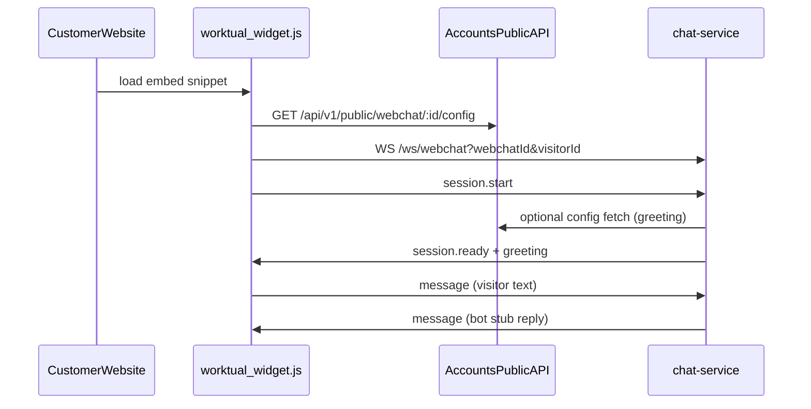

# Chat Service Plan — Webchat (dummy bot v1)

Implementation plan for CCaaS `chat-service` realtime webchat. My Accounts owns widget UI and config; CCaaS owns chat runtime.

## Ownership split

| Concern | Owner | Notes |
|---------|-------|-------|
| Widget UI, branding, embed snippet | My Accounts | Setup Workspace |
| Public config + assets | My Accounts API | Widget pulls on load |
| WebSocket realtime chat | **chat-service** | `/ws/webchat` |
| Bot NLU, agent inbox, queues, transcripts | **CCaaS** (future) | Not in Accounts DB |

**Join key:** `webchat_id` — format `wc_` + 32 hex chars (e.g. `wc_5d80cd9b1ace4080bc70717552472611`).

Full handoff contract: [webchat_widget.md](./webchat_widget.md).

## Architecture



## WebSocket endpoint

| Environment | Socket URL (set in Accounts `CCAAS_CHAT_SOCKET_URL`) |
|-------------|------------------------------------------------------|
| Local dev | `ws://localhost:3002/ws/webchat` |
| ngrok (dev) | `wss://engraving-flatness-dime.ngrok-free.dev/ws/webchat` |

Widget connects with query params:

```
wss://HOST/ws/webchat?webchatId=wc_<32hex>&visitorId=v_<id>
```

> **Note:** CCaaS uses `/ws/webchat`, not the Accounts stub path `/ccaas/chat`. Accounts must override `socketUrl` via `CCAAS_CHAT_SOCKET_URL`.

## Frame contract

JSON text frames — backward compatible with Accounts stub widget.

### Client → server

```json
{ "type": "session.start", "webchatId": "wc_…", "visitorId": "v_…", "pageUrl": "https://…" }
```

```json
{ "type": "message", "webchatId": "wc_…", "visitorId": "v_…", "text": "hello" }
```

Optional on `session.start`:

```json
{
  "consent": { "accepted": true },
  "prechatAnswers": { "field_email": "a@b.com" }
}
```

### Server → client (v1 stub)

```json
{ "type": "session.ready", "webchatId": "wc_…", "visitorId": "v_…", "conversationId": "…", "stub": true }
```

```json
{ "type": "message", "from": "bot", "text": "…", "stub": true }
```

```json
{ "type": "system", "text": "…" }
```

## Implementation phases

### Phase 1 — Done (dummy bot v1)

- [x] WebSocket gateway at `/ws/webchat` (`apps/chat-service/src/websocket/webchat-ws-gateway.ts`)
- [x] Zod frame validation (`types/webchat-frames.ts`)
- [x] In-memory session store (`services/webchat-session-store.ts`)
- [x] Dummy bot responder with `stub: true` (`services/dummy-bot.ts`)
- [x] Optional Accounts config fetch for greeting (`services/accounts-config-client.ts`)
- [x] Structured logging (`component: webchat-ws`) + `LOG_FILE` support
- [x] Health endpoints (`/health`, `/health/ready`)

### Phase 2 — NLP integration (next)

- [ ] `NlpBotResponder` implementing `BotResponder` interface
- [ ] HTTP/SSE call to `nlp-service` on visitor `message`
- [ ] Stream tokens back as `message` frames (or single reply for v1)

### Phase 3 — Agent handoff & persistence

- [ ] Store transcripts in CCaaS DB (not Accounts)
- [ ] Publish `cc.message.received` to Kafka on inbound messages
- [ ] Agent handoff events (`handoff`, `agent.joined`, `agent.typing`)
- [ ] Use Accounts config copy (`agentHandoffMessage`, busy, OOH)

### Phase 4 — Production hardening

- [ ] Redis session store (multi-instance)
- [ ] Rate limiting per `webchatId` / IP
- [ ] Metrics + alerting on connection count, message latency
- [ ] Host `worktual_widget.js` on CCaaS CDN (optional)

## Code layout

```
apps/chat-service/src/
├── index.ts                          # Fastify app + WS registration
├── types/webchat-frames.ts           # Zod schemas
├── services/
│   ├── webchat-session-store.ts      # In-memory sessions
│   ├── dummy-bot.ts                  # BotResponder (stub)
│   └── accounts-config-client.ts     # Public config pull
└── websocket/webchat-ws-gateway.ts   # /ws/webchat handler
```

## Environment variables

| Variable | Default | Purpose |
|----------|---------|---------|
| `PORT` | `3002` | HTTP + WebSocket port |
| `WEBCHAT_WS_PATH` | `/ws/webchat` | Upgrade path |
| `ACCOUNTS_PUBLIC_API_URL` | _(unset)_ | Accounts public API for greeting/config |
| `LOG_FILE` | _(unset)_ | JSON log file path |
| `LOG_LEVEL` | `info` | Pino level |

**Accounts team sets (in their env, not chat-service):**

```
CCAAS_CHAT_SOCKET_URL=wss://engraving-flatness-dime.ngrok-free.dev/ws/webchat
```

## Accounts team checklist

1. Set `CCAAS_CHAT_SOCKET_URL` to the CCaaS WebSocket URL above.
2. Ensure public config `socketUrl` reflects this value in install/embed responses.
3. Widget already sends `session.start` and `message` frames — no widget change required for v1 stub.
4. Keep using `webchatId` (`wc_…`) as the stable join key.

## Testing

```bash
# Start service
LOG_FILE=logs/chat-service.log npm run dev:chat-service

# Monitor socket logs
tail -f apps/chat-service/logs/chat-service.log | grep '"component":"webchat-ws"'

# Manual WS test
websocat "ws://localhost:3002/ws/webchat?webchatId=wc_5d80cd9b1ace4080bc70717552472611&visitorId=v_test1"
```

## Related docs

- [API.md](./API.md) — full API reference (HTTP + WebSocket)
- [locator.js](./locator.js) — CLI file map (`node docs/chatservice/locator.js`)
- [README](./README.md) — quick reference
- [webchat_widget.md](./webchat_widget.md) — My Accounts handoff contract
- [Golden path: Webchat → Agent](../golden-path/webchat-to-agent.md)
- [AI Contact Center Plan](../AI_CONTACT_CENTER_PLAN.md)
