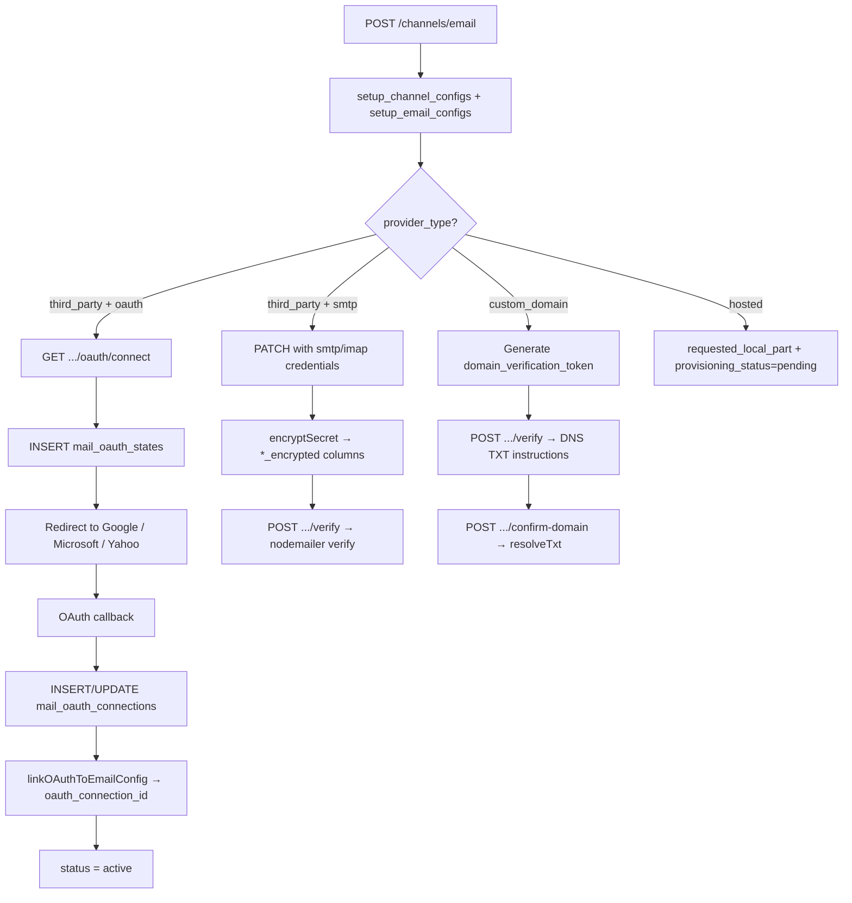
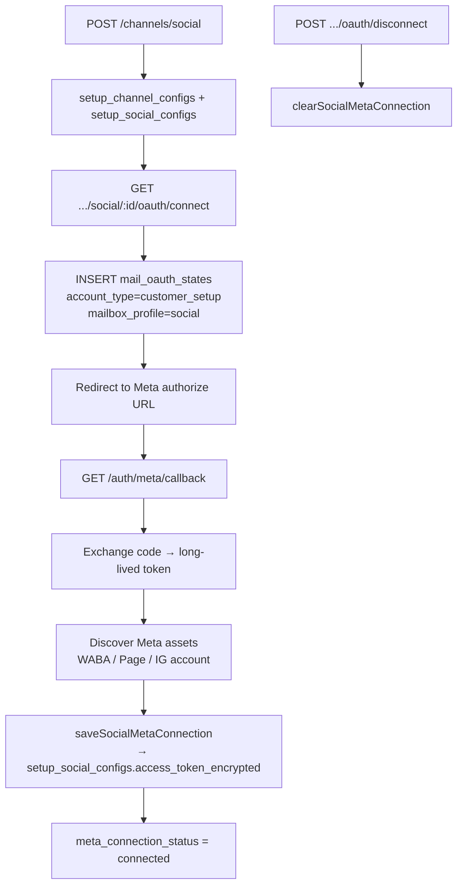
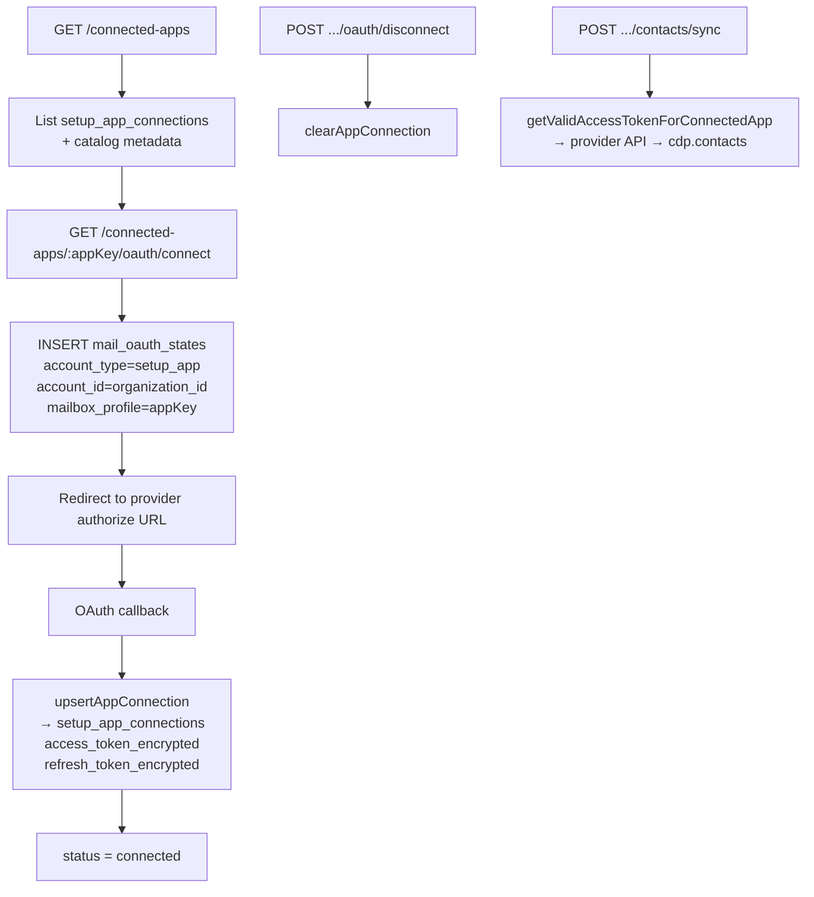

# Channel Configurations & Connectors — Tables & Flows

**Audience:** Engineers working on Setup Workspace channels, Connected Apps, and OAuth integrations in My Accounts.

**Related:** [OAUTH_CONNECTOR_DATA_CONTRACT.md](./OAUTH_CONNECTOR_DATA_CONTRACT.md) — encryption format, key handling, and access rules for all `*_encrypted` columns.

---

## 1. Overview

Setup Workspace splits **communication channels** and **third-party connectors** across two patterns:

| Area | Pattern | Parent table |
|---|---|---|
| Email, Web Chat, Social | Parent + type-specific child | `accounts.setup_channel_configs` |
| Voice (DIDs, IVR prompts) | Org-scoped, **not** a channel config | `accounts.setup_voice_*` |
| Connected Apps (HubSpot, Xero, etc.) | Org-scoped OAuth connector | `accounts.setup_app_connections` |
| Email OAuth tokens (Google / Microsoft / Yahoo) | Shared token store | `platform.mail_oauth_connections` |
| OAuth CSRF state (all flows) | Short-lived state | `platform.mail_oauth_states` |

**Schemas in use:** `accounts` (tenant data), `platform` (shared OAuth infrastructure). Runtime `search_path`: `accounts, platform, public`.

**Encryption:** All secrets use AES-256-GCM via `backend/src/lib/oauthCrypto.ts` (`MS_TOKEN_ENCRYPTION_KEY`). Stored format: `base64(iv):base64(authTag):base64(ciphertext)`.

---

## 2. Entity Relationship Diagram

```mermaid
erDiagram
  organizations ||--o{ setup_channel_configs : owns
  setup_channel_configs ||--o| setup_email_configs : email
  setup_channel_configs ||--o| setup_webchat_configs : web_chat
  setup_channel_configs ||--o| setup_social_configs : social
  setup_channel_configs ||--o{ setup_crm_channel_agents : crm_agents
  setup_email_configs }o--o| mail_oauth_connections : oauth_link
  organizations ||--o{ setup_app_connections : connected_apps
  organizations ||--o{ setup_voice_prompt_profiles : voice
  organizations ||--o{ setup_voice_dids : voice
  setup_voice_dids }o--o| setup_users : route_user
  setup_voice_dids }o--o| setup_ccaas_queues : route_queue
  setup_voice_dids }o--o| setup_voice_prompt_profiles : prompts
  setup_crm_channel_agents }o--|| setup_users : agent
  mail_oauth_states }o..o mail_oauth_connections : oauth_flow_anchor
```

**Delete cascade:** Removing a row from `setup_channel_configs` cascades to `setup_email_configs`, `setup_webchat_configs`, `setup_social_configs`, and `setup_crm_channel_agents`.

---

## 3. Tables Reference

### 3.1 Core — Channel parent

#### `accounts.setup_channel_configs`

Top-level record for every Setup communication channel (email, web chat, social). Voice is **not** modeled here.

| Column | Type | Description |
|---|---|---|
| `id` | UUID PK | Channel identifier |
| `organization_id` | UUID FK → `organizations` | Owning org |
| `channel_type` | VARCHAR(32) | `email`, `web_chat`, `social` |
| `name` | VARCHAR(255) | Display name |
| `status` | VARCHAR(32) | e.g. `pending`, `active`, `inactive` |
| `product_ids` | JSONB | Purchased products using this channel |
| `created_at`, `updated_at` | TIMESTAMPTZ | |

**Index:** `idx_setup_channel_configs_org (organization_id)`  
**RLS:** org-scoped via `platform.rls_org_ok(organization_id)`

**Code:** `setupChannels.repo.ts` · `channels.ts` · `GET/POST/PATCH/DELETE /api/v1/me/setup/channels/*`

---

### 3.2 Email channel

#### `accounts.setup_email_configs`

Email integration settings: hosted mailbox, custom domain, third-party OAuth, or SMTP/IMAP credentials.

| Column | Type | Description |
|---|---|---|
| `id` | UUID PK | Row id |
| `channel_config_id` | UUID UNIQUE FK → `setup_channel_configs` | Parent channel |
| `provider_type` | VARCHAR(32) | `third_party`, `custom_domain`, `hosted` |
| `third_party_mode` | VARCHAR(32) | `oauth` or `smtp` |
| `sender_email`, `sender_name`, `reply_to` | VARCHAR | From / reply headers |
| `domain` | VARCHAR(255) | Custom sending domain |
| `domain_verification_status` | VARCHAR(32) | DNS verification state |
| `domain_verification_token` | VARCHAR(128) | TXT record value |
| `smtp_host`, `smtp_port`, `smtp_secure` | VARCHAR/INT/BOOL | SMTP server |
| `imap_host`, `imap_port`, `imap_secure` | VARCHAR/INT/BOOL | IMAP server |
| **`smtp_user_encrypted`** | TEXT | **Encrypted** SMTP username |
| **`smtp_pass_encrypted`** | TEXT | **Encrypted** SMTP password |
| **`imap_user_encrypted`** | TEXT | **Encrypted** IMAP username |
| **`imap_pass_encrypted`** | TEXT | **Encrypted** IMAP password |
| `oauth_connection_id` | UUID FK → `mail_oauth_connections` | Link to OAuth token row |
| `oauth_provider` | VARCHAR(32) | `google`, `microsoft`, `yahoo` |
| `ccaas_handler` | VARCHAR(32) | `bot`, `human`, `bot_then_human` |
| `requested_local_part` | VARCHAR(128) | Hosted mailbox local part |
| `hosted_domain` | VARCHAR(255) | Default `vectone.tech` |
| `provisioning_status` | VARCHAR(32) | Hosted mailbox provisioning |
| `created_at`, `updated_at` | TIMESTAMPTZ | |

**Code:** `setupChannels.repo.ts` · `channels.ts` · `/api/v1/me/setup/channels/email/*`

---

#### `platform.mail_oauth_connections`

Shared OAuth token store for **email** integrations (Setup email channels and internal staff mailboxes). Also used as an OAuth **state anchor** for Connected Apps and Meta social flows — social and connected-app tokens are stored elsewhere.

| Column | Type | Description |
|---|---|---|
| `id` | UUID PK | Referenced by `setup_email_configs.oauth_connection_id` |
| `account_type` | VARCHAR(16) | Context discriminator (see table below) |
| `account_id` | UUID | Context-dependent id |
| `mailbox_profile` | VARCHAR(16) | Context-dependent profile |
| `account_email` | VARCHAR(255) | Connected mailbox email |
| `account_name` | VARCHAR(255) | Display name |
| `ms_tenant_id` | VARCHAR(64) | Microsoft tenant id (or provider hint) |
| **`access_token_encrypted`** | TEXT NOT NULL | **Encrypted** OAuth access token |
| **`refresh_token_encrypted`** | TEXT NOT NULL | **Encrypted** OAuth refresh token |
| `expires_at` | TIMESTAMPTZ | Token expiry |
| `scope` | TEXT | Granted OAuth scopes |
| `needs_reauth` | BOOLEAN | `true` = user must reconnect |
| `created_at`, `updated_at` | TIMESTAMPTZ | |

**Unique:** `(account_type, account_id, mailbox_profile)`  
**Indexes:** `idx_mail_oauth_connections_profile`, `idx_mail_oauth_connections_email`

**`account_type` / `mailbox_profile` conventions:**

| account_type | account_id | mailbox_profile | Stores tokens? | Purpose |
|---|---|---|---|---|
| `internal` | staff `users.id` | `inbox`, `finance`, … | Yes | Internal mail module |
| `customer_setup` | `setup_channel_configs.id` | `email` | Yes | Setup email OAuth |
| `customer_setup` | `setup_channel_configs.id` | `social` | No | Meta OAuth state anchor only |
| `setup_app` | `organizations.id` | app catalog key | No | Connected Apps OAuth state anchor only |

**Code:** `mailOAuth.repo.ts` · `googleOAuth.ts`, `yahooOAuth.ts`, `ms-graph/oauth.ts`, `ms-graph/tokens.ts`

---

#### `platform.mail_oauth_states`

Short-lived OAuth CSRF state (10-minute TTL). Used by **all** OAuth flows — email, social, and connected apps.

| Column | Type | Description |
|---|---|---|
| `state` | VARCHAR(128) PK | Random hex token |
| `account_type` | VARCHAR(16) | Same convention as above |
| `account_id` | UUID | Flow context id |
| `mailbox_profile` | VARCHAR(16) | Flow context profile |
| `return_path` | VARCHAR(512) | Frontend redirect after OAuth |
| `expires_at` | TIMESTAMPTZ | TTL |
| `created_at` | TIMESTAMPTZ | |

**Index:** `idx_mail_oauth_states_expires_at`

**Code:** `mailOAuth.repo.ts` via `createOAuthState`, `consumeOAuthState`

---

### 3.3 Web chat channel

#### `accounts.setup_webchat_configs`

Web chat widget identity and personalisation. **No OAuth or credentials.**

| Column | Type | Description |
|---|---|---|
| `channel_config_id` | UUID PK FK → `setup_channel_configs` | Parent channel |
| `webchat_id` | VARCHAR(64) UNIQUE | Public widget identifier |
| `title`, `alias_title` | VARCHAR(255) | Widget labels |
| `description` | TEXT | |
| `greeting_message` | TEXT NOT NULL | Initial bot message |
| `trigger_message` | TEXT | Proactive trigger copy |
| `personalisation` | JSONB | Colours, logos, sounds, layout |
| `created_at`, `updated_at` | TIMESTAMPTZ | |

Widget assets (logos, sounds) are stored on the filesystem (`uploads/webchat/`), not in the database.

**Code:** `setupWebchat.repo.ts` · `webchat.ts` · `/api/v1/me/setup/channels/web-chat/*`  
**Public read:** `GET /api/v1/public/webchat/:webchatId/config`

---

### 3.4 Social channel (Meta)

#### `accounts.setup_social_configs`

WhatsApp, Instagram, and Facebook channel configuration. **Meta OAuth token is stored directly on this table** (not in `mail_oauth_connections`).

| Column | Type | Description |
|---|---|---|
| `channel_config_id` | UUID PK FK → `setup_channel_configs` | Parent channel |
| `provider` | VARCHAR(32) | `whatsapp`, `instagram`, `facebook` |
| `bot_enabled` | BOOLEAN | CCaaS inbox bot mode |
| `usage_mode` | VARCHAR(32) | `inbox` or `templates` |
| `display_number` | VARCHAR(64) | WhatsApp display number |
| **`access_token_encrypted`** | TEXT | **Encrypted** Meta long-lived token |
| `token_expires_at` | TIMESTAMPTZ | Token expiry |
| `meta_user_id` | VARCHAR(64) | Meta user id |
| `meta_user_name` | VARCHAR(255) | Meta user display name |
| `waba_id` | VARCHAR(64) | WhatsApp Business Account id |
| `phone_number_id` | VARCHAR(64) | WhatsApp phone number id |
| `page_id` | VARCHAR(64) | Facebook Page id |
| `ig_business_account_id` | VARCHAR(64) | Instagram Business account id |
| `meta_connected_at` | TIMESTAMPTZ | Last successful connect |
| `meta_connection_status` | VARCHAR(32) | `disconnected`, `connected`, `needs_reauth` |
| `created_at`, `updated_at` | TIMESTAMPTZ | |

**Indexes:** `idx_setup_social_configs_provider`, partial indexes on `phone_number_id`, `page_id`

**Code:** `setupChannels.repo.ts` · `social.ts` · `metaOAuth.ts` · `/api/v1/me/setup/channels/social/*`

---

### 3.5 Voice channel

Voice is org-scoped and **does not** use `setup_channel_configs`.

#### `accounts.setup_voice_prompt_profiles`

IVR / voice prompt profiles (slot-based JSON). No OAuth.

| Column | Type | Description |
|---|---|---|
| `id` | UUID PK | |
| `organization_id` | UUID FK → `organizations` | |
| `name` | VARCHAR(255) | Profile name |
| `description` | TEXT | |
| `status` | VARCHAR(32) | Default `active` |
| `slots` | JSONB | Prompt slot definitions |
| `created_at`, `updated_at` | TIMESTAMPTZ | |

Audio files: filesystem (`uploads/voice/` or `VOICE_MEDIA_ROOT`).

#### `accounts.setup_voice_dids`

Phone number (DID) assignment and call routing.

| Column | Type | Description |
|---|---|---|
| `id` | UUID PK | |
| `organization_id` | UUID FK → `organizations` | |
| `phone_number` | VARCHAR(64) | E.164 or local format |
| `product_id` | VARCHAR(64) | e.g. `contact-center`, `crm` |
| `routing_type` | VARCHAR(16) | Routing mode |
| `routing_user_id` | UUID FK → `setup_users` | Direct-to-agent |
| `routing_queue_id` | UUID FK → `setup_ccaas_queues` | Route to CCaaS queue |
| `prompt_profile_id` | UUID FK → `setup_voice_prompt_profiles` | IVR prompts |
| `status` | VARCHAR(32) | Default `active` |
| `created_at`, `updated_at` | TIMESTAMPTZ | |

**Unique:** `(organization_id, lower(phone_number))`

**Code:** `setupVoice.repo.ts` · `voice.ts` · `/api/v1/me/setup/voice/*`

---

### 3.6 CRM channel agents (Phase 2 stub)

#### `accounts.setup_crm_channel_agents`

Maps setup users to channel configs for CRM product routing. **Table exists; API not yet implemented.**

| Column | Type | Description |
|---|---|---|
| `id` | UUID PK | |
| `channel_config_id` | UUID FK → `setup_channel_configs` | |
| `user_id` | UUID FK → `setup_users` | Agent user |
| `created_at` | TIMESTAMPTZ | |

**Unique:** `(channel_config_id, user_id)`

---

### 3.7 Connected Apps (Connectors)

#### `accounts.setup_app_connections`

Org-scoped third-party OAuth integrations — CRM, accounting, calendar, ads, meetings, storage.

| Column | Type | Description |
|---|---|---|
| `id` | UUID PK | |
| `organization_id` | UUID FK → `organizations` | Owning org |
| `app_key` | VARCHAR(64) | Catalog key (e.g. `hubspot`, `xero`) |
| `provider` | VARCHAR(32) | OAuth provider id |
| `status` | VARCHAR(32) | `disconnected`, `connected`, `needs_reauth` |
| `account_email` | VARCHAR(255) | Connected account email |
| `account_name` | VARCHAR(255) | Display name |
| `external_account_id` | VARCHAR(255) | Provider account / tenant id |
| `scopes` | TEXT | Granted OAuth scopes |
| **`access_token_encrypted`** | TEXT | **Encrypted** access token |
| **`refresh_token_encrypted`** | TEXT | **Encrypted** refresh token |
| `token_expires_at` | TIMESTAMPTZ | Token expiry |
| `metadata` | JSONB | Provider-specific data (e.g. Xero tenants, Shopify shop) |
| `connected_at` | TIMESTAMPTZ | Last successful connect |
| `created_at`, `updated_at` | TIMESTAMPTZ | |

**Unique:** `(organization_id, app_key)` — one connection per app per org  
**Indexes:** `idx_setup_app_connections_org`, `idx_setup_app_connections_provider`  
**RLS:** org-scoped

**Supported apps (catalog):**

| app_key | Provider | Category |
|---|---|---|
| `hubspot` | hubspot | CRM |
| `xero` | xero | Accounting |
| `shopify` | shopify | Ecommerce |
| `google-calendar` | google | Calendar |
| `microsoft-365` | microsoft | Calendar |
| `ms-dynamics` | microsoft | CRM |
| `gmail` | google | Email |
| `google-ads` | google | Advertising |
| `linkedin` | linkedin | Advertising |
| `google-meet` | google | Meeting |
| `teams` | microsoft | Meeting |
| `zoom` | zoom | Meeting |
| `google-drive` | google | Storage |
| `google-sheets` | google | Storage |

**Code:** `setupAppConnections.repo.ts` · `integrations.ts`, `connectedAppsOAuth.ts`, `connectedAppsTokens.ts` · `/api/v1/me/setup/connected-apps/*`

---

## 4. Credentials & OAuth Storage Summary

| Credential type | Table | Encrypted columns | Plaintext metadata |
|---|---|---|---|
| Email OAuth (Google / Microsoft / Yahoo) | `platform.mail_oauth_connections` | `access_token_encrypted`, `refresh_token_encrypted` | `account_email`, `scope`, `expires_at`, `needs_reauth` |
| Email SMTP / IMAP | `accounts.setup_email_configs` | `smtp_user_encrypted`, `smtp_pass_encrypted`, `imap_user_encrypted`, `imap_pass_encrypted` | `smtp_host/port`, `imap_host/port` |
| Social Meta token | `accounts.setup_social_configs` | `access_token_encrypted` | `meta_user_id`, `waba_id`, `phone_number_id`, `meta_connection_status` |
| Connected Apps | `accounts.setup_app_connections` | `access_token_encrypted`, `refresh_token_encrypted` | `app_key`, `provider`, `status`, `scopes`, `metadata` |
| OAuth CSRF state | `platform.mail_oauth_states` | — (no secrets) | `state`, `return_path`, `expires_at` |
| Web chat | — | No credentials | Widget config only |
| Voice | — | No credentials | Routing + prompt JSON only |

**Token refresh:**
- Connected Apps → `connectedAppsTokens.ts` (`getValidAccessTokenForConnectedApp`)
- Mail OAuth → `ms-graph/tokens.ts` (lock + refresh, re-encrypt before save)

**Re-encryption CLI:** `cd backend && yarn tokens:reencrypt [--dry-run]`

---

## 5. Application Flows

### 5.1 Channel creation (general)

```text
POST /api/v1/me/setup/channels/{type}
  │
  ├─► INSERT accounts.setup_channel_configs
  │     (organization_id, channel_type, name, status=pending, product_ids)
  │
  └─► INSERT type-specific child table
        • email  → setup_email_configs
        • web_chat → setup_webchat_configs (+ generate webchat_id)
        • social → setup_social_configs
  │
  └─► Return DTO (secrets never exposed to frontend)
```

Product gating: email and social require an active `contact-center` or `campaign` subscription. Web chat defaults to `contact-center`.

---

### 5.2 Email channel flows



**OAuth callbacks:** `/auth/google/callback`, `/auth/yahoo/callback`, `/auth/microsoft/callback`

---

### 5.3 Social (Meta) OAuth flow



> Meta tokens are stored in `setup_social_configs`, **not** in `mail_oauth_connections`. The mail OAuth state table is used only for CSRF protection during the redirect.

---

### 5.4 Connected Apps OAuth flow



**OAuth callbacks (by provider):**
- Google apps → `/auth/google/callback` (when `account_type=setup_app`)
- Microsoft apps → `/auth/microsoft/callback` (intended; verify route wiring)
- Meta, HubSpot, Shopify, Zoom, Xero, LinkedIn → provider-specific callback routes in `oauth-callbacks.ts`

---

### 5.5 Web chat flow

```text
POST /channels/web-chat
  → setup_channel_configs + setup_webchat_configs (webchat_id generated)
  → Optional asset uploads → filesystem (uploads/webchat/)

Public widget loads:
  GET /api/v1/public/webchat/:webchatId/config
  → reads setup_webchat_configs (no auth required)
```

---

### 5.6 Voice flow

```text
Prompt profiles:
  POST /voice/prompt-profiles → setup_voice_prompt_profiles
  Audio upload → filesystem

DIDs:
  POST /voice/dids → setup_voice_dids
  Route to: setup_users | setup_ccaas_queues | setup_voice_prompt_profiles
```

---

## 6. API Route Index

| Area | Routes | Service |
|---|---|---|
| Channel list | `GET /api/v1/me/setup/channels?type=` | `channels.ts` |
| Email CRUD + OAuth | `/api/v1/me/setup/channels/email/*` | `channels.ts` |
| Social CRUD + Meta OAuth | `/api/v1/me/setup/channels/social/*` | `social.ts` |
| Web chat CRUD | `/api/v1/me/setup/channels/web-chat/*` | `webchat.ts` |
| Public web chat | `/api/v1/public/webchat/:webchatId/*` | `publicWebchat.ts` |
| Voice prompts / DIDs | `/api/v1/me/setup/voice/*` | `voice.ts` |
| Connected Apps | `/api/v1/me/setup/connected-apps/*` | `integrations.ts` |
| OAuth callbacks | `/auth/google/callback`, `/auth/yahoo/callback`, `/auth/microsoft/callback`, `/auth/meta/callback` | `oauth-callbacks.ts` |

Route registration: `backend/src/modules/setup-workspace/native-routes.ts`

---

## 7. Repository & Service Map

| Table(s) | Repository | Service(s) |
|---|---|---|
| `setup_channel_configs`, `setup_email_configs`, `setup_social_configs` | `setupChannels.repo.ts` | `channels.ts`, `social.ts` |
| `setup_webchat_configs` | `setupWebchat.repo.ts` | `webchat.ts` |
| `setup_voice_*` | `setupVoice.repo.ts` | `voice.ts` |
| `setup_app_connections` | `setupAppConnections.repo.ts` | `integrations.ts`, `connectedAppsOAuth.ts`, `connectedAppsTokens.ts` |
| `mail_oauth_connections`, `mail_oauth_states` | `mailOAuth.repo.ts` | `googleOAuth.ts`, `yahooOAuth.ts`, `metaOAuth.ts`, `ms-graph/*` |

---

## 8. Migration Source Files

| File | Contents |
|---|---|
| `backend/database/v2/06_accounts_setup_tables.sql` | All `setup_channel_*`, `setup_voice_*`, `setup_crm_channel_agents` |
| `backend/database/v2/12_setup_app_connections.sql` | `setup_app_connections` |
| `backend/database/schema.sql` | Original `mail_oauth_connections`, `mail_oauth_states` |
| `backend/database/v2/01_move_tables.sql` | Moves mail OAuth tables → `platform` schema |

---

## 9. Adjacent Tables (routing, not credentials)

These tables relate to **how channels are routed to agents** but do not store OAuth tokens or credentials:

| Table | Purpose |
|---|---|
| `accounts.setup_ccaas_queues` | CCaaS queue definitions |
| `accounts.setup_ccaas_queue_agents` | Agent ↔ queue mapping with channel handle flags (`handles_email`, `handles_whatsapp`, `handles_chat`, etc.) |
| `accounts.organizations` | Parent org for all setup tables |

---

## 10. Security Checklist

- [ ] All reads scoped by `organization_id` (never query by provider alone)
- [ ] Decrypt tokens only in backend memory; never return to frontend
- [ ] Reject rows with `needs_reauth = true` or `status = needs_reauth`
- [ ] Re-encrypt refreshed tokens before database update
- [ ] Use `backend/src/lib/oauthCrypto.ts` for all new connector secret fields
- [ ] Name secret columns with `*_encrypted` suffix

See [OAUTH_CONNECTOR_DATA_CONTRACT.md](./OAUTH_CONNECTOR_DATA_CONTRACT.md) for full encryption spec, key rotation, and integration checklist.
