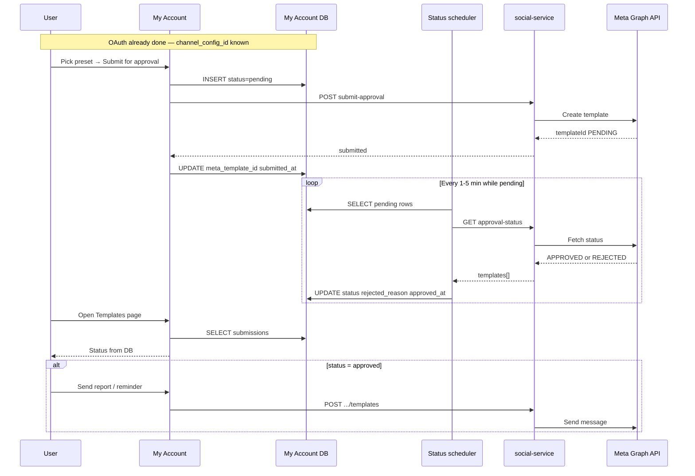

# WhatsApp UTILITY templates — post-OAuth approval flow (My Account)

**Audience:** My Account engineers  
**Assumption:** WhatsApp OAuth is **already done**. You have `channel_config_id` (same as CCaaS `channelConfigId`) and a connected row in `accounts.setup_social_configs`.

**API reference:** [WHATSAPP_TEMPLATE_API.md](./WHATSAPP_TEMPLATE_API.md)

---

## What you build (after OAuth)

Worktual UTILITY presets (report / reminder) are **drafts in your UI**. Meta must **approve** each template per WABA before send.

```text
Show presets → Submit for approval → PENDING (store in My Account DB)
              → Scheduler polls CCaaS → APPROVED | REJECTED (update My Account DB)
              → If APPROVED: enable + send via CCaaS
```

**Status storage:** My Account (`accounts.whatsapp_template_submissions`).  
**CCaaS social-service:** submit / poll / send only — does **not** persist template status.

---

## Flow

```text
┌──────────────────────────────────────────────────────────────────┐
│ Starting point: channel_config_id + waba_id already in DB        │
├──────────────────────────────────────────────────────────────────┤
│ 1. User picks UTILITY preset → Submit for approval               │
│    → INSERT whatsapp_template_submissions (status = pending)     │
│    → POST CCaaS .../templates/submit-approval                    │
│    → UPDATE meta_template_id, submitted_at                       │
│                                                                  │
│ 2. Scheduler (every 1–5 min) on rows where status = pending      │
│    → GET CCaaS .../templates/approval-status                     │
│    → UPDATE status, rejected_reason, approved_at                 │
│                                                                  │
│ 3. UI reads My Account DB                                        │
│    → Pending / Approved / Rejected badges                        │
│    → "Use for reports" only when approved                        │
│                                                                  │
│ 4. Send (after approved)                                         │
│    → POST CCaaS .../templates                                    │
└──────────────────────────────────────────────────────────────────┘
```



---

## Where status is updated (My Account only)

| When | Action |
|------|--------|
| User submits | `status = pending`, save `meta_template_id`, `submitted_at` |
| Scheduler poll | Map Meta → `pending` / `approved` / `rejected`, set `rejected_reason`, `approved_at`, `last_status_check_at` |
| User disables in UI | `enabled = false` (Meta status unchanged) |

CCaaS returns live Meta status on each poll — **My Account writes it to your DB**.

---

## Status values

| My Account `status` | Meta | UI | Send? |
|---------------------|------|-----|-------|
| `draft` | — | Not submitted | No |
| `pending` | `PENDING` | Under Meta review | No |
| `approved` | `APPROVED` | Ready | Yes |
| `rejected` | `REJECTED` | Show reason; **new name** to resubmit | No |
| `disabled` | (any) | User turned off | No |

```text
PENDING  → pending
APPROVED → approved  (+ approved_at)
REJECTED → rejected  (+ rejected_reason)
```

---

## Database

### `accounts.whatsapp_template_submissions`

| Column | Notes |
|--------|--------|
| `channel_config_id` | From existing OAuth — CCaaS `channelConfigId` |
| `preset_key` | e.g. `daily_report` |
| `template_name` | Meta name, `^[a-z0-9_]+$` |
| `language` | e.g. `en` — must match send `languageCode` |
| `category` | `UTILITY` |
| `meta_template_id` | From submit response |
| `status` | See table above |
| `rejected_reason` | From scheduler poll |
| `components_json` | BODY sent to Meta |
| `submitted_at`, `approved_at`, `last_status_check_at` | |
| `enabled` | User toggle — only if `approved` |

**Unique:** `(channel_config_id, template_name, language)`

```sql
CREATE TABLE accounts.whatsapp_template_submissions (
  id UUID PRIMARY KEY DEFAULT gen_random_uuid(),
  organization_id UUID NOT NULL REFERENCES accounts.organizations(id) ON DELETE CASCADE,
  channel_config_id UUID NOT NULL REFERENCES accounts.setup_channel_configs(id) ON DELETE CASCADE,
  preset_key VARCHAR(64) NOT NULL,
  template_name VARCHAR(512) NOT NULL,
  language VARCHAR(16) NOT NULL,
  category VARCHAR(32) NOT NULL DEFAULT 'UTILITY',
  meta_template_id VARCHAR(64),
  status VARCHAR(32) NOT NULL DEFAULT 'draft',
  rejected_reason TEXT,
  components_json JSONB NOT NULL DEFAULT '[]'::jsonb,
  submitted_at TIMESTAMPTZ,
  approved_at TIMESTAMPTZ,
  last_status_check_at TIMESTAMPTZ,
  enabled BOOLEAN NOT NULL DEFAULT false,
  created_by_user_id UUID,
  created_at TIMESTAMPTZ NOT NULL DEFAULT NOW(),
  updated_at TIMESTAMPTZ NOT NULL DEFAULT NOW(),
  CONSTRAINT uq_whatsapp_template_submissions_name
    UNIQUE (channel_config_id, template_name, language)
);

CREATE INDEX idx_whatsapp_template_submissions_pending
  ON accounts.whatsapp_template_submissions (last_status_check_at)
  WHERE status = 'pending';
```

### Presets (code or table)

| preset_key | template_name | body (example) |
|------------|---------------|----------------|
| `daily_report` | `worktual_daily_report` | Your Worktual daily report for {{1}} is ready. Open: {{2}} |
| `appointment_reminder` | `worktual_appointment_reminder` | Reminder: your appointment on {{1}} at {{2}}. |

---

## Step 1 — Submit for approval (sync)

When user clicks **Submit**:

1. Load preset → build `components_json`.
2. `INSERT` row with `status = pending`.
3. `POST` CCaaS:

```http
POST {CCAAS_BASE}/internal/v1/whatsapp/templates/submit-approval
Content-Type: application/json
x-internal-service-key: {KEY}

{
  "channelConfigId": "<channel_config_id>",
  "name": "worktual_daily_report",
  "language": "en",
  "category": "UTILITY",
  "components": [
    { "type": "BODY", "text": "Your Worktual daily report for {{1}} is ready. Open: {{2}}" }
  ]
}
```

4. On **200**: save `meta_template_id`, `submitted_at`.
5. On error: revert row to `draft` or delete; show error.

**QA base:** `https://rebuild-ccaas-api.worktual.com/social-api`

---

## Step 2 — Scheduler updates status (async)

Run every **1–5 minutes**.

```sql
SELECT * FROM accounts.whatsapp_template_submissions
WHERE status = 'pending'
ORDER BY last_status_check_at NULLS FIRST
LIMIT 100;
```

For each row:

```http
GET {CCAAS_BASE}/internal/v1/whatsapp/templates/approval-status
  ?channelConfigId={channel_config_id}
  &templateName={template_name}
  &language={language}
x-internal-service-key: {KEY}
```

Update row from `templates[0].status` and `rejectedReason`. Stop polling when `approved` or `rejected`.

```typescript
function mapMetaStatus(meta: string) {
  if (meta === "APPROVED") return "approved";
  if (meta === "REJECTED") return "rejected";
  return "pending";
}
```

---

## Step 3 — UI (read DB)

- List `whatsapp_template_submissions` for the org’s WhatsApp `channel_config_id`.
- Badge from `status` — no live CCaaS call on page load (optional one-shot poll for pending).
- **Enable for reports** only when `status = approved`.
- **Rejected:** show `rejected_reason`; resubmit requires a **new** `template_name`.

---

## Step 4 — Send (after approved)

Only when DB `status = approved`:

```http
POST {CCAAS_BASE}/internal/v1/whatsapp/templates
```

```json
{
  "channelConfigId": "<channel_config_id>",
  "to": "919876543210",
  "templateName": "worktual_daily_report",
  "languageCode": "en",
  "components": [
    {
      "type": "body",
      "parameters": [
        { "type": "text", "text": "21 Aug 2026" },
        { "type": "text", "text": "https://app.example.com/reports/abc" }
      ]
    }
  ]
}
```

- `to`: country code + digits, no `+`
- `languageCode` must match submit language exactly

---

## CCaaS endpoints (post-OAuth only)

| Step | Method | Path |
|------|--------|------|
| Submit | `POST` | `/internal/v1/whatsapp/templates/submit-approval` |
| Scheduler | `GET` | `/internal/v1/whatsapp/templates/approval-status` |
| List (optional) | `GET` | `/internal/v1/whatsapp/templates?status=APPROVED` |
| Detail (optional) | `GET` | `/internal/v1/whatsapp/templates/detail` |
| Send | `POST` | `/internal/v1/whatsapp/templates` |

Full URLs (QA / ngrok): [WHATSAPP_TEMPLATE_API.md](./WHATSAPP_TEMPLATE_API.md)

---

## Checklist

- [ ] Table `whatsapp_template_submissions`
- [ ] Preset catalog in UI
- [ ] Submit → insert `pending` + CCaaS submit-approval
- [ ] Scheduler → poll approval-status → update DB
- [ ] UI from DB; enable send only when `approved`
- [ ] Rejected → new template name on resubmit
- [ ] Env: `CCAAS_SOCIAL_API_BASE`, `INTERNAL_SERVICE_KEY`
