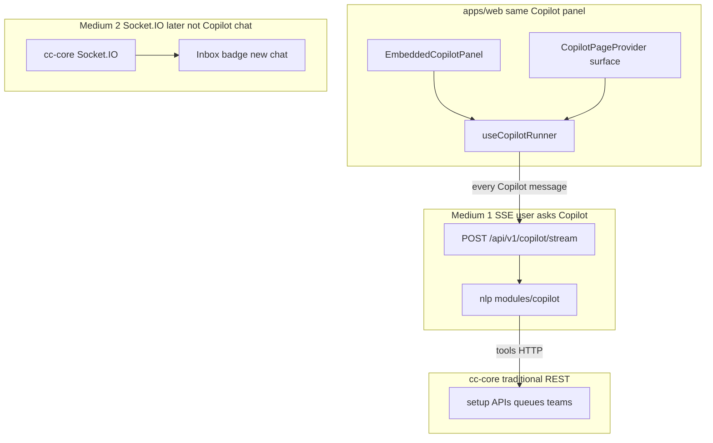
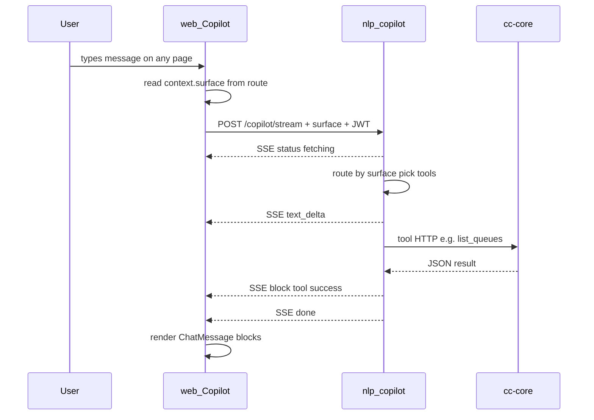
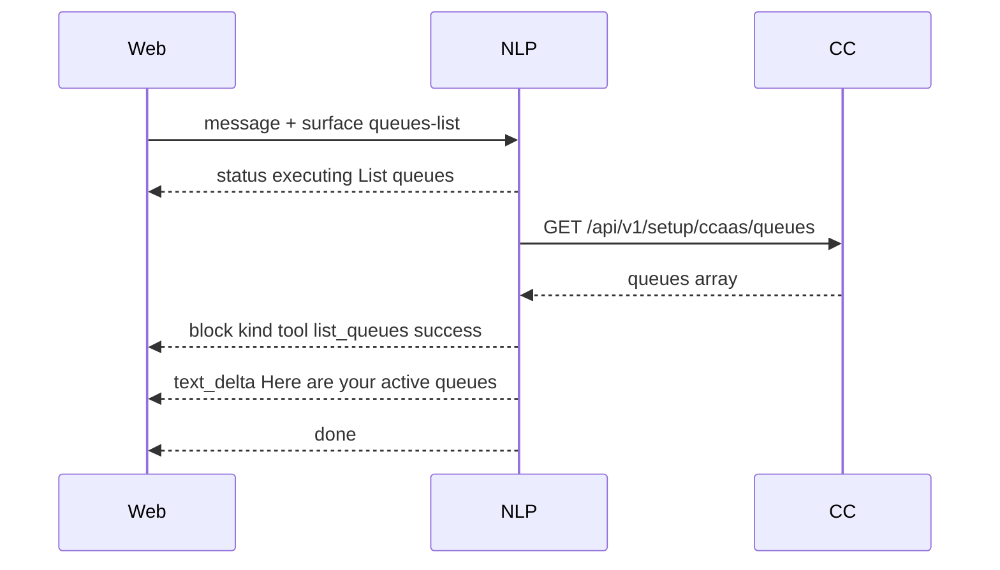
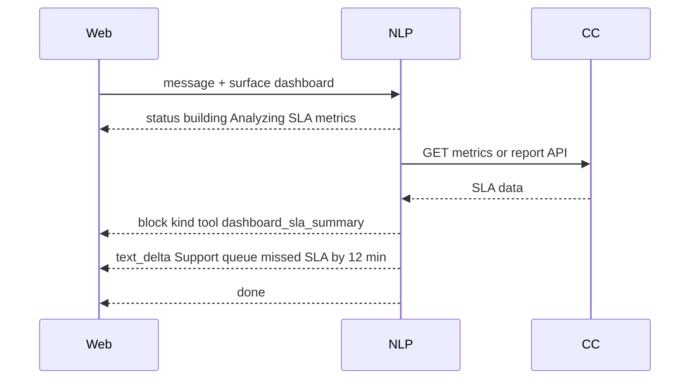
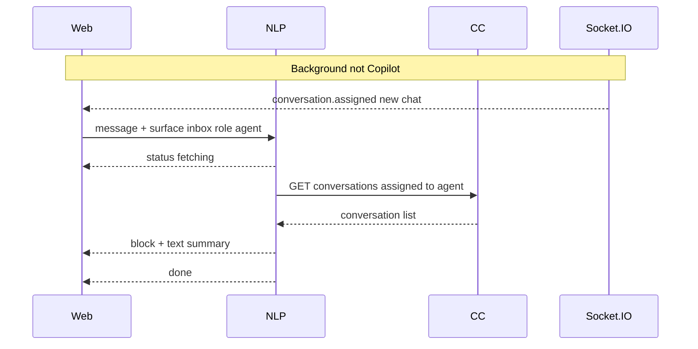
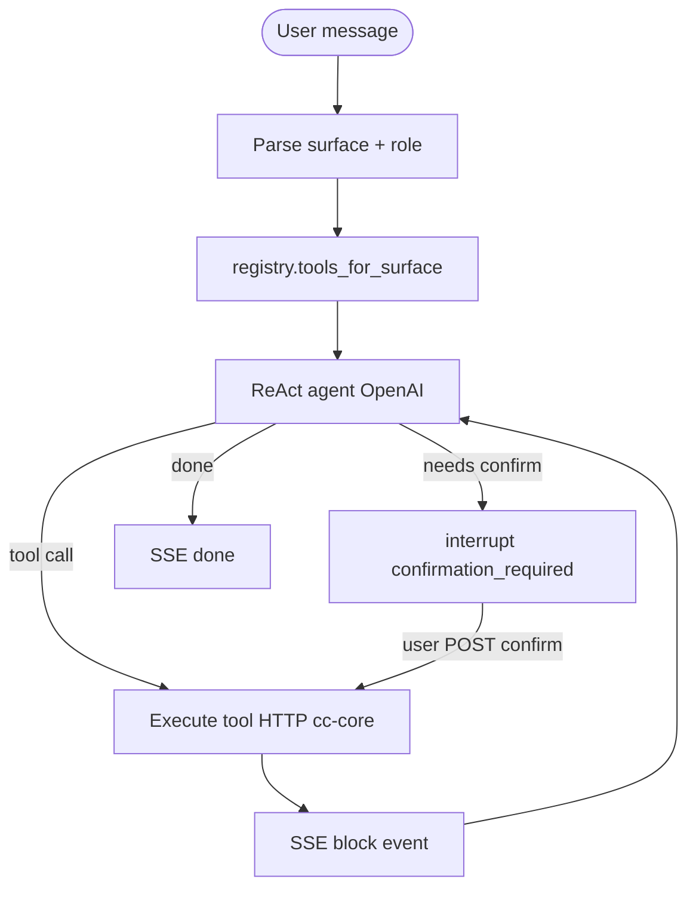

# Copilot Backend (SSE)

> **Status:** Planning  
> **Priority:** Build first (before webchat NLP)  
> **Owner:** `apps/nlp` only — full Copilot backend lives here  
> **Related:** [NLP Backend Roadmap](./NLP_BACKEND_ROADMAP.md)

One Copilot panel serves **all admin pages** (queues, config, dashboard, reports) and **agent workspace**. Same UI, same SSE endpoint, same code structure — only `context.surface` and **tools** change per page.

---

## Two mediums, one product



| Medium | When | Used for |
|--------|------|----------|
| **SSE** | User sends Copilot message | Answers, tools, reports, config — **all surfaces** |
| **Socket.IO** | Server pushes without user ask | New chat assigned, SLA alert — **workspace only (later)** |
| **REST** | User clicks Save / table load | Traditional forms — **not Copilot** |

**Rule:** Copilot chat is always SSE. Socket.IO never replaces Copilot; it only powers live inbox/monitoring.

---

## End-to-end flow (all surfaces)



---

## Example flows

### Example A — Queues list (`surface: queues-list`)

**User on** `/admin/workforce/queues`  
**User says:** `"List all queues"`



**SSE events (abbreviated):**

```text
event: status
data: {"phase":"executing","label":"Fetching queues"}

event: block
data: {"kind":"tool","tool":"list_queues","status":"success","result":{"queues":[...]}}

event: text_delta
data: {"delta":"You have 3 queues. 2 are active."}

event: done
data: {"turnId":"..."}
```

---

### Example B — Dashboard (`surface: dashboard`)

**User on** `/admin/dashboard`  
**User says:** `"Which queues missed SLA today?"`



Same SSE pipe; NLP uses `surface=dashboard` to enable **dashboard tools** instead of queue CRUD tools.

---

### Example C — Agent workspace (`surface: inbox`)

**User on** `/agent/workspace`  
**User says:** `"Summarize my open conversations"`



Copilot turn = **SSE**. New chat arriving = **Socket.IO** (separate, does not block Copilot).

---

## Same code structure (web + NLP)

### Principle

| Layer | Pattern |
|-------|---------|
| **One entry point** | Single SSE endpoint + single Copilot runner |
| **Surface routing** | `context.surface` selects tools + prompt slice |
| **Add new page** | Register surface + add tool module — no new transport |

### Web (`apps/web`)

```text
apps/web/src/features/assistant/
├── copilot-page-context.tsx     # surface from route (extend CopilotSurface enum)
├── copilot-context.ts           # welcome + quick prompts per surface
├── copilot-engine.ts            # ChatMessage types, local regex fast-path
├── assistant-api.ts             # streamCopilot() SSE client — ONE function all pages
├── use-copilot-runner.ts        # submit() — ONE handler all pages
└── copilot-actions.ts           # deprecated for server tools; keep draft sync only

apps/web/src/components/assistant/
└── embedded-copilot-panel.tsx   # same panel mounted in AppLayout everywhere
```

**Adding a new surface (e.g. `reports`):**

1. Add `"reports"` to `CopilotSurface` in [`copilot-page-context.tsx`](../../apps/web/src/features/assistant/copilot-page-context.tsx)
2. Map route in `surfaceFromLocation()`
3. Add welcome + quick prompts in [`copilot-context.ts`](../../apps/web/src/features/assistant/copilot-context.ts)
4. No new SSE client — `streamCopilot()` already sends `context.surface`

### NLP (`apps/nlp`)

```text
apps/nlp/src/app/
├── routers/
│   └── copilot.py                    # POST /copilot, /copilot/stream — only router
├── schemas/
│   └── copilot.py                    # CopilotRequest, SSE event types
├── modules/copilot/
│   ├── service.py                    # run_turn() — entry for all surfaces
│   ├── graph.py                      # LangGraph ReAct loop
│   ├── surfaces/
│   │   ├── registry.py               # surface → tool set + prompt key
│   │   ├── queues.py                 # queues-list, queue-create, queue-edit
│   │   ├── dashboard.py              # dashboard tools
│   │   ├── inbox.py                  # agent workspace tools
│   │   └── reports.py                # (future) report tools
│   ├── prompts/
│   │   ├── base.py                   # shared system prompt
│   │   ├── queues.py
│   │   ├── dashboard.py
│   │   └── inbox.py
│   ├── tools/
│   │   ├── registry.py               # register tools by surface
│   │   ├── cc_core_client.py         # shared HTTP client → cc-core
│   │   ├── queues.py                 # list_queues, create_queue, ...
│   │   ├── dashboard.py              # get_sla_summary, get_kpis, ...
│   │   ├── conversations.py        # list_assigned, summarize_thread
│   │   └── navigation.py             # navigate block no HTTP
│   ├── response/
│   │   ├── formatter.py              # → ChatMessage JSON for SSE block events
│   │   └── sse_writer.py             # emit status, text_delta, block, done
│   └── utils/
│       └── context.py                # validate surface + role permissions
└── providers/openai.py
```

**Adding a new surface (e.g. `reports`):**

1. Add `reports` to `surfaces/registry.py`
2. Create `surfaces/reports.py` + `prompts/reports.py` + `tools/reports.py`
3. Register tools in `tools/registry.py` for that surface
4. No new HTTP route — same `/copilot/stream`

### Surface registry (NLP)

```python
# modules/copilot/surfaces/registry.py (conceptual)

SURFACE_TOOLS = {
    "queues-list":     ["list_queues", "create_queue", "navigate", ...],
    "queue-create":    ["create_queue", "list_teams", "navigate", ...],
    "queue-edit":      ["update_queue", "delete_queue", "navigate", ...],
    "dashboard":       ["get_kpis", "get_sla_summary", "navigate", ...],
    "inbox":           ["list_assigned", "summarize_conversation", "navigate"],
    "reports":         ["run_report", "export_report", "navigate"],  # future
    "other":           ["navigate", "general_chat"],
}

def tools_for_surface(surface: str, role: str) -> list[str]:
    # agent role: filter out write tools on inbox
    ...
```

---

## API contract

### Request (same for every page)

```json
{
  "message": "List all queues",
  "role": "admin",
  "tenant_id": "org-uuid",
  "auth_token": "jwt",
  "context": {
    "path": "/admin/workforce/queues",
    "surface": "queues-list",
    "queueId": null,
    "recordLabel": null
  },
  "history": []
}
```

### SSE events (same for every page)

| Event | Purpose |
|-------|---------|
| `status` | `fetching` / `building` / `executing` |
| `text_delta` | Stream assistant text |
| `block` | Full `ChatMessage` (text or tool card) |
| `confirmation_required` | HITL before delete |
| `error` | Failure |
| `done` | Turn complete |

---

## Tool → cc-core mapping (by domain)

| Domain | Tools | cc-core APIs |
|--------|-------|--------------|
| **Queues** | list, create, update, delete | `/api/v1/setup/ccaas/queues/*` |
| **Workforce** | list_teams, list_agents | `/api/v1/setup/workforce/*` |
| **Dashboard** | get_kpis, get_sla_summary | `/api/v1/runtime/*` or reports API (TBD) |
| **Inbox** | list_assigned, get_conversation | conversations API (TBD) |
| **Navigation** | navigate | No HTTP — `block` with `{ path }` |

All tools use [`cc_core_client.py`](../../apps/nlp) pattern: forward JWT + `x-tenant-id`.

---

## LangGraph flow (inside NLP)



---

## Web connection

| Option | Path |
|--------|------|
| **Recommended** | `web → cc-core POST /assistant/copilot/stream` → proxy → NLP |
| **Direct** | `web → NLP POST /api/v1/copilot/stream` + CORS |

Proxy only forwards bytes + injects auth — **no orchestration in cc-core**.

---

## cc-core changes (minimal)

| Item | Action |
|------|--------|
| SSE proxy route | Optional pipe to NLP |
| Setup APIs | Unchanged — NLP tools call them |
| Socket.IO | Later — inbox push only, not Copilot |
| Orchestrator service | **Not needed** |

---

## Implementation phases

| Phase | Deliverable |
|-------|-------------|
| **C1** | NLP `modules/copilot` structure + `cc_core_client` + queue tools |
| **C2** | `surfaces/registry` + queues + dashboard + inbox surface routing |
| **C3** | `POST /copilot/stream` SSE + web `streamCopilot()` |
| **C4** | cc-core SSE proxy + HITL confirm |
| **C5** | Tests per surface, LangSmith, circuit breaker |

---

## Security

- NLP has no DB — all mutations via cc-core HTTP
- `role=agent` filters write tools in `tools_for_surface()`
- Destructive tools: `confirmation_required` before HTTP DELETE
- Audit on cc-core (existing)

---

## Out of scope (v1)

- Socket.IO for Copilot chat
- Copilot orchestration in cc-core
- Separate SSE endpoint per surface
