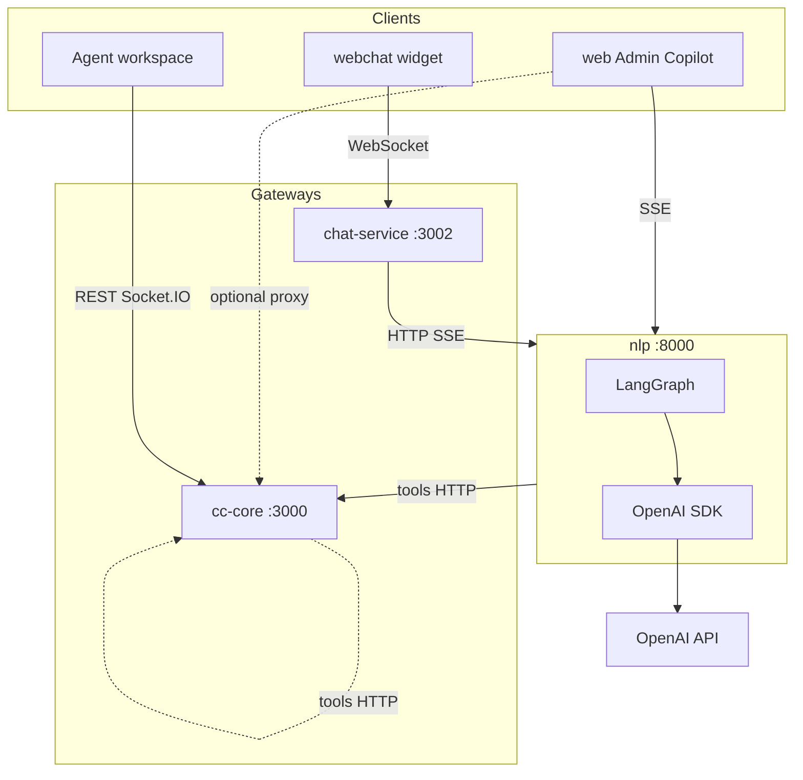

# NLP Backend Roadmap

> **Status:** Planning  
> **Service:** `apps/nlp` (port 8000)  
> **Related:** [Copilot Backend SSE](./COPILOT_BACKEND_SSE.md) · [AI Contact Center Plan](../AI_CONTACT_CENTER_PLAN.md)

Platform-wide NLP microservice for Worktual CCaaS. Frontends never call NLP directly — all traffic goes through **cc-core** or **chat-service** gateways.

---

## Core principle

```text
Copilot:  web ←SSE→ NLP service (full backend) ──tools HTTP──→ cc-core setup APIs
Webchat:  widget ←WS→ chat-service ←SSE→ NLP
Agent assist / inbox: web ←REST/Socket.IO→ cc-core (later)
```

**Copilot:** NLP owns LangGraph + SSE + tool execution. **cc-core** exposes traditional feature REST APIs consumed as **tools** by NLP — not as the Copilot orchestrator.

**Webchat / other surfaces:** chat-service or cc-core remain gateways; see transport matrix below.

---

## Services map

| Service | Port | Role in AI stack |
|---------|------|------------------|
| **nlp** | 8000 | AI brain: LangGraph, OpenAI SDK, REST + SSE |
| **cc-core** | 3000 | Gateway: orchestrate, tool execution, Socket.IO (agent inbox) |
| **chat-service** | 3002 | Gateway: webchat WebSocket, NLP SSE relay |
| **web** | 5173 | UI — calls cc-core only |

---

## System architecture



---

## Tech stack (`apps/nlp`)

| Layer | Technology |
|-------|------------|
| HTTP | FastAPI + Uvicorn |
| Validation | Pydantic v2 |
| Orchestration | **LangGraph** (graph per module) |
| Model client | **OpenAI Python SDK** (`providers/openai.py`) |
| Tracing | LangSmith (optional) |
| Tests | pytest + httpx |

```toml
# pyproject.toml target
fastapi, uvicorn, pydantic, langgraph, openai, langsmith
```

---

## Three orchestration planes

| Plane | Framework | Owner |
|-------|-----------|-------|
| AI reasoning | LangGraph + OpenAI SDK | `apps/nlp` |
| Tool execution | Custom TS orchestrator | `cc-core` |
| Business workflows | Temporal (Phase 5+) | `cc-core` / workers |

---

## Folder structure (vertical slices)

```text
apps/nlp/src/app/
├── main.py
├── config/settings.py
├── routers/          # HTTP only — health, chat, intent, assist, legacy
├── middleware/       # request-id, logging, errors
├── schemas/          # HTTP API DTOs
├── modules/
│   ├── shared/utils/     # llm, sse, history (extract when duplicated)
│   ├── copilot/            # prompts/ tools/ response/ utils/ graph.py
│   ├── webchat/            # prompts/ response/ utils/ graph.py stream.py
│   ├── agent_assist/       # summarize, suggest, analyze
│   └── intent/             # shared classifier
├── providers/openai.py
└── workers/enrichment_consumer.py   # Phase 4 Kafka
```

Each feature module owns: `prompts/`, `tools/`, `response/`, `utils/`, `graph.py`, `service.py`.

---

## Transport matrix

| Use case | Client | Gateway | NLP |
|----------|--------|---------|-----|
| Admin Copilot (all surfaces) | **SSE** | NLP `/api/v1/copilot/stream` | `surface` routes tools — see [COPILOT_BACKEND_SSE.md](./COPILOT_BACKEND_SSE.md) |
| Customer webchat | WebSocket | chat-service | `/api/v1/chat/stream` |
| Agent assist | REST | cc-core | `/api/v1/summarize` etc. |
| Async enrichment | Kafka | nlp-worker | batch graph |
| Agent inbox push | Socket.IO | cc-core | — (NLP not involved) |

**Never:** Kafka on live chatbot turn path.

---

## NLP API (`/api/v1`)

| Endpoint | Module |
|----------|--------|
| `POST /copilot` | copilot (sync blocks) |
| `POST /copilot/stream` | copilot (SSE to web) |
| `POST /chat` | webchat / copilot fallback |
| `POST /chat/stream` | webchat (SSE) |
| `POST /intent` | intent |
| `POST /summarize` | agent_assist |
| `POST /suggest-reply` | agent_assist |
| `POST /analyze` | agent_assist |
| `GET /health`, `/health/ready` | — |

Legacy `/ai/*` routes shim to v1 during migration.

---

## cc-core role (Copilot)

**Not** the Copilot backend. Provides traditional REST APIs that NLP tools call:

- `/api/v1/setup/ccaas/queues/*`
- `/api/v1/setup/workforce/*`

Optional thin SSE proxy only:

```text
POST /api/v1/assistant/copilot/stream  →  pipe to NLP (JWT + tenant injection)
```

---

## Security

- NLP: no DB credentials, internal CORS only
- Tool side effects: cc-core only (entitlements + audit)
- Tenant: `x-tenant-id` / JWT propagated to NLP request context
- Destructive tools: HITL confirmation before execution

---

## Implementation phases

| Phase | Deliverable |
|-------|-------------|
| **0** | Folder structure, OpenAI provider, `/api/v1`, LangGraph dep |
| **1** | Copilot backend in NLP only — see [COPILOT_BACKEND_SSE.md](./COPILOT_BACKEND_SSE.md) |
| **2** | chat-service `NlpBotResponder` (REST then SSE) |
| **3** | Agent assist endpoints |
| **4** | Kafka enrichment worker |
| **5** | Socket.IO golden path + Temporal |

---

## ADRs (to create)

- `ADR-009` — LangGraph + OpenAI SDK in NLP; cc-core executes tools
- `ADR-010` — REST/SSE on NLP; WebSocket/Socket.IO on gateways only
- `ADR-011` — Vertical module layout per surface

---

## Out of scope (v1)

- Direct WebSocket on NLP
- Copilot orchestration logic in cc-core (NLP calls cc-core APIs as tools — that is intended)
- CrewAI / OpenAI Agents SDK as primary orchestrator
- RAG / tenant fine-tuning
