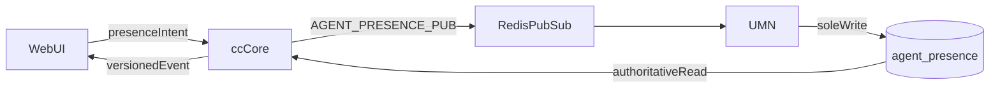

# Agent Presence

`ccass.agent_presence` in PostgreSQL is the only authoritative presence record. The Unified Media Node (UMN) is the sole writer. cc-core and the workspace publish intent and read the row UMN committed.

## Architecture



Publishing `AGENT_PRESENCE_PUB` is not the same as writing `cc:presence:*`. A Redis publish success is not a presence change. Workspace GET, routing, monitoring, workforce, and runtime queues read `ccass.agent_presence`. They do not overlay a Redis cache on top of that row.

This stack commits that intent in-process so presence changes do not wait forever for a media node that is not attached. Set `CCAAS_EXTERNAL_UMN_PRESENCE=1` only when the Unified Media Node is the process that upserts `ccass.agent_presence`. With that flag set, cc-core publishes and waits, and it does not write the table.

Login publishes `{ state: not_ready, reason: login_default }` once per authenticated server session. Refresh, reconnect, and another component mount only GET the current database state.

Heartbeat reports connectivity. It does not change `presence_state` and does not restore a cached Ready over database Not Ready or Away.

Inbound `AGENT_PRESENCE_SUB` is notify-only. cc-core rereads the row UMN already wrote, emits a socket event when `version` is newer, and does not upsert `ccass.agent_presence` again.

Capacity, skills, shift, channel, and business hours are separate from presence. A Ready agent can still be ineligible for those reasons. A stale Redis value cannot override a database Ready.

## Redis

Redis carries organization-scoped pub/sub and optional operational cache. Keys use `org:{organizationId}:cc:...`. Presence cache keys are not routing authority.

| Key | Role |
|-----|------|
| `org:{organizationId}:cc:presence:agent:{agentId}` | Optional cache copy. Not a write path for presence. |
| `org:{organizationId}:cc:presence:user:{userId}` | User to agent map. |
| `AGENT_PRESENCE_PUB` | Intent from cc-core to UMN. |
| `AGENT_PRESENCE_SUB` | Notification after UMN commits the row. |

Socket.IO uses the Redis adapter so every cc-core instance emits the same versioned `presence.updated` event. Clients ignore events at or below the version they already have. Rooms are `org:{organizationId}` and `org:{organizationId}:user:{userId}`. The payload organization id never chooses the room.

## Presence states

| State | Routing eligible? |
|-------|-------------------|
| `ready` / `available` | Yes, subject to capacity, skills, shift, channel, and hours |
| `busy` | No. Occupancy is published through UMN. `agent_capacity` remains the concurrency limit. |
| `not_ready` | No |
| `away` | No |
| `after_contact_work` | No |
| `offline` | No |

Logout maps to offline in the product and is published to UMN as `Offline`. Break, away, and wrap-up stay `Away`. Ready and available are both eligible.

## API flows

```
PATCH /api/v1/workspace/presence
  → publish AGENT_PRESENCE_PUB
  → wait until UMN's committed row matches the expected state and version
  → emit presence.updated from the database row

POST /api/v1/workspace/presence/initialize
  → claim accounts.auth_sessions.presence_initialized_at once
  → first claim publishes not_ready / login_default
  → later calls GET the database row

POST /api/v1/workspace/presence/heartbeat
  → GET the current database row
  → does not change presence_state
```

Queue publish does not force members offline. A missing presence row is seeded only through the UMN initialization contract.

## Code map

| File | Role |
|------|------|
| `apps/cc-core/src/services/presence.ts` | Database reads and publish-only updates |
| `apps/cc-core/src/services/umn-presence.ts` | `AGENT_PRESENCE_PUB` / notify-only `AGENT_PRESENCE_SUB` |
| `apps/cc-core/src/services/auth-sessions.ts` | One login initialization per access-token session |
| `apps/cc-core/src/lib/redis-keys.ts` | Organization-scoped key builders |
| `apps/cc-core/src/lib/socket-rooms.ts` | Organization- and user-qualified rooms |
| `apps/web/src/features/workspace/use-agent-presence.ts` | One shared presence store |

## Related docs

- [Telephony presence stored procedure](../ccaas/TELEPHONY_PRESENCE_STORED_PROCEDURE.md)
