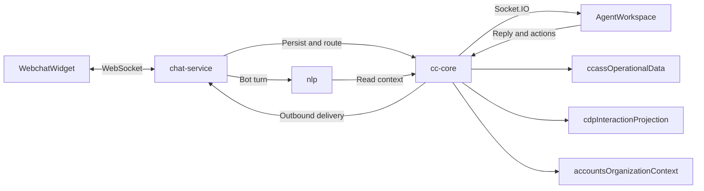
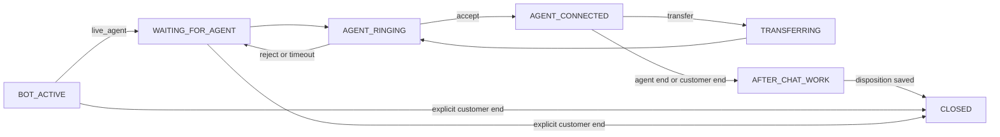

# Webchat NLP, Live Agent, and Copilot Plan

## Implementation status

Implemented in the direct-HTTP vertical slice:

- `chat-service` owns the customer WebSocket; `cc-core` owns canonical conversation state, routing, presence, assignment, and agent realtime.
- Bot output stops when `cc-core` reports `bot_active = false`. Post-handoff customer messages are persisted and forwarded to the agent without synthetic bot acknowledgements.
- Handoff creates an offer, not an automatic acceptance. Accept/reject, policy-based offer timeout, re-offer, queued events, and routing when an agent becomes Ready are implemented.
- Agent and system messages are persisted first, delivered through `cc-core → chat-service`, audited in `message_delivery_attempts`, retried, and surfaced with delivery state.
- Inbox Copilot is bound to the selected `conversationId`; NLP obtains bounded context through authorized cc-core tools. Suggestions remain internal until the agent explicitly sends.
- Copilot turns are persisted and accepted suggestions link to the final `conversation_messages` row.
- Agent workspace uses live APIs, handles offer and queue realtime events, prevents cross-conversation draft leakage, and resolves conversations through cc-core.

Still deferred:

- Kafka and transactional outbox.
- Durable distributed offer scheduling (the vertical slice uses in-process timers; restart recovery requires a worker).
- Dedicated read-only NLP PostgreSQL role and direct approved views.
- Full Copilot memory/skill lifecycle and complete CDP/SLA/wrap-up rollout.
- Production LLM-backed webchat answers using approved organization context. The current customer-bot implementation is rules-based.
- Skill/proficiency-aware routing. Current routing applies queue membership, presence, capacity, and round robin but does not yet use the skill tables.
- Conversation transfer, Transferred-tab behavior, mandatory dispositions, and final `closed` transition.
- Durable widget reconnect recovery, typing indicators, customer read receipts, and attachment exchange.

Current schema-only capabilities must not be described as implemented. Transfer, disposition, SLA, conversation memory, attachment metadata, and several CDP fields require runtime services and UI/API wiring.

## Scope and decisions

- Phase 1 implements Website Chat only. The state machine, message model, routing contracts, and realtime event envelope remain channel-neutral so later WhatsApp, Instagram, Facebook Messenger, Voice Bot, Email, and SMS adapters can reuse them.
- Preserve the existing workspace navigation, three-panel layout, component names, and design system. Add only the controls, dialogs, notifications, and states required by this plan.
- Use direct internal HTTP first between `chat-service`, `cc-core`, and `nlp`. Keep the customer connection on the existing WebSocket and agent realtime delivery on Socket.IO. Introduce Kafka and transactional outbox after the vertical slice is stable.
- Trigger live-agent handoff on an explicit request, low confidence/repeated bot failure, or configured business rules.
- Keep the customer webchat bot separate from the internal Copilot. Webchat NLP may reply only while a conversation is `bot_active`. Once handoff starts, bot generation stops and only Copilot may assist the live agent.
- Run one internal Copilot across Agent Workspace, Admin My Workspace, Contacts, Queues, Monitoring, and future contact-center surfaces. Skills vary by authenticated tenant, role, and surface while the Copilot session remains continuous.
- Keep operational state and the canonical transcript in `ccass`. Project customer-centric interactions into `cdp`.
- Give NLP read-only database access. Every write, mutation, or external action must use an authorized registered tool/API.
- Treat an explicit customer End action differently from a temporary browser/network disconnect. Explicit End closes customer participation immediately; disconnect enters a configurable reconnect grace period.
- Customer-facing closure never waits for an agent to complete a disposition. The agent enters After Contact Work and must submit disposition before becoming eligible for new work according to tenant policy.

## AI provider boundaries

Secrets must be supplied by environment variables or a secret manager. Provider keys must never appear in source, browser bundles, API responses, logs, tests, or this plan. Rotate any key previously shared in plaintext.

### Customer bot and live-agent suggestions

- Provider: OpenAI-compatible chat-completions API.
- Environment variables: `CHAT_OPENAI_BASE_URL`, `CHAT_OPENAI_API_KEY`, and `CHAT_OPENAI_MODEL`.
- Required model policy: `gpt-oss-120b`, low reasoning effort, and no reasoning/thinking content exposed to customers or agents.
- Use this provider for customer chatbot turns and the automatic suggestion generated after every inbound customer message while an agent is connected.
- Validate provider support for `reasoning_effort` and no-thinking request options at startup. Filter reasoning-only stream deltas defensively.

### Third-panel Coworker

- Provider: Together.
- Environment variables: `TOGETHER_API_KEY` and `TOGETHER_MODEL`.
- Required model policy: `Qwen/Qwen3.7-Max` with thinking disabled. Validate the configured model identifier against the provider before rollout.
- Use Together only for internal Coworker actions: draft, rewrite, translate, summarize, CRM note, ticket summary, tone improvement, shorten, and expand.
- Coworker output remains internal until the agent explicitly uses or sends it.

## NLP permission model

Dynamic skills have only two execution classes:

1. `database_read`
   - Parameterized `SELECT` operations only.
   - Approved tenant-scoped repositories or views only.
   - Dedicated read-only PostgreSQL role, read-only transactions, RLS organization context, statement timeout, row limit, and result-size limit.
   - No arbitrary SQL, stored-procedure side effects, authentication secrets, billing records, unrestricted private notes, or cross-tenant data.

2. `tool_call`
   - Every mutation or external action uses an allowlisted tool owned by `cc-core` or another internal service.
   - Includes replies, handoff, assignment, queue changes, presence changes, dispositions, skill activation, and navigation/action requests.
   - The owning service re-checks tenant, JWT role, permissions, confirmation, idempotency, and audit requirements.

There is no direct database-write skill. NLP must never receive `INSERT`, `UPDATE`, `DELETE`, DDL, arbitrary-code, shell, or unrestricted URL execution privileges.

## Database tables

All new operational and AI tables use UUID primary keys, UTC timestamps, explicit `organization_id` indexes, additive migrations, and tenant-scoped access.

### Conversation and webchat runtime (`ccass`)

- `ccass.conversations`: organization, channel, external thread, webchat/visitor, contact/profile, queue, assigned agent, status, priority, subject, lifecycle timestamps, optimistic version. Unique organization + channel + external thread.
- `ccass.webchat_sessions`: conversation, hashed token/JTI, visitor, page origin/URL, consent, pre-chat answers, connection state, expiry and connection timestamps. Never store raw session tokens.
- `ccass.conversation_participants`: conversation, participant type, identity reference, joined/left timestamps.
- `ccass.conversation_messages`: external/idempotency ID, sender/recipient type, direction, customer/internal visibility, body, attachments, reply-to, delivery state, model metadata, event timestamps.
- `ccass.message_delivery_attempts`: message, destination, attempt, status, provider response/error, attempted/delivered timestamps.
- `ccass.conversation_assignments`: conversation, queue, agent, routing attempt, state/reason, offer/accept/reject/expire/end timestamps.
- `ccass.conversation_transfers`: conversation, source/destination queue and agent, initiating agent, notes, disposition, summary, state/outcome, routing attempt, and requested/accepted/completed timestamps.
- `ccass.message_receipts`: message, participant/session, receipt state (`sent`, `delivered`, `read`), event ID, and timestamp. Enforce monotonic receipt progression and idempotency.
- `ccass.conversation_attachments`: message, storage key, original name, MIME type, size, checksum, scan state, uploader, visibility, and timestamps. Store object references rather than binary content in Postgres.
- `ccass.conversation_memory`: bounded rolling summary, extracted facts, latest summarized message, model/version, token estimate, optimistic version.
- `ccass.conversation_notes`: internal notes with author and timestamps.
- `ccass.audit_log`: actor, action, entity, before/after JSON, trace ID, timestamp.

### Routing, skills, capacity, and presence (`ccass`)

- `ccass.skills`: tenant skill catalog.
- `ccass.agent_skills`: agent proficiency, priority, verification, and expiry.
- `ccass.queue_skills`: required/preferred skills, minimum proficiency, and weight.
- `ccass.queue_routing_profiles`: approved queue description, supported intents/examples/keywords, language constraints, skill mapping, classifier version.
- `ccass.routing_policies`: strategy, priority, offer timeout, attempts, overflow, capacity, idle behavior, after-contact-work duration.
- `ccass.routing_cursors`: atomically locked round-robin cursor per queue.
- `ccass.routing_attempts`: candidates, eligibility scores, skips, failures, and outcomes.
- Extend `ccass.agent_presence`: current state, reason, heartbeat, lease expiry, version, source.
- `ccass.agent_presence_history`: previous/new state, reason, source, start/end.
- `ccass.presence_reason_codes`: tenant Not Ready/Away reasons and validation rules.
- `ccass.agent_capacity`: per-agent/per-channel concurrency, reservations, active count, version.

### SLA and wrap-up (`ccass`)

- `ccass.sla_policies`: response/resolution targets, warnings, business-hours mode, escalation policy.
- `ccass.conversation_sla_state`: active deadlines, warnings, and breaches.
- `ccass.dispositions`: tenant wrap-up outcomes.
- `ccass.conversation_dispositions`: resolution status, disposition code, notes, conclusion, summary, applied agent/system actor, transfer reference, and timestamp.

### Shared Copilot and dynamic NLP skills (`ccass`)

- `ccass.nlp_skills`: stable key, name, description, type (`copilot` or `webchat_bot`), owner, state.
- `ccass.nlp_skill_versions`: immutable published versions with prompt, input/output schemas, model/context/safety policy, checksum, lifecycle metadata.
- `ccass.nlp_skill_bindings`: tenant, version, role, surface, channel, priority, effective dates, enablement, overrides.
- `ccass.nlp_skill_tools`: version-to-allowlisted-tool mapping, permission class, confirmation requirement.
- `ccass.nlp_skill_activation_history`: publish, activate, canary, rollback, and retire audit.
- `ccass.copilot_sessions`: tenant, authenticated user, role, active surface, lifecycle timestamps.
- `ccass.copilot_turns`: optional conversation, surface, turn type, agent input, Copilot response, suggestion/final text, acceptance/send link, skill/model/latency/status.
- `ccass.copilot_memory`: user-level preferences/facts and separately scoped conversation summaries with provenance, expiry, and version.
- `ccass.copilot_skill_executions`: skill/tool execution metadata, status, token use, latency, error, trace ID.

### Customer interaction projection (`cdp`)

- `cdp.interactions`: organization + canonical conversation, contact/profile/visitor, channel, queue/agent, lifecycle times, outcome, summary, topics, sentiment, disposition, SLA result, last activity.
- `cdp.interaction_events`: canonical message/assignment/transfer reference, event ID/type, customer-safe metadata, occurred time.

Do not copy internal Copilot prompts, private notes, delivery internals, or the complete transcript into CDP.
Apply schema changes through ordered, versioned migrations. Do not rely on untracked manual SQL or `prisma db push` for production rollout. Add organization, lifecycle, assignment, transfer, and event indexes; add foreign keys where ownership permits and explicit cleanup for logical cross-schema references.

## Tenant organization context

- Resolve `webchatId` to the tenant, queue, webchat configuration, organization name/description, public contact numbers and email addresses, branches, business hours, addresses, website, approved FAQs, and approved capabilities.
- Include a bounded organization-context block automatically in every customer-bot turn. Retrieve it server-side; never trust organization context supplied by the widget.
- Build prompts from an explicit public-data allowlist. Exclude credentials, tax/billing data, admin-only contacts, private notes, employee data, and cross-tenant records.
- Select only information relevant to the active webchat and customer question. Enforce token, row, and result-size limits instead of dumping all organization records into every prompt.
- Source capabilities from approved webchat description/personalisation and organization configuration. If information is absent or ambiguous, the bot must clarify rather than invent it.
- Cache context by organization + configuration version while preserving RLS and tenant isolation. Record the IDs/versions of knowledge records used so the handoff summary can identify its sources.

## Canonical conversation lifecycle

The backend owns state transitions. Frontends render state but cannot invent or directly mutate it. During migration, existing lower-case statuses (`bot_active`, `queued`, `assigned`, `active`, `resolved`) must be mapped explicitly; do not perform an unversioned rename.

Canonical Phase 1 states:

- `BOT_ACTIVE`: customer bot may answer.
- `WAITING_FOR_AGENT`: bot generation is stopped and the conversation is queued.
- `AGENT_RINGING`: one agent owns a time-limited offer; capacity is reserved.
- `AGENT_CONNECTED`: accepted by an agent; customer and agent can exchange messages.
- `TRANSFERRING`: current assignment is ending and a new queue/agent target is being selected.
- `AFTER_CHAT_WORK`: customer-facing interaction has ended; disposition is pending or being completed.
- `CLOSED`: final terminal state after required system closure and wrap-up data are saved.

Transition rules:

- Explicit customer End terminates customer participation immediately and emits closure events. If an agent is connected, that agent moves to After Contact Work; otherwise the conversation can close with a system disposition.
- A browser refresh, tab loss, or network disconnect does not end the conversation immediately. Mark the webchat session disconnected, notify the agent, and start the configured reconnect grace period.
- Reconnect within the grace period restores the same conversation, transcript, queue/offer state, and assigned agent. It must not create a new conversation.
- Grace-period expiry closes an unassigned bot/queued conversation with a system disposition. For an assigned conversation, notify the agent and enter After Contact Work.
- Reject or offer timeout releases reserved capacity and routes to the next eligible candidate without repeating an already exhausted candidate in the same routing cycle.
- If no eligible agent remains, notify the customer and apply the tenant routing policy: overflow queue, remain queued, or atomically return to `BOT_ACTIVE` and resume AI assistance. The Phase 1 default is to resume AI assistance while periodically retrying routing.
- Any in-flight bot request must be cancelled or discarded after leaving `BOT_ACTIVE`; late model output must never be persisted or delivered.
- Reopening a `CLOSED` interaction creates a new conversation linked to the previous interaction unless a tenant policy explicitly allows reopening the same conversation.

## Webchat NLP and handoff

- Replace the current rules-only customer bot with a dedicated LLM-backed route and prompt boundary in the existing NLP service.
- NLP receives a canonical conversation ID and latest customer message, then reads bounded tenant context and transcript through approved read paths.
- Return structured output: reply, confidence, `intent`, candidate queues/skills, sentiment, next-best action, escalation recommendation, handoff recommendation/reason, knowledge references, and trace/model metadata.
- For explicit requests such as “human”, “live agent”, “representative”, “customer care”, or “speak with someone”, return `intent: "live_agent"`. Apply deterministic rules around the model so explicit human requests cannot be ignored.
- Replace the dummy bot in `chat-service` with orchestration that persists inbound messages, invokes NLP only in `bot_active`, persists the reply, and initiates handoff when required.
- Handoff atomically changes state before routing and cancels any in-flight customer-bot generation.
- Before offering to an agent, generate and persist a bounded handoff package containing conversation summary, current intent, customer details, sentiment, important facts, recent messages, and knowledge references. Display it to the receiving agent before they reply.

## Skill-based round-robin routing

- NLP classifies the message against tenant-approved queue descriptions, intents, and skill mappings. It cannot invent a queue or skill.
- Filter candidates by active queue membership, business hours/shift, required skills and proficiency, `ready` presence, and remaining webchat capacity.
- Rank preferred-skill coverage/proficiency, then perform atomic round robin among equally qualified agents with longest-idle as deterministic tie-breaker.
- Lock selection transactionally, reserve capacity, record attempts, advance on timeout/rejection, and retry. Keep the conversation queued if nobody is eligible.
- Required skills are hard filters; preferred skills influence ranking. Persist each included candidate, score, skipped candidate/reason, cursor position, and final outcome for audit and fairness analysis.
- Capacity is per agent and channel. Reserved offers and active conversations both count toward availability; accepting converts a reservation to active usage, while rejection/timeout releases it.
- Routing policy defines offer timeout, maximum attempts, overflow queue, no-agent behavior, and After Contact Work duration. Do not hard-code these values in the workspace.
- Transfer routing uses the same engine but excludes the sending agent by default and may honor a selected target agent if that agent is eligible. Ineligible direct targets fall back to the selected queue.

## Enterprise agent presence

- States: `offline`, `ready`, `not_ready`, `away`, `busy`, and `after_contact_work`.
- `Not Ready` requires a configured reason.
- `Busy` is automatic on assignment; `After-Contact Work` begins on resolution; `Offline` follows logout or heartbeat lease expiry.
- Provide server-backed presence, reason, heartbeat, and workload APIs.
- Make the current toolbar functional in Agent Workspace and Admin My Workspace.
- Admin users receive work only if linked to an active agent, assigned to the queue, skill-qualified, within capacity, and explicitly `ready`.
- UI labels such as Online, Break, and Do Not Disturb map to canonical backend states and configured reason codes; they are not separate uncoordinated routing states. Only canonical `ready` agents receive new offers.

## Agent ringing and offer handling

- Emit a durable offer record and `conversation.offer` event containing conversation, queue, customer summary, waiting time, offer expiry, and transfer metadata.
- Play one reusable ringing sound while an unexpired offer is visible. Browser autoplay restrictions require the workspace to unlock audio after the agent's first interaction.
- Show Accept and Reject in the existing global offer surface and in the selected conversation when appropriate; both invoke server-authoritative idempotent actions.
- Accept stops ringing, converts reserved capacity to active capacity, assigns the conversation, moves it to Ongoing, and emits `conversation.accepted`.
- Reject stops ringing for that agent, records the reason when configured, releases capacity, and immediately routes to the next candidate.
- Timeout behaves like rejection with outcome `expired`. Offer scheduling must become durable before production so service restarts cannot strand ringing conversations.
- Multiple browser tabs for one agent must converge on the same offer result. A stale tab must not accept an already rejected, expired, or accepted offer.

## Dynamic skill loading and one Copilot

- Replace the static surface registry with a resolver for published skill bindings by tenant, role, surface, channel, effective date, and priority.
- Validate schema, checksum, lifecycle, tool permissions, and dependencies before activation.
- Cache compiled bundles by tenant + binding checksum and retain a last-known-good bundle during transient failure.
- Support draft, publish, canary tenant, rollback, retire, and activation audit.
- Seed Copilot skills for conversation summary, suggested reply, customer context, queue/workforce lookup, routing explanation, live monitoring explanation, and navigation.
- Keep one Copilot session per authenticated user/tenant. Surface changes load authorized skills without creating a separate Copilot.
- Webchat bot skills remain in a separate `webchat_bot` runtime and cannot access Copilot memory or internal tools.

## Agent workspace, Inbox semantics, and Copilot memory

- Preserve the existing three-panel layout and existing Inbox tabs.
- **Ongoing** contains ringing offers relevant to the agent, accepted/active conversations owned by the agent, and active channel work. Pending offers remain visually distinct from accepted conversations.
- **Transferred** contains transfer records relevant to the agent for audit/history. A receiving agent first gets a ringing offer; after acceptance, the active conversation appears in Ongoing. The sender retains the transfer record in Transferred.
- **Closed** contains completed interactions after customer end, agent end, idle/disconnect expiry, or final wrap-up. Closed records retain transcript and disposition history.
- Replace remaining workspace mock/stub behavior with cc-core APIs plus Socket.IO cache updates and reconnect catch-up. The Transferred tab must not remain a hard-coded empty filter.
- Support queue arrival, assignment/claim, inbound messages, agent replies, delivery state, transfer, resolve, After Contact Work, disposition, and final close.
- Pass selected conversation ID to the shared Copilot; do not send an untrusted raw transcript from the browser.
- Persist summaries, questions, suggested replies, agent edits/acceptance, and final sent-message linkage in Copilot tables.
- After each inbound customer message in `AGENT_CONNECTED`, automatically generate and publish an internal suggestion containing suggested reply, updated summary, customer intent, sentiment, next-best action, and escalation recommendation when applicable.
- Copilot and suggestions remain internal. They can suggest or answer the agent but cannot send to the customer without the agent's explicit send action.

## Transfer workflow

- Add Transfer to the existing second-panel conversation header without restructuring the panel.
- Transfer dialog fields: destination queue, optional eligible agent, transfer notes, and mandatory transfer disposition/conclusion.
- On submit, validate tenant, conversation ownership, target queue membership, target eligibility, and idempotency. Create a transfer record before ending the current assignment.
- Atomically enter `TRANSFERRING`, stop the sender from sending customer-visible messages, release or update sender capacity, and route through the standard offer engine.
- The receiving agent gets ringing context including sender, source queue, transfer notes, summary, and customer wait time.
- If the receiving agent rejects or times out, continue through other eligible agents according to routing policy. Do not return ownership to the sender unless policy explicitly permits it.
- Persist transfer lineage, source/destination queue and agent, notes, disposition, timestamps, attempts, and outcome. Project a customer-safe transfer event into CDP.

## End, disposition, and After Contact Work

- Agent End opens a mandatory disposition dialog before the agent action is submitted.
- Required fields: resolution status (`resolved`, `unresolved`, or `transferred`), disposition code/status, disposition notes describing what happened, conclusion, and conversation summary.
- Transfer uses the same dialog contract with resolution status `transferred`, then continues into the transfer workflow rather than final closure.
- Customer End closes customer participation immediately. When an agent is connected, notify that agent and enter `AFTER_CHAT_WORK`; do not keep the customer session open while waiting for disposition.
- Idle/disconnect expiry stores a system-generated end reason and summary. If an agent owns the conversation, the agent still completes the required wrap-up fields.
- Save disposition and final lifecycle transition in one idempotent backend transaction. Emit the close/update events only after canonical state is committed.
- After Contact Work eligibility follows tenant policy. An agent must not remain permanently unavailable if the browser closes; server-side timeout and supervisor recovery are required.

## Session recovery, idle timeout, and realtime messaging

- Persist a signed, short-lived widget session identity bound to organization, webchat, visitor, allowed origin, and conversation. Store only its hash/JTI server-side and support rotation/revocation.
- On reconnect, validate the session, look up the canonical conversation, rebuild bounded runtime context from `ccass`, replay missing messages/events, and restore the current queue, offer, or agent assignment.
- Maintain a configurable disconnect grace period and a separate configurable idle timeout. Notify customer and agent before idle closure where a connection exists.
- Support customer, agent, and AI typing indicators as ephemeral events with server-enforced expiry; typing events are not part of the canonical transcript.
- Support monotonic `sent → delivered → read` receipts with idempotent event IDs. A client cannot move a message receipt backward.
- Support customer and agent attachments for approved images, PDF, DOCX, XLSX, audio, and video types. Enforce tenant MIME/size policy, presigned upload, checksum, malware scan/quarantine, authorization, and customer/internal visibility before delivery.
- Internal notes are persisted with `visibility = internal`, excluded from customer WebSocket delivery and customer-safe CDP data, and visible only to authorized workspace users.

## Backend API contracts

Keep external/widget, workspace, and internal service routes separate. Every mutation is organization-aware, authenticated for its caller class, idempotent, validated against the current conversation version/state, and audited.

Required capabilities:

- Start/resume/end webchat session and retrieve bounded conversation history.
- Persist/send customer, bot, agent, system, and internal-note messages.
- Initiate handoff and query queue/waiting status.
- Accept, reject, and expire an offer.
- Transfer to a queue or eligible agent and retrieve transfer history.
- Start/complete After Contact Work and save disposition.
- Request upload authorization and finalize attachment metadata after scanning.
- Publish typing state and sent/delivered/read receipts.
- Generate, stream, persist, accept, dismiss, and link AI suggestions.

Use stable request/response schemas rather than exposing database rows. Return explicit conflict responses for stale conversation versions, expired offers, duplicate terminal actions, and invalid transitions.

## WebSocket and Socket.IO event contracts

Use a consistent envelope containing `eventId`, `eventType`, `organizationId`, `conversationId` when applicable, `occurredAt`, `traceId`, `schemaVersion`, and a typed payload. Consumers deduplicate by `eventId` and refresh canonical state after reconnect or version gaps.

Required event families:

- Lifecycle: `conversation.started`, `conversation.updated`, `conversation.waiting`, `conversation.closed`, `conversation.reconnected`.
- Offers/assignment: `conversation.offer`, `conversation.assigned`, `conversation.accepted`, `conversation.rejected`, `conversation.offer_expired`.
- Transfer/wrap-up: `conversation.transfer_started`, `conversation.transferred`, `conversation.after_chat_work`, `conversation.disposition_saved`.
- Messaging: `message.created`, `message.delivery_updated`, `message.read`, `attachment.updated`.
- Ephemeral UI: `typing.started`, `typing.stopped`, `suggestion.updated`.
- Routing/presence: `queue.updated`, `agent.presence_updated`, `agent.capacity_updated`.

Persist canonical business events before publication. Realtime delivery is a projection/notification mechanism, not the source of truth.

## Analytics and CDP projection

- Track average wait, handle, resolution and After Contact Work times; first-response SLA; AI/agent resolution rates; transfer rate; queue length; concurrent conversations; offer acceptance/rejection/timeout; and agent utilization.
- Derive metrics from committed lifecycle, assignment, transfer, message, and disposition events rather than browser timestamps.
- Populate CDP interaction outcome, summary, topics, sentiment, disposition, SLA result, lifecycle times, and last activity. Keep operational routing internals and internal AI prompts in `ccass`.
- Use an outbox/event projection for reliable analytics updates when production durability is introduced. Projection retries must be idempotent.

## Security, testing, and rollout

- Use short-lived signed widget session tokens bound to tenant, webchat, visitor, and allowed origin.
- Add rate limits, message limits, consent handling, PII-safe logs, trace propagation, service authentication, and idempotency.
- Add upload validation/scanning, CSP/origin enforcement, prompt-injection boundaries for organization context, output moderation, secret redaction, and retention/deletion policies.
- Test tenant isolation, read-only NLP DB enforcement, denied SQL writes, tool authorization, skill version/rollback, webchat/Copilot separation, handoff bot shutdown, routing fairness/races, capacity reservation, offer restart recovery, presence leases, reconnect grace/expiry, duplicate events, transfer chains, disposition enforcement, attachment authorization, receipts, agent reply, SLA, CDP projection, and suggestion acceptance.
- Add end-to-end scenarios for bot resolution, explicit live-agent request, no eligible agent, accept, reject, timeout, multi-agent contention, transfer accept/reject, customer End, temporary disconnect/reconnect, grace expiry, idle closure, attachment exchange, and agent wrap-up.
- Roll out behind `nlp_enabled` and `live_agent_enabled` per-webchat flags to one tenant first.
- Add Kafka + transactional outbox later using the existing event contracts without changing public APIs.

## Phased implementation and acceptance criteria

### Phase 1A — LLM chatbot and tenant-safe context

- Replace rules-only replies with the OpenAI-compatible customer bot.
- Resolve bounded public organization context and canonical recent transcript server-side.
- Return the structured NLP contract and deterministic `live_agent` intent.
- Acceptance: organization questions are answered from approved tenant data; cross-tenant/private data cannot appear; explicit human requests always initiate handoff; late bot output after handoff is discarded.

### Phase 1B — Canonical lifecycle and session recovery

- Add versioned lifecycle transitions, explicit End, disconnect grace period, idle timeout, resume token, event replay, and final close semantics.
- Acceptance: refresh restores the same conversation/history/agent; explicit End closes immediately; grace expiry follows policy; invalid or duplicate transitions are harmless.

### Phase 1C — Skill routing, capacity, and durable ringing

- Wire queue descriptions, required/preferred skills, proficiency, shifts, presence, capacity reservation, atomic round robin, offer timeout, rejection, and overflow/no-agent behavior.
- Acceptance: only eligible `ready` agents ring; concurrent routing cannot over-assign; reject/timeout advances fairly; restart does not strand offers.

### Phase 1D — Transfer and Transferred Inbox

- Add transfer persistence/API/events, second-panel Transfer UI, target selection, notes/disposition, receiving-agent ringing, and functional Transferred filtering.
- Acceptance: sender loses send authority atomically; receiver accepts into Ongoing; rejection advances routing; complete transfer lineage remains visible and auditable.

### Phase 1E — Disposition and After Contact Work

- Add mandatory agent End dialog, transfer disposition, system end reasons, ACW policy, final close, and CDP projection.
- Acceptance: agent cannot complete wrap-up without required fields; customer closure never waits on wrap-up; agent capacity/presence is released correctly.

### Phase 1F — Realtime collaboration and media

- Add automatic per-message suggestions, handoff context, typing, read receipts, internal notes, attachment upload/scanning/delivery, and reconnect catch-up.
- Acceptance: events are deduplicated and ordered by canonical versions; internal notes never reach customers; unsafe/unscanned files cannot be delivered.

### Phase 1G — Analytics, hardening, and rollout

- Complete SLA/CDP fields, metric projections, security controls, migration automation, load/race/failure tests, observability, and tenant feature-flag rollout.
- Acceptance: required metrics reconcile with source events; tenant isolation and authorization tests pass; rollout can be enabled or rolled back per webchat without public contract changes.

## Deferred omnichannel adapters

WhatsApp, Instagram, Facebook Messenger, Voice Bot, Email, and SMS adapters are outside Phase 1. They must later translate provider-specific sessions, messages, media, delivery receipts, and call controls into the canonical conversation APIs/events without duplicating lifecycle, routing, transfer, disposition, Copilot, or analytics logic.
