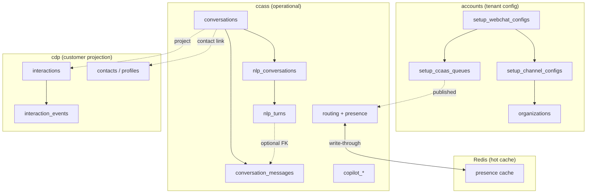
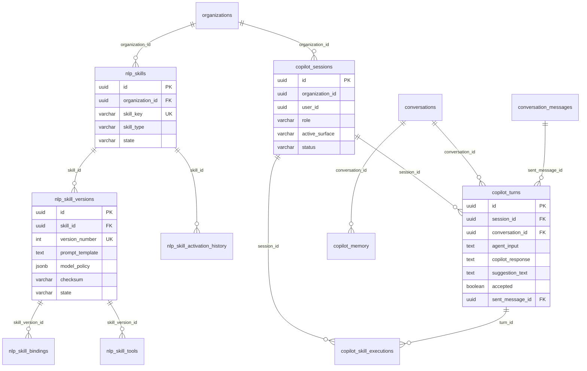
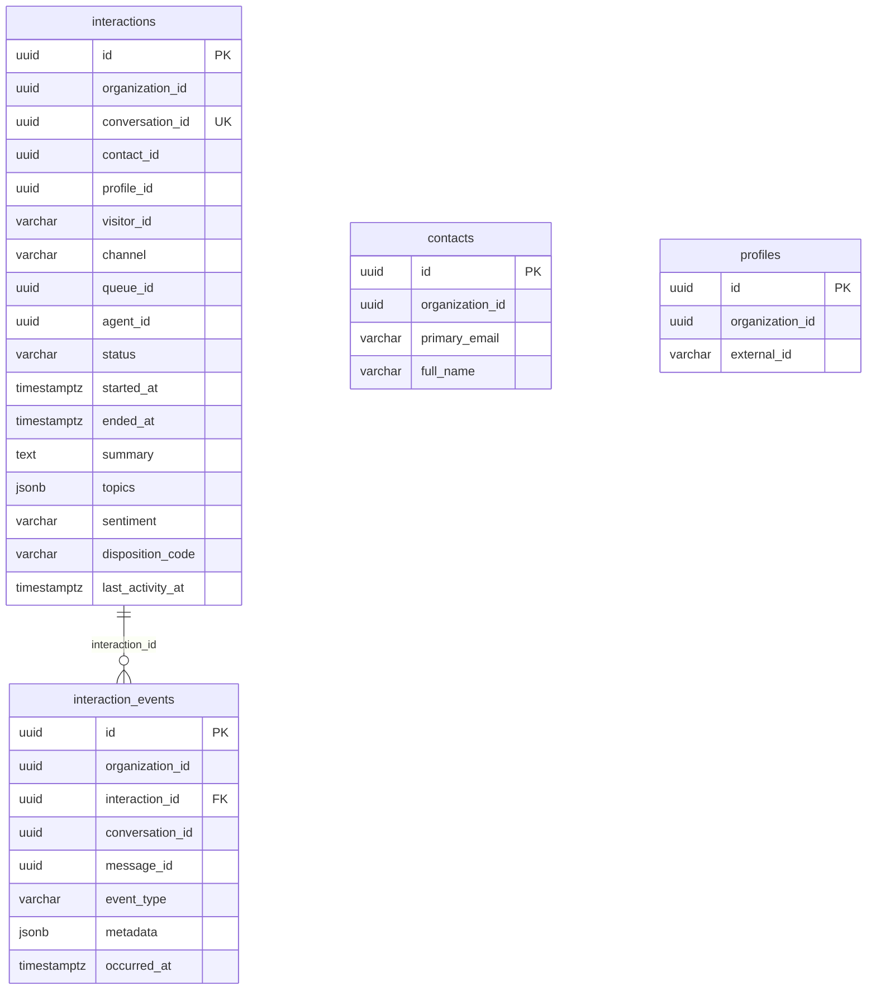
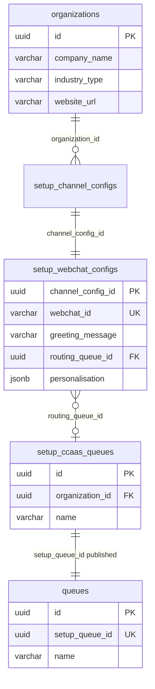

# Webchat & Live Agent — Database ERD

Entity-relationship diagrams for the webchat NLP + live-agent vertical slice.

**Schema rule:** operational contact-center state (conversations, NLP runtime, routing, Copilot) lives in **`ccass`**. **Agent presence** is write-through cached in **Redis** for routing and realtime reads (PostgreSQL remains durable source). Customer-centric interaction projections live in **`cdp`**. Tenant configuration is read from **`accounts`**.

Migrations:

| File | Schema |
|------|--------|
| `packages/db-cc/prisma/migrations/ccass_routing_tables.sql` | `ccass` routing baseline |
| `packages/db-cc/prisma/migrations/conversations_and_nlp.sql` | `ccass` conversations + NLP + Copilot |
| `packages/db-cc/prisma/migrations/cdp_interactions.sql` | `cdp` interaction projection |

---

## 1. Schema overview



---

## 2. Full ERD — conversation & NLP runtime (`ccass`)

```mermaid
erDiagram
  organizations ||--o{ conversations : "organization_id"
  queues ||--o{ conversations : "queue_id"
  agents ||--o{ conversations : "assigned_agent_id"

  conversations ||--|| webchat_sessions : "conversation_id"
  conversations ||--o{ conversation_participants : "conversation_id"
  conversations ||--o{ conversation_messages : "conversation_id"
  conversations ||--o| conversation_memory : "conversation_id"
  conversations ||--o{ conversation_notes : "conversation_id"
  conversations ||--o| conversation_sla_state : "conversation_id"
  conversations ||--o{ conversation_dispositions : "conversation_id"
  conversations ||--o{ conversation_assignments : "conversation_id"
  conversations ||--|| nlp_conversations : "conversation_id"
  conversations ||--o{ routing_attempts : "conversation_id"

  nlp_conversations ||--o{ nlp_turns : "nlp_conversation_id"
  nlp_turns }o--o| conversation_messages : "customer_message_id"
  nlp_turns }o--o| conversation_messages : "bot_message_id"
  nlp_skill_versions }o--o| nlp_conversations : "skill_version_id"

  conversation_messages ||--o{ message_delivery_attempts : "message_id"
  conversation_messages ||--o{ nlp_turns : "linked turn"
  conversation_messages }o--o| conversation_messages : "reply_to_message_id"

  routing_attempts ||--o{ conversation_assignments : "routing_attempt_id"
  queues ||--o{ conversation_assignments : "queue_id"
  agents ||--o{ conversation_assignments : "agent_id"

  conversations {
    uuid id PK
    uuid organization_id FK
    varchar channel
    varchar external_thread_id UK
    varchar webchat_id
    varchar visitor_id
    uuid queue_id FK
    uuid assigned_agent_id FK
    uuid assigned_user_id
    varchar status
    boolean bot_active
    boolean nlp_enabled
    boolean live_agent_enabled
    timestamptz created_at
    timestamptz queued_at
    timestamptz assigned_at
    timestamptz resolved_at
  }

  webchat_sessions {
    uuid id PK
    uuid organization_id
    uuid conversation_id UK FK
    varchar webchat_id
    varchar visitor_id
    varchar token_hash
    text page_url
    jsonb consent
    jsonb prechat_answers
    varchar connection_state
  }

  conversation_messages {
    uuid id PK
    uuid organization_id
    uuid conversation_id FK
    varchar external_id UK
    varchar sender_type
    varchar direction
    varchar visibility
    text body
    jsonb model_metadata
    varchar delivery_state
    timestamptz created_at
  }

  nlp_conversations {
    uuid id PK
    uuid organization_id
    uuid conversation_id UK FK
    varchar runtime_type
    uuid skill_version_id FK
    varchar status
    timestamptz started_at
    timestamptz ended_at
    varchar end_reason
  }

  nlp_turns {
    uuid id PK
    uuid organization_id
    uuid nlp_conversation_id FK
    uuid conversation_id FK
    int turn_number UK
    uuid customer_message_id FK
    uuid bot_message_id FK
    text customer_text
    text bot_reply
    numeric confidence
    varchar intent
    jsonb candidate_skills
    boolean handoff_recommended
    varchar handoff_reason
    varchar trace_id
    varchar model_name
  }

  conversation_assignments {
    uuid id PK
    uuid conversation_id FK
    uuid queue_id FK
    uuid agent_id FK
    uuid routing_attempt_id FK
    varchar state
    timestamptz offered_at
    timestamptz accepted_at
  }
```

---

## 3. ERD — routing, presence & skills (`ccass`)

```mermaid
erDiagram
  organizations ||--o{ queues : "organization_id"
  organizations ||--o{ agents : "organization_id"
  organizations ||--o{ skills : "organization_id"

  queues ||--o{ queue_members : "queue_id"
  agents ||--o{ queue_members : "agent_id"
  agents ||--o| agent_presence : "agent_id"
  agents ||--o{ agent_presence_history : "agent_id"
  agents ||--o{ agent_capacity : "agent_id"
  agents ||--o{ agent_skills : "agent_id"

  skills ||--o{ agent_skills : "skill_id"
  skills ||--o{ queue_skills : "skill_id"
  queues ||--o{ queue_skills : "queue_id"
  queues ||--|| queue_routing_profiles : "queue_id"
  queues ||--|| routing_policies : "queue_id"
  queues ||--|| routing_cursors : "queue_id"
  queues ||--o{ routing_attempts : "queue_id"

  agents {
    uuid id PK
    uuid organization_id FK
    uuid setup_user_id UK
    varchar display_name
    varchar status
  }

  queues {
    uuid id PK
    uuid organization_id FK
    uuid setup_queue_id UK
    varchar name
    jsonb skills
    varchar status
  }

  queue_members {
    uuid id PK
    uuid queue_id FK
    uuid agent_id FK
    uuid setup_user_id
    boolean handles_chat
    int chat_concurrency
  }

  agent_presence {
    uuid id PK
    uuid agent_id UK FK
    varchar presence_state
    varchar reason_code
    timestamptz heartbeat_at
    timestamptz lease_expires_at
  }

  agent_capacity {
    uuid id PK
    uuid agent_id FK
    varchar channel UK
    int max_concurrency
    int active_count
  }

  routing_cursors {
    uuid id PK
    uuid queue_id UK FK
    int cursor_index
    uuid last_agent_id
  }

  routing_attempts {
    uuid id PK
    uuid conversation_id
    uuid queue_id FK
    uuid agent_id FK
    varchar outcome
    jsonb candidate_scores
  }
```

---

## 4. ERD — Copilot & dynamic NLP skills (`ccass`)

Copilot is **internal agent assist**. Webchat bot uses `nlp_conversations` / `nlp_turns`. Both skill registries share `nlp_skills` metadata.



---

## 5. ERD — customer projection (`cdp`)

`cdp` stores **customer-safe** interaction summaries. It does **not** store NLP prompts, Copilot internals, or full operational transcripts.



**Logical link (no cross-schema FK):** `cdp.interactions.conversation_id` → `ccass.conversations.id`

---

## 6. ERD — tenant webchat config (`accounts` → `ccass`)



---

## 7. Table inventory by schema

### `ccass` — operational

| Group | Tables |
|-------|--------|
| **Conversation runtime** | `conversations`, `webchat_sessions`, `conversation_participants`, `conversation_messages`, `message_delivery_attempts`, `conversation_assignments`, `conversation_memory`, `conversation_notes` |
| **Webchat NLP runtime** | `nlp_conversations`, `nlp_turns` |
| **Routing & presence** | `queues`, `queue_members`, `agents`, `agent_presence`, `agent_presence_history`, `agent_capacity`, `presence_reason_codes`, `skills`, `agent_skills`, `queue_skills`, `queue_routing_profiles`, `routing_policies`, `routing_cursors`, `routing_attempts` |
| **SLA & wrap-up** | `sla_policies`, `conversation_sla_state`, `dispositions`, `conversation_dispositions` |
| **Copilot & skill registry** | `nlp_skills`, `nlp_skill_versions`, `nlp_skill_bindings`, `nlp_skill_tools`, `nlp_skill_activation_history`, `copilot_sessions`, `copilot_turns`, `copilot_memory`, `copilot_skill_executions` |
| **Audit** | `audit_log` |

### `cdp` — customer projection

| Tables | Purpose |
|--------|---------|
| `interactions` | Canonical customer interaction record per conversation |
| `interaction_events` | Customer-safe lifecycle events (started, message, assigned, resolved) |
| `contacts`, `profiles` | Existing CDP identity (linked when resolved) |

### `accounts` — configuration (read at runtime)

| Tables | Purpose |
|--------|---------|
| `organizations` | Tenant company context for NLP prompts |
| `setup_webchat_configs` | Webchat widget config, greeting, queue binding |
| `setup_ccaas_queues` | Admin queue definition (published to `ccass.queues`) |

---

## 8. Key relationships (quick reference)

| From | To | Cardinality | Notes |
|------|----|-------------|-------|
| `ccass.conversations` | `ccass.nlp_conversations` | 1:1 | Created when NLP enabled; ended on handoff |
| `ccass.nlp_conversations` | `ccass.nlp_turns` | 1:N | One row per bot turn while `bot_active` |
| `ccass.nlp_turns` | `ccass.conversation_messages` | N:1 each | Optional FKs to customer/bot message rows |
| `ccass.conversations` | `cdp.interactions` | 1:1 projected | Upserted by `cdp-projection` service |
| `cdp.interactions` | `cdp.interaction_events` | 1:N | Customer-safe event stream |
| `accounts.setup_webchat_configs` | `ccass.queues` | N:1 via publish | `setup_queue_id` → `ccass.queues.id` |
| `ccass.agent_presence` | Redis `cc:presence:*` | 1:1 cached | Write-through on update/heartbeat |

---

## 9. Redis presence cache (not in PostgreSQL ERD)

Agent presence hot reads use Redis keys documented in [PRESENCE_REDIS_CACHE.md](./PRESENCE_REDIS_CACHE.md). PostgreSQL `ccass.agent_presence` remains the durable store; Redis is ephemeral with lease TTL.

---

## Related docs

- [WEBCHAT_SERVICE_FLOW.md](./WEBCHAT_SERVICE_FLOW.md) — service interaction & communication flows
- [PRESENCE_REDIS_CACHE.md](./PRESENCE_REDIS_CACHE.md) — Redis key layout & write-through policy
- [WEBCHAT_LIVE_AGENT_PLAN.md](./WEBCHAT_LIVE_AGENT_PLAN.md) — implementation plan & decisions
