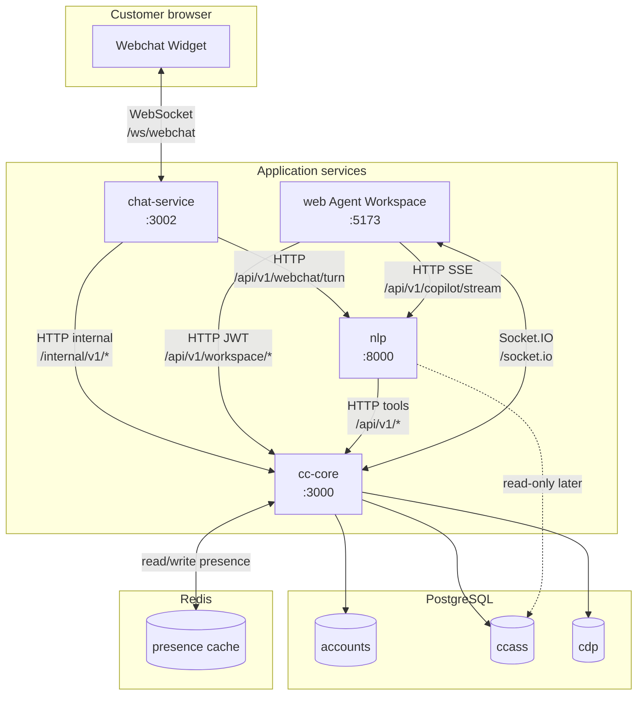
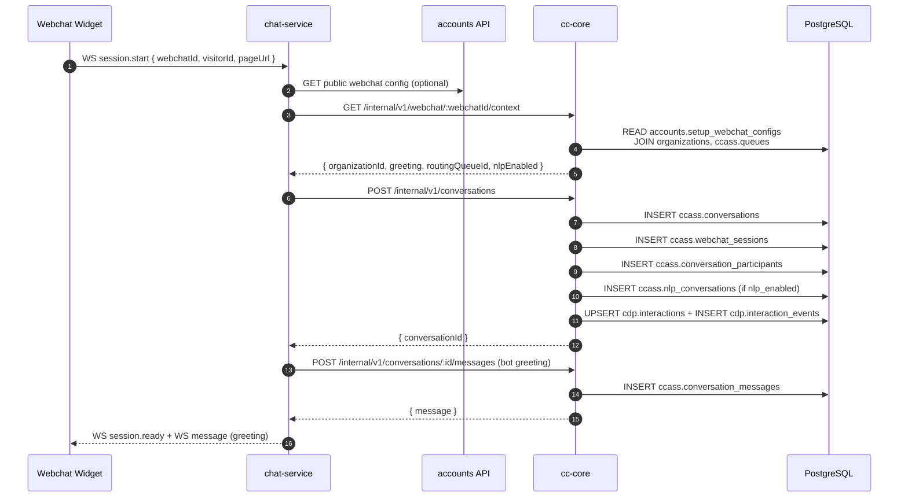
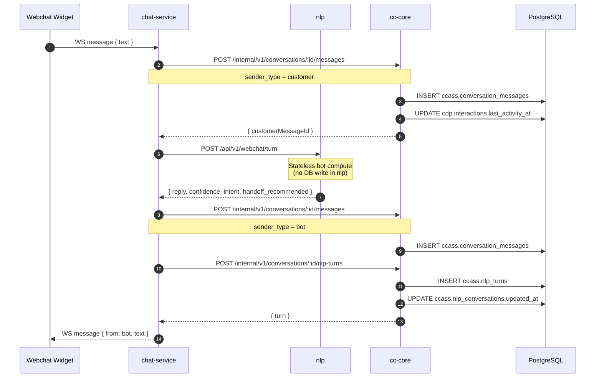
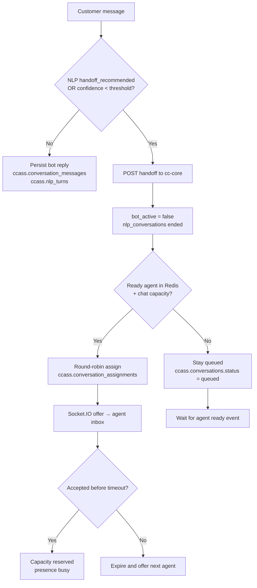
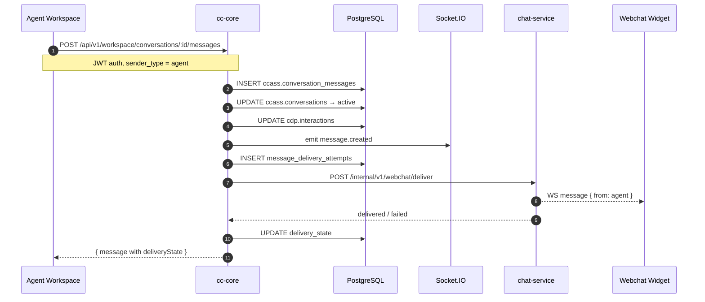
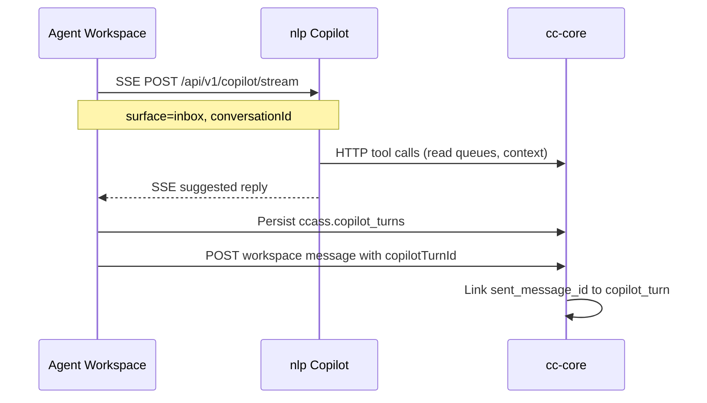
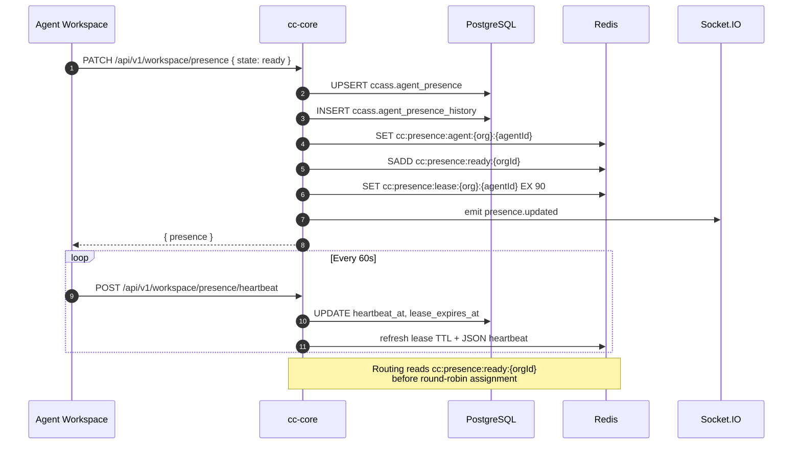
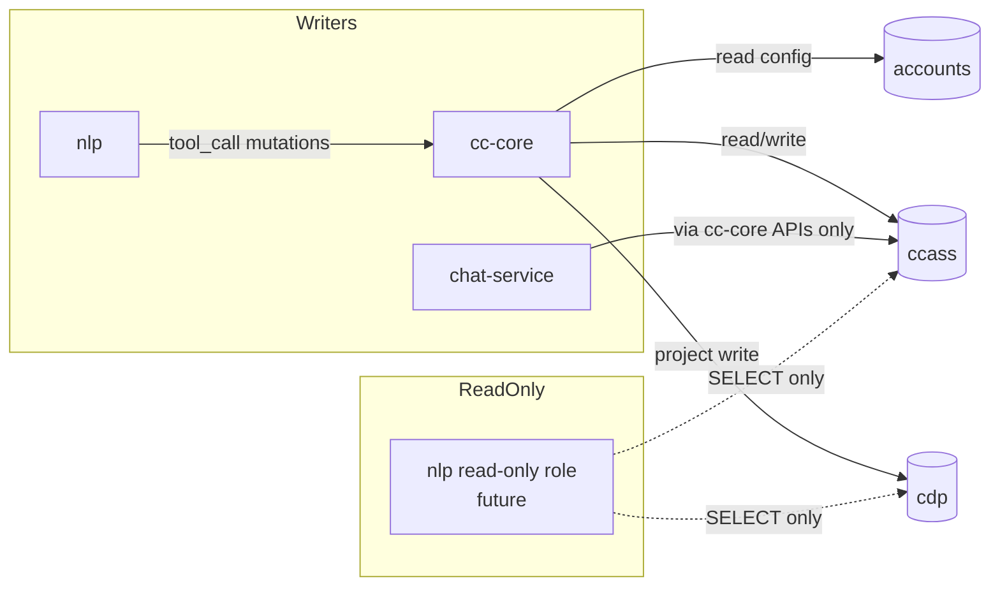
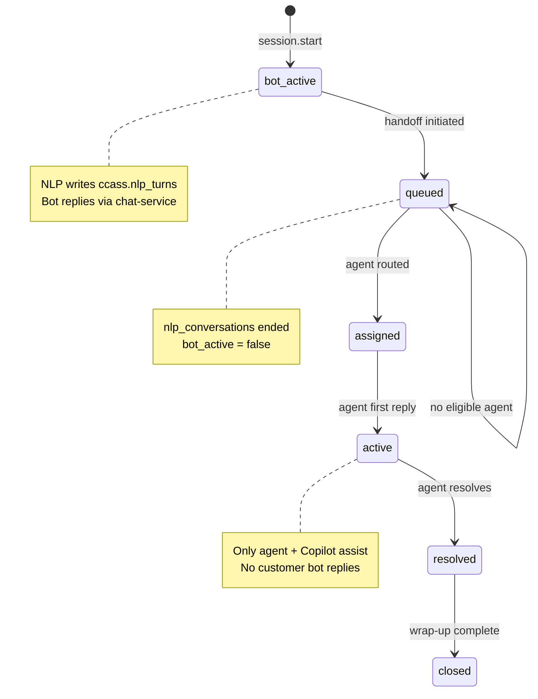

# Webchat & Live Agent — Service Flow

End-to-end flows showing **which service talks to which**, **over what protocol**, and **which database tables** are read or written at each step.

**Services:**

| Service | Port | Role |
|---------|------|------|
| **Webchat widget** | — | Customer browser; WebSocket client |
| **chat-service** | 3002 | WebSocket gateway; orchestrates bot + persistence |
| **cc-core** | 3000 | System of record; routing, presence, APIs, Socket.IO |
| **nlp** | 8000 | Customer webchat bot (`/api/v1/webchat/turn`) + shared Copilot (`/api/v1/copilot`) |
| **web** | 5173 | Agent workspace UI |

**Databases:**

| Schema | Owner | Contents |
|--------|-------|----------|
| `accounts` | Platform | Tenant + webchat configuration |
| `ccass` | cc-core | Conversations, NLP turns, routing, Copilot runtime |
| `cdp` | cc-core (projection) | Customer interaction summaries only |

---

## 1. System context (block diagram)



---

## 2. Communication matrix

| From | To | Protocol | Auth | Purpose |
|------|----|----------|------|---------|
| Widget | chat-service | **WebSocket** | `webchatId` + `visitorId` | `session.start`, `message` frames |
| chat-service | cc-core | **HTTP** | `x-internal-service-key` + `x-tenant-id` | Persist conversation, messages, handoff, NLP turns |
| chat-service | nlp | **HTTP** | `x-tenant-id` | Customer bot turn (stateless compute) |
| nlp | cc-core | **HTTP** | JWT / service key | Tool calls & read context (Copilot; webchat bot via chat-service today) |
| web | cc-core | **HTTP** | JWT Bearer | Inbox, replies, presence |
| web | cc-core | **Socket.IO** | JWT / dev auth | Realtime inbox updates |
| web | nlp | **SSE** | JWT Bearer | Copilot assist (not customer-facing) |
| cc-core | PostgreSQL | **SQL** | RLS `app.organization_id` | All writes to `ccass`; projection to `cdp` |
| cc-core | Redis | **Redis protocol** | `REDIS_URL` | Agent presence cache (write-through) |

---

## 3. Session start flow

Customer opens webchat and sends `session.start`.



### Tables touched — session start

| Step | Service | Tables | Operation |
|------|---------|--------|-----------|
| Resolve tenant | cc-core | `accounts.setup_webchat_configs`, `accounts.organizations`, `ccass.queues` | SELECT |
| Create conversation | cc-core | `ccass.conversations` | INSERT |
| Bind session | cc-core | `ccass.webchat_sessions` | INSERT |
| Start NLP runtime | cc-core | `ccass.nlp_conversations` | INSERT |
| Project to CDP | cc-core | `cdp.interactions`, `cdp.interaction_events` | UPSERT + INSERT |
| Greeting | cc-core | `ccass.conversation_messages` | INSERT |

---

## 4. Customer message + NLP bot turn

Customer sends a message while conversation is `bot_active`.



### Tables touched — bot turn

| Step | Service | Tables | Operation |
|------|---------|--------|-----------|
| Customer message | cc-core | `ccass.conversation_messages` | INSERT |
| Activity projection | cc-core | `cdp.interactions`, `cdp.interaction_events` | UPDATE / INSERT |
| Bot reply | cc-core | `ccass.conversation_messages` | INSERT |
| NLP audit trail | cc-core | `ccass.nlp_turns` | INSERT |
| NLP session | cc-core | `ccass.nlp_conversations` | UPDATE |

**Important:** NLP bot logic runs in the **`nlp` service**, but **all conversation/NLP persistence is in `ccass`** via **cc-core**. The `nlp` service does not write to the database for webchat turns.

---

## 5. Handoff to live agent

Triggered by explicit human request, low confidence, or business rules. Bot stops; routing begins.

```mermaid
sequenceDiagram
  autonumber
  participant W as Webchat Widget
  participant C as chat-service
  participant R as cc-core
  participant DB as PostgreSQL
  participant RD as Redis
  participant SIO as Socket.IO
  participant WEB as Agent Workspace

  C->>R: POST /internal/v1/conversations/:id/handoff
  R->>DB: UPDATE ccass.conversations<br/>status=queued, bot_active=false
  R->>DB: UPDATE ccass.nlp_conversations<br/>status=ended, end_reason
  R->>DB: INSERT ccass.routing_attempts

  R->>DB: SELECT ccass.queue_members, agent_capacity
  R->>RD: SMEMBERS cc:presence:ready:{orgId}
  R->>DB: SELECT/UPDATE ccass.routing_cursors (FOR UPDATE)
  R->>DB: INSERT ccass.conversation_assignments
  R->>DB: UPDATE ccass.conversations assigned_agent_id
  R->>DB: UPDATE cdp.interactions (assigned)

  R->>SIO: emit conversation.offer
  SIO-->>WEB: conversation.offer event
  WEB->>R: POST accept
  R->>DB: assignment accepted; capacity +1; presence busy

  R->>DB: INSERT system handoff message
  R->>C: POST /internal/v1/webchat/deliver
  C->>R: POST nlp-turns (final bot turn record)
  C-->>W: WS system message (please hold)
```

### Handoff decision block



### Tables touched — handoff

| Step | Tables | Operation |
|------|--------|-----------|
| Stop bot | `ccass.conversations`, `ccass.nlp_conversations` | UPDATE |
| Route | `ccass.routing_attempts`, `ccass.routing_cursors`, `ccass.queue_members`, `ccass.agent_presence`, `ccass.agent_capacity` | SELECT / INSERT / UPDATE |
| Assign | `ccass.conversation_assignments`, `ccass.conversations` | INSERT / UPDATE |
| Notify agent | — | Socket.IO event (no DB) |
| CDP | `cdp.interactions`, `cdp.interaction_events` | UPDATE / INSERT |

---

## 6. Agent reply flow

After handoff, only the **live agent** replies to the customer. **Copilot** may assist the agent internally (separate path).



### Copilot assist (parallel, internal only)



Copilot never sends directly to the customer. Agent explicitly sends via workspace API.

---

## 7. Agent presence flow

Presence uses a **write-through Redis cache** backed by `ccass.agent_presence`. See [PRESENCE_REDIS_CACHE.md](./PRESENCE_REDIS_CACHE.md) for key layout and configuration.



Presence states: `offline`, `ready`, `not_ready`, `away`, `busy`, `after_contact_work`.

Only `ready` agents with a valid lease and remaining `agent_capacity` are eligible for webchat routing.

---

## 8. Data ownership map

Which service may write which schema:



| Data | Canonical store | Written by | Read by |
|------|-----------------|------------|---------|
| Webchat config | `accounts` | Admin/setup APIs | cc-core (context resolver) |
| Conversation transcript | `ccass.conversation_messages` | cc-core | cc-core, web workspace |
| NLP bot turns | `ccass.nlp_turns` | cc-core (via chat-service) | cc-core, analytics |
| NLP bot session | `ccass.nlp_conversations` | cc-core | cc-core |
| Routing state | `ccass.routing_*`, `agent_presence` + **Redis presence cache** | cc-core | cc-core |
| Copilot memory | `ccass.copilot_*` | cc-core / nlp via tools | nlp Copilot |
| Customer interaction | `cdp.interactions` | cc-core projection | CDP APIs, CRM views |

---

## 9. Internal API reference (chat-service → cc-core)

| Method | Path | ccass tables |
|--------|------|--------------|
| GET | `/internal/v1/webchat/:webchatId/context` | READ `accounts.*`, `ccass.queues` |
| POST | `/internal/v1/conversations` | INSERT `conversations`, `webchat_sessions`, `nlp_conversations` |
| GET | `/internal/v1/conversations/:id` | READ `conversations`, `conversation_messages` |
| POST | `/internal/v1/conversations/:id/messages` | INSERT `conversation_messages` |
| POST | `/internal/v1/conversations/:id/nlp-turns` | INSERT `nlp_turns` |
| POST | `/internal/v1/conversations/:id/handoff` | UPDATE `conversations`, `nlp_conversations`, routing tables |

All paths also trigger **`cdp.interactions`** projection where applicable.

---

## 10. Socket.IO events (cc-core → web)

| Event | Room | Payload | When |
|-------|------|---------|------|
| `conversation.created` | `org:{tenantId}` | `{ conversation }` | New webchat conversation |
| `conversation.assigned` | `agent:{tenantId}:{userId}` | `{ conversation }` | Routed to agent |
| `message.created` | `conversation:{tenantId}:{id}` | `{ conversationId, message }` | New message |
| `presence.updated` | `org:{tenantId}` | `{ presence }` | Agent presence change |

Client joins rooms via `conversation.join` after selecting a conversation.

---

## 11. Lifecycle state machine



---

## Related docs

- [WEBCHAT_SCHEMA_ERD.md](./WEBCHAT_SCHEMA_ERD.md) — entity-relationship diagrams
- [WEBCHAT_LIVE_AGENT_PLAN.md](./WEBCHAT_LIVE_AGENT_PLAN.md) — implementation plan
- [COPILOT_BACKEND_SSE.md](./COPILOT_BACKEND_SSE.md) — shared Copilot architecture
