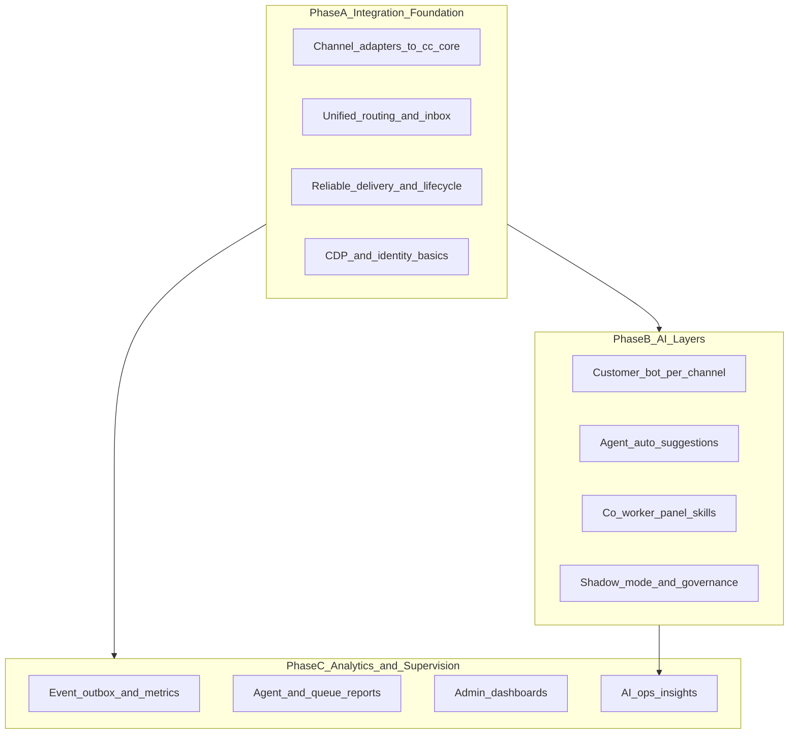
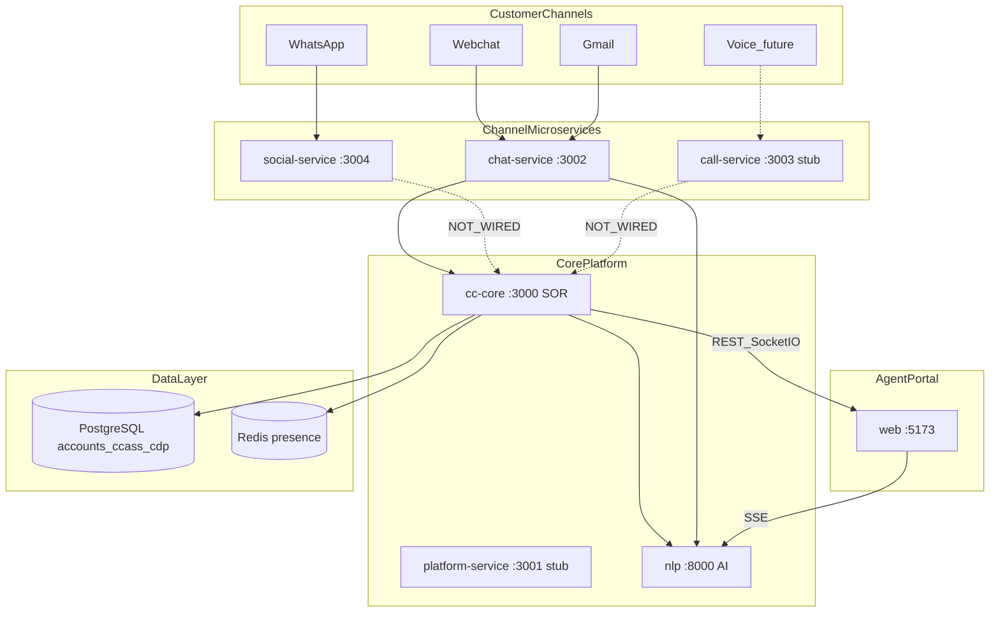
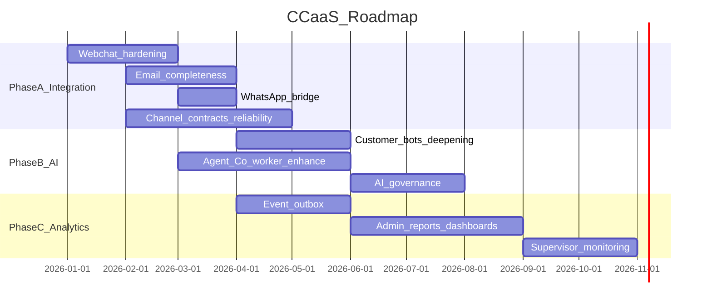

# Pending CCaaS Plan

> Enterprise AI contact center roadmap: omnichannel integration, live agent workspace, AI Co-worker, and future reports/analytics.
>
> **Last updated:** 2026-07-29  
> **Status:** Living document — track progress in Section 15 checklists.

---

## Executive framing

This is an **enterprise AI contact center** with three product pillars:

1. **Omnichannel operations** — one agent workspace for webchat, email, WhatsApp, voice, social
2. **Live agent assist (AI Co-worker)** — internal Copilot for suggestions, drafting, summarization, guided setup
3. **Reports & analytics** — operational KPIs, agent performance, SLA, channel mix, AI effectiveness (mostly future)

**Critical sequencing principle:**

> **Do not deepen AI features on channels that are not fully integrated end-to-end.** AI on broken plumbing creates shadow demos, not production value.

**Work order:** Phase A (integration) → Phase B (AI) → Phase C (analytics). Phases B and C can start in parallel only where their prerequisites are met.

---

## 1. Purpose and scope

This document captures:

- Current-state snapshot per service and per channel
- What is **done**, **partial**, and **pending**
- How omnichannel + live agent workspace + AI Co-worker fit together
- Enterprise considerations (multi-tenant, RLS, audit, SLA, scale)
- Future reports/analytics dependency on event foundation
- Microservices architecture recommendation
- Actionable checklists with task IDs for execution tracking

**Related documentation:**

- [WEBCHAT_LIVE_AGENT_PLAN.md](./nlp-backend/WEBCHAT_LIVE_AGENT_PLAN.md) — webchat NLP, handoff, copilot detail
- [DEFERRED_ENTERPRISE_WORK.md](./ccaas/DEFERRED_ENTERPRISE_WORK.md) — enterprise backlog
- [AI_CONTACT_CENTER_PLAN.md](./AI_CONTACT_CENTER_PLAN.md) — product vision, portal structure, phases
- [WHATSAPP_SOCIAL_SERVICE.md](./ccaas/WHATSAPP_SOCIAL_SERVICE.md) — WhatsApp adapter

---

## 2. Current architecture

**Canonical rule:** `cc-core` owns conversation truth (`ccass`). Channel services are **adapters**. `web` is the agent/admin experience. `nlp` is AI compute — never the system of record.

| Service | Port | Role |
|---------|------|------|
| `cc-core` | 3000 | Conversation SOR, routing, presence, workspace API, Socket.IO |
| `chat-service` | 3002 | Webchat WebSocket + Gmail inbound/outbound |
| `social-service` | 3004 | WhatsApp Meta adapter (not wired to cc-core) |
| `call-service` | 3003 | Voice scaffold only |
| `nlp` | 8000 | Customer bots + agent Copilot |
| `web` | 5173 | Agent/admin portal |
| `platform-service` | 3001 | Platform stub (not on live-agent critical path) |

---

## 3. Omnichannel live-agent workspace (today)

Unified three-panel layout ([AI_CONTACT_CENTER_PLAN.md](./AI_CONTACT_CENTER_PLAN.md)):

| Panel | Role |
|-------|------|
| Left — Inbox | Ongoing / Transferred / Closed; channel badge; queue |
| Center — Conversation | Messages, composer, transfer/end, channel-specific view (email thread vs chat bubbles) |
| Right — Customer 360 | Profile, previous interactions, Co-worker tab, My notes |

**Runtime flow (channel-agnostic after ingest):**

1. Conversation row in `ccass.conversations` with `channel` metadata
2. Agent sees it in inbox via `GET /api/v1/workspace/conversations`
3. Realtime via Socket.IO (`conversation.offer`, `message.created`, etc.)
4. Agent Accept → `active` → reply
5. Delivery branches at edge only: email → Gmail; webchat → WS; social → **not wired**

**Key files:**

- `apps/web/src/features/workspace/`
- `apps/cc-core/src/routes/workspace.ts`
- `apps/cc-core/src/services/realtime.ts`

---

## 4. AI Co-worker model (enterprise)

Separate **three AI surfaces** — do not conflate:

| Surface | Audience | When active | Service | Status |
|---------|----------|-------------|---------|--------|
| **Customer bot** | Visitor/customer | `bot_active = true` | `nlp` webchat/email routers | Webchat + email partial |
| **Auto suggestion** | Agent (inline) | Conversation `active`; inbound customer msg | `nlp` copilot suggest stream | Implemented for workspace |
| **Co-worker panel** | Agent (right tab) | Any time; draft/rewrite/summarize | `nlp` copilot + Together model | Implemented; session in Redux |

**AI integration rules:**

- Customer bot **must stop** after handoff (`bot_active = false`) — enforced in cc-core + chat-service
- Co-worker output is **internal until agent sends** — never auto-delivered to customer
- Copilot must be bound to `conversationId` for workspace context
- Shadow mode (email) = log NLP decisions without customer send — for safe rollout
- AI metrics (grounded rate, handoff rate) exist at API level (`GET /api/v1/email/metrics`) but not in admin UI yet

**Phase B AI backlog (after integration):**

- LLM-backed webchat (today rules-based in parts)
- Social channel NLP router (`whatsapp.py` etc.)
- Copilot memory/skill lifecycle across pages
- KB-grounded answers with approved org context
- Auto-wrap-up summary + disposition assist
- Sentiment/intent badges in customer panel
- Supervisor AI insights (shadow vs live comparison dashboard)
- Quality scoring on agent replies

---

## 5. Per-service: what exists vs what is missing

### 5.1 `cc-core` (conversation SOR, routing, workspace API)

**Owns:** `ccass.conversations`, routing, presence, assignments, dispositions, Socket.IO, workspace REST, internal ingest APIs, CDP projection, performance API (agent self-service).

| Implemented | Missing / partial |
|-------------|-------------------|
| Webchat + email ingest internal APIs | Social ingest API (`/internal/v1/social/conversations`) |
| Routing for `chat` + `email` | Per-channel routing (`whatsapp`, `instagram`, `facebook`, `voice`) |
| Offer accept/reject/expire | Durable offer worker (restart-safe) |
| Transfer + end + disposition | Final `closed` semantics + ACW enforcement |
| Email session boundaries (`provider_thread_id`) | Channel delivery registry (replace if/else in workspace routes) |
| Agent performance API + CSV export | Admin/queue/supervisor analytics APIs |
| Queue publish to `ccass` | Skill/proficiency scoring in routing |
| RLS + tenant context | Audit event persistence |
| Copilot turn persistence hooks | SLA runtime engine (timestamps exist; enforcement partial) |
| `cdp.interactions` projection | Full CDP contact resolution from channel identity |
| Email mailbox policy API | Policy admin UI (consumed by web admin) |

**Key paths:** `apps/cc-core/src/services/conversations.ts`, `routing.ts`, `routes/workspace.ts`, `routes/internal.ts`, `routes/performance.ts`

---

### 5.2 `chat-service` (webchat WS + Gmail adapter)

| Implemented | Missing / partial |
|-------------|-------------------|
| WebSocket gateway `/ws/webchat` | Durable session store (DB-backed reconnect) |
| Webchat orchestrator → cc-core + NLP | Kafka consumer (stub only) |
| Gmail Pub/Sub inbound | Microsoft Graph / SMTP / IMAP |
| Gmail outbound + delivery worker | HTML email body ingestion |
| Internal deliver routes for webchat + email | Attachment download from Gmail |
| OAuth credential store | Rate limiting / abuse protection on WS |
| Watch renewal | Multi-instance WS sticky sessions / Redis pubsub for connections |
| E2E email script | Production widget hosting (vs test page + ngrok) |

**Key paths:** `apps/chat-service/src/websocket/`, `src/services/webchat-orchestrator.ts`, `src/email/`

---

### 5.3 `social-service` (WhatsApp Meta adapter)

| Implemented | Missing / partial |
|-------------|-------------------|
| Meta webhook verify + inbound normalize | **cc-core forward on inbound** |
| Outbound text/template | **Agent reply delivery path** |
| Credential decrypt from accounts DB | Instagram + Facebook providers |
| Template approval routes | Conversation session model (24h window rules) |
| Tests for routes/credentials | NLP social bot integration |
| | Media messages (images, docs) |
| | Kafka (stub) |
| | Link to queue/routing in cc-core |

**Key paths:** `apps/social-service/src/services/inbound-handler.ts`, `src/routes/webhooks.ts`

---

### 5.4 `call-service` (voice — placeholder)

| Implemented | Missing / partial |
|-------------|-------------------|
| Health endpoints | Everything else |
| Kafka stub | Telephony provider (Twilio/Exotel/etc.) |
| `POST /internal/messages` log-only | cc-core voice ingest |
| | IVR, recording, transcription |
| | Agent softphone in workspace |
| | Voice bot + live agent handoff |

**Key path:** `apps/call-service/src/index.ts` (scaffold only)

---

### 5.5 `nlp` (AI compute)

| Implemented | Missing / partial |
|-------------|-------------------|
| Webchat turn + handoff detection | Production LLM webchat (approved org KB) |
| Email turn + guard/shadow gates | WhatsApp/Instagram/Facebook routers |
| Copilot stream + suggest-reply | Copilot long-term memory across sessions |
| Copilot tools (queue setup, etc.) | Read-only DB role for NLP (deferred) |
| Internal auth for service calls | Model routing per tenant/plan |
| Email/webchat tests | Social channel prompts |
| | AI analytics export to cc-core events |
| | Canary/shadow promotion workflow UI |

**Key paths:** `apps/nlp/src/app/routers/webchat.py`, `email.py`, `copilot.py`

---

### 5.6 `web` (agent + admin portal)

| Implemented | Missing / partial |
|-------------|-------------------|
| Agent workspace (inbox, offer, reply, transfer, end) | Admin dashboard KPIs |
| Channel-aware UI (email thread, chat bubbles) | Live monitoring (supervisor) |
| Presence toolbar | Reports module (`/admin/reports` — Phase 3) |
| Co-worker embedded panel | Mailbox policy admin UI |
| Auto suggestion on inbound | Email attachments UI |
| Agent performance page (basic) | Queue name in inbox (shows UUID) |
| Contacts page + seed data | Social channel setup UI in admin |
| Workforce queue editor (social flags) | Widget embed management |
| Copilot session persistence (navigation) | CSAT survey post-interaction |
| E2E webchat→agent test | E2E email + WhatsApp tests |

**Key paths:** `apps/web/src/features/workspace/`, `apps/web/src/pages/performance/`, `apps/web/src/components/assistant/`

---

### 5.7 `platform-service` (enterprise platform stub)

| Implemented | Missing / partial |
|-------------|-------------------|
| Health + Swagger | Real user/org/product APIs for CC |
| Basic platform routes stub | Auth integration boundary with accounts |
| Prisma plugin | Not on critical live-agent path today |

**Note:** Most auth/org/user data lives in `accounts` schema via cc-core directly today.

---

### 5.8 Shared packages / data

| Package | Role | Missing |
|---------|------|---------|
| `packages/db-cc` | Prisma + migrations (`accounts`, `ccass`, `cdp`) | Social tables in Prisma (some via raw SQL only) |
| `packages/event-contracts` | Channel event types | Producers/consumers not wired |
| `packages/observability` | Structured logging | Distributed tracing, metrics dashboards |

---

## 6. Channel status matrix

| Capability | Webchat | Email | WhatsApp | Instagram/FB | Voice |
|------------|---------|-------|----------|--------------|-------|
| Adapter service | chat-service | chat-service | social-service | social-service | call-service stub |
| Ingest → cc-core | Yes | Yes | Yes | Yes | No |
| Bot before handoff | Yes | Yes | Yes | Yes | No |
| Live agent routing | Yes | Yes | Yes | Yes | No |
| Agent workspace inbox | Yes | Yes | Yes | Yes | No |
| Agent reply delivery | Yes | Yes | Yes | Yes | No |
| Session/end/disposition | Yes | Yes (new session after close) | No | No | No |
| E2E test | Yes | Script only | No | No | No |
| Customer bot AI | Partial | Yes + shadow | No | No | No |
| Agent AI assist | Yes | Yes | Would work once ingested | — | — |

---

## 7. Phase A — Integration foundation (do this first)

**Goal:** Every supported channel can complete: inbound → conversation → route → offer → accept → reply → end/disposition → outbound, with reliable state in cc-core.

### A1. Webchat production hardening

- Durable reconnect + session recovery
- Attachment upload/scan/deliver
- Production widget embed (replace test page)
- Durable offer expiration worker
- Queue display names in inbox (not UUID)

### A2. Email operational completeness

- Attachment pipeline (download, scan, display, agent attach)
- Bounce/complaint handling + suppression
- Mailbox policy admin UI
- CDP sender → contact linking
- Microsoft Graph provider (enterprise requirement)
- Fix UI polish (From address, channel-specific offer copy, delivery state)

### A3. WhatsApp bridge (highest priority new channel)

- `ingestInboundSocialConversation` in cc-core
- social-service → cc-core HTTP on webhook
- Extend `RoutableChannel` + `handles_whatsapp` routing
- `social-delivery.ts` for agent replies
- E2E test: Meta webhook → agent inbox → reply → Meta send

### A4. Unified channel contracts

- Extend `packages/event-contracts` with normalized inbound/outbound message shape
- Channel delivery registry in cc-core (replace channel if/else)
- Consistent `external_thread_id` / `provider_thread_id` pattern per channel

### A5. Platform reliability (parallel)

- Transactional outbox + Kafka (when infra ready)
- Durable workers for offers, email outbox, Gmail watch
- Internal service auth hardening (`x-internal-service-key`)
- Multi-instance WebSocket fanout (Redis adapter)

### A6. CDP + identity basics

- Link `visitor_id` / email / phone to `cdp.contacts`
- Previous interactions accuracy across sessions
- Customer 360 real data (not placeholders)

**Exit criteria for Phase A:** Agent can handle webchat + email + WhatsApp in one inbox with correct lifecycle; no channel stops at adapter layer.

---

## 8. Phase B — AI layers (after integration)

**Goal:** AI augments every integrated channel without breaking operational truth.

### B1. Customer-facing bots (per channel)

- Webchat: LLM + approved KB; confidence/handoff gates
- Email: expand shadow → canary → full auto-send with governance
- WhatsApp: NLP router + template fallback for window expiry
- Unified handoff reasons across channels

### B2. Agent live assist (workspace)

- Auto suggestion quality + latency SLAs
- Co-worker: summarize thread, draft reply, translate, tone adjust
- Wrap-up assist: disposition + resolution summary generation
- Intent/sentiment chips in conversation header
- "Use as reply" only in inbox context (not embedded Co-worker tab)

### B3. AI governance

- Shadow mode dashboards per mailbox/channel
- Grounding/guard failure alerts
- Tenant model policy (which model, temperature, PII rules)
- Copilot audit trail (what was suggested vs sent)

### B4. Admin AI (Workforce Copilot)

- Guided queue/channel setup (partially done)
- Policy recommendation from conversation patterns
- KB gap detection from unresolved intents

**Exit criteria for Phase B:** AI measurable per channel (handoff rate, acceptance rate, CSAT correlation); no AI path bypasses cc-core writes.

---

## 9. Phase C — Reports, analytics, supervision (enterprise)

**Depends on:** committed lifecycle events from Phase A outbox; accurate disposition/resolution data.

### C1. Event foundation (prerequisite)

- Emit events: `conversation.started`, `assigned`, `accepted`, `message.created`, `transferred`, `resolved`, `ended`
- Idempotent projection to analytics tables or warehouse
- CDP interaction timeline as customer-centric view

### C2. Agent-facing (partial today)

- **Done:** `GET /api/v1/performance/me` + CSV download (`apps/cc-core/src/routes/performance.ts`)
- **Pending:** CSAT, quality score, coaching feedback, trend charts

### C3. Supervisor / admin (future)

From [AI_CONTACT_CENTER_PLAN.md](./AI_CONTACT_CENTER_PLAN.md) Phase 3:

- Queue KPIs, SLA breach dashboard
- Live monitoring: queue depth, agent state, active conversations
- Channel mix reports (webchat vs email vs WhatsApp volume)
- Agent productivity, occupancy, handle time, FCR
- AI ops: bot containment rate, handoff reasons, suggestion acceptance rate
- Scheduled reports + exports
- Silent monitor / whisper / barge (voice phase)

### C4. Considerations for analytics design

- **Source of truth:** `ccass.conversations` + `conversation_assignments` + dispositions — not UI state
- **Time zones:** agent vs queue vs org for SLA
- **Session boundaries:** email new session after close must not double-count handle time
- **AI attribution:** link `nlp_turns` and `copilot_turns` to outcomes
- **Multi-tenant:** all reports scoped by `organization_id` + RLS
- **PII:** aggregate exports must redact customer content where required

---

## 10. Enterprise considerations checklist

| Area | Consideration | Status |
|------|---------------|--------|
| Multi-tenancy | RLS via `app.organization_id` | Implemented |
| Auth | Agent login via cc-core; service keys for internal | Partial |
| Audit | Who ended, transferred, disposition codes | DB fields exist; audit log table deferred |
| SLA | First response / resolution due timestamps (email) | Partial |
| ACW | After Contact Work presence state | Partial |
| Business hours | Queue profiles + email routing | Email partial; holidays deferred |
| Capacity | Per-channel concurrency (`agent_capacity`) | Implemented |
| Secrets | OAuth tokens encrypted; rotation deferred | Partial |
| Rate limits | WS + webhook abuse | Not implemented |
| DR / HA | Single DB; no cross-region | Deferred |
| Compliance | Retention, deletion, regional data | Deferred |
| Observability | Structured logs per service | Partial; no unified APM |

---

## 11. Suggested delivery order

**Priority order:**

1. WhatsApp ↔ cc-core bridge (biggest omnichannel gap)
2. Webchat reconnect + production widget
3. Email attachments + bounces + admin policy UI
4. Event outbox (unblocks analytics)
5. AI deepening per channel
6. Admin reports + live monitoring

---

## 12. Microservices: keep separate or merge?

**Recommendation: keep separate services.**

| Service | Verdict | Reason |
|---------|---------|--------|
| `cc-core` | Keep | SOR; must stay stable, tenant-safe, fast |
| `chat-service` | Keep | WS + Gmail workers; different scale profile |
| `social-service` | Keep | Meta webhooks, token lifecycle, template compliance |
| `call-service` | Keep (when built) | Telephony latency, media, recording |
| `nlp` | Keep | LLM isolation, keys, GPU, rate limits |
| `web` | Keep | Static frontend CDN deploy |
| `platform-service` | Keep | Platform boundary; grow into real org APIs |

**Merge logically, not physically:**

- One ingest pattern in cc-core per channel
- One delivery registry in cc-core
- One event contract package
- One agent workspace (already true)

**Do not merge** chat + social + cc-core into one Node process — loses scaling, blast-radius isolation, and team ownership.

**Dev ergonomics:** monorepo `npm run dev` already runs all services; use that, not code consolidation.

**Middle ground:** extend `packages/event-contracts` with normalized inbound/outbound message shapes so each adapter stays thin (~200 lines of provider glue).

---

## 13. File index

| Service | Key paths |
|---------|-----------|
| cc-core | `apps/cc-core/src/services/conversations.ts`, `routing.ts`, `email-*.ts`, `routes/workspace.ts` |
| chat-service | `apps/chat-service/src/websocket/`, `src/email/`, `src/services/webchat-orchestrator.ts` |
| social-service | `apps/social-service/src/services/inbound-handler.ts` |
| call-service | `apps/call-service/src/index.ts` |
| nlp | `apps/nlp/src/app/routers/` |
| web workspace | `apps/web/src/features/workspace/` |
| web AI | `apps/web/src/components/assistant/` |
| web performance | `apps/web/src/pages/performance/` |
| DB | `packages/db-cc/prisma/migrations/` |
| Events | `packages/event-contracts/src/index.ts` |

---

## 14. Epic summary (track at sprint level)

| Epic ID | Phase | Scope |
|---------|-------|-------|
| `a-wa-bridge` | A3 | WhatsApp social-service ↔ cc-core ingest + delivery + E2E |
| `a-webchat-harden` | A1 | Webchat reconnect, attachments, production widget, durable offers |
| `a-email-complete` | A2 | Email attachments, bounces, policy UI, CDP linking |
| `a-platform-reliability` | A4–A5 | Channel delivery registry, event contracts, durable workers, CDP |
| `b-ai-layers` | B | Customer bots, Co-worker enhancements, AI governance |
| `c-analytics` | C | Event outbox, admin reports, supervisor monitoring |

---

## 15. Working checklist and tasks

Use this as the execution backlog. Check items off in order within each phase. **Do not start Phase B until Phase A exit criteria are met for that channel.**

### Phase A exit criteria (gate before Phase B)

- [ ] **A-GATE-1** Webchat: customer can reconnect after refresh/disconnect and continue same conversation (or graceful new session)
- [ ] **A-GATE-2** Email: agent can send/receive with attachments; bounce does not create zombie conversations
- [ ] **A-GATE-3** WhatsApp: inbound webhook → agent inbox → agent reply → customer receives on WhatsApp
- [ ] **A-GATE-4** All three channels: end + disposition closes session; new inbound creates new session where applicable
- [ ] **A-GATE-5** Inbox shows queue **name** (not UUID) and correct channel badge for every conversation

---

### Phase A1 — Webchat integration hardening

| ID | Task | Service | Done |
|----|------|---------|------|
| A1-01 | DB-backed webchat session / resume token (replace in-memory store) | chat-service + cc-core | [ ] |
| A1-02 | Disconnect grace period + configurable idle timeout | chat-service | [ ] |
| A1-03 | Event replay on reconnect (missed messages while offline) | chat-service + cc-core | [ ] |
| A1-04 | Durable offer-expiration worker (replace in-process timers) | cc-core | [ ] |
| A1-05 | Attachment upload endpoint + metadata in `conversation_messages` | chat-service + cc-core | [ ] |
| A1-06 | Attachment scan/quarantine pipeline (stub → real scanner) | cc-core + infra | [ ] |
| A1-07 | Deliver attachments to widget over WS | chat-service | [ ] |
| A1-08 | Production webchat widget embed (replace test page / ngrok-only flow) | web + chat-service | [ ] |
| A1-09 | Multi-instance WS fanout (Redis pub/sub for connection registry) | chat-service | [ ] |
| A1-10 | E2E: reconnect + attachment + handoff regression test | web e2e | [ ] |
| A1-11 | Update stale docs (`docs/golden-path/webchat-to-agent.md`, `docs/chatservice/PLAN.md`) | docs | [ ] |

---

### Phase A2 — Email integration completeness

| ID | Task | Service | Done |
|----|------|---------|------|
| A2-01 | Download Gmail attachment bytes on ingest | chat-service | [ ] |
| A2-02 | Store attachments in object store; update `scanState` | cc-core + infra | [ ] |
| A2-03 | Show attachments in `WorkspaceEmailView` | web | [ ] |
| A2-04 | Enable composer attach button + outbound attachment delivery | web + cc-core + chat-service | [ ] |
| A2-05 | Ingest HTML body (sanitize → store plain + safe HTML) | chat-service | [ ] |
| A2-06 | Gmail bounce/complaint webhook handler + suppression list | chat-service + cc-core | [ ] |
| A2-07 | Mailbox policy admin UI (bot, shadow, auto-send, queues) | web + cc-core | [ ] |
| A2-08 | CDP: link sender email → `cdp.contacts` on ingest | cc-core | [ ] |
| A2-09 | Fix hardcoded From address in email view | web | [ ] |
| A2-10 | Show delivery state on outbound email messages | web | [ ] |
| A2-11 | Channel-specific offer banner copy (not "incoming chat") | web | [ ] |
| A2-12 | Resolve queue display name in inbox (join `ccass.queues`) | cc-core + web | [ ] |
| A2-13 | Microsoft Graph adapter (behind same ingest API) | chat-service | [ ] |
| A2-14 | E2E: email ingest → agent reply → verify outbox (extend existing script) | cc-core scripts | [ ] |
| A2-15 | Supervisor view for failed `email_delivery_outbox` rows | cc-core + web admin | [ ] |

---

### Phase A3 — WhatsApp bridge (highest priority new channel)

| ID | Task | Service | Done |
|----|------|---------|------|
| A3-01 | Design normalized social ingest payload (extend `event-contracts`) | packages | [ ] |
| A3-02 | `POST /internal/v1/social/conversations` ingest in cc-core | cc-core | [ ] |
| A3-03 | Session model for WhatsApp (`provider_thread_id` = customer phone / Meta thread) | cc-core | [ ] |
| A3-04 | Extend `RoutableChannel` to include `whatsapp` | cc-core | [ ] |
| A3-05 | Routing uses `handles_whatsapp` (not generic `handles_chat`) | cc-core | [ ] |
| A3-06 | social-service: forward `NormalizedWhatsAppInbound` to cc-core after webhook | social-service | [ ] |
| A3-07 | `social-delivery.ts` in cc-core → social-service internal send | cc-core | [ ] |
| A3-08 | Workspace agent reply branches to social delivery for `channel=whatsapp` | cc-core `workspace.ts` | [ ] |
| A3-09 | WhatsApp 24h window / template fallback rules | social-service + cc-core | [ ] |
| A3-10 | Media inbound (image/doc) metadata + optional download | social-service | [ ] |
| A3-11 | E2E: mock Meta webhook → agent inbox → reply → outbound | social-service + cc-core | [ ] |
| A3-12 | Seed test agent + queue with `handles_whatsapp` for worktual1 | cc-core scripts | [ ] |

---

### Phase A4 — Unified platform plumbing

| ID | Task | Service | Done |
|----|------|---------|------|
| A4-01 | Channel delivery registry in cc-core (webchat, email, whatsapp) | cc-core | [ ] |
| A4-02 | Shared `ingestInbound{Channel}Conversation` pattern documented + enforced | cc-core | [ ] |
| A4-03 | Transactional outbox table + publisher skeleton | cc-core | [ ] |
| A4-04 | Kafka producer for `cc.message.received` / lifecycle events | cc-core | [ ] |
| A4-05 | Replace Kafka stubs in chat-service, social-service, call-service | all adapters | [ ] |
| A4-06 | Internal service auth audit (`x-internal-service-key` on all internal routes) | all services | [ ] |
| A4-07 | Rate limiting on public WS and webhooks | chat-service + social-service | [ ] |
| A4-08 | Skill/proficiency tables wired into routing score | cc-core | [ ] |

---

### Phase A5 — CDP and customer 360

| ID | Task | Service | Done |
|----|------|---------|------|
| A5-01 | Resolve `visitor_id` / email / phone to contact on conversation create | cc-core | [ ] |
| A5-02 | Customer panel shows real tier, LTV, open tickets (not placeholders) | web + cc-core | [ ] |
| A5-03 | Previous interactions paginated and channel-accurate | cc-core + web | [ ] |
| A5-04 | Internal notes: persist + never leak to customer channel delivery | cc-core + web | [ ] |

---

### Phase B — AI layers (start only after Phase A gates)

| ID | Task | Service | Depends on | Done |
|----|------|---------|------------|------|
| B-01 | Webchat: LLM bot with approved org KB + confidence gates | nlp + chat-service | A-GATE-1 | [ ] |
| B-02 | Email: shadow → canary promotion workflow (admin UI) | web + cc-core + nlp | A-GATE-2 | [ ] |
| B-03 | WhatsApp: NLP router + handoff before live agent | nlp + social-service | A-GATE-3 | [ ] |
| B-04 | Auto suggestion: latency SLA + fallback when NLP down | web + nlp | A gates | [ ] |
| B-05 | Co-worker: thread summarize + wrap-up disposition assist | nlp + web | A gates | [ ] |
| B-06 | Intent/sentiment chips in conversation header | nlp + web | A gates | [ ] |
| B-07 | AI governance dashboard (grounded rate, handoff rate, shadow compare) | web admin + cc-core | A2-07 | [ ] |
| B-08 | Copilot audit: suggested vs sent linkage per turn | cc-core + web | A gates | [ ] |
| B-09 | KB gap report from unresolved intents | nlp + admin | B-01 | [ ] |

---

### Phase C — Reports and analytics (start after A4-03 outbox)

| ID | Task | Service | Depends on | Done |
|----|------|---------|------------|------|
| C-01 | Lifecycle event schema finalized in `event-contracts` | packages | A4-03 | [ ] |
| C-02 | Idempotent analytics projection tables (or warehouse export) | cc-core | C-01 | [ ] |
| C-03 | Admin dashboard: queue KPIs, SLA breaches, channel volume | web admin | C-02 | [ ] |
| C-04 | Supervisor live monitoring page (agents, queues, active convos) | web admin | C-02 | [ ] |
| C-05 | Extend agent performance: CSAT, quality score, trends | cc-core + web | C-02 | [ ] |
| C-06 | Scheduled report generation + CSV/PDF export | cc-core + web | C-03 | [ ] |
| C-07 | AI ops report: containment, handoff reasons, suggestion acceptance | cc-core + nlp | B-07, C-02 | [ ] |
| C-08 | Reports module route `/admin/reports` | web | C-06 | [ ] |

---

### Quick-start: recommended first 2 weeks

Work these in order for fastest visible progress:

1. **A3-02 → A3-06 → A3-07 → A3-08** — WhatsApp live in agent inbox (biggest omnichannel gap)
2. **A2-12** — Queue name in inbox (small UX win, all channels)
3. **A1-04** — Durable offer expiration (stability)
4. **A2-08** — CDP contact linking (customer 360 value)
5. **A4-01** — Channel delivery registry (reduces tech debt before more channels)

---

### Task status legend

| Symbol | Meaning |
|--------|---------|
| `[ ]` | Not started |
| `[~]` | In progress |
| `[x]` | Done |
| **Blocked** | Note dependency ID in PR/commit |

### How to track

- Check off tasks in this file as work completes
- Create GitHub issues / Linear tickets using IDs (`A3-02`, `B-07`, etc.)
- Reference task IDs in PR descriptions
- Map epics in Section 14 to sprint milestones
