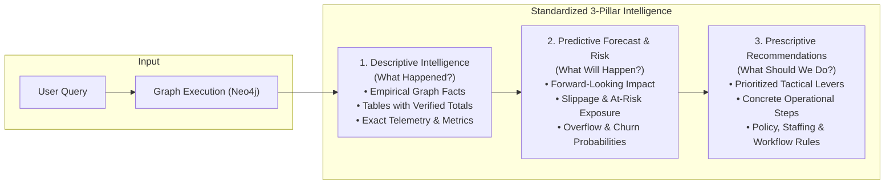
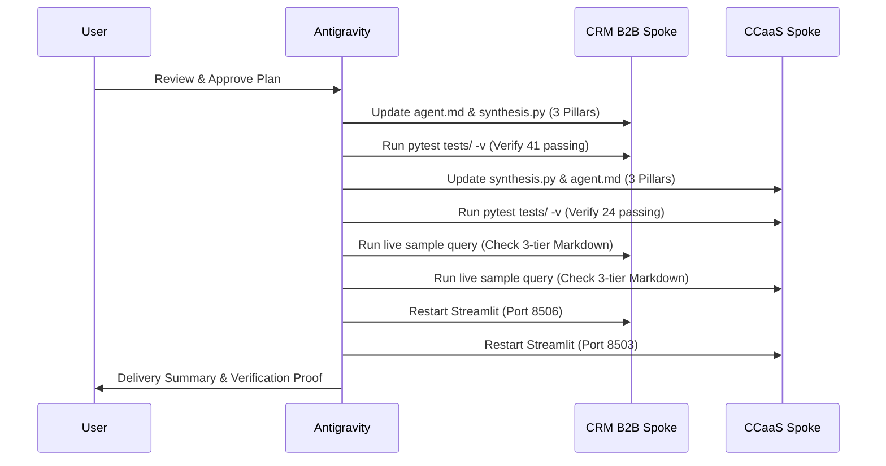

# CRM B2B reports — flow (SQL vs KG)

Chat: `test_streamlit/crm_b2b/` (`app.py` UI, `turn.py` one turn). Identity = org, user, role + question.

```
question → Domain (plan JSON)
              ├─ counts / win rate / mix / lists → sql_executor → Postgres
              └─ reasons / 360 / path / BANT     → kg_executor → Neo4j
         → facts (SQL numbers then kg_notes) → Domain briefing
```

Why / compare on **deals**: Domain emits t1 SQL then t2 KG. Lead / quote / invoice **counts**: SQL only. Pure named-account 360: KG only.

| Path | What it is | SQL / KG |
|---|---|---|
| [domain/agent.md](domain/agent.md) | Plan (shape → kpi/dimension or kg) + briefing from facts | both |
| [sql_executor/agent.md](sql_executor/agent.md) | `run_kpi` or one `SELECT` on `rpt.*` | SQL |
| [core/](core/) | Time bind, views, sqlglot guard, `run_kpi` / `run_sql`, facts | SQL |
| [product/](product/) | `kpis.yml`, `sql/*.sql`, `schema.yml`, `access.yml` | SQL |
| [kg_executor/](kg_executor/) | Planner, Cypher templates, Neo4j, graph 360/why/path | KG |
| [kg_executor/agent.md](kg_executor/agent.md) | Cypher plan + graph synthesis (facts still briefed by Domain) | KG |
| `test_streamlit/crm_b2b/turn.py` | Calls Domain, SQL, KG; no KPI rename | both |

**Objects:** deals → `rpt.deals`. Leads/contacts → `rpt.contacts` (`lead_count` = all active; `unassigned_leads` only if they said unassigned; contacted = `lead_count` + `status_filter`). Quotes / invoices / activities are their own views. Do not answer a lead question with deal KPIs or deal KG.

**Revenue:** sales_rep / sales_manager default = booked (`won_revenue` on deals). Finance default = collected (`collected_revenue` on paid invoices). Admin bare “revenue” = both, labeled, never summed. Explicit wording (won deals vs paid invoices) always wins.

# Implementation Plan: 3-Pillar Analytics Architecture (Descriptive, Predictive, Prescriptive)

This plan defines the architectural updates, prompt engineering enhancements, code changes, and verification protocols required to standardize both the **CRM B2B Knowledge Graph Agent** and the **CCaaS Knowledge Graph Agent** on an enterprise 3-tier response framework.

---

## 1. Architectural Objective

Every query processed by either agent must systematically deliver three cohesive, mathematically grounded intelligence tiers:



---

## 2. Pillar Definitions by Domain

### A. CRM B2B Commercial Knowledge Graph

| Pillar | Focus | Concrete Elements in Output |
| :--- | :--- | :--- |
| **1. Descriptive** | Current & Historical State | • Ground truth answer with exact metrics.<br>• Markdown table with separate multi-currency totals (`$ USD` vs `₹ INR`).<br>• Won/Lost counts, stage breakdown, invoice aging brackets, rep allocations. |
| **2. Predictive** | Revenue & Pipeline Projection | • **Forecast Realization**: Projected closed-won revenue based on current stage velocity and quote approval status.<br>• **Slippage Exposure**: Value of deals stalled in pipeline at high risk of slipping past target close dates.<br>• **Cash Realization Timeline**: Projected payment timing for overdue receivables.<br>• **Churn / Stagnation Risk**: Accounts with no recent interactions or quote activity. |
| **3. Prescriptive** | Operational & Commercial Actions | • **Immediate Deal Levers**: Specific discovery mandates, discount approvals, executive sponsorship triggers.<br>• **Data Integrity Mandates**: Mandating quote generation at discovery stage to eliminate $0 unpriced deals.<br>• **Territory & Capacity Rebalancing**: Shifting volume from overloaded reps to underutilized reps. |

---

### B. CCaaS Contact Center Knowledge Graph

| Pillar | Focus | Concrete Elements in Output |
| :--- | :--- | :--- |
| **1. Descriptive** | Historical Telemetry & Routing | • Omnichannel conversation volume and active customer counts.<br>• Handle times segmented by channel (separating async Email from real-time Voice/Chat).<br>• Queue routing distribution (`ROUTED_TO`) and agent workloads (`HANDLED_BY`).<br>• Disconnect breakdown (`end_actor`, `end_reason`, `disposition_code`). |
| **2. Predictive** | Operational Bottleneck Forecast | • **Queue Overflow Risk**: Projected wait time spikes if arrival rates continue.<br>• **Escalation & Abandonment Probability**: Likelihood of customer drop-off given current transfer loops and agent unavailability flags (`no_ready_agents`).<br>• **SLA Breach Risk**: Projected breach rates during shift transitions or peak intervals.<br>• **Repeat Contact Friction**: Projected volume of repeat calls/chats caused by unresolved first touches. |
| **3. Prescriptive** | Workforce & Routing Policy | • **Staffing & Shift Reallocation**: Adjusting schedules based on business hours and peak abandonment windows.<br>• **Queue & Routing Rules**: Tuning timeout thresholds and configuring overflow queues for chained sessions.<br>• **Agent Coaching & Channel Policy**: Isolating long-duration asynchronous tasks from real-time queues. |

---

## 3. Detailed Component Changes

### Phase 1: CRM B2B Spoke Updates
1. **Modify `agent.md` (Section 2: Executive Synthesis)**:
   - File: [`reports_analytics_agent_crm_b2b_kg/agent.md`](file:///home/vectone/shiva/reports-analytics-spoke/reports-analytics-spoke/reports_analytics_agent_crm_b2b_kg/agent.md)
   - Update instructions to enforce the 3 standard headings:
     * `### 1. Descriptive Intelligence` (or topic-specific equivalent e.g., `### 1. Active Pipeline & Valuation Breakdown`)
     * `### 2. Predictive Risk & Revenue Forecast` (e.g., `### 2. Forecast Realization & Slippage Exposure`)
     * `### 3. Prescriptive Strategic Recommendations` (e.g., `### 3. Tactical Levers to Accelerate Close`)
   - Provide concrete few-shot synthesis guidelines for revenue projections and slippage risk based on verified stage probability and quote statuses.
2. **Update `core/synthesis.py`**:
   - File: [`reports_analytics_agent_crm_b2b_kg/core/synthesis.py`](file:///home/vectone/shiva/reports-analytics-spoke/reports-analytics-spoke/reports_analytics_agent_crm_b2b_kg/core/synthesis.py)
   - Update deterministic fallback generator (`lines 198-220`) to format fallback summaries into the 3-pillar structure.
   - Ensure `_verify_and_align_totals` verifies multi-currency totals across all 3 sections.

---

### Phase 2: CCaaS Spoke Updates
1. **Modify `core/synthesis.py` (Executive Synthesis Prompt)**:
   - File: [`reports_analytics_agent_ccaas_kg/core/synthesis.py`](file:///home/vectone/shiva/cursor_report_agent/reports_analytics_agent_ccaas_kg/core/synthesis.py)
   - Remove the suppressing directives (`DO NOT provide "Next Steps", "Recommendations"...`).
   - Replace with strict 3-pillar synthesis instructions:
     * `### 1. Descriptive Telemetry & Operational State`
     * `### 2. Predictive Operational Risk & Impact`
     * `### 3. Prescriptive Contact Center Recommendations`
   - Update deterministic fallback builder to include the 3 sections.
2. **Update `agent.md`**:
   - File: [`reports_analytics_agent_ccaas_kg/agent.md`](file:///home/vectone/shiva/cursor_report_agent/reports_analytics_agent_ccaas_kg/agent.md)
   - Align role description and output synthesis guidelines with the 3-pillar requirement.

---

### Phase 3: Automated Testing & Verification
1. **Regression Testing**:
   - Run existing test suites in both repos:
     * `reports_analytics_agent_crm_b2b_kg`: `pytest tests/ -v` (41 tests)
     * `reports_analytics_agent_ccaas_kg`: `pytest tests/ -v` (24 tests)
2. **End-to-End Query Verification**:
   - Execute benchmark queries across both agents to confirm each response contains:
     - Section 1 (Descriptive facts & table)
     - Section 2 (Predictive forecast / risk)
     - Section 3 (Prescriptive recommendations)
3. **Live Streamlit Restart**:
   - Restart background daemons on ports `8503` (CCaaS) and `8506` (CRM B2B) and verify HTTP `200 OK`.

---

## 4. Execution Sequence & Timeline



---

## 5. Verification Checklist

- [ ] **CRM B2B Agent**:
  - [ ] Opening descriptive table with verified multi-currency totals (`USD` / `INR`).
  - [ ] Predictive section projecting revenue realization, slippage exposure, or cash timeline.
  - [ ] Prescriptive recommendations with prioritized operational levers.
  - [ ] All 41 unit/integration tests pass.
- [ ] **CCaaS Agent**:
  - [ ] Opening descriptive table with handle times, disconnect reasons, and queue/agent counts.
  - [ ] Predictive section projecting queue overflow, repeat contact loops, or SLA risk.
  - [ ] Prescriptive recommendations with staffing and routing rule adjustments.
  - [ ] All 24 unit/integration tests pass.
- [ ] **Zero Hardcoding**: Verified that all predictive projections and recommendations are derived dynamically by the LLM reasoning over graph facts, with zero `if/elif` keyword matching.
