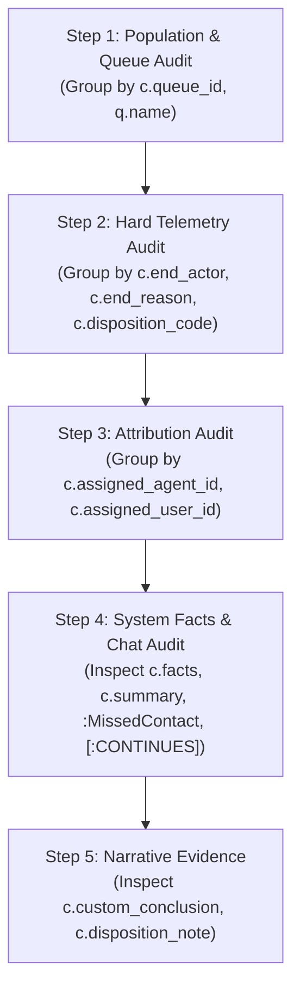

# Skill: `root-cause-4step-traversal`

## Overview & Purpose
Provides the mandatory 5-step graph traversal protocol for answering any "WHY" or root-cause question (e.g. why metrics dropped, why conversations remained unresolved, why transfers occurred, or what caused an operational breakdown).

---

## The 5-Step Traversal Protocol



---

## Detailed Step Specifications & Cypher Templates

### Step 1: Population & Queue Audit
* **Goal**: Establish whether the issue is isolated to a specific queue or distributed across the entire contact center.
* **Cypher Pattern**:
```cypher
MATCH (c:Conversation)
WHERE toLower(c.resolution_code) = 'unresolved'
OPTIONAL MATCH (c)-[:ROUTED_TO]->(q:ContactCentreQueue)
RETURN coalesce(q.name, 'Queue ' + toString(c.queue_id), 'Unassigned') AS queue_name,
       coalesce(c.queue_id, q.id) AS queue_id,
       count(c) AS unresolved_volume
ORDER BY unresolved_volume DESC
LIMIT 20
```

### Step 2: Hard Telemetry Audit (Disconnect Attribution)
* **Goal**: Determine exact causality via ground-truth disconnect telemetry without speculation.
* **Cypher Pattern**:
```cypher
MATCH (c:Conversation)
WHERE toLower(c.resolution_code) = 'unresolved'
RETURN coalesce(c.end_actor, 'system') AS disconnect_actor,
       coalesce(c.end_reason, 'unspecified') AS disconnect_reason,
       coalesce(c.disposition_code, 'none') AS disposition_code,
       count(c) AS incident_count,
       round(avg(duration.between(c.created_at, c.ended_at).seconds) / 60.0, 2) AS avg_duration_minutes,
       round(avg(duration.between(c.created_at, c.ended_at).seconds), 1) AS avg_duration_seconds
ORDER BY incident_count DESC
LIMIT 20
```

### Step 3: Attribution Audit (Staff & Agent Distribution)
* **Goal**: Check whether issues are skewed by specific agents or evenly distributed across staff.
* **Cypher Pattern**:
```cypher
MATCH (c:Conversation)
WHERE toLower(c.resolution_code) = 'unresolved'
OPTIONAL MATCH (c)-[:HANDLED_BY]->(a:ContactCentreAgent)
RETURN coalesce(a.display_name, a.email, 'Agent ' + toString(c.assigned_agent_id), 'Unassigned') AS agent_name,
       coalesce(c.assigned_agent_id, a.id) AS assigned_agent_id,
       count(c) AS conversations_handled,
       round(avg(duration.between(c.created_at, c.ended_at).seconds) / 60.0, 2) AS avg_handle_time_minutes
ORDER BY conversations_handled DESC
LIMIT 20
```

### Step 4: System Facts & Continuation Audit (Routing Failures)
* **Goal**: Query failure flags (`no_ready_agents`, `live_agent_unavailable`), missed escalations (`:MissedContact`), and transfer chains (`[:CONTINUES]`).
* **Cypher Pattern**:
```cypher
MATCH (c:Conversation)
WHERE any(f IN coalesce(c.facts, []) WHERE f IN ['live_agent_unavailable', 'no_ready_agents'])
   OR exists((c)-[:HAS]->(:MissedContact))
OPTIONAL MATCH (c)-[:HAS]->(mc:MissedContact)
OPTIONAL MATCH (c)-[:ROUTED_TO]->(q:ContactCentreQueue)
RETURN c.id AS conversation_id,
       c.channel AS channel,
       c.handoff_reason AS handoff_reason,
       coalesce(mc.reason, 'none') AS missed_contact_reason,
       coalesce(q.name, 'Support Queue') AS queue_name,
       c.facts AS telemetry_facts,
       c.summary AS system_summary
ORDER BY c.id DESC
LIMIT 20
```

### Step 5: Narrative Evidence (Transcript Conclusion Quotes)
* **Goal**: Extract exact quotes from `c.custom_conclusion` or `c.disposition_note` only after steps 1–4 are cited.
* **Cypher Pattern**:
```cypher
MATCH (c:Conversation)
WHERE toLower(c.resolution_code) = 'unresolved' AND c.custom_conclusion IS NOT NULL
RETURN c.id AS conversation_id,
       c.channel AS channel,
       c.custom_conclusion AS conclusion_quote,
       coalesce(c.disposition_note, 'No note') AS disposition_note
ORDER BY c.id DESC
LIMIT 10
```
