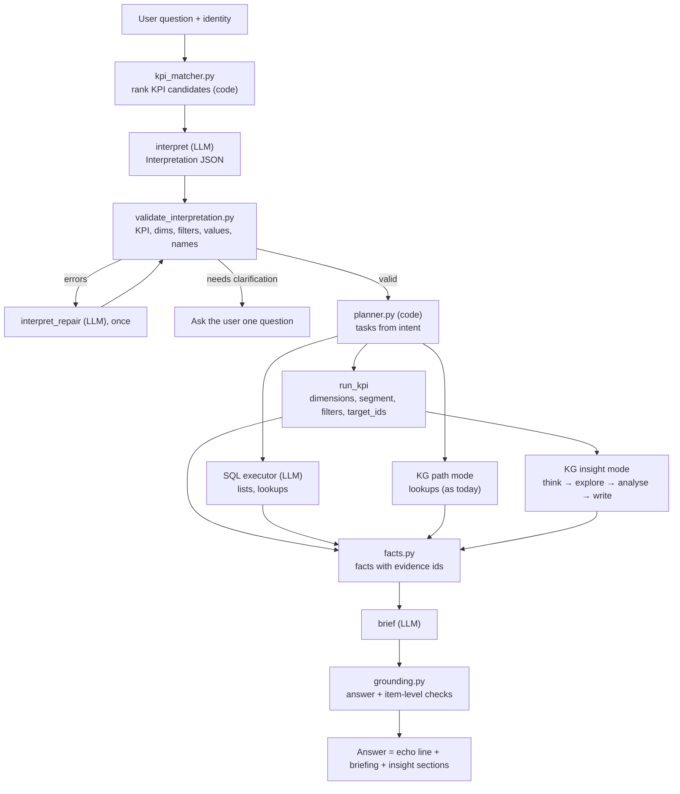

# Ticketing Reporting Module — Fix-in-Place Plan

Applies to the existing package `reports_analytics_agent_ticketing_v2/`. It keeps the current structure (domain agent → SQL executor and KG executor), the SQL guard, the `rpt.*` views and the certified KPI templates. It fixes:

1. picking the wrong KPI;
2. group-by and filter errors;
3. weak interpretation of the user's question;
4. KG answers that only show data instead of describing, diagnosing, predicting and recommending.

---

## 0. Rules for whoever implements this (Cursor or a developer)

1. **Use the prompts in section 14 exactly as written.** Copy each one into the file path given. Do not paraphrase, shorten or "improve" them while implementing. Changes to prompts happen later, through the change process in section 4.6.
2. **No prompt text inside Python.** Every LLM call loads its prompt from a file through `core/prompts.py`. The inline strings in `tests/app.py` (the CEO briefing prompt, the regeneration prompt, the repair message and the replan message) must be deleted and replaced by the files in section 14.
3. **Every LLM call is built the same way** (section 4.3): same message order, fixed temperature per prompt, JSON output validated against a Pydantic model.
4. **Field names are fixed.** Use the names in section 15 (contracts) everywhere: prompts, code, tests and facts.
5. **Implement in the order of section 18.** Each step has acceptance checks; do not start the next step until they pass.

---

## 1. What changes, in one view

| Area | Today | After |
| --- | --- | --- |
| KPI choice | The domain LLM picks an id from a 44-line list. Only `ticket_count` has synonyms. | A code matcher ranks KPIs using synonyms, meanings and wording cues. The LLM chooses only from the top 5 candidates. Code validates the choice. |
| Interpretation | One free-form plan JSON with `kpi`, one `dimension`, and a text `goal` | A structured `Interpretation` with intent, KPI, up to 2 dimensions, segment, filters, time, scope, top N, insight type, and a plain-English echo, validated in code and repaired once |
| Planning | The LLM writes the plan | Code builds the plan from the validated interpretation |
| Breakdowns | `dimension` is never passed to `run_kpi`, so breakdowns return totals | `dimensions` are passed; unsupported dimensions return an error instead of being dropped silently |
| Filters | `segment_sql` and `filters_sql` are always `TRUE` | Segments and filters are compiled into SQL; names are resolved to ids; values are checked against real data |
| Named scope | `target_ids` is never passed, so "Billing queue" scope returns zero | Names resolved with the existing `core/resolve.py`, ids passed |
| Replan | Forces free SQL, can reference undefined variables, falls back to `SELECT COUNT(*) FROM rpt.tickets` | Replan re-interprets with the error, never invents a fallback query, and reports the failure honestly |
| Briefing | Two different briefing prompts (one unused in `domain/agent.md`, one inline in `app.py`) | One briefing prompt file used everywhere |
| KG | Writes one lookup Cypher; the answer restates rows | Two modes: `path` (lookups, as today) and `insight` (hypotheses → bounded exploration → Python analysis → four-part report) |
| Grounding | Removes any number not in the fact block; explanations get stripped | Facts plus KG evidence values; item-level checks; facts-only fallback only if the headline fails |
| Code layout | All orchestration inside `tests/app.py` | Orchestration in `core/pipeline.py`; `tests/app.py` is UI only |

---

## 2. Problems found in the current code

| # | Problem | Where | Effect | Fixed in |
| --- | --- | --- | --- | --- |
| P1 | `run_kpi(...)` is called without `dimension=` even when the plan has one | `tests/app.py`, certified KPI branch of the task loop | "Ticket count by queue" returns one total | 9.1 |
| P2 | `segment_sql` and `filters_sql` are hard-coded to `TRUE`; the plan has no field for them | `core/run_kpi.py` slots dictionary; plan schema in `domain/agent.md` | "How many open tickets" counts all tickets | 9.1, 9.3 |
| P3 | `dimension_slots` returns empty strings for a dimension the KPI does not allow | `core/templates.py` | A wrong breakdown silently becomes a total | 9.2 |
| P4 | `target_ids` never passed; named queues and agents never resolved; `core/resolve.py` is unused | `tests/app.py`, `core/run_kpi.py` scope branch | Named-entity questions return zero or wrong scope | 7.5, 9.1 |
| P5 | 43 of 44 KPIs have no synonyms; no meanings or "not to be confused with" notes are given to the LLM | `product/kpis.yml`, `domain/agent.md` KPI list | Near-twin KPIs get swapped (`reopen_count` vs `reopen_rate`, `escalation_count` vs `escalation_rate`, `sla_breach_rate` vs `resolution_sla_compliance`, and others) | 5, 7 |
| P6 | Only one dimension per question | Plan schema, `core/templates.py` | "By queue and priority" cannot be answered | 9.2 |
| P7 | Replan uses `time_ctx` and `query_params`, which exist only in the free-SQL branch, and defaults to `SELECT COUNT(*) FROM rpt.tickets` | `tests/app.py` replan block | Crash or a silently wrong number | 10 |
| P8 | Two briefing prompts: the Brief section in `domain/agent.md` is never sent; an inline prompt in `app.py` is used | `domain/agent.md`, `tests/app.py` | Inconsistent answers; fixes made in one place do not apply | 4, 14.3 |
| P9 | Time dimensions (`day`, `week`, `month`) always use `created_at`, even for KPIs timed on `resolved_at` or `csat_rated_at` | `core/templates.py` | Monthly resolution time grouped by creation month | 9.2 |
| P10 | KG executor produces one Cypher per task; no analysis step; graph holds only current state | `kg_executor/agent.md`, `tests/app.py` KG branch | Answers list rows; no explanation | 11 |
| P11 | Grounding replaces the whole answer with raw facts when one number fails | `core/grounding.py` `apply_grounding` | Explanations collapse into fact dumps | 12 |

---

## 3. Flow after the changes



---

## 4. Prompt system

### 4.1 Prompt files

| Prompt name | System file(s) | User template | Used by |
| --- | --- | --- | --- |
| `interpret` | `domain/agent.md` + `domain/prompts/interpret.system.md` | `domain/prompts/interpret.user.md` | `core/interpret.py` |
| `interpret_repair` | same as `interpret` | `domain/prompts/interpret_repair.user.md` (appended after the first exchange) | `core/interpret.py` |
| `brief` | `domain/agent.md` + `domain/prompts/brief.system.md` | `domain/prompts/brief.user.md` (`answer_mode` is `standard`, or `insight_headline` for insight questions) | `core/pipeline.py` |
| `brief_regen` | same as `brief` | `domain/prompts/brief_regen.user.md` (appended) | `core/pipeline.py` via grounding |
| `sql` | `sql_executor/agent.md` | `sql_executor/prompts/sql.user.md` | `core/pipeline.py` |
| `sql_repair` | same as `sql` | `sql_executor/prompts/sql_repair.user.md` (appended) | `core/pipeline.py` |
| `kg_path` | `kg_executor/agent.md` + `kg_executor/prompts/path.system.md` | `kg_executor/prompts/path.user.md` | `core/kg_path.py` |
| `kg_path_repair` | same as `kg_path` | `kg_executor/prompts/path_repair.user.md` (appended) | `core/kg_path.py` |
| `kg_think` | `kg_executor/agent.md` + `kg_executor/prompts/think.system.md` | `kg_executor/prompts/think.user.md` | `core/kg_insight.py` |
| `kg_step` | `kg_executor/agent.md` + `kg_executor/prompts/step.system.md` | `kg_executor/prompts/step.user.md` | `core/kg_insight.py` |
| `kg_write` | `kg_executor/agent.md` + `kg_executor/prompts/write.system.md` | `kg_executor/prompts/write.user.md` | `core/kg_insight.py` |

### 4.2 Registry (`core/prompts.py`)

```python
# core/prompts.py
from dataclasses import dataclass
from pathlib import Path
from typing import Type
from pydantic import BaseModel
from . import contracts as C

ROOT = Path(__file__).resolve().parents[1]

@dataclass(frozen=True)
class PromptSpec:
    system_files: tuple[str, ...]
    user_file: str
    temperature: float
    max_tokens: int
    schema: Type[BaseModel] | None   # None = free text (briefing)

PROMPTS: dict[str, PromptSpec] = {
    "interpret":        PromptSpec(("domain/agent.md", "domain/prompts/interpret.system.md"), "domain/prompts/interpret.user.md", 0.0, 700, C.Interpretation),
    "interpret_repair": PromptSpec(("domain/agent.md", "domain/prompts/interpret.system.md"), "domain/prompts/interpret_repair.user.md", 0.0, 700, C.Interpretation),
    "brief":            PromptSpec(("domain/agent.md", "domain/prompts/brief.system.md"), "domain/prompts/brief.user.md", 0.2, 500, None),
    "brief_regen":      PromptSpec(("domain/agent.md", "domain/prompts/brief.system.md"), "domain/prompts/brief_regen.user.md", 0.0, 500, None),
    "sql":              PromptSpec(("sql_executor/agent.md",), "sql_executor/prompts/sql.user.md", 0.0, 600, C.SqlToolCall),
    "sql_repair":       PromptSpec(("sql_executor/agent.md",), "sql_executor/prompts/sql_repair.user.md", 0.0, 600, C.SqlToolCall),
    "kg_path":          PromptSpec(("kg_executor/agent.md", "kg_executor/prompts/path.system.md"), "kg_executor/prompts/path.user.md", 0.0, 500, C.CypherToolCall),
    "kg_path_repair":   PromptSpec(("kg_executor/agent.md", "kg_executor/prompts/path.system.md"), "kg_executor/prompts/path_repair.user.md", 0.0, 500, C.CypherToolCall),
    "kg_think":         PromptSpec(("kg_executor/agent.md", "kg_executor/prompts/think.system.md"), "kg_executor/prompts/think.user.md", 0.2, 700, C.ThinkOutput),
    "kg_step":          PromptSpec(("kg_executor/agent.md", "kg_executor/prompts/step.system.md"), "kg_executor/prompts/step.user.md", 0.0, 600, C.StepAction),
    "kg_write":         PromptSpec(("kg_executor/agent.md", "kg_executor/prompts/write.system.md"), "kg_executor/prompts/write.user.md", 0.2, 1100, C.InsightReport),
}
```

### 4.3 How every LLM call is built (`core/llm.py`)

1. **System message:** the system files of the prompt, read from disk, joined with two newlines.
2. **User message:** the user template rendered with `core.templates.fill_named` (placeholders are `{{name}}`; it raises if any placeholder is unfilled).
3. **Repair and regeneration prompts** are appended as a second user turn after the model's first answer: `[system, user, assistant(first answer), user(repair template)]`.
4. **Settings:** `temperature` and `max_tokens` come from the registry, never from the call site.
5. **Structured output:** when `schema` is set, send the Pydantic model's JSON schema as `response_format: {"type": "json_schema", "json_schema": {"name": <prompt name>, "schema": <schema>}}`. If the vLLM server rejects `response_format`, send `extra_body={"guided_json": <schema>}` instead. Parse with the existing `extract_json`, validate with Pydantic, and on failure make one retry with the validation error appended.
6. **Timeout:** 20 seconds per call (`httpx`), as one constant in `core/llm.py`.
7. **Trace:** log prompt name, prompt version (first line of each file, `<!-- version: x.y.z -->`), temperature, latency and token counts for every call.

```python
# core/llm.py (public API)
def call(prompt: str, slots: dict[str, str], *, history: list[dict] | None = None) -> str | BaseModel: ...
```

### 4.4 Knowledge rendered into prompts

Prompts contain behaviour, not facts. Facts are rendered into placeholders from these files by `core/context.py`:

| Placeholder | Source | Renderer |
| --- | --- | --- |
| `{{kpi_candidates}}` | `product/kpis.yml` (top 5 from the matcher) | `kpi_candidate_lines()` |
| `{{business_terms}}` | `product/concepts.yml` | `concept_lines()` |
| `{{allowed_values}}` | `core/value_catalog.py` | `allowed_value_lines()` |
| `{{kpi_knowledge}}` | `product/kpis.yml` business fields | `kpi_knowledge_lines()` |
| `{{graph_map}}` | `product/kg/graph_map.yml` | `graph_map_lines()` |
| `{{lenses}}` | `product/kg/lenses.md` | read as is |
| `{{views_summary}}` | `product/schema.yml` (existing logic, moved from `app.py`) | `views_summary()` |
| `{{sql_examples}}`, `{{cypher_examples}}` | existing example files via `core/examples.py` | existing `format_examples_for_prompt` |

### 4.5 Size limits

Keep each rendered call under about 4,500 input tokens for the SLM. `kpi_candidates` is at most 5 entries. `allowed_values` lists at most 30 values per field; longer lists are cut and marked `(+N more)`.

### 4.6 Changing a prompt later

1. Edit the file and bump its version line.
2. Run `pytest tests/test_interpretation_eval.py tests/test_insight_eval.py`.
3. A change is accepted only if KPI accuracy, dimension accuracy and filter accuracy do not drop.

---

## 5. KPI catalog changes (`product/kpis.yml`)

### 5.1 New fields on every KPI

| Field | Purpose | Used by |
| --- | --- | --- |
| `meaning` | One plain sentence a business user would understand | Matcher, interpreter, KG |
| `synonyms` | At least 4 phrases users say | Matcher |
| `cue` | `count`, `rate`, `avg`, `sum` or `scalar` (wording family) | Matcher, validator |
| `confusable_with` | List of `{id, use_when}` for near-twins | Interpreter, validator |
| `allowed_filters` | Filter fields the template supports (section 9.3) | Validator, `run_kpi` |
| `polarity` | `higher_is_better`, `lower_is_better` or `neutral` (from existing `direction`) | KG |
| `guard_kpis` | KPIs that must hold for this one to count as good | KG |
| `drivers` | Concept ids that commonly drive this KPI | KG |
| `graph` | How the KPI maps to the graph (entity, value, time field, filter) | KG |

Example:

```yaml
reopen_rate:
  label: Reopen rate
  meaning: Share of finished tickets that are currently reopened.
  synonyms: [reopen rate, reopen percentage, how often tickets reopen, share of tickets reopened, percent reopened]
  cue: rate
  confusable_with:
    - {id: reopen_count, use_when: the user asks how many tickets are reopened (a number, not a percent)}
  allowed_filters: [status, priority, channel, category, queue, agent, resolver, customer, created_by, is_unassigned, is_high_priority]
  polarity: lower_is_better
  guard_kpis: []
  drivers: [quick_resolution, reassignment, category_complexity]
  graph: {entity: Ticket, value: "status = 'Reopened' over status in [Resolved, Closed, Reopened]", time_field: created_at}
  # existing fields (family, aggregation, unit, direction, default_time_column,
  # allowed_date_columns, allowed_scope_levels, allowed_dimensions, definition, segments) stay unchanged
```

### 5.2 Meanings, synonyms and near-twins for all KPIs

Fill in these values exactly. Add the remaining fields (`allowed_filters`, `polarity`, `guard_kpis`, `drivers`, `graph`) per 5.1 and 9.3.

| KPI id | cue | meaning | synonyms | confusable_with (use the other when …) |
| --- | --- | --- | --- | --- |
| `ticket_count` | count | Number of tickets created in the period | how many tickets, ticket volume, number of tickets, tickets created, total tickets | `avg_tickets_per_day`: "per day", "daily average" |
| `avg_tickets_per_day` | avg | Average tickets created per calendar day | tickets per day, daily ticket volume, average daily tickets, tickets a day | `ticket_count`: a total, not per day |
| `avg_open_ticket_age` | avg | Average hours that currently Open tickets have been open | open ticket age, how old are open tickets, age of open tickets, average age of open tickets | `avg_resolution_time`: finished tickets |
| `days_since_last_ticket` | scalar | Days since the most recent ticket was created | days since last ticket, when was the last ticket, last ticket date, time since last ticket | — |
| `resolution_rate` | rate | Share of tickets created in the period that are Resolved or Closed | resolution rate, percent resolved, share of tickets resolved, how many get resolved (percent) | `resolution_sla_compliance`: resolved within SLA |
| `assignment_rate` | rate | Share of tickets created in the period that were assigned at least once | assignment rate, percent assigned, share of tickets assigned, how often tickets get assigned | `reassignment_rate`: assigned more than once |
| `reopen_count` | count | Number of tickets currently in Reopened status | reopened tickets, how many reopened, number of reopens, count of reopened tickets | `reopen_rate`: percent or "how often" |
| `reopen_rate` | rate | Share of finished tickets that are currently reopened | reopen rate, reopen percentage, how often tickets reopen, percent reopened | `reopen_count`: a number |
| `escalation_rate` | rate | Share of tickets created in the period that were escalated at least once | escalation rate, percent escalated, how often tickets are escalated, share escalated | `escalation_count`: number of escalation events |
| `escalation_count` | count | Number of escalation events | how many escalations, number of escalations, escalations count, escalated events | `escalation_rate`: percent |
| `reassignment_rate` | rate | Share of assigned tickets that were reassigned at least once | reassignment rate, percent reassigned, how often tickets get reassigned, bounce rate | `reassignment_count`: number of reassignment events |
| `reassignment_count` | count | Number of reassignment events (second or later assignment) | how many reassignments, number of reassignments, reassignments, times reassigned | `reassignment_rate`: percent |
| `avg_first_response_time` | avg | Average hours from creation to first response | first response time, time to first response, how fast we respond, response time, FRT | `avg_resolution_time`: time to resolve |
| `avg_resolution_time` | avg | Average hours from creation to resolution for resolved tickets | resolution time, time to resolve, how long to resolve, TTR, average handling time for tickets | `avg_first_response_time`: first reply; `avg_open_ticket_age`: still open |
| `avg_resolution_variance_vs_sla` | avg | Average hours resolved before (negative) or after (positive) the SLA due time | variance vs SLA, how far from SLA, resolution vs due time, hours over or under SLA | `average_overdue_hours`: only overdue time |
| `first_response_sla_compliance` | rate | Share of decided tickets whose first response met the SLA | first response SLA, response SLA compliance, responded within SLA, FR SLA met | `resolution_sla_compliance`: resolution SLA |
| `resolution_sla_compliance` | rate | Share of decided tickets resolved within the SLA | SLA compliance, resolution SLA met, resolved within SLA, SLA met rate, on-time resolution | `sla_breach_rate`: missed SLA |
| `sla_breach_rate` | rate | Share of decided tickets that missed the resolution SLA | SLA breach rate, breach rate, missed SLA, SLA violations percent, late resolution rate | `resolution_sla_compliance`: met SLA |
| `first_response_at_risk_count` | count | Open tickets close to missing the first-response SLA | first response at risk, about to miss response SLA, response SLA risk | `resolution_at_risk_count`: resolution SLA |
| `resolution_at_risk_count` | count | Open tickets close to missing the resolution SLA | at risk tickets, about to breach, tickets at risk of SLA breach, close to due | `queues_at_risk`: per queue |
| `no_sla_count` | count | Tickets with no resolution SLA due time | tickets without SLA, no SLA, missing SLA, tickets with no due date | — |
| `queues_at_risk` | count | Queues with at-risk tickets, one row per queue | queues at risk, which queues are at risk, risky queues, teams at risk | `resolution_at_risk_count`: a ticket total |
| `average_overdue_hours` | avg | Average hours tickets are past their due time | overdue hours, how late are tickets, average overdue time, hours overdue | `avg_resolution_variance_vs_sla`: early and late |
| `avg_csat` | avg | Average customer satisfaction score of rated tickets | CSAT, customer satisfaction, satisfaction score, average rating, CSAT score | `csat_response_rate`: how many rated |
| `csat_response_rate` | rate | Share of completed tickets that received a CSAT rating | CSAT response rate, survey response rate, how many customers rate us, rating rate | `avg_csat`: the score |
| `csat_distribution_rate` | rate | Split of ratings into promoter, neutral and detractor | CSAT distribution, promoters and detractors, rating breakdown, satisfaction split | `avg_csat`: one average |
| `customers_served` | count | Distinct customers who had tickets in the period | customers served, how many customers contacted us, customers with tickets, unique customers | `total_customers`: all customers; `active_customers`: active status |
| `accounts_served` | count | Distinct customer profiles linked to tickets in the period | accounts served, how many accounts, distinct accounts with tickets | `customers_served` |
| `active_customers` | count | Distinct customers with tickets whose profile status is Active | active customers, customers marked active, active contacts with tickets | `customers_served`, `total_customers` |
| `total_customers` | count | All leads and customers in the customer database | total customers, all customers, customer base, how many customers do we have | `customers_served`: only those with tickets |
| `active_agents` | count | Staff with role agent and status Active | active agents, how many agents, number of agents, agents on the team | `total_users`: all staff |
| `total_users` | count | All staff accounts: agents, resolvers and admins | total users, all staff, how many users, team size | `active_agents` |
| `queue_count` | count | Number of queues | how many queues, number of queues, how many teams, team count | `queue_coverage`, `distinct_queues_covered` |
| `queue_coverage` | count | Number of staff-to-queue memberships (not a percent) | queue memberships, queue coverage, staff assignments to queues | `distinct_agents_in_queues` |
| `distinct_agents_in_queues` | count | Distinct staff who belong to at least one queue | staff in queues, agents assigned to queues, people in teams | `queue_coverage` |
| `distinct_queues_covered` | count | Distinct queues that have at least one member | queues with members, staffed queues, covered queues | `queue_count` |
| `note_count` | count | Number of notes written on tickets | how many notes, number of notes, notes written, internal notes count | — |
| `kb_article_count` | count | Published knowledge base articles | KB articles, knowledge base articles, how many articles, help articles | `kb_views` |
| `kb_views` | sum | Total views of knowledge base articles | KB views, article views, knowledge base views, how often articles are read | `kb_article_count` |
| `recommendation_count` | count | Number of AI recommendations | AI recommendations, how many recommendations, suggestions made | `recommendation_acceptance_rate` |
| `recommendation_acceptance_rate` | rate | Share of AI recommendations accepted | recommendation acceptance, accepted suggestions percent, how often recommendations are accepted | `recommendation_count` |
| `approval_count` | count | Number of AI approval requests | approvals, approval requests, how many approvals | `approval_rate` |
| `approval_rate` | rate | Share of decided approvals that were approved | approval rate, percent approved, how often approvals pass | `approval_count` |
| `unread_notifications` | count | Unread notifications (the user's own unless org-wide is asked) | unread notifications, notifications I have not read, unread alerts | — |

### 5.3 Remove from `domain/agent.md`

The flat list of certified KPI ids and all KPI-routing examples move out of the prompt. The interpreter receives only the top 5 candidates, with meanings and near-twins, through `{{kpi_candidates}}`.

---

## 6. Business concepts (`product/concepts.yml`, new)

Business terms used by the interpreter (rendered into `{{business_terms}}`) and by the KG agent.

```yaml
version: 1
concepts:
  open:
    terms: [open, open tickets]
    filters: [{field: status, op: eq, value: Open}]
  unresolved:
    terms: [unresolved, outstanding, pending, not closed, still open, backlog]
    filters: [{field: status, op: not_in, value: [Resolved, Closed]}]
    note: '"pending" alone means unresolved; "pending status" or "waiting on customer" means pending_status'
  pending_status:
    terms: [pending status, waiting on customer, awaiting customer, on hold]
    filters: [{field: status, op: eq, value: Pending}]
  overdue:
    terms: [overdue, past due, late tickets]
    filters: [{field: status, op: eq, value: Overdue}]
  reopened:
    terms: [reopened, re-opened, came back]
    filters: [{field: status, op: eq, value: Reopened}]
  resolved:
    terms: [resolved]
    filters: [{field: status, op: eq, value: Resolved}]
  closed:
    terms: [closed]
    filters: [{field: status, op: eq, value: Closed}]
  finished:
    terms: [finished, completed, done]
    filters: [{field: status, op: in, value: [Resolved, Closed]}]
  unassigned:
    terms: [unassigned, no owner, not assigned, nobody assigned]
    filters: [{field: is_unassigned, op: eq, value: true}]
  high_priority:
    terms: [high priority, urgent, critical tickets]
    filters: [{field: is_high_priority, op: eq, value: true}]
  team:
    terms: [team, teams, group, groups]
    maps_to_dimension: queue
  l1_agent:
    terms: [agent, agents, assignee, owner, L1, first line]
    maps_to_dimension: agent
  l2_resolver:
    terms: [resolver, resolvers, L2, second line, escalation team]
    maps_to_dimension: resolver
  reassignment:
    terms: [reassigned, bounced, passed around, handed over]
    meaning: Ticket assigned to a different person after its first assignment
  escalation:
    terms: [escalated, sent to L2, raised to resolver]
    meaning: Ticket escalated to a resolver
  quick_resolution:
    meaning: Ticket resolved much faster than the median for its category
  category_complexity:
    meaning: Some categories take longer and bounce more by nature
  queue_capacity:
    meaning: Arrivals compared with the staff active in a queue
  pending_wait:
    meaning: Time a ticket spends in Pending; this is customer wait, not staff work
```

---

## 7. Interpretation layer (new)

### 7.1 Files

| File | Purpose |
| --- | --- |
| `core/kpi_matcher.py` | Rank KPI candidates in code |
| `core/value_catalog.py` | Allowed values per filter field, per org, cached |
| `core/interpret.py` | Matcher → interpret prompt → validate → repair → `Interpretation` |
| `core/validate_interpretation.py` | All validation rules, returning a list of error strings |
| `core/contracts.py` | Pydantic models (section 15) |

### 7.2 KPI matcher (`core/kpi_matcher.py`)

```python
def rank_kpis(question: str, catalog: dict, top_k: int = 5) -> list[KpiCandidate]: ...
```

Scoring for each KPI, all lower-cased:

1. **Synonym phrase match:** +10 for each synonym found as a whole phrase in the question; +3 for each label word found.
2. **Cue match:**
    - "how many", "number of", "count of", "total" → +4 to `count` KPIs, −4 to `rate` KPIs.
    - "rate", "%", "percent", "percentage", "how often", "share", "ratio", "proportion" → +4 to `rate`, −4 to `count`.
    - "average", "avg", "mean", "typical", "how long", "how fast" → +4 to `avg`.
3. **Topic words:**
    - "first response", "respond", "reply" → +3 to first-response KPIs, −3 to resolution KPIs.
    - "resolve", "resolution", "fix", "close" → the reverse.
    - "breach", "missed", "violat" → +3 `sla_breach_rate`.
    - "compliance", "met", "within SLA", "on time" → +3 to `*_sla_compliance`.
4. Return the top 5 by score, with scores. Mark `confident = True` when the top score is at least 10 and at least 6 above the second.

The matcher never decides alone. It narrows the choice and ranks it; the interpreter chooses; the validator checks.

### 7.3 Value catalog (`core/value_catalog.py`)

- `status`: the fixed list `Open, Pending, Overdue, Reopened, Resolved, Closed`.
- `priority`, `channel`, `category`: `SELECT DISTINCT` from `rpt.tickets` for the org, cached for 10 minutes per org.
- `queue`: distinct `queue_name`, cached the same way.
- Agent, resolver, customer and creator names are not listed (too many). They are resolved after interpretation with `core/resolve.py`.

### 7.4 Interpretation flow (`core/interpret.py`)

```python
def interpret(question: str, identity: Identity, session: Session | None) -> Interpretation | Clarification: ...
```

1. `candidates = rank_kpis(question, catalog)`.
2. Render the `interpret` prompt with `question`, `role`, `kpi_candidates` (top 5), `business_terms`, `allowed_values` and `previous_interpretation` (only when `session.is_follow_up(question)` detects words like "that", "those", "break it down", "same for", "and for").
3. Call the LLM and receive an `Interpretation`.
4. `errors = validate(interpretation, candidates, catalog, value_catalog)`.
5. If there are errors, call `interpret_repair` once with the errors listed, then validate again.
6. If errors remain, or `needs_clarification` is true, return a `Clarification` with one question.
7. Resolve names with `core/resolve.py`: queue, agent, resolver, customer, created_by.
    - An ambiguous name becomes a clarification listing up to 5 matches.
    - An unmatched name becomes a clarification such as: "I could not find a queue called 'X'. Did you mean …?"
8. Return the validated interpretation with names replaced by ids (`resolved_filters`).

### 7.5 Validation rules (`core/validate_interpretation.py`)

Each failed rule adds one plain error string, used in the repair prompt.

1. **`kpi_id` must be one of the candidate ids**, or null when `intent` is `list`, `lookup` or `graph_path`.
2. **The KPI's `cue` must fit the wording:**
    - If the question contains count words and the KPI cue is `rate`, the error must name the `confusable_with` KPI whose cue is `count`.
    - The same applies in reverse for rate words with a count KPI.
3. **Dimensions:** each must be in the KPI's `allowed_dimensions`; at most 2; no duplicates.
4. **Segment:** must be a key of the KPI's `segments`.
5. **Filters:**
    - each field must be in the KPI's `allowed_filters` (for KPI intents) or in the list filter fields (for `list` and `lookup`);
    - `op` must be one of `eq`, `neq`, `in`, `not_in`;
    - values for `status`, `priority`, `channel`, `category` and `queue` must exist in the value catalog, matched case-insensitively and rewritten to the stored spelling.
6. **Segment and filters must not conflict:** for example, segment `open` together with filter `status = Closed`.
7. **Scope** must be allowed for the KPI (`allowed_scope_levels`) and for the role (existing access matrix).
8. **`top_n`:** requires `intent` `ranking` and at least one dimension.
9. **Insight fields:** `insight_type` is required when `intent` is `insight`, and `compare_time` is required when `insight_type` is `change`.
10. **`echo`** must be present and under 25 words.

---

## 8. Planner in code (`core/planner.py`, new)

The domain LLM no longer writes plans. The plan is built from the validated interpretation.

| Intent | Tasks |
| --- | --- |
| `metric` | `t1`: `run_kpi(kpi, segment, filters, time, scope)` |
| `breakdown` | `t1`: `run_kpi(... dimensions)` |
| `ranking` | `t1`: `run_kpi(... dimensions, order, top_n)` |
| `list` | `t1`: SQL executor (LLM) with the structured task |
| `lookup` | `t1`: SQL executor (LLM) with the structured task |
| `graph_path` | `t1`: KG path mode |
| `insight` / `diagnosis` | `t1`: `run_kpi(kpi, filters)`; `t2`: `run_kpi(kpi, dimensions=[focus dimension or queue])`; `t3`: KG insight with `t1` and `t2` facts |
| `insight` / `comparison` | `t1`: `run_kpi(kpi, dimensions=[the compared dimension])`; `t2`: KG insight |
| `insight` / `change` | `t1`: `run_kpi(kpi, time)`; `t2`: `run_kpi(kpi, compare_time)`; `t3`: KG insight |
| `insight` / `risk` | `t1`: `run_kpi(resolution_at_risk_count, dimensions=[queue])`; `t2`: KG insight |
| `insight` / `recommendation` | Same tasks as diagnosis |
| `insight` / `explore` | `t1`: `run_kpi` for `ticket_count`, `sla_breach_rate`, `avg_resolution_time`, `reopen_rate`, `escalation_rate` (current window); `t2`: the same for the previous period; `t3`: KG insight |

SQL tasks run in parallel with `concurrent.futures.ThreadPoolExecutor(max_workers=4)`. The KG insight task starts after the SQL tasks finish, or after 6 seconds, whichever comes first. If SQL is not done by then, KG runs without those inputs.

**Plan task shape** (replaces the old plan JSON):

```json
{
  "id": "t1",
  "executor": "sql_kpi",
  "kpi": "avg_resolution_time",
  "dimensions": ["queue"],
  "segment": null,
  "filters": [{"field": "priority", "op": "eq", "value": "high"}],
  "time": "this month",
  "scope": "org",
  "target_ids": [],
  "order": "desc",
  "top_n": null,
  "answer_type": "breakdown"
}
```

`executor` is one of `sql_kpi`, `sql_free`, `kg_path`, `kg_insight`.

---

## 9. SQL execution changes

### 9.1 `core/run_kpi.py`

- **New parameters:** `dimensions: list[str] | None`, `segment: str | None`, `filters: list[dict] | None`, `order: str = "desc"`, `top_n: int | None`.
- Keep `dimension: str | None` as a backward-compatible alias that becomes `[dimension]`.
- **`segment_sql`:** `card["segments"][segment]` when a segment is given, else `"TRUE"`. An unknown segment returns `error_type: REPLAN`, `error: "unknown_segment: <name>; allowed: <list>"`.
- **`filters_sql`:** `core.filters.compile_filters(filters, card)`. Fields not in `allowed_filters` return `error_type: REPLAN` with the allowed list.
- **`limit_sql`:** `LIMIT <top_n>` when `top_n` is set.
- **`target_ids`:** filled by the pipeline from resolved names when the scope is `queue`, `agent` or `resolver`.
- **Result additions:** `applied: {dimensions, segment, filters, time_window, scope}`. `facts.py` prints these so the briefing states exactly what was computed.

### 9.2 `core/templates.py`

`dimension_slots(dimensions, allowed, time_column, order="desc")`:

- Each dimension must be in `allowed`. Otherwise **raise** `ValueError("unsupported_dimension: <dim>; allowed: <list>")`. `run_kpi` turns this into a `REPLAN` error. No silent dropping.
- Time dimensions use the KPI's time column: `DATE_TRUNC('<unit>', <time_column>)::date`, where `time_column` is the column `run_kpi` already resolves (`date_col`).
- **SELECT:** `"<e1> AS <d1>, <e2> AS <d2>,"`.
- **GROUP BY:** `"GROUP BY <e1>, <e2> ORDER BY <n+1> <DESC|ASC> NULLS LAST"`, where `n` is the number of dimensions.

### 9.3 `core/filters.py` (new)

| Filter field | Column in `base_ticket` | Value handling |
| --- | --- | --- |
| `status` | `status` | Catalog value |
| `priority` | `priority` | Catalog value |
| `channel` | `channel` | Catalog value |
| `category` | `category` | Catalog value |
| `queue` | `queue_id` | Name resolved to id(s) |
| `agent` | `assignee_id` | Name resolved to id(s) |
| `resolver` | `resolver_id` | Name resolved to id(s) |
| `customer` | `customer_id` | Name resolved to id(s) |
| `created_by` | `created_by_id` | Name resolved to id(s) |
| `is_unassigned` | `is_unassigned` | Boolean |
| `is_high_priority` | `is_high_priority` | Boolean |
| `ticket_number` | `ticket_number` | Matches both `104` and `#104` |

- `compile_filters` joins the predicates with `AND`.
- Text values go through `core.resolve.escape_literal`; ids are cast with `int()`.
- `in` and `not_in` take lists.
- **`allowed_filters` per KPI:** set it to the full list above when the KPI's SQL file contains both `{{base_ticket}}` and `{{filters_sql}}`. Otherwise set it to `[]`.
- **Validator check:** extend `core/validate.py` so it fails when a KPI lists `allowed_filters` but its template lacks those slots.

### 9.4 Free SQL path

The SQL executor receives the structured task instead of a goal string (prompt in section 14.5). Repair uses `sql_repair` (section 14.6). The guard is unchanged.

---

## 10. Replan and error handling

Replace the replan block in `tests/app.py` with this logic in `core/pipeline.py`:

1. **A `run_kpi` task returns `REPLAN`:** call `interpret_repair` with the original question, the previous interpretation and the error message. This catches cases like an unsupported dimension or a wrong segment. Rebuild the plan and run once more.
2. **A free-SQL task fails after its one repair:** return an honest failure fact: `EXECUTION_ERROR` with a user-safe message.
3. **`DENY`:** no retry. Tell the user the data is outside their access.
4. **Never** invent a fallback query. Delete the default `SELECT COUNT(*) FROM rpt.tickets`.
5. Keep `core/loop.py` `LoopState` for attempt counting, with a maximum of 2 attempts per question.

---

## 11. KG executor changes

### 11.1 Two modes

| Mode | When | What it does |
| --- | --- | --- |
| `path` | `intent = graph_path` | One Cypher lookup, as today, using the `kg_path` prompt and the existing templates and examples |
| `insight` | `intent = insight` | The loop below (`core/kg_insight.py`) |

### 11.2 KG knowledge (what the KG agent knows)

| File | Content | Status |
| --- | --- | --- |
| `product/kpis.yml` | `meaning`, `polarity`, `guard_kpis`, `drivers`, `graph` per KPI | New fields (section 5) |
| `product/concepts.yml` | Business concepts and their meaning | New (section 6) |
| `product/kg/graph_map.yml` | Labels, relationships and properties, each with a meaning and the lenses it serves | New (11.3) |
| `product/kg/lenses.md` | Analyst lenses (11.4) | New |
| `product/kg/measures.yml` | Existing templates, plus `purpose`, `lenses`, `misleading_when` on each | Update |
| `product/kg/schema_registry.json`, `product_edges.yml` | Guard allowlists | Update in step 2 of 11.7 |

### 11.3 `product/kg/graph_map.yml` (stage 1: the graph as it is today)

```yaml
version: 1
labels:
  Ticket:
    meaning: One support ticket and its current state
    properties:
      status: {meaning: "Current status: Open, Pending, Overdue, Reopened, Resolved, Closed"}
      priority: {meaning: Priority as stored}
      channel: {meaning: Channel the ticket came from}
      category: {meaning: Business category}
      skill: {meaning: Skill the ticket needs}
      created_at: {meaning: When the ticket was created}
      first_response_at: {meaning: First staff response time; null if none yet}
      resolved_at: {meaning: Resolution time; null if unresolved}
      due_at: {meaning: Resolution SLA due time; null means no SLA}
      csat_score: {meaning: Customer rating 1 to 5; null if not rated}
      queue_name: {meaning: Queue name (also reachable via in_queue)}
      assignee_name: {meaning: L1 agent name}
      resolver_name: {meaning: L2 resolver name}
      customer_id: {meaning: Customer id}
    lenses: [contrast, concentration, outcome_link, change]
  Agent:
    meaning: A staff member; property role is agent (L1), resolver (L2) or admin
    properties: {role: {meaning: agent, resolver or admin}, status: {meaning: Active or not}}
  Queue:
    meaning: A team that tickets are routed to
    properties: {queue_name: {meaning: Queue name}, type: {meaning: Queue type}}
  Note:
    meaning: A note written on a ticket
    properties: {created_at: {meaning: When written}, author_name: {meaning: Who wrote it}}
  SLA:
    meaning: SLA policy for a priority
    properties: {priority: {}, resolution_hours: {}, first_response_hours: {}}
  Contact:
    meaning: The customer who raised the ticket (leaf node; never traverse out of it)
relationships:
  in_queue: {from: Ticket, to: Queue, meaning: Ticket belongs to this queue}
  assigned_to: {from: Ticket, to: Agent, meaning: Current L1 agent}
  resolved_by: {from: Ticket, to: Agent, meaning: L2 resolver}
  has_sla: {from: Ticket, to: SLA, meaning: SLA policy applied}
  has_note: {from: Ticket, to: Note, meaning: Notes on the ticket}
  written_by: {from: Note, to: Agent, meaning: Note author}
  raised_by: {from: Ticket, to: Contact, meaning: Customer who raised it}
  staffed_by: {from: Queue, to: Agent, meaning: Staff member of the queue}
computed_in_cypher:
  resolution_hours: "duration.between(t.created_at, t.resolved_at).seconds / 3600.0"
  first_response_hours: "duration.between(t.created_at, t.first_response_at).seconds / 3600.0"
  breached: "t.due_at IS NOT NULL AND (t.resolved_at > t.due_at OR (t.resolved_at IS NULL AND datetime() > t.due_at))"
  note_count: "COUNT { (t)-[:has_note]->() }"
```

The `computed_in_cypher` expressions assume the date properties are stored as Neo4j datetimes. If the KG pipeline stores them as strings, wrap them in `datetime()`. Check this once with `profile` in step 11.7 and fix the expressions accordingly.

### 11.4 `product/kg/lenses.md`

```markdown
# Analyst lenses
Use one lens per hypothesis. The lens tells you what evidence settles it.

- decompose: Where does the total come from? Split by category, priority, queue, status.
- contrast: What differs between good and bad cases? Compare slow vs fast, breached vs met.
- change: What is different between this period and the previous one?
- concentration: Do a few queues, categories, customers or people explain most of it?
- outlier: What is unusual against its own normal or against peers?
- outcome_link: Does this pattern go with lower CSAT, reopens or SLA breaches?
- capacity: Are arrivals growing faster than the staff available in a queue?
- path: Which sequence of events leads to the outcome? (needs journey data, stage 2)
```

### 11.5 Insight loop (`core/kg_insight.py`)

```python
def run_insight(interp: Interpretation, identity: Identity, sql_facts: list[FactBlock] | None,
                budget_s: float = 26.0) -> tuple[InsightReport, list[Evidence]]: ...
```

| Step | Who | Detail |
| --- | --- | --- |
| 1. Orient | Code | Collect the KPI's `meaning`, `polarity`, `guard_kpis` and `drivers`; the concept entries for those drivers; the `graph_map` entries for `Ticket` plus labels within one hop; `lenses.md`; and the SQL facts if present |
| 2. Think | LLM `kg_think` | Returns 3 to 5 hypotheses. Each has a lens. At least one is a mix hypothesis (the result is explained by the priority, category or channel mix). |
| 3. Steps | LLM `kg_step`, code executes | Maximum 6 steps. Each step returns one action (`query`, `peek`, `profile`, `templates`, `analyse`, `stop`) plus status updates for hypotheses. Templates are offered only after think and only on a `templates` action, at most 3, from `measures.yml`. |
| 4. What else | Code rule inside steps | If the model chooses `stop` with at least 8 s and 1 step left, and has not yet run a query outside its first hypotheses, code replies "Before stopping, test one new direction no hypothesis covers" and allows 1 more step |
| 5. Write | LLM `kg_write` | Produces the `InsightReport`. Code validates each item (section 12). |

**Execution rules for `query`:**

- Run through `core/run_cypher.py` (existing guard), with a 3-second timeout.
- Keep at most 200 rows in memory; show the model the row count, the columns and the first 10 rows.
- Store each result as `R<n>` and register its numbers as evidence `K<n>`.

**Automatic analysis.** When a result has one text column and numeric columns, code automatically adds:

- each group's share of the total;
- each group's difference from the overall value;
- concentration (the share held by the top 3 groups).

These are attached to the same evidence id.

**Analyse action:**

```json
{"action": "analyse", "kind": "compare_groups|mix_adjusted_compare|decompose|concentration|trend|outliers|correlate",
 "result_ref": "R2", "group_col": "...", "value_col": "...", "n_col": "...", "strata_col": "..."}
```

**Scope:** for non-admin roles, every query must contain `$SCOPE(t)` on each `Ticket` variable. The guard expands it (11.6).

**Budget:** total 26 seconds. If less than 6 seconds remain, skip to write.

### 11.6 `core/cypher_guard.py` and `core/cypher_validate.py`

- **Scope macro `$SCOPE(var)`:**
    - admin: `true`
    - agent: `(EXISTS { MATCH (var)-[:assigned_to]->(a:Agent) WHERE a.id = $user_id } OR EXISTS { MATCH (var)-[:in_queue]->(q:Queue) WHERE q.id IN $queue_ids })`
    - resolver: the same with `resolved_by` in place of `assigned_to`
    - For non-admin roles, reject any query with a `Ticket` variable not wrapped in `$SCOPE`.
- **Insight mode** allows aggregation functions (`count`, `avg`, `sum`, `min`, `max`, `percentileCont`, `collect`), `WITH`, `UNWIND` and `CASE`. Path mode keeps today's rules.
- **Variable-length paths:** still forbidden in stage 1. In stage 2, allowed only on `next` with a maximum depth of 3.
- **`LIMIT`:** always required; the guard appends `LIMIT 200` if it is missing.

### 11.7 Graph additions (stage 2, after stage 1 works)

Implement in the KG pipeline that already builds the org graph, or as jobs in a new `kg_build/` folder writing to the same `org<id>` database. All jobs use `MERGE` on stable keys, run incrementally every 15 minutes, and are rebuilt fully every night.

| Addition | Source | Key | Purpose |
| --- | --- | --- | --- |
| `TicketEvent {type, at, actor_id}`, `(Ticket)-[:had_event]->(TicketEvent)`, `(TicketEvent)-[:next]->(TicketEvent)`, `(TicketEvent)-[:by]->(Agent)` | `rpt.audit_events`, plus synthetic `created` and `first_response` events from `rpt.tickets` | Audit event id; `created:<ticket_id>`, `first_response:<ticket_id>` | Journey |
| `StateInterval {status, start, end, hours, is_current}`, `(Ticket)-[:had_state]->(StateInterval)` | Ordered `ticket.status_changed` events (`meta->>'from'`, `meta->>'to'`) | `<ticket_id>:<seq>` | Where time went |
| Properties on `Ticket`: `hops`, `escalation_count`, `reopen_count`, `hours_pending_total`, `hours_open_total`, `hours_waiting_resolver`, `breached_resolution`, `note_count`, `last_activity_at`, `path_signature` | Events, intervals, notes | Ticket id | Fast contrast and filtering |
| `QueueDay {date, arrivals, resolved, backlog_end, breaches, active_staff}`, `(QueueDay)-[:for]->(Queue)` | Tickets and events | `<queue_id>:<date>` | Capacity and change |

**Event type mapping:**

| Audit action | Condition | `TicketEvent.type` |
| --- | --- | --- |
| `ticket.assigned` | First for the ticket | `assigned` |
| `ticket.assigned` | Later ones | `reassigned` |
| `ticket.escalated` | — | `escalated` |
| `ticket.resolver_set` | — | `resolver_set` |
| `ticket.status_changed` | `meta->>'to' = 'Reopened'` | `reopened` |
| `ticket.status_changed` | `meta->>'to' = 'Resolved'` | `resolved` |
| `ticket.status_changed` | Otherwise | `status_changed` |

**After stage 2:**

- add the new labels, relationships and properties to `graph_map.yml` (with meanings), `schema_registry.json` and `product_edges.yml`;
- add `path` to the lenses in use;
- add templates for time-in-status, reassignment hops and waiting for resolver to `measures.yml`.

---

## 12. Facts and grounding changes

### 12.1 `core/facts.py`

- Each fact block starts with an evidence id: `[S1]`, `[S2]` for SQL tasks; KG evidence uses `[K1]`, `[K2]`.
- Print the `applied` block from `run_kpi`, as plain lines: `applied: dimensions=queue; segment=open; filters=priority eq high; window=this month; scope=org`.
- Accept `group_by: list[str]` from `dimensions` (the parameter already exists; pass it).
- New `insight_evidence_block(evidence: list[Evidence]) -> str` renders KG evidence values for the briefing and grounding.

### 12.2 `core/grounding.py`

- **Keep `ground_check` as is** for the briefing text, now run against SQL facts plus the KG evidence block.
- **New `ground_items(report: InsightReport, evidence: dict[str, Evidence]) -> list[int]`:** for each finding, prediction and recommendation, every number in its text must appear (via `_normalize`) in the values of the evidence ids it cites. Returns the indexes of failing items.
- **New handling for the KG report:**
    - failing items are sent once to `kg_write` with "Rewrite only these items using numbers from their cited evidence";
    - items that still fail are removed;
    - the report is never replaced by raw facts.
- **Change `apply_grounding`:** the facts-only fallback applies only to the briefing headline, not to KG sections.

### 12.3 Answer layout (`core/render.py`, new)

The final answer is assembled by code in this order:

1. **Echo line:** `_Interpreted as: <echo>_`
2. **Briefing:** the `brief` output. For insight questions, only the headline paragraph.
3. **For insight questions,** sections rendered from the `InsightReport`:
    - **What's happening:** describe items.
    - **Why:** diagnose items, with confidence in brackets.
    - **What to expect:** predict items, marked as estimates.
    - **What to do:** recommend items.
    - **Data limits:** data gaps, when any.
4. The data table, as today.

---

## 13. Pipeline extraction

### 13.1 `core/pipeline.py` (new)

```python
def answer(question: str, identity: Identity, *, dsn: str | None, session: Session) -> PipelineResult:
    # 1 interpret (or return clarification)
    # 2 plan
    # 3 execute tasks (parallel SQL; then KG)
    # 4 facts
    # 5 brief
    # 6 ground (answer + KG items)
    # 7 render
    # returns PipelineResult(answer_markdown, interpretation, plan, task_results, facts, insight_report, grounded, trace)
```

### 13.2 `tests/app.py`

- Remove every prompt string and all orchestration code.
- Keep the sidebar settings and the inputs.
- Call `core.pipeline.answer(...)`.
- **Display:**
    - the answer;
    - a clarification question when one is returned;
    - the data tables;
    - the trace expander: interpretation JSON, plan, applied filters per task, KG hypotheses with status, prompt versions, timings.
- Keep the Direct Query Inspector tab, but pass `dimensions`, `segment` and `filters` inputs to `run_kpi`.

---

## 14. Prompts — use exactly these

Each file starts with a version line. Placeholders use `{{name}}`.

### 14.1 `domain/agent.md` (replace the whole file)

```markdown
<!-- version: 3.0.0 -->
# reports_analytics_domain

You are the lead analyst for a ticketing system's reporting module.
You never write SQL or Cypher and you never calculate numbers.
You either interpret a question into structured JSON or write a short briefing from facts you are given.

Ticketing basics:
- Statuses: Open, Pending, Overdue, Reopened, Resolved, Closed.
- Agents are L1 staff (assignee). Resolvers are L2 staff who receive escalated tickets.
- Teams are queues.

Global rules:
- Use only the information in this conversation. Never use remembered numbers.
- Follow the output format exactly.
```

### 14.2 Interpreter

**`domain/prompts/interpret.system.md`**

```markdown
<!-- version: 1.0.0 -->
## Task: interpret the question

Turn the user's question into one JSON object that describes exactly what to compute.
Do not answer the question.

### 1. Intent (choose one)
- metric: one number for a KPI ("how many", "what is our", "average", "rate").
- breakdown: a KPI split by one or two dimensions ("by queue", "per agent", "for each priority", "across channels", "monthly").
- ranking: a breakdown where they want the top or bottom few ("which agent has the most", "top 5 queues", "lowest").
- list: rows of tickets, people or queues ("show", "list", "which tickets", "find").
- lookup: one specific record (a ticket number, one named customer's tickets).
- graph_path: relationships of a named thing (who staffs a queue, who wrote notes on a ticket, a ticket's neighbourhood).
- insight: they want an explanation, a change, a comparison, a prediction or advice ("why", "what changed", "compared to", "will", "at risk", "how can we reduce", "what should we do", "anything unusual").

### 2. KPI (kpi_id)
- Choose ONLY from the KPI candidates listed. Never invent an id.
- Read the meaning and the "not to be confused with" notes, not just the name.
- Count or rate: "how many", "number of", "count" mean a count KPI. "rate", "%", "percent", "how often", "share" mean a rate KPI.
- "average", "typical", "how long", "how fast" mean an average KPI.
- "met SLA", "within SLA", "compliance", "on time" mean an SLA compliance KPI. "breach", "missed", "violated" mean sla_breach_rate.
- "respond", "reply", "first response" mean first-response KPIs. "resolve", "resolution", "fix", "close" mean resolution KPIs.
- If two candidates are equally plausible after these rules, set needs_clarification to true and ask one short question naming both.
- kpi_id is null for list, lookup and graph_path.

### 3. Dimensions
- Use only dimensions listed for the chosen KPI. At most 2.
- Signal words: "by", "per", "each", "for every", "across", "split by", "breakdown by", "which <dimension>", "daily", "weekly", "monthly".
- If the user asks for a dimension the KPI does not allow, put it in requested_dimensions_unsupported, not in dimensions.

### 4. Segment and filters
- Use a segment only when the chosen KPI lists a segment with exactly that meaning.
- Otherwise use filters: {"field", "op", "value"}. op is one of eq, neq, in, not_in.
- Use only filter fields the KPI allows. For list and lookup, any listed filter field is allowed.
- Copy values with the exact spelling from the allowed values.
- Names of queues, agents, resolvers, customers or creators: put the name as written into a filter with op eq. Python resolves names.
- Business words map to filters as given in Business terms.
- A filter the KPI does not allow goes into filters_unsupported.

### 5. Time
- Copy the user's time phrase exactly ("last 7 days", "this month", "August 2026", "2026-09-01 to 2026-09-15").
- No time words: "all time".
- "last 1 day" and "past 24 hours" stay as written; they are not "yesterday".
- For insight_type change: compare_time is the earlier period they name, or "previous period" if they only say rise, drop or change.

### 6. Scope
- admin: "org" unless they say "my". agent asking about "my tickets": "own". resolver asking about "my tickets": "own".
- "unread notifications": "own" unless they say whole organisation or everyone.

### 7. Insight questions
- insight_type: diagnosis (why, what drives), change (rise, drop, what changed), comparison (A vs B), risk (will, likely, at risk), recommendation (how to improve, reduce, what to do), explore (anything unusual, what stands out).
- Still set kpi_id to the KPI the question is about, and use filters or dimensions for its focus (for example queue Billing).
- For explore with no KPI mentioned, set kpi_id to null.

### 8. Ranking
- top_n: the number they ask for, or 5 if they say "top" or "which ... most" without a number. order: "desc" for most, highest, top; "asc" for least, lowest, bottom.

### 9. Entity
- entity: for lookup and graph_path, the ticket number or the name exactly as written (for example "#1611" or "Billing"). Otherwise null.

### 10. Echo
- echo: one plain sentence, under 25 words, saying what will be computed. Example: "Average resolution time by queue, this month, high-priority tickets only."

Return exactly one JSON object matching the schema. No other text.
```

**`domain/prompts/interpret.user.md`**

```markdown
<!-- version: 1.0.0 -->
Role: {{role}}
Question: {{question}}

KPI candidates (id | meaning | cue | unit | dimensions | filters | segments | not to be confused with):
{{kpi_candidates}}

Business terms:
{{business_terms}}

Allowed values:
{{allowed_values}}

Previous interpretation (use only if the question refers to it):
{{previous_interpretation}}
```

**`domain/prompts/interpret_repair.user.md`**

```markdown
<!-- version: 1.0.0 -->
Your JSON did not pass validation:
{{errors}}

Fix only what these errors mention. Keep everything else the same.
Choose kpi_id only from the candidates, and use only the dimensions, filters, segments and values listed for it.
Return the full corrected JSON object. No other text.
```

### 14.3 Briefing

**`domain/prompts/brief.system.md`**

```markdown
<!-- version: 1.0.0 -->
## Task: write the briefing

Write a short, direct answer for a business reader using only the facts given.

Rules:
- First sentence: the metric in plain words, the period in plain words, and the main figure in bold.
- Use the exact numbers from the facts. Do not calculate new numbers.
- Counts: whole numbers with thousands separators (20,043).
- Rates: one decimal percent (55.1%), using display_percent when present. Never write a raw ratio such as 0.5511.
- Averages: two decimals unless the facts already give a display value. Say the unit (hours, score).
- queue_coverage is a count of memberships, not a percent.
- Breakdowns and rankings: mention the top 3 rows by name and value, then say how many groups there are.
- If the facts say list_not_a_total or row_cap_hit: say you are showing a sample of N rows, not that there are N in total.
- If a value is zero or there are no rows: say so plainly and name what was counted.
- If the facts contain EXECUTION_ERROR: say briefly that this part could not be computed. Do not mention systems or errors by name.
- If answer_mode is insight_headline: write only 1 or 2 sentences with the main official figure. The explanation is added separately.
- Do not repeat the filters line word for word; describe filters naturally ("for high-priority tickets in Billing").
- No headings. No bullet lists unless there are more than 3 groups to show.
```

**`domain/prompts/brief.user.md`**

```markdown
<!-- version: 1.0.0 -->
Question: {{question}}
What was computed: {{echo}}
answer_mode: {{answer_mode}}

Facts:
{{facts}}
```

**`domain/prompts/brief_regen.user.md`**

```markdown
<!-- version: 1.0.0 -->
These figures in your answer are not in the facts: {{ungrounded}}.
Rewrite the answer using only numbers that appear in the facts above. Keep the same structure.
```

### 14.4 SQL executor

**`sql_executor/agent.md`** (replace the whole file)

```markdown
<!-- version: 3.0.0 -->
# sql_analytics_executor

You write one read-only SQL query against rpt.* views for lists, lookups and custom questions.
Certified KPIs are run by Python, not by you. You do not write the user-facing answer.

## Views and columns
- Only SELECT or WITH against rpt.<view>. Never ticketing.* or physical tables.
- rpt.tickets: ticket fields, status, priority, channel, category, customer contact fields, assignee, resolver, queue.
- rpt.ticket_facts: SLA states (resolution_sla_met, resolution_sla_missed, resolution_at_risk), resolution_hours, first_response_hours, lifecycle flags. Join on rpt.ticket_facts.ticket_id = rpt.tickets.id.
- rpt.queues, rpt.queue_members, rpt.agents: teams and staff. Teams are queues.
- Use only columns listed in the views summary.

## Filters you receive
- Filters arrive already validated. Apply every filter exactly as given:
  - status, priority, channel, category: WHERE <column> = '<value>' (or IN / NOT IN for lists).
  - queue_id, assignee_id, resolver_id, customer_id, created_by_id: WHERE <column> IN (<ids>).
  - is_unassigned true: WHERE assignee_id IS NULL. is_high_priority true: WHERE priority = 'high'.
  - ticket_number: WHERE ticket_number = '<n>' OR ticket_number = '#<n>'.
- Text searches the task asks for (subject, partial names) use ILIKE '%term%'.
- Do not add filters that are not in the task.

## Time and scope
- If time params are given, filter on the task's time column: <column> >= :start AND <column> < :end.
- If time is all time, add no date filter.
- Scope and tenant filters are injected by the guard. Never add organization_id or role filters yourself.

## Shape
- Lists: LIMIT 50. Rankings: LIMIT 10 unless top_n is given. Order rankings by the measure, descending unless order is asc.
- Name computed columns clearly (COUNT(*) AS ticket_count).
- A list is not a count: never COUNT(*) a capped list to answer "how many".

## Output
Exactly one JSON object: {"tool": "run_sql", "sql": "<query>"}. No other text.
```

**`sql_executor/prompts/sql.user.md`**

```markdown
<!-- version: 1.0.0 -->
Task:
- intent: {{intent}}
- what to return: {{echo}}
- filters (apply all): {{filters}}
- time column: {{time_column}}
- time params: {{time_params}}
- order: {{order}}
- top_n: {{top_n}}

Views:
{{views_summary}}

Examples:
{{sql_examples}}
```

**`sql_executor/prompts/sql_repair.user.md`**

```markdown
<!-- version: 1.0.0 -->
The query was rejected: {{error}}
Fix the query using only rpt.* views and columns from the views summary. Keep all filters from the task.
Return exactly one JSON object: {"tool": "run_sql", "sql": "<query>"}.
```

### 14.5 KG executor

**`kg_executor/agent.md`** (replace the whole file)

```markdown
<!-- version: 3.0.0 -->
# kg_analytics_executor

You are a ticketing analyst working on the organisation's Neo4j knowledge graph.
The connection is already on this organisation's own database: never filter by organization_id.

Rules for every query:
- Read-only: MATCH, OPTIONAL MATCH, WHERE, WITH, UNWIND, RETURN, ORDER BY, LIMIT, aggregation functions, CASE.
  Never CREATE, MERGE, SET, DELETE, REMOVE, DETACH, LOAD CSV, CALL dbms.*, CALL apoc.*.
- Use only labels, relationships and properties listed in the graph map.
- No variable-length relationships unless the graph map marks the relationship as variable_length_allowed.
- Every query ends with LIMIT.
- Contact is a leaf: never traverse out of a Contact node.
- When scope is not admin, wrap every Ticket variable with $SCOPE(t) in a WHERE clause, for example: MATCH (t:Ticket) WHERE $SCOPE(t) AND ...
- Python does all statistics on query results. You choose what to look at and explain what it means.
- Return exactly one JSON object in the format the task asks for. No other text.
```

**`kg_executor/prompts/path.system.md`**

```markdown
<!-- version: 1.0.0 -->
## Task: graph lookup

Write one Cypher query that returns the relationships asked about for a named ticket, queue, customer or person.
- The task names the entity. If it does not, return {"tool": "run_cypher", "cypher": "", "error_type": "REPLAN", "error": "graph lookup needs a ticket number, queue name or person name"}.
- Ticket numbers: match both '104' and '#104' on t.ticket_number.
- Names: case-insensitive partial match with toLower(x) CONTAINS toLower($name).
- LIMIT 50.

Output: {"tool": "run_cypher", "cypher": "<query>", "params": {<named params>}}
```

**`kg_executor/prompts/path.user.md`**

```markdown
<!-- version: 1.0.0 -->
Task: {{echo}}
Entity: {{entity}}
Scope: {{scope}}
Time params: {{time_params}}

Graph map:
{{graph_map}}

Examples:
{{cypher_examples}}
```

**`kg_executor/prompts/path_repair.user.md`**

```markdown
<!-- version: 1.0.0 -->
The query was rejected: {{error}}
Fix it using only labels, relationships and properties from the graph map, read-only, with LIMIT.
Return the same JSON format.
```

**`kg_executor/prompts/think.system.md`**

```markdown
<!-- version: 1.0.0 -->
## Task: form hypotheses

Before looking at any data, write 3 to 5 hypotheses that could explain the answer to the question.

For each hypothesis give:
- id: H1, H2, ...
- text: one sentence in plain ticketing language.
- lens: one of decompose, contrast, change, concentration, outlier, outcome_link, capacity, path (use path only if the graph map has journey data).
- entities: graph labels you expect to use.
- expected_signal: what you would see in the data if it were true.

Rules:
- Include at least one hypothesis that the mix of tickets (priority, category or channel) explains the result.
- Use the KPI's meaning, polarity, guard KPIs and drivers. If a guard KPI matters (for example reopens for a fast resolution time), include a hypothesis about it.
- Prefer hypotheses a support manager could act on.
- Do not write Cypher.

Output: {"hypotheses": [{"id", "text", "lens", "entities", "expected_signal"}]}
```

**`kg_executor/prompts/think.user.md`**

```markdown
<!-- version: 1.0.0 -->
Question: {{question}}
Insight type: {{insight_type}}
What is being analysed: {{echo}}
Scope: {{scope}}
Time: {{time_label}}{{compare_time_label}}

KPI knowledge:
{{kpi_knowledge}}

Business concepts:
{{business_terms}}

Official figures from SQL (may be empty):
{{sql_facts}}

Graph map:
{{graph_map}}

Lenses:
{{lenses}}
```

**`kg_executor/prompts/step.system.md`**

```markdown
<!-- version: 1.0.0 -->
## Task: choose the next step

You are testing hypotheses against the graph. Choose ONE action:
- query: write your own read-only Cypher to test a hypothesis. Return grouped, aggregated results (counts, averages, shares), not raw ticket lists.
- peek: see a few real nodes of a label with their neighbours, to check what the data looks like. Give label and an optional where clause.
- profile: see the distribution of one property (values, nulls, min, max). Give label and property.
- templates: see up to 3 proven query patterns for one hypothesis. Use them as is, adapt them, or ignore them.
- analyse: ask Python to analyse a stored result. kind is one of compare_groups, mix_adjusted_compare, decompose, concentration, trend, outliers, correlate. Give result_ref and the column names.
- stop: every hypothesis is settled, or more steps will not change the answer.

Also update the status of hypotheses based on the latest observation: supported, rejected or unclear, citing evidence ids (K1, K2, ...). Do not mark a hypothesis supported without evidence.

Rules:
- Every action states which hypothesis it serves and a one-sentence reason.
- Prefer one query that compares groups over several narrow queries.
- When a comparison could be explained by ticket mix, run mix_adjusted_compare with strata priority or category before calling it supported.
- If an observation suggests a direction no hypothesis covers, you may add one new hypothesis (next id) in new_hypotheses.

Output: {"action", "hypothesis_id", "reason", "cypher", "params", "label", "where", "property", "kind", "result_ref", "group_col", "value_col", "n_col", "strata_col", "status_updates": [{"id", "status", "evidence"}], "new_hypotheses": [...]}
Leave fields that do not apply to the action as null.
```

**`kg_executor/prompts/step.user.md`**

```markdown
<!-- version: 1.0.0 -->
Question: {{question}}
Scope: {{scope}}
Time params: {{time_params}}
Budget: {{steps_left}} steps left, {{seconds_left}} seconds left.

Hypotheses and status:
{{hypotheses}}

Observations so far:
{{observations}}

Template patterns (only shown after a templates action):
{{templates}}

Graph map:
{{graph_map}}

{{system_note}}
```

`{{system_note}}` is empty except when the what-else rule (11.5 step 4) applies. Then it holds: "Before stopping, test one new direction that no hypothesis covers."

**`kg_executor/prompts/write.system.md`**

```markdown
<!-- version: 1.0.0 -->
## Task: write the insight report

Write the report from the hypotheses and evidence only.

Sections:
- headline: 1 or 2 sentences that answer the question. Use the official SQL figure when one is given.
- describe: what is happening, 2 to 4 items.
- diagnose: what the result is associated with, one item per supported hypothesis, strongest first. Mention rejected hypotheses only if a reader would otherwise assume them (for example "this is not explained by priority mix").
- predict: 1 or 2 items on what is likely next if nothing changes. Each states it is an estimate, its assumptions and its horizon. Leave empty if the evidence does not support a prediction.
- recommend: 1 to 3 concrete actions a support manager can take, each tied to a supported hypothesis.
- data_gaps: anything you could not test and why.

Rules:
- Every item cites evidence ids. Every number in an item must appear in the evidence it cites. Do not calculate new numbers.
- Wording follows confidence: strong = "strongly associated with", moderate = "associated with", weak = "may be related to". Never write "caused by".
- Use plain ticketing language. No Cypher, no property names, no evidence ids inside the text itself.
- For people (agents, resolvers): describe patterns, not blame. If scope is not admin, refer to peers as "Agent A", "Agent B".
- Before you answer, check: Did I answer the question asked? Is any claim based on a small group (n below the minimum sample)? If so, say so in the item or move it to data_gaps.

Output JSON matching the InsightReport schema.
```

**`kg_executor/prompts/write.user.md`**

```markdown
<!-- version: 1.0.0 -->
Question: {{question}}
Insight type: {{insight_type}}
What was analysed: {{echo}}
Minimum sample: {{min_sample}}

Official figures from SQL (may be empty):
{{sql_facts}}

Hypotheses and final status:
{{hypotheses}}

Evidence (id: summary | values | confidence):
{{evidence}}
```

---

## 15. Contracts (`core/contracts.py`)

```python
from typing import Any, Literal
from pydantic import BaseModel, Field

Op = Literal["eq", "neq", "in", "not_in"]
Intent = Literal["metric", "breakdown", "ranking", "list", "lookup", "graph_path", "insight"]
InsightType = Literal["diagnosis", "change", "comparison", "risk", "recommendation", "explore"]
Confidence = Literal["strong", "moderate", "weak", "insufficient"]

class Filter(BaseModel):
    field: str
    op: Op
    value: Any

class Interpretation(BaseModel):
    intent: Intent
    insight_type: InsightType | None = None
    kpi_id: str | None = None
    dimensions: list[str] = Field(default_factory=list, max_length=2)
    requested_dimensions_unsupported: list[str] = Field(default_factory=list)
    segment: str | None = None
    filters: list[Filter] = Field(default_factory=list)
    filters_unsupported: list[str] = Field(default_factory=list)
    time: str = "all time"
    compare_time: str | None = None
    scope: Literal["org", "own", "created_by_me", "queue", "agent", "resolver"] = "org"
    top_n: int | None = None
    order: Literal["desc", "asc"] = "desc"
    entity: str | None = None            # for lookup and graph_path
    needs_clarification: bool = False
    clarification_question: str | None = None
    echo: str

class Clarification(BaseModel):
    question: str
    options: list[str] = Field(default_factory=list)

class SqlToolCall(BaseModel):
    tool: Literal["run_sql"]
    sql: str
    error_type: str | None = None
    error: str | None = None

class CypherToolCall(BaseModel):
    tool: Literal["run_cypher"]
    cypher: str
    params: dict[str, Any] = Field(default_factory=dict)
    error_type: str | None = None
    error: str | None = None

class HypothesisIn(BaseModel):
    id: str
    text: str
    lens: str
    entities: list[str] = Field(default_factory=list)
    expected_signal: str

class ThinkOutput(BaseModel):
    hypotheses: list[HypothesisIn] = Field(min_length=3, max_length=5)

class StatusUpdate(BaseModel):
    id: str
    status: Literal["supported", "rejected", "unclear"]
    evidence: list[str] = Field(default_factory=list)

class StepAction(BaseModel):
    action: Literal["query", "peek", "profile", "templates", "analyse", "stop"]
    hypothesis_id: str | None = None
    reason: str
    cypher: str | None = None
    params: dict[str, Any] | None = None
    label: str | None = None
    where: str | None = None
    property: str | None = None
    kind: str | None = None
    result_ref: str | None = None
    group_col: str | None = None
    value_col: str | None = None
    n_col: str | None = None
    strata_col: str | None = None
    status_updates: list[StatusUpdate] = Field(default_factory=list)
    new_hypotheses: list[HypothesisIn] = Field(default_factory=list)

class Finding(BaseModel):
    text: str
    evidence: list[str]
    confidence: Confidence
    hypothesis_id: str | None = None

class Prediction(BaseModel):
    text: str
    evidence: list[str]
    assumptions: str
    horizon: str

class Recommendation(BaseModel):
    text: str
    based_on: list[str]
    evidence: list[str]

class Hypothesis(BaseModel):
    id: str
    text: str
    lens: str
    status: Literal["untested", "supported", "rejected", "unclear"]
    evidence: list[str] = Field(default_factory=list)

class InsightReport(BaseModel):
    headline: str
    describe: list[Finding] = Field(default_factory=list)
    diagnose: list[Finding] = Field(default_factory=list)
    predict: list[Prediction] = Field(default_factory=list)
    recommend: list[Recommendation] = Field(default_factory=list)
    data_gaps: list[str] = Field(default_factory=list)
    hypotheses: list[Hypothesis] = Field(default_factory=list)

class Evidence(BaseModel):
    id: str                       # "S1" for SQL facts, "K1" for KG
    summary: str
    values: dict[str, Any]
    confidence: Confidence | None = None
    source: str | None = None     # SQL, Cypher or analysis name
```

**Analysis functions to add to `core/analysis.py`** (keep the existing three):

| Function | Returns in `values` |
| --- | --- |
| `compare_groups(rows, group_col, value_col, n_col)` | Value and n per group, difference and ratio vs overall, Cliff's delta between top and bottom groups |
| `mix_adjusted_compare(rows, group_col, value_col, strata_col, n_col)` | Raw difference, difference after weighting each group to the overall strata mix |
| `decompose(rows, group_col, value_col)` | Share of total per group |
| `concentration(rows, group_col, value_col)` | Top-3 share, number of groups covering 80% |
| `trend(rows, time_col, value_col)` | Slope per period, % change first to last, 1-period projection with a range |
| `outliers(rows, group_col, value_col)` | Robust z-score per group (median and MAD); groups with abs(z) of at least 2.5 |
| `correlate(rows, x_col, y_col)` | Spearman rho and n |
| `confidence(n_min, effect, consistent)` | Label per rules below |

**Confidence rules:**

- **insufficient:** the smallest group n is below `min_sample` (default 20).
- **weak:** effect below 0.15, or the direction flips across strata.
- **moderate:** effect 0.15 to 0.33 and consistent.
- **strong:** effect above 0.33, consistent, and the smallest n is at least 60.

The effect measure is Cliff's delta for comparisons and abs(rho) for correlations.

---

## 16. File-by-file change list

| File | Action | Change |
| --- | --- | --- |
| `domain/agent.md` | Replace | Section 14.1 |
| `domain/prompts/interpret.system.md`, `interpret.user.md`, `interpret_repair.user.md` | New | Section 14.2 |
| `domain/prompts/brief.system.md`, `brief.user.md`, `brief_regen.user.md` | New | Section 14.3 |
| `sql_executor/agent.md` | Replace | Section 14.4 |
| `sql_executor/prompts/sql.user.md`, `sql_repair.user.md` | New | Section 14.4 |
| `kg_executor/agent.md` | Replace | Section 14.5 |
| `kg_executor/prompts/path.system.md`, `path.user.md`, `path_repair.user.md`, `think.system.md`, `think.user.md`, `step.system.md`, `step.user.md`, `write.system.md`, `write.user.md` | New | Section 14.5 |
| `product/kpis.yml` | Update | Add `meaning`, `synonyms`, `cue`, `confusable_with`, `allowed_filters`, `polarity`, `guard_kpis`, `drivers`, `graph` to all KPIs (section 5) |
| `product/concepts.yml` | New | Section 6 |
| `product/kg/graph_map.yml` | New | Section 11.3 |
| `product/kg/lenses.md` | New | Section 11.4 |
| `product/kg/measures.yml` | Update | Add `purpose`, `lenses`, `misleading_when` to each measure |
| `product/kg/schema_registry.json`, `product_edges.yml` | Update in stage 2 | New labels and relationships (section 11.7) |
| `core/contracts.py` | New | Section 15 |
| `core/prompts.py` | New | Section 4.2 |
| `core/llm.py` | New | Section 4.3; replaces `call_llm` in `tests/app.py` |
| `core/kpi_matcher.py` | New | Section 7.2 |
| `core/value_catalog.py` | New | Section 7.3 |
| `core/interpret.py` | New | Section 7.4 |
| `core/validate_interpretation.py` | New | Section 7.5 |
| `core/planner.py` | New | Section 8 |
| `core/filters.py` | New | Section 9.3 |
| `core/run_kpi.py` | Update | Section 9.1 |
| `core/templates.py` | Update | Section 9.2 |
| `core/context.py` | Update | Add renderers listed in section 4.4; remove the flat KPI index from prompt use |
| `core/facts.py` | Update | Section 12.1 |
| `core/grounding.py` | Update | Section 12.2 |
| `core/analysis.py` | Update | Add functions from section 15 |
| `core/kg_path.py` | New | Path mode (moved from `tests/app.py` KG branch), using `kg_path` prompts |
| `core/kg_insight.py` | New | Section 11.5 |
| `core/cypher_guard.py`, `core/cypher_validate.py` | Update | Section 11.6 |
| `core/render.py` | New | Section 12.3 |
| `core/pipeline.py` | New | Section 13.1; also holds the replan logic of section 10 |
| `core/session.py` | New | Previous interpretation per Streamlit session; follow-up detection |
| `core/validate.py` | Update | Check KPI new fields exist; `allowed_filters` vs template slots; prompt files exist and have version lines |
| `tests/app.py` | Update | Section 13.2 |
| `skills/analytics-*/SKILL.md` | Update | Point `allowed-tools` and procedure text to the new flow; bump versions |
| `FILE_STRUCTURE_GUIDE.md` | Update | Describe the new files and the flow in section 3 |
| `tests/eval_interpretation.yml`, `tests/test_interpretation_eval.py` | New | Section 17.1 |
| `tests/eval_insight.yml`, `tests/test_insight_eval.py` | New | Section 17.2 |
| `tests/test_filters.py`, `tests/test_templates_dimensions.py`, `tests/test_kpi_matcher.py`, `tests/test_grounding_items.py`, `tests/test_cypher_scope.py` | New | Unit tests for the new code |

---

## 17. Evals

### 17.1 Interpretation eval (`tests/eval_interpretation.yml`)

Each case lists the expected `intent`, `kpi_id`, `dimensions`, `segment` and `filters`. Run with the live LLM (marked `integration`) and report accuracy per field. Start with these cases and grow the set from real user questions.

| Question | intent | kpi_id | dimensions | segment or filters |
| --- | --- | --- | --- | --- |
| How many tickets are reopened? | metric | reopen_count | — | — |
| What percentage of tickets get reopened? | metric | reopen_rate | — | — |
| How many escalations did we have last week? | metric | escalation_count | — | — |
| How often do tickets get escalated? | metric | escalation_rate | — | — |
| What is our SLA compliance this month? | metric | resolution_sla_compliance | — | — |
| What share of tickets missed SLA? | metric | sla_breach_rate | — | — |
| How fast do we respond to tickets? | metric | avg_first_response_time | — | — |
| How long does it take to resolve tickets? | metric | avg_resolution_time | — | — |
| How old are our open tickets? | metric | avg_open_ticket_age | — | — |
| How many customers contacted us this month? | metric | customers_served | — | — |
| How many customers do we have? | metric | total_customers | — | — |
| How many tickets per day do we get? | metric | avg_tickets_per_day | — | — |
| How many open tickets do we have? | metric | ticket_count | — | segment open |
| How many unresolved tickets are there? | metric | ticket_count | — | segment pending_generic |
| How many tickets are waiting on the customer? | metric | ticket_count | — | segment pending_literal |
| Ticket count by queue | breakdown | ticket_count | queue | — |
| Resolution time by queue and priority this month | breakdown | avg_resolution_time | queue, priority | — |
| Monthly SLA breach rate | breakdown | sla_breach_rate | — (month not allowed: requested_dimensions_unsupported) | — |
| Which agent resolved tickets fastest this week? | ranking | avg_resolution_time | agent | order asc, top_n 5 |
| Top 3 queues by ticket volume | ranking | ticket_count | queue | top_n 3 |
| High-priority tickets in Billing by status | breakdown | ticket_count | status | filters priority eq high (or is_high_priority), queue eq Billing |
| Average CSAT for the Support team last 30 days | metric | avg_csat | — | filters queue eq Support |
| List unassigned tickets | list | null | — | filters is_unassigned eq true |
| Show ticket #1611 | lookup | null | — | filters ticket_number eq 1611 |
| Who is in the Billing queue? | graph_path | null | — | entity Billing |
| Why is resolution time high in Billing this month? | insight (diagnosis) | avg_resolution_time | — | filters queue eq Billing |
| Why did SLA breaches go up this week? | insight (change) | sla_breach_rate | — | compare_time previous period |
| Billing vs Technical resolution time | insight (comparison) | avg_resolution_time | queue | filters queue in [Billing, Technical] |
| Which tickets are likely to breach SLA today? | insight (risk) | resolution_at_risk_count | — | — |
| How can we reduce reopens? | insight (recommendation) | reopen_rate | — | — |
| Anything unusual this week? | insight (explore) | null | — | — |

Queue names in these cases must match queues that exist in the test org. Adjust them to the seed data.

**Targets:**

- KPI accuracy of at least 97% on metric, breakdown and ranking cases.
- Dimension accuracy of at least 95%.
- Filter and segment accuracy of at least 95%.
- Intent accuracy of at least 95%.
- Zero silent fallbacks: every unsupported request appears in an `*_unsupported` field or a clarification.

### 17.2 Insight eval (`tests/eval_insight.yml`)

```yaml
- id: diag_billing_resolution
  question: Why is resolution time high in Billing this month?
  role: admin
  expected_insight_type: diagnosis
  expected_hypothesis_lenses: [decompose, contrast]   # at least these lenses appear
  must_test_mix: true                                 # a mix_adjusted_compare must run
  forbidden_phrases: ["caused by"]
  budget_s: 40
```

**Checks:**

- the report has non-empty describe, diagnose and recommend sections;
- every item cites existing evidence;
- `ground_items` returns no failures after repair;
- a mix check ran for comparison and diagnosis questions;
- latency is within budget;
- novel or adapted queries are at least half of all queries.

Use at least 15 questions across the six insight types.

### 17.3 Regression

All existing tests in `tests/` must keep passing. Update their imports where code moved from `tests/app.py` into `core/`.

---

## 18. Order of work and acceptance checks

**Step 1. Bugs P1, P2, P3, P4, P7, P9** (`run_kpi`, `templates.py`, `filters.py`, pipeline call sites).

- [ ] "Ticket count by queue" returns one row per queue.
- [ ] "How many open tickets" applies the `open` segment.
- [ ] An unsupported dimension returns a `REPLAN` error naming the allowed list.
- [ ] Monthly breakdowns use the KPI's time column.
- [ ] The replan path never references undefined variables and never invents SQL.

**Step 2. Prompt system** (`core/prompts.py`, `core/llm.py`, all prompt files from section 14, inline prompts removed from `tests/app.py`).

- [ ] A grep for "You are" or "Instructions:" in `tests/app.py` finds nothing.
- [ ] Every LLM call logs prompt name and version.

**Step 3. KPI catalog and concepts** (sections 5 and 6), plus the `core/validate.py` checks.

- [ ] `python -m reports_analytics_agent_ticketing_v2.core.validate` passes, including new-field and slot checks.

**Step 4. Interpretation layer and planner** (sections 7 and 8).

- [ ] Interpretation eval meets the targets in 17.1.
- [ ] Ambiguous names and KPIs produce one clarification question.

**Step 5. Facts, grounding and render** (section 12).

- [ ] The echo line appears on every answer.
- [ ] Breakdown answers name the top 3 groups.
- [ ] Grounding never replaces a whole answer when only a KG item fails.

**Step 6. KG insight, stage 1** (section 11.1 to 11.6, on the existing graph).

- [ ] Insight eval passes the checks in 17.2.
- [ ] p95 latency of 40 seconds or less.
- [ ] `$SCOPE` is enforced for agent and resolver roles.

**Step 7. KG insight, stage 2** (section 11.7, journey data).

- [ ] For every ticket, the sum of `StateInterval.hours` equals its age or resolution time, within 1%.
- [ ] Insight eval questions about time-in-status and reassignment reach their expected findings.

**Step 8. Pipeline extraction and UI** (section 13).

- [ ] `tests/app.py` contains UI code only.
- [ ] The trace shows interpretation, plan, applied filters, hypotheses, prompt versions and timings.

---

## 19. Defaults

| Setting | Default | Where |
| --- | --- | --- |
| LLM call timeout | 20 s | `core/llm.py` |
| KPI candidates shown to the LLM | 5 | `core/kpi_matcher.py` |
| Allowed values shown per field | 30 | `core/context.py` |
| Value catalog cache | 10 minutes per org | `core/value_catalog.py` |
| Max dimensions | 2 | `core/contracts.py`, `core/templates.py` |
| Default `top_n` for "top" without a number | 5 | `domain/prompts/interpret.system.md` |
| KG insight budget | 26 s; 6 steps; 3 s per query; 200 rows kept, 10 shown | `core/kg_insight.py` |
| Minimum sample per claim | 20 | `core/analysis.py` |
| SQL wait before KG starts | 6 s | `core/planner.py` |
| Max attempts per question | 2 | `core/loop.py` |
