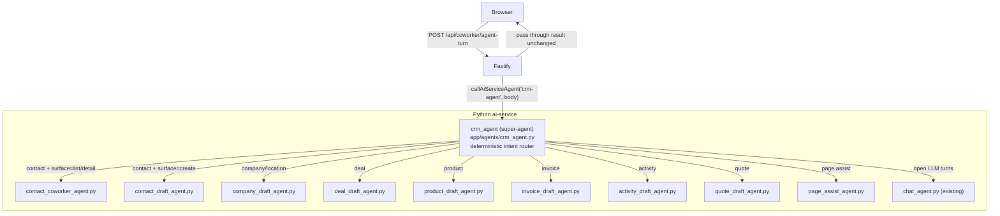

# Python Super-Agent Migration

## Current problem

All co-worker intelligence lives in TypeScript (`backend/src/service/ai/coworker-*.ts`). The Python ai-service only serves as a raw LLM call proxy (`"chat"` agent). Every routing decision, heuristic, system prompt, and patch-parsing is scattered across 5+ TS files.

## Target architecture



**TypeScript `backend/src/service/ai/` files become trivially thin pass-throughs** — they call `callAiServiceAgent("crm-agent", unified_body)` and return the result verbatim.

---

## Unified request / response envelope

All existing `/api/coworker/*` Fastify routes will continue to exist (no frontend changes). Each TS file now maps its specific input into a single shared envelope and calls one Python endpoint.

**Request to Python orchestrator:**
```json
{
  "intent": "agent_turn | contact_draft | company_draft | location_draft | deal_draft | product_draft | invoice_draft | activity_draft | quote_draft | page_assist",
  "messages": [{ "role": "user|assistant", "text": "..." }],
  "context": {
    "module": "contact",
    "surface": "list | create | detail",
    "entityId": null,
    "pathname": "/contact",
    "draft": {}
  },
  "catalog": {},
  "organizationId": null
}
```

**Response from Python orchestrator (unchanged shape — frontend stays untouched):**
```json
{
  "ok": true,
  "assistantText": "...",
  "patch": {},
  "toolProposals": [],
  "contactDraftPatch": {},
  "actions": [],
  "workspaceHint": {}
}
```

---

## Files to create in `ai-service/app/agents/`

| File | Mirrors current TS file | Key responsibility |
|---|---|---|
| `crm_agent.py` | `coworker-agent-turn.ts` (orchestrator part) | Deterministic intent router; dispatches to sub-agents |
| `contact_coworker_agent.py` | `coworker-agent-turn.ts` (Contacts heuristics) | list/create/detail intents for Contacts; returns `toolProposals` with `set_workspace` |
| `contact_draft_agent.py` | `coworker-contact-draft.ts` | Field-fill for contact create form; name parsing; list-leave intent |
| `company_draft_agent.py` | `coworker-company-draft.ts` | Company + location form fill |
| `deal_draft_agent.py` | `coworker-deal-draft.ts` | Deal form fill; stage proposal |
| `product_draft_agent.py` | `coworker-misc-drafts.ts` (product) | Product form fill |
| `invoice_draft_agent.py` | `coworker-misc-drafts.ts` (invoice) | Invoice form fill |
| `activity_draft_agent.py` | `coworker-misc-drafts.ts` (activity) | Activity form fill |
| `quote_draft_agent.py` | `coworker-misc-drafts.ts` (quote) | Quote form fill |
| `page_assist_agent.py` | `coworker-page-assist.ts` | Page-scoped navigate suggestions |

All agents follow the **existing pattern**: `TypedDict` state + `build_graph()` + `get_graph()` singleton + `async run()`. No new base class needed.

---

## `crm_agent.py` — the orchestrator

The router is **deterministic first, then LLM for open-ended turns**. It never calls the LLM itself — it routes to a sub-agent which does.

```python
# Routing priority (mirrors coworker-agent-turn.ts heuristics):
# 1. intent == "agent_turn" + module == "contact" → contact_coworker_agent
# 2. intent == "contact_draft" OR (module == "contact" + surface == "create") → contact_draft_agent
# 3. intent == "company_draft" → company_draft_agent
# 4. intent == "location_draft" → company_draft_agent (location path)
# 5. intent == "deal_draft" → deal_draft_agent
# 6. intent == "product_draft" → product_draft_agent
# 7. intent == "invoice_draft" → invoice_draft_agent
# 8. intent == "activity_draft" → activity_draft_agent
# 9. intent == "quote_draft" → quote_draft_agent
# 10. intent == "page_assist" → page_assist_agent
# 11. intent == "agent_turn" (other modules) → chat_agent (generic LLM turn)
```

It uses LangGraph `StateGraph` with a single `"route"` node that inspects `intent` + `context.module` + `context.surface` and calls the sub-agent's `run()` directly as an awaitable.

---

## Files to modify in `ai-service/`

- **`app/agents/__init__.py`** — add `crm_agent` to `REGISTRY` under key `"crm-agent"`
- **`app/api/routes.py`** — add one new route `POST /ai/v1/agents/crm-agent/run` (reuses `_run_contact_agent` pattern but with the unified body shape)

---

## Files to modify in TypeScript backend

All TypeScript co-worker service files become pass-throughs. The heuristics, system prompts, and patch parsing move to Python.

### `backend/src/service/ai/coworker-shared.ts`
- Keep `CoworkerMessage` type and `callAiServiceAgent` re-export
- Remove `runCoworkerChatJson`, `buildConversationUserPrompt`, `parseAssistantJsonPayload` (now in Python)

### `backend/src/service/ai/coworker-agent-turn.ts`
Replace entire implementation with:
```ts
export async function agentTurnCommand(input) {
  const result = await callAiServiceAgent("crm-agent", {
    intent: "agent_turn",
    messages: input.messages,
    context: input.context,
    organizationId: await getCurrentOrganizationId(),
  });
  if (!result) return { ok: true, ...heuristic(userText, ctx) }; // offline fallback
  return result;
}
```
Keep a minimal offline heuristic fallback for when ai-service is down.

### `backend/src/service/ai/coworker-contact-draft.ts`
```ts
export async function contactDraftAssistCommand(input) {
  await requireRole(canEditContacts, "...");
  const result = await callAiServiceAgent("crm-agent", {
    intent: "contact_draft",
    messages: input.messages,
    context: { module: "contact", surface: "create", draft: input.draft },
    organizationId: ...,
  });
  if (!result) return heuristicFallback(userText, companies);
  return result;
}
```
The catalog fetch (`fetchContactFormOptions`) moves into `contact_draft_agent.py` via the CRM API client (`app/crm_client.py`).

### `backend/src/service/ai/coworker-company-draft.ts`, `coworker-deal-draft.ts`, `coworker-misc-drafts.ts`
Same pattern as contact-draft — thin wrapper, `intent` key identifies which sub-agent.

### `backend/src/service/ai/coworker-page-assist.ts`
```ts
const result = await callAiServiceAgent("crm-agent", {
  intent: "page_assist",
  messages: input.messages,
  context: input.context,
  organizationId: ...,
});
```

---

## Catalog fetching in Python

Each sub-agent that needs CRM data (companies list, contacts list, deals list, etc.) fetches it using the existing `app/crm_client.py`. The `organizationId` from the request body is passed through to each API call.

- `contact_draft_agent.py` → calls `GET /api/contacts/form-options?organizationId=…`
- `deal_draft_agent.py` → calls `GET /api/companies?pageSize=80` + contacts
- `company_draft_agent.py` → calls existing company endpoints
- Other agents already have minimal catalogs (product, invoice, quote)

---

## Migration order (module by module)

1. **Infrastructure** — `crm_agent.py` (router only, no sub-agents yet), register route, update TS `agent-turn` to call it
2. **Contact** — `contact_coworker_agent.py` + `contact_draft_agent.py` (highest usage)
3. **Company/Location** — `company_draft_agent.py`
4. **Deal** — `deal_draft_agent.py`
5. **Misc drafts** — `product_draft_agent.py`, `invoice_draft_agent.py`, `activity_draft_agent.py`, `quote_draft_agent.py`
6. **Page assist** — `page_assist_agent.py`
7. **Cleanup** — remove heuristics from TS files, remove `runCoworkerChatJson`/`parseAssistantJsonPayload` from `coworker-shared.ts`

---

## What does NOT change

- All existing Fastify route paths (`/api/coworker/*`) — no frontend changes
- The response shape seen by the frontend (`ok`, `assistantText`, `patch`, `toolProposals`, etc.)
- Specialist background agents (`enrich-lead`, `score-lead`, `nurture-lead`, etc.) — untouched
- The `"chat"` agent — still used as the LLM primitive by sub-agents internally
- RBAC/permission checks remain in TypeScript (they need the session context)
