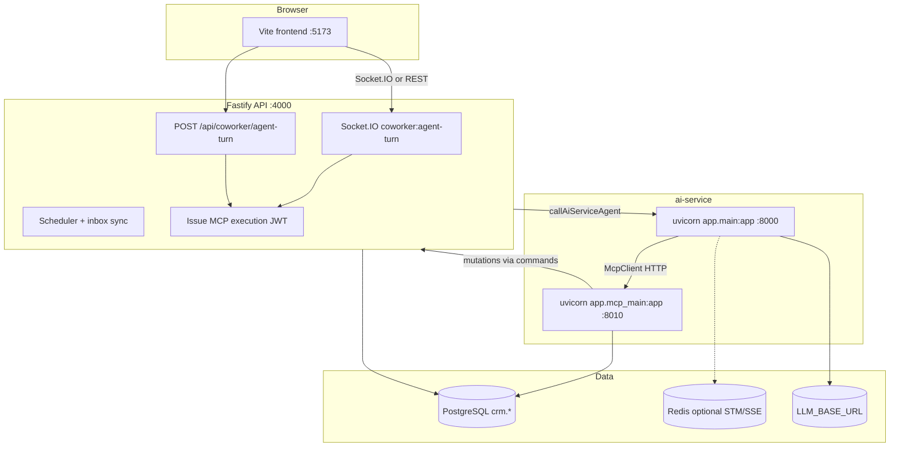
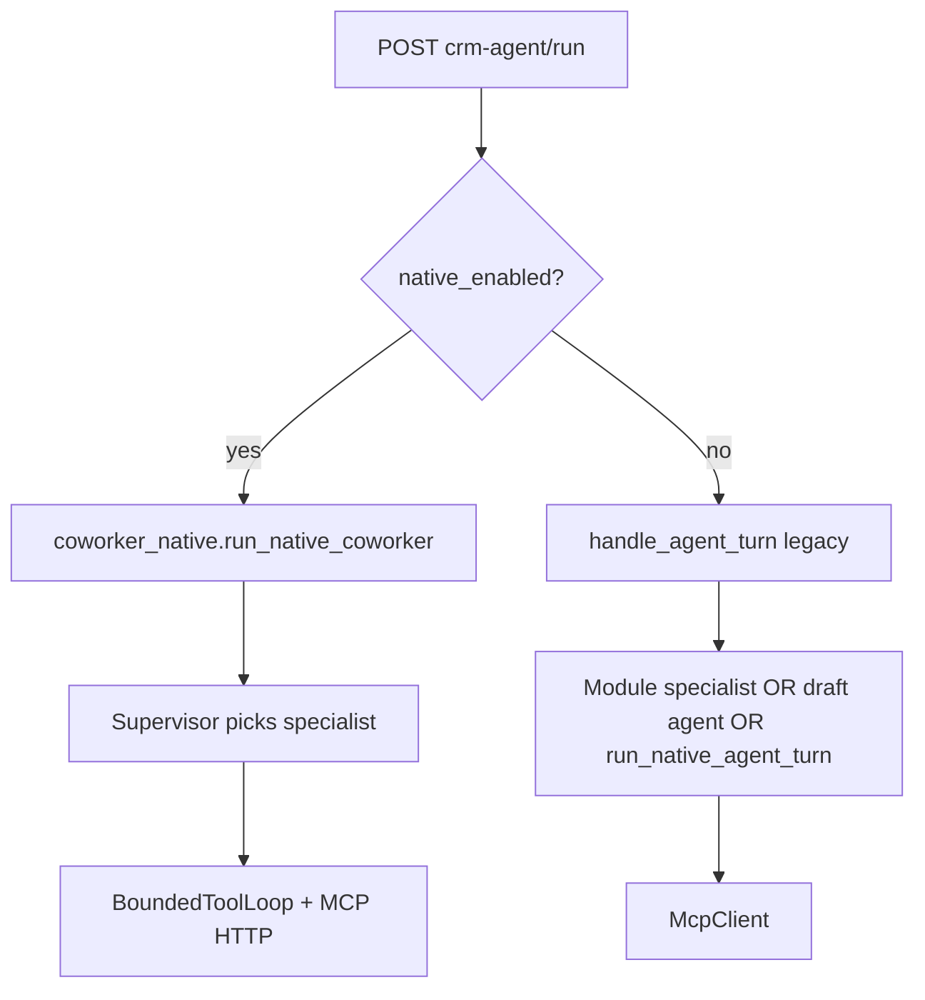

# CRM AI Service: End-to-End Architecture Migration Guide

How the CRM moved from **LangGraph + LangChain + in-process heuristics + ad-hoc sockets** to the **current native orchestrator + HTTP MCP + bounded tool loop + Fastify Socket.IO transport** design. Use this as the blueprint when migrating other Worktual pillars (e.g. **campaign-ms**).

Related docs:

- [`enterprise-agent-contract-baseline-v1.md`](./enterprise-agent-contract-baseline-v1.md)
- [`agent-runtime-deployment.md`](./agent-runtime-deployment.md)
- [`worktual-combine-contracts.md`](./worktual-combine-contracts.md)
- [`module-chat-intents.md`](./module-chat-intents.md)

---

## 1. Before vs after (one page)

| Concern | **Before** | **After (current)** |
|--------|------------|---------------------|
| **Orchestration** | LangGraph state graphs, LangChain chains | Imperative `native_pipeline.run_steps()` + `Orchestrator` + `Supervisor` + `BoundedToolLoop` |
| **LLM client** | LangChain wrappers | Direct OpenAI-compatible client in `app/llm.py` (`generate_ai_text`, `chat_with_tools`) |
| **Coworker tools** | Mixed graph nodes + Python helpers | MCP catalog (`app/mcp/catalog.py`) + dispatch (`app/mcp/dispatch.py`) over **HTTP** `:8010/mcp/v1` |
| **Heuristics** | Sometimes on happy path | **Offline fallback only** when LLM down/unusable; labeled `source: "heuristic"` |
| **Real-time UI** | Unclear / mixed | **Socket.IO only in Fastify** (`backend`); Python is **HTTP-only** |
| **Memory** | Graph checkpointing | Client `sessionMemory` + optional Redis STM + DB durable slots |
| **Prompts** | Ad-hoc per agent | Fixed **6 sections**: Role → Goal → Instructions → Context → Output → Guardrails |
| **Backend role** | Partial agent logic in TS | TS **enqueues + calls** `POST /ai/v1/agents/:name/run` only |
| **Rollout** | Single path | `legacy` \| `native` \| `dry_run` with allowlists |

**Hard rule (enforced in CI):** no `langgraph` or `langchain` in `ai-service/app` or `requirements.txt` — see `ai-service/tests/test_forbidden_framework_dependencies.py`.

---

## 2. Process topology (production)



**Other pillars should mirror this:** separate **agent API process**, separate **MCP process**, **one host app** (Fastify or Next server) that owns auth, tenancy, persistence, and Socket.IO — never expose MCP or LLM URLs to the browser.

See [`agent-runtime-deployment.md`](./agent-runtime-deployment.md) for process commands and probes.

---

## 3. LangGraph → native pipeline + orchestrator

### What LangGraph did

- Named nodes (enrich → score → route → …)
- Shared graph state mutated per node
- Checkpoint / resume via framework

### What replaced it

#### A. `native_pipeline` — linear step executor

File: `ai-service/app/agents/native_pipeline.py`

```python
async def run_steps(initial_state, steps):
    state = dict(initial_state)
    for step in steps:
        update = await step(state)  # or sync
        if update:
            state.update(update)
    return state
```

Used by **proactive job agents** (e.g. `score_lead_agent.py`, `nurture_lead_agent.py`):

```python
_PIPELINE_STEPS = (load_context, call_llm, persist, notify)
return await run_steps(state, _PIPELINE_STEPS)
```

Same *contract* as old graph nodes: each function is `(state) -> partial state dict`.

#### B. `Orchestrator` — enterprise runtime envelope

Location: `ai-service/app/orchestrator/`

| Type | Purpose |
|------|---------|
| `ExecutionEnvelope` | `runId`, `traceId`, `organizationId`, `actorId`, `role`, `businessType`, `deadline`, `idempotencyKey`, `toolBudget` |
| `RunResult` | `assistantText`, `toolProposals`, `sessionMemory`, `uiRefresh`, … |
| `AgentSpec` | name, kind, `allowedTools`, `allowedSkills`, `mutationCapable` |
| `ExecutionMode` | `legacy` \| `native` \| `dry_run` |

#### C. `PipelineRunner` — conditional steps + checkpoints

For named HTTP agents wrapped by `named_native.py`: retry, checkpoint hooks, step traces for dashboards.

#### D. `Supervisor` + `LlmRouter` — coworker routing

Opt-in path in `coworker_native.py`: LLM picks specialist agent (`contact-agent`, `deal-agent`, …), max 3 handoffs.

### Migration steps for a new pillar

1. List every LangGraph node → one Python function `(state) -> dict`.
2. Chain with `run_steps` or `PipelineRunner`.
3. Keep **HTTP route + JSON response shape unchanged** during migration (`ExecutionMode.legacy` first).
4. Add pytest guard: forbid `langgraph`/`langchain` imports.
5. Enable `native` per agent via allowlist when bounded tool loop is wired.

Phase 11 (2026-08-18) removed LangGraph/LangChain from production; see [`enterprise-agent-contract-baseline-v1.md`](./enterprise-agent-contract-baseline-v1.md).

---

## 4. LangChain → direct LLM + shared libraries

LangChain was removed entirely. Replacement stack:

| Capability | Module |
|------------|--------|
| Chat completion | `app/llm.py` → `generate_ai_text()` |
| Tool calling | `app/llm.py` → `chat_with_tools()` (OpenAI tool schema; Minimax XML fallback) |
| Coworker system prompt | `app/agents/crm_tools.py` → `build_system_prompt()` |
| Job agent prompts | `app/agents/llm_result.py` → `sectioned_system_prompt()` |
| JSON from LLM | `llm_result.extract_json()` + repair retry |
| Tool turn (legacy coworker) | `crm_tools.run_native_agent_turn()` |
| Provenance labels | `llm_result.label_ai()` / `label_fallback()` |

Do not add LangChain to new pillars. Copy `llm.py` + `llm_result.py` patterns; one OpenAI-compatible client, one prompt builder style.

---

## 5. Heuristics → offline fallback only

### Policy

See `.cursor/rules/agents-must-use-llm.mdc` and `AGENTS.md`.

| Path | Allowed? |
|------|----------|
| LLM score / draft / reply / route on success | **Yes (required)** |
| `if not is_ai_configured(): heuristic()` | **Yes (offline)** |
| Heuristic as primary “agent answer” when LLM is up | **Forbidden** |

### Labeling contract

```python
# Success
{"source": "ai", ...}

# Fallback
label_fallback(heuristic_result, "llm_timeout")
# → {"source": "heuristic", "llmReason": "llm_timeout", ...}
```

### Where heuristics still exist

| Layer | Example |
|-------|---------|
| **Python agents** | `score_lead_heuristic()`, `contacts_heuristic()` when LLM fails |
| **TypeScript jobs** | `lead-nurture-job.ts` — does not send heuristic nurture emails on happy path |
| **Coworker pre-routing** | Edit/delete confirmation patterns in `crm_agent.py` (labeled `heuristic` if no LLM) |

Every agent endpoint should return `source: "ai" | "heuristic"`. UI must not say “AI generated” when `source === "heuristic"`.

---

## 6. Socket.IO — transport only, not agent logic

### Important: Socket.IO is **not** in ai-service

| Component | Role |
|-----------|------|
| `backend/src/server.ts` | Mounts `SocketIOServer` on Fastify |
| `backend/src/modules/coworker/coworker-socket.ts` | Event `coworker:agent-turn` → `agentTurnCommand()` |
| `frontend/src/services/coworker-socket.ts` | `socket.io-client`, path `/socket.io` |
| `frontend/vite.config.ts` | Proxies `/socket.io` → backend |

### Turn flow

```
Browser ──Socket.IO──► Fastify coworker-socket.ts
                              │
                              ▼
                    coworker-agent-turn.ts
                    (enrich catalog, durableMemory, JWT)
                              │
                              ▼ HTTP POST
                    ai-service POST /ai/v1/agents/crm-agent/run
                              │
                              ▼
                    crm_agent.run() → LLM + MCP
```

Python never opens WebSockets. Socket.IO is a **UX transport** (lower latency chat, same payload as REST `POST /api/coworker/agent-turn`).

For campaign or other pillars: add Socket.IO on the **host server** only if live chat is needed. Agent brain stays HTTP to Python.

---

## 7. Harness — complete design

### 7.1 Bounded tool loop

File: `ai-service/app/orchestrator/tool_loop.py`

```
┌─────────────────────────────────────────┐
│ BoundedToolLoop.run(spec, context, msgs)│
├─────────────────────────────────────────┤
│ 1. list_tools → filter by skill/agent   │
│ 2. hooks.before_prompt                  │
│ 3. chat_with_tools(messages, tools)     │
│ 4. If no tool_calls → return text       │
│ 5. Cycle-detect repeated signatures     │
│ 6. Parallel batch: read-only tools      │
│ 7. Serial: mutations                    │
│ 8. hooks.authorize_tool / after_tool    │
│ 9. Append tool results; repeat          │
└─────────────────────────────────────────┘
```

**Budget defaults** (`ToolBudget` in `orchestrator/contracts.py`):

| Limit | Value |
|-------|-------|
| `maxRounds` | 6 |
| `maxCalls` | 10 |
| `maxRepeatedCall` | 2 (cycle detection) |
| `parallelReads` | true |

**Legacy parallel path:** `crm_tools.run_native_agent_turn()` — same idea, calls `McpClient` directly (used when `executionMode !== "native"`).

### 7.2 MCP tools

#### Catalog — single source of truth

`ai-service/app/mcp/catalog.py`

- Defines every tool: name, description, JSON schema, `risk` (`low`|`high`), `kind` (`ui_directive`, `draft_patch`, `mutation`, `clarify`)
- RBAC filters by module, surface, role, business type
- `FORM_OWNED_TOOLS` — return **proposals** to UI; Fastify/forms execute write

#### Dispatch — execution

`ai-service/app/mcp/dispatch.py`

| Tool kind | Behavior |
|-----------|----------|
| `navigate`, `set_workspace`, `open_entity` | Return UI directive |
| `patch_*` | Return draft patch for Vite form |
| `propose_*` | Return tool proposal (user confirms) |
| `remember_memory` | Forward to Fastify memory API |
| SQL analytics | Read-only guarded queries |
| Mutations | `commands.py` → authenticated Fastify internal routes |

#### HTTP MCP server (production)

`app/mcp_main.py` → **`POST /mcp/v1/tools/list`**, **`POST /mcp/v1/tools/call`**

Auth: HS256 JWT from Fastify (`MCP_EXECUTION_JWT_SECRET`) with tenant, actor, role, module, runId claims. See [`worktual-combine-contracts.md`](./worktual-combine-contracts.md).

#### Agent-side client

`app/mcp_client.py` — HTTP only in production; in-process fallback for tests.

### 7.3 Skills

Location: `ai-service/app/skills/`

Progressive disclosure for enterprise agents:

```
SkillRegistry.select(envelope, agentSpec)
    → list of SkillSpec names (metadata only)

SkillRegistry.load(name)
    → SkillPackage (full 6-section prompt + tool groups)

SkillRegistry.effective_tool_names(selected, agentSpec.allowedTools)
    → intersection (skills can NEVER add tools beyond agent allowlist)
```

- **Catalog:** `app/skills/catalog.py` — skills like `contact-crud`, `quote-lifecycle`, mapped to MCP tool groups.
- **Composer:** `app/skills/composer.py` — appends skill fragments to base system prompt.

For campaign: define skills per workflow (`campaign-create`, `audience-segment`, `channel-send`) with the same intersection rule.

### 7.4 Memory

Three layers:

#### 1. Client short-term memory (default)

Sent every turn from Vite → Fastify → Python:

```typescript
sessionMemory: {
  conversationId?,
  pendingIntent?,   // e.g. "create_contact"
  pendingAsk?,      // e.g. "email"
  slots?,           // create-flow progress
  lastEntities?,
}
```

Normalized in `coworker_runtime.py`; injected into prompt **Context** section. Returns as `sessionMemoryPatch` / `sessionMemory` in response.

#### 2. Redis STM (opt-in native path)

`app/memory/manager.py` — tenant/user/conversation keys, TTL, CAS, locks, redaction.

Env: `ORCHESTRATOR_STM_ENABLED=true`, `ORCHESTRATOR_REDIS_URL`.

Used by `coworker_native.run_native_coworker()`.

#### 3. Durable memory (DB)

- Table: `crm.agent_memories`
- API: Fastify `GET/POST /api/internal/mcp/agent-memory`
- Slots: `prefs`, `last_intent`, `open_ask`, `entity_hint`, `tone`, `follow_up`, `note`
- Scopes: `org` | `user` | `contact` | `deal`

Backend hydrates `catalog.durableMemory` before each turn (`coworker-agent-turn.ts`).

Other pillars should own their memory table or call the shared contract with the same slot allowlist.

### 7.5 Hooks

File: `ai-service/app/orchestrator/hooks.py`

| Hook | When |
|------|------|
| `before_run` | Start of orchestrator run |
| `before_prompt` | Before each LLM call in tool loop |
| `authorize_tool` | Before mutation tool execute |
| `after_tool` | After tool result |
| `after_run` | Final result shaping |
| `checkpoint` | Pipeline resume points |
| `on_cancel` | Deadline / cancel |
| `shutdown` | Process shutdown |

Default: `NoopLifecycleHook`. Use for tenancy audits, PII redaction, rate limits, pillar-specific gates.

---

## 8. Prompt structure (mandatory)

### Fixed section order

```
Role
Goal
Instructions
Context
Output
Guardrails
```

### Coworker — `build_system_prompt(module, surface, ctx)`

File: `ai-service/app/agents/crm_tools.py`

**Context** includes: `module`, `surface`, `pathname`, `entityId`, `businessType`, `role`, `sessionMemory`, `durableMemory`, draft field labels, open entity catalog (redacted IDs in speech).

**Guardrails** include: never expose raw IDs in user-facing text; form-owned vs MCP mutation rules; B2C finance gating; confirm destructive actions.

### Job agents — `sectioned_system_prompt()`

File: `ai-service/app/agents/llm_result.py`

```python
sectioned_system_prompt(
    role="Lead scoring analyst",
    goal="Score this lead 0–100 with rationale",
    instructions="Use enrichment + activities; output JSON",
    context=build_context_block(ctx),
    output='{"score": int, "band": "hot|warm|cold", "rationale": str}',
    guardrails="No invented company facts; cite signals only",
)
```

Skills append extra **Instructions** + **Guardrails** via `compose_system_prompt()`.

---

## 9. Backend integration (TypeScript)

### Single entry: `callAiServiceAgent`

File: `backend/src/service/ai/ai-service-client.ts`

```
POST ${AI_SERVICE_BASE_URL}/ai/v1/agents/${agent}/run
Headers: x-internal-secret, traceparent
Body: { ...payload, conversationId, runId, traceId, idempotencyKey, mcpExecutionToken? }
Timeouts: 90s default, 210s jobs, 240s max
```

### Coworker turn

File: `backend/src/service/ai/coworker-agent-turn.ts`

1. Load user session, org, role, business type
2. Hydrate durable memory → `catalog.durableMemory`
3. Issue MCP JWT if needed
4. Set `executionMode`: `legacy` | `native` (allowlist gated)
5. Call `crm-agent`
6. Persist durable memory writes (allowlisted slots only)
7. Return `{ ok, assistantText, toolProposals, patch, sessionMemoryPatch, uiRefresh }`

### Job enqueue pattern

TypeScript **never** scores/nurtures/composes on happy path:

```typescript
const py = await callAiServiceAgent("score-lead", { contactId, organizationId, ... });
if (py.source === "heuristic") log.warn("offline fallback");
// persist py.score via DAO
```

See [`module-chat-intents.md`](./module-chat-intents.md) for full coworker UX contract.

---

## 10. Coworker agent internal structure

File: `ai-service/app/agents/crm_agent.py`



**Specialists** (not separate HTTP routes): `contact_coworker_agent.py`, `deal_coworker_agent.py`, `proposal_coworker_agent.py`, …

**Draft agents:** `contact_draft_agent.py`, `deal_draft_agent.py`, …

**Routing order:**

1. Native MCP tools (LLM tool calls)
2. Draft fill agents on create surface
3. Heuristics (offline / confirm flows only)

---

## 11. Campaign / other pillar — migration checklist

### Phase 0 — Contracts

- [ ] Freeze HTTP contract: `POST /ai/v1/agents/:name/run` + coworker turn shape
- [ ] Document agent inventory (like `enterprise-agent-contract-baseline-v1.md`)
- [ ] Add forbidden-import test (no LangGraph/LangChain)

### Phase 1 — Extract agent service

- [ ] Dedicated ai-service agents (or shared process with pillar-specific modules)
- [ ] `app/llm.py`, `app/llm_result.py`, `app/agents/<name>_agent.py`
- [ ] One agent per file; primary output = LLM

### Phase 2 — MCP

- [ ] `app/mcp/catalog.py` — pillar tools
- [ ] `app/mcp/dispatch.py` — form-owned vs mutation
- [ ] `app/mcp_main.py` on `:8010`
- [ ] JWT from host server

### Phase 3 — Host server

- [ ] `callAiServiceAgent()` client (copy CRM pattern)
- [ ] `POST /api/coworker/agent-turn` or Socket.IO wrapper
- [ ] Own persistence in pillar schema only
- [ ] `uiRefresh` after writes

### Phase 4 — Harness

- [ ] `native_pipeline.run_steps` for batch jobs
- [ ] `BoundedToolLoop` for interactive chat
- [ ] `ToolBudget` + cycle detection
- [ ] Hooks for pillar RBAC

### Phase 5 — Memory & skills

- [ ] Client `sessionMemory` for wizards
- [ ] Durable slots in pillar DB
- [ ] Skills mapped to MCP tool groups

### Phase 6 — Prompts

- [ ] All agents use `sectioned_system_prompt` or `build_system_prompt`
- [ ] No ad-hoc system prompt strings

### Phase 7 — Rollout

- [ ] `ExecutionMode.legacy` first
- [ ] Allowlist `native` per agent
- [ ] Remove LangGraph deps; run full pytest suite

---

## 12. Key environment variables

| Variable | Process | Purpose |
|----------|---------|---------|
| `AI_SERVICE_BASE_URL` | Fastify | `http://127.0.0.1:8000` |
| `MCP_BASE_URL` | ai-service | `http://127.0.0.1:8010/mcp/v1` |
| `MCP_EXECUTION_JWT_SECRET` | Fastify + MCP | Tool auth |
| `LLM_BASE_URL`, `LLM_MODEL`, `LLM_API_KEY` | ai-service | Model endpoint |
| `CRM_API_BASE_URL` | ai-service | Read/write CRM via internal API |
| `COWORKER_NATIVE_ENABLED` | Fastify | Opt-in native supervisor |
| `ORCHESTRATOR_STM_ENABLED` | ai-service | Redis STM |
| `ORCHESTRATOR_REDIS_URL` | ai-service | Redis for STM |

---

## 13. File map (CRM ai-service)

| Path | Responsibility |
|------|----------------|
| `app/main.py` | Agent API FastAPI app |
| `app/mcp_main.py` | MCP-only ASGI app |
| `app/api/routes.py` | All `/ai/v1/agents/*/run` routes |
| `app/llm.py` | LLM client |
| `app/agents/crm_agent.py` | Coworker supervisor |
| `app/agents/crm_tools.py` | Tools, prompts, `run_native_agent_turn` |
| `app/agents/coworker_native.py` | Native supervisor path |
| `app/agents/coworker_shared.py` | Speech sanitization, memory helpers |
| `app/agents/coworker_runtime.py` | Session memory normalize |
| `app/agents/native_pipeline.py` | LangGraph replacement |
| `app/agents/named_native.py` | Native wrapper for job agents |
| `app/agents/llm_result.py` | Sectioned prompts + JSON extract |
| `app/orchestrator/*` | Orchestrator, tool loop, hooks, router, supervisor |
| `app/skills/*` | Skill catalog, registry, composer |
| `app/memory/*` | Redis STM + durable client |
| `app/mcp/*` | Catalog, dispatch, HTTP routes, RBAC |
| `app/mcp_client.py` | HTTP MCP client for agents |
| `backend/src/service/ai/coworker-agent-turn.ts` | Turn orchestration |
| `backend/src/service/ai/ai-service-client.ts` | HTTP to Python |
| `backend/src/modules/coworker/coworker-socket.ts` | Socket.IO → agent turn |

---

## 14. Mental model

1. **Python owns brains** — every decision/draft/score/reply comes from LLM on success path.
2. **TypeScript owns tenancy, auth, persistence, and transport** — including Socket.IO.
3. **MCP owns tool definitions and execution policy** — HTTP service, JWT-scoped.
4. **Tool loop owns LLM↔tool turns** — bounded, cycle-safe, hookable.
5. **Skills narrow tools** — never expand them.
6. **Memory is layered** — turn STM in client/Redis; durable in DB.
7. **Prompts are standardized** — six sections, two builders.
8. **Heuristics are emergency-only** — always labeled.
9. **LangGraph is gone** — replaced by `run_steps` + orchestrator, not another framework.
