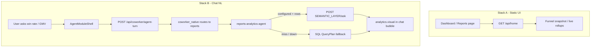

# CRM Dashboard / Reports / Analytics — handoff for Campaign

**Audience:** Campaign product (dashboard, reports, analytics).  
**Purpose:** How CRM built this end-to-end — static home cards vs chat-driven metrics, when we call the semantic layer, response shapes, and what Campaign should mirror vs replace.

CRM owns sales analytics. Campaign should **reuse the patterns** (split UI, agent → semantic `/ask` → `visual` envelope → chat chart), not copy CRM metric IDs or deal/funnel SQL.

---

## 1. Big picture (two stacks)

| Stack | What users see | Data source | Semantic layer? |
|-------|----------------|-------------|-----------------|
| **A. Static home / reports panel** | KPI tiles, funnel charts, coaching on Dashboard (and marketing `/reports`) | `GET /api/home` → cached / live OLTP rollups (`crm.report_snapshots`, live queries) | **No** |
| **B. Chat NL analytics** | Charts + narrative **inside coworker chat** | `reports-analytics-agent` → semantic gateway → optional SQL fallback | **Yes (preferred)** |

Do **not** conflate them. Home cards are rollups. Semantic layer is for **plain-English questions** in the coworker.



---

## 2. Product / nav rules (CRM)

| Surface | Who | Notes |
|---------|-----|-------|
| `/dashboard` | All CRM roles | Analytics **embedded** here for non-marketing |
| `/reports` | **Marketing only** | Same home `analytics` block; others redirect to `/dashboard` |
| Coworker on dashboard | All with dashboard | `moduleId="dashboard"`; chips like “win rate”, “pipeline by stage” |
| Coworker on reports | Marketing | `moduleId="reports"`; often reloads panel after tools |

Rule from [`docs/module-chat-intents.md`](module-chat-intents.md): **`reports` nav is marketing-only**. Everyone else gets analytics on Dashboard + `query_analytics` on `module=dashboard`.

**Campaign:** You can keep a first-class `/reports` for all Campaign roles. Do not copy CRM’s marketing-only Reports nav unless you want the same matrix.

---

## 3. Stack A — Static dashboard / reports (no semantic)

### Frontend

| File | Role |
|------|------|
| [`frontend/src/pages/DashboardPage.tsx`](../frontend/src/pages/DashboardPage.tsx) | Persona home + `AgentModuleShell` |
| [`frontend/src/pages/ReportsPage.tsx`](../frontend/src/pages/ReportsPage.tsx) | Marketing-only; same analytics panel |
| [`frontend/src/components/home/DashboardAnalyticsPanel.tsx`](../frontend/src/components/home/DashboardAnalyticsPanel.tsx) | Funnel / coaching charts |
| [`frontend/src/components/home/AdminOpsPanel.tsx`](../frontend/src/components/home/AdminOpsPanel.tsx) | Admin/manager ops + metrics |
| [`frontend/src/components/home/RepOpsPanel.tsx`](../frontend/src/components/home/RepOpsPanel.tsx) | Rep board |
| [`frontend/src/services/home.ts`](../frontend/src/services/home.ts) | `GET /api/home`, refresh |

### Backend

| File | Role |
|------|------|
| [`backend/src/modules/home/routes.ts`](../backend/src/modules/home/routes.ts) | `GET /api/home`, `POST /api/home/analytics/refresh`, briefing, ops |
| [`backend/src/service/home/dashboard-commands.ts`](../backend/src/service/home/dashboard-commands.ts) | Commands |
| [`backend/src/dao/home/home-dashboard.ts`](../backend/src/dao/home/home-dashboard.ts) | Persona assembly + attach `analytics` |
| [`backend/src/dao/reports/report-service.ts`](../backend/src/dao/reports/report-service.ts) | Funnel snapshot generate / load |
| [`backend/src/modules/reports/routes.ts`](../backend/src/modules/reports/routes.ts) | Legacy `GET /api/reports` (Vite prefers `/api/home`) |
| [`backend/src/service/reports/funnel-snapshot-job.ts`](../backend/src/service/reports/funnel-snapshot-job.ts) | Nightly snapshot |

### Call sequence (static)

```
Browser DashboardPage
  → GET /api/home?… (cookie session)
  → loadDashboardAnalytics()
       · admin/manager: latest org funnel snapshot (crm.report_snapshots)
       · sales_rep / own-scoped: live own-scoped funnel
  → { ok, data: { …persona KPIs, analytics: { funnelSnapshot, coaching… } } }
  → DashboardAnalyticsPanel / AdminOps / RepOps
```

Refresh (org snapshot only, admin/manager):

```
POST /api/home/analytics/refresh
  → regenerate funnel snapshot for org
```

### Response shape (home `analytics` block)

```ts
{
  canSeeOrgSnapshot: boolean;
  funnelSnapshot: {
    generatedAt: string | null;
    wonCount: number;
    lostCount: number;
    dealsByStage: Record<string, number>;
    lostReasons: Record<string, number>;
    quoteCounts: Record<string, number>;
    invoiceCounts: Record<string, number>;
  } | null;
  myCoaching: CoachingInsightSummary[];
  teamCoachingTrends: CoachingTrendRow[] | null;
}
```

Outer envelope is the usual CRM `{ statusCode, message, …payload }` unwrapped by the Vite client to `{ ok: true, data }`.

### Auth / tenancy (static)

- Session cookie required.
- Org from signed-in user (`getCurrentOrganizationId`).
- Snapshot **refresh** only if `canViewAllRecords(role)` (admin / sales_manager).
- Own-scoped roles get live personal funnel, not org cache.

**Campaign:** Replace deal/quote/invoice funnel with campaign metrics (sent, delivered, open rate, click rate, live/scheduled/past counts). Skip CRM coaching / deal ops panels.

---

## 4. Stack B — Chat analytics + semantic layer (core pattern)

This is what Campaign should copy for NL “what’s our open rate?” style UX.

### When we call the semantic layer

| Situation | Call semantic? |
|-----------|----------------|
| Greeting / small talk (“hi”, “thanks”) | **No** — conversational reply only |
| Explicit analytics question (“win rate”, “pipeline”, “GMV”, “how many leads”) | **Yes** if `SEMANTIC_LAYER_GATEWAY_URL` is set |
| Gateway returns usable rows | Use them → `source: "semantic_layer"` visual |
| Gateway down / empty / not configured | **SQL QueryPlan fallback** over allowlisted CRM datasets (or honest empty) |
| Create/nav language on dashboard | **No** — not the analytics specialist |

Classification lives in [`ai-service/app/agents/reports_analytics_agent.py`](../ai-service/app/agents/reports_analytics_agent.py) (`is_analytics_data_question`, `prefers_ontology_layer`, `prefers_semantic_layer`). Runtime rule:

- **Why / how / root-cause** → `ask_ontology_layer` (SSE ontology KG at `ONTOLOGY_GATEWAY_URL/chat/stream`) first; progress events land in `analytics.audit.progress` for coworker UI.
- **Plain metric / how-many data questions** → if gateway configured → always try `ask_semantic_layer` first.
- Either tool miss → SQL allowlisted plan fallback.

### End-to-end call sequence (chat)

```
User chip / prompt on Dashboard or Reports
  → AgentModuleShell (module=dashboard|reports, pageSnapshot?)
  → POST /api/coworker/agent-turn
  → backend coworker-agent-turn.ts → ai-service crm-agent
  → coworker_native: analytics domain → reports-analytics-agent
  → reports_analytics_agent.run(question, org_id, actor, role, business_type)
       1. If not data question → conversational LLM reply (no chart)
       2. If SEMANTIC_LAYER_GATEWAY_URL set:
            · optional LLM tool turn to reshape query (ask_semantic_layer tool schema)
            · POST {GATEWAY}/ask { query, organization_id, product }
       3. If successful metric rows → build visual + narrative → return
       4. Else → generate QueryPlan → scoped SQL → visual
  → RunResult { assistantText, analytics, suggestions, source }
  → Fastify forwards analytics to Vite
  → CoworkerMessageList renders msg.analytics via AnalyticsVisual
```

**Note:** Dashboard chat charts appear **in the bubble**. Home KPI panel is **not** auto-refreshed after chat (Reports page may `onAfterTool` reload).

### MCP tool (same agent, tool-loop path)

| Item | Value |
|------|--------|
| Tool name | `query_analytics` |
| Catalog | [`ai-service/app/mcp/catalog.py`](../ai-service/app/mcp/catalog.py) |
| Dispatch | [`ai-service/app/mcp/dispatch.py`](../ai-service/app/mcp/dispatch.py) → `_query_analytics` → `reports_analytics_agent.run` |
| Args | `{ question, label?, confirmed?, auto? }` — **required:** `question` |
| Modules | `reports`, `dashboard`, `sales`, `contact` |
| Risk | `read_only: true` |

MCP success envelope:

```json
{
  "ok": true,
  "kind": "executed",
  "assistantText": "Win rate is 42.0% …",
  "data": { "analytics": { /* StructuredAnalytics */ } }
}
```

Skills allowlist for reports group: `navigate`, `ask_clarification`, `query_analytics` ([`ai-service/app/skills/catalog.py`](../ai-service/app/skills/catalog.py)).

---

## 5. Semantic layer client (exact contract)

### Env (ai-service)

```bash
SEMANTIC_LAYER_GATEWAY_URL=http://192.168.13.244:9800   # gateway base
SEMANTIC_LAYER_PRODUCT=crm                              # product catalog key
```

Configured in [`ai-service/app/config.py`](../ai-service/app/config.py). Client: [`ai-service/app/services/semantic_layer.py`](../ai-service/app/services/semantic_layer.py).

### HTTP request

```
POST {SEMANTIC_LAYER_GATEWAY_URL}/ask
Content-Type: application/json

{
  "query": "what's our win rate?",
  "organization_id": "<CRM organization_id>",
  "product": "crm"
}
```

| Field | CRM meaning |
|-------|-------------|
| `query` | Plain English (optionally LLM-reshaped) |
| `organization_id` | Signed-in user's CRM organization id (string) |
| `product` | Always `crm` unless env overrides |

**Campaign:** Use `product: "campaign"` (or your gateway product key) and map `organization_id` to Campaign `tenantId` / org id (and branch if the gateway expects it).

### Gateway response (normalized)

Gateway may return a bare list **or** `{ "query": [ … ] }`. Client flattens to a list of metric results.

Success item:

```json
{
  "ok": true,
  "metric_id": "won_deal_rate",
  "rows": [{ "won_deal_rate": 0.42 }]
}
```

Failure / empty: treated as miss → SQL fallback or conversational reply.  
Transport errors: logged; agent continues to fallback.

### CRM catalog metric IDs (product=`crm`)

From `CATALOG_METRIC_IDS` in `semantic_layer.py`:

| Area | metric_id examples |
|------|--------------------|
| Contacts / funnel | `contact_volume`, `new_lead_volume`, `mql_rate`, `mql_contact_count`, `eligible_lead_contact_count`, `customer_conversion_rate`, `customer_contact_count`, `funnel_eligible_contact_count` |
| Pipeline | `deal_volume`, `open_pipeline_value`, `won_deal_rate`, `loss_rate`, `average_sales_cycle_days`, `average_deal_value`, `pipeline_coverage_ratio`, `sales_agent_win_rate` |
| Quotes / proposals | `quote_to_close_rate`, `proposal_acceptance_rate` |
| Commerce | `order_volume`, `order_gmv`, `average_order_value`, `repurchase_rate`, `customer_lifetime_value` |
| Finance | `invoice_outstanding_amount`, `days_sales_outstanding` |

Formatting: currency / ratio / days metric sets drive display (%, ₹, days).

**Campaign:** Register your own catalog on the gateway (e.g. `campaign_sent_count`, `open_rate`, `click_rate`, `delivery_rate`, `unsubscribe_rate`). Do not reuse CRM deal metrics.

### OpenAI tool schema used inside the agent

```json
{
  "name": "ask_semantic_layer",
  "description": "Ask a CRM metrics question in plain language…",
  "parameters": {
    "type": "object",
    "properties": {
      "query": { "type": "string", "description": "The user's business question…" }
    },
    "required": ["query"]
  }
}
```

The agent may call this tool so the LLM can rewrite the user utterance into a cleaner gateway query, then the Python client hits `/ask`.

---

## 6. How we respond (chat analytics envelope)

Frontend type: `StructuredAnalytics` in [`frontend/src/services/agent-stream.ts`](../frontend/src/services/agent-stream.ts).

```ts
{
  plan: Record<string, unknown>;           // real SQL plan OR dummy for semantic
  findings: {
    summary: string;                       // short narrative
    rows: Array<Record<string, unknown>>;  // e.g. [{ label, value }]
    comparison?: string;
  };
  chart?: { type: "kpi"|"bar"|"line"|"pie"|"table"; title?; x?; y?; … } | null;
  visual?: {
    version: "1.0";
    kind: "kpi" | "bar" | "line" | "pie" | "table";
    title: string;
    description?: string;
    kpis?: Array<{ label: string; value: string; hint?; change? }>;
    chart?: { xKey: string; data: Array<…>; series: Array<…> };
    table?: { columns: …; rows: … };
  } | null;
  audit: {
    source: "semantic_layer" | "sql" | …;
    organizationId: string;
    businessType: string;
    metricIds?: string[];
    rowCount?: number;
    // SQL path adds compile metadata
  };
}
```

Agent turn also returns:

```ts
{
  assistantText: string;   // shown as chat bubble
  analytics?: StructuredAnalytics;
  suggestions?: string[];  // follow-up chips
  source?: string;         // e.g. semantic_layer | sql | heuristic
}
```

UI render path:

1. Prefer `visual` v1.0 (`AnalyticsVisual.tsx`).
2. Else derive from `chart` + `findings.rows` (`derive-visual.ts`).
3. Components under [`frontend/src/components/analytics/`](../frontend/src/components/analytics/).

Backend sanitize (`coworker-agent-turn.ts`): requires `findings` + `audit` and (`plan` **or** `visual`); may default `plan` to `{ source: "semantic_layer" }` if missing.

---

## 7. SQL / heuristic fallback (offline / miss)

Only after semantic miss or when gateway unset:

1. LLM (or default) builds an allowlisted **QueryPlan** (dataset, metrics, dimensions, filters, chart).
2. Compile/execute with **hard** `organization_id = $1`.
3. `sales_rep` also owner-scoped.
4. B2C prompts avoid deal/quote/invoice metrics on the semantic path; SQL allowlist still respects business type.

Label honestly in `audit.source` / `source` — never claim “AI semantic” when it was pure SQL/heuristics.

Legacy TS NL heuristics: [`backend/src/service/ai/nl-analytics.ts`](../backend/src/service/ai/nl-analytics.ts) — **not** the primary coworker path.

---

## 8. Routing rules (coworker_native)

Approx behavior in [`ai-service/app/agents/coworker_native.py`](../ai-service/app/agents/coworker_native.py):

- Dashboard **data** questions → domain `reports` → `reports-analytics-agent`.
- Dashboard **nav / create** language → not analytics.
- Coaching-only phrases without KPI words → skip analytics route.
- Prompts in [`crm_tools.py`](../ai-service/app/agents/crm_tools.py) tell dashboard/reports sections: **semantic first**.

Period context: if `pageSnapshot.metricsPeriod` is set on the shell, it is appended as  
`Dashboard period filter: {period}` for the agent.

---

## 9. Auth, tenancy, RBAC summary

| Concern | CRM behavior |
|---------|--------------|
| Session | Cookie on all `/api/home*`, agent-turn |
| Semantic org | `organization_id` |
| SQL scope | Always org; reps further owner-filtered |
| Reports **nav** | Marketing only |
| Snapshot refresh | Admin / sales_manager |
| Viewer | Read-only analytics; no refresh |
| B2C | No Finance module; soft-limit deal/finance metrics in prompts |

---

## 10. Key file index

### Frontend
- `frontend/src/pages/DashboardPage.tsx` — home + coworker  
- `frontend/src/pages/ReportsPage.tsx` — marketing reports  
- `frontend/src/components/home/DashboardAnalyticsPanel.tsx` — static analytics  
- `frontend/src/components/analytics/*` — NL chart stack  
- `frontend/src/components/coworker/AgentModuleShell.tsx` — turns / tools  
- `frontend/src/components/coworker/CoworkerMessageList.tsx` — `msg.analytics`  
- `frontend/src/services/home.ts`, `agent-stream.ts`  

### Backend
- `backend/src/modules/home/routes.ts`, `service/home/dashboard-commands.ts`  
- `backend/src/dao/home/home-dashboard.ts`, `dao/reports/report-service.ts`  
- `backend/src/service/ai/coworker-agent-turn.ts`  
- `backend/src/config/modules.ts` — reports marketing-only  

### ai-service
- `ai-service/app/services/semantic_layer.py` — `/ask` client + catalog  
- `ai-service/app/agents/reports_analytics_agent.py` — semantic-first + SQL  
- `ai-service/app/agents/coworker_native.py` — domain routing  
- `ai-service/app/mcp/catalog.py` / `dispatch.py` — `query_analytics`  
- `ai-service/app/agents/crm_tools.py` — prompts  
- `ai-service/tests/test_semantic_layer.py`, `test_reports_analytics_agent.py`  

### Docs
- [`docs/module-chat-intents.md`](module-chat-intents.md)  
- [`docs/worktual-combine-contracts.md`](worktual-combine-contracts.md)  

---

## 11. What Campaign should do (checklist)

### Mirror

1. **Split** static dashboard cards vs chat NL metrics.  
2. Semantic client: `POST /ask` with `{ query, organization_id, product: "campaign" }`.  
3. Agent envelope: `assistantText` + `analytics.visual` v1.0 + `findings` + `audit`.  
4. Shared visual kinds: kpi / bar / line / pie / table.  
5. MCP-style `query_analytics` (read-only) if you use tool loops.  
6. Greetings → no gateway; data questions → gateway first.  
7. Fallback only on miss; label `source` honestly.  
8. Env: `SEMANTIC_LAYER_GATEWAY_URL` + campaign product key.

### Replace / do not copy

| CRM-specific | Campaign substitute |
|--------------|---------------------|
| `product: "crm"` + CRM metric IDs | Campaign catalog on the gateway |
| Deal / quote / invoice funnel | Campaign performance rollups |
| Coaching / AdminOps / RepOps | Campaign ops (optional) |
| Reports nav marketing-only | Your own role matrix |
| SQL over `crm.*` / `cdp.*` | Campaign DB or gateway-only |
| `organization_id` | Campaign `tenantId` / org id (+ branch if needed) |

### Suggested Campaign sequence

```
“open rate this week?”
  → Campaign analytics agent
  → ask_semantic_layer(query, organization_id=campaignOrgId)
  → map rows → visual v1.0
  → render in chat (+ optional refresh of dashboard cards)
  → if miss: Campaign SQL allowlist OR empty state
```

Today’s `campaign-ms` dashboard is status counts; reports page is a shell — this CRM path is the blueprint.

---

## 12. Smoke tests CRM uses

```bash
# Gateway health (your SEMANTIC_LAYER_GATEWAY_URL)
curl -sS -X POST "$SEMANTIC_LAYER_GATEWAY_URL/ask" \
  -H 'Content-Type: application/json' \
  -d '{"query":"what is our win rate","organization_id":"1000","product":"crm"}'

# Home (cookie session)
curl -sS -b cookies.txt 'http://localhost:4000/api/home'

# Agent turn (cookie) — ask a metric question with module=dashboard
# Expect assistantText + analytics.visual or analytics.findings
```

---

## 13. Short summary for Campaign

CRM analytics = **(A)** cached home/reports rollups without semantic + **(B)** coworker NL path that **always prefers** `POST {SEMANTIC_LAYER}/ask` with `organization_id` and `product=crm`, then maps results into a shared **`visual` v1.0** envelope for chat charts. SQL is offline/fallback only. Marketing alone gets a `/reports` nav; everyone else sees analytics on Dashboard.

Copy the **spine** (agent → semantic → visual envelope → chat). Swap **product, metrics, tenancy, and static cards** for Campaign’s own model.
