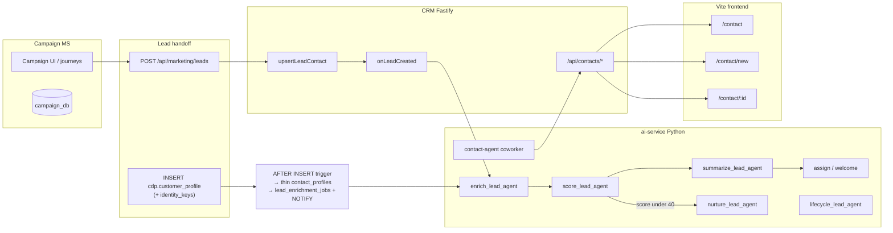

# Contact Module — Complete Workflow for Campaign Management

**Audience:** Campaign MS / marketing engineering & product  
**Purpose:** End-to-end map of how Contacts work in Worktual CRM — data model, UI, APIs, lead ingest from Campaign, and AI agent structure — so Campaign can hand off audiences and leads correctly.

**Stack:** Vite (`frontend/`) + Fastify (`backend/`) + Python `ai-service/`  
**Related docs:** [`contact-module.md`](contact-module.md) · [`cdp-customer-identity.md`](cdp-customer-identity.md) · [`lead-agent-pipeline.md`](lead-agent-pipeline.md) · [`crm-agent-prompts-tools-confirmation.md`](crm-agent-prompts-tools-confirmation.md) · [`module-chat-field-collection.md`](module-chat-field-collection.md) · [`multi-tenancy-common-model.md`](multi-tenancy-common-model.md)

---

## 1. What a “contact” is

A contact is a **person** (lead, prospect, customer). Campaign owns campaign execution and audience lists in `campaign_db`. CRM owns the sales/service person record and the lead pipeline after a lead lands in CRM.

| Concern | System of record |
|---------|------------------|
| Person identity (name, emails, phones) | `cdp.customer_profile` + `cdp.identity_keys` |
| CRM overlays (owner, lifecycle, lead status, company link, BANT, tags) | `crm.contact_profiles` |
| Companies / deals / activities / enrichment jobs | `crm.*` |
| Campaigns, journeys, send history | Campaign MS (`campaign_db`) — **not** CRM |

**Invariant:** CRM must **not** `CREATE` / `ALTER` / `DROP` on `cdp`, `accounts`, or `inventory`. Writers insert into **existing** CDP columns only; CRM state lives in `crm.*`.

Bridge: `crm.contact_profiles.account_contact_id` = `cdp.customer_profile.cdp_id` (text). Soft-archive is `crm.contact_profiles.status` (CDP has no `is_active`).

---

## 2. Architecture overview



Two equally valid ways a person enters CRM:

1. **Campaign / MyAccount / Shopify / any CDP writer** inserts into `cdp.customer_profile` → Postgres trigger creates thin `crm.contact_profiles` + enqueues enrichment (no CRM HTTP required).
2. **Campaign webhook** `POST /api/marketing/leads` → CRM `upsertLeadContact` → `onLeadCreated` (recommended when Campaign already has a CRM org context and wants merge + audit).

---

## 3. Data model (fields Campaign cares about)

### 3.1 Person (CDP)

| Field | Notes |
|-------|--------|
| `firstName`, `lastName` | Required for CRM create / webhook |
| `email` | Primary via `identity_keys` `key_type=email`; unique per org |
| `phone` | Primary via `identity_keys` `key_type=phone` |
| Secondary emails/phones | `email_secondary` / `phone_secondary` |
| `title`, address / city / country | Profile + `custom_fields` where needed |
| Company denorm | Name / domain / industry projected; **canonical company** is Prisma `Company` |

### 3.2 CRM overlay (`contact_profiles`)

| Field | Values / notes |
|-------|----------------|
| `lifecycleStage` / contact type | `lead` \| `prospect` \| `customer` \| `churned` |
| `leadStatus` | `new` \| `contacted` \| `qualifying` \| `qualified` \| `disqualified` \| `converted` |
| `leadSource` | e.g. `marketing_ms`, `csv_import`, form UTM |
| `ownerUserId` | **Pooled leads stay `null`** until score ≥ 40 or explicit claim. Never copy company owner onto a cold lead. |
| BANT | `bantBudget`, `bantAuthority`, `bantNeed`, `bantTimeline` (B2B / B2B2C) |
| `status` | `active` \| `inactive` \| `archived` |
| `company_id`, `location_id` | FK into CRM companies |
| `tags`, `notes`, `isPinned`, `convertedDealId` | |

Lifecycle rule: moving to `customer` / `churned` forces `leadStatus = converted`.

### 3.3 Business-type gating

| Type | Contact UX |
|------|------------|
| **B2B** | Company path; BANT; convert lead → deal; Finance enabled |
| **B2C** | Person-first; **no** company card / Finance; commerce orders |
| **B2B2C** | Company optional; sales + commerce |

Shared tables for all types — no per-type contact tables. Gate by `accounts.organizations.business_type`.

---

## 4. UI surfaces (Vite)

| Route | Screen | Primary files |
|-------|--------|----------------|
| `/contact` | List + in-shell create/detail workspace | `frontend/src/pages/ContactsPage.tsx`, `AgentModuleShell` |
| `/contact/new` | Coworker create (chat + draft panel) | `ContactCreateCoworkerPage.tsx`, `ContactCreateDraftPanel.tsx` |
| `/contact/:id` | Detail | `ContactDetailPage.tsx`, `ContactDetailPane.tsx` |
| `/contact/:id/edit` | Full edit form | `ContactFormPage.tsx` |

Query helpers:

- List: `q`, `stage` / `contactType`, `leadStatus`, `status`, `page`, `view=create|detail&id=`
- New: `companyId`, `locationId` (prefill); `form=1` (form-only, less chat)

Sidebar module key: `contact` (`backend/src/config/modules.ts`).

### 4.1 List (`/contact`)

- Filters: search, lifecycle, lead status, status (URL-synced).
- Columns: name (+ pin), email, company (hidden B2C), owner (admin), stage, updated.
- Actions: open detail, pin, infinite scroll, **Export**, **Import CSV**, multi-select → merge wizard.
- Coworker shell: in-page create (`view=create`) and detail (`view=detail&id=`) without leaving the module.

### 4.2 Create (`/contact/new` or in-shell create)

**Two modes:**

1. **Coworker (default)** — chat asks fields one-by-one; right panel shows draft progress; save via `propose_create_contact` → Fastify.
2. **Form** — classic form (`?form=1` or edit page); duplicate gate before save.

**Create order (chat):** full name → email **or** phone → optional company → optional title → “Shall I save?”  
Ready when: `firstName` + `lastName` + (email or phone).

After save: redirect / workspace refresh to detail; business-type tag; enrichment enqueued if company name present.

### 4.3 Detail (`/contact/:id`)

Header: name, lead-status pill, enrichment / nurture / lifecycle badges, duplicate alert.

Primary actions: Convert lead (non-B2C, requires **Qualified**), View deals, New order (commerce), Edit, Delete (confirm).

Quick actions: email, call (confirm), note, task, meeting, SMS.

Sections: Contact details, Company details (or “Consumer profile” on B2C), CRM fields / BANT, related deals/orders, AI summary panel, activity timeline.

Enrichment status updates via **SSE** (`/api/contacts/:id/enrichment/events`) — no polling.

### 4.4 Import / export / merge

| Feature | UI | API |
|---------|-----|-----|
| CSV import | List → Import dialog; or chat `propose_import_contacts` | `POST /api/contacts/import` `{ csvText, dryRun? }` max 500 rows |
| Sample template | Download / chat link | `GET /api/contacts/import/sample` |
| Export | List toolbar | `GET /api/contacts/export` |
| Dedupe gate | Create form | `POST /api/contacts/duplicates/find` |
| Merge wizard | Multi-select / detail alert | `POST /api/contacts/merge/preview` + `/merge/execute` |

Import create-only: duplicate email/phone → **skip** (not merge). Manual create / marketing webhook use **upsert merge** on strong email/phone matches (confidence ≥ 85).

---

## 5. Core CRM workflows

### 5.1 Create / update / delete

1. Validate identity; resolve company (existing id **or** create new company + HQ location).
2. Strong duplicate (email/phone) → fill blanks on primary + soft-archive losers; do not leave two actives.
3. Ownership: new **leads** stay unowned; non-leads follow assigner / company-location rules.
4. Delete: confirm; archive / cleanup activities; prune orphan companies when unused.

### 5.2 Lead conversion (B2B / B2B2C)

Shown when lifecycle is `lead` and status not converted/disqualified. UX requires **Qualified**. Creates/links company + location + deal; sets converted / prospect.

### 5.3 Activities & outreach

Logged against the contact (and related deals). Timeline merges contact + deal activities. Mail uses connected inboxes / org CRM bot depending on path (see lead pipeline mail rules below).

---

## 6. Campaign → CRM lead handoff (critical)

Campaign data stays in Campaign MS. CRM receives **leads**, not campaign definitions.

### 6.1 Preferred webhook

```
POST /api/marketing/leads
```

- Auth: shared secret via `Authorization` or `x-marketing-token` (`verifyMarketingWebhookHeaders`).
- No session cookie. Rate limit ~30/min per IP.
- Implemented in `backend/src/modules/marketing/routes.ts` → `ingestMarketingLeadCommand`.

**Body (accepted fields):**

| Field | Required | Notes |
|-------|----------|--------|
| `firstName` | **Yes** | |
| `email` | **Yes** | Valid email |
| `lastName` | No | Defaults to `"Lead"` |
| `phone` | No | |
| `companyName` | No | Triggers enrich path when present |
| `organizationId` | Recommended | Org tenancy |
| `ownerUserId` | No | Prefer leave null for pooled leads |
| `leadSource` | No | Default `marketing_ms` |
| `notes` | No | |

**Server behavior:**

1. `upsertLeadContact` — create or merge on strong email/phone duplicate.
2. Align CDP `organization_id` on profile + identity keys when possible.
3. Audit log (`source: marketing_ms`).
4. `onLeadCreated` → enrich → (later) score → summary → assign|nurture.
5. Notify admins (`lead_inbound`).
6. Response: `{ id, merged }` (HTTP success wrapper).

### 6.2 CDP-only insert (no CRM HTTP)

If Campaign (or another product) writes person identity into `cdp.customer_profile` (+ `identity_keys`):

1. `AFTER INSERT` trigger ensures thin `crm.contact_profiles`, upserts `lead_enrichment_jobs` (`pending`), `NOTIFY crm_lead_enrichment`.
2. CRM workers drain jobs (`LISTEN` and/or cron).
3. Score → summary → assign|nurture continues after enrich.

**Do not** invent new CDP columns. Use existing profile + identity key conventions (`docs/cdp-customer-identity.md`).

### 6.3 What Campaign should not do

- Do not maintain a parallel “CRM contact” table as source of truth.
- Do not call CRM DDL or alter `cdp` / `accounts` / `inventory`.
- Do not assume company owner = lead owner.
- Do not expect Finance / deal convert on pure B2C orgs.

### 6.4 Marketing embed (UI)

CRM Marketing nav embeds Campaign UI via JWT (`issueCrmAccessJwt`, audience `campaign-ms`). Contacts module in CRM remains the person CRM; Campaign sidebar “people / audiences” is Campaign-owned.

---

## 7. Lead agent pipeline (after a contact exists)

Canonical doc: [`lead-agent-pipeline.md`](lead-agent-pipeline.md).

```
New / merged lead
  → Enrichment (firmographics — fill blanks only)
  → Scoring (Fit 0–50 + Intent 0–50; total)
  → Summary (narrative)
  → total ≥ 40 → Assignment (territory + load) + welcome email from owner inbox
  → total < 40 → Nurture drip (org CRM bot mail); re-score → assign when ≥ 40
```

| Gate | Meaning |
|------|---------|
| ≥ 40 | Sales-ready; assign owner |
| 70–100 Hot · 40–69 Warm · 0–39 Cold | Bands |

**Ownership:** new leads pooled (`owner_user_id = null`) until gate or claim. Company owner ≠ lead owner.

**Mail:**

- Nurture / internal briefs → org CRM email channel (Accounts setup).
- Welcome / owned customer-facing mail → assigned rep’s connected Google/Microsoft inbox.
- Demo booking never from bot mailbox alone — assign first, then book on rep calendar.

**Lifecycle agent** (separate ladder) advances lead status / lifecycle / deal stage from evidence (activities, inbox, transcripts). Commercial moves need customer-voiced signal; LLM can veto but not invent. B2C stops at Qualified (no deal/quote/finance).

**Enrichment UI:** `LeadEnrichmentStatusBadge` — pending / running / enriched / skipped / failed.

---

## 8. Agent structure (for Campaign to mirror or integrate)

**Rule:** Every agent brain lives in **Python** under `ai-service/app/agents/**`. TypeScript only enqueues jobs and calls `callAiServiceAgent(...)`. Primary output must come from the LLM (`LLM_BASE_URL`); heuristics are offline fallback only.

### 8.1 Two agent families

| Family | Role | Entry |
|--------|------|--------|
| **Coworker (interactive)** | Chat on Contact screens; draft / update / import / navigate | Module `contact` → specialist `contact-agent` |
| **Proactive (jobs)** | Enrich, score, summarize, nurture, lifecycle, welcome | Cron + job tables + `onLeadCreated` |

### 8.2 Coworker: `contact-agent`

| Piece | Location |
|-------|----------|
| Routing map | `ai-service/app/agents/coworker_native.py` (`contact` → `contact-agent`) |
| Prompts | `build_system_prompt` + `MODULE_ADDONS["contact"]` in `crm_tools.py` |
| Prompt shape | Role → Goal → Instructions → Context → Output → Guardrails |
| Tools | MCP catalog `ai-service/app/mcp/catalog.py` over HTTP `/mcp/v1` |
| Memory | `coworker_shared.py` + `crm.agent_memories` |
| UI shell | `AgentModuleShell`, `ContactCreateCoworkerPage`, draft panel |

**Contact MCP tools (writes are confirmation / form-owned):**

| Tool | Purpose |
|------|---------|
| `patch_contact_draft` | Fill in-progress create draft (one or more fields) |
| `propose_create_contact` | Save after user agrees (`FORM_OWNED` → Fastify) |
| `propose_import_contacts` | CSV / sample import (`FORM_OWNED`) |
| `propose_update_contact` | Update existing contact fields |
| `propose_delete_contact` | Delete after confirm |
| `propose_merge_contacts` | Merge duplicates (`confirmed=true`) |
| `set_workspace` / `navigate` | Open create/detail or jump modules |
| Shared reads | Catalog contacts/companies for name resolution |

Mutating proposes surface as UI confirmations; Fastify owns persistence. Chat never pastes raw CSV; import uses attach/paste/`sample=true` + template link.

### 8.3 Proactive lead agents (Python files)

| Agent | File | Owns |
|-------|------|------|
| Enrich | `enrich_lead_agent.py` | Firmographics map (fill blanks) |
| Score | `score_lead_agent.py` | Fit/Intent JSON (normalized to caps) |
| Summarize | `summarize_lead_agent.py` | Lead narrative |
| Nurture | `nurture_lead_agent.py` | Drip decide + compose |
| Welcome | `welcome_lead_agent.py` | First-touch after assign |
| Lifecycle | `lifecycle_lead_agent.py` | Stage ladders from evidence |

Orchestration: `backend/src/service/ai/lead-pipeline.ts` (`onLeadCreated`, `afterScoreComplete`) + job runners / cron under `/api/cron/*`.

### 8.4 Confirmation & contracts

See [`worktual-combine-contracts.md`](worktual-combine-contracts.md) and [`crm-agent-prompts-tools-confirmation.md`](crm-agent-prompts-tools-confirmation.md).

- Speech never names tools/MCP.
- Deletes / merges / commercial sends require explicit confirm.
- Document agents (proposal/quote/invoice) need `approved_by` + `approved_at` — out of Contact scope but downstream of converted leads.

---

## 9. HTTP API surface (contacts)

Prefix: `/api/contacts` (session or API key; module `contacts`).

| Method | Path | Purpose |
|--------|------|---------|
| GET | `/` | List (filters, pagination) |
| POST | `/` | Create |
| GET | `/:id` | Detail |
| PATCH/PUT | `/:id` | Update |
| DELETE | `/:id` | Delete |
| POST | `/:id/pin` | Pin toggle |
| POST | `/:id/convert` | Lead → deal |
| GET | `/form-options`, `/:id/form-options` | Companies / owners for forms |
| POST | `/duplicates/find` | Dedupe candidates |
| GET | `/:id/duplicates` | Detail duplicates |
| POST | `/merge/preview`, `/merge/execute` | Merge |
| POST | `/import`, GET `/import/sample` | CSV |
| GET | `/export` | Export |
| GET | `/search-compose` | Email compose picker |
| GET/POST | `/:id/activities` … | Activities |
| GET | `/:id/enrichment/steps`, SSE `/enrichment/events` | Enrich status |
| GET | `/:id/summary` | AI summary / score payload |

Marketing ingest (separate prefix):

| Method | Path | Purpose |
|--------|------|---------|
| POST | `/api/marketing/leads` | Campaign webhook → upsert + pipeline |

Frontend client: `frontend/src/services/contacts.ts`.

---

## 10. RBAC (who can use Contacts)

| Role | Typical contact access |
|------|------------------------|
| admin / sales_manager | Org-wide; assign owner; agents |
| sales_rep | Own + pool leads; edit; no Marketing/Finance/Agents/Reports nav |
| marketing | Contacts yes; Marketing module; no Sales/Finance/Service |
| finance | Contacts + Finance; sales deep-link for invoice→deal |
| viewer | Read-only contacts; no Configuration |

Inbox roles (except viewer) also need Configuration (mail). Matrix: `backend/src/config/modules.ts`.

---

## 11. Code map (quick)

| Area | Path |
|------|------|
| UI pages | `frontend/src/pages/Contact*.tsx`, `ContactsPage.tsx` |
| UI components | `frontend/src/components/contacts/**` |
| Coworker shell | `frontend/src/components/coworker/AgentModuleShell.tsx` |
| Frontend API | `frontend/src/services/contacts.ts` |
| HTTP routes | `backend/src/modules/contacts/routes.ts` |
| Commands | `backend/src/service/contacts/contact-commands.ts` |
| DAO CRUD | `backend/src/dao/contacts/contact-service.ts` |
| Inbound upsert | `backend/src/dao/contacts/inbound-lead-upsert.ts` |
| Marketing ingest | `backend/src/service/marketing/marketing-commands.ts` |
| Lead pipeline | `backend/src/service/ai/lead-pipeline.ts` |
| Enrich / score jobs | `backend/src/service/ai/lead-enrichment-*.ts`, `lead-scoring-*.ts` |
| MCP tools | `ai-service/app/mcp/catalog.py` |
| Contact coworker prompts | `ai-service/app/agents/crm_tools.py` (`MODULE_ADDONS["contact"]`) |
| Contact specialist | `ai-service/app/agents/coworker_native.py` |
| Field ask order | `ai-service/app/agents/draft_conversation.py` |
| Proactive agents | `ai-service/app/agents/*_lead_agent.py` |

---

## 12. Acceptance checklist (Campaign ↔ CRM)

- [ ] Campaign can POST a lead with `firstName` + `email` (+ optional `organizationId`, `companyName`, `leadSource`) and receive `{ id, merged }`.
- [ ] Duplicate email/phone merges into primary; no second active contact.
- [ ] Lead appears in CRM `/contact` for the org; enrichment badge progresses when company name exists.
- [ ] New marketing leads stay **unowned** until score ≥ 40 (unless Campaign explicitly sets `ownerUserId`).
- [ ] CDP-only inserts still get thin CRM overlay + enrich job without a second CRM create call.
- [ ] B2C orgs never get Finance / deal-convert paths from that contact.
- [ ] Campaign does not alter CDP/accounts/inventory schema from CRM expectations.

---

## 13. Out of scope for Contact (point Campaign elsewhere)

| Topic | Where |
|-------|--------|
| Campaign create / journeys / send | Campaign MS + CRM Marketing embed |
| Deals / quotes / invoices | Sales / Finance modules |
| Marketing campaign sidebar analytics | Marketing role + Reports |
| Full coworker multiagent migration | [`ai-service-architecture-migration.md`](ai-service-architecture-migration.md) |

---

*Generated for Campaign Management handoff from the CRM Contact module as implemented in this repo (Vite + Fastify + ai-service).*
