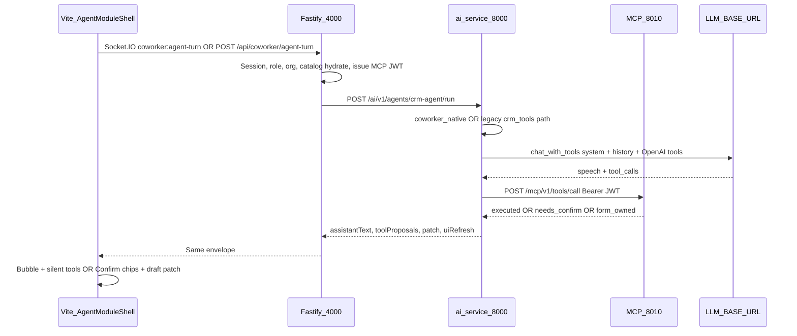
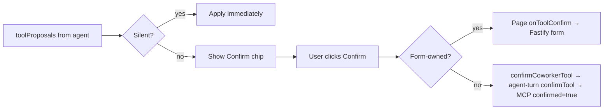

# CRM Agents — Prompts, Flow, Tools, Confirmation & LangGraph → Multiagent

**For:** Campaign / other Worktual pillars copying CRM’s agent model.  
**Rule:** Agent brain stays in **Python** (`ai-service`). TypeScript only enqueues and calls `callAiServiceAgent`. Primary output must come from the LLM; heuristics are offline fallback only.

Related docs:

- [`ai-service-architecture-migration.md`](./ai-service-architecture-migration.md) — full migration guide  
- [`worktual-combine-contracts.md`](./worktual-combine-contracts.md) — MCP + confirm contracts  
- [`module-chat-intents.md`](./module-chat-intents.md) — coworker UX per module  
- [`.cursor/rules/agents-must-use-llm.mdc`](../.cursor/rules/agents-must-use-llm.mdc) — mandatory LLM policy  

---

## 1. How prompts are declared

### Fixed 6-section shape (every agent)

```
Role → Goal → Instructions → Context → Output → Guardrails
```

Never invent a second prompt style. Reuse the shared builders below.

| Builder | Used by | File |
|---------|---------|------|
| `build_system_prompt(mod, surface, ctx)` | Coworker chat (module overlays) | [`ai-service/app/agents/crm_tools.py`](../ai-service/app/agents/crm_tools.py) |
| `sectioned_system_prompt(role=…, goal=…, …)` | Named job agents (enrich, score, nurture, …) | [`ai-service/app/agents/llm_result.py`](../ai-service/app/agents/llm_result.py) |
| Skills fragments | Same `sectioned_system_prompt` via `package_for()` | [`ai-service/app/skills/catalog.py`](../ai-service/app/skills/catalog.py) |

### Coworker prompts (`crm_tools.py`)

Declared as shared constants, then assembled at request time:

| Constant | Purpose |
|----------|---------|
| `PROMPT_ROLE` | Who the coworker is |
| `PROMPT_GOAL` | What success looks like |
| `PROMPT_INSTRUCTIONS` | How to behave (tools, confirmations, drafts) |
| `PROMPT_OUTPUT` | What to return (speech + tools) |
| `PROMPT_GUARDRAILS` | Hard limits (no inventing IDs, no silent deletes, …) |
| `CORE_SYSTEM` | Template that slots Context at runtime |
| `MODULE_ADDONS` | Extra Instructions per module (`contact`, `sales`, `company`, `product`, `finance`, `quotes`, `activities`, `dashboard`, `reports`) |
| `CONVERSATIONAL_SHARED` | Shared tone for draft specialists |

`build_system_prompt(mod, surface, ctx)` fills **Context** with:

- `module`, `surface`, `pathname`, `entityId`, `businessType`
- Catalog snippets (deals, products, companies) when relevant
- Current draft field labels
- `sessionMemory` (client STM)
- Durable memory slots (`crm.agent_memories`)
- Open-entity hints

Native multiagent specialists may append a short block:  
`"Native specialist:\n…"` after the shared system prompt (`coworker_native._run_specialist`).

### Named job agents (`llm_result.py`)

Each agent file owns its Role / Goal / Instructions / Output / Guardrails strings, then calls:

```python
sectioned_system_prompt(
    role="...",
    goal="...",
    instructions="...",
    context=runtime_context_str,
    output="...",
    guardrails="...",
)
```

Examples:

| Agent | File | Prompt notes |
|-------|------|--------------|
| Enrich | `enrich_lead_agent.py` | `ENRICH_MAP_SYSTEM` |
| Score | `score_lead_agent.py` | JSON score via LLM |
| Nurture | `nurture_lead_agent.py` | `DECIDE_SYSTEM`, `COMPOSE_SYSTEM` |
| Lifecycle | `lifecycle_lead_agent.py` | `LIFECYCLE_SYSTEM` |
| Assign / welcome / summarize / auto-reply | matching `*_agent.py` | Same sectioned pattern |

JSON helpers:

- `generate_json_with_retries` — LLM → validated JSON with repair  
- `label_ai` → `source: "ai"`  
- `label_fallback(..., reason)` → `source: "heuristic"`, `reason: llm_*`  

**Do not** tell users something was AI-generated when `source === "heuristic"`.

---

## 2. How the flow is defined

### Two agent families

| Family | Entry | Orchestration | Typical tools |
|--------|-------|---------------|---------------|
| **Coworker chat** | `POST /ai/v1/agents/crm-agent/run` (also `chat`) | Turn → router → specialist → tool loop | Full MCP catalog (filtered) |
| **Named jobs** | `POST /ai/v1/agents/<name>/run` | Linear `native_pipeline.run_steps` / `PipelineRunner` | Usually **none** (LLM JSON); skills groups empty on purpose |

### Coworker end-to-end



Key files:

| Layer | Path |
|-------|------|
| UI shell | `frontend/src/components/coworker/AgentModuleShell.tsx` |
| Client | `frontend/src/services/coworker.ts`, `coworker-socket.ts` |
| Fastify turn | `backend/src/service/ai/coworker-agent-turn.ts` |
| MCP JWT | `backend/src/service/ai/mcp-execution-jwt.ts` |
| Agent entry | `ai-service/app/agents/crm_agent.py` |
| Native multiagent | `ai-service/app/agents/coworker_native.py` |
| Legacy native turn | `ai-service/app/agents/crm_tools.py` → `run_native_agent_turn` |

**Socket.IO lives only on Fastify.** Python is HTTP-only. Browser never sees MCP or LLM credentials.

### Native multiagent routing (`coworker_native.py`)

Supervisor + `LlmRouter` (max **3** handoffs) pick a specialist:

| Domain | Specialist |
|--------|------------|
| contact | `contact-agent` |
| company | `company-agent` |
| sales (deals) | `deal-agent` |
| sales + open proposal | `proposal-agent` |
| product | `product-agent` |
| reports / analytics utterance | `reports-analytics-agent` |
| else | `link-agent` |

Eligible set = domain specialist + `link-agent` (dashboard metric questions → reports only).

Optional Redis STM (`ORCHESTRATOR_STM_*`); else client `sessionMemory`.

Reports specialist often skips the generic tool loop and calls `reports_analytics_agent.run` (semantic layer — see [`campaign-dashboard-reports-analytics-handoff.md`](./campaign-dashboard-reports-analytics-handoff.md)).

### Named job pipeline (example)

```
Fastify cron / event
  → callAiServiceAgent("score-lead" | "enrich-lead" | …)
  → agent run_steps: load_context → call_llm → validate → persist → notify
  → on LLM failure: heuristic + label_fallback
```

Lead pipeline (product): Enrich → Score → Summary → Assign (≥ 40) | Nurture (&lt; 40).  
See [`lead-agent-pipeline.md`](./lead-agent-pipeline.md).

### Orchestrator budgets

Under `ai-service/app/orchestrator/`:

| Piece | Role |
|-------|------|
| `ExecutionEnvelope` | runId, org, actor, role, businessType, toolBudget, … |
| `AgentSpec` | name, `allowedTools`, `allowedSkills`, `mutationCapable` |
| `BoundedToolLoop` | maxRounds **6**, maxCalls **10**, maxRepeatedCall **2** |
| `Supervisor` / `LlmRouter` | Coworker multiagent handoffs |
| `PipelineRunner` | Named agents with checkpoints |

---

## 3. How tools are declared and called

### Sole schema source = MCP catalog

All coworker tools are declared in [`ai-service/app/mcp/catalog.py`](../ai-service/app/mcp/catalog.py).

Each tool has:

| Field | Meaning |
|-------|---------|
| `name` | e.g. `propose_create_contact` |
| `description` | LLM-facing |
| `inputSchema` | JSON Schema args |
| `risk` | `low` \| `high` |
| `kind` | `ui_directive` \| `draft_patch` \| `mutation` \| `clarify` |
| `modules` | Which CRM modules may see it |
| `surfaces` | list / create / detail / … |
| `needsEntity` | Requires open record |
| `readOnlyHint` | e.g. `query_analytics` |

**Removed:** old `tools_for_module` in `crm_tools`. OpenAI schemas come from:

```
MCP list_tools(module, surface, entity_id)
  → mcp_tools_to_openai()   # ai-service/app/mcp_client.py
```

### MCP process

| Item | Value |
|------|--------|
| Host | `uvicorn app.mcp_main:app --port 8010` |
| Base | `MCP_BASE_URL` → `http://127.0.0.1:8010/mcp/v1` |
| List | `POST /mcp/v1/tools/list` |
| Call | `POST /mcp/v1/tools/call` |
| Auth | HS256 execution JWT from Fastify (`MCP_EXECUTION_JWT_*`) |
| Dispatch | [`ai-service/app/mcp/dispatch.py`](../ai-service/app/mcp/dispatch.py) |

Mutations that touch CRM business data usually go:

```
MCP dispatch → commands.forward_business_command
  → POST Fastify /api/internal/mcp/commands (JWT)
  → Fastify command → DAO
```

UI directives and draft patches do **not** write the DB — Vite applies them.

### Tool call sequence (one coworker turn)

1. Shell sends `messages` + `context` (module, surface, entityId, pathname, draft) + `sessionMemory`.  
2. Fastify hydrates catalogs / durable memory, sets `executionMode`, mints MCP JWT.  
3. Python builds system prompt; lists tools for module/surface.  
4. `chat_with_tools(messages, tools)` → assistant text + `tool_calls`.  
5. For each tool call:  
   - **Form-owned** → proposal with `auto` / confirm path; page Fastify API writes.  
   - Else → `McpClient.call_tool` with Bearer JWT.  
6. High-risk without `confirmed=true` → `kind: "needs_confirm"` proposal.  
7. Envelope back to UI: `assistantText`, `toolProposals`, `patch`, `uiRefresh`, memory patches.

Legacy path `run_native_agent_turn` in `crm_tools.py` does a single tool round then maps results via `mcp_result_to_turn_parts` / `map_tool_calls_to_result`. Native orchestrator uses `BoundedToolLoop` for multi-round tools.

### `map_tool_calls_to_result` (important rules)

Maps raw OpenAI tool_calls → UI proposals when needed:

- Create tools (`propose_create_*`) only when user looks like they confirmed save and draft is ready → often `args.auto: true`  
- `propose_stage_change` → `risk: "high"`  
- `ask_clarification` → speech only  
- Non-shell `set_workspace` rewritten to `navigate`  

---

## 4. How tools are differentiated across agents

### By module / surface (catalog filter)

`list_tools(module, surface, entity_id)` keeps only tools whose `modules` / `surfaces` match, and `needsEntity` when required.

`set_workspace` only for **in-shell** modules: contact, sales, company, product, finance, quotes, activities.  
Nav-only modules (dashboard, inbox, marketing, …) use `navigate` instead.

### By specialist allowlist (native)

`_allowed_tools(module)` from catalog. Examples:

- Proposal agent → nav/memory + `*proposal*` tools  
- Reports agent → `mutationCapable=False`; analytics path, not generic CRM writes  

### By skills groups (`skills/catalog.py`)

Groups such as `contact-crud`, `company-crud`, `proposals`, `quotes`, `invoices`, `activities`, `reports`, `nurture`, `scoring`, `lifecycle`, `meetings`.

**Intersection rule:** skills cannot grant tools beyond `AgentSpec.allowedTools`.  
Job groups `nurture` / `scoring` / `lifecycle` / `meetings` grant **no** implicit DB tools — decisions stay LLM-primary.

### By risk / ownership class

| Class | Examples | Behavior |
|-------|----------|----------|
| **UI directive** | `navigate`, `open_entity`, `set_workspace` | Vite applies; no Confirm |
| **Draft patch** | `patch_contact_draft`, `patch_deal_draft`, … | Silent field fill |
| **Clarify** | `ask_clarification` | Speech / chips |
| **Form-owned mutation** | Most `propose_create_*` / update / delete contact, deal, company, product, activity, quote, invoice, proposal | Proposal → UI page → Fastify form API |
| **MCP mutation** | Memory writes, some internals, analytics | MCP dispatch; high-risk needs `confirmed=true` |
| **Read-only** | `query_analytics` | No write |

Product motion filters strip B2B-only or B2C-only fields from OpenAI tool schemas when needed.

### Tool inventory (coworker, abbreviated)

**UI / clarify:** `navigate`, `open_entity`, `ask_clarification`, `set_workspace`

**Draft patches:** `patch_contact_draft`, `patch_deal_draft`, `patch_company_draft`, `patch_location_draft`, `patch_product_draft`, `patch_activity_draft`, `patch_invoice_draft`, `patch_quote_draft`

**Mutations (mostly high-risk):** create/update/delete contact/deal/company/product, stage change, import/merge contacts, activity create, quote/invoice/proposal lifecycle, proposal rewrite/personalize, …

**Memory / analytics:** `remember_memory`, `clear_memory`, `query_analytics`

Full list: `COWORKER_TOOLS` in `ai-service/app/mcp/catalog.py`. Form-owned set: `FORM_OWNED_TOOLS` in the same file (mirrored in UI as `FORM_OWNED_PROPOSE_TOOLS` in `AgentModuleShell.tsx`).

---

## 5. LangGraph → multiagent (what changed)

### Before

- LangGraph state graphs + LangChain chains  
- Mixed heuristics on the happy path  
- Unclear realtime / tool ownership  

### After (current)

| Concern | Replacement |
|---------|-------------|
| Graph nodes | `native_pipeline.run_steps` / `PipelineRunner` |
| LangChain LLM | `app/llm.py` → `generate_ai_text`, `chat_with_tools` |
| Tools | HTTP MCP catalog + dispatch |
| Coworker “multiagent” | Orchestrator `Supervisor` + `LlmRouter` + `BoundedToolLoop` |
| Heuristics | Offline only, labeled `source: "heuristic"` |
| Realtime | Fastify Socket.IO only |
| Prompts | Fixed 6 sections |

**CI forbids** `langgraph` / `langchain` in `ai-service/app` and `requirements.txt` (`tests/test_forbidden_framework_dependencies.py`).

### What stayed as offline fallback

- Score heuristics when LLM fails  
- Module coworker heuristics when LLM unavailable  
- Confirm-tool short responses may be labeled heuristic  
- Canned help/go/show **only** when LLM is not configured  

Same *step contract* as old graphs: each pipeline step is `(state) -> partial state`.

---

## 6. How confirmation works

### MCP gate (server)

```python
# ai-service/app/mcp/dispatch.py
if tool.risk == "high" and not args.confirmed:
    return { "kind": "needs_confirm", "proposal": ... }
# confirmed must be True / "true"
```

No high-risk mutation executes without `confirmed=true` on the MCP call.

### UI Confirm chip → execute



### Silent vs Confirm (`AgentModuleShell`)

**Silent (no chip)** when `isSilentWorkspaceTool`:

- All `patch_*`  
- `ask_clarification`, some proposal text patches  
- Listed `propose_*` when `args.auto === true` (user already agreed in chat)  
- `navigate` / `open_entity` / `set_workspace`  

**Confirm chip** for remaining high-risk tools without `auto`.

**Chat-confirm create pattern:**

1. Model asks “Shall I save?”  
2. User says yes with draft ready  
3. Mapper emits `propose_create_*` with `auto: true`  
4. Shell applies silently (already confirmed in chat)  

Dual path forever: **manual forms** remain first-class under the same RBAC. Agents do not replace forms.

---

## 7. Setup — env and call wiring

### Environment

| Variable | Where | Role |
|----------|--------|------|
| `LLM_BASE_URL` / `LLM_API_KEY` / `LLM_MODEL` | ai-service `.env` | OpenAI-compatible chat |
| `AI_SERVICE_BASE_URL` | Fastify | Agent API (`:8000`) |
| `MCP_BASE_URL` | ai-service | `http://127.0.0.1:8010/mcp/v1` |
| `MCP_EXECUTION_JWT_SECRET` | Fastify + MCP | Shared HS256 secret |
| `MCP_EXECUTION_JWT_ISSUER` | default `worktual-crm-api` | JWT iss |
| `MCP_EXECUTION_JWT_AUDIENCE` | default `worktual-crm-mcp` | JWT aud |
| `MCP_EXECUTION_JWT_TTL_SECONDS` | 15–120 (default 60) | Short-lived |
| `CRM_API_BASE_URL` | MCP | Forward mutations to Fastify |
| `ORCHESTRATOR_STM_ENABLED` / Redis URL | optional | Server STM |
| `COWORKER_NATIVE_ENABLED` / allowlists | Fastify | Native vs legacy roll-out |

JWT claims (never to browser): `iss`, `aud`, `jti`, `agentName`, `executionMode`, `businessType`, `module`, `surface`, `policyVersion`, `organizationId`, `actorId`, `role`, `runId`, `traceId`, `idempotencyKey`, optional `allowedTools`.

### Processes to run

```bash
# Agent API
cd ai-service && uvicorn app.main:app --host 127.0.0.1 --port 8000 --reload

# MCP (separate process in production)
cd ai-service && uvicorn app.mcp_main:app --host 127.0.0.1 --port 8010

# Fastify + Vite
cd backend && npm run dev    # :4000
cd frontend && npm run dev   # :5173
```

### Mental model (one sentence)

**Vite talks only to Fastify; Fastify mints a short MCP JWT and calls Python; Python LLM picks tools from the MCP catalog; high-risk tools need UI or chat confirmation before MCP/`confirmed=true` executes; form-owned tools still save through Fastify page APIs.**

---

## 8. What Campaign (or others) should copy

| Copy | Adapt |
|------|--------|
| 6-section prompts | Campaign Role/Goal/Instructions |
| Coworker turn envelope | Campaign modules/surfaces |
| MCP catalog + HTTP MCP process | Campaign tool names + risk matrix |
| High-risk `confirmed=true` + Confirm chips | Same UX |
| Form-owned vs MCP mutation split | Campaign’s own write APIs |
| Native supervisor + specialists | Campaign domains (audience, campaign, channel) |
| Heuristics offline + labeled | Same honesty rule |
| No LangGraph/LangChain | Same CI forbid |

Do **not** put LLM keys or MCP JWTs in the browser. Do **not** implement agent brains in TypeScript.

---

## 9. Key path index

| Concern | Path |
|---------|------|
| Coworker prompts + `run_native_agent_turn` | `ai-service/app/agents/crm_tools.py` |
| Job prompts / JSON / labels | `ai-service/app/agents/llm_result.py` |
| Native multiagent | `ai-service/app/agents/coworker_native.py` |
| Coworker entry | `ai-service/app/agents/crm_agent.py` |
| Named adapter | `ai-service/app/agents/named_native.py` |
| MCP catalog / FORM_OWNED | `ai-service/app/mcp/catalog.py` |
| MCP dispatch / confirmed | `ai-service/app/mcp/dispatch.py` |
| MCP client | `ai-service/app/mcp_client.py` |
| Tool loop | `ai-service/app/orchestrator/tool_loop.py` |
| Skills | `ai-service/app/skills/catalog.py` |
| Fastify turn | `backend/src/service/ai/coworker-agent-turn.ts` |
| MCP JWT | `backend/src/service/ai/mcp-execution-jwt.ts` |
| UI confirm / silent | `frontend/src/components/coworker/AgentModuleShell.tsx` |
| Migration deep dive | `docs/ai-service-architecture-migration.md` |

---

## 10. Short summary

1. **Prompts** — always Role→Goal→Instructions→Context→Output→Guardrails via `build_system_prompt` (coworker) or `sectioned_system_prompt` (jobs).  
2. **Flow** — Vite → Fastify agent-turn → Python `crm-agent` → native router/specialist or job `run_steps` → LLM → tools.  
3. **Tools** — declared once in MCP catalog; listed by module/surface; called over HTTP MCP with Fastify JWT.  
4. **Differentiation** — module allowlists + specialist allowlists + skills intersection + risk/form-owned classes.  
5. **LangGraph gone** — replaced by native pipeline + Supervisor/BoundedToolLoop + MCP; heuristics offline only.  
6. **Confirmation** — high-risk MCP needs `confirmed=true`; UI Confirm chip or chat `auto` after user agrees; form-owned writes stay on Fastify forms.
