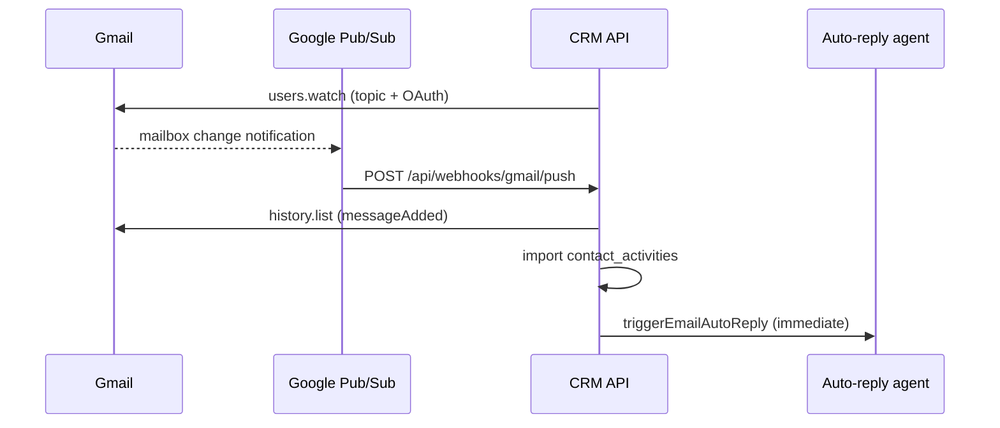

# Gmail Pub/Sub push inbox sync

Near-instant inbound mail detection for **Google-connected mailboxes** (rep inboxes + CRM bot nurture mailbox). Replaces reliance on 15–60s polling for Gmail when push is configured.

## Flow



Polling (`inbox-sync-live` / `inbox-sync`) remains as **fallback** when push is off, history expires, or Microsoft mailboxes are used.

## Ops setup (once per environment)

### 1. Pub/Sub topic

In GCP (same project as your Google OAuth client, or a dedicated ops project):

1. Create topic, e.g. `projects/YOUR_PROJECT/topics/gmail-inbox-push`
2. Grant **Pub/Sub Publisher** on the topic to:
   ```
   gmail-api-push@system.gserviceaccount.com
   ```
3. Create a **push subscription** to your public CRM API:
   ```
   POST https://api.your-domain.com/api/webhooks/gmail/push
   ```
   Optional: append `?token=YOUR_SECRET` and set the same value in `GMAIL_PUBSUB_VERIFICATION_TOKEN`.

### 2. CRM env

```bash
GMAIL_PUBSUB_TOPIC=projects/YOUR_PROJECT/topics/gmail-inbox-push
# Optional webhook auth (recommended in production):
GMAIL_PUBSUB_VERIFICATION_TOKEN=…
```

Restart the backend. On cron leader startup it runs `bootstrapGmailPushWatches()` to register `users.watch` for:

- All users with Gmail-readable Google OAuth connections
- All orgs with an active Google CRM bot email channel

Watches expire in ~7 days; `gmail-push-renew` cron (every 6h) renews watches within 48h of expiry.

### 3. Manual cron (external scheduler)

```bash
curl -X POST -H "Authorization: Bearer $CRON_SECRET" \
  https://api.your-domain.com/api/cron/gmail-push-renew
```

## Registration triggers

| Event | Action |
|---|---|
| User connects Google (Configuration → Email) | `registerGmailPushWatchForUser` |
| Admin reconnects CRM bot Google mailbox | `registerGmailPushWatchForCrmBot` |
| Cron leader boot | `bootstrapGmailPushWatches` |
| Every 6h | `renewExpiringGmailPushWatches` |

## Database

State lives in `crm.gmail_push_watches` (one row per mailbox email, unique on lower-case address).

## Behavior notes

- Push payload includes `emailAddress` + `historyId`; CRM calls `history.list` with `historyTypes=messageAdded` and imports only new messages linked to existing contacts (same rules as polling sync).
- Spam/trash messages are skipped at import time.
- Concurrent pushes for the same mailbox are serialized to avoid duplicate imports.
- If Gmail returns history expired (404), the cursor resets; the next push or poll catches up.
- Auto-reply jobs are enqueued and drained immediately after push import (same as live poll path).

## Local dev

Push requires a **public HTTPS URL** reachable by Google Pub/Sub (ngrok / Cloudflare tunnel). Without `GMAIL_PUBSUB_TOPIC`, behavior falls back to existing polling only.

## Related

- Meet transcript push (same Pub/Sub pattern): [`meeting-transcript-archive.md`](./meeting-transcript-archive.md)
- Auto-reply agent: Python `auto_reply_email_agent.py` via `email-auto-reply-job.ts`
