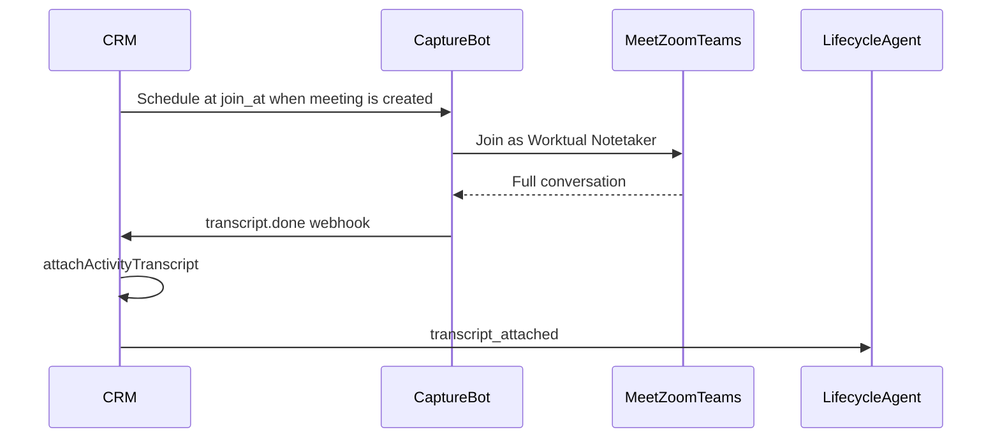

# Meeting capture for lifecycle agents

Production path so **lead-lifecycle agents** always have conversation text after CRM-scheduled Meet / Zoom / Teams calls.

## Model

| Path | Role |
|---|---|
| **Meeting bot (primary)** | Worktual Notetaker bot joins the call via Recall. Does **not** depend on the host turning on Meet/Zoom/Teams transcription. |
| **Native webhooks (backup)** | Zoom / Teams / Meet provider transcripts when those features were on — see webhook endpoints below. |

**Invariant:** Calendar “meeting time passed” alone is **not** enough for auto stage/cycle advances. Agents require `ContactActivity.transcriptText` (from bot or native). If the meeting ended and no transcript arrived, CRM marks capture **missing** and the lifecycle agent **waits** (no silent advance).



Live Sales Assist coaching uses the same Recall webhook path (`transcript.data` → Assist panel). See [`in-meeting-assist.md`](./in-meeting-assist.md). Prefer one in-call bot: if Worktual Notetaker is already admitted, Assist reuses it instead of knocking a second bot.

## Ops setup (Worktual once)

```bash
MEETING_BOT_API_KEY=…                    # Recall
MEETING_BOT_WEBHOOK_BASE_URL=https://api.your-domain.com
# MEETING_CAPTURE_BOT_ENABLED=true
# MEETING_CAPTURE_BOT_DISPLAY_NAME=Worktual Notetaker
# MEETING_CAPTURE_BOT_JOIN_SKEW_MINUTES=5
# MEETING_CAPTURE_MISSING_GRACE_HOURS=2
```

In the **Recall dashboard**, subscribe the same public webhook  
`POST /api/webhooks/meeting-bot/recall` to:

- `transcript.done`
- `recording.done` / `bot.done` (as available)
- optionally `transcript.failed`

Realtime `transcript.data` is already requested on bot create.

## Buyer contract

1. Schedule meetings **from Worktual CRM** (so join URL + session exist).
2. When **Worktual Notetaker** knocks / waits in the lobby — **admit it**.
3. Optional IT: auto-admit the bot or disable waiting room for sales calls.

Buyers do **not** need to remember “start transcription” for the primary path. Native transcription remains useful backup only.

## Native backup webhooks (optional)

| Provider | Endpoint |
|---|---|
| Zoom | `POST /api/webhooks/zoom/transcript` |
| Teams | `POST /api/webhooks/teams/transcript-notifications` |
| Google Meet | `POST /api/webhooks/google-meet/transcript-push` |

See earlier webhook setup notes for Zoom secret, Teams Graph subscription, Meet Pub/Sub.

## CRM UI

Meeting activities show capture status:

- **scheduled / joined** — bot pending or in call (admit if prompted)
- **captured** — transcript on the activity; lifecycle can use it
- **missing / failed** — no conversation evidence; agents will not auto-advance on that meeting

## Failure modes

| Failure | Behavior |
|---|---|
| Bot not admitted | After grace → `missing`; agent waits |
| Recall API down | `failed` on session meta; retry by rescheduling or ops |
| Meeting not from CRM | No bot (no join URL) |
| Native + bot both land | Prefer existing longer transcript; lifecycle not double-fired destructively |
